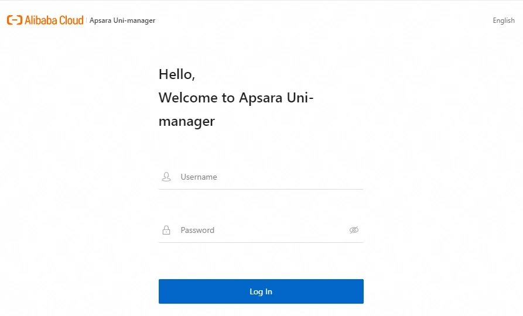

Alibaba Cloud  
Apsara Stack  
Auto Scaling  
Operations and Maintenance  
Guide  
Product Version: V3.18.6  
Document Version: 20250619

**Table of Contents**

- [1.Log on to the Apsara Uni-manager Operations Console](#section-1)
- [2.Product resources and services](#section-2)
    - [2.1. Application deployment](#section-2-1)
    - [2.2. Troubleshooting](#section-2-2)
- [3.Inspection](#section-3)
    - [3.1. Overview](#section-3-1)
    - [3.2. Monitoring inspection](#section-3-2)
    - [3.3. Basic software package version inspection](#section-3-3)

# 1.Log on to the Apsara Uni-manager Operations Console

This topic describes how to log on to the Apsara Uni-manager Operations Console.

**Prerequisites**

- The endpoint of the Apsara Uni-manager Operations Console and the username and password used to log on to the console are obtained from the deployment personnel or an administrator.

  The endpoint of the Apsara Uni-manager Operations Console is in the following format: *regi on-id*.ops.console.*intranet-domain-id*.

- A browser is available. We recommend that you use Google Chrome.

**Procedure**

1. Open your browser.

2. In the address bar, enter the endpoint of the Apsara Uni-manager Operations Console. Press the ENTER key.

   

   > **Note**
   >
   > You can click the current language in the upper-right corner to switch to another language. Simplified Chinese, English, and traditional Chinese are supported.

3. Enter your username and password.

   > **Note**
   >
   > Obtain the username and password used to log on to the Apsara Uni-
   >
   > manager Operations Console from the deployment personnel or an administrator.

   When you log on to the Apsara Uni-manager Operations Console for the first time, you must change the password of your username.

   For security reasons, your password must meet the following requirements:

   - The password contains uppercase and lowercase letters.

   - The password contains digits.

   - The password contains special characters such as exclamation points (!), at signs (@), number signs (#), dollar signs ($), and percent signs (%).

   - The password must be 10 to 20 characters in length.

4. Click **Log On**.

# 2.Product resources and services

## 2.1. Application deployment

All applications at the Auto Scaling business logic layer are stateless. You must restart the applications by running the docker restart command.

- ess-init

  ess-init first initializes the database service and then pushes all API configuration files of Auto Scaling to the pop configuration center to initialize OpenAPI.

- Trigger (dependent on ess-init)

  - Trigger executes tasks such as performing checks on the health, minimum number, and maximum number of instances as well as deleting scaling groups.

  - Trigger triggers scheduled tasks and event-triggered tasks.

- coordinator

  Coordinator is the open API layer that provides public-facing services. It maintains persistent requests and issues tasks.

- worker

  - Worker executes all scaling tasks, such as creating ECS instances, adding instances to SLB backend server groups and RDS whitelists, and synchronizing Cloud Monitor group information.

  - It retries failed tasks and provides the rollback mechanism.

- service-test

  service-test is used for regression tests on the overall application running status. It contains more than 60 regression test cases to test the integrity of features.

## 2.2. Troubleshooting

This topic describes how to handle issues related to the business logic layer.

**Procedure**

1. Go to the Alibaba Cloud Support Platform to submit a ticket.

2. In the Apsara Infrastructure Management console, view the status of the services on which the business logic layer depends.

   If a service cannot be executed, the business logic layer is affected. The following table describes the services and their impacts.

   Table 1. Services and impacts

   | Name | Impact |
   | --- | --- |
   | middleWare.dubbo | The deployment of the service is affected. The service is unavailable. |
   | middleWare.tair | The deployment of the service is affected. The service is unavailable. |
   | middleWare.metaq (message middleware) | The deployment of the service is affected. |
   | middleWare.zookeeper | The deployment of the service is affected. The service is unavailable. |
   | middleWare.jmenvDiamondVips | The deployment of the service is affected. The Diamond configuration item cannot be obtained. |
   | ram.ramService (RAM) | RAM users are unavailable. |
   | webapp.pop (API Gateway) | OpenAPI Explorer is unavailable. |
   | ecs.yaochi (ECS Business Foundation System) | All ECS creation requests become invalid. |
   | slb.yaochi (SLB Business Foundation System) | All SLB association requests become invalid. |
   | rds.yaochi (ApsaraDB RDS control system) | The requests for associating with ApsaraDB RDS instances failed. |
   | tianjimon (Apsara Infrastructure Management) | Some services are unavailable. |

# 3.Inspection

## 3.1. Overview

Auto Scaling inspection monitors the basic health conditions of clusters.

The inspected basic health conditions include the following aspects:

- Monitoring inspection

- Basic software package version inspection

## 3.2. Monitoring inspection

The monitoring inspection includes the basic monitoring and connectivity monitoring inspection.

## 3.3. Basic software package version inspection

The basic software package version inspection includes the version inspection for trigger, coordinator, worker, and base services.
