Alibaba Cloud  
Apsara Stack  
cloud migration hub  
User Guide  
Product Version: V3.18.6  
Document Version: 20251217

**Table of Contents**

- [1.What is AMC?](#section-1)
- [2.Migration guide](#section-2)
- [3.Getting started](#section-3)
    - [3.1. Server migration](#section-3-1)
    - [3.2. VMware VM migration](#section-3-2)
    - [3.3. OS replacement](#section-3-3)
    - [3.4. Database migration](#section-3-4)
    - [3.5. Storage migration](#section-3-5)
- [4.Resource migration](#section-4)
    - [4.1. Create a resource migration plan](#section-4-1)
    - [4.2. Manage resource migration plans](#section-4-2)
- [5.Advanced services](#section-5)
    - [5.1. Server migration](#section-5-1)
        - [5.1.1. Usage limits](#section-5-1-1)
        - [5.1.2. Before you begin](#section-5-1-2)
        - [5.1.3. Operation guide](#section-5-1-3)
            - [5.1.3.1. Server migration](#section-5-1-3-1)
            - [5.1.3.2. Agentless migration of VMware VMs](#section-5-1-3-2)
            - [5.1.3.3. OS replacement](#section-5-1-3-3)
    - [5.2. Cross-Platform Application Scanning](#section-5-2)
        - [5.2.1. Source code scanning](#section-5-2-1)
            - [5.2.1.1. Create an evaluation task](#section-5-2-1-1)
            - [5.2.1.2. View source code scan suggestions](#section-5-2-1-2)
            - [5.2.1.3. Download source code scan reports](#section-5-2-1-3)
            - [5.2.1.4. Scan parameter settings](#section-5-2-1-4)
        - [5.2.2. Software package evaluation](#section-5-2-2)
            - [5.2.2.1. Create an evaluation task](#section-5-2-2-1)
            - [5.2.2.2. View evaluation reports](#section-5-2-2-2)
    - [5.3. JVM parameter tuning](#section-5-3)

<a id="section-1"></a>

# 1.What is AMC?

As the core engine of enterprise digital transformation, Apsara Migration Center (AMC) builds an end-to-end intelligent cloud migration system based on centralized management, support for mainstream products, incorporation of best practices, and application-centric services. This helps enterprises migrate their businesses to the cloud efficiently and securely in a cost-effective manner.

1. Centralized management: unified platform for the full lifecycle management of cloud migration

   - End-to-end coverage: AMC manages the entire migration lifecycle, from assessment and planning to preparation, testing, execution, and validation. All migration operations are performed on AMC.

   - Automated execution: AMC automatically collects the configuration information and operational data of the source system. Factoring in constraints like network bandwidth, AMC autonomously designs the execution strategy, generates compatibility adaptations, and determines data verification methods. This eliminates manual intervention and complex configuration and allows for a seamless, click-through migration experience.

   - Process visualization: AMC provides a full-process tracking data dashboard to display the migration progress and resource status in real time. It captures key metrics during the migration process, such as the success rate of network transmission, migration bandwidth usage, and source resource load. Alerts are automatically triggered when exceptions occur.

2. Support for mainstream products: centralized management of multiple types of resources

   - Server: AMC supports migration of on-premises servers to the cloud, migration of on-premises virtual machines (VMs) to the cloud, and cross-cloud VM migration.

   - VMware: AMC supports agentless migration of on-premises VMware clusters to the cloud.

   - Operating systems: AMC supports upgrades for End-of-Life (EOL) operating systems and compliant reconfiguration of operating systems.

   - Storage: AMC supports migration of File Storage NAS (NAS) to the cloud and cross-cloud migration of Object Storage Service (OSS).

   - Database: AMC supports MySQL database migration to the cloud and cross-cloud MySQL database migration.

3. Incorporation of best practices: AMC meets enterprise demands for data security, business stability, and migration efficiency

   - Business continuity priority: Data migration is conducted with a priority on maintaining the stability of the source workload. It monitors the operational status of the migration source in real time during migration and automatically triggers a circuit breaker upon detecting any business risk.

   - Optimal resource utilization: AMC maximizes the use of migration resources such as network bandwidth, traffic, and CPU through batch task execution, adaptive synchronization rate adjustment, and off-peak data verification. This approach ensures overall migration efficiency is maximized.

   - Compatibility & scalability: AMC seamlessly handles version differences through built-in adaptation rules, automated discrepancy scanning, and resolution, all validated by rigorous testing. It also supports in-migration upgrades to versions, resource specifications, and cluster size to accommodate business growth.

   - Data consistency and integrity: Data integrity is guaranteed at the network layer by using secure transmission protocols for all resources by default. The platform enhances efficiency by performing integrity checks in parallel with data synchronization, and employs a tiered verification approach from global to local, to quickly isolate data issues.

4. Application-centric services: AMC manages migration from a business perspective

   - Application migration plan: AMC combines the resources of an application into a migration plan and migrates the resources from the bottom up based on the architecture dependencies of the application.

   - Application-level resource mapping: establishes mapping relationships between source and cloud resources from an application perspective. It provides a visual representation of the application architecture topology, which facilitates management across the entire lifecycle of application migration to the cloud.

   - Application-level business cutover: AMC orchestrates all switchover operations for business cutovers, monitors the operational status of both source and cloud resources, and tracks data synchronization and cutover progress in real time. It enables collaboration across multiple teams on a unified platform, and supports real-time information sharing among multiple roles (business, technical, and O&M teams) to reduce communication costs.

<a id="section-2"></a>

# 2.Migration guide

This topic demonstrates the common procedures that can be performed in the Apsara Migration Center (AMC) console and explains the core components and usage logic of AMC, which guides you to perform migration operations more effectively.

**Guidance Center**

After you log in to the AMC console, you are redirected to Guidance Center by default. Guidance Center provides detailed explanations of the supported migration scenarios, and introduces six major steps of the migration process as well as environmental requirements. This helps you better understand AMC.

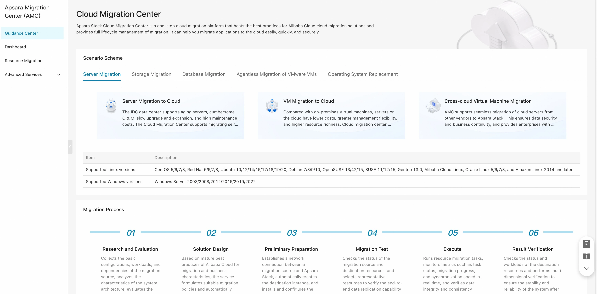

**Dashboard**

The dashboard provides a comprehensive, global view of migration data, which enables you to monitor the current progress and review historical migration records. This helps you better formulate migration plans.

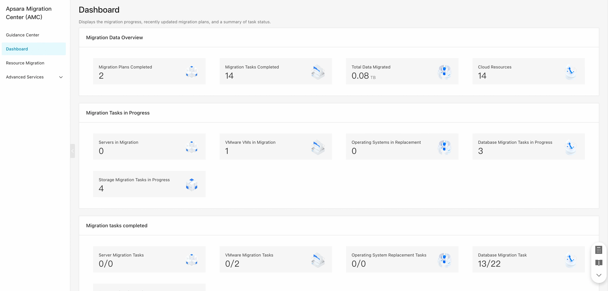

**Resource Migration**

You can manage and execute migration plans by using the resource migration module and perform the following six steps: survey and evaluation, solution design, preliminary preparation, migration test, migration execution, and result verification. The automated migration process reduces migration complexity and greatly improves migration efficiency.

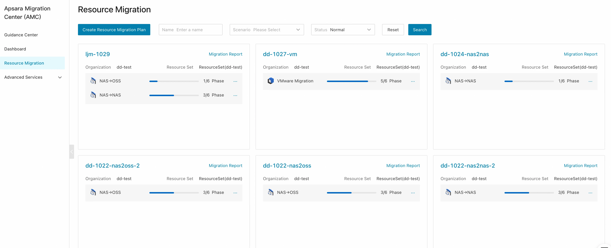

**Advanced Services**

The Advanced Services module is mainly used for migration scenarios that do not require a resource survey. This module also provides cross-platform evaluation and Java Virtual Machine (JVM) parameter tuning tools. You can use it based on your business requirements.

- **Server Migration**: supports **general server migration with agents**, **agentless migration of VMware VMs, and OS replacement**. After you complete pre-migration preparations, you can import the information about the migration source and create a migration task to quickly perform the migration.

- **Cross-platform Application Scanning**: helps you resolve modifications required for source code or software packages after migration when instruction set architectures are inconsistent between the source and destination platforms.

- **JVM Parameter Tuning**: allows you to optimize and migrate JVM parameters based on the Java version, provider, platform, and CPU architecture.

<a id="section-3"></a>

# 3.Getting started

<a id="section-3-1"></a>

## 3.1. Server migration

**Prerequisites**

Before you migrate a server, check whether the server meets the following requirements:

- **Linux**

  - Make sure that the system time of the server is the same as the standard time of the region in which the server resides. Otherwise, the SMC agent fails to be registered.

  - Check Security-Enhanced Linux (SELinux). You need to check whether SELinux is disabled on the CentOS and Red Hat operating systems. If SELinux is enabled, you can disable it by using one of the following methods:

    - Run the  `setenforce 0`  command to disable SELinux temporarily.

    - Modify the  `/etc/selinux/config`  file to set  `SELINUX`  to disabled to disable SELinux permanently.

  - Check the version of Grand Unified Bootloader (GRUB).

    You must use GRUB V2.02 or later for earlier versions of operating systems such as CentOS, Red Hat 5, Debian 7, and Amazon Linux.

  - Check the authorized applications.

    After you migrate the server to Apsara Stack, the application licenses that are associated with the underlying hardware may become invalid.

  - Perform a detailed check on the server based on its type:

    - If you migrate data from a **physical server**, check its virtualized applications. ECS instances of Apsara Stack do not support built-in virtualized applications. After the migration, software such as VMware Workstation Pro, VirtualBox, and Hyper-V is not supported because such software can be used only on a physical server.

    - If you migrate data from an **Amazon EC2 Linux instance**, check cloud-init configurations.

      Cloud-init is developed to initialize cloud instances across platforms. However, the cloud-init service configurations of AWS and Apsara Stack are not cross-compatible. Instances that are migrated from AWS to Apsara Stack may fail to be started and the network may fail to connect. We recommend that you use the cloud-init service configurations of Apsara Stack before the migration.

    - If you migrate data from a **Linux-based GCP VM**, make sure that cloud-init is installed.

    - If you migrate data from a **Linux-based UCloud VM**, check whether the Linux kernel is customized by UCloud. If the Linux kernel is customized by UCloud, the Linux instance may fail to be started or stopped in the ECS console after the migration. This is because some Linux kernels are incompatible with Apsara Stack. You can change the Linux kernel. For example, if your server runs CentOS, you can change the kernel to an official one.

  - Check the disks.

    - Run the df -h command to check whether a File Storage NAS (NAS) disk is attached. The server migration tool allows you to migrate data from a NAS disk to a cloud disk. If you do not need to do so, you can remove the directory of the NAS disk and migrate data from the NAS disk.

    - Run the df -h command to check whether FTP disks are mounted. The server migration tool cannot migrate data on FTP disks. Before migration, remove the FTP disk directory. You need to migrate the data on FTP disks separately.

    - Run the df -h command to check whether a hard disk is mounted to multiple directories. If a hard disk is mounted to multiple directories, you must unmount or remove redundant directories before migration.

- **Windows**

  - Make sure that the system time of the server is the same as the standard time of the region in which the server resides. Otherwise, the SMC agent fails to be registered.

  - Make sure that the Volume Shadow Copy Service (VSS) is enabled.

  - Check whether the QEMU Guest Agent software is installed. If the software is installed, you need to uninstall it first.

  - Check the authorized applications.

    After you migrate the server to Apsara Stack, the application licenses that are associated with the underlying hardware may become invalid.

  - Perform a detailed check on the server based on its type:

    - If you migrate data from a physical server, check its virtualized applications. ECS instances of Apsara Stack do not support built-in virtualized applications. After the migration, software such as VMware Workstation Pro, VirtualBox, and Hyper-V is not supported because such software can be used only on a physical server.

    - If you migrate data from a Windows-based cloud server deployed on other QEMU KVM virtualization platforms, check whether the  `QEMU Guest Agent VSS Provider`  service is installed.

      If the QEMU Guest Agent VSS Provider service is installed, find the uninstall.bat script in the  `C:\Program Files (x86)\virtio\monitor`  directory and run the script to uninstall the service.

**Procedure**

**Step 1: Create a resource migration plan**

<ol type="a">

<li>

**Create a migration plan**

</li>

</ol>

1. Click **Create Resource Migration Plan**.

   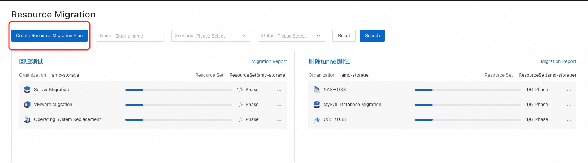

2. Configure the parameters such as the migration plan name and migration type. Then, click **OK**.

3. Click the migration plan name to go to the migration plan.

**Step 2: Conduct a survey and evaluation**

<ol type="a">

<li>

**Create a survey and evaluation task**

</li>

</ol>

1. Click **Start Survey**.

   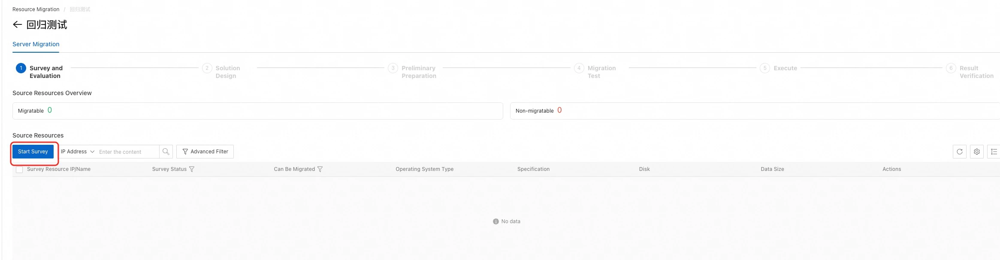

2. Specify the destination virtual private cloud (VPC), vSwitch, and server connection information based on your business requirements. If the server IP address is a public IP address, you must turn on the Survey over Internet switch. Make sure that the destination VPC can access the survey resources.

   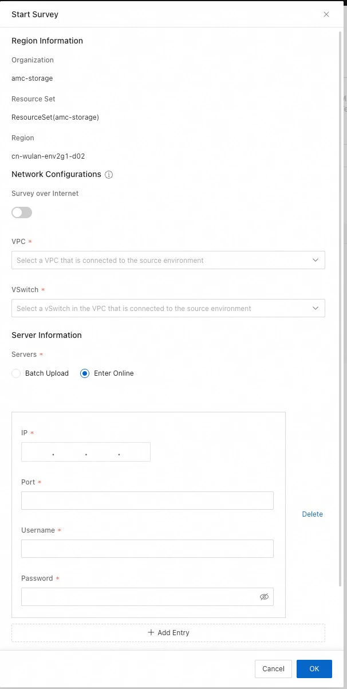

   > **Note**
   >
   > Enable Monitoring: If monitoring is enabled, the source CPU and memory usage is monitored during online survey. The minimum monitoring duration is 1 hour.

3. Click **OK** and wait until the survey task is complete.

   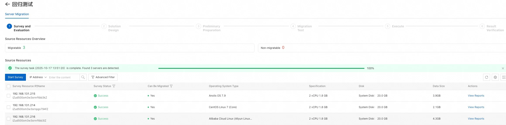

   > **Note**
   >
   > If the survey results indicate that migration cannot be performed, adjust the source resources based on the prompt and re-initiate the survey. Non-migratable resources cannot be selected to proceed with the next step.

   <ol type="a" start="2">

   <li>

   **Confirm the survey and evaluation results**

   </li>

   </ol>

1. Click **View Reports** to view the details of the server. The workload is displayed only when you enable the monitoring feature.

   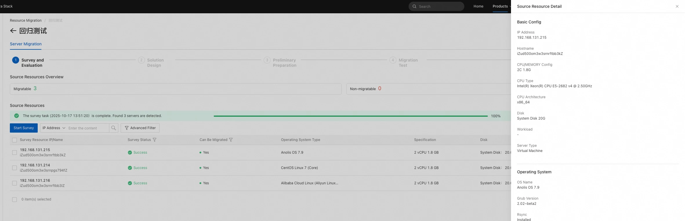

2. Select the resources that you want to migrate, and click **Next**. In the message that appears, confirm the selected resources.

   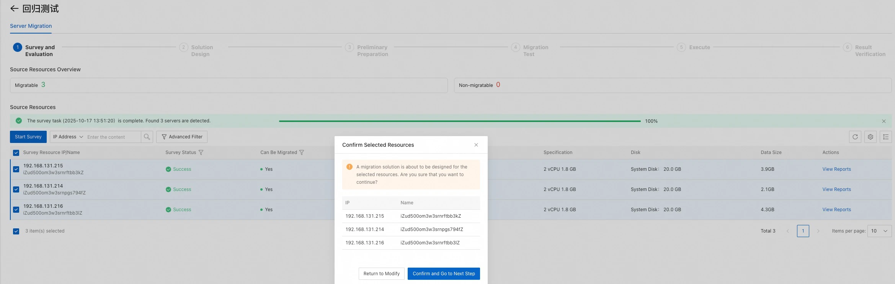

**Step 3: Perform solution design**

<ol type="a">

<li>

**Design a solution**

</li>

</ol>

1. Click **Start Solution Design**.

   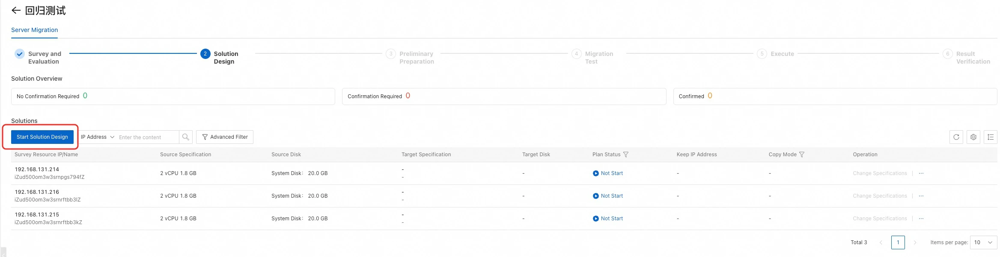

2. Specify the destination VPC, vSwitch, and available migration bandwidth. Then, click **OK**.

   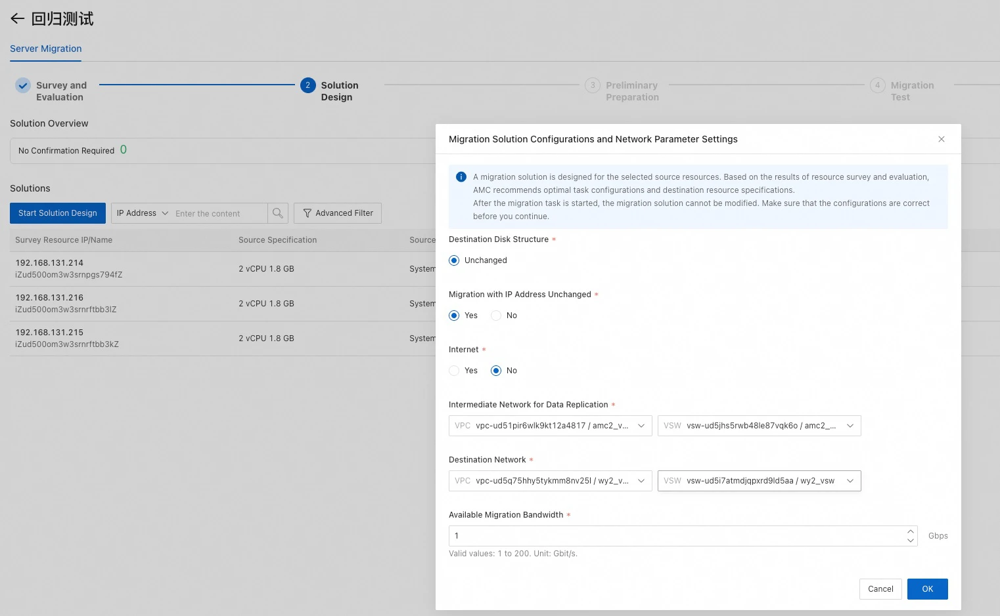

   > **Note**
   >
   > If you set Migration with IP Address Unchanged to Yes, make sure that the source IP address exists within the CIDR block of the destination VPC and remains unallocated, and that network connectivity is established between the migration source and the intermediate network for data replication.

   <ol type="a" start="2">

   <li>

   **Confirm the solution design results**

   </li>

   </ol>

1. Confirm the generated migration plan. You can modify the specifications of the destination instance based on your business requirements.

   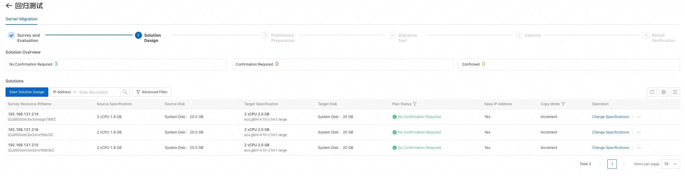

   > **Note**
   >
   > If specifications are not automatically recommended or the recommended specifications do not meet your business requirements, you can click Change Specifications to change specifications.

2. Check that the Plan Status column for all the resources to be migrated is not Confirmation Required. Then, click **Next**. In the message that appears, click OK.

   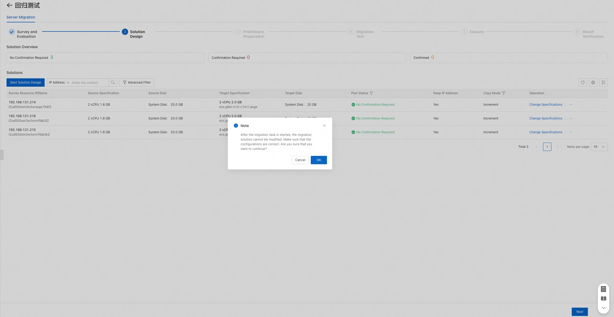

**Step 4: Make migration preparations**

<ol type="a">

<li>

**Make the preliminary preparations**

</li>

</ol>

1. Wait until the environment is initialized.

   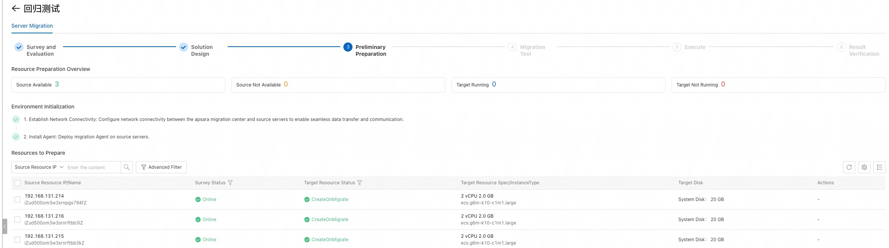

   > **Note**
   >
   > In the preparation phase, the platform automatically initializes the environment, including resource creation and migration agent installation. If resources fail to be created due to reasons such as insufficient resources, you can fix the issue and click Re-create Destination Resources. If the agent fails to be installed, you can click Reconnect to install the agent again.

   <ol type="a" start="2">

   <li>

   **Confirm the preparation results**

   </li>

   </ol>

1. Make sure that the agent is in the online state and the destination resources are in the normal state. Then, click **Next**. In the message that appears, click OK.

**Step 5: Perform a migration test**

<ol type="a">

<li>

**Start the migration test**

</li>

</ol>

1. Click **Start All Drills** and wait until the test is complete.

   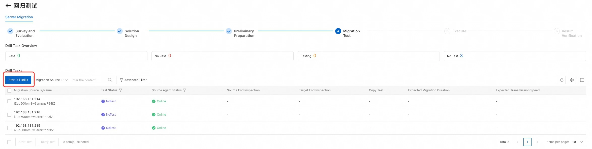

2. Click the report icon in the Test Status column to view the test report.

   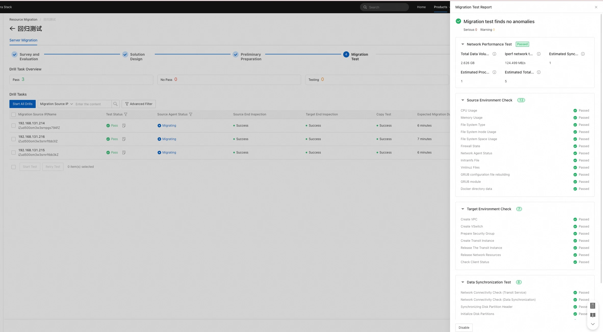

   <ol type="a" start="2">

   <li>

   **Confirm the migration test results**

   </li>

   </ol>

1. Check that the Test Status column for all the resources to be migrated is Pass. Then, click **Next**. In the message that appears, click OK.

   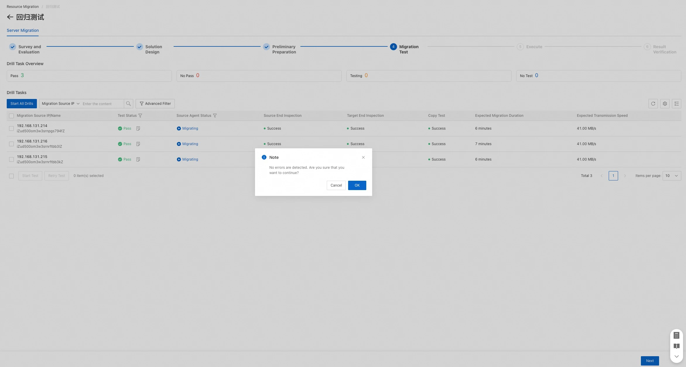

   > **Note**
   >
   > If a test item fails, fix the issue based on the error message and retry the migration test.

**Step 6: Perform the migration**

<ol type="a">

<li>

**Start the migration task**

</li>

</ol>

1. Click **Migrate All**.

   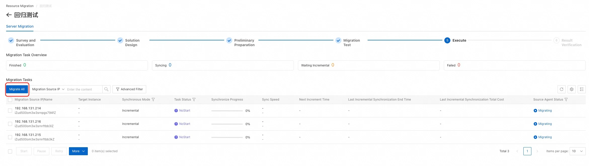

2. Wait until the migration task is complete. For an incremental synchronization, click **Complete Replication** to complete the task.

   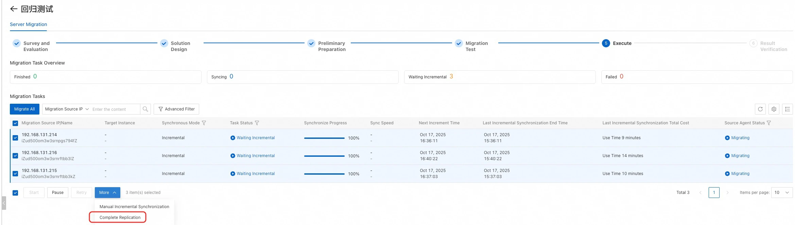

   You can choose whether to perform the last incremental synchronization when you complete the task.

   > **Note**
   >
   > An incremental migration task automatically synchronizes data every 1 hour. You can also click Manual Incremental Synchronization to trigger synchronization. The incremental migration task does not automatically end.

   <ol type="a" start="2">

   <li>

   **Confirm the migration results**

   </li>

   </ol>

1. Check that the Task Status column for all the resources to be migrated is Finished. Then, click **Next**. In the message that appears, click OK.

   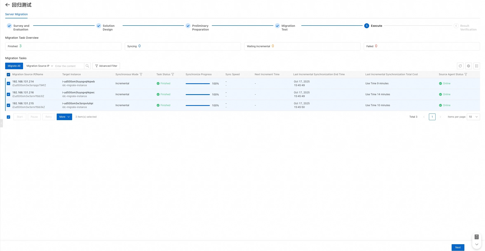

**Step 7: Verify the results**

<ol type="a">

<li>

**Start the verification**

</li>

</ol>

1. Click **Verify All** and wait until the verification is complete.

   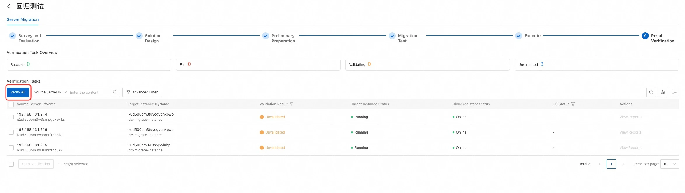

   > **Note**
   >
   > The result verification requires the ECS Cloud Assistant. If the ECS Cloud Assistant is unavailable, you need to install it.

2. After the verification is complete, you can click the report icon in the Validation Result column to view the verification report.

   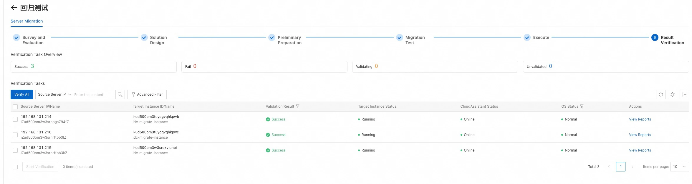

   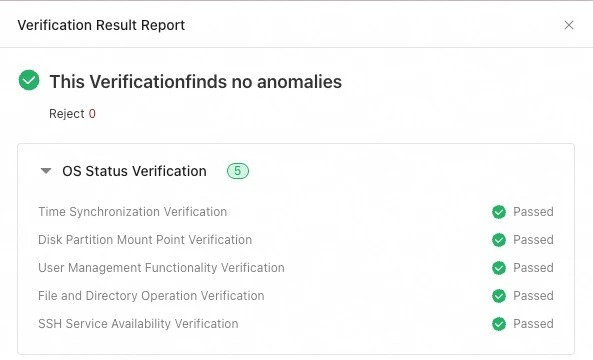

   <ol type="a" start="2">

   <li>

   **Confirm the verification results**

   </li>

   </ol>

1. Check that the Validation Result column for all the resources to be migrated is Success. Then, click **Confirm Completion**.

   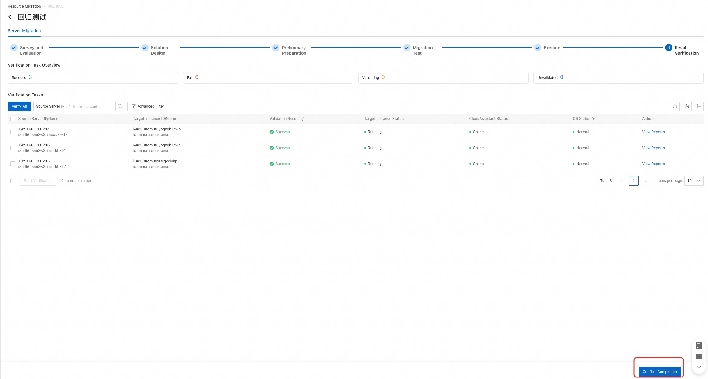

2. The migration report page appears. You can view the overall execution status of the migration task.

   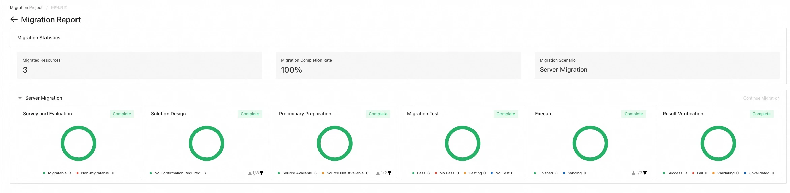

<a id="section-3-2"></a>

## 3.2. VMware VM migration

**Prerequisites**

- If you deploy a Server Migration Connector on vCenter Server, the account used to log in to VMware ESXi and the account used to log in to the VMware VM to be migrated must be granted the following permissions:

  - Datastore > Browse datastore

  - Datastore > Low-level file operations

  - Host > Local operations > Create virtual machine

  - Virtual machine > Change Configuration > Acquire disk lease

  - Virtual machine > Change Configuration > Toggle disk change tracking

  - Virtual machine > Provisioning > Allow virtual machine download

  - Virtual machine > Provisioning > Allow disk access

  - Virtual machine > Provisioning > Allow read-only disk access

  - Virtual machine > Snapshot management > Create snapshot

  - Virtual machine > Snapshot management > Remove Snapshot

- If you deploy a Server Migration Connector on VMware ESXi, you must use an administrator account to log in to VMware ESXi.

**Procedure**

**Step 1: Create a resource migration plan**

<ol type="a">

<li>

**Create a migration plan**

</li>

</ol>

1. Click **Create Resource Migration Plan**.

   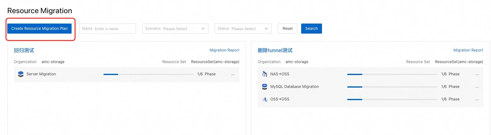

2. Configure the parameters such as the migration plan name and migration type. Then, click **OK**.

   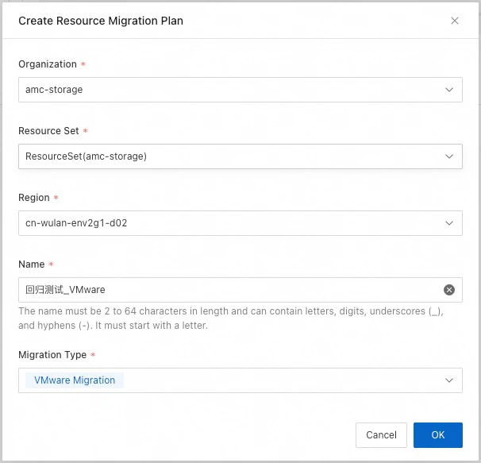

3. Click the migration plan name to go to the migration plan.

**Step 2: Conduct a survey and evaluation**

<ol type="a">

<li>

**Create a survey and evaluation task**

</li>

</ol>

1. Click **Start Survey**.

   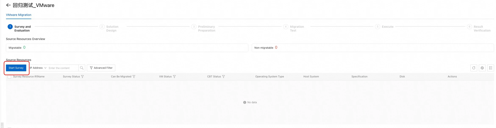

2. Specify the destination virtual private cloud (VPC), vSwitch, and vCenter Server/VMware ESXi connection information based on your business requirements. If the connection address is a public IP address, you must turn on the Survey over Internet switch. Make sure that the destination VPC can access the survey resources.

   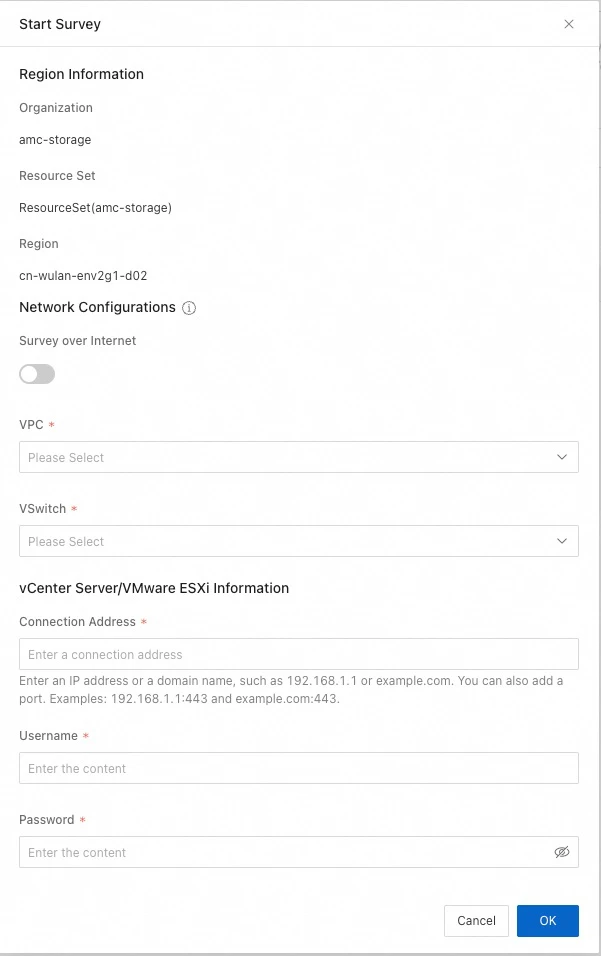

3. Click **OK** and wait until the survey task is complete.

   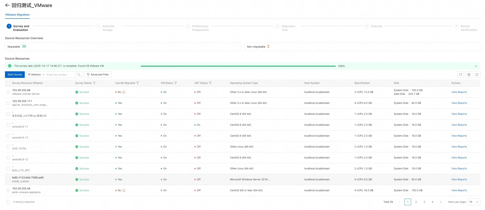

   > **Note**
   >
   > If the survey results indicate that migration cannot be performed, adjust the source resources based on the prompt and re-initiate the survey. Non-migratable resources cannot be selected to proceed with the next step. If the CBT Status of the task is Off, incremental migration cannot be performed and only full migration can be used.

   <ol type="a" start="2">

   <li>

   **Confirm the survey and evaluation results**

   </li>

   </ol>

1. Click **View Reports** to view the details of the VM.

   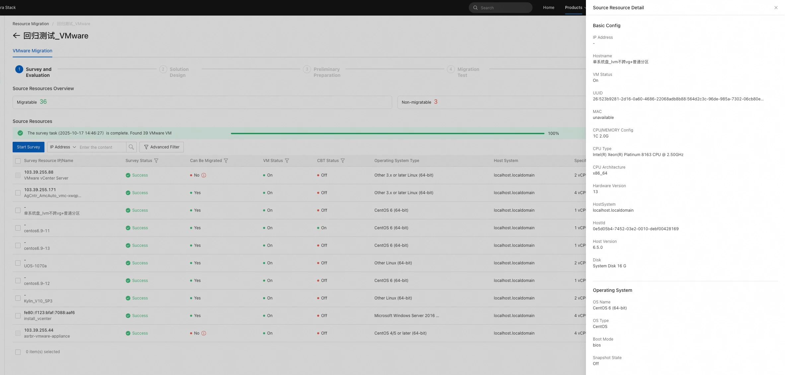

2. Select the resources that you want to migrate, and click **Next**. In the message that appears, confirm the selected resources.

   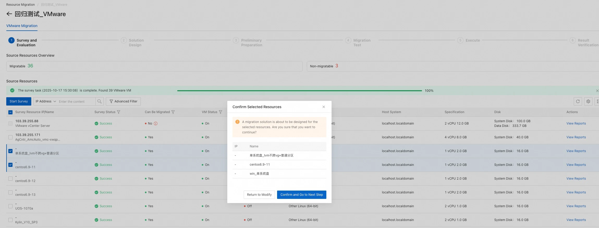

**Step 3: Perform solution design**

<ol type="a">

<li>

**Design a solution**

</li>

</ol>

1. Click **Start Solution Design**.

   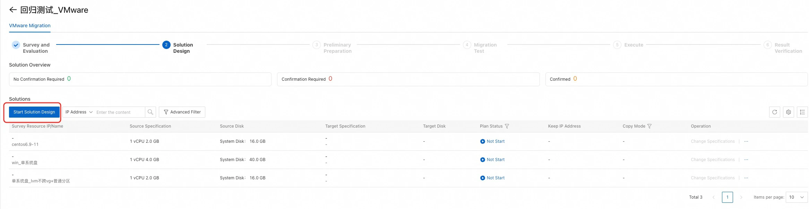

2. Specify the destination VPC, vSwitch, and available migration bandwidth. Then, click **OK**.

   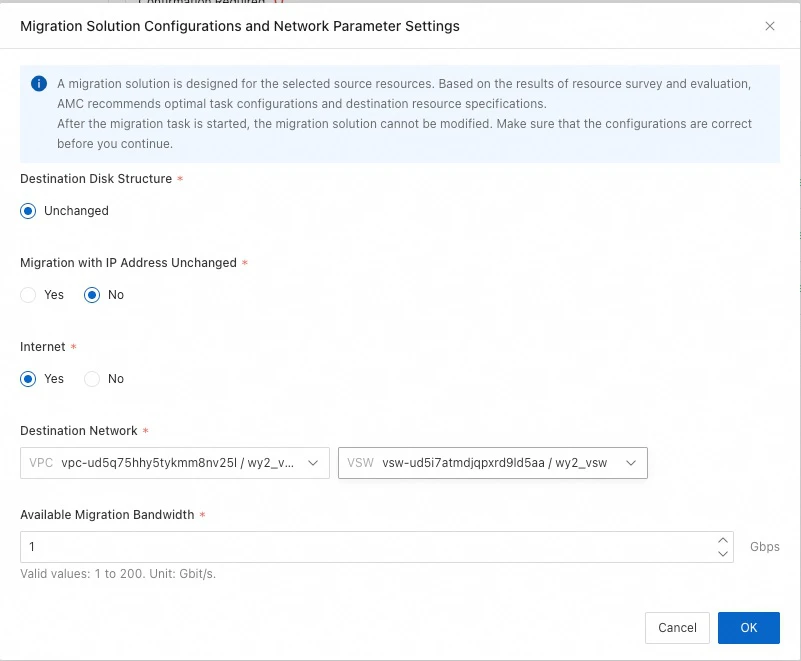

   > **Note**
   >
   > If you set Migration with IP Address Unchanged to Yes, make sure that the source IP address exists within the CIDR block of the destination VPC and remains unallocated, and that network connectivity is established between the migration source and the intermediate network for data replication.

   <ol type="a" start="2">

   <li>

   **Confirm the solution design results**

   </li>

   </ol>

1. Confirm the generated migration plan. You can modify the specifications of the destination instance based on your business requirements.

   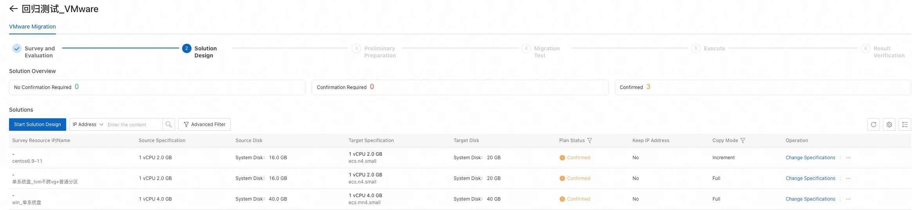

   > **Note**
   >
   > If specifications are not automatically recommended or the recommended specifications do not meet your business requirements, you can click Change Specifications to change specifications.

2. Check that the Plan Status column for all the resources to be migrated is not Confirmation Required. Then, click **Next**. In the message that appears, click OK.

   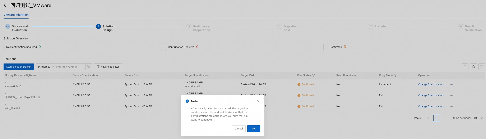

**Step 4: Make migration preparations**

<ol type="a">

<li>

**Make the preliminary preparations**

</li>

</ol>

1. Wait until the environment is initialized.

   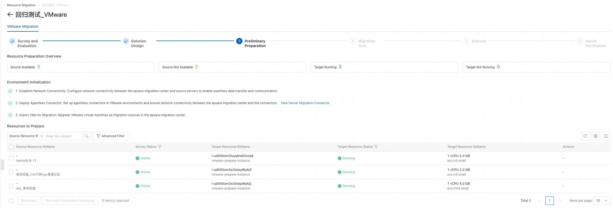

   > **Note**
   >
   > In the preparation phase, the platform automatically initializes the environment, including resource creation and migration agent installation. If resources fail to be created due to reasons such as insufficient resources, you can fix the issue and click Re-create Destination Resources. If the agent fails to be installed, you can click Reconnect to install the agent again.

   <ol type="a" start="2">

   <li>

   **Confirm the preparation results**

   </li>

   </ol>

1. Make sure that the agent is in the online state and the destination resources are in the normal state. Then, click **Next**. In the message that appears, click OK.

**Step 5: Perform a migration test**

<ol type="a">

<li>

**Start the migration test**

</li>

</ol>

1. Click **Start All Drills** and wait until the test is complete.

   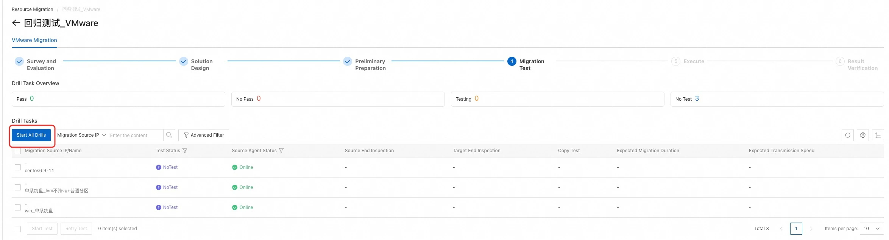

2. Click the report icon in the Test Status column to view the test report.

   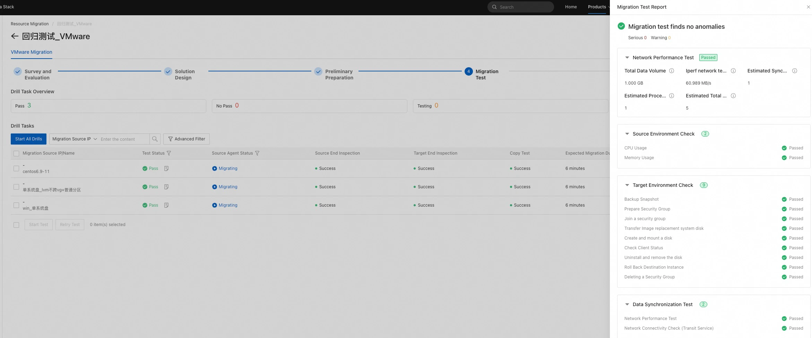

   <ol type="a" start="2">

   <li>

   **Confirm the migration test results**

   </li>

   </ol>

1. Check that the Test Status column for all the resources to be migrated is Pass. Then, click **Next**. In the message that appears, click OK.

   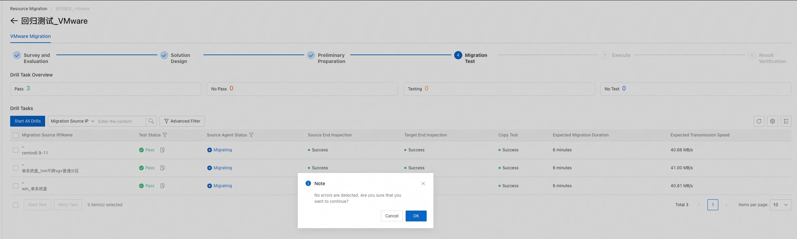

   > **Note**
   >
   > If a test item fails, fix the issue based on the error message and retry the migration test.

**Step 6: Perform the migration**

<ol type="a">

<li>

**Start the migration task**

</li>

</ol>

1. Click **Migrate All** and wait until the migration is complete.

   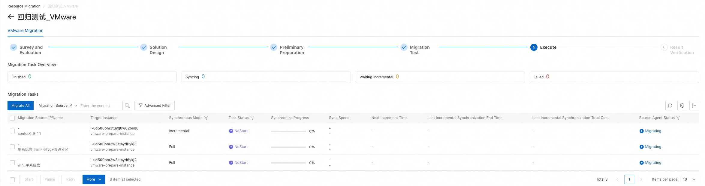

   <ol type="a" start="2">

   <li>

   **Confirm the migration results**

   </li>

   </ol>

1. Check that the Task Status column for all the resources to be migrated is Finished. Then, click **Next**. In the message that appears, click OK.

   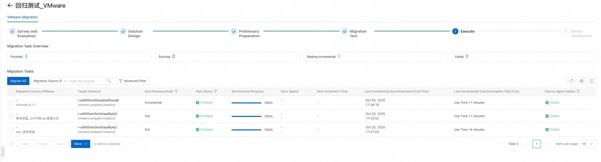

**Step 7: Verify the results**

<ol type="a">

<li>

**Start the verification**

</li>

</ol>

1. Click **Verify All** and wait until the verification is complete.

   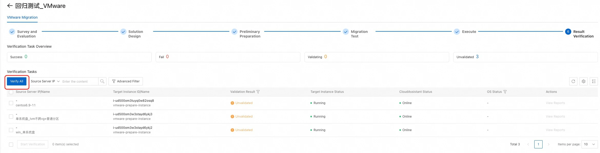

   > **Note**
   >
   > The result verification requires the ECS Cloud Assistant. If the ECS Cloud Assistant is unavailable, you need to install it.

2. After the verification is complete, you can click the report icon in the Validation Result column to view the verification report.

   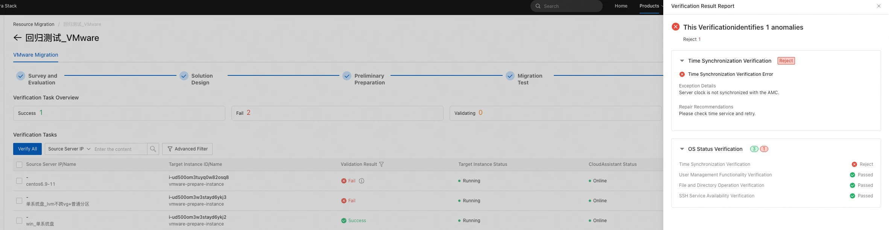

   <ol type="a" start="2">

   <li>

   **Confirm the verification results**

   </li>

   </ol>

1. Check that the Validation Result column for all the resources to be migrated is Success. Then, click **Confirm Completion**.

   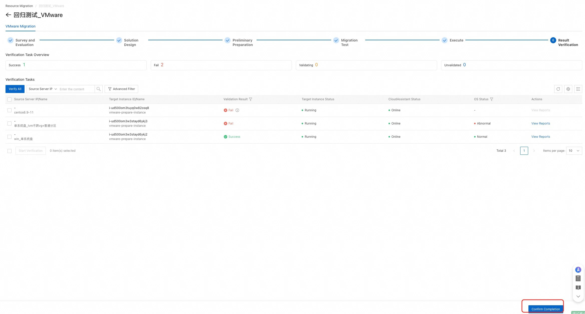

2. The migration report page appears. You can view the overall execution status of the migration task.

3.

<a id="section-3-3"></a>

## 3.3. OS replacement

**Limits**

| Category | Description |
| --- | --- |
| General limits | • Alibaba Cloud Linux does not provide i686-based software packages. If your CentOS operating system is equipped with i386-based or i686-based software packages, you cannot replace your OS with Alibaba Cloud Linux.<br>• Before you replace your OS of an Elastic Compute Service (ECS) instance with Alibaba Cloud Linux, make sure that the following resources are available:<br>• Memory size: 600 MiB<br>• Disk capacity:<br>• /usr: 250 MiB<br>• /var: 4 GiB<br>• /boot: 100 MiB |
| Replace CentOS 7 and Anolis OS 7 with Alibaba Cloud Linux 3 and Alibaba Cloud Linux V3 64bit | Alibaba Cloud Linux 3 uses Linux Kernel 5.10 LTS. The GNU toolchain of Alibaba Cloud Linux 3 contains GCC 10.2, Binutils 2.35, and glibc 2.32. If your business uses applications that depend on kernel APIs for different purposes, such as building out-of-tree kernel modules and using hardware resources, you must assess the applications in advance and determine whether the applications can run as expected after a direct OS replacement. |
| Replace CentOS 8 and Anolis OS 8 with Alibaba Cloud Linux 3 and Alibaba Cloud Linux V3 64bit | • Alibaba Cloud Linux 3 uses Linux Kernel 5.10 LTS. The GNU toolchain of Alibaba Cloud Linux 3 contains GCC 10.2, Binutils 2.35, and glibc 2.32. Alibaba Cloud Linux 3 is compatible with the CentOS 8 ecosystem.<br>• Before you replace CentOS 8 or Anolis OS 8 with Alibaba Cloud Linux 3, you must uninstall kmod-kvdo. You must evaluate whether uninstallation is feasible. Run the following command to uninstall your CentOS 8 or Anolis OS 8: yum remove kmod-kvdo. |

**Prerequisites**

A Yellowdog Updater Modified (YUM) repository is available for OS replacement. You must select a custom image based on the type of the destination OS to build the YUM repository.

| YUM repository image | Supported destination OS for replacement | Image deployment and configuration |
| --- | --- | --- |
| YUM repository of Alibaba Cloud Linux 3 Free Edition | Alibaba Cloud Linux 3 | 1. Obtain the YUM repository ECS image that corresponds to Alibaba Cloud Linux 3 from technical support. 2. Import the obtained image in the ECS console. 3. After the image is imported, use the image to create an ECS instance. 4. Uncomment the comment on line 2 of the /root/alinux/migration/aliyuncs-install.sh file of the image instance and change export MIRROR_SITE=xxxxxx to the actual YUM repository IP address. |
| YUM repository of Alibaba Cloud Linux 3 Commercial Edition | Alibaba Cloud Linux V3 64bit | 1. Obtain a YUM repository ECS image that corresponds to Alibaba Cloud Linux V3 64bit from technical support.<br>2. Import the obtained image in the ECS console. 3. After the image is imported, use the image to create an ECS instance. 4.Uncomment the comment on line 2 of the/root/alinux/migration/aliyuncs-install_3p.sh file of the image instance and change export MIRROR_SITE=xxxxxx to the actual YUM repository IP address. |

After the ECS instance is created, run the  `curl {YUM repository IP address}`  command on the ECS instance to check whether the YUM repository is normal.

**Procedure**

**Step 1: Create a resource migration plan**

<ol type="a">

<li>

**Create a migration plan**

</li>

</ol>

1. Click **Create Resource Migration Plan**.

   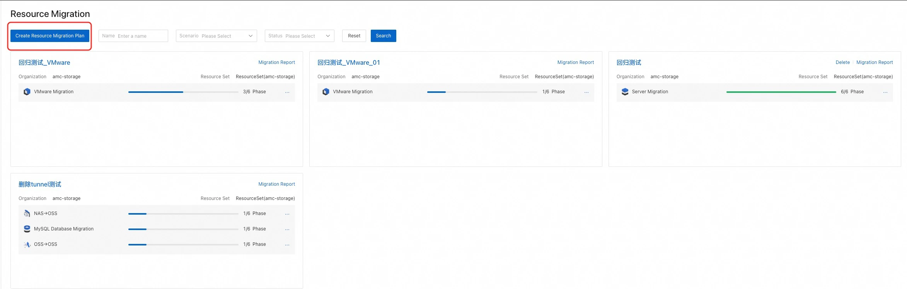

2. Configure the parameters such as the migration plan name and migration type. Then, click **OK**.

   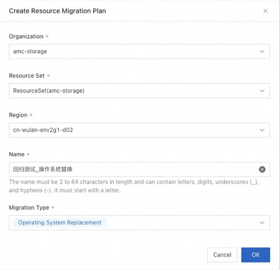

3. Click the migration plan name to go to the migration plan.

**Step 2: Conduct a survey and evaluation**

<ol type="a">

<li>

**Create a survey and evaluation task**

</li>

</ol>

1. Click **Start Survey**.

   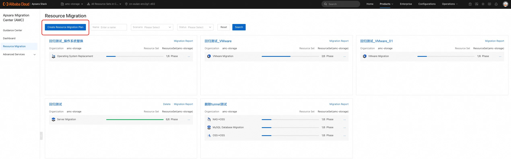

2. Select the ECS instance whose OS you want to replace.

   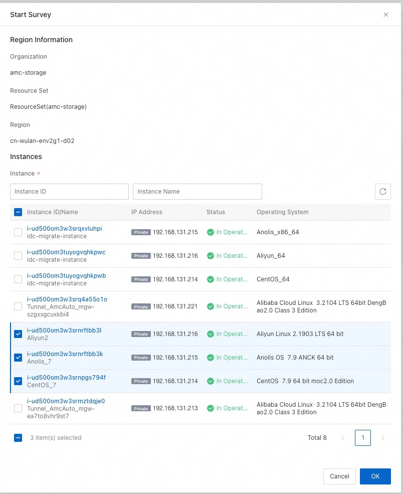

3. Click **OK** and wait until the survey task is complete.

   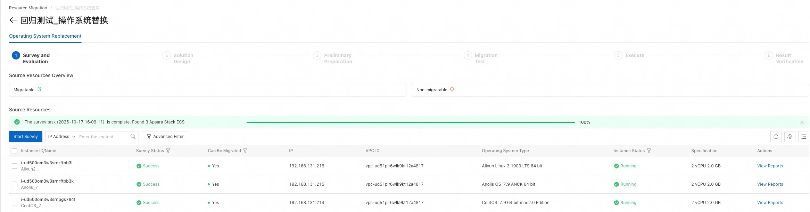

   > **Note**
   >
   > If the survey results indicate that migration cannot be performed, adjust the source resources based on the prompt and re-initiate the survey. Non-migratable resources cannot be selected to proceed with the next step.

   <ol type="a" start="2">

   <li>

   **Confirm the survey and evaluation results**

   </li>

   </ol>

1. Click **View Reports** to view the details of the ECS instance.

   

2. Select the resources that you want to migrate, and click **Next**. In the message that appears, confirm the selected resources.

   

**Step 3: Perform solution design**

<ol type="a">

<li>

**Design a solution**

</li>

</ol>

1. Click **Start Solution Design**.

2. In the dialog box that appears, specify the type of the destination OS and the YUM repository IP address.

   

   <ol type="a" start="2">

   <li>

   **Confirm the solution design results**

   </li>

   </ol>

1. Confirm the generated migration plan. You can modify the YUM repository IP address and destination OS based on your business requirements.

   

2. Check that the Plan Status column for all the resources to be migrated is not Confirmation Required. Then, click **Next**. In the message that appears, click OK.

   

**Step 4: Make migration preparations**

<ol type="a">

<li>

**Make the preliminary preparations**

</li>

</ol>

1. Wait until the environment is initialized.

   

   <ol type="a" start="2">

   <li>

   **Confirm the preparation results**

   </li>

   </ol>

1. Make sure that the agent is in the online state and the destination resources are in the normal state. Then, click **Next**. In the message that appears, click OK.

   

**Step 5: Perform a migration test**

<ol type="a">

<li>

**Start the migration test**

</li>

</ol>

1. Click **Start All Drills** and wait until the test is complete.

   

2. Click the report icon in the Test Status column to view the test report.

   

   > **Note**
   >
   > The warning items in the test report do not affect the OS replacement, but may affect the applications. You need to determine whether the impacts are acceptable.

   <ol type="a" start="2">

   <li>

   **Confirm the migration test results**

   </li>

   </ol>

1. Check that the Test Status column for all the resources to be migrated is Pass. Then, click **Next**. In the message that appears, click OK.

   

   > **Note**
   >
   > If a test item fails, fix the issue based on the error message and retry the migration test.

**Step 6: Perform the migration**

<ol type="a">

<li>

**Start the migration task**

</li>

</ol>

1. Click **Migrate All** and wait until the migration is complete.

   

   <ol type="a" start="2">

   <li>

   **Confirm the migration results**

   </li>

   </ol>

1. Check that the Task Status column for all the resources to be migrated is Finished. Then, click **Next**. In the message that appears, click OK.

   

**Step 7: Verify the results**

<ol type="a">

<li>

**Start the verification**

</li>

</ol>

1. Click **Verify All** and wait until the verification is complete.

   

   > **Note**
   >
   > The result verification requires the ECS Cloud Assistant. If the ECS Cloud Assistant is unavailable, you need to install it.

2. After the verification is complete, you can click the report icon in the Validation Result column to view the verification report.

   

   

   <ol type="a" start="2">

   <li>

   **Confirm the verification results**

   </li>

   </ol>

1. Check that the Validation Result column for all the resources to be migrated is Success. Then, click **Confirm Completion**.

   

2. The migration report page appears. You can view the overall execution status of the migration plan.

   

<a id="section-3-4"></a>

## 3.4. Database migration

**Prerequisites**

Before you migrate a database, check whether the database meets the following requirements:

- The server to which the source database belongs must have sufficient outbound bandwidth. Otherwise, the data migration speed decreases.

- The tables that you want to migrate must have PRIMARY KEY or UNIQUE constraints, and all fields must be unique. Otherwise, the destination database may contain duplicate data records.

- To perform incremental data migration, you must make sure that the following requirements are met:

  - The binary logging feature is enabled. The value of the binlog_format parameter is set to row, and the value of the binlog_row_image parameter is set to full. Otherwise, error messages are returned during the precheck and the data migration task cannot be started.

  - The binary logs of the ApsaraDB RDS instance must be stored for at least three days (seven days recommended). The binary logs of a self-managed MySQL database must be retained for at least seven days.

- Limits on operations that are performed on the source database:

  - During schema migration and full data migration, do not execute DDL statements to change the schemas of databases or tables. Otherwise, the data migration task fails.

  - If you perform only full data migration, do not write data to the source database during data migration. Otherwise, data inconsistency occurs between the source and destination databases.

**Procedure**

**Step 1: Create a resource migration plan**

<ol type="a">

<li>

**Create a migration plan**

</li>

</ol>

1. Click **Create Resource Migration Plan**.

   

2. Configure the parameters such as the migration plan name and migration type. Then, click **OK**.

   

3. Click the migration plan name to go to the migration plan.

**Step 2: Conduct a survey and evaluation**

<ol type="a">

<li>

**Create a survey and evaluation task**

</li>

</ol>

1. Click **Start Survey**.

   

2. Specify the destination virtual private cloud (VPC), vSwitch, and database connection information based on your business requirements. If the connection address is a public IP address, you must turn on the Survey over Internet switch. Make sure that the destination VPC can access the survey resources.

   

   > **Note**
   >
   > Enable Monitoring: If monitoring is enabled, the source CPU and memory usage is monitored during online survey. The minimum monitoring duration is 1 hour.

3. Click **OK** and wait until the survey task is complete.

   

   > **Note**
   >
   > If No is displayed in the Can Migrate column for a survey resource, adjust the source resource according to the prompt and re-initiate the research. The non-migratory resource cannot be selected to enter the next step.

   <ol type="a" start="2">

   <li>

   **Confirm the survey and evaluation results**

   </li>

   </ol>

1. Click **View Reports** to view the details of the database. The workload is displayed only when you enable the monitoring feature.

   

2. Select the resources that you want to migrate, and click **Next**. In the message that appears, confirm the selected resources.

   

**Step 3: Perform solution design**

<ol type="a">

<li>

**Design a solution**

</li>

</ol>

1. Click **Start Solution Design**.

   

2. Specify the destination VPC, vSwitch, and available migration bandwidth. Then, click **OK**.

   

   > **Note**
   >
   > If you set Destination Instance Creation Mode to Created by Platform, the migration destination is a new database. If you set Destination Instance Creation Mode to User Input, the migration destination is a specified existing database.

   <ol type="a" start="2">

   <li>

   **Confirm the solution design results**

   </li>

   </ol>

1. Confirm the generated migration plan. You can modify the specifications of the destination instance based on your business requirements.

   

   > **Note**
   >
   > After the solution is generated, you can modify it in the Operation column:
   >
   > - Change Specifications: If specifications are not automatically recommended or the recommended specifications do not meet your business requirements, you can click Change Specifications to change the specifications.
   >
   > - Modify Synchronization Method: You can switch between incremental synchronization and full synchronization.
   >
   > - Filter Objects to Be Synchronized: If you do not need to migrate all data, you can specify logical databases for data migration.

2. Check that the Plan Status column for all the resources to be migrated is not Confirmation Required. Then, click **Next**. In the message that appears, click OK.

   

**Step 4: Make migration preparations**

<ol type="a">

<li>

**Make the preliminary preparations**

</li>

</ol>

1. Wait until the environment is initialized.

   

   > **Note**
   >
   > In the preliminary preparation phase, the platform automatically initializes the environment. If the Destination Instance Creation Mode parameter is set to Manually Selected in the solution design phase, you need to click Configure Destination Resources in the Actions column to select an instance. If resources fail to be created due to reasons such as insufficient resources, you can fix the issue and then click Re-create Destination Resources. If the connectivity test fails, you can click Reconnect.

   <ol type="a" start="2">

   <li>

   **Confirm the preparation results**

   </li>

   </ol>

1. Make sure that the destination resources and network connection are normal. Then, click **Next**. In the message that appears, click OK.

   

**Step 5: Perform a migration test**

<ol type="a">

<li>

**Start the migration test**

</li>

</ol>

1. Click **Start All Drills** and wait until the migration test is complete.

   

2. Click **View Reports** to view the test report.

   

   <ol type="a" start="2">

   <li>

   **Confirm the migration test results**

   </li>

   </ol>

1. Check that the Test Status column for all the resources to be migrated is Pass. Then, click **Next**. In the message that appears, click OK.

   

   > **Note**
   >
   > If a test item fails, fix the issue based on the error message and retry the migration test.

**Step 6: Perform the migration**

<ol type="a">

<li>

**Start the migration task**

</li>

</ol>

1. Click **Migrate All**.

   

2. Wait until the migration task is complete. For an incremental synchronization, click **Complete Replication** to complete the task.

   > **Note**
   >
   > For incremental synchronization, automatic verification is performed every 10 minutes. You can also manually disable or enable verification.

   <ol type="a" start="2">

   <li>

   **Confirm the migration results**

   </li>

   </ol>

1. Click **View Reports** to view the migration details.

2. After all migration tasks are complete, click **Next**.

**Step 7: Verify the results**

<ol type="a">

<li>

**Start the verification**

</li>

</ol>

1. Click **Verify All** and wait until the verification is complete.

2. Click **View Reports** to view the verification report.

   <ol type="a" start="2">

   <li>

   **Confirm the verification results**

   </li>

   </ol>

1. Check that the Validation Result column for all the resources to be migrated is Success. Then, click **Confirm Completion**.

2. After you confirm the plan, the Migration Report page appears. You can view the overall execution status of the plan.

<a id="section-3-5"></a>

## 3.5. Storage migration

**Prerequisites**

Before you perform a storage migration, ensure that the following conditions and requirements are met:

- Data migration occupies network bandwidth and may affect the performance of online applications. We recommend that you migrate data during off-peak hours.

- Apsara Migration Center (AMC) does not support data migration from CDN-enabled data sources or data sources accessed by using an intermediate proxy or relay server. Make sure that the endpoint of your source is directly accessible, without CDN acceleration or any dependency on intermediate relay services.

- You must not modify or delete source data until the migration is complete and the data is verified.

- If a file with the same name exists during migration, the file may be overwritten by the migration process.

- During data migration, symbolic links are skipped.

**Procedure**

**Step 1: Create a resource migration plan**

<ol type="a">

<li>

**Create a migration plan**

</li>

</ol>

1. Click **Create Resource Migration Plan**.

   

2. Configure the parameters such as the migration plan name and migration type. Then, click **OK**.

   

   > **Note**
   >
   > You need to select a migration type based on the source and destination types, such as migration from NAS to NAS, from NAS to OSS, and from OSS to OSS.

3. Click the migration plan name to go to the migration plan.

**Step 2: Conduct a survey and evaluation**

<ol type="a">

<li>

**Create a survey and evaluation task**

</li>

</ol>

1. Click **Start Survey**.

   

2. Specify the destination virtual private cloud (VPC), vSwitch, and migration source connection information based on your business requirements. Make sure that the destination VPC can access the survey resources.

   

3. Click **OK** and wait until the survey task is complete.

   

   > **Note**
   >
   > If the survey results indicate that migration cannot be performed, adjust the source resources based on the prompt and re-initiate the survey. Non-migratable resources cannot be selected to proceed with the next step.

   <ol type="a" start="2">

   <li>

   **Confirm the survey and evaluation results**

   </li>

   </ol>

1. Click **View Reports** to view the details of the migration source.

   

2. Select the resources that you want to migrate, and click **Next**. In the message that appears, confirm the selected resources.

   

**Step 3: Perform solution design**

<ol type="a">

<li>

**Design a solution**

</li>

</ol>

1. Click **Start Solution Design**.

   

2. Specify the transmission network and available migration bandwidth. Then, click **OK**.

   

   > **Note**
   >
   > If you set Destination Resource Creation Method to Automatically Create, the migration destination is a new storage resource. If you set Destination Resource Creation Method to Manually Select, the migration destination is an existing storage resource.

   <ol type="a" start="2">

   <li>

   **Confirm the solution design results**

   </li>

   </ol>

1. Confirm the generated migration solution. You can modify the solution based on your business requirements.

   

   > **Note**
   >
   > After the solution is generated, you can modify it in the Operation column:
   >
   > - Modify Destination Name: You can modify the name of the destination resource.
   >
   > - Adjust Destination Specifications: If the specifications that are automatically recommended do not meet your business requirements, you can click this option to modify specifications.
   >
   > - Modify Synchronization Method: You can switch between incremental synchronization and full synchronization.
   >
   > - Modify Filtering Configuration: If you do not need to migrate all data, you can select specified files for migration.

2. Check that the Plan Status column for all the resources to be migrated is not Confirmation Required. Then, click **Next**. In the message that appears, click OK.

   

**Step 4: Make migration preparations**

<ol type="a">

<li>

**Make the preliminary preparations**

</li>

</ol>

1. Wait until the environment is initialized.

   

   > **Note**
   >
   > In the preliminary preparation phase, the platform automatically initializes the environment. If the Destination Resource Creation Method parameter is set to Manually Select in the solution design phase, you need to click Configure Destination Resources to select an instance. If the connectivity test fails, you can click Reconnect in the Actions column.

   <ol type="a" start="2">

   <li>

   **Confirm the preparation results**

   </li>

   </ol>

1. Make sure that the destination resources and network connection are normal. Then, click **Next**. In the message that appears, click OK.

   

**Step 5: Perform a migration test**

<ol type="a">

<li>

**Start the migration test**

</li>

</ol>

1. Click **Start All Drills** and wait until the migration test is complete.

   

   > **Note**
   >
   > For incremental synchronization, you must click End Drill to complete the migration test.

2. Click **View Reports** to view the test report.

   

   <ol type="a" start="2">

   <li>

   **Confirm the migration test results**

   </li>

   </ol>

1. Check that the Test Status column for all the resources to be migrated is Complete Tested. Then, click **Next**. In the message that appears, click OK.

   

   > **Note**
   >
   > If a test item fails, fix the issue based on the error message and retry the migration test.

**Step 6: Perform the migration**

<ol type="a">

<li>

**Start the migration task**

</li>

</ol>

1. Click **Migrate All**.

   

2. Wait until the migration task is complete. For an incremental synchronization, click **End Synchronization** to complete the task.

   

   <ol type="a" start="2">

   <li>

   **Confirm the migration results**

   </li>

   </ol>

1. Click **View Reports** to view the migration details.

   

2. After all migration tasks are complete, click **Next**.

**Step 7: Verify the results**

<ol type="a">

<li>

**Start the verification**

</li>

</ol>

1. Click **Verify All** and wait until the verification is complete.

   

2. Click **View Reports** to view the verification report.

   

   <ol type="a" start="2">

   <li>

   **Confirm the verification results**

   </li>

   </ol>

1. Check that the Validation Result column for all the resources to be migrated is Success. Then, click **Confirm Completion**.

   

2. The migration report page appears. You can view the overall execution status of the migration task.

   

<a id="section-4"></a>

# 4.Resource migration

<a id="section-4-1"></a>

## 4.1. Create a resource migration plan

**Procedure**

1. Log in to the Apsara Migration Center (AMC) console.

2. In the left-side navigation pane, click **Resource Migration**. On the Resource Migration page, click **Create Resource Migration Plan**.

3. Configure the organization, resource set, region, plan name, and migration type based on your business requirements. You can select multiple migration types.

   

4. Click **OK** to create the resource migration plan.

<a id="section-4-2"></a>

## 4.2. Manage resource migration plans

**Procedure**

1. Log in to the Apsara Migration Center (AMC) console.

2. In the left-side navigation pane, click **Resource Migration** to view resource migration plans.

3. Above the resource migration plan list, filter resource migration plans by name, scenario, and status. If Status of a resource migration plan is Expired, the resource migration plan has been in existence for more than 15 days and is not completed or terminated.

   

4. Click the edit icon next to a plan name to modify the plan name.

   

5. Click **Migration Report** to view the overview of the current migration plan.

   

6. Click the name of a migration plan or a migration scenario to go to the details page of the migration plan.

7. Click **Terminate Migration** next to a migration scenario to terminate the unfinished migration.

   

8. Click **Delete** to delete the current migration plan. Only completed and terminated migration plans can be deleted.

<a id="section-5"></a>

# 5.Advanced services

<a id="section-5-1"></a>

## 5.1. Server migration

<a id="section-5-1-1"></a>

### 5.1.1. Usage limits

**Specification description**

| Specification item | Description | Met hod of incr eas ing the limi t |
| --- | --- | --- |
| Block replication | The following Linux OSs support block replication: CentOS, Debian, OpenSUSE, Red Hat, SUSE, Ubuntu, Kylin, and UOS.<br>Windows OSs support block replication by default. | Non e |
| OS replacement | The migration source must be an Apsara Stack Elastic Compute Service (ECS) instance. On-premises servers must be migrated to the cloud first. | Non e |
| Size of the system disk | The size ranges from 20 to 2,048 in GB. | Non e |
| Size and quantity of data disks | The size of a single data disk ranges from 20 to 32,768 in GB. A maximum of 15 data disks are supported. | Non e |
| Number of activation codes | By default, 10,000 activation codes are configured for a single tenant (level-1 department). | Sub mit a tick et |
| Number of migration sources | By default, 10,000 migration sources are configured for a single tenant (level-1 department). | Sub mit a tick et |
| Number of migration tasks | By default, 10,000 migration tasks are configured for a single tenant (level-1 department). | Sub mit a tick et |
| Number of concurrent migration tasks | The maximum number of concurrent migration tasks for a single tenant (level-1 department) is 50. | Sub mit a tick et |
| Server Migration Connector | Each Server Migration Connector supports a maximum of 10 concurrent migration tasks. | Non e |

**Limits on data partitions for server migration**

| OS of the source server | Limit |
| --- | --- |
| Windows | • The partitioning scheme of some disks cannot be replicated, such as dynamic disk partitions and extended disk partitions. If the partitioning scheme of a source disk cannot be replicated, the destination disk is built as a regular partitioned disk.<br>• You cannot migrate the volume shadow snapshots of the source server. |
| Linux | • The partitioning scheme of some disks cannot be replicated, such as extended disk partitions. If the partitioning scheme of a source disk cannot be replicated, the destination disk is built as a regular partitioned disk.<br>• LVM volume groups (VGs) that span multiple physical disks are not supported.Such configurations will be automatically converted to regular partitions.<br>• Swap partitions cannot be replicated. After the source server is migrated, you must reconfigure a swap partition.<br>• Some file system formats are not supported. During the migration process, the file systems in the unsupported formats are converted to the file systems in the mainstream formats, such as ext2, ext3, and ext4.<br>• By default, if block replication is disabled, the virtual memory, cache, system snapshots, software configurations such as cloud-init and network services, and Docker directory data are not migrated. For more information, see the rsync_excludes_linux.txt filtering configuration file in the installation directory of the SMC client. |

**Limits on agentless migration of VMware VMs**

The following table describes the supported versions of vCenter Server and VMware ESXi.

| OVA template | Configuration of a Server Migration Connector | Environment requirement for deploying a Server Migration Connector on vCenter Server | Environment requirement for deploying a Server Migration Connector on VMware ESXi |
| --- | --- | --- | --- |
| SMC VMware Connector 6.7 OVA | • Number of vCPUs: four or more<br>• Memory size: 8 GB or more<br>• Disk space: 40 GB or more | • vCenter Server version: 6.0, 6.5, or 6.7<br>• Version of VMware ESXi on which the Server Migration Connector is deployed: 6.0, 6.5, or 6.7<br>• Version of VMware ESXi on which the VMware VM to be migrated is deployed: 6.0, 6.5, or 6.7<br>• Hardware version of the VMware VM to be migrated: 11, 12, 13, 14, or 15 | • Version of VMware ESXi: 6.0, 6.5, or 6.7<br>• Hardware version of the VMware VM to be migrated: 11, 12, 13, 14, or 15 |
| SMC VMware Connector 8.0 OVA | • Number of vCPUs: four or more<br>• Memory size: 8 GB or more<br>• Disk space: 40 GB or more | • vCenter Server version: 6.7, 7.0, or 8.0<br>• Version of VMware ESXi on which the Server Migration Connector is deployed: 6.7, 7.0, or 8.0<br>• Version of VMware ESXi on which the VMware VM to be migrated is deployed: 6.7, 7.0, or 8.0<br>• Hardware version of the VMware VM to be migrated: 14, 15, 16, 17, 18, 19, 20, or 21 | • Version of VMware ESXi: 6.7, 7.0, or 8.0<br>• Hardware version of the VMware VM to be migrated: 14, 15, 16, 17, 18, 19, 20, or 21 |

**Limits on operating systems**

Server migration and agentless migration of VMware VMs support the following OSs:

| Windwos | Linux |
| --- | --- |
| Windows Server 2003<br>Windows Server 2008<br>Windows Server 2012<br>Windows Server 2016<br>Windows Server 2019<br>Windows Server 2022 | CentOS 5/6/7/8<br>Red Hat 5/6/7/8<br>Ubuntu 10/12/14/16/17/18/19/20<br>Debian 7/8/9/10<br>OpenSUSE 13/42/15<br>SUSE 11/12/15<br>Gentoo 13.0<br>Alibaba Cloud Linux<br>Oracle Linux 5/6/7/8<br>Amazon Linux 2014 and later<br>UOS 1050a/e, 1050u2a/e, 1060a/e, and 1070a<br>Kylin-Sever-10-sp1/2/3 |

OS replacement supports the following OSs:

<table>
  <tr>
    <th>System architecture</th>
    <th>Source OS</th>
    <th>Destination OS</th>
  </tr>
  <tr>
    <td rowspan="5">x86</td>
    <td rowspan="2">CentOS 7 and CentOS 8</td>
    <td>Alibaba Cloud Linux 3</td>
  </tr>
  <tr>
    <td>Alibaba Cloud Linux V3 64bit</td>
  </tr>
  <tr>
    <td>Anolis OS 7 and Anolis OS 8</td>
    <td>Alibaba Cloud Linux V3 64bit</td>
  </tr>
  <tr>
    <td>Alibaba Cloud Linux 2</td>
    <td>Alibaba Cloud Linux 3</td>
  </tr>
  <tr>
    <td>Alibaba Cloud Linux 3</td>
    <td>Alibaba Cloud Linux V3 64bit</td>
  </tr>
</table>

**Other limits**

- Each source server can be associated with only one unfinished migration task at a time.

  > **Note**
  >
  > A migration task is unfinished if it is in the Ready, Running, Stopped, InError, or Expired state.

- You must use Grand Unified Bootloader (GRUB) V2.02 or later for migration sources that run the Linux OS.

  > **Note**
  >
  > You must use GRUB V2.02 or later for earlier versions of Linux distributions such as CentOS 5, Red Hat Enterprise Linux 5, Debian 7, Amazon Linux, and Oracle Linux.

<a id="section-5-1-2"></a>

### 5.1.2. Before you begin

Before you use server migration, you must determine applicable scenarios and limitations, configure permissions for the cloud migration account, back up data, establish network connectivity, and complete other prerequisite preparations.

**Applicable scenarios**

The server migration feature allows you to migrate data from servers in data centers, on-premises VMs, and third-party cloud platforms to Apsara Stack without service downtime. Data in a server includes data in the system disk and data disks. Supported VMs include VMware, Xen, KVM, and Hyper-V. Third-party cloud platforms can be Amazon Web Services (AWS), Microsoft Azure, Google Cloud Platform (GCP), and Tencent Cloud. We recommend that you use the server migration tool to migrate common web middleware servers, load balancing servers, and O&M servers. Migration of big data workloads and storage systems that handle massive small files or dynamically growing large files is not recommended. If a source instance supports block replication, single-instance databases and containerized data of the instance can be migrated. If a source instance supports only file replication, single-instance databases and containerized data of the instance cannot be migrated.

**Limits**

**Configure permissions**

Before you use Server Migration Center (SMC) to migrate servers, you must authorize SMC to access your cloud resources. In this case, make sure that you have activated Resource Access Management (RAM) and authorized SMC to access your cloud resources. Log in to the Apsara Migration Center (AMC) console. Follow the on-screen instructions to click **Confirm authorization** to complete the authorization.


A service-linked role is a RAM role whose trusted entity is an Apsara Stack service. SMC uses service-linked roles to obtain permissions to access other cloud services or cloud resources. RAM provides a system policy for each service-linked role. You cannot modify the policy.

**Back up data**

To prevent data loss or damage due to factors such as system failure, you must create snapshots to back up data.

**Establish network connections**

SMC supports server migration over the Internet or a virtual private cloud (VPC). You must ensure the network connectivity between the source server and the intermediate instance or destination instance.

- Server migration over the Internet: You must connect the source server to the Internet and enable ports 8080 and 8703 in the outbound direction of the migration source. The data of the source server is transmitted to the intermediate instance or destination instance over the Internet.

- Server migration over a VPC: You must connect the source server to an Apsara Stack VPC. The data of the source server is transmitted to the intermediate instance or destination instance over the VPC. If a server in a data center, a VM, or a third-party cloud server can connect to an Apsara Stack VPC, we recommend that you use SMC to migrate the server over the VPC. Compared with server migration over the Internet, server migration over a VPC is more efficient and stable. By default, this network type is used to transmit data.

Before you use server migration, make sure that the source server can access the following endpoints and ports:

- SMC endpoints:

  > **Note**
  >
  > By default, all SMC endpoints use HTTPS port 443. HTTP port 80 may not be supported.

During the migration process, the SMC client connects to port  `8080`  of the intermediate instance or destination instance to establish communication and transmits the disk data of the source server to the data disks of the intermediate instance by using port  `8703`  of the intermediate instance or destination instance. In this case, ports  `8080`  and  `8703`  must be enabled for the source server.

> **Note**
>
> During the migration process, SMC creates, starts, stops, and releases the intermediate instance No_Delete_SMC_Transition_Instance. The default security group of the intermediate instance allows access to ports 8080 and 8703. Both ports are the migration service ports of the intermediate instance. Port 8703 supports data transmission over HTTP and HTTPS, whereas port 8080 supports data transmission over only HTTP.

- If you need to install the SMC agent by using the CLI, you must be able to access the Object Storage Service (OSS) endpoint that stores the client resources.

- You do not need to enable inbound ports for the source server. However, you must make sure that the source server can access the preceding endpoints and ports.

**Environment of the source server and other requirements**

**Linux**

- Make sure that the system time of the source server is the same as the standard time of the region in which the server resides. Otherwise, the SMC client fails to be registered.

- Check Security-Enhanced Linux (SELinux).

  You need to check whether SELinux is disabled on the CentOS and Red Hat operating systems. If SELinux is enabled, you can disable it by using one of the following methods:

  - Run the  `setenforce 0`  command to disable SELinux temporarily.

  - Modify the  `/etc/selinux/config`  file to set  `SELINUX`  to disabled to disable SELinux permanently.

- Check the version of Grand Unified Bootloader (GRUB).

  You must use GRUB V2.02 or later for earlier versions of operating systems such as CentOS, Red Hat 5, Debian 7, and Amazon Linux.

- Check the authorized applications.

  After you migrate the server to Apsara Stack, the application licenses that are associated with the underlying hardware may become invalid.

- Perform a detailed check on the server based on its type:

  - If you migrate data from a **physical server**, check its virtualized applications. ECS instances of Apsara Stack do not support built-in virtualized applications. After the migration, software such as VMware Workstation Pro, VirtualBox, and Hyper-V is not supported because such software can be used only on a physical server.

  - If you migrate data from an **Amazon EC2 Linux instance**, check cloud-init configurations.

    Cloud-init is developed to initialize cloud instances across platforms. However, the cloud-init service configurations of AWS and Apsara Stack are not cross-compatible. Instances that are migrated from AWS to Apsara Stack may fail to be started and the network may fail to connect. We recommend that you use the cloud-init service configurations of Apsara Stack before the migration.

  - If you migrate data from a **Linux-based GCP VM**, make sure that cloud-init is installed.

  - If you migrate data from a **Linux-based UCloud VM**, check whether the Linux kernel is customized by UCloud.

  - If the Linux kernel is customized by UCloud, the Linux instance may fail to be started or stopped in the ECS console after the migration. This is because some Linux kernels are incompatible with Apsara Stack. You can change the Linux kernel. For example, if your server runs CentOS, you can change the kernel to an official one.

- Check the disks.

  - Run the df -h command to check whether a File Storage NAS (NAS) disk is attached. The server migration tool allows you to migrate data from a NAS disk to a cloud disk. If you do not need to do so, you can remove the directory of the NAS disk and migrate data from the NAS disk.

  - Run the df -h command to check whether FTP disks are mounted. The server migration tool cannot migrate data on FTP disks. Before migration, remove the FTP disk directory. You need to migrate the data on FTP disks separately.

  - Run the df -h command to check whether a hard disk is mounted to multiple directories. If a hard disk is mounted to multiple directories, you must unmount or remove redundant directories before migration.

**Windows**

- Make sure that the system time of the server is the same as the standard time of the region in which the server resides. Otherwise, the SMC client fails to be registered.

- Make sure that the Volume Shadow Copy Service (VSS) is enabled.

- Check whether QEMU Guest Agent is installed. If QEMU Guest Agent is installed, you must uninstall it.

- Check the authorized applications.

  After you migrate the server to Apsara Stack, the application licenses that are associated with the underlying hardware may become invalid.

- Perform a detailed check on the server based on its type:

  - If you migrate data from a physical server, check its virtualized applications. ECS instances of Apsara Stack do not support built-in virtualized applications. After the migration, software such as VMware Workstation Pro, VirtualBox, and Hyper-V is not supported because such software can be used only on a physical server.

  - If you migrate data from a Windows-based cloud server deployed on other QEMU KVM virtualization platforms, check whether the  `QEMU Guest Agent VSS Provider`  service is installed.

    If the QEMU Guest Agent VSS Provider service is installed, find the uninstall.bat script in the  `C:\Program Files (x86)\virtio\monitor`  directory and run the script to uninstall the service.

<a id="section-5-1-3"></a>

### 5.1.3. Operation guide

<a id="section-5-1-3-1"></a>

#### 5.1.3.1. Server migration

This topic describes how to migrate servers.

**Prerequisites**

Before you migrate a server, check whether the source server meets the following requirements:

- **Linux**

  - Make sure that the system time of the server is the same as the standard time of the region in which the server resides. Otherwise, the SMC agent fails to be registered.

  - Check Security-Enhanced Linux (SELinux). You need to check whether SELinux is disabled on the CentOS and Red Hat operating systems. If SELinux is enabled, you can disable it by using one of the following methods:

    - Run the  `setenforce 0`  command to disable SELinux temporarily.

    - Modify the  `/etc/selinux/config`  file to set  `SELINUX`  to disabled to disable SELinux permanently.

  - Check the version of Grand Unified Bootloader (GRUB).

    You must use GRUB V2.02 or later for earlier versions of operating systems such as CentOS, Red Hat 5, Debian 7, and Amazon Linux.

  - Check the authorized applications.

    After you migrate the server to Apsara Stack, the application licenses that are associated with the underlying hardware may become invalid.

  - Perform a detailed check on the server based on its type:

    - If you migrate data from a **physical server**, check its virtualized applications. ECS instances of Apsara Stack do not support built-in virtualized applications. After the migration, software such as VMware Workstation Pro, VirtualBox, and Hyper-V is not supported because such software can be used only on a physical server.

    - If you migrate data from an **Amazon EC2 Linux instance**, check cloud-init configurations.

      Cloud-init is developed to initialize cloud instances across platforms. However, the cloud-init service configurations of AWS and Apsara Stack are not cross-compatible. Instances that are migrated from AWS to Apsara Stack may fail to be started and the network may fail to connect. We recommend that you use the cloud-init service configurations of Apsara Stack before the migration.

    - If you migrate data from a **Linux-based GCP VM**, make sure that cloud-init is installed.

    - If you migrate data from a **Linux-based UCloud VM**, check whether the Linux kernel is customized by UCloud. If the Linux kernel is customized by UCloud, the Linux instance may fail to be started or stopped in the ECS console after the migration. This is because some Linux kernels are incompatible with Apsara Stack. You can change the Linux kernel. For example, if your server runs CentOS, you can change the kernel to an official one.

  - Check the disks.

    - Run the df -h command to check whether a File Storage NAS (NAS) disk is attached. The server migration tool allows you to migrate data from a NAS disk to a cloud disk. If you do not need to do so, you can remove the directory of the NAS disk and migrate data from the NAS disk.

    - Run the df -h command to check whether FTP disks are mounted. The server migration tool cannot migrate data on FTP disks. Before migration, remove the FTP disk directory. You need to migrate the data on FTP disks separately.

    - Run the df -h command to check whether a hard disk is mounted to multiple directories. If a hard disk is mounted to multiple directories, you must unmount or remove redundant directories before migration.

- **Windows**

  - Make sure that the system time of the server is the same as the standard time of the region in which the server resides. Otherwise, the SMC agent fails to be registered.

  - Make sure that the Volume Shadow Copy Service (VSS) is enabled.

  - Check whether the QEMU Guest Agent software is installed. If the software is installed, you need to uninstall it first.

  - Check the authorized applications.

    After you migrate the server to Apsara Stack, the application licenses that are associated with the underlying hardware may become invalid.

  - Perform a detailed check on the server based on its type:

    - If you migrate data from a physical server, check its virtualized applications. ECS instances of Apsara Stack do not support built-in virtualized applications. After the migration, software such as VMware Workstation Pro, VirtualBox, and Hyper-V is not supported because such software can be used only on a physical server.

    - If you migrate data from a Windows-based cloud server deployed on other QEMU KVM virtualization platforms, check whether the  `QEMU Guest Agent VSS Provider`  service is installed.

      If the QEMU Guest Agent VSS Provider service is installed, find the uninstall.bat script in the  `C:\Program Files (x86)\virtio\monitor`  directory and run the script to uninstall the service.

**Procedure**

**Step 1: Import the information about a migration source**

> **Note**
>
> **Migration source**: the initial environment or system where the information to be migrated resides. In this example, the migration source is the source server to be migrated.

<ol type="a">

<li>

**Import the information about the migration source offline by**

</li>

</ol>

**using a command line interface (CLI)**

1. Generate the activation code

   On the Migration Sources page, click the **Physical Machines/Virtual Machines/Cloud Servers** tab. Click Import Migration Source. On the Import Migration Source page, set Import Method to Command Line Import, click **Generate Activation Code**, and copy the generated activation code.

   

2. Import the information about the migration source

   Log in to the source server. Paste and run the copied command as an administrator to import the information about the migration source. If the Import Source Server [s-bp14zd35128xgjdbh\*\*\*\*] Successfully! message is displayed, the information about the migration source is imported.

   <ol type="a" start="2">

   <li>

   **Use the offline client to import the information about the**

   </li>

   </ol>

**Linux-based migration source**

1. On the import page, download the installation package of the SMC client based on the architecture (ARM or x86) and operating system (32-bit or 64-bit) of the source Linux server.

   

2. You can use a remote connection tool that supports file transfer to upload the SMC client package to the source Linux server.

3. Connect to the source Linux server and decompress the SMC client package.

   Linux 64-bit Generic is used in the example. Run the following command to decompress the package. If you use another version of the SMC client, replace the package name in the command with the name of your SMC client.

   ```bash
   tar -zxvf go2aliyun_client_linux_x86_64.tar.gz
   ```

4. Obtain an activation code.

   In the import description section of the SMC console, select the organization, resource set, and region to which the migration source belongs, click **Generate Activation Code**, and then copy the generated activation code information.

5. In the SMC client folder, run the following commands to run the SMC client.

   <ol type="i">

   <li>

   Run the following commands:

   ```bash
   cd go2aliyun_client_linux_x86_64
   sudo chmod +x go2aliyun_client
   sudo ./go2 aliyun_client --endpoint=SMC Endpoint 
   ```

   </li>

   <li>

   Follow on-screen instructions to enter the activation code:

   

   If a message similar to Import Source Server [s-aoqriroegdp\*\*\*\*] Successfully! is returned, the information about the migration source is imported.

   > **Note**
   >
   > If the information about the migration source fails to be imported, you can troubleshoot the issue based on the returned message. After you fix the issue, run the following commands to exit the background program and re-import the information about the migration source based on your permissions on the operating system of the migration source.
   >
   > ```bash
   > sudo ./go2aliyun_client --abort
   > sudo ./go2aliyun_client
   > ```

   </li>

   <li value="100">

   **Use the offline client to import the information about the**

   </li>

   </ol>

**Windows-based migration source**

1. On the client import page, download the installation package of the SMC client based on the operating system (32-bit or 64-bit) of the source Windows server.

2. You can use a remote connection tool that supports file transfer to upload the SMC client package to the source Windows server.

3. On the source Windows server, use the built-in decompression tool of Windows or the decompression tool installed on the server to decompress the SMC client package. The following figure shows the decompressed folders and files.

   

   | Folder or file | Description |
   | --- | --- |
   | go2aliyun_client.exe | The Windows CLI executable file. |
   | go2aliyun_gui.exe | The Windows GUI executable file. |
   | user_config.json | The configuration file of the migration source and destination. |
   | client_data | The migration data file, which records the information about the intermediate instance and the migration progress. |

4. In the SMC client folder that corresponds to the source server, run the SMC client.

   - To run the Windows GUI version, double-click the go2aliyun_gui.exe file.

   - To run the Windows CLI version, double-click the go2aliyun_client.exe file.

     > **Note**
     >
     > When you run the program, you must click **OK** to confirm that you have the administrator permissions.

5. Obtain an activation code.

   In the **Description** section of the SMC console, select the organization, resource set, and region to which the migration source belongs, click **Generate**, and then copy the generated activation code information.

6. Follow on-screen instructions to enter the activation code.

   - To run the Windows GUI version, enter the activation code or AccessKey pair in the **Token Id/AK** and **Token Code/SK** fields and click **Start**.

   - To run the Windows CLI version, enter the obtained access_access_token_id and access_token_code and press Enter.

     If a message similar to Import Source Server [s-tebufskeyf5\*\*\*\*] Successfully! is returned, the information about the migration source is imported.

     

**Step 2: Create a migration task**

1. Log in to the AMC console. In the left-side navigation pane, choose **Advanced Services** > **Server Migration** > **Migration Sources**. Find the migration source that you want to manage, and then click **Create Migration Task** in the Operation column.

2. Configure the parameters in the following table. If you need advanced settings, such as the network type and compression ratio, click **Expert Mode**.

   

   - On the **Migration Tasks** page, view the real-time status of the migration task. The amount of time required for data migration is subject to factors such as the data size of the migration source and network bandwidth.

   - If you want to migrate incremental data, turn on **Automatic Incremental Synchronization** when you create the migration task<strong>.</strong>

   <ol type="i">

   <li>

   Basic parameters

   | Parameter | Description | Example |
   | --- | --- | --- |
   | Task Name | The name of the migration task. | Agentless migration of VMware VMs |
   | Task Description | The description of the migration task. | test |
   | Target Type (required) | The type of the destination. Select a destination type based on the actual migration scenario.<br><strong>Migrate to ECS image</strong>: migrates to a custom image. You can use the image to create an ECS instance.<br><strong>Migrate to ECS instance</strong>: uses an ECS instance that has no data and is compatible with the configuration of the source VM as the destination ECS instance. | Migrate to ECS image |
   | Implementation Mode | Select a execution mode for the migration task:<br><strong>Migrate Now</strong>: The migration task starts immediately after it is created. By default, <strong>Migrate Now</strong> is selected.<br><strong>Migrate Later</strong>: The migration task automatically starts at the specified time after it is created.<br><strong>Note</strong>: The earliest time that you can specify to run a migration task is 10 minutes after the task is created.<br><strong>Create Only</strong>: After the migration task is created, you must click <strong>Start Task</strong> in the <strong>Operation</strong> column to manually start the migration task. | Retain the default value |
   | Automatic Incremental Synchronization | Specifies whether SMC automatically synchronizes incremental data of the migration source to Apsara Stack. By default, this feature is disabled.<br>Note<br>If you enable this feature, you must configure the following parameters:<br>• <strong>Synchronous repetition frequency</strong>: the interval at which SMC automatically synchronizes incremental data to Apsara Stack.<br>• <strong>Maximum Number of Images Retained</strong>: the maximum number of images that can be retained during incremental data synchronization.<br>SMC automatically synchronizes incremental data to Apsara Stack at the specified interval. | Retain the default value |

   </li>

   <li>

   Disk parameters

   </li>

   </ol>

   | Paramet er | Description | Example |
   | --- | --- | --- |
   | Adjust disk partition structur e | Specifies whether to enable disk partition adjustment.<br>• If this switch is turned off, the disk partitions of the destination system are the same as those of the migration source by default.<br>• If this switch is turned on, you can modify the disk partitions of the destination system, including the partition size, order, transmission mode, and whether to enable LVM.<br>The following section describes the parameters for disk partitions.<br>• Configure disks<br>• <strong>System Disk</strong>: the size of the system disk of the destination instance. Unit: GiB. Valid values: 20 to 2048.<br>The size of the destination system disk must be larger than the amount of data on the source system disk. For example, if the total size of the source system disk is 400 GiB but the amount of data stored on this disk is only 100 GiB, you must set this parameter to a value greater than 100.<br>Warning<br>The default value of this parameter is the size of the source system disk. We recommend that you retain the default value or specify a greater value.<br>• <strong>Data Disk &lt;N&gt;</strong>: the size of the data disk of the destination instance. Unit: GiB. Valid values: 1 to 32768.<br>• N indicates the serial number of the data disk. When you migrate a server to an ECS instance, N indicates the ID of the data disk.<br>• The size of the destination data disk must be larger than the amount of data on the source data disk. For example, if the total size of the source data disk is 500 GiB but the size of data stored on this disk is only 100 GiB, you must set this parameter to a value greater than 100.<br>• If a <strong>data disk</strong> has no mount target or No is selected from the drop-down list to the right of Regular Partition, the data on the data disk is not migrated.<br>• <strong>LVM</strong>: Logical Volume Manager (LVM) is a mechanism for managing disk partitions in a Linux system. LVM offers greater flexibility compared with ordinary disk partitions and allows dynamic adjustment of disk space. You can choose whether to enable LVM based on your business requirements. When LVM is enabled, the destination system automatically reconstructs the disk by using an LVM structure.<br>• Instructions for enabling LVM<br>For each LVM-enabled disk, the system creates one physical volume (PV) and its corresponding volume group (VG), and creates a number of logical volumes (LVs) that match the number of mount targets in this VG. The default name of a VG is vgX (X is the serial number of the disk), and the default name of an LV is lvX (X is the serial number of the LV). Examples:<br>The following figure shows an example of disk partitions of the migration source.<br><br>Enable LVM for the migration task:<br><br>Result after migration: Disks are reconstructed as an LVM structure<br><br>• LVM is not supported in the following scenarios:<br>• If your migration source runs Windows, LVM is not supported.<br>• If the system disk does not have a boot partition, LVM is not supported.<br>• After LVM is enabled, it does not take effect in the following scenarios:<br>• LVM2 is not supported on your migration source and the LVM2 software package is not installed.<br>• Your migration source runs Debian with a kernel version of 3.x or earlier, and XFS file systems are mounted.<br>• Configure mount targets<br>• Whether to migrate: You can specify whether to migrate a mount target based on your business requirements.<br>• Block Replication: If you turn on Block Replication, stable data transmission is ensured. The block-level replication feature also ensures that the source and destination disks use the same partitioning scheme. You cannot modify the size of each partition on the destination disk. SMC allows or disallows you to turn on this switch based on whether the migration source supports block replication.<br>• If the migration source does not support <strong>block replication</strong>, this switch cannot be turned on. The default file replication mode is used and the partition size can be changed.<br>• If the migration source supports <strong>block replication</strong> for partitions, the switch is turned on by default. You can migrate disk data at the partition level.<br>Note<br>If your source server runs Windows, block replication is enabled by default. You cannot disable this feature.<br>If LVM is enabled for a disk and the partition size is not an integer multiple of 4 MiB, block replication does not take effect. File replication is used for data transfer.<br>• Set the partition size: If block replication is not enabled, you can set the partition size based on your business requirements.However, the total size of partitions cannot be greater than the size of the disk to which they belong.<br>Note<br>If the disk sizes of the destination instance do not match those of the migration source, the migration task cannot be created. In this case, the system automatically adjusts the locations of the mount targets to meet the disk size requirements. If the requirements still cannot be met after the mount targets are adjusted, follow the on-screen instructions to handle the issue.<br>You can also drag and drop the mount targets to meet the disk | Retain the default value |

   > size requirements. However, if the partition type is a boot partition or a system partition, you cannot drag and drop the mount targets. To drag and drop mount targets, perform the following operations:
   >
   > <ol type="a">
   >
   > <li>
   >
   > Move the pointer over the icon in front of a mount target.
   >
   > </li>
   >
   > <li>
   >
   > Drag and drop the mount target to another disk.
   >
   > </li>
   >
   > </ol>

   <ol type="i" start="3">

   <li>

   Advanced configurations

   </li>

   </ol>

   | Parameter | Description | Example |
   | --- | --- | --- |
   | Transmission Speed Limit | The maximum bandwidth for data transmission during the migration. Unit: Mbit/s. | Retain the default value |
   | Compression Rate | The compression rate of the data to be migrated. Set the compression rate based on your business requirements.<br>• If the bandwidth is limited, a high compression rate improves the transmission efficiency.<br>• If a high bandwidth is available, we recommend that you do not compress data.Data compression consumes CPU resources of the migration source. | Retain the default value |
   | Checksum Validation | Specifies whether to verify data integrity by using a checksum. By default, the checksum verification feature is disabled. If you enable this feature, data integrity is enhanced but transmission speed may be reduced. | Retain the default value |
   | Transfer Instance Specifications | The type of the intermediate instance. Select an intermediate instance type based on your business requirements. This parameter is available only if you set the <strong>Target Type</strong> parameter to <strong>Migrate to ECS image</strong>.<br>• If you specify an instance type, SMC creates an intermediate instance of the specified type. If the specified instance type is unavailable, the migration task fails to be created.<br>• If you do not specify an instance type, SMC automatically selects an instance type to create an intermediate instance. | Retain the default value |

**Step 3: Run the migration task**

1. Log in to the AMC console. In the left-side navigation pane, choose **Advanced Services** > **Server Migration** > **Migration Tasks**. On the **Server Migration** tab, find the migration task that you want to manage, and then click **Start Task** in the Operation column. In the Start Migration Task message, click **OK**.

   

2. On the Migration Tasks page, view the status of the migration task. The amount of time required for data transmission is subject to factors such as the data size of the migration source and network bandwidth. Wait until the migration task is complete.

   

**Step 7: Manage the migration task**

1. Pause the task (the migration status is Synchronizing)

   Log in to the AMC console. In the left-side navigation pane, choose **Advanced Services** > **Server Migration** > **Migration Tasks**. On the **Server Migration** tab, find the migration task that you want to manage, and then click **Pause task** in the Operation column. In the Pause task message, click **OK**.

   

   On the **Migration Tasks** page, the migration task is in the Paused state.

   

2. Edit a migration task (the migration task is in the Not Started or Paused state)

   Log in to the AMC console. In the left-side navigation pane, choose **Advanced Services** > **Server Migration** > **Migration Tasks**. On the **Server Migration** tab, find the migration task that you want to manage, and then click **Edit Task** in the Operation column. In the dialog box that appears, configure the required parameters and click **OK**.

   

3. Delete a migration task (the migration task is in the Error or Completed state)

   Log in to the AMC console. In the left-side navigation pane, choose **Advanced Services** > **Server Migration** > **Migration Tasks**. On the **Server Migration** tab, find the migration task that you want to manage, and then click **Delete** in the Operation column. In the Delete Migration Task message, click **OK**.

   

4. Perform incremental synchronization (incremental migration is configured for the migration task)

   Log in to the AMC console. In the left-side navigation pane, choose **Advanced Services** > **Server Migration** > **Migration Tasks**. On the **Server Migration** tab, find the migration task that you want to manage, and then click **Complete incremental synchronization** in the Operation column. In the Complete incremental synchronization dialog box, select or clear the Make the last synchronization check box based on your business requirements, and then click **OK.**

   

<a id="section-5-1-3-2"></a>

#### 5.1.3.2. Agentless migration of VMware VMs

This topic describes how to perform agentless migration of VMware VMs

**Prerequisites**

The following table describes the environment requirements that vary based on the Open Virtual Appliance (OVA) template.

| OVA template | Configuration of a Server Migration Connector | vCenter deployment | Environment requirement for deploying a Server Migration Connector on VMware ESXi |
| --- | --- | --- | --- |
| SMC VMware Connector 6.7 OVA | • Number of vCPUs: four or more<br>• Memory size: 8 GB or more<br>• Disk space: 40 GB or more | • vCenter Server version: 6.0, 6.5, or 6.7<br>• Version of VMware ESXi on which the Server Migration Connector is deployed: 6.0, 6.5, or 6.7<br>• Version of VMware ESXi on which the VMware VM to be migrated is deployed: 6.0, 6.5, or 6.7<br>• Hardware version of the VMware VM to be migrated: 11, 12, 13, 14, or 15 | • VMware ESXi version: 6.0, 6.5, or 6.7<br>• Hardware version of the VMware VM to be migrated: 11, 12, 13, 14, or 15 |
| SMC VMware Connector 8.0 OVA | • Number of vCPUs: four or more<br>• Memory size: 8 GB or more<br>• Disk space: 40 GB or more | • vCenter Server version: 6.7, 7.0, or 8.0<br>• Version of VMware ESXi on which the Server Migration Connector is deployed: 6.7, 7.0, or 8.0<br>• Version of VMware ESXi on which the VMware VM to be migrated is deployed: 6.7, 7.0, or 8.0<br>• Hardware version of the VMware VM to be migrated: 14, 15, 16, 17, 18, 19, 20, or 21 | • VMware ESXi version: 6.7, 7.0, or 8.0<br>• Hardware version of the VMware VM to be migrated: 14, 15, 16, 17, 18, 19, 20, or 21 |

**Role permission requirements**

- If you deploy a Server Migration Connector on vCenter Server, the account used to log in to VMware ESXi and the account used to log in to the VMware VM to be migrated must be granted the following permissions:

  - Datastore > Browse datastore

  - Datastore > Low-level file operations

  - Host > Local operations > Create virtual machine

  - Virtual machine > Change Configuration > Acquire disk lease

  - Virtual machine > Change Configuration > Toggle disk change tracking

  - Virtual machine > Provisioning > Allow virtual machine download

  - Virtual machine > Provisioning > Allow disk access

  - Virtual machine > Provisioning > Allow read-only disk access

  - Virtual machine > Snapshot management > Create snapshot

  - Virtual machine > Snapshot management > Remove Snapshot

- If you deploy a Server Migration Connector on VMware ESXi, you must use an administrator account to log in to VMware ESXi.

**Procedure**

**Step 1: Download an OVF template of Server Migration Connector**

In the AMC console, download an Open Virtualization Format (OVF) template that can be used to create a Server Migration Connector, import the OVF template to your vCenter Server or VMware ESXi, and then deploy a Server Migration Connector by using the OVF template.

> **Note**
>
> **Server Migration Connector**: a tool that is used to establish a connection between vCenter Server or VMware ESXi and Apsara Stack. The tool eliminates the need to install additional agents on the VMs to be migrated.

1. On the **Migration Sources** page, click the **Vmwarevirtual Machine** tab and click **Import Migration Source**.

   

2. Select an organization, resource set, and region. Set Import Method to **VMware agentless connector import**. Download and decompress the OVF template based on the version of VMware ESXi or vCenter Server.

   

**Step 2: Install and deploy a Server Migration Connector**

Import the extracted OVF template to your VMware ESXi or vCenter Server and deploy a Server Migration Connector by using the OVF template. We recommend that you use vCenter Server.

1. **(Recommended) Deploy a Server Migration Connector on**

**vCenter Server**

Import the OVF template of a Server Migration Connector to vCenter Server and deploy the Server Migration Connector by using the OVF template. In this example, vCenter Server 6.7 is used. To deploy a Server Migration Connector on vCenter Server, perform the following steps:

1. Log in to vCenter Server. Find the vCenter Server host, right-click the name of the host, and then select **Deploy OVF Template**.

   

2. On the **Deploy OVF Template** page, follow the configuration wizard to create a VM.

   <ol type="i">

   <li>

   Select an OVF template and click **NEXT**. Select **Local file** and click **Browse** to select the decompressed OVF template file.

   

   </li>

   <li>

   Specify the VM name and installation location, and click **NEXT**. Enter the VM name in the **Virtual machine name** field and select the installation location.

   

   </li>

   <li>

   Select a compute resource and click **NEXT**.

   

   </li>

   </ol>

3. Confirm the template information and click **NEXT**.

   

4. Select the storage and click **NEXT**.

   

5. Select networks and click **NEXT**.

   

6. Confirm the configuration information and click **FINISH**.

   

7. After the Server Migration Connector is deployed, right-click the Server Migration Connector and choose **Power > Power On**.

8. Test whether the Server Migration Connector can access 443 port and 902 port (default) of vCenter Server. If the Server Migration Connector cannot access the ports, enable the ports in the backend.

9. On the **Summary** tab, obtain the IP address of the Server Migration Connector.

   

   2. **Deploy a Server Migration Connector on VMware ESXi**

Import the OVF template of a Server Migration Connector to VMware ESXi and deploy the Server Migration Connector by using the OVF template. In this example, VMware ESXi 7.0 is used. To deploy a Server Migration Connector on VMware ESXi, perform the following steps:

1. Log in to VMware ESXi. In the left-side navigation pane, right-click Virtual Machines and select **Create/Register VM**.

   

2. In the **Select creation type** step, select **Deploy a virtual machine from an OVF or OVA file** and click **NEXT**.

   

3. In the **Select OVF and VMDK files** step, enter a VM name, click **Click to select files or drag/drop**, select the downloaded OVA template, and then click **NEXT**.

   

4. In the **Select storage** step, click **NEXT**.

   

5. In the **Deployment options** step, click **NEXT**.

   

6. Wait until the VM is deployed. The IP address of the Server Migration Connector is displayed in the **General Information** section. By default, Dynamic Host Configuration Protocol (DHCP) is configured in the network settings of the Server Migration Connector. You can modify the network settings based on your business requirements.

   

   After the deployment is complete, perform the following steps:

   <ol type="i">

   <li>

   Configure the network environment to ensure that the Server Migration Connector can connect to port 443 and port 902 of VMware ESXi. The preceding ports are default ports.

   </li>

   <li>

   Log in to the Server Migration Connector and check the system clock. In this example, an SSH remote connection is established. Perform the following steps:

   <ol type="a">

   <li>

   On a terminal from which the Server Migration Connector is accessible over a network, run the following command to connect to the Server Migration Connector. The default username is root, and the password is left empty by default.

   ```bash
   ssh root@<IP address of the Server Migration Connector>
   ```

   </li>

   <li>

   Run the following command to check whether the time on the Server Migration Connector is accurate:

   ```text
   date
   ```

   </li>

   </ol>

   <ol type="i" start="100">

   <li>

   If the time is inaccurate, you can run the **ntpdate** command to calibrate the time. In this topic, the time server at 0.asia.pool.ntp.org is used. (Each environment has an NTP server, which can be queried.)

   ```text
   #ntpdate 0.asia.pool.ntp.org
   #hwclock --systohc
   ```

   </li>

   </ol>

   

   </li>

   </ol>

   > **Important**
   >
   > If the time is inaccurate, the information about the migration source fails to be imported.

**Step 3: Import the VMware VM to be migrated**

> **Note**
>
> **Migration source**: the initial environment or system where the information to be migrated resides. In this example, the migration source is the VMware VM to be migrated.

1. **Import the information about a migration source**

1. Select the VMware VM to be migrated (migration source)

   Log in to the Server Migration Connector. (The default username is root and the default password is empty.)

   ```bash
   ssh root@<IP address of the Server Migration Connector>
   ```

   Run the following commands to configure the Server Migration Connector:

   ```bash
   cd /root/smc
   ./configure.sh
   ```

   Configure the IP address, username, password, and port number of vCenter Server or VMware ESXi. We recommend that you use the default port 443.

   ```text
   [root@localhost ~]# cd /root/smc
   [root@localhost smc]# ./configure.sh
   Please input vCenter/ESXi IP:192.168.XX.XX
   Please input username:administr****@vsphere.local
   Please input password:
   Please input port number(default 443):443
   ```

   The "Connect success" message is displayed, and a list of hosts is generated. Enter the ID of the host on which the VMware VM to be migrated resides. You must select a host that is in the Connected state. If an asterisk (\*) is displayed in the Connected column of a host, the host is connected.

   ```text
   Test to connect the vCenter/ESXi...
   Connect success!
   save to ./vmware_connect_config.json
   ========Aliyun SMC VMware Configure Tool 1.2========
   Connect success!
    Getting host list progress:
    [>>>>>>>>>>>>>>>>>>>>>>>>>>>>>>>>>>>>>>>>>>>>>>>>>>100.00%]time: 1.0s


   Host List:
   ------------------------------------------------------------------------
   ID      Name                              Version            Connected
   1       192.168.XX.XX                     6.7.0                  *
   2       192.168.XX.XX                     7.0.3                  *
   ------------------------------------------------------------------------
   Please input the ID of Host(input 0 to exit):1
   ```

   After you enter a host ID, a list of VMs is generated. Enter the ID of the VMware VM to be migrated. You must select a VM that is in the Connected state. If an asterisk (\*) is displayed in the Connected column of a VM, the VM is connected.

   ```text
   Test to connect 192.168.XX.XX
   Connect success!
    Getting vm list progress:
    [>>>>>>>>>>>>>>>>>>>>>>>>>>>>>>>>>>>>>>>>>>>>>>>>>>100.00%]time: 2.3s


   VM List of 192.168.XX.XX:
   ------------------------------------------------------------------------
   ID      Name                               Connected      CBT      Add
   1080    test1                                  *
   1084    win16bios                              *
   1011    centos7-bios-2                         *
   3008    centos7-uefi                           *
   2001    centos-hw10                            *
   ------------------------------------------------------------------------
   Please input the ID of VM to be migrated (input 0 to exit):1084
   ```

   Enter the chip architecture of the host where the VM to be migrated resides.

   ```text
   --------------------------------------------------------------
   0    x86_64
   1    i386
   2    arm64
   --------------------------------------------------------------
   ```

   Check whether the OS provided by the system is the actual OS of the current VM. If yes, enter y. If no, enter n. Then, enter the corresponding serial number of the OS in the OS list.

   > **Important**
   >
   > The OS preset when a VM is created on vCenter Server may be incorrect. You must confirm the OS of the VM.

   ```text
   Is [CentOS 7 (64-bit)]' truly the OS of VM (y or n)?n
   ------------------------------------------------------------------------
   0  CentOS
   1  Ubuntu
   2  SUSE
   3  OpenSUSE
   4  Debian
   5  RedHat
   6  Others Linux
   7  Windows Server 2003
   8  Windows Server 2008
   9  Windows Server 2012
   10  Windows Server 2016
   11  Windows Server 2019
   12  Windows Server 2022
   ------------------------------------------------------------------------
   Please choose the OS of VM:
   ```

   Select the system disk. By default, the virtual disk marked with 0 is selected.

   ```text
   --------------------------------------------------------------
   0    [datastore1] win16bios/wins16bios-000001.vmdk
   1    [datastore1] wins16bios/wins16bios_1-000001.vmdk
   --------------------------------------------------------------
   Please choose the system disk (default 0):0
   ```

   If an asterisk (\*) is displayed in the Add column that corresponds to the VM, the VM is imported.

   ```text
   VM List of 192.168.XX.XX:
   --------------------------------------------------------------
   ID      Name                     Connected      CBT      Add  
   481     TEST_CLONE_1                 *      
   389     win16bios                    *                    *  
   338     hanjun_test_001              *  
   386     Aliyun_SMC_Agent_6.5         *  
   393     win16uefi   
   --------------------------------------------------------------
   Please input the ID of VM to be migrated (input 0 to exit):0
   ```

   If you want to migrate multiple VMs, enter the IDs of the VMs to be migrated. After all the VMs to be migrated are imported, enter 0 and return to the host list. Then, exit the configuration.

   In the /root/smc directory, run the ll command to check whether the vmware_connect_config.json and vmware_migrate_config.json files are generated.

   ```text
   [root@localhost smc]# ll
   total 5588
   drwxrwxrwx. 4 root root     239 Oct 17 17:27 Check
   -rwxrwxrwx. 1 root root    6884 Oct 14 15:54 client_data
   -rwxrwxrwx. 1 root root     151 Oct 14 17:47 configure.sh
   drwxrwxrwx. 2 root root      72 Nov  1 01:15 dist
   -rwxrwxrwx. 1 root root   38878 Oct 14 15:54 EULA
   drwxrwxrwx. 2 root root    4096 Oct 17 17:27 Excludes
   -rwxrwxrwx. 1 root root 5633792 Oct 31 19:43 go2aliyun_client
   -rwxrwxrwx. 1 root root     146 Oct 14 15:54 user_config.json
   -rw-r--r--. 1 root root     263 Nov 10 18:05 vmware_connect_config.json
   -rw-r--r--. 1 root root   18406 Nov 10 18:07 vmware_migrate_config.json
   ```

2. Import the information about a migration source by using the SMC client

   Log in to the AMC console. On the VMware VM migration page, obtain the activation code of the SMC client. An SMC access token consists of an access token ID and an access token code. If you do not have an SMC access token, click **Generate Activation Code** in the **Import Description** section, and copy the generated access token ID and access token code.

   

   

   You can use either of the following methods to import the migration source:

   <ol type="i">

   <li>

   Log in to the Server Migration Connector. In the /root/smc directory, execute Step 5 in the following figure (recommended).

   

   </li>

   <li>

   Log in to the Server Migration Connector. Copy the content of the user_config.json file to the /root/smc/user_config.json file, or write the Access Token Id, AccessKey Token Code, and SMC Endpoint to the./user_config.json file. Run the following commands to import the information about the migration source:

   ```bash
   chmod +x ./go2aliyun_client
   ./go2aliyun_client --jobtype=3
   ```

   If the Import Source Server [s-bp14zd35128xgjdbh\*\*\*\*] Successfully! message is displayed, the information about the migration source is imported by using the SMC client.

   </li>

   </ol>

   In the AMC console, view the value of the Migration Source Status column on the Vmwarevirtual Machine tab of the Migration Sources page. If the Migration Source Status column is Online, the information about the migration source is imported. If the migration source is in another state, the information about the migration source fails to be imported. Contact Apsara Stack Migration R&D for technical support.

   > **Important**
   >
   > One Server Migration Connector supports the migration of up to 10 VMs. To support concurrent migration of more than 10 VMs, multiple Server Migration Connectors must be deployed. You need to import migration sources for each Server Migration Connector.

**Step 4: Create a migration task**

1. Log in to the AMC console. In the left-side navigation pane, choose **Advanced Services** > **Server Migration** > **Migration Sources**. Find the migration source that you want to manage, and then click **Create Migration Task** in the Operation column.

2. Configure the parameters in the following table. If you need advanced settings, such as the network type and compression ratio, click **Expert Mode**.

   

   - On the **Migration Tasks** page, view the real-time status of the migration task. The amount of time required for data migration is subject to factors such as the data size of the migration source and network bandwidth.

   - If you want to migrate incremental data, select **Automatic Incremental Synchronization** when you create the migration task<strong>.</strong>

   <ol type="i">

   <li>

   Basic parameters

   | Parameter | Description | Example |
   | --- | --- | --- |
   | Task Name | The name of the migration task. | Agentless migration of VMware VMs |
   | Task Description | The description of the migration task. | test |
   | Target Type (required) | The type of the destination. Select a destination type based on the actual migration scenario.<br><strong>Migrate to ECS image</strong>: migrates to a custom image. You can use the image to create an ECS instance.<br><strong>Migrate to ECS instance</strong>: uses an ECS instance that has no data and is compatible with the configuration of the source VM as the destination ECS instance. | Migrate to ECS image |
   | Implementation Mode | Select an execution mode for the migration task:<br><strong>Migrate Now</strong>: The migration task starts immediately after it is created. By default, <strong>Migrate Now</strong> is selected.<br><strong>Migrate Later</strong>: The migration task automatically starts at the specified time after it is created.<br><strong>Note</strong>: The earliest time that you can specify to run a migration task is 10 minutes after the task is created.<br><strong>Create Only</strong>: After the migration task is created, you must click <strong>Start Task</strong> in the <strong>Operation</strong> column to manually start the migration task. | Retain the default value |
   | Automatic Incremental Synchronization | Specifies whether SMC automatically synchronizes incremental data of the migration source to Apsara Stack. By default, this feature is disabled.<br>Note<br>If you enable this feature, you must configure the following parameters:<br>• <strong>Synchronous repetition frequency</strong>: the interval at which SMC automatically synchronizes incremental data to Apsara Stack.<br>• <strong>Maximum Number of Images Retained</strong>: the maximum number of images that can be retained during incremental data synchronization.<br>SMC automatically synchronizes incremental data to Apsara Stack at the specified interval. | Retain the default value |

   </li>

   <li>

   Disk parameters

   </li>

   </ol>

   | Parameter | Description | Example |
   | --- | --- | --- |
   | Destination Disk (GiB) | The disk configurations of the destination ECS instance. Configure the following parameters based on your business requirements:<br>System Disk: the size of the system disk of the ECS instance. Unit: GiB. Valid values: 20 to<br>2048. The size of the destination system disk must be larger than the amount of data on the source system disk. For example, if the total size of the source system disk is 400 GiB but the amount of data stored on this disk is only 100 GiB, you must set this parameter to a value greater than 100.<br>Note<br>The default value of this parameter is the size of the source system disk. We recommend that you retain the default value or specify a greater value.<br>Data disk &lt;N&gt;: the size of the data disk of the destination instance. Unit: GiB. Valid values: 20 to 32768.<br>• If you select the <strong>Data disk</strong> check box, a destination data disk is generated.<br>• <code> N </code> indicates the serial number of the data disk.<br>• The size of the destination data disk must be larger than the amount of data on the source data disk. For example, if the total size of the source data disk is 500 GiB but the size of data stored on this disk is only 100 GiB, you must set this parameter to a value greater than 100. | Retain the default value |

   <ol type="i" start="3">

   <li>

   Advanced configurations

   </li>

   </ol>

   | Parameter | Description | Example |
   | --- | --- | --- |
   | Transmission Speed Limit | The maximum bandwidth for data transmission during the migration. Unit: Mbit/s. | Retain the default value |
   | Compression Rate | The compression rate of the data to be migrated. Set the compression rate based on your business requirements.<br>• If the bandwidth is limited, a high compression rate improves the transmission efficiency.<br>• If a high bandwidth is available, we recommend that you do not compress data.Data compression consumes CPU resources of the migration source. | Retain the default value |
   | Checksum Validation | Specifies whether to verify data integrity by using a checksum. By default, the checksum verification feature is disabled. If you enable this feature, data integrity is enhanced but transmission speed may be reduced. | Retain the default value |
   | Transfer Instance Specifications | The type of the intermediate instance. Select an intermediate instance type based on your business requirements. This parameter is available only if you set the <strong>Target Type</strong> parameter to <strong>Migrate to ECS image</strong>.<br>• If you specify an instance type, SMC creates an intermediate instance of the specified type. If the specified instance type is unavailable, the migration task fails to be created.<br>• If you do not specify an instance type, SMC automatically selects an instance type to create an intermediate instance. | Retain the default value |

**Step 5: Migrate another VMware VM**

If you specify multiple VM IDs when you configure the VMware VM to be migrated, you can close the SMC client process after the current VMware VM is migrated, and then migrate another VMware VM.

> **Note**
>
> This step applies only to Server Migration Connectors in which the version of the agent is 2.0.0 or later. The following figure shows how to obtain the version.


1. Log in to the Server Migration Connector.

2. Press  `Ctrl+C`  to exit the current SMC client process that is running. Then, run the following command to terminate the SMC client process:

   ```text
   ./dist/finish 1
   ```

3. Run the following command to start a new SMC client. Then, migrate another VMware VM.

   ```text
   ./go2aliyun_client --jobtype=3
   ```

**Step 6: Run the migration task**

**Procedure:**

1. Log in to the AMC console. In the left-side navigation pane, choose **Advanced Services** > **Server Migration** > **Migration Tasks**. On the **VMware Agentless Migration** tab, find the migration task that you want to manage, and then click **Start Task** in the Operation column. In the Start Migration Task message, click **OK**.

   

2. On the Migration Tasks page, view the status of the migration task. The amount of time required for data transmission is subject to factors such as the data size of the migration source and network bandwidth. Wait until the migration task is complete.

   

> **Important**
>
> When the SMC client is running, do not perform operations on the VMware VM to be migrated, such as shutting down the VMware VM, restarting the VMware VM, and creating or deleting snapshots for the VMware VM. If you create or delete snapshots for the VMware VM to be migrated, the migration may fail. If the migration fails, run the./dist/migrate_configure command in the /root/smc home directory of the SMC client to obtain the VM configurations again. Then, run the ./go2aliyun_client --jobtype=3 command to start a new SMC client.

**Step 7: Manage the migration task**

1. Pause the task (the migration status is Synchronizing)

   Log in to the AMC console. In the left-side navigation pane, choose **Advanced Services** > **Server Migration** > **Migration Tasks**. On the **VMware Agentless Migration** tab, find the migration task that you want to manage, and then click **Pause task** in the Operation column. In the Pause task message, click **OK**.

   

   On the **Migration Tasks** page, the migration task is in the Paused state.

   

2. Edit a migration task (the migration task is in the Not Started or Paused state)

   Log in to the AMC console. In the left-side navigation pane, choose **Advanced Services** > **Server Migration** > **Migration Tasks**. On the **VMware Agentless Migration** tab, find the migration task that you want to manage, and then click **Edit Task** in the Operation column. In the Edit Migration Task dialog box, configure the required parameters and click **OK**.

   

3. Delete a migration task (the migration task is in the Error or Completed state)

   Log in to the AMC console. In the left-side navigation pane, choose **Advanced Services** > **Server Migration** > **Migration Tasks**. On the **VMware Agentless Migration** tab, find the migration task that you want to manage, and then click **Delete Migration Task** in the Operation column. In the Delete Migration Task message, click **OK**.

   

4. Perform incremental synchronization (incremental migration is configured for the migration task)

   Log in to the AMC console. In the left-side navigation pane, choose **Advanced Services** > **Server Migration** > **Migration Tasks**. On the **VMware Agentless Migration** tab, find the migration task that you want to manage, and then click **Complete incremental synchronization** in the Operation column. In the Complete incremental synchronization dialog box, select or clear the Make the last synchronization check box based on your business requirements, and then click **OK.**

   

<a id="section-5-1-3-3"></a>

#### 5.1.3.3. OS replacement

This topic describes how to perform an OS replacement.

**Prerequisites**

| Category | Description |
| --- | --- |

<table>
  <tr>
    <td>General limits</td>
    <td>• Alibaba Cloud Linux does not provide i686-based software packages. If your CentOS operating system is equipped with i386-based or i686-based software packages, you cannot replace your OS with Alibaba Cloud Linux.<br>• Before you replace your OS of an Elastic Compute Service (ECS) instance with Alibaba Cloud Linux, make sure that the following resources are available:<br>• Memory size: 600 MiB<br>• Disk capacity:<br>• /usr: 250 MiB<br>• /var: 4 GiB<br>• /boot: 100 MiB</td>
  </tr>
  <tr>
    <td>Replace CentOS 7 and Anolis OS 7 with Alibaba Cloud Linux 3 and Alibaba Cloud Linux V3 64bit</td>
    <td>Alibaba Cloud Linux 3 uses Linux Kernel 5.10 LTS. The GNU toolchain of Alibaba Cloud Linux 3 contains GCC 10.2, Binutils 2.35, and glibc 2.32. If your business uses applications that depend on kernel APIs for different purposes, such as building out-of-tree kernel modules and using hardware resources, you must assess the applications in advance and determine whether the applications can run as expected after a direct OS replacement.</td>
  </tr>
  <tr>
    <td>Replace CentOS 8 and Anolis OS 8 with Alibaba Cloud Linux 3 and Alibaba Cloud Linux V3 64bit</td>
    <td>• Alibaba Cloud Linux 3 uses Linux Kernel 5.10 LTS. The GNU toolchain of Alibaba Cloud Linux 3 contains GCC 10.2, Binutils 2.35, and glibc 2.32. Alibaba Cloud Linux 3 is compatible with the CentOS 8 ecosystem.<br>• Before you replace CentOS 8 or Anolis OS 8 with Alibaba Cloud Linux 3, you must uninstall kmod-kvdo. You must evaluate whether uninstallation is feasible. Run the following command to uninstall your CentOS 8 or Anolis OS 8: yum remove kmod-kvdo.</td>
  </tr>
</table>

A Yellowdog Updater Modified (YUM) repository is available for OS replacement. You must select a custom image based on the type of the destination OS to build the YUM repository.

| YUM repository image | Supported destination OS for replacement | Image deployment and configuration |
| --- | --- | --- |
| YUM repository of Alibaba Cloud Linux 3 Free Edition | Alibaba Cloud Linux 3 | 1. Obtain the YUM repository ECS image that corresponds to Alibaba Cloud Linux 3 from technical support. 2. Import the obtained image in the ECS console. 3. After the image is imported, use the image to create an ECS instance. 4. Uncomment the comment on line 2 of the /root/alinux/migration/aliyuncs-install.sh file for the image instance and change export MIRROR_SITE=xxxxxx to the actual YUM repository IP address. |
| YUM repository of Alibaba Cloud Linux 3 Commercial Edition | Alibaba Cloud Linux V3 64bit | 1. Obtain a YUM repository ECS image that corresponds to Alibaba Cloud Linux V3 64bit from technical support.<br>2. Import the obtained image in the ECS console. 3. After the image is imported, use the image to create an ECS instance. 4.Uncomment the comment on line 2 of the/root/alinux/migration/aliyuncs-install_3p.sh file for the image instance and change export MIRROR_SITE=xxxxxx to the actual YUM repository IP address. |

After the ECS instance is created, run the  `curl {YUM repository IP address}`  command on the ECS instance to check whether the YUM repository is normal.

**Procedure**

**Step 1: Import the information about a migration source**

> **Note**
>
> **Migration source**: the initial environment in which the OS needs to be replaced. In this example, the migration source is the Apsara Stack ECS instance to be replaced.

1. On the **Migration Sources** page, click the **Alibaba Cloud ECS Server** tab, and then click **Import Migration Source**.

   

2. Follow on-screen instructions to configure the Target Operating System Yum Source, Instance Resource Set, and Examples.

   

3. Select the instance whose OS needs to be replaced and click **Verify YUM Source**. The verification process takes less than 1 minute.

4. After the YUM repository passes the verification, click **Import**. The import process takes less than 3 minutes.

   

**Step 2: Create an OS replacement task**

1. On the Alibaba Cloud ECS Server tab of the **Migration Sources** page, find the ECS instance whose OS you want to replace and click **Create Migration Task**.

2. Select the destination OS type from the **Target Operating System** drop-down list.

   

   > **Note**
   >
   > **Implementation Mode**: If you set this parameter to Test Only, OS replacement feasibility is checked and OS replacement is not performed. If you set this parameter to Test and Migrate, OS replacement is automatically performed if the migration test passes.

3. Wait until the OS replacement is complete. The OS replacement time depends on the disk size and the snapshot creation speed. After the migration task is complete, you cannot log in immediately. It takes 5 to 10 minutes to initialize the system. Then, you can log in normally.

<a id="section-5-2"></a>

## 5.2. Cross-Platform Application Scanning

By analyzing the source code and software package of the software to be migrated, the cross-platform application scanning tool provides migration guidance, migratability assessment, and visualized migration recommendations. This helps improve migration efficiency.

The cross-platform code migration tool provides the following features:

1. The source code scanning feature supports most mainstream development languages, including C/CPP, Java, Python, Go, and Rust.

2. The tool supports Chinese-made processors such as Kunpeng, Hygon, and ShenWei.

3. Scan reports contain detailed problem descriptions, code snippets, and modification suggestions, and provide a preliminary workload evaluation.

4. This tool supports compatibility assessment for non-source software packages.

<a id="section-5-2-1"></a>

### 5.2.1. Source code scanning

<a id="section-5-2-1-1"></a>

#### 5.2.1.1. Create an evaluation task

This topic describes how to create a task for evaluating source code scanning.

**Prerequisites**

- The code to be scanned must be packaged into a compressed file and uploaded. The size of the compressed file cannot exceed 2 GB.

- The source code must be written in one of the following languages: C, C++, Java, Python, Go, or Rust.

**Procedure**

1. Log in to the Apsara Migration Center (AMC) console.

2. In the left-side navigation pane, choose **Advanced Services > Cross-platform Application Scanning**. On the Cross-Platform Application Scanning page, click **Create Assessment Tasks**.

3. In the **Create an application scan task** dialog box, configure the parameters, upload the compressed source code package, and then click **Confirm**.

   

   **The following table describes the parameters.**

   | Parameter | Description |
   | --- | --- |
   | Task Name | The task name, which is displayed in the Task Name column to distinguish between tasks. |
   | Task Type | Select <strong>Source code scanning</strong>. |
   | Scan Method | The source code must be locally packaged into a compressed package before you upload it. The compressed file can be up to 2 GB in size. If the file size exceeds 2 GB, we recommend that you package the file in batches and scan it in batches. Valid values: Local Upload and OSS Scan. |
   | Destination Instruction Set Architectur e | The instruction set architecture of the migration destination. Valid values: arm64, c86, and sw64. |
   | Language Type | Valid values: CPP, JAVA, PYTHON, GO, and RUST. You can select multiple options. The generated report displays the scan results of multiple languages. |
   | Task Description | An additional description field that has no impact on the scan result. It is only used to help users distinguish tasks. |

4. After the task is created, you can view the task in the evaluation task list. After an evaluation task is created, the task is in the **Not Started** state.

5. In the task list, find the task that you want to start and click **Start Execution**. Then, click **OK.**

   

6. On the task management page, you can view that the task is in the **In execution** state. After the task execution is complete, the task changes to the **Completed** state.

   

<a id="section-5-2-1-2"></a>

#### 5.2.1.2. View source code scan suggestions

This topic describes how to view the results of a source code scan and fix issues based on the source code scan suggestions.

**Prerequisites**

A source code scan task is in the **Completed** state.

**View scan reports**

1. Log in to the Apsara Migration Center (AMC) console.

2. In the left-side navigation pane, choose **Advanced Services** > **Cross-platform Application Scanning**.

3. On the Cross-Platform Application Scanning page, find the scan report that you want to view, and click the preview icon or **Task Name** to preview the scan report online.

   

4. View the source code scan suggestions.

   Click **Source Code Suggestion** to go to the source code view. The files with compatibility issues are displayed on the left side, and the original source code and issue analysis are displayed on the right side.

   

5. Fix issues.

   Move the pointer over the source code in red to display the issue details. You can fix the issues as prompted. The **Quick Fix** option is available for some issues.

   

   After you fix the issues, click the **save** icon in the upper-right corner to save the modification. Select the files that you want to replace and click the **download** icon to package and download the files. Fuzzy search is supported for file names.

   

<a id="section-5-2-1-3"></a>

#### 5.2.1.3. Download source code scan reports

This topic describes how to download and view source code scan reports.

**Prerequisites**

A source code scan task is complete.

**Procedure**

1. Log in to the Apsara Migration Center (AMC) console.

2. In the left-side navigation pane, choose **Advanced Services** > **Cross-platform Application Scanning**.

3. On the Cross-Platform Application Scanning page, click the download icon to download the code scan results.

   

4. After the download process is complete, decompress and open the html file of the scan report to view the offline report.

<a id="section-5-2-1-4"></a>

#### 5.2.1.4. Scan parameter settings

You can configure parameters to dynamically modify workload evaluation results.

**Procedure**

1. Log in to the Apsara Migration Center (AMC) console.

2. In the left-side navigation pane, choose **Advanced Services** > **Cross-platform Application Scanning**.

3. On the Cross-Platform Application Scanning page, click **Scan Parameter Settings** to modify the workload parameter for each programming language.

   

4. The workload evaluation in the scan report is calculated based on the value of the workload parameter.

<a id="section-5-2-2"></a>

### 5.2.2. Software package evaluation

<a id="section-5-2-2-1"></a>

#### 5.2.2.1. Create an evaluation task

This topic describes how to create a software package evaluation task.

**Prerequisites**

The software package to be scanned must be packaged into a compressed file and uploaded. The size of the compressed file cannot exceed 2 GB.

**Procedure**

1. Log in to the Apsara Migration Center (AMC) console.

2. In the left-side navigation pane, choose **Advanced Services > Cross-platform Application Scanning**.

3. On the **Cross-Platform Application Scanning** page, click **Create Assessment Tasks**.

4. In the **Create an application scan task** dialog box, configure the parameters, upload the compressed source code package, and then click **Confirm**.

   

   **The following table describes the parameters.**

   | Parameter | Description |
   | --- | --- |
   | Task Name | The task name, which is displayed in the Task Name column to distinguish between tasks. |
   | Task Type | Select <strong>Software package evaluation</strong>. |
   | Scan Method | Non-source software packages and JAR packages can be scanned. Valid values: Local Upload and OSS Scan. |
   | Destination Instruction Set Architecture | The instruction set architecture of the migration destination. Valid values: arm64 and c86. |
   | Target Operating System | Valid values: ALinux3, CentOS7.4, CentOS7.5, CentOS7.6, and CentOS7.7. |
   | Task Description | An additional description field that has no impact on the scan result. It is only used to help users distinguish tasks. |

5. After the task is created, you can view the task in the evaluation task list. After an evaluation task is created, the task is in the **Not Started** state.

6. In the task list, find the task that you want to start and click **Start Execution** in the Operation column. In the message that appears, click **OK**.

   

7. On the task management page, you can view that the task is in the **In execution** state. After the task execution is complete, the task changes to the **Completed** state.

   

<a id="section-5-2-2-2"></a>

#### 5.2.2.2. View evaluation reports

This topic describes how to view the evaluation report for a software package.

**Prerequisites**

A software package evaluation task is complete.

**Procedure**

1. Log in to the Apsara Migration Center (AMC) console.

2. In the left-side navigation pane, choose **Advanced Services > Cross-platform Application Scanning**.

3. On the **Cross-Platform Application Scanning** page, find the scan report that you want to view, and click the **preview** icon or **Task Name** to preview the scan report online.

   

4. Click **Download** or **Copy Link** to obtain a replacement software package that is compatible with the destination platform. You can replace the dynamic link library and executable file to obtain an application that is compatible with the destination platform.

5. You can click **Download Report** to download the offline scan report.

<a id="section-5-3"></a>

## 5.3. JVM parameter tuning

JVM parameter tuning tools allow you to optimize and migrate JVM parameters based on relevant information, such as the Java version, provider, platform, and CPU architecture. The entire process is simple and fast, and significantly reduces the cost of JVM parameter tuning.

**Prerequisites**

- A supported browser is used. We recommend that you use Google Chrome.

**Procedure**

1. Log in to the AMC console.

2. In the left-side navigation pane, choose **Advanced Services > JVM Parameter Tuning** to open the JVM Parameter Tuning page.

3. On the JVM Parameter Tuning page, click the **Parameter Generation** tab, configure the runtime environment and advanced settings, and then click **Generate Parameter** to generate JVM parameters.

   

4. On the Parameter Optimization tab, configure the environment and parameters, and then click **Parameter Optimization** to obtain optimized parameters and optimization suggestions for the original parameters.

   

5. Click the **Parameter Migration** tab. After you configure the input parameters, click **Parameter Migration** to obtain modification suggestions for the migrated parameters.

   

6. Click the **Parameter Query** tab. After you configure the input parameters, click **Query** to query the results.

   
