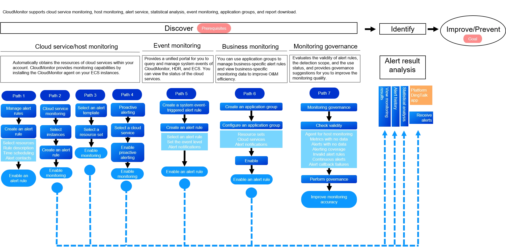
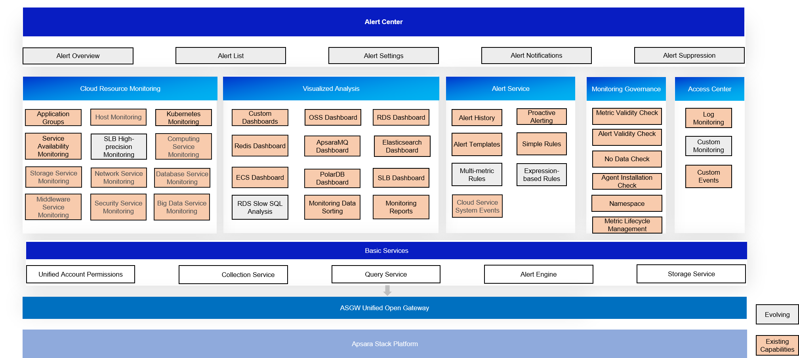

Alibaba Cloud  
Apsara Stack  
CloudMonitor  
Product Introduction  
Product Version: V3.18.6  
Document Version: 20260629

**Table of Contents**

- [1.CloudMonitor](#section-1)
    - [1.1. Features](#section-1-1)
    - [1.2. Architecture](#section-1-2)
    - [1.3. Benefits](#section-1-3)
    - [1.4. Scenarios](#section-1-4)

# 1.CloudMonitor

This topic describes the overview of CloudMonitor and the features provided by CloudMonitor.

**Overview**

CloudMonitor provides an out-of-the-box, all-in-one, and enterprise-class monitoring solution that monitors resources in Apsara Stack.

CloudMonitor provides a variety of features, including cloud service monitoring, host monitoring, alerting, statistical analysis, event monitoring, application group management, report export, namespace management, service availability monitoring, custom dashboards, event center, and log monitoring. You can use CloudMonitor to monitor the events and custom metrics of various cloud services, such as Elastic Compute Service (ECS), Server Load Balancer (SLB), Object Storage Service (OSS), and Simple Log Service (SLS).

CloudMonitor helps you monitor resources in a comprehensive and efficient manner. It not only improves the availability of system services but also reduces the O&M costs of IT infrastructure.

**Features**

## 1.1. Features

This topic describes the features of CloudMonitor for Apsara Stack.

| Feature | Description |
| --- | --- |

- Monitoring Overview: The Monitoring Overview tab displays the number of cloud services with active alarms, number of triggered alarm rules (excluding disabled alarm rules), number of system events reported by cloud services based on non-time series metrics, historical alarms that are generated from time-series metrics, and cloud resources currently being monitored.

- Governance Detection: This feature analyzes resource instance metrics and alarm rules in the current organization and resource set. It evaluates and diagnoses the validity of these metrics and alarms, and provides suggestions to help you

Overview

reslove issues with a few clicks. This feature provides Immediate Detection and Re-detection. The metric states include Normal, Existing problems, Proposed governance, Detect abnormalities, In detection, and Detection failed.

- ASCM custom roles allow you to assign differentiated access permissions to various O&M accounts. When an account logs into the CloudMonitor platform to view monitoring data on the current page, the system displays only the data for product lines that the account is authorized to access.

CloudMonitor provides a standard visualized interface to help you quickly identify abnormal cloud services. You can click a cloud service name to go to the corresponding alert list and details page for troubleshooting.

- Alert (not closed): This section displays the distribution of active, unclosed alerts in the resource set of the current organization. Alerts are categorized into four severity levels: Serious, Warning, Information, and Notification.

- Trend of Total Alerts: This section displays the trend of the total number of alerts in the resource set of the current organization over the past seven days.

Alert Overview

- Alerting (auto-scroll): This section displays the active alerts in the resource set of the current organization in real time.

- Notification Success Rate: This section displays statistics on the success rate of notifications sent based on notification policies in the resource set of the current organization.

- Alert Ranking: This section ranks the cloud services that trigger the most alerts in the resource set of the current organization.

- Cloud Product Alert Statistics: This section displays the distribution of alerts from different alert sources in the resource set of the current organization.

- Alerts: The section displays the active alerts, closed historical alerts, and their trends. You can search for specific alerts on this page.

- Alert processing:

  - You can handle or close active alerts.

Alert List

- On the alert details page, use the One-Click Diagnosis feature to analyze the alert in detail and get handling suggestions.

- Alert details: displays detailed information about an alert.

Alert Center

Alert Rules integrate the alert rule capabilities of ARMS, SLS, and Prometheus. If any of these products

Alert Rule

are not deployed, their corresponding alert rules will be unavailable.

- You can create and manage notification policies. Based on these policies, CloudMonitor sends alert notifications via webhook URLs, email addresses, and DingTalk accounts configured under the cloud management account.

- You can filter alerts, merge alerts, and reduce

Notification Policy

noises. This feature is designed to reduce low-priority or unnecessary alert notifications, prevent overflowing alerts and scattered information, and help you focus on high-priority and concerned alerts.

- The notification policy list displays all existing policies. You can modify, disable, enable, and delete them.

- You can configure temporary or permanent suppression policies for alerts. Alerts matching a suppression policy will no longer be ingested into CloudMonitor.

Suppression Policy

- The suppression policy list displays all existing policies. You can modify, disable, enable, and delete them.

After the CloudMonitor agent is installed on your Elastic Compute Service (ECS) instances, CloudMonitor can collect various monitoring data of metrics about the operating system that the ECS instances run. You can configure alert rules for these metrics to optimize monitoring costs.

- You can retrieve and display the ECS instance list.

- Monitoring chart: CloudMonitor displays time-series charts for various host metrics of individual ECS instances.

- Alert rule: You can configure a single threshold-based alert rule for each metric. The rules can be triggered during consecutive or non-consecutive periods.

- Agent installation: By default, when you create an

Host monitoring

ECS instance, the CloudMonitor agent is automatically installed. If the installation fails, you can reinstall it. Batch installation on multiple ECS instances is also supported.

- Agent O&M: You can perform the following O&M operations on the agent: install the agent on existing ECS instances where it is missing, upgrade the agent on existing ECS instances, or install and upgrade the agent to the latest version on existing ECS instances.

- Plugin installation failure detection: CloudMonitor provides details of plugins that fail to install.

- Plugin upgrade: You can update a plugin when a new version is released to enable more comprehensive data collection.

Click a product to view monitoring charts and alert rules for its connected instances. This covers more

Cloud Service

than 60 mainstream cloud products across categories

Monitoring

such as computing, storage, networking, databases, big data, security, middleware, and more, providing more thanr 1,000 metrics and 200 events.

Cloud Resource Monitoring

Monitor the performance of fundamental resources at the Kubernetes cluster, node, and pod levels to learn about cluster health and promptly identify and resolve issues. Kubernetes container monitoring provides the following capabilities.

- Configure alert rules to monitor Kubernetes clusters.

- Synchronize and view the information about Kubernetes clusters in a list. The information

Kubernetes

includes cluster name, cluster ID, health status, and

Container

number of nodes.

Monitoring

- Monitor individual clusters and view time-series charts for CPU, memory, and file system metrics.

- Configure alert rules for metrics related to CPU, memory, and file system of individual clusters.

- Prometheus Monitoring 2.0 is supported. You can also view monitoring details of core components, nodes, applications, networks, GPUs, and big data/AI.

Application groups allow you to manage ECS instances by group, such as centrally managing business-specific

Application Group

ECS instances. You can manage alert rules and view monitoring data by application group, which simplifies management and improves monitoring efficiency.

You can view Time series indicator and System Events.

- Time series indicator: CloudMonitor provides a unified query interface for cloud service metrics and visual monitoring charts, facilitating metric data analysis and visualization.

Namespace

- System Events: CloudMonitor provides a query interface for cloud service system events, displaying details such as the event name, description, level, status, and type.

Holographic View is a unified exploration and analysis entry centered on AI-observable cloud service instance entities in CloudMonitor. Through entity queries, you can quickly locate and analyze various AI-observable entities modeled in CloudMonitor, enabling seamless exploration from a global perspective down to detailed views.

Holographic View

- Globally Observability: View detailed data in the following sections: Data Center, Workflow, Model call, Tool call, Model Training, Agent, Model reasoning, and Basic cloud services.

- Global Topology: View detailed information across the MaaS/AI application layer, PaaS platforms and data layer, and IaaS infrastructure layer.

Agent provide analysis of exceptions, performance, and traffic of agents.

- Workspace: View monitoring metric details for Q&A, workflows, model calls, script execution, tool calls,

Agent

and asynchronous tasks.

- Basic Resources: View monitoring metric details for overview, core components, nodes, applications, networks, GPUs, and big data/AI.

Data Centers monitor data processing tasks and basic runtime operations.

On the workspace details page, you can view the

Data Center

instance name, resource set, organization, creation time, and monitoring metrics for CPU, memory, and network.

Model Inference includes connected Online Services,

AI Observability

Online Service Group, and Batch Inference.

Model Inference

Monitoring items include CPU, memory, disk, and network I/O consumption.

Model Training includes connected Notebook Modeling, Model Tuning, Visual Modeling, Model Evaluation, and Task Modeling.

Model Training

Monitoring items include CPU, memory, disk, and network I/O consumption for tasks, as well as CPU, memory, and disk monitoring for associated pod groups.

AI Computing Power consists of AI Compute, AI Storage, and AI Gateway. Computing monitoring items include CPU, memory, disk, and other resource consumption, GPU usage and temperature monitoring, and RDMA network monitoring. Storage monitoring

AI Computing Power

items include storage usage, IOPS, and bandwidth. Gateway monitoring items include uplink and downlink requests, success rate, and duration.

You can create custom dashboards to monitor, analyze, and display key metrics. This helps you understand and manage data intuitively and efficiently.

- System dashboard: A total of 12 default dashboards are provided. The default dashboards display data of all core metrics in the current organization, including the preset metrics of multiple instances of a single cloud service. Default dashboards include API Gateway, DNS, MQ, Elasticsearch on K8s, OSS, SLB, ECS, PolarDB-X, Redis(Cluster), Redis (Standard), RDS-PG(cloud storage), RDS-PG(Local SSD), RDS-PolarDB, and RDS-MYSQL. You can only copy and favorite default dashboards.

- Custom dashboard:

  - Dashboard list: You can manage dashboards in custom directories. You can favorite, delete, copy, modify, and move custom dashboards, and specify a custom dashboard as the default dashboard.

Visualization

Custom Dashboard

- Directory creation: You can create two levels of directories. Subdirectories cannot be created in a level-2 directory.

- Dashboard creation: You can create custom dashboards and change the layout of charts on a dashboard. The system automatically displays N charts per row on a dashboard based on a layout template. By default, five layout templates are supported. Four chart types are supported: line chart, top-n chart, pie chart, and heatmap. You can customize a chart, including auxiliary lines, legends, and axes. You can also create a dashboard using a JSON model.

- Dashboard data: You can create visualized data charts for top-N metrics of multiple instances of cloud services in the current organization and resource set based on the data provided by CloudMonitor.

You can specify filter conditions, such as the cloud service, instance, and alert level to view the alert

Alert History

history. You can also export and download the alert history to your on-premises machine for data analysis.

You can configure alert rules for metrics in host monitoring and instances in cloud service monitoring. You can apply an alert rule to all resources, an application group, or an instance. CloudMonitor sends alert notifications to contacts via emails, DingTalk messages, and webhook URLs.

- Alert rule creation: You can create alert rules for cloud services that are connected to CloudMonitor, such as ECS. If the metric threshold specified in an alert rule is reached, CloudMonitor generates an alert and sends a notification to the specified

Alert Rule

contact.

- Alert rule management: You can modify, disable, enable, or delete alert rules in the alert rule list.

- Rule validity diagnosis: You can diagnose each alert rule to check whether the alert rule can be loaded by the alert engine and whether the alert rule can be triggered to generate alerts as expected.

- Rule execution record: You can view the execution records of each alert rule, including the execution time and returned results.

- General Template: General alert templates preconfigure common alert rules based on primary cloud service scenarios and business practices, enabling you to rapidly establish monitoring and alerting capabilities for cloud resources. CloudMonitor provides preset general alert templates for cloud services. You can apply general templates directly to resource sets or application groups to quickly implement monitoring and alerting

Alert Template

for common cloud service metrics. Additionally, you can clone a general template when creating a custom template to rapidly tailor it to your specific business needs. Default templates cannot be deleted or modified.

- Custom Template: You can manage custom alert templates that are created in each organization and resource set. You can delete, modify, clone, and apply custom alert templates.

Alerting

This feature associates default alert rules with cloud service resources within all organizations and resource sets under the current level-1 organization. This way, you can enable the alert service with ease. Instance exclusion for One-Click Alert supports single-level rules only.

- One-click enable: CloudMonitor associates default alert rules with cloud services within all organizations and resource sets under the current level-1 organization to complete One-Click Alert setup and activation.

- One-click disable: You can disable One-Click Alert for cloud services. Once disabled, CloudMonitor deletes corresponding alert rules from the alert rule list.

- Exclude resources: The application scope for each cloud service in one-click alerts defaults to all instance objects under the current level-1

One-Click Alert

organization. To exclude specific resources, select resource set resources under the organization for individual exclusion to prevent alert binding. By default, the scope of One-Click Alert for each cloud service includes all instances under the current level-1 organization. To exclude specific resources, you can select individual resources under the organization and resource set to prevent them from being associated with alert rules.

- Custom alert rules: You can directly modify, disable, or delete system alert rules. You can also create custom alert rules for individual cloud service.

- Batch edit: You can batch edit parameters, such as Silence channel period, Effective time, Alarm callback, No data processing method, and Alarm contact group for alert rules under each cloud service.

- Alarm History: On this tab, you can export alerts generated within a specific time range as an Excel file. You can also create and delete report download tasks.

- Alarm Rules: On this tab, you can export alert rules in the current resource set of the organization as an

Report Export

Excel file. You can also create and delete report download tasks.

- Alarm Template: On this tab, you can export custom and general templates in the current resource set of the organization as an Excel file. You can also create and delete report download tasks.

Availability Monitoring periodically probes specified local or remote paths and ports for normal responses. When response times out or an error code is returned, CloudMonitor sends an alert notification to help you quickly detect unresponsive local or remote services. Availability monitoring allows you to use any ECS instance as the monitoring node.

- Task creation: You can create and manage tasks to

Service Availability

monitor service availability using HTTP, Telnet, or

Monitoring

PING from one, multiple, or all ECS instances.

Availability

- Task list: You can query data in the task list. You can

Monitoring

disable, enable, modify, and delete tasks.

- Monitoring chart: CloudMonitor provides monitoring charts to display the data of availability monitoring tasks. You can view data generated within the last 31 days at most in each monitoring chart.

Cloud Service

You can use probes deployed on ECS instances to

Availability

perform one-click connectivity monitoring for cloud

Monitoring

service instances over the ICMP or TCP protocol.

The Event Center module provides a unified entry for you to query and collect data of system events of cloud services. You can view the status of the cloud services and receive alert notifications. This helps you troubleshoot business exceptions at the earliest opportunity.

- Event Monitoring: This tab displays events and products that are connected to CloudMonitor. The System Event Distribution Map section displays the distribution of system events reported over a period.

Event Center

System Event

The System Events section displays system events reported over a period.

- Event Alarm Rules: You can configure alert rules for cloud service system events. If exceptions occur, CloudMonitor generate alerts and sends notifications to contacts. You can also modify, disable, enable, and delete alert rules configured for system events.

- Event Alarm History: This tab displays the list of system events. You can filter the events by rule ID or rule name.

CloudMonitor lets you sort the top 1,000 instances of a cloud service in an organization. You can use CloudMonitor to sort and analyze the monitoring data of supported cloud services in a specific organization.

- Sort: You can sort the monitoring data in the resource set of the current organization based on

Monitoring Sort

the cloud service, metric, sorting order (ascending or descending), and metric aggregation value (average value, sum of values, current value, maximum value, and minimum value).

- Report export: You can click Export data to quickly

Statistical analysis

export historical data. This capability comes from the Apsara Uni-manager Management Console.

You can create data subscription tasks, and consume or view data subscribed from Simple Log Service (SLS). You can create a data subscription task only for a

Data Subscription

level-1 organization. If you have multiple level-1 organizations, you must create a subscription task for each level-1 organization. You can view, modify, delete, disable, and enable data subscription tasks.

You can monitor keywords in SLS logs, and detect potential issues at the earliest opportunity. This improves system stability and O&M efficiency.

- By monitoring keywords in SLS logs, CloudMonitor records the number of times that specific keywords

Log Monitoring

appear in the slow query logs, error logs, and detailed logs of ApsaraDB RDS. You can also configure alert rules for logs.

- In the log monitoring list, you can view, edit, delete, and copy log monitoring items.

The metric monitoring feature provides an API for you to report custom metrics. This lets you collect and report business-generated metrics to Cloud Monitor and receive alert notifications by configuring alert rules for the reported metrics.

- Metric Monitoring: You can add, edit, clone, and

Custom Monitoring

delete metrics.

- Alert Rule: You can create and manage alert rules.

Access Center

You can view alert rule details, check rule validity, and view rule execution records. You can also modify, disable, enable, and delete alert rules.

You can use this entry to report custom events in your business. After configuring alert rules for these events, you can receive alert notifications.

- Event Monitoring: CloudMonitor provides an SDK demo to show you how to report custom events using the SDK. The Custom Event Distribution section displays the distribution of custom events that are reported over a period of time. The Custom Event Monitoring section displays the custom events

Custom Event

that are reported over a period of time.

- Event alarm rules: You can report events of cloud services over HTTP to CloudMonitor and create event-triggered alert rules. You can also modify, disable, enable, or delete these alert rules.

- Event Alarm History: This tab displays the list of custom events. You can filter the events by rule ID or rule name.

## 1.2. Architecture

This topic describes the architecture of CloudMonitor.

CloudMonitor has the following modules: alert center, cloud service monitoring, visualized analysis, alert service, monitoring governance, and access center. The following figure shows the architecture.

Description:

- Alert center: In the entire monitoring business architecture, the alert center acts as a unified alerting platform for tenant-side operations. It provides features such as alert overview, alert list, alert settings, alert notifications, and alert suppression.

- Cloud resource monitoring: You can monitor the instances of cloud services based on various metrics. CloudMonitor allows you to view details about the metrics of cloud services in the console.

- Visualized analysis: You can customize dashboards across organizations and resource sets. CloudMonitor provides dashboards for cloud services such as Object Storage Service (OSS), ApsaraDB RDS, and ApsaraDB for Redis. The dashboards help you analyze hot and abnormal instances. You can also track data changes and consume data based on reports.

- Alert service: You can configure alert rules that are triggered by metrics and system events for cloud service instances. CloudMonitor provides single-metric rules, multi-metric rules, alert templates, and proactive alerting.

- Monitoring governance: CloudMonitor provides metric validity check, alert validity check, data reporting check, Elastic Compute Service (ECS) collection plug-in, metric namespace, and lifecycle management.

- Access center: CloudMonitor provides custom data integration for logs, metrics, and events.

## 1.3. Benefits

This topic describes the benefits of CloudMonitor.

- **Out-of-the-box features**

  CloudMonitor is easy to use. No additional activation or purchase is required. After you purchase and use cloud resources, you can directly access cloud service monitoring to view the status of the resources. You can enable alerting for all resources to quickly configure alert rules for cloud services and quickly build a basic monitoring system without any barriers.

- **One-stop monitoring** CloudMonitor allows you to monitor distributed resources in a unified manner. Hybrid Cloud Monitoring provides metric namespaces. You can collect resource data that is scattered across multiple accounts, provided by different cloud service providers, and deployed on and off the cloud for unified monitoring. This eliminates the cumbersome operation of switching between different platforms.

- **Flexible and diverse response set capabilities**

  CloudMonitor responds quickly when problems are identified. CloudMonitor supports multiple alert notification methods, auto scaling, integration with other cloud services, and integration with third-party systems. CloudMonitor provides multiple and flexible methods to meet the demands of problem notification, coordinated handling, and system integration.

## 1.4. Scenarios

This topic describes the application scenarios of CloudMonitor (CMS).

| Scenario | Description | Related service |
| --- | --- | --- |
| Cloud resource monitoring and alerting | After you purchase cloud resources, you can view reports and configure alert rules in the CloudMonitor console. This helps you quickly build infrastructure-oriented monitoring and alerting capabilities in the early stage of service launch. It avoids the time and cost of building and maintaining a monitoring system independently when human resources are limited, and ensures infrastructure exceptions are promptly detected. | Function Compute and Auto Scaling |
| Automated response based on events | In addition to the key system events of cloud resources, CloudMonitor can connect exception events defined based on metric threshold rules to the event center. You can subscribe to these events in the event center.CloudMonitor delivers the events to your downstream cloud services such as Message Service and Function Compute in real time. This allows you to process these exception events and status changes through programs, facilitating rapid fault self-healing . | Function Compute, Message Service, and Simple Log Service |

<table>
  <tr>
    <td>Unified monitoring in cross-account, multi-cloud, and hybrid cloud scenarios</td>
    <td>As enterprises move their business to the cloud, they inevitably face the challenge of unified monitoring in cross-account, multi-cloud, and hybrid cloud scenarios. You can use the private data warehouse of Hybrid Cloud Monitoring to aggregate, process, display, and alert on resource monitoring data from different cloud service providers, distributed across the cloud and multiple accounts, thereby achieving integrated resource monitoring.</td>
    <td>Simple Log Service</td>
  </tr>
</table>
