Alibaba Cloud  
Apsara Stack  
CloudMonitor  
User Guide  
Product Version: V3.18.6  
Document Version: 20260629

**Table of Contents**

- [1.Overview](#section-1)
- [2.Overview](#section-2)
- [3.Alert center](#section-3)
    - [3.1. Alert overview](#section-3-1)
    - [3.2. Alert list](#section-3-2)
    - [3.3. Alert rules](#section-3-3)
    - [3.4. Notification policy](#section-3-4)
    - [3.5. Blocking policies](#section-3-5)
- [4.Cloud resource monitoring](#section-4)
    - [4.1. Host monitoring](#section-4-1)
        - [4.1.1. Install the CloudMonitor agent](#section-4-1-1)
        - [4.1.2. Process monitoring](#section-4-1-2)
        - [4.1.3. View host monitoring details](#section-4-1-3)
    - [4.2. Cloud product monitoring](#section-4-2)
        - [4.2.1. CloudMonitor metrics](#section-4-2-1)
            - [4.2.1.1. Elastic computing](#section-4-2-1-1)
                - [4.2.1.1.1. Kubernetes container monitoring](#section-4-2-1-1-1)
                - [4.2.1.1.2. Elastic Compute Service](#section-4-2-1-1-2)
                - [4.2.1.1.3. Bare metal computing platform (BMCP) (node)](#section-4-2-1-1-3)
                - [4.2.1.1.4. Bare Metal Computing Platform (BMCP)](#section-4-2-1-1-4)
                - [4.2.1.1.5. BMCP (Container-based AI Compute Cluster)](#section-4-2-1-1-5)
                - [4.2.1.1.6. BMCP (Bare metal compute platform)](#section-4-2-1-1-6)
                - [4.2.1.1.7. Bare Metal Service (BMS)](#section-4-2-1-1-7)
            - [4.2.1.2. Database services](#section-4-2-1-2)
                - [4.2.1.2.1. ApsaraDB RDS](#section-4-2-1-2-1)
                - [4.2.1.2.2. ApsaraDB for RDS: New connection](#section-4-2-1-2-2)
                - [4.2.1.2.3. PolarDB Cluster Edition](#section-4-2-1-2-3)
                - [4.2.1.2.4. PolarDB High-availability Edition](#section-4-2-1-2-4)
                - [4.2.1.2.5. PolarDB for MySQL HTAP Edition](#section-4-2-1-2-5)
                    - [4.2.1.2.5.1. PolarDB integrated edition (computing node)](#section-4-2-1-2-5-1)
                    - [4.2.1.2.5.2. PolarDB for X-Engine (HTAP) (data node)](#section-4-2-1-2-5-2)
                - [4.2.1.2.6. ApsaraDB for MongoDB](#section-4-2-1-2-6)
                - [4.2.1.2.7. ApsaraDB for MongoDB (New)](#section-4-2-1-2-7)
                - [4.2.1.2.8. ApsaraDB for Redis](#section-4-2-1-2-8)
                - [4.2.1.2.9. ApsaraDB for Redis (New Link)](#section-4-2-1-2-9)
                - [4.2.1.2.10. AnalyticDB for PostgreSQL](#section-4-2-1-2-10)
                - [4.2.1.2.11. AnalyticDB for PostgreSQL (new pipeline)](#section-4-2-1-2-11)
                - [4.2.1.2.12. Data Transmission Service (DTS)](#section-4-2-1-2-12)
                    - [4.2.1.2.12.1. DTS subscription tasks](#section-4-2-1-2-12-1)
                    - [4.2.1.2.12.2. Data transmission service (DTS) (migration tasks)](#section-4-2-1-2-12-2)
                    - [4.2.1.2.12.3. Data transmission service (DTS) - Synchronization jobs](#section-4-2-1-2-12-3)
                - [4.2.1.2.13. Lindorm Database](#section-4-2-1-2-13)
                - [4.2.1.2.14. Cloud-native multi-model database Lindorm 2.0](#section-4-2-1-2-14)
            - [4.2.1.3. Storage and CDN](#section-4-2-1-3)
                - [4.2.1.3.1. NAS](#section-4-2-1-3-1)
                - [4.2.1.3.2. Object Storage Service (OSS)](#section-4-2-1-3-2)
                - [4.2.1.3.3. CPFS](#section-4-2-1-3-3)
                - [4.2.1.3.4. APFS](#section-4-2-1-3-4)
                - [4.2.1.3.5. Apsara File Storage NAS](#section-4-2-1-3-5)
            - [4.2.1.4. Network](#section-4-2-1-4)
                - [4.2.1.4.1. NAT Gateway](#section-4-2-1-4-1)
                - [4.2.1.4.2. Server Load Balancer (SLB)](#section-4-2-1-4-2)
                - [4.2.1.4.3. Application Load Balancer](#section-4-2-1-4-3)
                - [4.2.1.4.4. Elastic IP Address](#section-4-2-1-4-4)
                - [4.2.1.4.5. VPN Gateway](#section-4-2-1-4-5)
                - [4.2.1.4.6. Alibaba Cloud DNS - PrivateZone](#section-4-2-1-4-6)
                - [4.2.1.4.7. Alibaba Cloud DNS - Tenant-forwarded domain name](#section-4-2-1-4-7)
                - [4.2.1.4.8. Cloud Enterprise Network](#section-4-2-1-4-8)
            - [4.2.1.5. Middleware services](#section-4-2-1-5)
                - [4.2.1.5.1. Message Queue for Apache RocketMQ](#section-4-2-1-5-1)
                - [4.2.1.5.2. ApsaraMQ for RocketMQ](#section-4-2-1-5-2)
                - [4.2.1.5.3. ApsaraMQ for Kafka](#section-4-2-1-5-3)
                - [4.2.1.5.4. API Gateway](#section-4-2-1-5-4)
            - [4.2.1.6. Big data](#section-4-2-1-6)
                - [4.2.1.6.1. DataHub](#section-4-2-1-6-1)
                - [4.2.1.6.2. Alibaba Cloud Elasticsearch](#section-4-2-1-6-2)
                - [4.2.1.6.3. MaxCompute](#section-4-2-1-6-3)
                - [4.2.1.6.4. MaxCompute quota group](#section-4-2-1-6-4)
            - [4.2.1.7. Security (Apsara Stack Security)](#section-4-2-1-7)
                - [4.2.1.7.1. Bastion Host](#section-4-2-1-7-1)
                - [4.2.1.7.2. Static data masking and watermarking](#section-4-2-1-7-2)
                - [4.2.1.7.3. Vulnerability scan engine](#section-4-2-1-7-3)
                - [4.2.1.7.4. NFV Cloud Firewall](#section-4-2-1-7-4)
                - [4.2.1.7.5. Web Application Firewall](#section-4-2-1-7-5)
            - [4.2.1.8. AI and machine learning](#section-4-2-1-8)
                - [4.2.1.8.1. AI Studio (online service)](#section-4-2-1-8-1)
                - [4.2.1.8.2. AI Studio (Model Evaluation)](#section-4-2-1-8-2)
                - [4.2.1.8.3. AI Studio (Notebook modeling)](#section-4-2-1-8-3)
                - [4.2.1.8.4. AI Studio (Task Modeling)](#section-4-2-1-8-4)
                - [4.2.1.8.5. AI Studio (Visualized Modeling)](#section-4-2-1-8-5)
                - [4.2.1.8.6. AI Studio (Model finetuning)](#section-4-2-1-8-6)
                - [4.2.1.8.7. AI Studio (Batch Inference)](#section-4-2-1-8-7)
                - [4.2.1.8.8. AI Studio (Online service group)](#section-4-2-1-8-8)
                - [4.2.1.8.9. AI Studio (resource pool)](#section-4-2-1-8-9)
                - [4.2.1.8.10. A-Speed](#section-4-2-1-8-10)
                - [4.2.1.8.11. Elastic Fault-tolerant Service](#section-4-2-1-8-11)
        - [4.2.2. Manage cloud service monitoring](#section-4-2-2)
    - [4.3. Kubernetes container monitoring](#section-4-3)
    - [4.4. Application group](#section-4-4)
        - [4.4.1. Create an application group](#section-4-4-1)
        - [4.4.2. Manage application groups](#section-4-4-2)
        - [4.4.3. Availability monitoring](#section-4-4-3)
            - [4.4.3.1. Create an availability monitoring task](#section-4-4-3-1)
            - [4.4.3.2. Manage availability monitoring tasks](#section-4-4-3-2)
            - [4.4.3.3. Status codes](#section-4-4-3-3)
    - [4.5. Namespaces](#section-4-5)
        - [4.5.1. Time-series metrics](#section-4-5-1)
        - [4.5.2. System events](#section-4-5-2)
            - [4.5.2.1. Cloud product event monitoring metrics](#section-4-5-2-1)
            - [4.5.2.2. View system event metrics](#section-4-5-2-2)
- [5.AI observability](#section-5)
    - [5.1. Holographic View](#section-5-1)
    - [5.2. Agent](#section-5-2)
    - [5.3. Data center](#section-5-3)
    - [5.4. Model inference](#section-5-4)
    - [5.5. Model training](#section-5-5)
    - [5.6. AI computing power](#section-5-6)
- [6.Visualization](#section-6)
    - [6.1. Custom dashboards](#section-6-1)
- [7.Alert service](#section-7)
    - [7.1. Alert history](#section-7-1)
    - [7.2. Alert rules](#section-7-2)
        - [7.2.1. Create an alert rule](#section-7-2-1)
        - [7.2.2. Manage alert rules](#section-7-2-2)
        - [7.2.3. Notification methods supported by Cloud Monitor](#section-7-2-3)
    - [7.3. Alert templates](#section-7-3)
        - [7.3.1. General alert templates](#section-7-3-1)
        - [7.3.2. Create an alert template](#section-7-3-2)
        - [7.3.3. Manage alert templates](#section-7-3-3)
    - [7.4. One-click alarm](#section-7-4)
    - [7.5. Download a report](#section-7-5)
- [8.Availability monitoring](#section-8)
    - [8.1. Service availability monitoring](#section-8-1)
    - [8.2. Cloud service availability monitoring](#section-8-2)
- [9.Event Center](#section-9)
    - [9.1. System events](#section-9-1)
        - [9.1.1. Cloud service system events](#section-9-1-1)
        - [9.1.2. View system events](#section-9-1-2)
        - [9.1.3. Create a system event-triggered alert rule](#section-9-1-3)
        - [9.1.4. Manage system event-triggered alert rules](#section-9-1-4)
- [10.Statistical analysis](#section-10)
    - [10.1. Monitoring ranking](#section-10-1)
    - [10.2. Data subscription](#section-10-2)
- [11.Access Center](#section-11)
    - [11.1. Log monitoring](#section-11-1)
    - [11.2. Custom monitoring](#section-11-2)
    - [11.3. Report custom events](#section-11-3)

<a id="section-1"></a>

# 1.Overview

CloudMonitor provides an out-of-the-box all-in-one enterprise-grade monitoring solution for you to monitor resources on Apsara Stack.

**Background information**

CloudMonitor provides the following features: cloud service monitoring, host monitoring, alerting, alert center, statistical analysis, event monitoring, application group, report export, namespace, and availability monitoring. You can use CloudMonitor to collect data on the monitoring metrics of various cloud services, such as Elastic Compute Service (ECS), Server Load Balancer (SLB), Object Storage Service (OSS), and Simple Log Service (SLS). The metrics include event-based metrics and custom metrics.

CloudMonitor helps you implement comprehensive and efficient monitoring. You can improve system service availability and reduce the O&M costs of IT infrastructure.

**Usage notes**

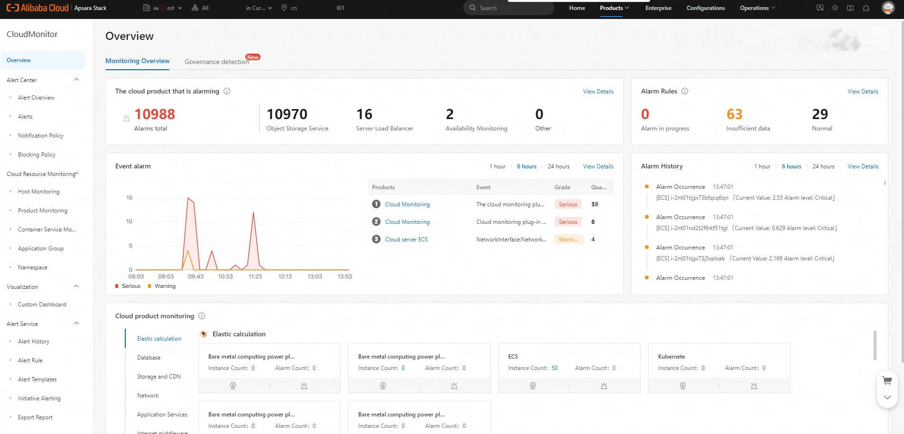

> **Important**
>
> - You can view the business data of CloudMonitor based on different dimensions. To do so, select an organization, a resource set, and a region in the top navigation bar of the CloudMonitor console.
>
> - Do not perform operations in the root organization.

> **Note**
>
> When you view information in a list, take note of the following points:
>
> - The  ,  ,  , and  buttons are displayed above the list. You can adjust the list
>
>   based on your business requirements.
>
>    : refreshes the list.
>
>    : displays information in the default or compact mode.
>
>    : shows or hides specific items in the list. Move the pointer over a display
>
>   item and click the  icon to the right of the display item to adjust the order
>
>   of the items.
>
>    : displays information in full screen mode.
>
> - You can resize the width of columns based on your business requirements. The column width configuration is stored in the local storage of the browser. If you clear the local storage, the configuration becomes invalid.

<a id="section-2"></a>

# 2.Overview

**Background**

In CloudMonitor, use custom roles to assign specific access permissions to operations accounts. When a user logs on, the console displays only monitoring data for product lines permitted by their assigned role. This granular control secures and isolates monitoring data, prevents sensitive information leaks, and simplifies the user interface. It helps operations personnel focus on their designated product lines, improving efficiency and data security.

**Monitoring overview**

The CloudMonitor overview provides a comprehensive view of your resource usage, service status, and overall health on Alibaba Cloud. It sends timely alerts for anomalies so you can respond quickly and ensure your applications run smoothly. The Monitoring Overview page consists of five modules: Cloud Services in Alarm, Alert Rules, Event Alerts, Alert History, and Cloud Service Monitoring.

1. Log on to the Apsara Uni-manager Operation Console.

2. In the top menu bar, click **Products** and choose **Migration & O&M Management** > **O&M and Monitoring** > **CloudMonitor**.

3. In the left-side navigation pane, click **overview**.

4. On the **overview** page, click the **Monitoring Overview** tab to view the overview information.

   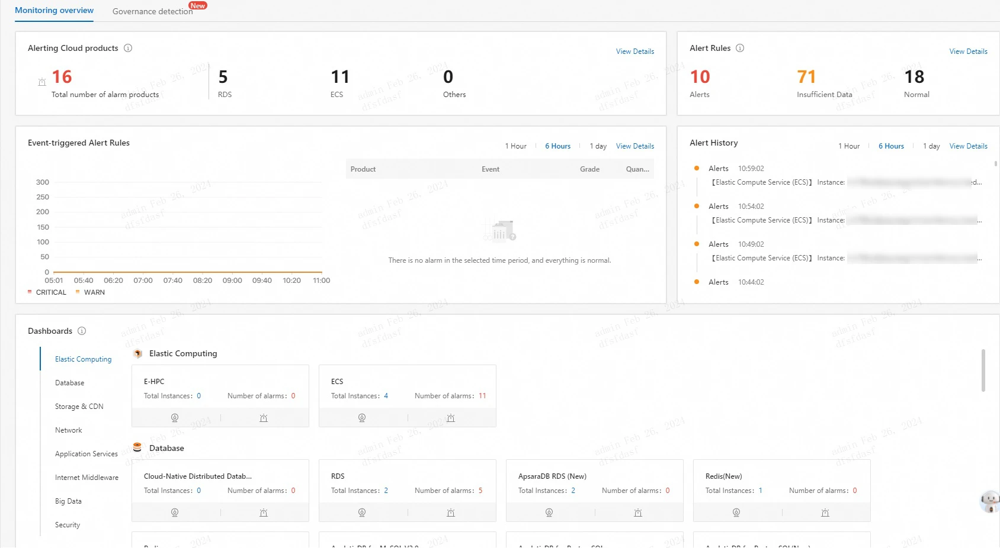

   | Module | Description |
   | --- | --- |
   | Cloud Services in Alarm | • Displays the number of active alerts for cloud services with alerting enabled in CloudMonitor.<br>• Click <strong>View Details</strong> to go to the <strong>Alert History</strong> page and view detailed alert information. |
   | Alert Rules | • Displays the number of alert rules with the status <strong>In Alarm</strong>, <strong>Insufficient</strong> <strong>Data</strong>, or <strong>OK</strong>.<br>Note<br>An <strong>alert rule</strong> may have the <strong>Insufficient Data</strong> status for the following reasons:<br>• The cloud service is not reporting data for the specified metric.<br>• The cloud service instance was deleted.<br>• The cloud service instance was not created in or is missing from the Logstore and requires investigation.<br>• Click <strong>View Details</strong> to go to the <strong>Alert Rules</strong> page and view detailed information about the alert rules. |
   | Event Alerts | • Event alerts report the status of system events for cloud services, helping you quickly analyze and resolve issues when a service fails.<br>• Click <strong>View Details</strong> to go to the <strong>System Events</strong> page and view detailed event alert information. |
   | Alert History | • Shows details of active alerts for all monitored cloud services.<br>• Click <strong>View Details</strong> to go to the <strong>Alert History</strong> page and view detailed alert information. |
   | Cloud Service Monitoring | • CloudMonitor automatically retrieves the total number of instances and alerts for the cloud service resources under your account.<br>• Click the name of a cloud service to go to its monitoring page, where you can view monitoring charts and alert rules for each instance.<br>• Clickto view the alert rules for the cloud service.<br>• Clickto view the monitoring information for the cloud service. |

**Governance and inspection**

The governance and inspection feature analyzes metrics and alert rules for resource instances in the current resource group. It then evaluates metric validity and alert effectiveness to provide recommendations and one-click fixes.

1. On the **overview** page, click the **Governance and Inspection** tab to view the governance and inspection information.

   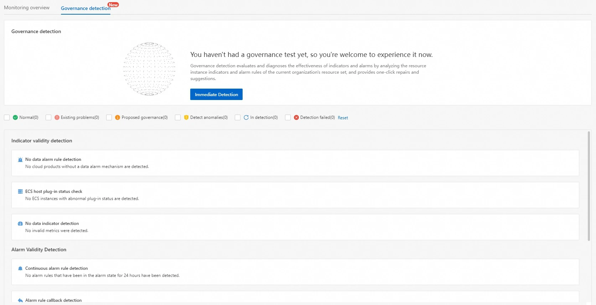

   | Module | Description |
   | --- | --- |
   | Inspection area | In the inspection area, click <strong>Inspect Now</strong> or <strong>Re-inspect</strong>.<br>Note<br>• If no inspection has been run, the button displays <strong>Inspect Now</strong>.<br>• If an inspection has been run, the button displays <strong>Re-inspect</strong>, and the results of the most recent inspection are shown. |

   <table>
     <tr>
       <td>Inspection Details</td>
       <td>If an inspection finds an issue, click <strong>View Details and Governance Guidance</strong> to the right of the inspection item. In the <strong>Inspection Details</strong> panel, you can view information about the inspection mechanism, its scope, and the affected objects.<br>• Metric Validity Inspection<br>• <strong>ECS Plugin Status Inspection</strong>: Checks whether the plugin status for all ECS instances is <code> Running </code>.<br>• <strong>No-Data Alert Rule Inspection</strong>: Verifies that for each cloud service metric, at least one instance in the resource group has an alert rule configured for <code> Insufficient Data </code>.<br>• <strong>No-Data Metric Inspection</strong>: Checks whether all metrics for a cloud service are receiving data.<br>• Alert Effectiveness Inspection<br>• <strong>Persistent Alert Rule Inspection</strong>: Checks whether any alert rule has remained in the <code> In Alarm </code> state for the last 24 hours.<br>• <strong>Alert Rule Callback Inspection</strong>: Checks for failed callbacks from any alert rule within the last 24 hours.<br>• <strong>Invalid Alert Rule Inspection</strong>: Checks for invalid alert rules on your cloud service resources.<br>• <strong>Cloud Service Alert Coverage Inspection</strong>: Checks if any cloud service resources have no alert rules configured.<br>Note<br>• If one-click alerting is enabled for all instances of a cloud service under the top-level organization, all instances of that service are considered covered by alert rules by default.<br>• If an alert rule for a cloud service applies to a specific resource group, all instances of that service within that resource group are considered covered.<br>• An instance is considered covered if at least one of its metrics has an alert rule.</td>
     </tr>
   </table>

<a id="section-3"></a>

# 3.Alert center

**Benefits**

- Provides a centralized interface to display the alert data of cloud services.

- Provides unified alert policies that can be configured for cloud services.

**Features**

| Feature | Description |
| --- | --- |
| Alert overview | You can view alert statistics and locate issues. |
| Alert list | You can view a list of active alerts, historical alerts, and alert trends. The list of active alerts includes alerts that are in the Pending and Processing states. The list of historical alerts includes alerts that are in the Closed state. |
| Notification policy | You can filter alerts, merge alerts, and reduce noises. This feature is designed to reduce low-priority or unnecessary alert notifications, prevent overflowing alerts and scattered information, and locate high-priority and concerned alerts. |
| Masking policy | You can block integrated alerts based on specific alert conditions. You can specify the time period, alert objects, alert levels, alert sources, and alert names. |

**Alert sources**

Alert data is obtained from the following alert sources:

- Application Real-Time Monitoring Service (ARMS)

- Simple Log Service (SLS)

- CloudMonitor

- DataWorks

- Managed Service for Prometheus

<a id="section-3-1"></a>

## 3.1. Alert overview

CloudMonitor provides a visualized interface to quickly identify abnormal cloud services. You can click a cloud service name to go to the corresponding monitoring list and details page for troubleshooting.

**Procedure**

1. Log on to the Apsara Uni-manager Management Console.

2. In the top navigation bar, choose **Products** > **Migration and O&M Management** > **O&M and Monitoring** > **CloudMonitor**.

3. In the left-side navigation pane, choose **Alert Center > Alert Overview.**

4. The **Alert Overview** page consists of the following seven sections that analyze and collect statistics on alert information from different perspectives.

   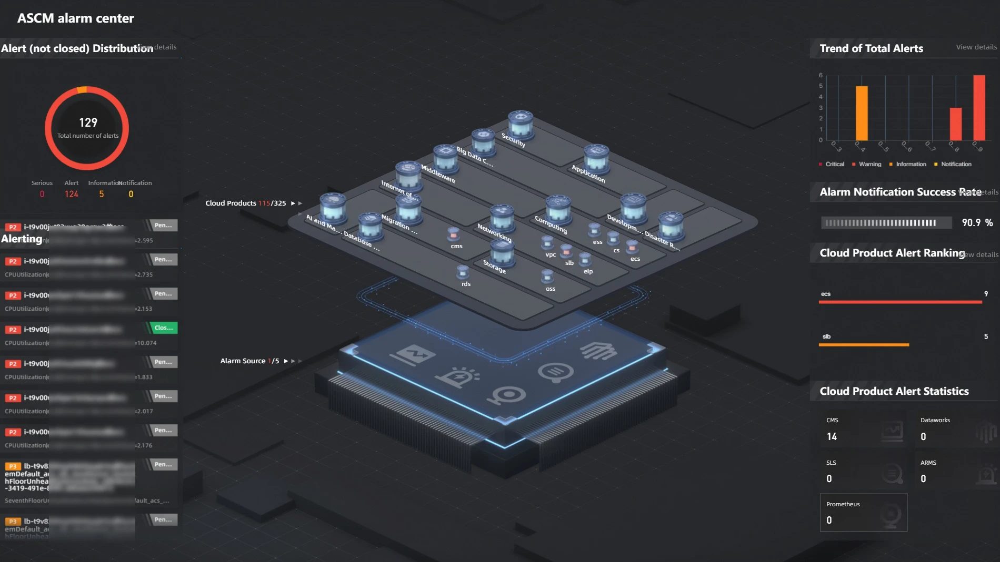

   - **Alert (not closed)**: provides the distribution of active alerts that are not resolved in the resource set of the current organization. The alerts are classified into Critical, Warning, Info, and Notification based on the alert level. Click **Details** to go to the **Alerts** page.

   - **Alerting**: displays the resources that triggered alerts in the resource set of the current organization in real time. Click **Details** to go to the alert details page.

   - **Trend of Total Alerts**: provides the trend of the total number of alerts in the resource set of the current organization over the past seven days.

     - Colors on each bar represent the alert levels. A darker color indicates a higher alert level.

     - A larger area of a color on a bar indicates more alerts of the corresponding levels.

     - Click **Details** to go to the **Alerts** page.

   - **Notification Success Rate**: provides statistics on the success rate of notifications that are configured with notification policies in the resource set of the current organization. Click **Details** to go to the **Notification policy** page.

   - **Alert Ranking**: provides the top list of alerts for all cloud services in the resource set of the current organization. Click **Details** to go to the **Alerts** page.

   - **Cloud Product Alert Statistics**: provides the distribution of alerts from different alert sources in the resource set of the current organization. Click the name of a cloud service to go to the **Alerts** page.

   - Middle section: Click the icon of a cloud service to display the alert status, alert source, and exception instance of the cloud service. Click **View Details** to go to the Instances page.

**What to do next**

After you obtain the alert overview information based on your requirements, you can view alert details in the alert list.

<a id="section-3-2"></a>

## 3.2. Alert list

The alert list displays active alerts, historical alerts, and alert trends. Alerts are grouped into two categories: active alerts, which have a processing status of  `pending`  or  `in progress` , and historical alerts, which have a processing status of  `closed` .

**Procedure**

1. Log in to the Apsara Uni-manager Operation Console.

2. In the top menu bar, click **Products** and choose **Migration & O&M Management** > **O&M and Monitoring** > **CloudMonitor**.

3. In the left-side navigation pane, select **alert center > alert list.**

4. The **alert list** page displays **active alerts** and **historical alerts**. By default, the **active alerts** tab is displayed. Click the **historical alerts** tab to switch to the **historical alerts** tab.

   - At the top of the **active alerts** tab, filter alerts by **alert ID**, **Alert Name**, **severity**, **alert source**, **resource**, **Product**, **alert message**, **extended attributes**, and a time range.

     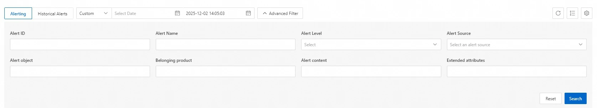

   - The **alert trend** section displays the number of alerts over time.

     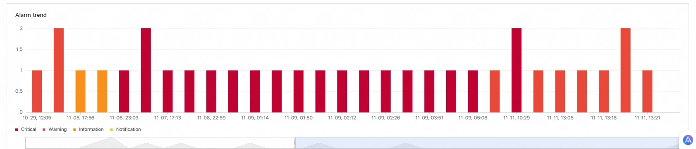

     - In each bar, colored sections represent different severities. Darker colors indicate higher severity.

     - Larger colored sections represent a greater number of alerts for the corresponding severity.

     - Hover over a bar to see the total count of alerts for each severity on that day.

   - The alert list includes columns such as **Alert ID/Name**, **Organization**, **severity**, **resource/Product**, **alert message**, **alert state**, **processing status**, **alert source**, **Occurrences**, **Start Time**, **Last Occurrence**, and **Duration (s).**

     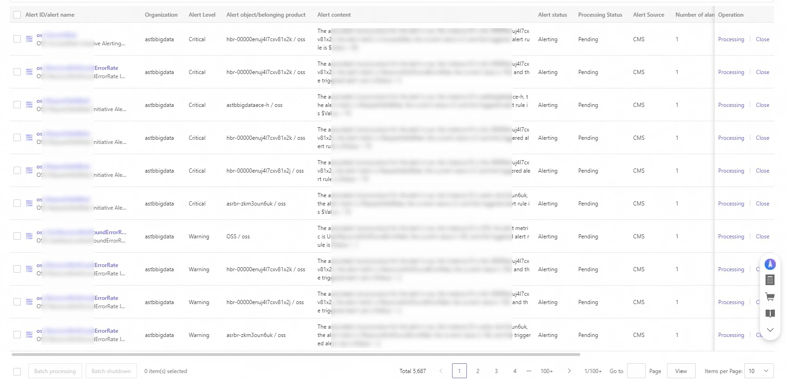

     - Click an alert's **Alert ID/Name** to view its details page.

       - In the upper-right corner of the page, click **Acknowledge** or **Close** to change the alert's processing status. The change is also recorded in the timeline.

       - In the upper-right corner of the page, click **One-click Diagnosis**. Apsara Assistant uses the alert ID to query details, run an automated analysis, and display a detailed summary report.

       - View basic information about the alert in the Basic Information section.

         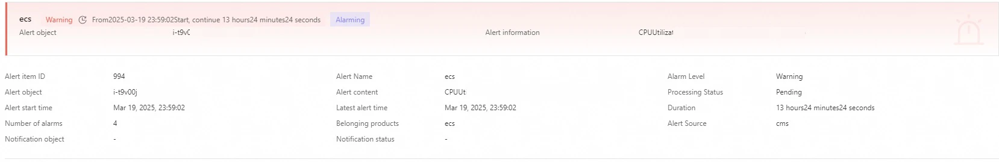

       - View additional information about the alert in the **Extended Attributes** section.

         > **Note**
         >
         > The displayed extended attributes vary depending on the alert.

       - In the **timeline** section, add events such as **Alert Triggered**, **Alert Investigation**, **root cause analysis**, **Alert Closed**, and **Alert Response**.

         Click **Add**. In the **Add Timeline Event** panel, configure **Select Node**, **Time**, and **Description**.

         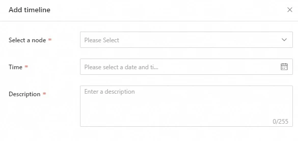

       - The **alert analysis** section shows detailed monitoring metrics and an alert trace diagram.

         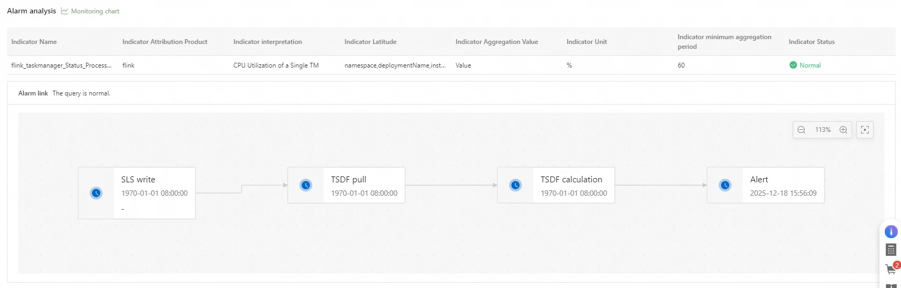

         Click **Monitoring Chart** to specify a custom time range and view the trend chart for monitoring metrics.

         > **Note**
         >
         > The alert analysis section does not appear for alerts that do not originate from CMS.

       - In the **Alert Feedback** section, view the **Alert Validity** and **Alert Accuracy**.

         > **Note**
         >
         > You can provide feedback on an alert's validity and accuracy when you close it.

         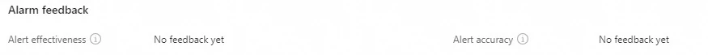

     - Once the triggering condition is resolved, the system periodically updates the alert state based on the corresponding alert rule. If the alert state is not updated promptly, you can manually change its processing status to **in progress** or **closed**.

       - To set the status to **in progress**:

         - Single alert: In the alert list, click **Acknowledge** in the **Actions** column for an alert to change its **processing status** to **in progress**.

         - Multiple alerts: Select the alerts and click **Batch Acknowledge**. This changes their **processing status** to **in progress**.

       - To set the status to **closed**:

         - Single alert: On the **alert list** page, click **Close** in the **Actions** column for an alert. Its **processing status** changes to **closed**, and the alert moves to the **historical alerts** tab.

         - Multiple alerts: Select the alerts and click **Batch Close**. This changes their **processing status** to **closed** and moves them to the **historical alerts** tab.

<a id="section-3-3"></a>

## 3.3. Alert rules

The alert center of Cloud Monitor integrates alert rule capabilities of Application Real-Time Monitoring Service (ARMS), Simple Log Service (SLS), and Managed Service for Prometheus. If the service is not deployed, you cannot use the alert rule capability of the service.

**ARMS**

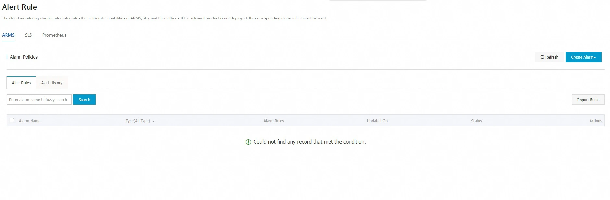

For more information about alert rules in ARMS and the operations that you can perform on historical alerts, see **Application Real-Time Monitoring Service** > **User Guide** > **Alerts** > **Create an alert rule**.

**SLS**

> **Note**
>
> If the system prompts that the operation is unauthorized, click **Authorization operation SLS permissions** and open the page again.

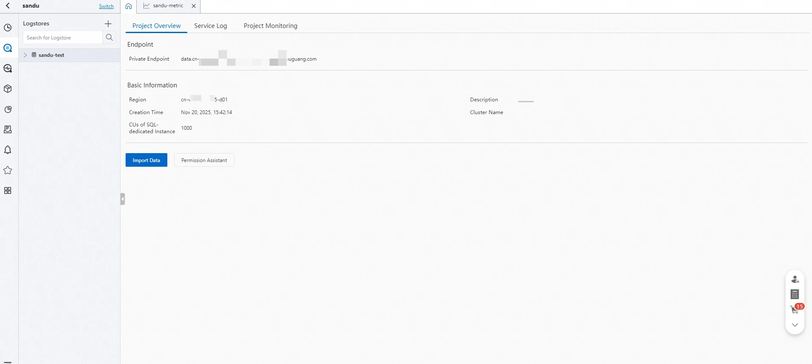

Cloud Monitor allows you to subscribe to the metric store of SLS. For more information, see **Simple Log Service** > **User Guide**.

**Prometheus**

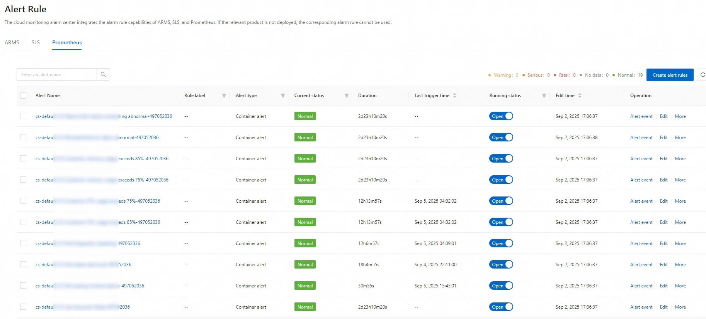

For more information about alert rules in Managed Service for Prometheus and the operations that you can perform on historical alerts, see **Simple Log Service** > **User Guide** > **Alerts** > **Configure an alarm**.

<a id="section-3-4"></a>

## 3.4. Notification policy

A notification policy lets you filter, consolidate, and reduce noise from triggered alerts. It minimizes interruptions from low-priority or unnecessary notifications, addresses alert fatigue and information overload, and helps you focus on high-priority alerts.

**Create notification policy**

**Procedure**

1. Log on to the Apsara Uni-manager Operation Console.

2. In the top menu bar, click **Products** and choose **Migration & O&M Management** > **O&M and Monitoring** > **CloudMonitor**.

3. In the left-side navigation pane, choose **Alert Center > Notification Policy.**

4. On the **Notification Policy** page, click **Create Notification Policy**.

5. In the **Create Notification Policy** panel, configure the parameters as needed.

   **Category**

   **Parameter**

   **Description**

   **Name**

   Enter a name for the notification policy.

   **Basic information**

   **Description**

   Enter a description for the notification policy.

   **Alert source**

   Select one or more alert sources.

   Click **Add alert name** and enter an alert name.

   > **Note**

   **Alert name**

   > You can add multiple alert names.

   Select an alert level. Valid values are **Critical**, **Warning**,

   **Alert level**

   **Info**, and **Notice**.

   **Subscription conditions**

   Click **Add alert object** and enter an alert object.

   **Alert object**

   > **Note**
   >
   > You can add multiple alert objects.

   Click **Add alert content** and enter alert content.

   **Alert content**

   > **Note**
   >
   > You can add multiple alert content entries.

   Select a muting condition. Valid values: **Conditional**

   **Muting**

   **Trigger**, **Trigger and Mute**, **Trigger and Do Not**

   **condition**

   **Mute**, and **Trigger and Mute Until Resolved**.

   > **Note**
   >
   > This parameter is required if you set **Muting**

   **Muting policy**

   **Muting**

   > **condition** to **Conditional Trigger** or **Trigger and**

   **condition**

   > **Mute**.

   **description**

   Enter a description for the muting condition.

   Click **Add effective time** and select a time range. Notifications are sent only during the specified time range.

   > **Note**
   >
   > You can select multiple time periods.

   **Policy period**

   **Effective time**

   > **Important**
   >
   > If you select multiple effective periods, avoid overlapping time ranges to prevent duplicate notifications.

   Select the contacts to notify.

   **Contact/group**

   > **Note**
   >
   > You can add multiple contacts.

   Click **Add webhook** and configure its parameters, such

   **Notification**

   as **URL**, **Method**, **Custom header**, **Request**

   **method**

   **parameters**, **Content type**, and **Body parameter (JSON)**.

   - **URL**: Enter the Webhook URL. You must use a domain name that starts with http or https. IP addresses are not supported.

   - **Method**: Select the request method: **GET** or **POST**.

   - **Custom header**: Click **Add custom header** to configure key-value pairs.

     > **Note**
     >
     > You can configure multiple custom headers.

   - **Request parameters**: Click **Add request parameter** to configure key-value pairs.

     > **Note**
     >
     > You can configure multiple request parameters.

   **Webhook**

   - **Content type**: Select the content type and character encoding for the request payload.

     > **Note**
     >
     > This parameter is required if **Method** is set to POST.

     - **application/json**: The request payload must be a JSON string.

       **Body parameter (JSON)**: Enter the request payload in JSON format.

     - **application/x-www-form-urlencoded**: The request payload is submitted as a form.

       **Body parameters**: Click **Add body parameters** to configure key-value pairs in the request payload.

       > **Note**
       >
       > You can configure multiple body parameters.

   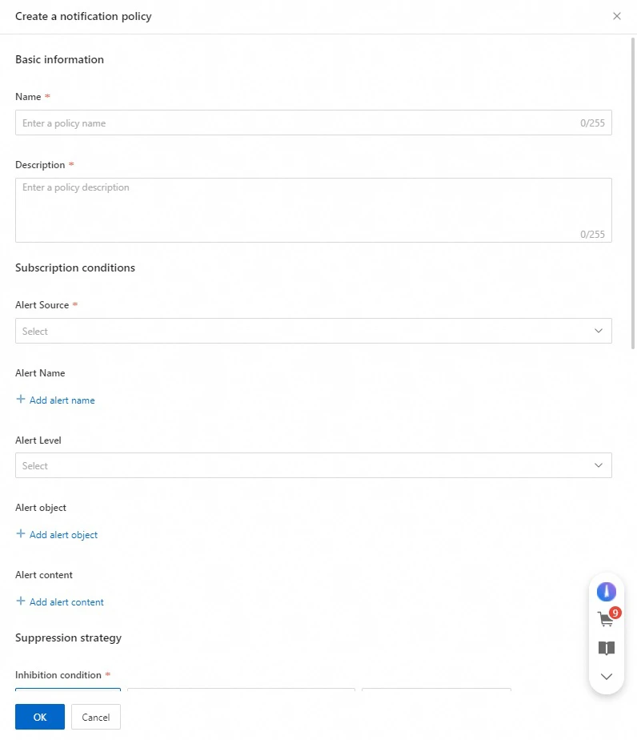

6. Click **OK**.

> **Note**
>
> Cloud Monitor (CMS) uses a large language model to provide intelligent analysis, automatically generating root cause analysis and troubleshooting suggestions in alert notifications. This feature helps you quickly locate faults, makes alerts more actionable, and reduces both manual analysis time and the mean time to respond.

**View notification policy**

**Procedure**

After creating a notification policy, you can view its details.

The **Notification Policy** page shows a list of policies and their details, including **Policy name**, **Policy description**, **Policy status**, **Notification rules**, **Muting condition**, **Effective period**, **Notification history**, **Notification target**, and **Webhook configuration**.

> **Note**
>
> - Use the dropdown lists or the search box at the top of the policy list to quickly find a notification policy.
>
> - Click the  icon next to the Policy status column to filter policies by status.
>
> - Hover over the number in the **Notification rules**, **Effective period**, or **Notification target** column to view details.
>
> - Click the  icon in the **Notification history** column to view the notification
>
>   history from the last three days. The history includes details such as **Alert ID/Alert name**, **Alert level**, **Alert object/Product**, **Alert content**, **Processing status**, **Alert start time**, **Last alert time**, and **Send time**.
>
>   Click **View More** in the upper-right corner to go to the **Message Center > Unread Messages** page.

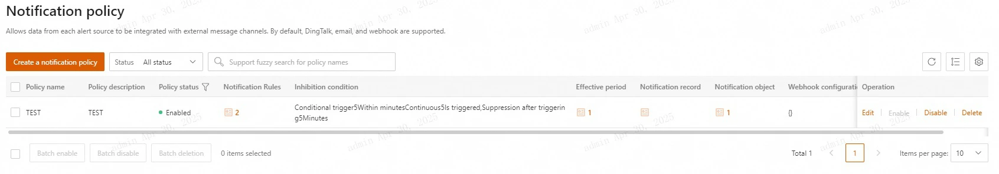

**Modify notification policy**

**Procedure**

You can modify a notification policy to update its details.

1. In the list on the **Notification Policy** page, find the target policy and click **Edit** in the Actions column.

2. In the **Edit Notification Policy** panel, modify the parameters as needed. For details about the parameters, see Create a notification policy.

**Disable notification policy**

**Procedure**

You can disable a policy that you do not currently need.

> **Important**
>
> Before you disable a notification policy, ensure its **Policy status** is **Enabled**.

- Disable a single policy

  <ol type="i">

  <li>

  In the list on the **Notification Policy** page, find the target policy and click **Disable** in the Actions column.

  <ol type="i" start="2">

  <li>

  Click **OK**.

  </li>

  </ol>

  </li>

  </ol>

- Disable policies in batches

  <ol type="i">

  <li>

  In the list on the **Notification Policy** page, select the checkboxes of the target policies.

  <ol type="i" start="2">

  <li>

  Click **Batch disable** below the list.

  </li>

  <li>

  Click **OK**.

  </li>

  </ol>

  </li>

  </ol>

**Enable notification policy**

**Procedure**

You can enable a disabled policy when you need it again.

> **Important**
>
> Before you enable a notification policy, ensure its **Policy status** is **Disabled**.

- Enable a single policy

  <ol type="i">

  <li>

  In the list on the **Notification Policy** page, find the target policy and click **Enable** in the Actions column.

  <ol type="i" start="2">

  <li>

  Click **OK**.

  </li>

  </ol>

  </li>

  </ol>

- Enable policies in batches

  <ol type="i">

  <li>

  In the list on the **Notification Policy** page, select the checkboxes of the target policies.

  <ol type="i" start="2">

  <li>

  Click **Batch enable** below the list.

  </li>

  <li>

  Click **OK**.

  </li>

  </ol>

  </li>

  </ol>

**Delete notification policy**

**Procedure**

You can delete a policy that you no longer need.

- Delete a single policy

  <ol type="i">

  <li>

  In the list on the **Notification Policy** page, find the target policy and click **Delete** in the Actions column.

  <ol type="i" start="2">

  <li>

  Click **OK**.

  </li>

  </ol>

  </li>

  </ol>

- Delete policies in batches

  <ol type="i">

  <li>

  In the list on the **Notification Policy** page, select the checkboxes of the target policies.

  <ol type="i" start="2">

  <li>

  Click **Batch delete** below the list.

  </li>

  <li>

  Click **OK**.

  </li>

  </ol>

  </li>

  </ol>

<a id="section-3-5"></a>

## 3.5. Blocking policies

You can configure a temporary or permanent blocking policy for alerts. The blocked alerts are no longer connected to the system.

**Create a blocking policy**

**Procedure**

1. Log on to the Apsara Uni-manager Management Console.

2. In the top navigation bar, choose **Products** > **Migration and O&M Management** > **O&M and Monitoring** > **CloudMonitor**.

3. In the left-side navigation pane, choose **Alert Center > Blocking Policy.**

4. On the **Masking policy** page, click **Create a masking policy**.

5. In the **Create a masking policy** panel, configure the parameters. The following table describes the parameters.

   **Category**

   **Parameter**

   **Description**

   Enter a name for the blocking

   **Name**

   policy.

   **Basic information**

   Enter a description for the

   **Description**

   blocking policy.

   Select the source of the alerts

   **Alert Source**

   that you want to block.

   Click **Add alert name** and enter an alert name for the blocking policy.

   **Alert Name**

   > **Note**
   >
   > You can add multiple alert names.

   Select an alert level. Valid values: **Critical**, **Warning**,

   **Alarm Level**

   **Information**, and **Notification**.

   **Shielding condition**

   Click **Add alert object** and enter a notification object.

   **Alert object**

   > **Note**
   >
   > You can add multiple notification objects.

   Click **Add alert content** and enter an alert message.

   **Alert content**

   > **Note**
   >
   > You can add multiple alert messages.

   <table>
     <tr>
       <th rowspan="2">Mask settings</th>
       <th>Shielding condition</th>
       <th>Select <strong>Custom Time</strong> or <strong>All</strong> <strong>time, direct shielding</strong>.</th>
     </tr>
     <tr>
       <td>Policy masking time</td>
       <td>Note<br>This parameter is required only when you set the Shielding condition parameter to <strong>Custom</strong> <strong>Time</strong>.<br>Click <strong>Add policy masking</strong> <strong>time</strong> and select a time range.Alerts are blocked only within the time range.<br>Important<br>If you select multiple periods, make sure that they do not overlap.</td>
     </tr>
   </table>

   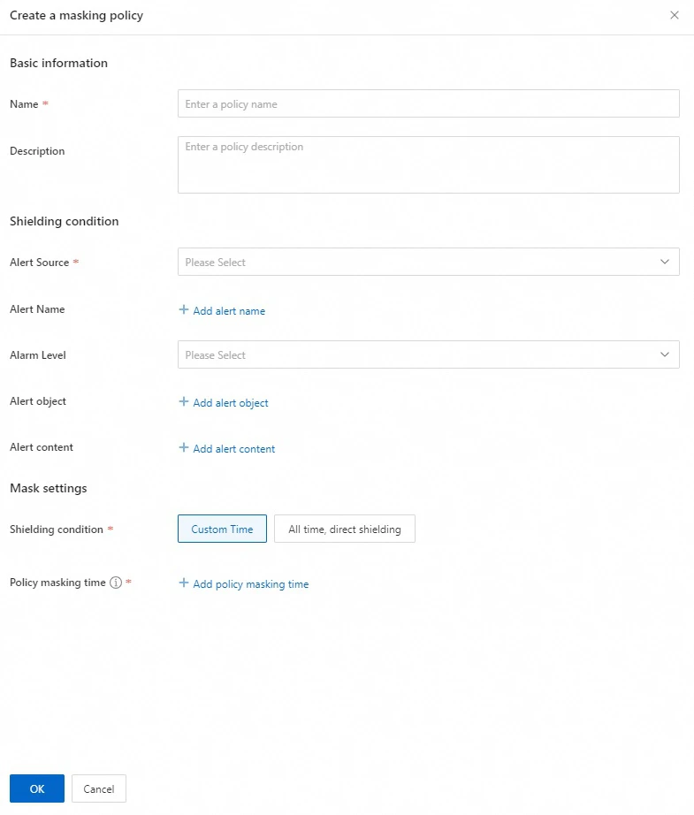

6. Click **OK**.

**View blocking policies**

**Procedure**

After a blocking policy is created, you can view the details of the blocking policy.

On the **Masking policy** page, view the **Policy name**, **Policy description**, **Policy status**, **Masking rules**, and **Masking period**.

> **Note**
>
> - You can select a blocking policy from the drop-down list or enter a policy name in the search box to quickly find a blocking policy.
>
> - You can click the  icon next to Policy status to filter blocking policies.
>
> - You can move the pointer over the number in the **Masking rules** and **Masking period** columns to view the details.

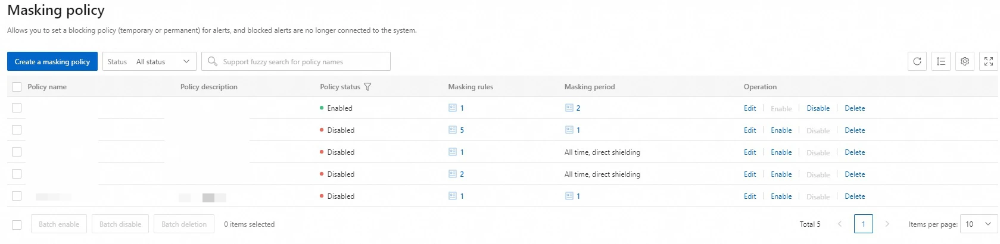

**Modify a blocking policy**

**Procedure**

You can modify an existing blocking policy based on your business requirements.

1. On the **Masking policy** page, find the blocking policy that you want to modify and click **Edit** in the **Operation** column.

2. In the **Edit** panel, modify the parameters based on your business requirements. For more information about the parameters, see Create a blocking policy.

**Disable blocking policies**

**Procedure**

You can disable a blocking policy if you do not need it.

> **Important**
>
> Before you disable a blocking policy, make sure that the **status** of the policy is **Enabled**.

- Disable a single blocking policy

  <ol type="i">

  <li>

  On the **Masking policy** page, find the blocking policy that you want to disable and click **Disable** in the **Operation** column.

  <ol type="i" start="2">

  <li>

  In the message that appears, click **OK**.

  </li>

  </ol>

  </li>

  </ol>

- Disable multiple blocking policies at a time

  <ol type="i">

  <li>

  On the **Masking policy** page, select the blocking policies that you want to disable.

  <ol type="i" start="2">

  <li>

  Click **Batch disable** in the lower-left corner of the policy list.

  </li>

  <li>

  In the message that appears, click **OK**.

  </li>

  </ol>

  </li>

  </ol>

**Enable blocking policies**

**Procedure**

If you need to use a disabled blocking policy again, you can enable the blocking policy.

> **Important**
>
> Before you enable a blocking policy, make sure that the **Policy Status** is **Disabled**.

- Enable a single blocking policy

  <ol type="i">

  <li>

  On the **Masking policy** page, find the blocking policy that you want to enable and click **Enable** in the **Operation** column.

  <ol type="i" start="2">

  <li>

  In the message that appears, click **OK**.

  </li>

  </ol>

  </li>

  </ol>

- Enable multiple blocking policies at a time

  <ol type="i">

  <li>

  On the **Masking policy** page, select the blocking policies that you want to enable.

  <ol type="i" start="2">

  <li>

  Click **Batch enable** in the lower-left corner of the policy list.

  </li>

  <li>

  In the message that appears, click **OK**.

  </li>

  </ol>

  </li>

  </ol>

**Delete blocking policies**

**Procedure**

You can delete the blocking policies that you no longer need.

- Delete a single blocking policy

  <ol type="i">

  <li>

  On the **Masking policy** page, find the blocking policy that you want to delete and click **Delete** in the **Operation** column.

  <ol type="i" start="2">

  <li>

  In the message that appears, click **OK**.

  </li>

  </ol>

  </li>

  </ol>

- Delete multiple blocking policies at a time

  <ol type="i">

  <li>

  On the **Masking policy** page, select the blocking policies that you want to delete.

  <ol type="i" start="2">

  <li>

  Click **Batch delete** in the lower-left corner of the policy list.

  </li>

  <li>

  In the message that appears, click **OK**.

  </li>

  </ol>

  </li>

  </ol>

<a id="section-4"></a>

# 4.Cloud resource monitoring

<a id="section-4-1"></a>

## 4.1. Host monitoring

After the CloudMonitor agent is installed on your Elastic Compute Service (ECS) instances, CloudMonitor can collect various monitoring data of metrics about the operating system that the ECS instances run. You can configure alert rules for the metrics to reduce monitoring costs.

- **Easy-to-use agent**: After the CloudMonitor agent is installed on your ECS instances, CloudMonitor can collect various monitoring data of metrics about the operating system that the ECS instances run.

- **Various metrics**: Host monitoring supports various metrics about the operating system, GPUs, inbound and outbound traffic, disk reads and writes, processes, cloud disks, and Azure VMware Solution (AVS) network.

- **Business-specific process monitoring**: Host monitoring collects the CPU utilization, memory usage, and number of opened files for active processes. This helps you monitor the resource usage of your ECS instances.

- **Flexible alerting**: Host monitoring allows you to manage ECS instances across regions and configure alert rules by application group. This reduces the costs of monitoring management.

<a id="section-4-1-1"></a>

### 4.1.1. Install the CloudMonitor agent

You can install the CloudMonitor agent on Elastic Compute Service (ECS) instances to collect the monitoring data of operating systems.

**Batch install or upgrade the CloudMonitor agent**

1. Log on to the Apsara Uni-manager Management Console.

2. In the top navigation bar, choose **Products** > **Migration and O&M Management** > **O&M and Monitoring** > **CloudMonitor**.

3. In the left-side navigation pane, choose **Cloud Resource Monitoring > Host Monitoring**.

4. On the **Host Monitoring** page, select the ECS instances for which you want to install or upgrade the agent and click **Bulk install or upgrade plug-ins** in the lower-left corner of the instance list.

   > **Note**
   >
   > You can only install the CloudMonitor agent for ECS instances that run the **Linux** and **Windows** operating systems.

5. In the message that appears, click **OK**.

   > **Note**
   >
   > The installation or upgrade process takes approximately five minutes. After the agent changes from the **In Installation** state to the **In operation** state, the CloudMonitor agent is installed or upgraded.

**Install or upgrade the CloudMonitor agent globally**

> **Note**
>
> This operation takes effect on multiple ECS instances and can be performed every 30 minutes.

1. On the **Host Monitoring** page, click **Install/Upgrade Agent**.

2. In the **Install/Upgrade Agent** dialog box, select **Install Only for Uninstalled**, **Only Upgrade for Installed**, or **Install and Upgrade to Latest Version**.

   > **Note**
   >
   > - **Install Only for Uninstalled**: installs the CloudMonitor agent only on the ECS instances that are not installed with the agent.
   >
   > - **Only Upgrade for Installed**: upgrades the CloudMonitor agent for the ECS instances that are installed with the agent.
   >
   > - **Install and Upgrade to Latest Version**: installs and upgrades the CloudMonitor agent to the latest version for all existing ECS instances.

3. Click **Execute Now**.

**Install the CloudMonitor agent on a single ECS instance**

1. Find the ECS instance on which you want to install the CloudMonitor agent and click the 

   icon.

2. In the message that appears, click **OK**.

   > **Note**
   >
   > If the CloudMonitor agent fails to be installed, click the
   >
   > icon in the **Agent Status**
   >
   > 
   >
   > column to view the installation failure details, including **Last Installation Failure Cause**, **Installation History Details**, **Installation Status**, and **Installed Agent Output**.

<a id="section-4-1-2"></a>

### 4.1.2. Process monitoring

By default, process monitoring collects the CPU usage, memory usage, and number of open files for active processes on an Elastic Computing Service (ECS) instance. If you add a process keyword, process monitoring also collects the number of processes that contain the keyword.

**Prerequisites**

The CloudMonitor agent is installed on the ECS instance. For more information, see Install the agent.

**Background information**

CloudMonitor polls and collects process data every 15 seconds. For each process, it records the process name, process ID, user, CPU usage, memory usage, number of open files, and time.

- CPU usage and memory usage of a process: These metrics correspond to the output of the **top** command in Linux.

- Number of open files in a process: This metric corresponds to the output of the **lsof** command in Linux.

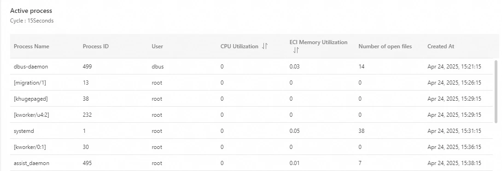

**Add or delete system process keywords**

You can monitor the number of processes on an ECS instance to collect the count of key processes and check their status.

**Procedure**

1. Log on to the Apsara Uni-manager Management Console.

2. In the top menu bar, click **Products** and choose **Migration & O&M Management** > **O&M and Monitoring** > **CloudMonitor**.

3. In the navigation pane on the left, choose **Resource Monitoring > Host Monitoring**.

4. On the **Host Monitoring** page, click the name of the target ECS instance.

5. Click the **Process Monitoring** tab. In the **Process Count** area, click **Add Process** in the upper-right corner.

   - **Add a system process keyword**: In the **Add Process** panel, enter a process name and click **Add Process**.

   - **Delete a system process keyword**: In the **Add Process** panel, find the target process name and click **Delete Process** in the **Operation** column.

**Example of adding a system process keyword**

Assume that the following processes are running on an ECS instance:

```text
 /usr/bin/java -Xmx2300m -Xms2300m org.apache.catalina.startup.Bootstrap 

 /usr/bin/ruby 

 nginx -c /etc/nginx/nginx.conf 
```

After you add six process keywords, the collected results are as follows:

- **ruby**: The collected process count is 1. The keyword matches the process name.

- **nginx**: The collected process count is 1. The keyword matches the process name and parameters.

- **/usr/bin**: The collected process count is 2. The keyword matches the path of two processes.

- **apache.catalina**: The collected process count is 1. The keyword matches part of the parameters.

- **nginx.conf**: The collected process count is 1. The keyword matches part of the parameters.

- **-c**: The collected process count is 1. The keyword matches part of the parameters.

**Set an alert rule for process monitoring**

After you add a process to monitor, you can set an alert rule for it. This ensures that specified contacts receive an alert notification if the process count changes.

**Procedure**

1. In the navigation pane on the left, choose **Resource Monitoring > Host Monitoring**.

2. Click **Create Alert Rule**.

3. In the **Create Alert Rule** panel, click **Create Alert Rule**. For **Metric**, select **(Agent)process.count_processname** from the **Process** category. Then, configure other parameters for the alert rule as needed.

   If multiple processes are configured on the ECS instance, you can click **Create Alert Rule** to set alert rules for multiple processes. For more information about how to set the parameters for an alert rule, see Create an alert rule.

4. Click **OK**.

<a id="section-4-1-3"></a>

### 4.1.3. View host monitoring details

**Procedure**

1. Log on to the Apsara Uni-manager Management Console.

2. In the top menu bar, click **Products** and choose **Migration & O&M Management** > **O&M and Monitoring** > **CloudMonitor**.

3. In the navigation pane on the left, choose **Cloud Resource Monitoring > Host Monitoring**.

4. On the **Host Monitoring** page, view the following information for all instances: **Instance ID/Name**, **Organization/Resource Set**, **Region**, **Instance Status**, **ECS Plug-in Status**, **ECS Plug-in Version**, **Configuration**, **CPU Usage**, **Memory Usage**, **Cloud Disk Usage**, **Operating System**, **Instance Type**, **IP Address**, **VPC ID**, **Image ID**, **Zone ID**, and **Creation Time**. You can also sort the instances by **CPU Usage**, **Memory Usage**, and **Cloud Disk Usage**.

   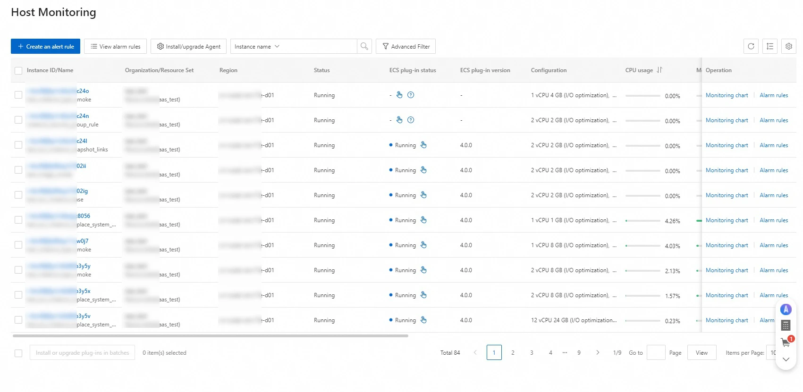

5. Click the name of a target instance or **Monitoring Chart** in the **Actions** column to go to the details page for an Elastic Compute Service (ECS) instance. On this page, you can view specific metrics. For more information about the metrics, see Elastic Compute Service.

   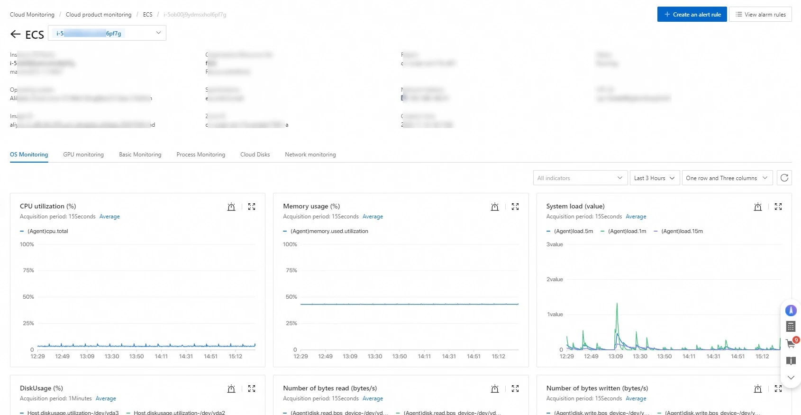

6. Click **Alert Rules** in the **Actions** column for a target instance to go to the **Alert Rules** page. On this page, you can view and manage the alert rules for the instance. For more information, see Manage alert rules.

7. Advanced filtering.

   You can use the advanced search to filter target instances by **Instance Name**, **Instance ID**, **Classic Network Private IP**, **VPC Private IP**, **Public IP**, **Elastic IP Address**, or **ECS Plug-in Status**.

   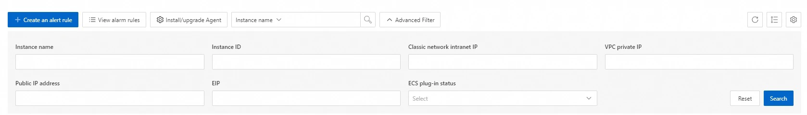

<a id="section-4-2"></a>

## 4.2. Cloud product monitoring

CloudMonitor automatically discovers the cloud product resources in your account. You can view monitoring charts to check the operational status of your resources. You can also create alert rules to monitor their status. When an alert rule is triggered, CloudMonitor automatically sends a notification to keep you informed about the status of your resources.

CloudMonitor supports monitoring for the following cloud products:

> **Note**
>
> For details about the monitoring metrics for each cloud product, see CloudMonitor Metric Reference.

| Product type | Product name |
| --- | --- |
| Elastic computing | • Container Monitoring for Kubernetes<br>• ECS<br>• BMCP (Node)<br>• BMCP (Bare Metal - AI Computing Cluster)<br>• BMCP (Container - AI Computing Cluster)<br>• BMCP (Bare Metal - Supercomputing Cluster)<br>• Bare Metal Management (BMS) |
| Database | • ApsaraDB for RDS<br>• ApsaraDB for RDS (New Link)<br>• ApsaraDB PolarDB (Cluster Edition)<br>• ApsaraDB PolarDB (Primary/Standby Edition)<br>• ApsaraDB for Redis<br>• ApsaraDB for Redis (New Link)<br>• PolarDB for HTAP<br>• AnalyticDB for PostgreSQL<br>• AnalyticDB for PostgreSQL (New Link)<br>• ApsaraDB for MongoDB<br>• ApsaraDB for MongoDB (New Link)<br>• DTS<br>• Cloud-Native Multimodel Database Lindorm<br>• Cloud-Native Multimodel Database Lindorm 2.0 |
| Storage and CDN | • NAS<br>• OSS<br>• Cloud Paralleled File System (CPFS)<br>• Apsara Parallel File System (APFS)<br>• EFS-NAS File Storage |
| Network | • NAT Gateway<br>• SLB<br>• Application Load Balancer (ALB)<br>• VPN Gateway<br>• Elastic IP Address (EIP)<br>• Alibaba Cloud DNS<br>• Alibaba Cloud DNS - Tenant Forwarded Domain |
| Middleware | • ApsaraMQ for RocketMQ<br>• Message Queue (tiangong)<br>• ApsaraMQ for Kafka<br>• API Gateway |
| Big data (Apsara BigData) | • DataHub<br>• MaxCompute<br>• MaxCompute (Quota Group) |
| Security (Apsara Stack Security) | • Tenant-side Bastion Host<br>• Vulnerability Scanning Engine<br>• NFV Cloud Firewall<br>• Web Application Firewall (WAF) |
| AI and machine learning | • PAI-Studio (Online Service)<br>• PAI-Studio (Model Evaluation)<br>• PAI-Studio (Notebook Modeling)<br>• PAI-Studio (Task Modeling)<br>• PAI-Studio (Visual Modeling)<br>• PAI-Studio (Model Tuning)<br>• PAI-Studio (Batch Inference)<br>• PAI-Studio (Online Service Group)<br>• PAI-Studio (Resource Pool) |

<a id="section-4-2-1"></a>

### 4.2.1. CloudMonitor metrics

CloudMonitor uses monitoring metrics from your cloud resources to track service availability. By setting alarm rules and notification policies for these metrics, you can stay informed about the operational status and performance of your service instances.

**Background**

You can use the custom role feature in Resource Access Management (RAM) to assign specific access permissions to different operations and maintenance (O&M) accounts. When a user logs on to the CloudMonitor console, the system checks their role and displays monitoring data only for the product lines they are authorized to access. This fine-grained access control provides security isolation for monitoring data and protects sensitive information from exposure. It also simplifies the interface for O&M personnel, letting them focus on their assigned product lines. This improves both operational efficiency and data security.

<a id="section-4-2-1-1"></a>

#### 4.2.1.1. Elastic computing

<a id="section-4-2-1-1-1"></a>

##### 4.2.1.1.1. Kubernetes container monitoring

This topic lists the metrics for Kubernetes container monitoring.

> **Note**
>
> These metrics apply to instances that do not support Prometheus monitoring 2.0. For instances that support Prometheus monitoring 2.0, click the instance name to go to the Kubernetes container monitoring page.

**Cluster**

The value of **Namespace** is **acs_k8s**. The default value of **Period** is **60** seconds, and can be set to any integer multiple of 60.

| Metric | Unit | MetricName | Dimensions | Description |
| --- | --- | --- | --- | --- |
| CPU resource limit | cpus | cluster.cpu.limit | user_id, cluster_name | The maximum amount of CPU resources the cluster can use. |
| CPU resource request | cpus | cluster.cpu.reque st | user_id, cluster_name | The total amount of CPU resources requested by all containers in the cluster. |
| Cluster CPU usage | cpus | cluster.cpu.usage _rate | user_id, cluster_name | The total CPU usage of the cluster. |
| Cluster CPU utilization | percent | cluster.cpu.utiliza tion | user_id, cluster_name | The CPU utilization of the cluster. |
| Cluster filesystem available size | bytes | cluster.filesystem.available | user_id, cluster_name | The total available filesystem size in the cluster. |
| Cluster filesystem limit | bytes | cluster.filesystem.limit | user_id, cluster_name | The total filesystem size limit of the cluster. |
| Cluster memory limit | bytes | cluster.memory.li mit | user_id, cluster_name | The total memory limit for the cluster. |
| Cluster memory request | bytes | cluster.memory.r equest | user_id, cluster_name | The total memory request for the cluster. |
| Cluster memory utilization | percent | cluster.memory.u tilization | user_id, cluster_name | The memory utilization of the cluster. |

**Node**

The value of **Namespace** is **acs_k8s**. The default value of **Period** is **60** seconds, and can be set to any integer multiple of 60.

| Metric | Unit | MetricName | Dimensions | Description |
| --- | --- | --- | --- | --- |
| node CPU allocatable | cpus | node.cpu.allocata ble | userId, cluster, node | The amount of CPU on the node available to pods. |
| node CPU capacity | cpus | node.cpu.capacit y | userId, cluster, node | The total CPU capacity of the node. |
| node CPU limit | cpus | node.cpu.limit | userId, cluster, node | The total CPU limit set for the node. |
| node CPU resource oversold rate | percent | node.cpu.oversal e_rate | userId, cluster, node | The CPU resource oversold rate on the node. |
| node CPU request | cpus | node.cpu.request | userId, cluster, node | The total CPU resources requested by all pods on the node. |
| node CPU reservation | cpus | node.cpu.reserva tion | userId, cluster, node | The amount of CPU reserved on the node. |
| node CPU usage rate | cpus | node.cpu.usage_r ate | userId, cluster, node | The CPU usage of the node. |
| node CPU utilization | percent | node.cpu.utilizati on | userId, cluster, node | The CPU utilization of the node. |
| node filesystem available | short | node.filesystem.a vailable | userId, cluster, node | The available filesystem size of the node. |
| node filesystem limit | short | node.filesystem.li mit | userId, cluster, node | The total filesystem size of the node. |
| node filesystem usage | short | node.filesystem.u sage | userId, cluster, node | The filesystem usage on the node. |
| node memory allocatable | gbytes | node.memory.all ocatable | userId, cluster, node | The amount of memory on the node available to pods. |
| node memory capacity | short | node.memory.ca pacity | userId, cluster, node | The total memory capacity of the node. |
| node memory limit | short | node.memory.lim it | userId, cluster, node | The total memory limit set for the node. |
| node memory major page faults | short | node.memory.ma jor_page_faults | userId, cluster, node | The number of major page faults on the node. |
| node memory major page faults rate | short | node.memory.ma jor_page_faults_r ate | userId, cluster, node | The rate of major page faults on the node. |
| node memory resource oversold rate | percent | node.memory.ov ersale_rate | userId, cluster, node | The memory resource oversold rate on the node. |
| node memory page faults | short | node.memory.pa ge_faults | userId, cluster, node | The number of page faults on the node. |
| node memory page faults rate | short | node.memory.pa ge_faults_rate | userId, cluster, node | The rate of page faults on the node. |
| node memory request | short | node.memory.req uest | userId, cluster, node | The total memory resources requested by all pods on the node. |
| node memory reservation | short | node.memory.res ervation | userId, cluster, node | The amount of memory reserved on the node. |
| node memory RSS | short | node.memory.rss | userId, cluster, node | The resident set size (RSS) of memory on the node. |
| node memory usage | short | node.memory.us age | userId, cluster, node | The memory usage of the node. |
| node memory utilization | short | node.memory.util ization | userId, cluster, node | The memory utilization of the node. |
| node memory working set | short | node.memory.wo rking_set | userId, cluster, node | The working set memory size of the node. |
| node network RX errors | short | node.network.rx_errors | userId, cluster, node | The number of receive errors on the node. |
| node network RX errors rate | percent | node.network.rx_errors_rate | userId, cluster, node | The rate of receive errors on the node. |
| node network RX rate | Bps | node.network.rx_rate | userId, cluster, node | The network receive rate of the node. |
| node network TX errors rate | Bps | node.network.tx_errors_rate | userId, cluster, node | The rate of transmit errors on the node. |
| node network TX rate | Bps | node.network.tx_rate | userId, cluster, node | The network transmit rate of the node. |

**Pod**

The value of **Namespace** is **acs_k8s**. The default value of **Period** is **60** seconds, and can be set to any integer multiple of 60.

| Metric | Unit | MetricName | Dimensions | Description |
| --- | --- | --- | --- | --- |
| pod CPU limit | cpus | pod.cpu.limit | userId, cluster, namespace, type, app, pod | The maximum amount of CPU the pod can use. |
| pod CPU resource oversold rate | cpus | pod.cpu.oversale _rate | userId, cluster, namespace, type, app, pod | The CPU resource oversold rate for the pod. |
| pod CPU request | cpus | pod.cpu.request | userId, cluster, namespace, type, app, pod | The minimum amount of CPU the pod requests. |
| pod CPU usage | cpus | pod.cpu.usage_ra te | userId, cluster, namespace, type, app, pod | The amount of CPU the pod uses. |
| pod CPU utilization | percent | pod.cpu.utilizatio n | userId, cluster, namespace, type, app, pod | The CPU utilization of the pod, calculated as usage divided by the limit. |
| pod filesystem available size | gbytes | pod.filesystem.av ailable | userId, cluster, namespace, type, app, pod | The available filesystem size for the pod. |
| pod filesystem limit | gbytes | pod.filesystem.li mit | userId, cluster, namespace, type, app, pod | The filesystem size limit of the pod. |
|  |  |  |  |  |
| pod memory limit | gbytes | pod.memory.limit | userId, cluster, namespace, type, app, pod | The maximum amount of memory the pod can use. |
| pod memory resource oversold rate | gbytes | pod.memory.over sale_rate | userId, cluster, namespace, type, app, pod | The memory resource oversold rate for the pod, calculated as usage divided by the request. |
| pod memory request | mbytes | pod.memory.requ est | userId, cluster, namespace, type, app, pod | The minimum amount of memory the pod requests. |
| pod memory RSS | mbytes | pod.memory.rss | userId, cluster, namespace, type, app, pod | The resident set size (RSS) of memory for the pod. |
| pod memory utilization | percent | pod.memory.utili zation | userId, cluster, namespace, type, app, pod | The memory utilization of the pod, calculated as the working set size divided by the memory limit. |
| pod memory working set | mbytes | pod.memory.wor king_set | userId, cluster, namespace, type, app, pod | The working set memory size of the pod. |
| pod network RX errors rate | Bps | pod.network.rx_e rrors_rate | userId, cluster, namespace, type, app, pod | The rate of network receive errors for the pod. |
| pod network RX rate | Bps | pod.network.rx_r ate | userId, cluster, namespace, type, app, pod | The network receive rate for the pod. |
| pod network TX errors rate | Bps | pod.network.tx_e rrors_rate | userId, cluster, namespace, type, app, pod | The rate of network transmit errors for the pod. |
| pod network TX rate | Bps | pod.network.tx_r ate | userId, cluster, namespace, type, app, pod | The network transmit rate for the pod. |

**Deployment**

| Metric | Unit | MetricName | Dimensions | Description |
| --- | --- | --- | --- | --- |
| deployment CPU limit | cpus | deployment.cpu.l imit | userId, cluster, namespace, type, app | The total CPU resource limit of the deployed application. |
| deployment CPU usage | cpus | deployment.cpu.usage_rate | userId, cluster, namespace, type, app | The total CPU usage of the deployed application. |
| deployment filesystem available size | bytes | deployment.filesy stem.available | userId, cluster, namespace, type, app | The total available filesystem size of the deployed application. |
| deployment filesystem limit | bytes | deployment.filesy stem.limit | userId, cluster, namespace, type, app | The total filesystem size limit of the deployed application. |
| deployment memory limit | bytes | deployment.mem ory.limit | userId, cluster, namespace, type, app | The total memory resource limit of the deployed application. |
| deployment memory request | bytes | deployment.mem ory.request | userId, cluster, namespace, type, app | The total memory resource request of the deployed application. |
| deployment memory working set | bytes | deployment.mem ory.working_set | userId, cluster, namespace, type, app | The total working set memory of the deployed application. |
| deployment network RX errors rate | Bps | deployment.netw ork.rx_errors_rate | userId, cluster, namespace, type, app | The rate of network receive errors for the deployed application. |
|  |  |  |  |  |
| deployment network TX errors rate | Bps | deployment.netw ork.tx_errors_rate | userId, cluster, namespace, type, app | The rate of network transmit errors for the deployed application. |

<a id="section-4-2-1-1-2"></a>

##### 4.2.1.1.2. Elastic Compute Service

This article describes the monitoring metrics for ECS.

**Basic metrics**

The **Namespace** is **acs_ecs_dashboard**. The default **Period** is **60** seconds and must be a multiple of 60.

> **Note**
>
> - When connected to a public cloud, you can switch platforms to view metrics for your ECS instances.
>
> - The following metrics are collected from the host machine (virtualization) layer and may differ slightly from metrics collected within the operating system.

| Metric | Unit | Metric name | Dimensions | Description |
| --- | --- | --- | --- | --- |
| (ECS) CPU utilization | percent | CPUUtilization | userId, instanceId | CPU utilization |
| (ECS) Classic Network public inbound bandwidth | bps | InternetInRate | userId, instanceId | Public network inbound rate |
| (ECS) internal inbound bandwidth | bps | IntranetInRate | userId, instanceId | Internal network inbound rate |
| (ECS) Classic Network public outbound bandwidth | bps | InternetOutRate | userId, instanceId | Public network outbound rate |
| (ECS) internal outbound bandwidth | bps | IntranetOutRate | userId, instanceId | Internal network outbound rate |
| (ECS) Total disk read BPS | BPS | DiskReadBPS | userId, instanceId | Bytes read per second across all disks |
| (ECS) Total disk write BPS | BPS | DiskWriteBPS | userId, instanceId | Bytes written per second across all disks |
| (ECS) Total disk read IOPS | count/s | DiskReadIOPS | userId, instanceId | Read operations per second across all disks |
| (ECS) Total disk write IOPS | count/s | DiskWriteIOPS | userId, instanceId | Write operations per second across all disks |

**OS-level metrics**

The **Namespace** is **acs_ecs_dashboard**. The default **Period** is **15** seconds and can be set to an integer multiple of 15.

> **Note**
>
> To collect OS-level metrics, you need to install the monitoring agent on an ECS instance.
>
> To install the agent, in the Cloud Monitor console, choose Host Monitoring from the left navigation pane. On the **ECS Monitoring List** page, select the instances that you want to monitor, and then click **Batch Install or Upgrade Plug-in** at the bottom of the list.
>
> After the monitoring agent is installed, monitoring data appears on the charts within 5 to 10 minutes.

| Metric | Unit | MetricName | Dimensions | Description |
| --- | --- | --- | --- | --- |
| CPU utilization | Percent | cpu_total | userId, instanceId | The percentage of CPU in use. |
| Memory utilization | Percent | memory_usedutiliz ation | userId, instanceId | The percentage of memory in use. |
| System load (15m) | N/A | load_15m | userId, instanceId | The average system load over the past 15 minutes.<br>Note<br>This metric is not available for Windows. |
| System load (1m) | N/A | load_1m | userId, instanceId | The average system load over the past 1 minute.<br>Note<br>This metric is not available for Windows. |

<table>
  <tr>
    <td>System load (5m)</td>
    <td>N/A</td>
    <td>load_5m</td>
    <td>userId, instanceId</td>
    <td>The average system load over the past 5 minutes.<br>Note<br>This metric is not available for Windows.</td>
  </tr>
  <tr>
    <td>Disk utilization</td>
    <td>Percent</td>
    <td>diskusage_utilizati on</td>
    <td>userId, instanceId, device</td>
    <td>The percentage of disk space in use.</td>
  </tr>
  <tr>
    <td>Inode utilization</td>
    <td>Percent</td>
    <td>fs_inodeutilization</td>
    <td>userId, instanceId, device</td>
    <td>The percentage of inodes in use.<br>Note<br>This metric is available for Linux only.</td>
  </tr>
  <tr>
    <td>Disk read throughput</td>
    <td>Bytes/s</td>
    <td>disk_readbytes</td>
    <td>userId, instanceId, device</td>
    <td>The number of bytes read from the disk per second.</td>
  </tr>
  <tr>
    <td>Disk read IOPS</td>
    <td>Count/s</td>
    <td>disk_readiops</td>
    <td>userId, instanceId, device</td>
    <td>The number of read I/O operations from the disk per second.</td>
  </tr>
  <tr>
    <td>Disk write throughput</td>
    <td>Bytes/s</td>
    <td>disk_writebytes</td>
    <td>userId, instanceId, device</td>
    <td>The number of bytes written to the disk per second.</td>
  </tr>
  <tr>
    <td>Disk write IOPS</td>
    <td>Count/s</td>
    <td>disk_writeiops</td>
    <td>userId, instanceId, device</td>
    <td>The number of write I/O operations to the disk per second.</td>
  </tr>
  <tr>
    <td>TCP connections by state</td>
    <td>Count</td>
    <td>net_tcpconnection</td>
    <td>userId, instanceId, state</td>
    <td>The number of TCP connections in each state.</td>
  </tr>
  <tr>
    <td>Number of processes by name</td>
    <td>Count</td>
    <td>process.number</td>
    <td>userId, instanceId, processName</td>
    <td>The number of processes that match the specified name.</td>
  </tr>
  <tr>
    <td>I/O saturation</td>
    <td>Percent</td>
    <td>disk_io_util</td>
    <td>userId, instanceId, device</td>
    <td>The percentage of time the disk is busy with I/O operations.</td>
  </tr>
  <tr>
    <td>Total number of zombie processes</td>
    <td>Count</td>
    <td>zombieProcessNu mber</td>
    <td>userId, instanceId</td>
    <td>The number of terminated processes that remain in the process table.<br>Note<br>This metric is not available for Windows.</td>
  </tr>
  <tr>
    <td>Total number of processes</td>
    <td>Count</td>
    <td>totalProcessNumbe r</td>
    <td>userId, instanceId</td>
    <td>The total number of active processes on the instance.<br>Note<br>This metric is not available for Windows.</td>
  </tr>
  <tr>
    <td>Swap partition utilization</td>
    <td>Percent</td>
    <td>swapUtilization</td>
    <td>userId, instanceId</td>
    <td>The percentage of the swap partition in use.</td>
  </tr>
  <tr>
    <td>Network interface transmit packet drop rate</td>
    <td>Percent</td>
    <td>networkout_drop_r atio</td>
    <td>userId, instanceId, device</td>
    <td>The percentage of outbound packets dropped by the network interface.</td>
  </tr>
  <tr>
    <td>Network interface transmit error rate</td>
    <td>Percent</td>
    <td>networkout_error_r atio</td>
    <td>userId, instanceId, device</td>
    <td>The percentage of outbound packets that could not be transmitted due to errors.</td>
  </tr>
  <tr>
    <td>Network interface receive packet drop rate</td>
    <td>Percent</td>
    <td>networkin_drop_rat io</td>
    <td>userId, instanceId, device</td>
    <td>The percentage of inbound packets dropped by the network interface.</td>
  </tr>
  <tr>
    <td>Network interface receive error rate</td>
    <td>Percent</td>
    <td>networkin_error_ra tio</td>
    <td>userId, instanceId, device</td>
    <td>The percentage of inbound packets that contained errors.</td>
  </tr>
  <tr>
    <td>Number of open files</td>
    <td>Count</td>
    <td>system_open_files</td>
    <td>instanceId</td>
    <td>The number of open file descriptors.</td>
  </tr>
</table>

**GPU monitoring**

**Mapping legacy to new GPU metrics**

> **Important**
>
> - CloudMonitor has standardized its GPU monitoring metrics. After you upgrade the Argusagent, legacy GPU metrics are deprecated. If you use these legacy metrics in external applications or dashboards, you must replace them with the new metrics.
>
> - After you upgrade CloudMonitor, it automatically updates your existing alert rules to use the new GPU metrics.

**NVIDIA**

| Legacy metric | Legacy metric name | New metric | New metric name |
| --- | --- | --- | --- |
| gpu_power_readings_p ower_draw | GPU Power Draw | gpu_power_readings_p ower_draw_v2 | GPU Power Draw |
| gpu_gpu_temperature | GPU Temperature | gpu_gpu_temperature_v2 | GPU Temperature |
| gpu_gpu_usedutilizatio n | GPU Utilization | gpu_gpu_usedutilizatio n_v2 | GPU Utilization |
| gpu_memory_usedutili zation | GPU Memory Utilization | gpu_memory_usedutiliz ation_v2 | GPU Memory Utilization |
| gpu_memory_freespac e | Available GPU Memory | gpu_memory_freespac e_v2 | Available GPU Memory |
| gpu_memory_freeutiliz ation | Available GPU Memory Utilization | gpu_memory_freeutiliz ation_v2 | Available GPU Memory Utilization |
| gpu_memory_usedspac e | Used GPU Memory | gpu_memory_usedspac e_v2 | Used GPU Memory |
| gpu_encoder_utilizatio n | Encoder Utilization | gpu_encoder_utilization _v2 | Encoder Utilization |
| gpu_decoder_utilizatio n | Decoder Utilization | gpu_decoder_utilization _v2 | Decoder Utilization |
| / | / | gpu_tx_throughput_v2 | Transmit Throughput |
| / | / | gpu_rx_throughput_v2 | Receive Throughput |
| / | / | gpu_fan_speed_v2 | Fan Speed |
| / | / | gpu_power_utilization_v2 | GPU Power Utilization |

**Hygon**

| Legacy metric | Legacy metric name | New metric | New metric name |
| --- | --- | --- | --- |
| gpu_power_readings_po wer_draw_hygon | (Agent) Hygon Power Draw | gpu_power_readings_p ower_draw_v2 | GPU Power Draw |
| gpu_gpu_temperature_hygon | (Agent) Hygon Temperature | gpu_gpu_temperature_v2 | GPU Temperature |
| gpu_gpu_usedutilization _hygon | (Agent) Hygon Utilization | gpu_gpu_usedutilizatio n_v2 | GPU Utilization |
| gpu_memory_usedutiliz ation_hygon | (Agent) Hygon Memory Utilization | gpu_memory_usedutili zation_v2 | GPU Memory Utilization |
| / | / | gpu_memory_freespac e_v2 | Available GPU Memory |
| / | / | gpu_memory_freeutiliz ation_v2 | Available GPU Memory Utilization |
| / | / | gpu_memory_usedspa ce_v2 | Used GPU Memory |
| / | / | gpu_power_utilization_v2 | GPU Power Utilization |

**Ascend**

| Legacy metric | Legacy metric name | New metric | New metric name |
| --- | --- | --- | --- |
| gpu_power_readings_po wer_draw_ascend | (Agent) Ascend Power Draw | gpu_power_readings_p ower_draw_v2 | GPU Power Draw |
| gpu_gpu_temperature_ascend | (Agent) Ascend Temperature | gpu_gpu_temperature_v2 | GPU Temperature |
| gpu_gpu_usedutilization _ascend | (Agent) Ascend Utilization | gpu_gpu_usedutilizatio n_v2 | GPU Utilization |
| gpu_memory_usedutiliz ation_ascend | (Agent) Ascend Memory Utilization | gpu_memory_usedutiliz ation_v2 | GPU Memory Utilization |
| / | / | gpu_memory_freespac e_v2 | Available GPU Memory |
| / | / | gpu_memory_freeutiliz ation_v2 | Available GPU Memory Utilization |
| / | / | gpu_memory_usedspac e_v2 | Used GPU Memory |

**PPU**

| Legacy metric | Legacy metric name | New metric | New metric name |
| --- | --- | --- | --- |
| gpu_power_readings_po wer_draw_ppu | (Agent) PPU Power Draw | gpu_power_readings_p ower_draw_v2 | GPU Power Draw |
| gpu_gpu_temperature_p pu | (Agent) PPU Temperature | gpu_gpu_temperature_v2 | GPU Temperature |
| gpu_gpu_usedutilization_ppu | (Agent) PPU Utilization | gpu_gpu_usedutilizatio n_v2 | GPU Utilization |
| gpu_memory_usedutiliza tion_ppu | (Agent) PPU Memory Utilization | gpu_memory_usedutili zation_v2 | GPU Memory Utilization |
| / | / | gpu_memory_freespac e_v2 | Available GPU Memory |
| / | / | gpu_memory_freeutiliz ation_v2 | Available GPU Memory Utilization |
| / | / | gpu_memory_usedspac e_v2 | Used GPU Memory |
| / | / | gpu_encoder_utilizatio n_v2 | Encoder Utilization |
| / | / | gpu_decoder_utilizatio n_v2 | Decoder Utilization |
| / | / | gpu_tx_throughput_v2 | Transmit Throughput |
| / | / | gpu_rx_throughput_v2 | Receive Throughput |
| / | / | gpu_fan_speed_v2 | Fan Speed |
| / | / | gpu_power_utilization_v2 | GPU Power Utilization |

**GPU metrics**

The value of **namespace** is **acs_ecs_dashboard**; the default **period** is **60** seconds and can be set to any integer multiple of 60.

| Metric | Unit | Metric ID | Dimensions | Description |
| --- | --- | --- | --- | --- |
| GPU Decoder Utilization | percen t | gpu_decoder_utili zation_v2 | instanceId,gpuId | The utilization of the GPU decoder. |
| GPU Encoder Utilization | percen t | gpu_encoder_utili zation_v2 | instanceId,gpuId | The utilization of the GPU encoder. |
| GPU Temperature | celsius | gpu_gpu_tempera ture_v2 | instanceId,gpuId | The temperature of the GPU. |
| GPU Utilization | percen t | gpu_gpu_usedutili zation_v2 | instanceId,gpuId | The utilization of the GPU. |
| Available GPU Memory | bytes | gpu_memory_free space_v2 | instanceId,gpuId | The amount of available GPU memory. |
| Available GPU Memory Utilization | percen t | gpu_memory_free utilization_v2 | instanceId,gpuId | The percentage of available GPU memory. |
| Used GPU Memory | bytes | gpu_memory_use dspace_v2 | instanceId,gpuId | The amount of used GPU memory. |
| GPU Memory Utilization | percen t | gpu_memory_use dutilization_v2 | instanceId,gpuId | The utilization of GPU memory. |
| GPU Power Draw | watt | gpu_power_readin gs_power_draw_v 2 | instanceId,gpuId | The power draw of the GPU. |
| GPU Transmit Throughput | KB/s | gpu_tx_throughpu t_v2 | instanceId,gpuId | The transmit throughput of the GPU. |
| GPU Receive Throughput | KB/s | gpu_rx_throughpu t_v2 | instanceId,gpuId | The receive throughput of the GPU. |
| GPU Fan Speed | percen t | gpu_fan_speed_v2 | instanceId,gpuId | The fan speed of the GPU. |
| GPU Power Utilization | percen t | gpu_power_utiliza tion_v2 | instanceId,gpuId | The power utilization of the GPU. |

**Process monitoring**

The **Process Monitoring** tab shows active processes, including **Process Name**, **Process ID**, **User**, **CPU Utilization**, **Memory Utilization**, **Number of Open Files**, and **Time**.

**Cloud disk**

The **namespace** is **acs_ecs_dashboard**. The default **period** is **60** seconds and must be a multiple of 60.

| Metric | Unit | MetricName | Dimensions | Description |
| --- | --- | --- | --- | --- |
| Cloud disk utilization (Agent) | percen t | DiskSerialUsePercent | userId, instanceId, id_serial | The percentage of used space on the cloud disk. |
| Total cloud disk size (Agent) | gbytes | DiskSerialTotal | instanceId, id_serial | The total size of the cloud disk. |
| Used cloud disk space (Agent) | mbyte s | DiskSerialUsed | instanceId, id_serial | The used space on the cloud disk. |
| Free cloud disk space (Agent) | mbyte s | DiskSerialFree | instanceId, id_serial | The free space on the cloud disk. |
| Total size of all mounted cloud disks | gbytes | DiskSerialTotal_Sum | instanceId | The sum of the total sizes of all cloud disks mounted to the instance. |
| Total used space of all mounted cloud disks | mbyte s | DiskSerialUsed_Sum | instanceId | The sum of used space across all cloud disks mounted to the instance. |
| Total utilization of all mounted cloud disks | percen t | DiskSerialUsePercent_Sum | instanceId | The overall utilization of all mounted cloud disks, calculated as total used space divided by total disk size. |
| Cloud disk read latency | micros econds | DiskReadLatency | instanceId, diskId | The time taken to complete a read operation on the cloud disk. |
| Cloud disk write latency | micros econds | DiskWriteLatency | instanceId, diskId | The time taken to complete a write operation on the cloud disk. |
| Cloud disk write bandwidth | bytes | DiskWriteBytes | instanceId, diskId | The number of bytes written to the cloud disk during the collection period. |
| Cloud disk read bandwidth | bytes | DiskReadBytes | instanceId, diskId | The number of bytes read from the cloud disk during the collection period. |
| Cloud disk write iops | short | DiskIOPSWrite | instanceId, diskId | The number of write operations per second (iops) on the cloud disk. |
| Cloud disk read iops | short | DiskIOPSRead | instanceId, diskId | The number of read operations per second (iops) on the cloud disk. |

**Network monitoring**

The **Namespace** is **acs_ecs_dashboard**. The **Period** defaults to **60** seconds and must be a multiple of 60.

| Metric | Unit | MetricName | Dimensions | Description |
| --- | --- | --- | --- | --- |
| Inbound network bandwidth | bps | networkin_rate_avs | userId, instanceId | Inbound network bandwidth. |
| Outbound network bandwidth | bps | networkout_rate_avs | userId, instanceId | Outbound network bandwidth. |
| Inbound packets | packets/s | networkin_packages_avs | userId, instanceId | Inbound packets per second. |
| Outbound packets | packets/s | networkout_package s_avs | userId, instanceId | Outbound packets per second. |
| Inbound packet errors | packets/s | networkin_errorpack ages_avs | userId, instanceId | Inbound packet errors per second. |
| Outbound packet errors | packets/s | networkout_errorpac kages_avs | userId, instanceId | Outbound packet errors per second. |
| TCP connections | Count | net_tcpconnection_a vs | userId, instanceId | The total number of TCP connections. |
| Inbound VPC bandwidth | bps | VPC_PublicTP_Intern etInRate | userId, instanceId | The inbound bandwidth for the instance's VPC connection. |
| Outbound VPC bandwidth | bps | VPC_PublicTP_Intern etOutRate | userId, instanceId | The outbound bandwidth for the instance's VPC connection. |
| IPv6 transmitted bytes | Bytes | ipv6_tx_bytes_sum | userId, instanceId | The total number of transmitted IPv6 bytes. |
| IPv6 received bytes | Bytes | ipv6_rx_bytes_sum | userId, instanceId | The total number of received IPv6 bytes. |
| IPv6 transmitted packets | Count | ipv6_tx_packets_sum | userId, instanceId | The total number of transmitted IPv6 packets. |
| IPv6 received packets | Count | ipv6_rx_packets_sum | userId, instanceId | The total number of received IPv6 packets. |
| IPv6 outbound security group packet drops | Count | ipv6_tx_acl_error_su m | userId, instanceId | Number of outbound IPv6 packets dropped by the security group. |
| IPv6 inbound security group packet drops | Count | ipv6_rx_acl_error_su m | userId, instanceId | Number of inbound IPv6 packets dropped by the security group. |
| North-south traffic IPv6 transmitted packets | Count | ipv6_tx_igw_packets_avg | userId, instanceId | Average number of transmitted IPv6 packets for north-south traffic. |
| North-south traffic IPv6 received packets | Count | ipv6_rx_igw_packets _avg | userId, instanceId | Average number of received IPv6 packets for north-south traffic. |
| North-south traffic IPv6 transmitted bandwidth | bps | ipv6_tx_igw_bytes_av g | userId, instanceId | Average IPv6 transmitted bandwidth for north-south traffic. |
| North-south traffic IPv6 received bandwidth | bps | ipv6_rx_igw_bytes_a vg | userId, instanceId | Average IPv6 received bandwidth for north-south traffic. |

**CPU credits**

> **Note**
>
> These metrics are displayed only for the  `ecs.t5`  instance type; they are not available for other instance families.

| Metric | Unit | MetricName | Dimensions | Description |
| --- | --- | --- | --- | --- |
| (ECS) burstable performance instance -advanced CPU credits | Count | AdvanceCredit | instanceId,gpuId | Advanced CPU credits for a burstable performance instance. |
| (ECS) burstable performance instance -consumed CPU credits | Count | BurstCredit | instanceId,gpuId | Consumed CPU credits for a burstable performance instance. |
| (ECS) burstable performance instance - surplus CPU credits | Count | NotpaidSurplusCredit | instanceId,gpuId | Surplus CPU credits for a burstable performance instance. |
| (ECS) burstable performance instance -accumulated CPU credits | Count | TotalCredit | instanceId,gpuId | Accumulated CPU credits for a burstable performance instance. |

<a id="section-4-2-1-1-3"></a>

##### 4.2.1.1.3. Bare metal computing platform (BMCP) (node)

This topic describes the metrics for Bare Metal Computing Platform (BMCP) nodes.

The **Namespace** is **acs_bms**. The default **Period** is **60** seconds and can be any integer multiple of 60.

**Basic monitoring**

| Metric | Unit | MetricName | Dimensions | Description |
| --- | --- | --- | --- | --- |
| CPU utilization | Percent | NODE_CPU_USAG E | instanceId,userId | The percentage of CPU in use. |
| Memory utilization | Percent | NODE_MEM_USA GE | instanceId,userId | The percentage of memory in use. |
| Disk utilization | Percent | NODE_DISK_USA GE | instanceId,userId | The percentage of disk space in use. |
| System load load1 | Count | NODE_LOAD1 | instanceId,userId | The 1-minute system load average. |
| System load load5 | Count | NODE_LOAD5 | instanceId,userId | The 5-minute system load average. |
| System load load15 | Count | NODE_LOAD15 | instanceId,userId | The 15-minute system load average. |
| Number of TCP connections | Count | TCP_ESTAB | instanceId,userId | The number of TCP connections in the ESTABLISHED state. |
| Network download bandwidth | MB/s | NETWORK_RX | instanceId,userId | The rate of incoming network traffic (download). |
| Network upload bandwidth | MB/s | NETWORK_TX | instanceId,userId | The rate of outgoing network traffic (upload). |

**GPU monitoring**

| Metric | Unit | MetricName | Dimensions | Description |
| --- | --- | --- | --- | --- |
| GPU temperature | °C | GPU_TEMP | instanceId,userId,g pu | The temperature of the GPU. |
| GPU power usage | W | GPU_POWER_USA GE | instanceId,userId,g pu | The power drawn by the GPU. |
| GPU utilization | Percent | GPU_USAGE | instanceId,userId,g pu | The percentage of time the GPU's processing cores are active. |
| GPU encoder utilization | Percent | GPU_ENC_USAGE | instanceId,userId,g pu | The utilization of the GPU's video encoder. |
| GPU decoder utilization | Percent | GPU_DEC_USAGE | instanceId,userId,g pu | The utilization of the GPU's video decoder. |
| GPU frame buffer usage | Percent | GPU_FB_USAGE | instanceId,userId,g pu | The percentage of the GPU's framebuffer memory in use. |
| GPU SM clock | Hz | GPU_SM_CLOCK | instanceId,userId,g pu | The clock speed of the GPU's Streaming Multiprocessors (SM). |
| GPU memory clock | Hz | GPU_MEM_CLOCK | instanceId,userId,g pu | The clock speed of the GPU's memory. |

**RDMA monitoring**

| Metric | Unit | MetricName | Dimensions | Description |
| --- | --- | --- | --- | --- |
| RDMA network transmit throughput | MB/s | rdma_tx_bytes | instanceId,userId, minor | The transmission rate of the RDMA network. |
| RDMA network receive throughput | MB/s | rdma_rx_bytes | instanceId,userId, minor | The reception rate of the RDMA network. |
| Number of RDMA network buffer overflows | Count | rdma_out_of_buff er | instanceId,userId, minor | The number of receive buffer overflows on the RDMA network. |
| Number of out-of-sequence RDMA network datagrams | Count | rdma_out_of_seq | instanceId,userId, minor | The number of RDMA network data packets received out of order. |
| Number of local RDMA CQE errors | Count | rdma_cqe_error | instanceId,userId, minor | The number of errors in the local RDMA Completion Queue Entry (CQE). |
| Number of RNR NAK packets from the peer | Count | rdma_service_mo nitor_rnr_nak_retr y_err | instanceId,userId, minor | The number of Receiver Not Ready (RNR) Negative Acknowledgment (NAK) packets received from the peer. |

<a id="section-4-2-1-1-4"></a>

##### 4.2.1.1.4. Bare Metal Computing Platform (BMCP)

This topic lists the monitoring metrics for Bare Metal Computing Platform (BMCP) (Bare Metal-Intelligent Computing Cluster).

The value for **namespace** is **acs_bmcp**. The default **period** is **60** seconds and can be set to any multiple of 60.

**Basic monitoring**

| Metric | Unit | MetricName | Dimensions | Description |
| --- | --- | --- | --- | --- |
| CPU utilization | percent | NODE_CPU_USAG E | instanceId,userId | The percentage of CPU resources in use. |
| Memory utilization | percent | NODE_MEM_USA GE | instanceId,userId | The percentage of memory in use. |
| Disk utilization | percent | NODE_DISK_USA GE | instanceId,userId | The percentage of disk space in use. |
| System load 1 | short | NODE_LOAD1 | instanceId,userId | The 1-minute average system load. |
| System load 5 | short | NODE_LOAD5 | instanceId,userId | The 5-minute average system load. |
| System load 15 | short | NODE_LOAD15 | instanceId,userId | The 15-minute average system load. |
| TCP connections | short | TCP_ESTAB | instanceId,userId | The number of established TCP connections. |
| Network inbound bandwidth | MBs | NETWORK_RX | instanceId,userId | The rate of incoming network traffic. |
| Network outbound bandwidth | MBs | NETWORK_TX | instanceId,userId | The rate of outgoing network traffic. |

**GPU monitoring**

| Metric | Unit | MetricName | Dimensions | Description |
| --- | --- | --- | --- | --- |
| GPU temperature | Celsius | GPU_TEMP | instanceId,userId,g pu | The temperature of the GPU. |
| GPU power usage | watt | GPU_POWER_USA GE | instanceId,userId,g pu | The power consumed by the GPU. |
| GPU utilization | percent | GPU_USAGE | instanceId,userId,g pu | The percentage of GPU resources in use. |
| GPU encoder utilization | percent | GPU_ENC_USAGE | instanceId,userId,g pu | The utilization of the GPU's video encoder. |
| GPU decoder utilization | percent | GPU_DEC_USAGE | instanceId,userId,g pu | The utilization of the GPU's video decoder. |
| GPU framebuffer utilization | percent | GPU_FB_USAGE | instanceId,userId | The percentage of GPU framebuffer memory in use. |

**RDMA monitoring**

| Metric | Unit | MetricName | Dimensions | Description |
| --- | --- | --- | --- | --- |
| RDMA network transmit throughput | MBs | rdma_tx_bytes | instanceId,minor,u serId | The rate of outgoing data over the RDMA network. |
| RDMA network receive throughput | MBs | rdma_rx_bytes | instanceId,minor,u serId | The rate of incoming data over the RDMA network. |
| RDMA network buffer overflows | short | rdma_out_of_buff er | instanceId,minor,u serId | The number of RDMA network buffer overflows. |
| RDMA network out of sequence packets | short | rdma_out_of_seq | instanceId,minor,u serId | The number of out-of-sequence RDMA network packets. |
| RDMA local CQE errors | short | rdma_cqe_error | instanceId,minor,u serId | The number of local Completion Queue Entry (CQE) errors. |
| Peer RNR NAK packets | short | rdma_service_mo nitor_rnr_nak_retr y_err | instanceId,minor,u serId | The number of Receiver Not Ready (RNR) Negative Acknowledgment (NAK) packets from the peer. |

<a id="section-4-2-1-1-5"></a>

##### 4.2.1.1.5. BMCP (Container-based AI Compute Cluster)

This topic lists the monitoring metrics for BMCP (Container-based AI Compute Cluster).

The **Namespace** is **acs_bmcp_ack**. The default **Period** is **60** seconds, and can be set to any integer multiple of 60.

**Basic monitoring**

| Metric | Unit | Metric name | Dimensions | Description |
| --- | --- | --- | --- | --- |
| CPU utilization | percent | NODE_CPU_USAG E | instanceId,userId | The percentage of time during which the node's CPU is active. |
| Memory utilization | percent | NODE_MEM_USA GE | instanceId,userId | The percentage of the node's total memory that is in use. |
| Disk utilization | percent | NODE_DISK_USA GE | instanceId,userId | The percentage of the node's total disk space that is in use. |
| System load 1 | Count | NODE_LOAD1 | instanceId,userId | The system load average over the last 1 minute. |
| System load 5 | Count | NODE_LOAD5 | instanceId,userId | The system load average over the last 5 minutes. |
| System load 15 | Count | NODE_LOAD15 | instanceId,userId | The system load average over the last 15 minutes. |
| Number of TCP connections | Count | TCP_ESTAB | instanceId,userId | The number of established TCP connections. |
| Network download bandwidth | MB/s | NETWORK_RX | instanceId,userId | The rate at which the node receives data. |
| Network outbound bandwidth | MB/s | NETWORK_TX | instanceId,userId | The rate at which the node transmits data. |

**GPU monitoring**

| Metric | Unit | Metric name | Dimensions | Description |
| --- | --- | --- | --- | --- |
| GPU temperature | Celsius | GPU_TEMP | instanceId,userId,g pu | The operating temperature of the GPU. |
| GPU power | W | GPU_POWER_USA GE | instanceId,userId,g pu | The power draw of the GPU. |
| GPU utilization | percent | GPU_USAGE | instanceId,userId,g pu | The percentage of time during which the GPU is active. |
| GPU encoder utilization | percent | GPU_ENC_USAGE | instanceId,userId,g pu | The utilization of the GPU's hardware video encoder. |
| GPU decoder utilization | percent | GPU_DEC_USAGE | instanceId,userId,g pu | The utilization of the GPU's hardware video decoder. |
| GPU framebuffer usage | percent | GPU_FB_USAGE | instanceId,userId | The percentage of the GPU's framebuffer memory that is in use. |

**RDMA monitoring**

| Metric | Unit | Metric name | Dimensions | Description |
| --- | --- | --- | --- | --- |
| RDMA network transmit throughput | MB/s | rdma_tx_bytes | instanceId,minor,u serId | The transmit throughput of the Remote Direct Memory Access (RDMA) network. |
| RDMA network receive throughput | MB/s | rdma_rx_bytes | instanceId,minor,u serId | The receive throughput of the RDMA network. |
| RDMA network buffer overflow count | Count | rdma_out_of_buff er | instanceId,minor,u serId | The number of RDMA network buffer overflows. |
| RDMA network out-of-sequence packet count | Count | rdma_out_of_seq | instanceId,minor,u serId | The number of out-of-sequence packets received by the RDMA network. |
| RDMA local CQE error count | Count | rdma_cqe_error | instanceId,minor,u serId | The number of local Completion Queue Entry (CQE) errors. |
| Peer RNR NAK packet count | Count | rdma_service_mo nitor_rnr_nak_retr y_err | instanceId,minor,u serId | The number of Receiver Not Ready (RNR) Negative Acknowledgment (NAK) packets received from the peer. |

<a id="section-4-2-1-1-6"></a>

##### 4.2.1.1.6. BMCP (Bare metal compute platform)

This topic describes the monitoring metrics for BMCP.

The **namespace** is **acs_bmcp**. The default **period** is **60** seconds and can be any integer multiple of 60.

| Monitoring item | Unit | Metric name | Dimensions | Description |
| --- | --- | --- | --- | --- |
| CPU utilization | percent | NODE_CPU_USAGE | instanceId,userId | The percentage of CPU in use. |
| Memory utilization | percent | NODE_MEM_USAGE | instanceId,userId | The percentage of memory in use. |
| Disk usage | percent | NODE_DISK_USAGE | instanceId,userId | The percentage of disk space in use. |
| System load (1-minute) | None | NODE_LOAD1 | instanceId,userId | The 1-minute system load average. |
| System load (5-minute) | None | NODE_LOAD5 | instanceId,userId | The 5-minute system load average. |
| System load (15-minute) | None | NODE_LOAD15 | instanceId,userId | The 15-minute system load average. |
| Number of TCP connections | Count | TCP_ESTAB | instanceId,userId | The number of TCP connections in the ESTABLISHED state. |
| Network inbound bandwidth | MB/s | NETWORK_RX | instanceId,userId | The inbound data transfer rate. |
| Network outbound bandwidth | MB/s | NETWORK_TX | instanceId,userId | The outbound data transfer rate. |

<a id="section-4-2-1-1-7"></a>

##### 4.2.1.1.7. Bare Metal Service (BMS)

This topic describes the metrics for BMS.

The **namespace** is **acs_cgw_bms**. The **period** is **60** seconds by default and must be an integer multiple of 60.

**Basic monitoring**

| Metric | Unit | MetricName | Dimensions | Description |
| --- | --- | --- | --- | --- |
| CPU utilization | percent | NODE_CPU_USAGE | instanceId,userId | The percentage of CPU in use. |
| Memory utilization | percent | NODE_MEM_USAGE | instanceId,userId | The percentage of memory in use. |
| Disk utilization | percent | NODE_DISK_USAGE | instanceId,userId | The percentage of disk space in use. |
| System load (load1) | N/A | NODE_LOAD1 | instanceId,userId | The 1-minute system load average. |
| System load (load5) | N/A | NODE_LOAD5 | instanceId,userId | The 5-minute system load average. |
| System load (load15) | N/A | NODE_LOAD15 | instanceId,userId | The 15-minute system load average. |
| TCP connections | connect ions | TCP_ESTAB | instanceId,userId | The number of established TCP connections. |
| Inbound bandwidth | MB/s | NETWORK_RX | instanceId,userId | The rate of incoming data traffic. |
| Outbound bandwidth | MB/s | NETWORK_TX | instanceId,userId | The rate of outgoing data traffic. |

**GPU monitoring**

| Metric | Unit | MetricName | Dimensions | Description |
| --- | --- | --- | --- | --- |
| GPU temperature | Celsius | GPU_TEMP | instanceId,userId,gpu | The operating temperature of the GPU. |
| GPU power usage | watt | GPU_POWER_USAGE | instanceId,userId,gpu | The power consumed by the GPU. |
| GPU utilization | percent | GPU_USAGE | instanceId,userId,gpu | The percentage of the GPU in use. |
| GPU encoder utilization | percent | GPU_ENC_USAGE | instanceId,userId,gpu | The utilization of the GPU's video encoder engine. |
| GPU decoder utilization | percent | GPU_DEC_USAGE | instanceId,userId,gpu | The utilization of the GPU's video decoder engine. |
| GPU frame buffer usage | percent | GPU_FB_USAGE | instanceId,userId,gpu | The percentage of GPU frame buffer memory in use. |
| GPU SM clock | hertz | GPU_SM_CLOCK | instanceId,userId,gpu | The clock frequency of the GPU's Streaming Multiprocessors (SMs). |
| GPU memory clock | hertz | GPU_MEM_CLOCK | instanceId,userId,gpu | The clock frequency of the GPU memory. |

<a id="section-4-2-1-2"></a>

#### 4.2.1.2. Database services

<a id="section-4-2-1-2-1"></a>

##### 4.2.1.2.1. ApsaraDB RDS

This topic describes the metrics for ApsaraDB RDS.

By default, ApsaraDB RDS uses a legacy data pipeline with a data collection interval of 60 to 300 seconds.

The value for **Namespace** is **acs_rds_dashboard**. The default value for **Period** is **60-300** seconds.

ApsaraDB RDS supports four database engines: RDS for MySQL, RDS for SQL Server, RDS for PolarDB-O, and RDS for PostgreSQL.

**RDS for MySQL**

| Metric | Unit | MetricName | Dimensions | Description |
| --- | --- | --- | --- | --- |
| Connection usage | percent | ConnectionUsage | userId, instanceId | The percentage of connections in use. |
| CPU utilization | percent | CpuUsage | userId, instanceId | The percentage of CPU utilization. |
| Disk usage | percent | DiskUsage | userId, instanceId | The percentage of disk space used. |
| IOPS usage | percent | IOPSUsage | userId, instanceId | The percentage of IOPS usage. |
| Memory usage | percent | MemoryUsage | userId, instanceId | The percentage of memory used. |
| MySQL inbound network traffic | bps | MySQL_NetworkI nNew | userId, instanceId | The rate of inbound network traffic to the MySQL instance. |
| MySQL outbound network traffic | bps | MySQL_NetworkO utNew | userId, instanceId | The rate of outbound network traffic from the MySQL instance. |
| MySQL QPS | ops | MySQL_QPS | userId, instanceId | The number of queries the MySQL instance processes per second. |
| Database proxy -CPU utilization | percent | DockerCpuUsage | userId, instanceId | The CPU utilization percentage of the database proxy's Docker container. |

**RDS for SQL Server**

| Metric | Unit | MetricName | Dimensions | Description |
| --- | --- | --- | --- | --- |
| Connection usage | percent | ConnectionUsage | userId, instanceId | The percentage of connections in use. |
| CPU utilization | percent | CpuUsage | userId, instanceId | The percentage of CPU utilization. |
| Disk usage | percent | DiskUsage | userId, instanceId | The percentage of disk space used. |
| IOPS usage | percent | IOPSUsage | userId, instanceId | The percentage of IOPS usage. |
| SQL Server inbound network traffic | bps | SQLServer_Netw orkInNew | userId, instanceId | The rate of inbound network traffic to the SQL Server instance. |
| SQL Server outbound network traffic | bps | SQLServer_Netw orkOutNew | userId, instanceId | The rate of outbound network traffic from the SQL Server instance. |

**RDS for PolarDB-O**

| Metric | Unit | MetricName | Dimensions | Description |
| --- | --- | --- | --- | --- |
| Connection usage | percent | ConnectionUsage | userId, instanceId | The percentage of connections in use. |
| CPU utilization | percent | CpuUsage | userId, instanceId | The percentage of CPU utilization. |
| Disk usage | percent | DiskUsage | userId, instanceId | The percentage of disk space used. |
| IOPS usage | percent | IOPSUsage | userId, instanceId | The percentage of IOPS usage. |
| Memory usage | percent | MemoryUsage | userId, instanceId | The percentage of memory used. |

**RDS for PostgreSQL**

- **RDS for PostgreSQL with local SSD**

  | Metric | Unit | MetricName | Dimensions | Description |
  | --- | --- | --- | --- | --- |
  | Connection usage | percent | ConnectionUsag e | userId, instanceId | The percentage of connections in use. |
  | CPU utilization | percent | CpuUsage | userId, instanceId | The percentage of CPU utilization. |
  | Disk usage | percent | DiskUsage | userId, instanceId | The percentage of disk space used. |
  | IOPS usage | percent | IOPSUsage | userId, instanceId | The percentage of IOPS usage. |
  | Memory usage | percent | MemoryUsage | userId, instanceId | The percentage of memory used. |

- **RDS for PostgreSQL with cloud disk**

  | Metric | Unit | MetricName | Dimensions | Description |
  | --- | --- | --- | --- | --- |
  | Average active connections per CPU | short | ActiveConnectio ns | userId, instanceId | The average number of active connections per CPU. |
  | Inode usage | percent | InodeUsage | userId, instanceId | The percentage of inodes used. |
  | Read-only replication lag | seconds | ReadLag | userId, instanceId | The replication lag of read-only instances. |
  | Database age | short | DBAge | userId, instanceId | The database age. |
  | Read-only streaming replication status | short | StreamingStatus | userId, instanceId | The streaming replication status of the read-only instance.<br>• 0: Disconnected.<br>• 1: Normal. |
  | Connection usage | percent | conn_usage | userId, instanceId | The percentage of connections in use. |
  | CPU utilization | percent | cpu_usage | userId, instanceId | The percentage of CPU utilization. |
  | IOPS usage | percent | iops_usage | userId, instanceId | The percentage of IOPS usage. |
  | Disk space usage | percent | local_fs_size_usa ge | userId, instanceId | The percentage of disk space used. |
  | Memory usage | percent | mem_usage | userId, instanceId | The percentage of memory used. |

<a id="section-4-2-1-2-2"></a>

##### 4.2.1.2.2. ApsaraDB for RDS: New connection

This topic describes the monitoring metrics for ApsaraDB for RDS.

ApsaraDB for RDS supports a new connection with a collection interval of 60 seconds.

**Namespace** is **acs_rds_dashboard**, and the default **period** is **60** seconds.

ApsaraDB for RDS supports three engines: MySQL, PolarDB for Oracle, and PostgreSQL.

**RDS MySQL**

| Metric | Unit | MetricName | Dimensions | Description |
| --- | --- | --- | --- | --- |
| Connection usage | percent | ConnectionUsage | instanceId | The percentage of available connections currently in use. |
| CPU usage | percent | CpuUsage | instanceId | The percentage of CPU utilized by the instance. |
| Disk usage | percent | DiskUsage | instanceId | The percentage of total disk space consumed. |
| IOPS usage | percent | IOPSUsage | instanceId | The percentage of provisioned IOPS (Input/Output Operations Per Second) in use. |
| Memory usage | percent | MemoryUsage | instanceId | The percentage of total memory utilized by the instance. |
| MySQL inbound bandwidth | bps | MySQL_NetworkIn bound | instanceId | The MySQL inbound network traffic per second. |
| MySQL outbound bandwidth | bps | MySQL_NetworkOu tbound | instanceId | The MySQL outbound network traffic per second. |
| User data usage | mbytes | M_UserDataSize | instanceId | The amount of disk space used by user data. |
| System data usage | mbytes | M_SysDataSize | instanceId | The amount of disk space used by system data. |
| Instance space usage | mbytes | M_InsSize | instanceId | The total disk space used by the instance. |
| MySQL instance disk usage | mbytes | M_InstanceDiskSiz e | instanceId | The disk space used by the MySQL instance. |
| MySQL data disk usage | mbytes | M_DataDiskSize | instanceId | The amount of disk space used for MySQL data. |
| MySQL temporary disk usage | mbytes | M_TmpDiskSize | instanceId | The amount of disk space used for MySQL temporary files. |
| MySQL other disk usage | mbytes | M_OtherDiskSize | instanceId | The amount of disk space used by other MySQL-related data. |
| MySQL log disk usage | mbytes | M_LogDiskSize | instanceId | The amount of disk space used by MySQL logs. |
| Slow query log space usage | mbytes | M_SlowLogSize | instanceId | The amount of disk space used by the slow query log. |
| Relay log space usage | mbytes | M_RelayLogSize | instanceId | The amount of disk space used by the relay log. |
| Redo log space usage | mbytes | M_RedoLogSize | instanceId | The amount of disk space used by the redo log. |
| General log space usage | mbytes | M_GeneralLogSize | instanceId | The amount of disk space used by the general log. |
| Binlog space usage | mbytes | M_BinlogSize | instanceId | The amount of disk space used by the binlog. |
| MySQL queries per second (QPS) | ops | MySQL_QPS | instanceId | The number of queries processed by the MySQL instance per second. |
| Replica lag | seconds | DataDelay | instanceId | The time delay, in seconds, between the primary and replica instances. |
| Read/write latency | seconds | RWDelay | instanceId | The time taken to perform read and write operations. |
| Connected threads | short | ThreadsConnected | instanceId | The number of connected threads. |
| Running threads | short | ThreadsRunning | instanceId | The number of running threads. |
| Slow queries per second | short | SlowQueriesPs | instanceId | The number of slow queries per second. |
| Total row lock wait time | milliseconds | InnodbRowLockWa its | instanceId | The total wait time for row locks. |
| Average row lock wait time | milliseconds | InnodbRowLockTi meAvg | instanceId | The average wait time for a row lock. |
| Row lock waits | short | InnodbRowLockWa its | instanceId | The number of row lock waits. |
| Total connections | short | TotalConnections | instanceId | The total number of current connections. |
| Data disk usage | percent | DiskUsage_Data | instanceId | The percentage of the data disk that is in use. |
| MySQL average active connections | short | MySQL_ActiveSessi on | instanceId | The average number of active connections. |
| Total sessions | short | M_TotalSessions | instanceId | The total number of sessions. |
| Total SQL statements per second | ops | M_Queries_ps | instanceId | The total number of SQL statements executed per second. |
| MySQL transactions per second (TPS) | ops | M_TPS | instanceId | The number of transactions processed by the MySQL instance per second. |
| Slow queries per second | short | SlowQueriesPs | instanceId | The number of slow queries per second. |
| MySQL REPLACE... SELECT statements per second | ops | M_ComReplaceSel ect | instanceId | The number of MySQL REPLACE ... SELECT statements executed per second. |
| MySQL INSERT ...SELECT statements per second | ops | M_ComInsertSelect | instanceId | The number of MySQL INSERT ... SELECT statements executed per second. |
| MySQL REPLACE statements per second | ops | M_ComReplace | instanceId | The number of MySQL REPLACE statements executed per second. |
| MySQL INSERT statements per second | ops | M_ComInsert | instanceId | The number of MySQL INSERT statements executed per second. |
| MySQL DELETE statements per second | ops | M_ComDelete | instanceId | The number of MySQL DELETE statements executed per second. |
| Data written to storage engine per second | KB/s | M_Inno_Data_Writt en | instanceId | The amount of data written to the storage engine per second. |
| InnoDB data read per second | KB/s | M_InnoDBDataRea d | instanceId | The amount of data read from the InnoDB storage engine per second. |
| InnoDB data written per second | KB/s | M_InnoDBDataWrit ten | instanceId | The amount of data written to the InnoDB storage engine per second. |
| InnoDB rows updated per second | ops | M_InnoDBRowUpd ate | instanceId | The number of rows updated in the InnoDB storage engine per second. |
| InnoDB rows read per second | ops | M_InnoDBRowRea d | instanceId | The number of rows read from the InnoDB storage engine per second. |
| InnoDB rows inserted per second | ops | M_InnoDBRowInser t | instanceId | The number of rows inserted into the InnoDB storage engine per second. |
| InnoDB rows deleted per second | ops | M_InnoDBRowDele te | instanceId | The number of rows deleted from the InnoDB storage engine per second. |
| InnoDB log physical writes per second | ops | M_InnoDBLogWrite s | instanceId | The number of physical writes to the InnoDB log per second. |
| InnoDB log write requests per second | ops | M_InnoDBLogWrite Requests | instanceId | The number of write requests to the InnoDB log per second. |
| InnoDB log fsyncs per second | ops | M_InnoDBLogFsyn c | instanceId | The number of fsync operations to the InnoDB log per second. |
| InnoDB open files | short | M_InnoDBNumOpe nFiles | instanceId | The number of files currently open by InnoDB. |
| InnoDB row lock wait time per second | milliseconds | M_InnoDBRowLock TimePs | instanceId | The total time spent waiting for InnoDB row locks per second. |
| Row lock waits | short | InnodbRowLockWa its | instanceId | The number of row lock waits. |
| Total row lock wait time | milliseconds | InnodbRowLockTi me | instanceId | The total wait time for row locks. |
| Average row lock wait time | milliseconds | InnodbRowLockTi meAvg | instanceId | The average wait time for a row lock. |
| Sessions waiting for row lock | short | Innodb_row_lock_c urrent_waits | instanceId | The number of sessions currently waiting for a row lock. |
| Delta of sessions waiting for row lock | short | M_Innodb_row_loc k_current_waits_de lta | instanceId | The change in the number of sessions waiting for a row lock. |
| MyISAM key buffer usage | percent | M_Key_Usage_Rati o | instanceId | The percentage of the MyISAM key buffer in use. |
| MyISAM key buffer read hit rate | percent | M_Key_Read_Hit_R atio | instanceId | The percentage of key block read requests satisfied from the MyISAM key buffer. |
| MyISAM key buffer write hit rate | percent | M_Key_Write_Hit_R atio | instanceId | The percentage of key block write requests satisfied from the MyISAM key buffer. |
| MyISAM index writes to cache per second | ops | M_Myisam_KeyR_W | instanceId | The number of MyISAM index writes to the cache per second. |
| MyISAM index reads from cache per second | ops | M_Myisam_keyR_R | instanceId | The number of MyISAM index reads from the cache per second. |
| MyISAM index reads from disk per second | ops | M_Myisam_KeyR | instanceId | The number of MyISAM index reads from disk per second. |
| MyISAM index writes to disk per second | ops | M_Myisam_KeyW | instanceId | The number of MyISAM index writes to disk per second. |
| InnoDB buffer pool usage | percent | M_IbufUseRatio | instanceId | The percentage of the InnoDB buffer pool in use. |
| InnoDB buffer pool read hit rate | percent | M_IbufReadHit | instanceId | The percentage of read requests satisfied from the InnoDB buffer pool. |
| InnoDB buffer pool dirty page percentage | percent | M_IbufDirtyRatio | instanceId | The percentage of dirty pages in the InnoDB buffer pool. |
| MySQL logical writes per second | ops | M_IbufRequestW | instanceId | The number of logical writes per second. |
| MySQL logical reads per second | ops | M_IbufRequestR | instanceId | The number of logical reads per second. |
| MySQL physical reads per second | ops | M_ibufPoolReads | instanceId | The number of physical reads per second. |
| Read-only instance SQL thread state | short | M_SlaveSQLRunnin g | instanceId | Indicates whether the SQL thread of the read-only instance is running. |
| Read-only instance I/O thread state | short | M_SlaveIORunning | instanceId | Indicates whether the I/O thread of the read-only instance is running. |
| Primary-standby sync latency | seconds | M_StandbySyncLa g | instanceId | The synchronization latency between the primary and standby instances. |
| Temporary tables created per second | ops | M_TempDiskTable Creates | instanceId | The number of temporary tables created per second. |
| Connections blocked by MDL locks | short | mdl_lock_session | instanceId | The number of connections blocked by metadata locks (MDL). |
| Deadlocks | short | lock_deadlocks | instanceId | The number of deadlocks detected. |

**PolarDB for Oracle**

| Metric | Unit | Metric name | Dimensions | Description |
| --- | --- | --- | --- | --- |
| connection usage | perce nt | ConnectionUsage_new | userId, instanceId | The connection usage percentage. |
| CPU usage | perce nt | CpuUsage_new | userId, instanceId | The CPU usage percentage. |
| disk usage | perce nt | DiskUsage_new | userId, instanceId | The disk usage percentage. |
| IOPS usage | perce nt | IOPSUsage_new | userId, instanceId | The usage percentage of provisioned IOPS. |
| memory usage | perce nt | MemoryUsage_ne w | userId, instanceId | The memory usage percentage. |
| Inactive slots for PolarDB-O Enterprise Edition local disk instances | short | PG_InactiveSlots | instanceId | The number of inactive slots on a PolarDB-O Enterprise Edition local disk instance. |
| Replay latency for PolarDB-O Enterprise Edition local disk instances | mbyte s | PG_ReplayLatencyI nMB | instanceId | The replay latency, measured in megabytes. |
| Checkpoint latency for PolarDB-O Enterprise Edition local disk databases | mbyte s | PG_CheckpointLate ncyMB | instanceId | The checkpoint latency, measured in megabytes. |
| Swell time for PolarDB-O Enterprise Edition local disk databases | secon ds | PG_SwellTime | instanceId | The database swell time, measured in seconds. |
| Database age for PolarDB-O Enterprise Edition local disk databases | short | PG_O_DBAge | instanceId | The age of a PolarDB-O Enterprise Edition local disk database. |
| Average active connections per core for PolarDB-O Enterprise Edition local disk databases | short | PG_ActiveConnecti onsPerCpu | instanceId | The average number of active connections per CPU core. |
| PPAS primary/standby disconnections | short | PPAS_ReplicationN um | userId, instanceId | The number of disconnections between the primary and standby PPAS instances. |
| PPAS replication lag | secon ds | PPAS_ReplicationL ag | userId, instanceId | The replication lag, in seconds, between the primary and standby PPAS instances. |

**RDS PostgreSQL**

- **ApsaraDB RDS for PostgreSQL (local SSD)**

  | Metric | Unit | Metric name | Dimensions | Description |
  | --- | --- | --- | --- | --- |
  | Connection usage | percent | ConnectionUsag e_new | user ID, instance ID | The percentage of connections in use. |
  | CPU utilization | percent | CpuUsage_new | user ID, instance ID | The percentage of CPU capacity in use. |
  | Disk space utilization | percent | DiskUsage_new | user ID, instance ID | The percentage of disk space used. |
  | IOPS utilization | percent | IOPSUsage_new | user ID, instance ID | The percentage of provisioned IOPS that are in use. |
  | Memory utilization | percent | MemoryUsage_n ew | user ID, instance ID | The percentage of memory used. |
  | Primary/standby connections | short | PG_ReplicationN um | user ID, instance ID | The number of connections between the primary and standby instances. |
  | Replication lag | seconds | PG_ReplicationLa g | user ID, instance ID | The amount of time, in seconds, that the standby instance is behind the primary instance. |

- **ApsaraDB RDS for PostgreSQL (cloud disk)**

  | Metric | Unit | Metric name | Dimensions | Description |
  | --- | --- | --- | --- | --- |
  | Average active connections per CPU | short | ActiveConnectio ns_new | user ID, instance ID | The average number of active connections per CPU core. |
  | Connection usage | percent | conn_usage | user ID, instance ID | The percentage of connections in use. |
  | CPU utilization | percent | cpu_usage | user ID, instance ID | The percentage of CPU capacity in use. |
  | IOPS utilization | percent | iops_usage | user ID, instance ID | The percentage of provisioned IOPS that are in use. |
  | INODE usage | percent | InodeUsage_new | user ID, instance ID | The percentage of inodes in use. |
  | Disk space utilization | percent | local_fs_size_usa ge | user ID, instance ID | The percentage of disk space used. |
  | Memory utilization | percent | mem_usage | user ID, instance ID | The percentage of memory used. |
  | Read replica lag | seconds | ReadLag_new | user ID, instance ID | The amount of time, in seconds, that a read replica is behind the primary instance. |
  | Database age | short | DBAge_new | user ID, instance ID | The database age, used to monitor for potential transaction ID wraparound. |
  | Streaming replication status | short | StreamingStatus _new | user ID, instance ID | The current status of streaming replication. |
  | Primary/standby connections | short | PG_ESSD_Replic ationNum | user ID, instance ID | The number of connections between the primary and standby instances. |
  | Replication lag | seconds | PG_ESSD_Replic ationLag | user ID, instance ID | The amount of time, in seconds, that the standby instance is behind the primary instance. |

<a id="section-4-2-1-2-3"></a>

##### 4.2.1.2.3. PolarDB Cluster Edition

This topic describes the metrics available for monitoring PolarDB Cluster Edition.

The **namespace** is **acs_polardb_dashboard**. The default collection **period** is **60** seconds, but you can set it to any integer multiple of 60.

**PolarDB for MySQL**

| Metric | Unit | Metric | Dimensions | Description |
| --- | --- | --- | --- | --- |
| Connection usage | percent | ConnectionUsa ge_new | Average,Minimum, Maximum | The database connection usage, as a percentage. |
| CPU usage | percent | CpuUsage_new | Average,Minimum, Maximum | The CPU usage, as a percentage. |
| Memory usage | percent | MemoryUsage_new | Average,Minimum, Maximum | The memory usage, as a percentage. |
| Active connections | short | Active_Session _new | Average,Minimum, Maximum | The number of active connections. |
| Storage engine I/O throughput per second | ops | Iops_throughou t_new | Average,Minimum, Maximum | The storage engine's I/O throughput, in operations per second. |
| Storage engine IOPS | ops | Mps_new | Average,Minimum, Maximum | The number of storage engine I/O operations per second (IOPS). |
| IOPS | ops | DataIo_Ps_new | Average,Minimum, Maximum | The number of I/O operations per second. |
| Queries per second | ops | Queries_Ps_ne w | Average,Minimum, Maximum | The number of queries per second (QPS). |
| Slow queries per second | ops | SlowQueries_Ps _new | Average,Minimum, Maximum | The number of slow queries per second. |
| TPS | ops | Tps_M | Average,Minimum, Maximum | The number of transactions per second (TPS). |
| BlkTag usage | percent | BlktagUsage | Average | The blkTag resource usage, as a percentage. |
| BlkTag remaining | short | BlktagLeft | Average | The number of available blkTag resources. |
| Inode usage | percent | InodeUsage | Average | The inode resource usage, as a percentage. |
| Inode remaining | short | InodeLeft | Average | The number of available inodes. |
| Disk space usage | percent | DiskUsage | Average | The disk space usage, as a percentage. |
| Disk space remaining | mbytes | DiskLeft | Average | The available disk space, in megabytes. |
| Health check | short | healthCheck | instanceId | The instance health status. A value of 1 indicates the instance is healthy, and 0 indicates it is unhealthy. |

**PolarDB for Oracle**

| Metric | Unit | Metric | Dimensions | Description |
| --- | --- | --- | --- | --- |
| Database CPU usage | percent | Cgroup_Cpu_To tal | Average,Minimu m,Maximum | The CPU usage of the database, as a percentage. |
| Database memory usage | percent | Cgroup_Mem_U sage | Average,Minimu m,Maximum | The memory usage of the database, as a percentage. |
| Connection usage | percent | Connection_Rati o | Average,Minimu m,Maximum | The database connection usage, as a percentage. |
| Disk space usage | percent | Local_Disk_Usa ge | Average,Minimu m,Maximum | The local disk space usage, as a percentage. |
| Connections | short | Connections_O | Average,Minimu m,Maximum | The total number of connections to the database. |
| Active connections | short | Active_Connecti ons | Average,Minimu m,Maximum | The number of active connections to the database. |
| TPS | ops | Tps_O | Average,Minimu m,Maximum | The number of transactions per second (TPS). |
| PFS read IOPS | short | Pfsd_Read_Iops | Average,Minimu m,Maximum | Read I/O operations per second (IOPS) on the PolarDB File System (PFS). |
| PFS write IOPS | short | Pfsd_Write_Iops | Average,Minimu m,Maximum | Write I/O operations per second (IOPS) on PFS. |
| Database age | short | Db_Age | Average,Minimu m,Maximum | The age of the database, which is related to transaction ID wraparound prevention. |

**PolarDB for PostgreSQL**

| Metric | Unit | Metric | Dimensions | Description |
| --- | --- | --- | --- | --- |
| CPU usage | percent | PG_CPUUtilizatio n | instanceId | The CPU usage, as a percentage. |
| Memory usage | percent | PG_MemoryUtiliz ation | instanceId | The memory usage, as a percentage. |
| Connection usage | percent | PG_ConnectionU sage | instanceId | The database connection usage, as a percentage. |
| Disk space usage | percent | PG_DiskUsage | instanceId | The disk space usage, as a percentage. |
| Database user-mode CPU usage | percent | PG_CgroupCPUU ser | instanceId | The percentage of CPU time the database process spends in user mode. |
| Database space usage | percent | PG_PLSBlkUsage | instanceId | The space usage on the PolarDB shared storage, as a percentage. |
| Connections | short | PG_PolarDBConn ections | instanceId | The total number of connections to the database. |
| Active connections | short | PG_PolarDBActiv eConnections | instanceId | The number of active connections to the database. |
| Average active connections per core | short | PG_ActiveConnP erCore | instanceId | The average number of active connections per CPU core. |
| PFS read IOPS | short | PG_ReadIOPS | instanceId | Read I/O operations per second (IOPS) on PFS. |
| PFS write IOPS | short | PG_WriteIOPS | instanceId | Write I/O operations per second (IOPS) on PFS. |
| TPS | ops | PG_TPS | instanceId | The number of transactions per second (TPS). |
| PFS blocks used | short | PG_PLSBlkUsed | instanceId | The number of PFS blocks in use. |
| Total PFS blocks | short | PG_PLSBlkTotal | instanceId | The total number of available PFS blocks. |
| Standby playback latency | mbytes | PG_ReplyLatency | instanceId | The data replay latency on a standby node, in megabytes. |
| Logical replication latency | mbytes | PG_LogicalLaten cy | instanceId | The logical replication data lag, in megabytes. |
| Checkpoint latency | mbytes | PG_CheckpointLa tency | instanceId | The data lag since the last checkpoint, in megabytes. |
| WAL write point and replay point latency | mbytes | PG_WPAPLatency | instanceId | The data lag between the Write-Ahead Logging (WAL) write point and the replay point, in megabytes. |
| WAL write point and consistency point latency | mbytes | PG_WPCPLatency | instanceId | The data lag between the WAL write point and the consistency point, in megabytes. |
| Replay point and consistency point latency | mbytes | PG_APCPLatency | instanceId | The data lag between the replay point and the consistency point, in megabytes. |
| Slot status (replica) | none | PG_ReplSlotStatu s | instanceId | The replication slot status for a replica node. |
| Slot status (standby) | none | PG_StandbySlotS tatus | instanceId | The replication slot status for a standby node. |
| Maximum database age | short | PG_DBAge | instanceId | The age of the oldest database, which is related to transaction ID wraparound prevention. |
| Longest transaction duration | seconds | PG_SwellTime | instanceId | The duration of the longest-running transaction, in seconds. |
| Database proxy memory usage | percent | MemRatio | userId,instanceI d | The memory usage of the database proxy, as a percentage. |
| Database proxy CPU usage | percent | CpuRatio | userId,instanceI d | The CPU usage of the database proxy, as a percentage. |

<a id="section-4-2-1-2-4"></a>

##### 4.2.1.2.4. PolarDB High-availability Edition

This topic covers the metrics for PolarDB High-availability Edition.

The value for **namespace** is **acs_polardblocal**. The default for **period** is **60** seconds, and the value must be an integer multiple of 60.

**MySQL engine**

**Basic monitoring**

| Monitoring item | Unit | Metric | Dimensions | Description |
| --- | --- | --- | --- | --- |
| MySQL queries per second (New) | ops | MySQL_QPS_new | instance ID | The number of MySQL queries per second. |
| MySQL transactions per second | ops | M_TPS | instance ID | The number of MySQL transactions per second. |
| MySQL average active connections (New) | ops | MySQL_ActiveSe ssion | instance ID | The average number of active MySQL connections. |
| Number of deadlocks | count | lock_deadlocks | instance ID | The number of deadlocks. |
| Total connections | count | TotalConnections | instance ID | The number of current connections. |
| Failed connections | ops | FailedCount | instance ID | The number of failed connections. |
| Slow queries per second (New) | count/s | SlowQueriesPs | instance ID | The number of slow queries per second. |
| Read/write latency (New) | seconds | RWDelay | instance ID, slave | The read/write latency. |
| CPU usage (New) | % | CpuUsage_new | instance ID | The CPU usage percentage. |
| Memory usage (New) | % | MemoryUsage_n ew | instance ID | The memory usage percentage. |
| MySQL temporary disk usage | KB | M_TmpDiskSize | instance ID | The temporary disk space used by MySQL. |
| MySQL other disk usage | KB | M_OtherDiskSize | instance ID | The disk space used by MySQL for other purposes. |
| MySQL log disk usage | KB | M_LogDiskSize | instance ID | The total disk space used by MySQL logs. |
| IOPS usage (New) | % | IOPSUsage_new | instance ID | The IOPS usage percentage. |
| Disk usage (New) | % | DiskUsage_new | instance ID | The disk usage percentage. |
| Slow log usage | KB | M_SlowLogSize | instance ID | Disk space used by the slow log. |
| Relay log usage | KB | M_RelayLogSize | instance ID | Disk space used by the relay log. |
| Redo log usage | KB | M_RedoLogSize | instance ID | Disk space used by the redo log. |
| General log usage | KB | M_GeneralLogSiz e | instance ID | Disk space used by the general log. |
| Binlog usage | KB | M_BinLogSize | instance ID | Disk space used by the binlog. |
| InnoDB open files | count | M_InnoDBNumO penFiles | instance ID | The number of files currently open by InnoDB. |
| MySQL network inbound bandwidth (New) | bps | MySQL_NetworkI nNew_new | instance ID | Inbound network traffic of the MySQL instance. |
| MySQL network outbound bandwidth (New) | bps | MySQL_Network OutNew_new | instance ID | Outbound network traffic of the MySQL instance. |
| MySQL average active connections | count | MySQL_ActiveSe ssion | instance ID | The average number of active MySQL connections. |
| Connected threads (New) | count | ThreadsConnect ed | instance ID | The number of currently connected threads. |
| Running threads (New) | count | ThreadsRunning | instance ID | The number of running (non-sleeping) threads. |
| Connection usage (New) | % | ConnectionUsag e_new | instance ID | The percentage of connections in use. |
| MySQL replace selects per second | ops | M_ComReplaceS elect | instance ID | The number of REPLACE SELECT statements executed per second. |
| MySQL replaces per second | ops | M_ComReplace | instance ID | The number of REPLACE statements executed per second. |
| MySQL insert selects per second | ops | M_ComInsertSele ct | instance ID | The number of INSERT SELECT statements executed per second. |
| MySQL inserts per second | ops | M_ComInsert | instance ID | The number of INSERT statements executed per second. |
| MySQL deletes per second | ops | M_ComDelete | instance ID | The number of DELETE statements executed per second. |
| MySQL InnoDB rows read per second | ops | M_InnoDBRowRe ad | instance ID | Rows read per second from InnoDB tables. |
| MySQL InnoDB rows updated per second | ops | M_InnoDBRowUp date | instance ID | Rows updated per second in InnoDB tables. |
| MySQL InnoDB rows inserted per second | ops | M_InnoDBRowIns ert | instance ID | Rows inserted per second into InnoDB tables. |
| MySQL InnoDB rows deleted per second | ops | M_InnoDBRowDe lete | instance ID | Rows deleted per second from InnoDB tables. |
| MySQL logical writes per second | ops | M_IbufRequestW | instance ID | The number of logical write requests per second. |
| MySQL logical reads per second | ops | M_IbufRequestR | instance ID | The number of logical read requests per second. |
| MySQL physical reads per second | ops | M_ibufPoolReads | instance ID | The number of physical reads from disk per second. |
| Buffer pool usage | % | M_IbufUseRatio | instance ID | The percentage of the buffer pool in use. |
| Buffer pool read hit rate | % | M_IbufReadHit | instance ID | The read hit rate of the buffer pool. |
| Buffer pool dirty pages ratio | % | M_IbufDirtyRatio | instance ID | The percentage of dirty pages in the buffer pool. |
| MySQL InnoDB data written per second | B/s | M_InnoDBDataW ritten | instance ID | The amount of data written per second by the InnoDB storage engine. |
| MySQL InnoDB data read per second | B/s | M_InnoDBDataRe ad | instance ID | The amount of data read per second by the InnoDB storage engine. |
| MySQL InnoDB log fsyncs per second | ops | M_InnoDBLogFsy nc | instance ID | The number of fsync operations performed on the InnoDB log file per second. |
| MySQL InnoDB log physical writes per second | ops | M_InnoDBLogWri tes | instance ID | The number of physical writes to the InnoDB log file per second. |
| MySQL InnoDB log write requests per second | ops | M_InnoDBLogWri teRequests | instance ID | The number of write requests for the InnoDB log file per second. |
| Row lock waits (New) | count | InnodbRowLock Waits | instance ID | The number of times a thread waited for a row lock. |
| Average row lock wait time (New) | ms | InnodbRowLockTi meAvg | instance ID | The average time spent waiting for a row lock. |
| Total row lock wait time (New) | ms | InnodbRowLockTi me | instance ID | The total time spent waiting for row locks. |
| MySQL InnoDB row lock wait time per second | ms | M_InnoDBRowLo ckTimePs | instance ID | The total time spent waiting for row locks per second in InnoDB. |
| Connections blocked by MDL lock | count | mdl_lock_session | instance ID | The number of connections blocked by a metadata lock (MDL). |
| Sessions waiting for row lock | count | Innodb_row_lock _current_waits | instance ID | The number of sessions currently waiting for a row lock. |
| Semi-sync to async degradations | count | SemiSyncDegrad ation | instance ID | The number of times semi-synchronous replication was degraded to asynchronous replication. |
| Read-only instance latency | seconds | DataDelay | instance ID | The replication latency of the read-only instance. |
| Read-only instance IO thread status | count | M_SlaveIORunnin g | instance ID | Status of the I/O thread on the read-only instance. 1 indicates the thread is running. |
| Read-only instance SQL thread status | count | M_SlaveSQLRunn ing | instance ID | Status of the SQL thread on the read-only instance. 1 indicates the thread is running. |

**Network monitoring**

| Metric | Unit | MetricName | Dimensions | Description |
| --- | --- | --- | --- | --- |
| IPv4 inbound traffic | KB/s | SLB_VipTraffic_I PV4 | instanceId | Amount of inbound IPv4 traffic. |
| IPv4 inbound packets | packets/s | SLB_VipPackets _IPV4 | instanceId | Number of inbound IPv4 packets per second. |
| IPv4 packet loss rate | percent | SLB_VipPacketL oss_IPV4 | instanceId | Packet loss rate of IPv4 traffic. |
| IPv4 active connections | count | SLB_VipActiveC onnections_IPV4 | instanceId | Number of active IPv4 connections. |
| IPv4 new connections | connection s/s | SLB_VipNewCon nections_IPV4 | instanceId | Number of new IPv4 connections per second. |
| IPv6 inbound traffic | KB/s | SLB_VipTraffic_I PV6 | instanceId | Amount of inbound IPv6 traffic. |
| IPv6 inbound packets | packets/s | SLB_VipPackets _IPV6 | instanceId | Number of inbound IPv6 packets per second. |
| IPv6 active connections | count | SLB_VipActiveC onnections_IPV6 | instanceId | Number of active IPv6 connections. |
| IPv6 new connections | connection s/s | SLB_VipNewCon nections_IPV6 | instanceId | Number of new IPv6 connections per second. |
| IPv6 packet loss rate | percent | SLB_VipPacketL oss_IPV6 | instanceId | Packet loss rate of IPv6 traffic. |

**PolarDB_PG engine**

| Metric | Unit | MetricName | Dimensions | Description |
| --- | --- | --- | --- | --- |
| Connection Usage (New) | percent | ConnectionUsa ge_new | instanceId | The percentage of available connections in use. |
| CPU Usage (New) | percent | CpuUsage_new | instanceId | The percentage of CPU capacity in use. |
| Disk Usage (New) | percent | DiskUsage_new | instanceId | The percentage of total disk space in use. |
| IOPS Usage (New) | percent | IOPSUsage_ne w | instanceId | The percentage of IOPS capacity in use. |
| Memory Usage (New) | percent | MemoryUsage_new | instanceId | The percentage of total memory in use. |
| PPAS Replication Number | short | PPAS_Replicatio nNum | instanceId | The number of standby instances in the primary/standby replication setup. |
| PPAS Replication Lag | seconds | PPAS_Replicatio nLag | instanceId | The replication lag between the primary and standby PPAS instances. |
| PG Active Connections Per CPU | short | PG_ActiveConn ectionsPerCpu | instanceId | The average number of active connections per CPU core for a PolarDB-O Enterprise Edition instance with local disks. |
| PG Database Age | short | PG_DBAge | instanceId | The age of the oldest transaction ID, used to monitor the risk of transaction ID wraparound on a PolarDB-O Enterprise Edition instance with local disks. |
| PG Swell Time | seconds | PG_SwellTime | instanceId | A time-based metric that measures database bloat on a PolarDB-O Enterprise Edition instance with local disks. |
| PG Checkpoint Latency | MB | PG_Checkpoint LatencyMB | instanceId | The amount of data written to disk during a checkpoint, measured in megabytes. This metric indicates checkpoint performance on a PolarDB-O Enterprise Edition instance with local disks. |
| PG Inactive Slots | short | PG_InactiveSlot s | instanceId | The number of inactive or disconnected replication slots on a PolarDB-O Enterprise Edition instance with local disks. |
| PG Replay Latency | MB | PG_ReplayLate ncyInMB | instanceId | The amount of unreplayed data on a standby instance, measured in megabytes. This metric indicates the replication lag for a PolarDB-O Enterprise Edition instance with local disks. |
| Postmaster CPU Usage | percent | PostmasterCpu Usage | instanceId | The percentage of CPU capacity used by the main Postmaster process. |
| Superuser Connections | short | SuperuserConn ections | userId,instanceId | The number of connections established by superusers. |

**PolarDB PPAS engine**

| Metric | Unit | Metric name | Dimensions | Description |
| --- | --- | --- | --- | --- |
| CPU utilization (New) | percent | CpuUsage_new | instanceId | The percentage of CPU capacity in use. |
| Memory utilization (New) | percent | MemoryUsage_new | instanceId | The percentage of memory capacity in use. |
| IOPS utilization (New) | percent | IOPSUsage_ne w | instanceId | The percentage of IOPS capacity in use. |
| Disk utilization (New) | percent | DiskUsage_new | instanceId | The percentage of disk space in use. |
| Connection utilization (New) | percent | ConnectionUsa ge_new | instanceId | The percentage of available connections in use. |
| PPAS primary/standby disconnection | short | PPAS_Replicatio nNum | instanceId | The number of disconnections between the PPAS primary and standby instances. |
| PPAS primary/standby replication lag | seconds | PPAS_Replicatio nLag | instanceId | The replication lag, in seconds, between the PPAS primary and standby instances. |
| Average active connections per core for PolarDB-O Enterprise Edition with local disks | short | PG_ActiveConn ectionsPerCpu | instanceId | The average number of active connections per CPU core. |
| Swell point for PolarDB-O Enterprise Edition with local disks | seconds | PG_SwellTime | instanceId | An indicator of database bloat, measured in seconds. |
| Database age for PolarDB-O Enterprise Edition with local disks | short | PG_DBAge | instanceId | The age of the oldest transaction ID, used to monitor the risk of transaction ID wraparound. |
| Checkpoint size in megabytes for PolarDB-O Enterprise Edition with local disks | MB | PG_Checkpoint LatencyMB | instanceId | The amount of data (in MB) written during a checkpoint. This metric reflects checkpoint performance. |
| Number of inactive replication slots for PolarDB-O Enterprise Edition with local disks | short | PG_InactiveSlot s | instanceId | The number of inactive replication slots. |
| Replay lag in megabytes for PolarDB-O Enterprise Edition with local disks | MB | PG_ReplayLate ncyInMB | instanceId | The amount of replication data (in MB) that the standby instance has not yet replayed. |
| Superuser connections | short | SuperuserConn ections | userId,instanceId | The number of superuser connections. |

<a id="section-4-2-1-2-5"></a>

##### 4.2.1.2.5. PolarDB for MySQL HTAP Edition

<a id="section-4-2-1-2-5-1"></a>

###### 4.2.1.2.5.1. PolarDB integrated edition (computing node)

This topic lists the monitoring metrics for PolarDB integrated edition (computing node).

The **Namespace** is **acs_drds**. The default **Period** is **60** seconds, which can be changed to any multiple of 60.

**Compute resource instance**

| Metric | Unit | MetricName | Dimensions | Description |
| --- | --- | --- | --- | --- |
| CPU usage | percent | InstanceCgroupCp uUsage | instanceId | The CPU usage. |
| QPS | ops | InstanceNodeReqC ount | instanceId | Queries per second (QPS). |
| TPS | ops | InstanceTxCount | instanceId | Transactions per second (TPS). |
| Average response time | microse conds | InstanceNodeReqR T | instanceId | The average response time. |
| Health check | short | healthCheck | instanceId | The health check status. |
| Total sessions | short | InstanceNodeActiv eConn | instanceId | The total number of sessions. |
| Active sessions | short | InstanceNodeRunni ngCount | instanceId | The number of active sessions. |
| Logical slow SQL queries | short | InstanceNodeSlow ReqCount | instanceId | The number of logical slow SQL queries. |
| Physical slow SQL queries | short | InstanceNodePhySl owReqCount | instanceId | The number of physical slow SQL queries. |
| Inbound network traffic | Bps | InstanceNodeNetw orkInBytes | instanceId | The inbound network traffic. |
| Outbound network traffic | Bps | InstanceNodeNetw orkOutBytes | instanceId | The outbound network traffic. |

**Compute resource node**

| Metric | Unit | MetricName | Dimensions | Description |
| --- | --- | --- | --- | --- |
| CPU usage | percent | CPUUtilization | instanceId,nodeId | The CPU usage. |
| Host memory usage | percent | MemoryUtilization | instanceId,nodeId | The host memory usage. |
| Heap memory usage | percent | HeapMemoryUsage | instanceId,nodeId | The heap memory usage. |
| Connections | short | ConnectionCount | instanceId,nodeId | The number of connections. |
| QPS | ops | NodeQPS | instanceId,nodeId | Queries per second (QPS). |
| TPS | ops | cm_node_tx_count | instanceId,nodeId | Transactions per second (TPS). |
| Average number of logical requests per second | short | LogicQPS | instanceId,nodeId | The average number of logical requests per second. |
| Average logical response time | millisec onds | LogicRT | instanceId,nodeId | The average logical response time. |
| Average number of physical requests per second | short | PhysicsQPS | instanceId,nodeId | The average number of physical requests per second. |
| Average physical response time | millisec onds | PhysicsRT | instanceId,nodeId | The average physical response time. |
| Total sessions | short | NodeActiveConn | instanceId,nodeId | The total number of sessions. |
| Active sessions | short | NodeRunningCount | instanceId,nodeId | The number of active sessions. |
| Errors per second | short | SecondErrorCount | instanceId,nodeId | The number of errors per second. |
| Logical slow SQL queries | short | NodeSlowReqCount | instanceId,nodeId | The number of logical slow SQL queries. |
| Physical slow SQL queries | short | NodePhySlowReqC ount | instanceId,nodeId | The number of physical slow SQL queries. |
| Inbound network traffic | Bps | NetworkInputTraffic | instanceId,nodeId | The inbound network traffic. |
| Outbound network traffic | Bps | NetworkOutputTraf fic | instanceId,nodeId | The outbound network traffic. |
| Log directory size | bytes | LogSize | instanceId,nodeId | The size of the log directory. |
| Spill directory size | bytes | SpillSize | instanceId,nodeId | The size of the spill directory. |
| Temporary directory size | bytes | TmpSize | instanceId,nodeId | The size of the temporary directory. |
| Young GC time | millisec onds | cm_node_jvmstats_ygc_collector_time | instanceId,nodeId | The time taken by Young GC. |
| Full GC time | millisec onds | cm_node_jvmstats_fgc_collector_time | instanceId,nodeId | The time taken by Full GC. |

**Data resource node**

| Metric | Unit | MetricName | Dimensions | Description |
| --- | --- | --- | --- | --- |
| CPU usage | percent | CpuUsage_new | instanceId | The CPU usage. |
| Memory usage | percent | MemoryUsage_new | instanceId | The memory usage. |
| IOPS usage | percent | IOPSUsage_new | instanceId | The IOPS usage. |
| Disk usage | percent | DiskUsage_new | instanceId | The disk usage. |
| Connection usage | percent | ConnectionUsage_new | instanceId | The connection usage. |
| Health check | short | healthCheck | instanceId | The health check status. |
| MySQL inbound network bandwidth | Bps | MySQL_NetworkInN ew_new | instanceId | The inbound network bandwidth for MySQL. |
| MySQL outbound network bandwidth | Bps | MySQL_NetworkOut New_new | instanceId | The outbound network bandwidth for MySQL. |
| MySQL QPS | ops | MySQL_QPS_new | instanceId | The number of queries per second (QPS) for MySQL. |
| Inbound traffic | KB/s | InputTrafficPS | userId,instanceId | The inbound traffic. |
| Outbound traffic | KB/s | OutputTrafficPS | userId,instanceId | The outbound traffic. |
| Instance space usage | MB | data_ins_size | instanceId | Total disk space used by the instance. |
| Data space usage | MB | data_data_size | instanceId | Disk space used by data. |
| Log space usage | MB | data_log_size | instanceId | Disk space used by logs. |
| Temporary space usage | MB | data_tmp_size | instanceId | The space used by temporary files. |
| Other space usage | MB | data_other_size | instanceId | The space used by other files. |
| Rows deleted per second | ops | InnodbRowsDelete dPS | userId,instanceId | The number of rows deleted per second. |
| Rows inserted per second | ops | InnodbRowsInserte dPS | userId,instanceId | The number of rows inserted per second. |
| Rows read per second | ops | InnodbRowsReadPS | userId,instanceId | The number of rows read per second. |
| Rows updated per second | ops | InnodbRowsUpdate dPS | userId,instanceId | The number of rows updated per second. |
| Data read per second | KB/s | InnodbDataReadPS | userId,instanceId | The amount of data read per second. |
| Data written per second | KB/s | InnodbDataWritten PS | userId,instanceId | The amount of data written per second. |
| Slow SQL queries per second | ops | SlowQueriesPS | userId,instanceId | The number of slow SQL queries per second. |
| Temporary disk tables per second | bytes | CreatedTmpDiskTa blesPS | userId,instanceId | The number of temporary tables created on disk per second. |
| Buffer pool reads per second | ops | InnodbBufferPoolR eadReqPS | userId,instanceId | The number of reads from the buffer pool per second. |
| Buffer pool writes per second | ops | InnodbBufferPoolW riteReqPS | userId,instanceId | The number of writes to the buffer pool per second. |
| Row lock waits | short | InnodbRowLockWai ts | userId,instanceId | The number of row lock waits. |
| Total lock wait time | millisec onds | InnodbRowLockTim e | userId,instanceId | The total lock wait time. |
| Average lock wait time | millisec onds | InnodbRowLockTim eAvg | userId,instanceId | The average lock wait time. |
| Standby instance latency | seconds | SlaveLag | userId,instanceId | The replication lag of the standby instance. |
| SQL thread state of the standby instance | none | SlaveSqlThread | userId,instanceId | The state of the SQL thread on the standby instance. |
| Active sessions | short | ActiveSession | userId,instanceId | The number of active sessions. |
| Total sessions | short | TotalSession | userId,instanceId | The total number of sessions. |

**Log resource node**

| Metric | Unit | MetricName | Dimensions | Description |
| --- | --- | --- | --- | --- |
| CPU usage | percent | CgroupCpuUsage | instanceId,nodeId | The CPU usage. |
| Memory usage | percent | DumperHeapUsag e | instanceId,nodeId | The memory usage. |
| Processing latency | millisec onds | DumperDelay | instanceId,nodeId | The processing latency. |
| Data processed | bytes | DumperBPS | instanceId,nodeId | The amount of data processed per second. |
| Events processed | short | DumperEPS | instanceId,nodeId | The number of events processed per second. |
| Transactions processed | short | DumperTPS | instanceId,nodeId | The number of transactions processed per second. |

<a id="section-4-2-1-2-5-2"></a>

###### 4.2.1.2.5.2. PolarDB for X-Engine (HTAP) (data node)

This topic lists the monitoring metrics for PolarDB for X-Engine (HTAP) (data node).

The **Namespace** is **acs_polarxsn_dashboard**. The **Period** must be an integer multiple of 60, in the range of **60-300** seconds.

| Metric | Unit | MetricName | Dimensions | Description |
| --- | --- | --- | --- | --- |
| CPU utilization | percent | CpuUsage_new | instanceId | The percentage of CPU resources used. |
| Memory usage | percent | MemoryUsage_new | instanceId | The percentage of memory resources used. |
| IOPS usage | percent | IOPSUsage_new | instanceId | The percentage of IOPS capacity used. |
| Disk usage | percent | DiskUsage_new | instanceId | The percentage of disk space used. |
| Connection usage | percent | ConnectionUsage_new | instanceId | The percentage of available connections used. |
| Health check | short | healthCheck | instanceId | The health check result. |
| MySQL network inbound bandwidth | bps | MySQL_NetworkInN ew_new | instanceId | The inbound network bandwidth for MySQL. |
| MySQL network outbound bandwidth | bps | MySQL_NetworkOut New_new | instanceId | The outbound network bandwidth for MySQL. |
| MySQL queries per second | ops | MySQL_QPS_new | instanceId | The number of MySQL queries per second (QPS). |
| Inbound traffic | KBs | InputTrafficPS | userId,instanceId | The volume of inbound traffic per second. |
| Outbound traffic | KBs | OutputTrafficPS | userId,instanceId | The volume of outbound traffic per second. |
| Instance space usage | mbytes | data_ins_size | instanceId | The total storage space used by the instance. |
| Data space usage | mbytes | data_data_size | instanceId | The storage space occupied by data. |
| Log space usage | mbytes | data_log_size | instanceId | The storage space occupied by logs. |
| Temporary space usage | mbytes | data_tmp_size | instanceId | The storage space used for temporary data. |
| Other space usage | mbytes | data_other_size | instanceId | The storage space occupied by other file types. |
| Number of rows deleted per second | ops | InnodbRowsDelete dPS | userId,instanceId | The number of rows deleted per second. |
| Number of rows inserted per second | ops | InnodbRowsInserte dPS | userId,instanceId | The number of rows inserted per second. |
| Number of rows read per second | ops | InnodbRowsReadPS | userId,instanceId | The number of rows read per second. |
| Number of rows updated per second | ops | InnodbRowsUpdate dPS | userId,instanceId | The number of rows updated per second. |
| Data read per second | KBs | InnodbDataReadPS | userId,instanceId | The amount of data read per second. |
| Data written per second | KBs | InnodbDataWritten PS | userId,instanceId | The amount of data written per second. |
| Slow SQL query | ops | SlowQueriesPS | userId,instanceId | The number of slow SQL queries per second. |
| Number of temporary tables | ops | CreatedTmpDiskTa blesPS | userId,instanceId | The number of temporary tables created on disk per second. |
| Buffer pool reads per second | ops | InnodbBufferPoolR eadReqPS | userId,instanceId | The number of buffer pool read requests per second. |
| Buffer pool writes per second | ops | InnodbBufferPoolW riteReqPS | userId,instanceId | The number of buffer pool write requests per second. |
| Row lock wait count | short | InnodbRowLockWai ts | userId,instanceId | The number of row lock waits. |
| Total lock wait time | millisec onds | InnodbRowLockTim e | userId,instanceId | The total time spent waiting for row locks. |
| Average lock wait time | millisec onds | InnodbRowLockTim eAvg | userId,instanceId | The average wait time for a row lock. |
| Replica lag | seconds | SlaveLag | userId,instanceId | The time delay, in seconds, between the primary node and the replica node. |
| Replica SQL thread status | none | SlaveSqlThread | userId,instanceId | The status of the replica SQL thread. |
| Active sessions | short | ActiveSession | userId,instanceId | The number of active sessions. |
| Total sessions | short | TotalSession | userId,instanceId | The total number of sessions. |

<a id="section-4-2-1-2-6"></a>

##### 4.2.1.2.6. ApsaraDB for MongoDB

This topic describes the monitoring metrics for ApsaraDB for MongoDB.

The  `Namespace`  is  `acs_mongodb` . The  `Period`  defaults to  `60`  seconds and can be set to any integer multiple of 60.

**Basic metrics**

| Metric | Unit | MetricName | Dimensions | Description |
| --- | --- | --- | --- | --- |
| CPU utilization | percent | CPUUtilization | userId, instanceId, role | The CPU utilization percentage. |
| Memory utilization | percent | MemoryUtilizatio n | userId, instanceId, role | The memory utilization percentage. |
| Disk utilization | percent | DiskUtilization | userId, instanceId, role | The disk utilization percentage. |
| IOPS utilization | percent | IOPSUtilization | userId, instanceId, role | The IOPS utilization percentage. |
| Connection utilization | percent | ConnectionUtiliza tion | userId, instanceId, role | The connection utilization percentage. |
| Requests per second | short | QPS | userId, instanceId, role | The number of requests per second. |
| Connections | short | ConnectionAmou nt | userId, instanceId, role | The number of connections. |

**Disk usage**

| Metric | Unit | MetricName | Dimensions | Description |
| --- | --- | --- | --- | --- |
| Disk space used by instance | bytes | InstanceDiskAmo unt | userId, instanceId, role | The amount of disk space used by the instance. |
| Disk space used by data | bytes | DataDiskAmount | userId, instanceId, role | The amount of disk space used by data. |
| Disk space used by logs | bytes | LogDiskAmount | userId, instanceId, role | The amount of disk space used by logs. |

**Network requests**

| Metric | Unit | MetricName | Dimensions | Description |
| --- | --- | --- | --- | --- |
| Inbound intranet traffic | bytes | IntranetIn | userId, instanceId, role | The amount of inbound intranet traffic. |
| Outbound intranet traffic | bytes | IntranetOut | userId, instanceId, role | The amount of outbound intranet traffic. |
| Requests | short | NumberRequests | userId, instanceId, role | The number of requests. |

**Operations**

| Metric | Unit | MetricName | Dimensions | Description |
| --- | --- | --- | --- | --- |
| Command operations | short | OpCommand | userId, instanceId, role | The number of command operations. |
| Delete operations | short | OpDelete | userId, instanceId, role | The number of delete operations. |
| Getmore operations | short | OpGetmore | userId, instanceId, role | The number of getmore operations. |
| Insert operations | short | OpInsert | userId, instanceId, role | The number of insert operations. |
| Query operations | short | OpQuery | userId, instanceId, role | The number of query operations. |
| Update operations | short | OpUpdate | userId, instanceId, role | The number of update operations. |

<a id="section-4-2-1-2-7"></a>

##### 4.2.1.2.7. ApsaraDB for MongoDB (New)

This topic describes the monitoring metrics for ApsaraDB for MongoDB (New).

The **Namespace** is **acs_mongodb**. The **Period** defaults to **60** seconds and can be any integer multiple of 60.

**Basic metrics**

| Metric | Unit | MetricName | Dimensions | Description |
| --- | --- | --- | --- | --- |
| Cpu utilization (New) | percent | CPUUtilization_ne w | userId, instanceId, role | The CPU utilization as a percentage. |
| Memory utilization (New) | percent | MemoryUtilizatio n_new | userId, instanceId, role | The memory utilization as a percentage. |
| Disk utilization (New) | percent | DiskUtilization_n ew | userId, instanceId, role | The disk utilization as a percentage. |
| IOPS utilization (New) | percent | IOPSUtilization_n ew | userId, instanceId, role | The IOPS utilization as a percentage. |
| Connection utilization (New) | percent | ConnectionUtiliza tion_new | userId, instanceId, role | The connection utilization as a percentage. |
| QPS (New) | short | QPS_new | userId, instanceId, role | The number of queries per second. |
| Connection usage (New) | short | ConnectionAmou nt_new | userId, instanceId, role | The number of connections in use. |
| Total connections (New) | short | TotalConnections | userId, instanceId, role | The total number of connections. |

**Disk capacity**

| Metric | Unit | MetricName | Dimensions | Description |
| --- | --- | --- | --- | --- |
| Instance disk usage (New) | bytes | InstanceDiskAmo unt_new | userId, instanceId, role | The amount of disk space used by the instance. |
| Data disk usage (New) | bytes | DataDiskAmount _new | userId, instanceId, role | The amount of disk space used by data. |
| Log disk usage (New) | bytes | LogDiskAmount_new | userId, instanceId, role | The amount of disk space used by logs. |

**Network requests**

| Metric | Unit | MetricName | Dimensions | Description |
| --- | --- | --- | --- | --- |
| Internal network inbound traffic (New) | bytes | IntranetIn_new | userId, instanceId, role | The amount of inbound traffic on the internal network. |
| Internal network outbound traffic (New) | bytes | IntranetOut_new | userId, instanceId, role | The amount of outbound traffic on the internal network. |
| Number of requests (New) | short | NumberRequests _new | userId, instanceId, role | The number of requests. |

**Number of operations**

| Metric | Unit | MetricName | Dimensions | Description |
| --- | --- | --- | --- | --- |
| Number of command operations (New) | short | OpCommand_ne w | userId, instanceId, role | The number of command operations. |
| Number of delete operations (New) | short | OpDelete_new | userId, instanceId, role | The number of delete operations. |
| Number of getmore operations (New) | short | OpGetmore_new | userId, instanceId, role | The number of getmore operations. |
| Number of insert operations (New) | short | OpInsert_new | userId, instanceId, role | The number of insert operations. |
| Number of query operations (New) | short | OpQuery_new | userId, instanceId, role | The number of query operations. |
| Number of update operations (New) | short | OpUpdate_new | userId, instanceId, role | The number of update operations. |

**Basic metrics (cluster)**

| Metric | Unit | MetricName | Dimensions | Description |
| --- | --- | --- | --- | --- |
| Cpu utilization (cluster) | percen t | CPUUtilization_new _cluster | userId, instanceId, role | The CPU utilization as a percentage. |
| Memory utilization (cluster) | percen t | MemoryUtilization_new_cluster | userId, instanceId, role | The memory utilization as a percentage. |
| Disk utilization (cluster) | percen t | DiskUtilization_ne w_cluster | userId, instanceId, role | The disk utilization as a percentage. |
| IOPS utilization (cluster) | percen t | IOPSUtilization_ne w_cluster | userId, instanceId, role | The IOPS utilization as a percentage. |
| Connection utilization (cluster) | percen t | ConnectionUtilizati on_new_cluster | userId, instanceId, role | The connection utilization as a percentage. |
| QPS (cluster) | short | QPS_new_cluster | userId, instanceId, role | The number of queries per second. |
| Connection usage (cluster) | short | ConnectionAmount _new_cluster | userId, instanceId, role | The number of connections in use. |
| Total connections (cluster) | short | TotalConnections_cluster | userId, instanceId, role | The total number of connections. |

**Disk capacity (cluster)**

| Metric | Unit | MetricName | Dimensions | Description |
| --- | --- | --- | --- | --- |
| Instance disk usage (cluster) | bytes | InstanceDiskAmoun t_new_cluster | userId, instanceId, role | The amount of disk space used by the instance. |
| Data disk usage (cluster) | bytes | DataDiskAmount_n ew_cluster | userId, instanceId, role | The amount of disk space used by data. |
| Log disk usage (cluster) | bytes | LogDiskAmount_ne w_cluster | userId, instanceId, role | The amount of disk space used by logs. |

**Network requests (cluster)**

| Metric | Unit | MetricName | Dimensions | Description |
| --- | --- | --- | --- | --- |
| Internal network inbound traffic (cluster) | bytes | IntranetIn_new_cl uster | userId, instanceId, role | The amount of inbound traffic on the internal network. |
| Internal network outbound traffic (cluster) | bytes | IntranetOut_new_cluster | userId, instanceId, role | The amount of outbound traffic on the internal network. |
| Number of requests (cluster) | short | NumberRequests _new_cluster | userId, instanceId, role | The number of requests. |

**Number of operations (cluster)**

| Metric | Unit | MetricName | Dimensions | Description |
| --- | --- | --- | --- | --- |
| Number of command operations (cluster) | short | OpCommand_new_cluster | userId, instanceId, role | The number of command operations. |
| Number of delete operations (cluster) | short | OpDelete_ne w_cluster | userId, instanceId, role | The number of delete operations. |
| Number of getmore operations (cluster) | short | OpGetmore_n ew_cluster | userId, instanceId, role | The number of getmore operations. |
| Number of insert operations (cluster) | short | OpInsert_new _cluster | userId, instanceId, role | The number of insert operations. |
| Number of query operations (cluster) | short | OpQuery_new _cluster | userId, instanceId, role | The number of query operations. |
| Number of update operations (cluster) | short | OpUpdate_ne w_cluster | userId, instanceId, role | The number of update operations. |

<a id="section-4-2-1-2-8"></a>

##### 4.2.1.2.8. ApsaraDB for Redis

This topic lists the metrics for ApsaraDB for Redis.

The **namespace** is **acs_kvstore**. The **period** is **60** seconds by default and can be set to any multiple of 60.

| Metric | Unit | Metric name | Dimensions | Description |
| --- | --- | --- | --- | --- |
| Connection utilization | percent | ConnectionUsage | userId, instanceId | The percentage of connections used. |
| CPU utilization | percent | CpuUsage | userId, instanceId | The percentage of CPU resources used. |
| Number of failed operations | ops | FailedCount | userId, instanceId | The number of failed operations per second. |
| Internal network inbound traffic | Bps | IntranetIn | userId, instanceId | The rate of inbound traffic over the internal network. |
| Write bandwidth utilization | percent | IntranetInRatio | userId, instanceId | The percentage of write bandwidth used. |
| Internal network outbound traffic | Bps | IntranetOut | userId, instanceId | The rate of outbound traffic over the internal network. |
| Read bandwidth utilization | percent | IntranetOutRatio | userId, instanceId | The percentage of read bandwidth used. |
| Memory utilization | percent | MemoryUsage | userId, instanceId | The percentage of memory used. |
| Used QPS | ops | UsedQPS | userId, instanceId | The number of commands processed per second. |

<a id="section-4-2-1-2-9"></a>

##### 4.2.1.2.9. ApsaraDB for Redis (New Link)

This topic describes the metrics for ApsaraDB for Redis.

Set **Namespace** to **acs_kvstore**. The **Period** defaults to **60** seconds and must be a multiple of 60.

**Cluster edition**

**Instance metrics**

| Metric | Unit | Metric name | Dimension | Description |
| --- | --- | --- | --- | --- |
| CPU utilization (cluster edition) | percent | ShardingCpuUsage | instanceId | The CPU utilization of the instance. |
| Memory utilization (cluster edition) | percent | ShardingMemoryUsage | instanceId | The memory utilization of the instance. |
| Lua script memory usage (cluster edition) | bytes | ShardingUsedMemoryLu a | instanceId | The amount of memory used by Lua scripts. |
| Inbound bandwidth (cluster edition) | KB/s | ShardingIntranetIn | instanceId | The inbound network traffic of the instance. |
| Outbound bandwidth (cluster edition) | KB/s | ShardingIntranetOut | instanceId | The outbound network traffic of the instance. |
| Inbound bandwidth utilization (cluster edition) | percent | ShardingIntranetInRatio | instanceId | The inbound bandwidth utilization of the instance. |
| Outbound bandwidth utilization (cluster edition) | percent | ShardingIntranetOutRati o | instanceId | The outbound bandwidth utilization of the instance. |
| Current total connections (cluster edition) | count | ShardingTotalConnection s | instanceId | The current number of connections. |
| Used connections (cluster edition) | count | ShardingUsedConnection | instanceId | The number of active connections. |
| Failed connections (cluster edition) | count | ShardingErrorConnection s | instanceId | The number of failed connection attempts. |
| Connections from proxy to DB nodes (cluster edition) | count | ShardingAdminClients | instanceId | The number of connections from proxies to DB nodes. |
| Connection utilization (cluster edition) | percent | ShardingConnectionUsag e | instanceId | The percentage of connections in use. |
| Total QPS (cluster edition) | ops | ShardingTotalQps | instanceId | The total queries per second. |
| Read QPS (cluster edition) | ops | ShardingGetQps | instanceId | The number of read queries per second. |
| Write QPS (cluster edition) | ops | ShardingPutQps | instanceId | The number of write queries per second. |
| Other QPS (cluster edition) | ops | ShardingOtherQps | instanceId | Queries per second for other command types. |
| QPS utilization (cluster edition) | percent | ShardingQPSUsage | instanceId | The percentage of the QPS limit utilized. |
| Average requests per second (cluster edition) | ops | ShardingUsedQPS | instanceId | The average number of requests processed per second. |
| Total commands processed (cluster edition) | count | ShardingTotalCommands Processed | instanceId | The total number of commands processed. |
| Slow query count (cluster edition) | count | ShardingSlowlogCount | instanceId | The number of slow queries. |
| Slow query count delta (cluster edition) | count | ShardingSlowlogCountD elta | instanceId | The change in the number of slow queries since the last data point. |
| Average response time (cluster edition) | milliseco nds | ShardingAvgRt | instanceId | The average time to process a command. |
| Data node hit rate (cluster edition) | percent | ShardingHitRate | instanceId | The cache hit rate of the data nodes. |
| Blocked clients (cluster edition) | count | ShardingBlockedClients | instanceId | The number of clients blocked on a command. |
| Binlog sync delay (cluster edition) | kbytes | ShardingSyncDelayTime | instanceId | The sync delay, measured in kilobytes of unsynchronized Binlog data. |
| Number of keys in cache (cluster edition) | count | ShardingKeys | instanceId | The number of keys in the cache. |

**Data node**

| Item | Unit | Metric | Dimensions | Description |
| --- | --- | --- | --- | --- |
| CPU utilization (node) | percent | NodeCpuUsage | instanceId,node Id | The CPU utilization of the node. |
| Memory utilization (node) | percent | NodeMemoryUsage | instanceId,node Id | The memory utilization of the node. |
| Memory usage (node) | bytes | NodeUsedMemory | instanceId,node Id | The memory usage of the node. |
| Lua script memory usage (node) | bytes | NodeUsedMemoryLua | instanceId,node Id | The memory used by Lua scripts on the node. |
| Ingress bandwidth utilization (node) | percent | NodeIntranetInRatio | instanceId,node Id | The ingress bandwidth utilization of the node. |
| Egress bandwidth utilization (node) | percent | NodeIntranetOutRatio | instanceId,node Id | The egress bandwidth utilization of the node. |
| Ingress bandwidth (node) | KB/s | NodeIntranetIn | instanceId,node Id | The ingress bandwidth of the node. |
| Egress bandwidth (node) | KB/s | NodeIntranetOut | instanceId,node Id | The egress bandwidth of the node. |
| Total number of connections (node) | count | NodeTotalConnections | instanceId,node Id | The total number of connections to the node. |
| Number of used connections (node) | count | NodeUsedConnection | instanceId,node Id | The number of active connections on the node. |
| Connection utilization (node) | percent | NodeConnectionUsage | instanceId,node Id | The percentage of active connections on the node. |
| Number of connections from proxies (node) | count | NodeAdminClients | instanceId,node Id | The number of connections from proxies to the node. |
| Total QPS (node) | count/s | NodeTotalQps | instanceId,node Id | The total QPS of the node. |
| QPS (node) | count/s | NodeUsedQPS | instanceId,node Id | The queries per second (QPS) on the node. |
| QPS utilization (node) | percent | NodeQPSUsage | instanceId,node Id | The QPS utilization for the node. |
| Write QPS (node) | ops | NodePutQps | instanceId,node Id | The number of write commands per second on the node. |
| Other QPS (node) | ops | NodeOtherOps | instanceId,node Id | The number of other commands per second on the node. |
| Read QPS (node) | ops | NodeGetQps | instanceId,node Id | The number of read commands per second on the node. |
| Total commands processed (node) | count | NodeTotalCommandsPr ocessed | instanceId,node Id | The total number of commands processed by the node. |
| Average response time (node) | milliseco nds | NodeAvgRt | instanceId,node Id | The average response time of commands on the node. |
| Hit rate (node) | percent | NodeHitRate | instanceId,node Id | The cache hit rate of the node. |
| Maximum latency (node) | milliseco nds | NodeMaxRt | instanceId,node Id | The maximum latency of commands on the node. |
| Number of blocked clients (node) | count | NodeBlockedClients | instanceId,node Id | The number of clients on the node suspended by a <code>block</code> command. |
| Binlog sync delay (node) | KB | NodeSyncDelayTime | instanceId,node Id | The replication lag, measured in kilobytes, between the currently synced binlog and the latest binlog on the node. |
| Total number of expired keys (node) | count | NodeExpiredKeys | instanceId,node Id | The total number of keys expired on the node since instance startup. |
| Number of keys with an expiration set (node) | count | NodeExpires | instanceId,node Id | The number of keys on the node that have an expiration time (TTL) set. |
| Key misses per second (node) | ops | NodeMisses | instanceId,node Id | The number of failed key lookups (cache misses) per second on the node. |
| Expired keys per second (node) | ops | NodeExpiredKeysPerSe cond | instanceId,node Id | The number of keys expired per second on the node. |
| Evicted keys per second (node) | ops | NodeEvictedKeysPerSe cond | instanceId,node Id | The number of keys evicted per second from the node due to memory pressure. |
| Total number of evicted keys (node) | count | NodeEvictedKeys | instanceId,node Id | The total number of keys evicted from the node since instance startup. |
| Number of keys in cache (node) | count | NodeKeys | instanceId,node Id | The number of keys stored on the node. |
| Number of failed operations (node) | ops | NodeFailedCount | instanceId,node Id | The number of failed operations on the node. |

**Proxy node**

| Monitoring item | Unit | Metric | Dimensions | Description |
| --- | --- | --- | --- | --- |
| Proxy CPU utilization (Cluster edition -Proxy node) | percent | ShardingProxyCpuUs age | instanceId,nodeId | CPU utilization of the proxy node in a cluster edition instance. |
| Proxy egress traffic rate (Cluster edition -Proxy node) | bytes | ShardingProxyIntrane tOut | instanceId,nodeId | Egress traffic rate of the proxy node in a cluster edition instance. |
| Proxy average request size (Cluster edition -Proxy node) | bytes | ShardingProxyAvgRe questSize | instanceId,nodeId | Average size of a single request to the proxy node in a cluster edition instance. |
| Proxy maximum request size (Cluster edition -Proxy node) | bytes | ShardingProxyMaxRe questSize | instanceId,nodeId | Maximum size of a single request to the proxy node in a cluster edition instance. |
| Proxy average response size (Cluster edition -Proxy node) | bytes | ShardingProxyAvgRes ponseSize | instanceId,nodeId | Average size of a single response from the proxy node in a cluster edition instance. |
| Proxy maximum response size (Cluster edition -Proxy node) | bytes | ShardingProxyMaxRe sponseSize | instanceId,nodeId | Maximum size of a single response from the proxy node in a cluster edition instance. |
| Proxy total QPS (Cluster edition -Proxy node) | ops | ShardingProxyTotalQ ps | instanceId,nodeId | Total requests per second (QPS) on the proxy node in a cluster edition instance. |
| Proxy read QPS (Cluster edition -Proxy node) | ops | ShardingProxyGetQps | instanceId,nodeId | Read queries per second (QPS) on the proxy node in a cluster edition instance. |
| Proxy write QPS (Cluster edition -Proxy node) | ops | ShardingProxyPutQps | instanceId,nodeId | Write queries per second (QPS) on the proxy node in a cluster edition instance. |
| Proxy average latency (Cluster edition - Proxy node) | microsec onds | ShardingProxyAvgRt | instanceId,nodeId | Average latency of the proxy node in a cluster edition instance. |
| Proxy maximum latency (Cluster edition - Proxy node) | microsec onds | ShardingProxyMaxRt | instanceId,nodeId | Maximum latency of the proxy node in a cluster edition instance. |
| Proxy used connections (Cluster edition -Proxy node) | short | ShardingProxyConnec tionUsage | instanceId,nodeId | Number of used connections on the proxy node in a cluster edition instance. |

**Standard edition**

| Monitoring item | Unit | Metric | Dimensions | Description |
| --- | --- | --- | --- | --- |
| CPU usage (Standard Edition) | % | StandardCpuUsage | instanceId | CPU usage of the instance. |
| Memory usage (Standard Edition) | % | StandardMemoryUsage | instanceId | Memory usage of the instance. |
| Used memory (Standard Edition) | MB | StandardUsedMemory | instanceId | The amount of memory used by the instance. |
| Lua script memory usage (Standard Edition) | MB | StandardUsedMemoryL ua | instanceId | The amount of memory that Lua scripts use. |
| Inbound traffic rate (Standard Edition) | MB/s | StandardIntranetIn | instanceId | The rate of incoming traffic to the instance. |
| Outbound traffic rate (Standard Edition) | MB/s | StandardIntranetOut | instanceId | The rate of outgoing traffic from the instance. |
| Inbound bandwidth utilization (Standard Edition) | % | StandardIntranetInRati o | instanceId | The percentage of inbound bandwidth capacity in use. |
| Outbound bandwidth utilization (Standard Edition) | % | StandardIntranetOutRa tio | instanceId | The percentage of outbound bandwidth capacity in use. |
| Total connections (Standard Edition) | Count | StandardTotalConnecti ons | instanceId | The total number of connections. |
| Used connections (Standard Edition) | Count | StandardUsedConnecti on | instanceId | The number of connections in use. |
| Failed connections (Standard Edition) | Count | StandardErrorConnecti ons | instanceId | The number of connection attempts that failed. |
| Connection utilization (Standard Edition) | % | StandardConnectionUs age | instanceId | The percentage of available connections in use. |
| Connections from proxy to DB nodes (Standard Edition) | Count | StandardAdminClients | instanceId | The number of connections from proxies to DB nodes. |
| Total QPS (Standard Edition) | ops | StandardTotalQps | instanceId | The total number of queries processed per second (QPS) by the instance. |
| Write QPS (Standard Edition) | ops | StandardPutQps | instanceId | The number of write queries processed per second. |
| Read QPS (Standard Edition) | ops | StandardGetQps | instanceId | The number of read queries processed per second. |
| Other QPS (Standard Edition) | ops | StandardOtherOps | instanceId | The number of queries per second that are not read or write operations. |
| QPS utilization (Standard Edition) | % | StandardQPSUsage | instanceId | The percentage of the QPS quota in use. |
| Total commands processed (Standard Edition) | Count | StandardTotalComman dsProcessed | instanceId | The total number of commands processed. |
| Maximum latency (Standard Edition) | ms | StandardMaxRt | instanceId,nod eId | The highest latency recorded for a command. |
| Slow query count (Standard Edition) | Count | StandardSlowlogCount | instanceId | The number of queries that exceeded the slow query time threshold. |
| Slow query count delta (Standard Edition) | Count | StandardSlowlogCount Delta | instanceId | The difference in the slow query count between measurement intervals. |
| Used QPS (Standard Edition) | ops | StandardUsedQPS | instanceId | The number of queries processed per second. |
| Average response time (Standard Edition) | ms | StandardAvgRt | instanceId | The average latency for commands. |
| Data node hit rate (Standard Edition) | % | StandardHitRate | instanceId | The cache hit rate on data nodes. |
| Blocked clients (Standard Edition) | Count | StandardBlockedClient s | instanceId | The number of clients blocked on a command. |
| Replication lag (Standard Edition) | s | StandardSyncDelayTim e | instanceId | The delay in data replication. |

**Read/write splitting edition**

**Instance**

| Item | Unit | Metric | Dimensions | Description |
| --- | --- | --- | --- | --- |
| Lua script memory usage | bytes | SplitrwUsedMemoryLua | instanceId | Memory used by Lua scripts in a Read/write Splitting instance. |
| Total commands processed | short | SplitrwTotalCommands Processed | instanceId | Total commands processed by a Read/write Splitting instance. |
| Read QPS | ops | SplitrwGetQps | instanceId | The read QPS of a Read/write Splitting instance. |
| Write QPS | ops | SplitrwPutQps | instanceId | The write QPS of a Read/write Splitting instance. |
| Other QPS | ops | SplitrwOtherOps | instanceId | The QPS of other commands for a Read/write Splitting instance. |
| Key misses per second | ops | SplitrwMisses | instanceId | Key misses per second in a Read/write Splitting instance. |
| Expired keys per second | ops | SplitrwExpiredKeysPerS econd | instanceId | Expired keys per second in a Read/write Splitting instance. |
| Evicted keys per second | ops | SplitrwEvictedKeysPerS econd | instanceId | Evicted keys per second in a Read/write Splitting instance. |
| Number of keys in cache | short | SplitrwKeys | instanceId | The number of keys in the cache of a Read/write Splitting instance. |
| Number of keys with expiration time | short | SplitrwExpires | instanceId | The number of keys with an expiration time set in a Read/write Splitting instance. |
| Total expired keys | short | SplitrwExpiredKeys | instanceId | The cumulative number of expired keys in a Read/write Splitting instance. |
| Connection count from proxy to data nodes | short | SplitrwAdminClients | instanceId | The connection count from proxy nodes to data nodes in a Read/write Splitting instance. |
| Slow query count | short | SplitrwSlowlogCount | instanceId | The number of slow queries in a Read/write Splitting instance. |
| Change in slow query count | short | SplitrwSlowlogCountDe lta | instanceId | The change in the number of slow queries for a Read/write Splitting instance. |
| Number of blocked clients | short | SplitrwBlockedClients | instanceId | The number of clients suspended after a <code> block </code> command is executed in a Read/write Splitting instance. |
| Binlog replication lag | kbytes | SplitrwSyncDelayTime | instanceId | The Binlog replication lag in a Read/write Splitting instance. |

**Data node**

| Item | Unit | Metric | Dimensions | Description |
| --- | --- | --- | --- | --- |
| Average response time | millise conds | SplitrwNodeAvgRt | instanceId,nod eId | The average response time of the data node. |
| Memory utilization | percen t | SplitrwNodeMemoryUs age | instanceId,nod eId | The memory utilization of the data node. |
| Memory usage | bytes | SplitrwNodeUsedMemo ry | instanceId,nod eId | The memory usage of the data node. |
| Lua script memory usage | bytes | SplitrwNodeUsedMemo ryLua | instanceId,nod eId | Memory used by Lua scripts on the data node. |
| Inbound bandwidth | KBs | SplitrwNodeIntranetIn | instanceId,nod eId | The inbound bandwidth of the data node. |
| Outbound bandwidth | KBs | SplitrwNodeIntranetOu t | instanceId,nod eId | The outbound bandwidth of the data node. |
| Inbound bandwidth utilization | percen t | SplitrwNodeIntranetInR atio | instanceId,nod eId | The inbound bandwidth utilization of the data node. |
| Outbound bandwidth utilization | percen t | SplitrwNodeIntranetOu tRatio | instanceId,nod eId | The outbound bandwidth utilization of the data node. |
| Total connection count | short | SplitrwNodeTotalConne ctions | instanceId,nod eId | The total number of connections to the data node. |
| Connection utilization | percen t | SplitrwNodeConnection Usage | instanceId,nod eId | The connection utilization of the data node. |
| Connection count from proxy nodes to the data node | short | SplitrwNodeAdminClien ts | instanceId,nod eId | The connection count from proxy nodes to the data node. |
| Total QPS | ops | SplitrwNodeTotalQps | instanceId,nod eId | The total QPS of the data node. |
| Other QPS | ops | SplitrwNodeOtherOps | instanceId,nod eId | The QPS of other commands on the data node. |
| QPS utilization | percen t | SplitrwNodeQPSUsage | instanceId,nod eId | The QPS utilization of the data node. |
| Write QPS | ops | SplitrwNodePutQps | instanceId,nod eId | The write QPS of the data node. |
| Read QPS | ops | SplitrwNodeGetQps | instanceId,nod eId | The read QPS of the data node. |
| Average response time | millise conds | SplitrwNodeAvgRt | instanceId,nod eId | The average response time of the data node. |
| Hit rate | percen t | SplitrwNodeHitRate | instanceId,nod eId | The hit rate of the data node. |
| Maximum response time | millise conds | SplitrwNodeMaxRt | instanceId,nod eId | The maximum response time of the data node. |
| Binlog replication lag | kbytes | SplitrwNodeSyncDelay Time | instanceId,nod eId | The Binlog replication lag on the data node. |
| Average QPS | short | SplitrwNodeUsedQPS | instanceId,nod eId | Average requests per second on the data node. |
| Number of keys in cache | short | SplitrwNodeKeys | instanceId,nod eId | The number of keys in the cache of the data node. |
| Number of keys with expiration time | short | SplitrwNodeExpires | instanceId,nod eId | The number of keys with an expiration time set on the data node. |
| Total expired keys | short | SplitrwNodeExpiredKey s | instanceId,nod eId | The cumulative number of expired keys on the data node. |
| Total evicted keys | short | SplitrwNodeEvictedKey s | instanceId,nod eId | The cumulative number of evicted keys on the data node. |
| Key misses per second | ops | SplitrwNodeMisses | instanceId,nod eId | Key misses per second on the data node. |
| Expired keys per second | ops | SplitrwNodeExpiredKey sPerSecond | instanceId,nod eId | Expired keys per second on the data node. |
| Evicted keys per second | ops | SplitrwNodeEvictedKey sPerSecond | instanceId,nod eId | Evicted keys per second on the data node. |
| Number of blocked clients | short | SplitrwNodeBlockedCli ents | instanceId,nod eId | The number of clients suspended after a <code> block </code> command is executed on the data node. |
| Total commands processed | short | SplitrwNodeTotalComm andsProcessed | instanceId,nod eId | Total commands processed by the data node. |
| Number of failed operations | ops | SplitrwNodeFailedCoun t | instanceId,nod eId | The number of failed operations on the data node. |

**Proxy node**

| Item | Unit | Metric | Dimensions | Description |
| --- | --- | --- | --- | --- |
| CPU utilization | percen t | SplitrwProxyCpuUsage | instanceId,nod eId | The CPU utilization of the proxy node. |
| Outbound bandwidth | Bps | SplitrwProxyIntranetOu t | instanceId,nod eId | The outbound traffic rate of the proxy node. |
| Average request size | bytes | SplitrwProxyAvgReque stSize | instanceId,nod eId | The average request size handled by the proxy node. |
| Maximum request size | bytes | SplitrwProxyMaxReque stSize | instanceId,nod eId | The maximum size of a single request handled by the proxy node. |
| Total QPS | ops | SplitrwProxyTotalQps | instanceId,nod eId | The total QPS on the proxy node. |
| Write QPS | ops | SplitrwProxyPutQps | instanceId,nod eId | The write QPS of the proxy node. |
| Read QPS | ops | SplitrwProxyGetQps | instanceId,nod eId | The read QPS of the proxy node. |
| Average response time | micros econd s | SplitrwProxyAvgRt | instanceId,nod eId | The average response time of the proxy node. |
| Maximum response time | micros econd s | SplitrwProxyMaxRt | instanceId,nod eId | The maximum response time of the proxy node. |
| Number of used connections | short | SplitrwProxyConnectio nUsage | instanceId,nod eId | The number of connections in use on the proxy node. |

<a id="section-4-2-1-2-10"></a>

##### 4.2.1.2.10. AnalyticDB for PostgreSQL

This topic describes the monitoring metrics for AnalyticDB for PostgreSQL.

The **Namespace** is **acs_hybriddb**; the **Period** defaults to **60** seconds and can be any integer multiple of 60.

**Elastic mode**

| Metric | Unit | MetricName | Dimensions | Description |
| --- | --- | --- | --- | --- |
| Connection usage | perce nt | ConnectionUsage | userId, instanceId, role | The percentage of connections in use. |
| CPU usage | perce nt | CpuUsage | userId, instanceId, role | The percentage of CPU utilization. |
| Disk usage | perce nt | DiskUsage | userId, instanceId, role | The percentage of used disk space. |
| I/O throughput usage | perce nt | IOPSUsage | userId, instanceId, role | The percentage of I/O throughput utilization. |
| Memory usage | perce nt | MemoryUsage | userId, instanceId, role | The percentage of used memory. |

**Storage-reserved mode**

| Metric | Unit | MetricName | Dimensions | Description |
| --- | --- | --- | --- | --- |
| Coordinator node connections | short | adbpg_conn_count | instance_id,<br>instance_compon ent, hostname | The number of connections to a coordinator node. |
| Node disk space used | mbyte s | node_disk_used_m b | instance_id,<br>instance_compon ent, hostname | The amount of disk space used by the node. |
| Node CPU usage | perce nt | node_cpu_used_per cent | instance_id,<br>instance_compon ent, hostname | The percentage of CPU used by the node. |
| Node memory usage | perce nt | node_mem_used_p ercent | instance_id,<br>instance_compon ent, hostname | The percentage of memory used by the node. |
| Node IOPS | short | node_disk_iops | instance_id,<br>instance_compon ent, hostname | The number of I/O operations per second (IOPS) on the node. |
| Node disk usage | perce nt | node_disk_used_pe rcent | instance_id,<br>instance_compon ent, hostname | The percentage of disk space used by the node. |
| Instance disk space used | mbyte s | adbpg_instance_dis k_used_mb | instance_id | The amount of disk space used by the instance. |
| Instance disk usage | perce nt | adbpg_instance_dis k_usage_percent | instance_id | The percentage of disk space used by the instance. |
| Unhealthy coordinator nodes | short | adbpg_master_cnt_unhealth | instance_id | The number of unhealthy coordinator nodes. |
| Unhealthy compute nodes | short | adbpg_segment_cn t_unhealth | instance_id | The number of unhealthy compute nodes. |
| Unsynced coordinator nodes | short | adbpg_master_cnt_repl_not_sync | instance_id | The number of coordinator nodes that are out of sync. |
| Unsynced compute nodes | short | adbpg_segment_cn t_repl_not_sync | instance_id | The number of compute nodes that are out of sync. |
| Blocked queries | short | adbpg_query_block ed | instance_id | The number of blocked queries on the instance. |
| Queued queries | short | adbpg_query_queu ed | instance_id | The number of queued queries on the instance. |
| Active connections | short | adbpg_conn_active | instance_id | The number of active connections on the instance. |
| Active queries | short | adbpg_query_activ e | instance_id | The number of active queries on the instance. |
| Idle connections | short | adbpg_conn_idle | instance_id | The number of idle connections on the instance. |

<a id="section-4-2-1-2-11"></a>

##### 4.2.1.2.11. AnalyticDB for PostgreSQL (new pipeline)

This document describes the metrics for AnalyticDB for PostgreSQL (new pipeline).

**Namespace** is set to **acs_hybriddb**. **Period** defaults to **60** seconds and can be any multiple of 60.

**Integrated compute and storage (master nodes)**

| Metric | Unit | MetricName | Dimensions | Description |
| --- | --- | --- | --- | --- |
| \[Integrated compute and storage\] Master node connection usage (New) | perce nt | ConnectionUsageMa ster | instanceId, role | The connection usage rate. |
| \[Integrated compute and storage\] Master node CPU usage (New) | perce nt | CpuUsageMaster | instanceId, role | The CPU usage rate. |
| \[Integrated compute and storage\] Master node disk usage (New) | perce nt | DiskUsageMaster | instanceId, role | The disk usage rate. |
| \[Integrated compute and storage\] Master node IOPS usage (New) | perce nt | IOPSUsageMaster | instanceId, role | The IOPS usage rate. |
| \[Integrated compute and storage\] Master node memory usage (New) | perce nt | MemoryUsageMaster | instanceId, role | The memory usage rate. |
| \[Integrated compute and storage\] Connection usage | perce nt | ConnectionUsage | instanceId, role | The connection usage rate. |
| \[Integrated compute and storage\] CPU usage | perce nt | CpuUsage | instanceId, role | The CPU usage rate. |
| \[Integrated compute and storage\] Disk usage | perce nt | DiskUsage | instanceId, role | The disk usage rate. |
| \[Integrated compute and storage\] IOPS usage | perce nt | IOPSUsage | instanceId, role | The IOPS usage rate. |
| \[Integrated compute and storage\] Memory usage | perce nt | MemoryUsage | instanceId, role | The memory usage rate. |

**Integrated compute and storage (compute group nodes)**

| Metric | Unit | MetricName | Dimensions | Description |
| --- | --- | --- | --- | --- |
| \[Integrated compute and storage\] Compute group node CPU usage (New) | perce nt | CpuUsageSegment | instanceId, role | The CPU usage rate. |
| \[Integrated compute and storage\] Compute group node disk usage (New) | perce nt | DiskUsageSegment | instanceId, role | The disk usage rate. |
| \[Integrated compute and storage\] Compute group node IOPS usage (New) | perce nt | IOPSUsageSegment | instanceId, role | The IOPS usage rate. |
| \[Integrated compute and storage\] Compute group node memory usage (New) | perce nt | MemoryUsageSegm ent | instanceId, role | The memory usage rate. |

**Storage-reserved (master nodes)**

| Metric | Unit | MetricName | Dimensions | Description |
| --- | --- | --- | --- | --- |
| \[Storage-reserved\] Number of unhealthy master coordinator nodes (New) | count | adbpg_master_cnt_u nhealth_master | instanceId | The number of unhealthy master coordinator nodes. |
| \[Storage-reserved\] Number of active connections on the master node instance (New) | count | adbpg_conn_active_master | instanceId | The number of active connections on the master instance. |
| \[Storage-reserved\] Number of idle connections on the master node instance (New) | count | adbpg_conn_idle_m aster | instanceId | The number of idle connections on the master instance. |
| \[Storage-reserved\] Number of connections on master coordinator nodes (New) | count | adbpg_conn_count_master | instanceId, instance_component, hostname | The number of connections on master coordinator nodes. |
| \[Storage-reserved\] Number of queued queries on the master node instance (New) | count | adbpg_query_queue d_master | instanceId | The number of queued queries on the master instance. |
| \[Storage-reserved\] Number of active queries on the master node instance (New) | count | adbpg_query_active _master | instanceId | The number of active queries on the master instance. |
| \[Storage-reserved\] Number of unsynchronized master coordinator nodes (New) | count | adbpg_master_cnt_r epl_not_sync_maste r | instanceId | The number of master coordinator nodes that are out of sync. |
| \[Storage-reserved\] Master node CPU usage (New) | perce nt | node_cpu_used_per cent_master | instanceId, instance_component, hostname | The CPU usage of master nodes. |
| \[Storage-reserved\] Master node memory usage (New) | perce nt | node_mem_used_pe rcent_master | instanceId, instance_component, hostname | The memory usage of master nodes. |

**Storage-reserved (compute group nodes)**

| Metric | Unit | MetricName | Dimensions | Description |
| --- | --- | --- | --- | --- |
| \[Storage-reserved\] Instance disk usage of compute group nodes (New) | perce nt | adbpg_instance_disk_usage_percent_segm ent | instanceId | The overall disk usage of compute group nodes. |
| \[Storage-reserved\] Compute group node CPU usage (New) | perce nt | node_cpu_used_perc ent_segment | instanceId | The CPU usage of compute group nodes. |
| \[Storage-reserved\] Compute group node memory usage (New) | perce nt | node_mem_used_per cent_segment | instanceId | The memory usage of compute group nodes. |
| \[Storage-reserved\] Compute group node disk usage (New) | perce nt | node_disk_used_perc ent_segment | instanceId | The disk usage of compute group nodes. |
| \[Storage-reserved\] Read IOPS for local data (New) | ops | node_disk_iops_read_segment | instanceId | The read IOPS for local data. |
| \[Storage-reserved\] Write IOPS for local data (New) | ops | node_disk_iops_write _segment | instanceId | The write IOPS for local data. |
| \[Storage-reserved\] Size of local data files (New) | MB | adbpg_local_data_dir _size_segment | instanceId | The size of local data files. |

<a id="section-4-2-1-2-12"></a>

##### 4.2.1.2.12. Data Transmission Service (DTS)

<a id="section-4-2-1-2-12-1"></a>

###### 4.2.1.2.12.1. DTS subscription tasks

This topic describes the monitoring metrics for Data Transmission Service (DTS) subscription tasks.

The **Namespace** is **acs_dts_dashboard**. The **Period** defaults to **60** seconds and can be set to any integer multiple of 60.

| Metric | Unit | MetricName | Dimensions | Description |
| --- | --- | --- | --- | --- |
| Subscription task latency | seconds | ChangeTrackingLatency | instanceId | The latency of the subscription task. |
| Number of failed subscription tasks | tasks | ChangeTrackingJobFailed | instanceId | The number of failed subscription tasks. |
| Total number of subscription task instances | instances | SubscribeInstanceTotal | userId | The total number of subscription task instances. |
| Number of unavailable subscription task instances | instances | SubscribeInstanceUnavai lability | userId | The number of unavailable subscription task instances. |

<a id="section-4-2-1-2-12-2"></a>

###### 4.2.1.2.12.2. Data transmission service (DTS) (migration tasks)

This topic lists the metrics for Data Transmission Service (DTS) migration tasks.

The **namespace** is  `acs_dts_dashboard` . The default **period** is  `60`  seconds. It can also be set to an integer multiple of 60.

| Metric | Unit | MetricName | Dimension | Description |
| --- | --- | --- | --- | --- |
| Migration task latency | Seconds | MigrationLatency | instanceId | The latency of the migration task instance. |
| Migration task failures | N/A | MigrationJobFailed | instanceId | The number of failures recorded for the migration task instance. |
| Total migration task instances | N/A | MigrationInstanceTotal | userId | The total number of migration task instances for the user. |
| Unavailable migration task instances | N/A | MigrationInstanceUnavai lability | userId | The number of unavailable migration task instances for the user. |

<a id="section-4-2-1-2-12-3"></a>

###### 4.2.1.2.12.3. Data transmission service (DTS) - Synchronization jobs

This topic describes the metrics for synchronization jobs in Data Transmission Service (DTS).

The value of **Namespace** is **acs_dts_sync**. The default **Period** is **60** seconds, but can be set to any multiple of 60.

| Metric | Unit | MetricName | Dimensions | Description |
| --- | --- | --- | --- | --- |
| synchronization latency | seconds | SynchronizationLatency | instanceId | The latency of a synchronization job. |
| Number of failed data transmission jobs | count | SynchronizationJobFailed | instanceId | The number of failed data transmission jobs. |
| total synchronization instances | count | SynchronizationInstance Total | userId | The total number of synchronization instances. |
| number of unavailable synchronization instances | count | SynchronizationInstance Unavailability | userId | The number of unavailable synchronization instances. |

<a id="section-4-2-1-2-13"></a>

##### 4.2.1.2.13. Lindorm Database

This topic lists the monitoring metrics for Lindorm.

The **Namespace** is **acs_lindorm**. The default **Period** is **60** seconds and can be any integer multiple of 60.

**Wide-column engine metrics**

| Metric | Unit | MetricName | Dimensions | Description |
| --- | --- | --- | --- | --- |
| Read requests -Number of read requests | ops | WTEM_RR_readR equestVolume | instanceId | The number of read requests per second to the wide-column engine. |
| Read requests -Average RT | millisec onds | WTEM_RR_readA verageRT | instanceId | The average response time (RT) of read requests, in milliseconds. |
| Read requests -Read traffic | short | WTEM_RR_readTr affic | instanceId | The volume of read traffic. |
| Read requests -Number of Get requests | ops | WTEM_RR_getRe questVolume | instanceId | The number of Get requests per second. |
| Read requests -Get average RT | millisec onds | WTEM_RR_getAv erageRT | instanceId | The average RT of Get requests, in milliseconds. |
| Read requests -Get P99 RT | millisec onds | WTEM_RR_getP9 9RT | instanceId | The 99th percentile RT of Get requests, in milliseconds. |
| Read requests -Number of Scan requests | ops | WTEM_RR_scanR equestVolume | instanceId | The number of Scan requests per second. |
| Read requests -Scan average RT | millisec onds | WTEM_RR_scanA verageRT | instanceId | The average RT of Scan requests, in milliseconds. |
| Read requests -Scan P99 RT | millisec onds | WTEM_RR_scanP 99RT | instanceId | The 99th percentile RT of Scan requests, in milliseconds. |
| Write requests -Number of write requests | ops | WTEM_WR_write RequestVolume | instanceId | The number of write requests per second. |
| Write requests -Average RT | millisec onds | WTEM_WR_write Requests | instanceId | The average RT of write requests, in milliseconds. |
| Write requests -Write traffic | short | WTEM_WR_writeT raffic | instanceId | The volume of write traffic. |
| Write requests -Total number of Put requests | ops | WTEM_WR_putTo talRequestVolum e | instanceId | The total number of Put requests per second. |
| Write requests -Put average RT | millisec onds | WTEM_WR_putAv erageRT | instanceId | The average RT of Put requests, in milliseconds. |
| Write requests -Number of Put requests | ops | WTEM_WR_putRe questVolume | instanceId | The number of Put requests per second. |
| Write requests -Number of times Memstore upper limit is exceeded | short | WTEM_WR_excee dingMemstoreUp perLimit | instanceId | The number of times the Memstore size limit was exceeded. |
| Write requests -Put P99 RT | millisec onds | WTEM_WR_putP9 9RT | instanceId | The 99th percentile RT of Put requests, in milliseconds. |
| SQLv2 - Number of SQL connections | short | WTEM_SQLv2_sQ LConnectionCoun t | instanceId | The total number of SQL connections. |
| SQLv2 - Number of SELECT requests | ops | WTEM_SQLv2_sel ectRequestCount | instanceId | The number of SELECT requests per second. |
| SQLv2 - SELECT P99 RT | millisec onds | WTEM_SQLv2_sel ectP99RequestTi me | instanceId | The 99th percentile RT of SELECT requests, in milliseconds. |
| SQLv2 - Number of UPSERT requests | ops | WTEM_SQLv2_up sertRequestCoun t | instanceId | The number of UPSERT requests per second. |
| SQLv2 - UPSERT P99 RT | millisec onds | WTEM_SQLv2_up sertP99RequestTi me | instanceId | The 99th percentile RT of UPSERT requests, in milliseconds. |
| SQLv2 - Number of DELETE requests | ops | WTEM_SQLv2_del eteRequestCount | instanceId | The number of DELETE requests per second. |
| SQLv2 - DELETE P99 RT | millisec onds | WTEM_SQLv2_del eteP99RequestTi me | instanceId | The 99th percentile RT of DELETE requests, in milliseconds. |
| Cluster load -Number of regions on an RS | short | WTEM_CL_rSRegi onCount | instanceId | The number of regions on a single RS. |
| Cluster load -Length of the Handler queue | short | WTEM_CL_handle rQueueLength | instanceId | The number of pending tasks in the Handler queue. |
| Cluster load -Length of the Compaction queue | short | WTEM_CL_compa ctionQueueLengt h | instanceId | The number of pending tasks in the Compaction queue. |
| SQLv2 - DELETE median RT | millisec onds | WTEM_SQLv2_del eteMedianReque stTime | instanceId | The median RT of DELETE requests, in milliseconds. |
| SQLv2 - UPSERT median RT | millisec onds | WTEM_SQLv2_up sertMedianReque stTime | instanceId | The median RT of UPSERT requests, in milliseconds. |
| SQLv2 - SELECT median RT | millisec onds | WTEM_SQLv2_sel ectMedianReques tTime | instanceId | The median RT of SELECT requests, in milliseconds. |

**Time series engine metrics**

| Metric | Unit | MetricName | Dimensions | Description |
| --- | --- | --- | --- | --- |
| Number of data points written | ops | TSEM_WV | instanceId | The number of data points written per second. |
| Number of failed writes | ops | TSEM_FV | instanceId | The number of failed data point writes per second. |
| Number of write requests | ops | TSEM_writeReque stVolume | instanceId | The number of write requests per second. |
| Write average RT | millisec onds | TSEM_writeAvera geRT | instanceId | The average RT of write requests, in milliseconds. |
| Write P99 RT | millisec onds | TSEM_writeRTP99 | instanceId | The 99th percentile RT of write requests, in milliseconds. |
| Number of read requests | ops | TSEM_readReque stVolume | instanceId | The number of read requests per second. |
| Number of active SQL connections | short | TSEM_activeConn ectionsCount | instanceId | The number of active SQL connections. A negative value means this metric is unavailable. |
| Number of active statements | short | TSEM_activesStat ementCount | instanceId | The number of active statements. |
| Number of active result sets | short | TSEM_activeResu ltSetCount | instanceId | The number of active result sets. |
| Number of inserted rows | ops | TSEM_insertRowC ount | instanceId | The number of rows inserted per second. |
| Number of rows scanned by SELECT | ops | TSEM_selectScan RowCount | instanceId | The number of rows scanned by SELECT queries per second. |
| Number of SELECT requests | ops | TSEM_selectRequ estCount | instanceId | The number of SELECT requests per second. |
| SELECT average RT | millisec onds | TSEM_selectAver ageRT | instanceId | The average RT of SELECT requests, in milliseconds. |
| SELECT P99 RT | millisec onds | TSEM_selectTime P99 | instanceId | The 99th percentile RT of SELECT requests, in milliseconds. |
| Number of client connections | short | TSEM_clientConn ectionCount | instanceId | The number of client connections. |
| Average RT of multi-value API queries | millisec onds | TSEM_queryAver ageRT_mquery | instanceId | The average RT of multi-value API queries, in milliseconds. |
| Average RT of single-value API queries | millisec onds | TSEM_TSEM_quer yAverageRT_quer y | instanceId | The average RT of single-value API queries, in milliseconds. |
| P99 RT of multi-value API queries | millisec onds | TSEM_queryRTP9 9_mquery | instanceId | The 99th percentile RT of multi-value API queries, in milliseconds. |
| P99 RT of single-value API queries | millisec onds | TSEM_queryRTP9 9_query | instanceId | The 99th percentile RT of single-value API queries, in milliseconds. |
| Number of timelines | short | TSEM_timelineCo unt | instanceId | The total number of timelines. |

**File engine metrics**

| Metric | Unit | MetricName | Dimensions | Description |
| --- | --- | --- | --- | --- |
| Hot storage usage - Used storage | mbytes | FEM_SU_storageU sed | instanceId | The amount of used hot storage, in megabytes. |
| Hot storage usage - Total storage | mbytes | FEM_SU_totalStor age | instanceId | The total amount of available hot storage, in megabytes. |
| Hot storage usage -dfs_fsnamesyst em_capacitytot al (multi-AZ Lindorm) | short | FEM_SU_dfs_fsna mesystem_capaci tytotal | instanceId | The total storage capacity of the file system for multi-AZ Lindorm instances. |
| Hot storage usage -dfs_fsnamesyst em_capacityuse d (multi-AZ Lindorm) | short | FEM_SU_dfs_fsna mesystem_capaci tyused | instanceId | The used storage capacity of the file system for multi-AZ Lindorm instances. |
| Hot storage watermark | percent | FEM_sWatermark | instanceId | The percentage of hot storage used. |
| NameNode operations (ops)<br>- create_file_ops | ops | FEM_NO_create_fi le_ops | instanceId | The number of create_file operations per second on the NameNode. |
| NameNode operations (ops)<br>- delete_file_ops | ops | FEM_NO_delete_fi le_ops | instanceId | The number of delete_file operations per second on the NameNode. |
| NameNode operations (ops)<br>- add_block_ops | ops | FEM_NO_add_blo ck_ops | instanceId | The number of add_block operations per second on the NameNode. |
| NameNode operations (ops) -get_blockloc_op s | ops | FEM_NO | instanceId | The number of get_block_locations operations per second on the NameNode. |
| NameNode operations (ops) -get_file_info_op s | ops | FEM_NO_get_file_info_ops | instanceId | The number of get_file_info operations per second on the NameNode. |
| NameNode operations (ops)<br>- list_dir_ops | ops | FEM_NO_list_dir_ops | instanceId | The number of list_dir operations per second on the NameNode. |
| NameNode operations (ops) -block_report_op s | ops | FEM_NO_block_re port_ops | instanceId | The number of block_report operations per second on the NameNode. |
| DataNode read traffic | short | FEM_dataNodeRe adTraffic | instanceId | The volume of read traffic on the DataNode. |
| DataNode write traffic | short | FEM_dataNodeWr iteTraffic | instanceId | The volume of write traffic on the DataNode. |

<a id="section-4-2-1-2-14"></a>

##### 4.2.1.2.14. Cloud-native multi-model database Lindorm 2.0

This topic describes the monitoring metrics for Lindorm 2.0.

The **Namespace** is **acs_lindorm_multi_model**. The default **Period** is **60** seconds, and the value must be an integer multiple of 60.

**Cluster overview**

| Metric | Unit | MetricName | Dimensions | Description |
| --- | --- | --- | --- | --- |
| 5-minute average load (load5) | percent | lindorm_cluster_s ystem_load5 | instanceId,compon ent | The average system load over the past 5 minutes. |
| 1-minute average load (load1) | percent | lindorm_cluster_s ystem_load1 | instanceId,compon ent | The average system load over the past 1 minute. |
| CPU idle rate | percent | lindorm_cluster_c pu_usage_idle | instanceId,compon ent | The percentage of time the CPU was idle. |
| CPU I/O wait usage | percent | lindorm_cluster_c pu_usage_iowait | instanceId,compon ent | The percentage of CPU time spent waiting for I/O operations to complete. |
| CPU utilization (system) | percent | lindorm_cluster_c pu_usage_system | instanceId,compon ent | The percentage of CPU time spent by kernel processes. |
| CPU utilization (user) | percent | lindorm_cluster_c pu_usage_user | instanceId,compon ent | The percentage of CPU time spent by user-level processes. |

**Compute engine**

| Metric | Unit | MetricName | Dimensions | Description |
| --- | --- | --- | --- | --- |
| Cumulative daily usage of the resource group | short | Idps_total_cuh | instanceId,computeGr oup | The cumulative usage of the resource group for the current day. |
| Real-time memory usage of the resource group | gbytes | Idps_memory_scale_b y_compute_group | instanceId,computeGr oup | The real-time memory usage of the resource group. |
| Real-time CPU usage of the resource group | cpus | Idps_cpu_scale_by_co mpute_group | instanceId,computeGr oup | The real-time CPU usage of the resource group. |

**Search engine**

| Metric | Unit | MetricName | Dimensions | Description |
| --- | --- | --- | --- | --- |
| Doc count | short | search_node_index_level_do cs_count | instanceId | The total number of documents. |
| Index doc store size | bytes | search_node_index_level_do cs_total_size_in_bytes | instanceId | The storage size of documents in the index. |
| Fielddata cache size | mbytes | search_node_cache_field_dat a_cache_memory_size_in_by tes | instanceId | The memory size of the fielddata cache. |
| Request cache size | mbytes | search_node_cache_request_cache_memory_size_in_byte s | instanceId | The memory size of the request cache. |
| Query cache size | mbytes | search_node_cache_query_c ache_memory_size_in_bytes | instanceId | The memory size of the query cache. |
| Active write threads | short | search_node_thread_pool_wr ite_active | instanceId | The number of active write threads. |
| Queued write threads | short | search_node_thread_pool_wr ite_queue | instanceId | The number of queued write threads. |
| Queued query threads | short | search_node_thread_pool_se arch_queue | instanceId | The number of queued query threads. |
| Node query QPS | ops | lindorm_search_node_indices _search_query_rate | instanceId | The number of queries per second (QPS) for the node. |
| Active query threads | short | search_node_thread_pool_se arch_active | instanceId | The number of active query threads. |
| Node fetch QPS | ops | search_node_fetch_qps | instanceId | The number of fetch operations per second (QPS) for the node. |
| Node write TPS | ops | search_node_write_tps | instanceId | The number of write transactions per second (TPS) for the node. |

**Wide table engine**

| Metric | Unit | MetricName | Dimensions | Description |
| --- | --- | --- | --- | --- |
| Compaction queue length | short | lindorm_ldserver_compactionQ ueueSize_prom | instanceId | The length of the compaction queue. |
| Handler queue length | short | lindorm_ldserver_handlerQueue Size_prom | instanceId | The length of the handler queue. |
| Region count per RegionServer | short | lindorm_ldserver_regions_prom | instanceId | The number of regions hosted by the RegionServer. |
| Put request rate | ops | lindorm_ldserver_putRequestLa tency_num_ops_prom | instanceId | The number of Put requests per second. |
| Write traffic rate | short | lindorm_ldserver_writeDataPer SecondKB_prom | instanceId | The write traffic in kilobytes per second (KB/s). |
| Write request rate | ops | lindorm_ldserver_writeRequests _num_ops_prom | instanceId | The number of write requests per second. |
| Read request rate | ops | lindorm_ldserver_readRequests _num_ops_prom | instanceId | The number of read requests per second. |
| Get request rate | ops | lindorm_ldserver_getRequestLa tency_num_ops_prom | instanceId | The number of Get requests per second. |
| Scan request rate | ops | lindorm_ldserver_nextrpcReque stLatency_num_ops_prom | instanceId | The number of Scan requests per second. |
| Read traffic rate | short | lindorm_ldserver_readDataPerS econdKB_prom | instanceId | The read traffic in kilobytes per second (KB/s). |

**Time series engine**

| Metric | Unit | MetricName | Dimensions | Description |
| --- | --- | --- | --- | --- |
| Number of client connections | short | tsdb_reporter_tsd_connectionmg r_connections_open_prom | instanceId | The number of open client connections. |
| SELECT request rate | ops | tsdb_reporter_tsql_connector_qu ery_timer_1min_prom | instanceId | The number of SELECT requests per second. |
| Number of active statements | short | tsdb_reporter_tsql_statement_ac tive_counter_prom | instanceId | The number of active statements. |
| Number of active SQL connections | short | tsdb_reporter_tsql_connection_a ctive_counter_prom | instanceId | The number of active SQL connections. A negative value indicates this metric is unavailable. |
| Number of active result sets (SQL) | short | tsdb_reporter_tsql_resultset_acti ve_counter_prom | instanceId | The number of active SQL result sets. |

**Vector engine**

| Metric | Unit | MetricName | Dimensions | Description |
| --- | --- | --- | --- | --- |
| Number of VectorProxy client connections | short | lindorm_vector_n ode_proxy_total_connections | instanceId | The number of client connections to VectorProxy. |
| Maximum delete latency | millisec onds | lindorm_vector_n ode_vs_delete_m ax | instanceId | The maximum latency of delete operations. |
| Average delete latency | millisec onds | lindorm_vector_n ode_vs_delete_m ean | instanceId | The average latency of delete operations. |
| Maximum get latency | millisec onds | lindorm_vector_n ode_vs_get_max | instanceId | The maximum latency of get operations. |
| Average get latency | millisec onds | lindorm_vector_n ode_vs_get_mean | instanceId | The average latency of get operations. |
| Maximum GetDistance latency | millisec onds | lindorm_vector_n ode_vs_getdistan ce_max | instanceId | The maximum latency of GetDistance operations. |
| Average GetDistance latency | millisec onds | lindorm_vector_n ode_vs_getdistan ce_mean | instanceId | The average latency of GetDistance operations. |
| Maximum put latency | millisec onds | lindorm_vector_n ode_vs_put_max | instanceId | The maximum latency of put operations. |
| Average put latency | millisec onds | lindorm_vector_n ode_vs_put_mea n | instanceId | The average latency of put operations. |
| Maximum KnnSearch latency | millisec onds | lindorm_vector_n ode_vs_knnsearc h_max | instanceId | The maximum latency of KnnSearch operations. |
| Average KnnSearch latency | millisec onds | lindorm_vector_n ode_vs_knnsearc h_mean | instanceId | The average latency of KnnSearch operations. |

**Stream engine**

| Metric | Unit | MetricName | Dimensions | Description |
| --- | --- | --- | --- | --- |
| Number of TaskManagers | short | lindorm_jobmanager_num_registered_task_managers | instanceId,comp onent | The number of registered TaskManagers. |
| Number of running jobs | short | lindorm_jobmanager_num_running_jobs | instanceId,comp onent | The number of running jobs. |
| Total task slots | short | lindorm_jobmanager_t ask_slots_total | instanceId,comp onent | The total number of task slots. |
| Available task slots | short | lindorm_jobmanager_t ask_slots_available | instanceId,comp onent | The number of available task slots. |

**Columnar storage engine**

| Metric | Unit | MetricName | Dimensions | Description |
| --- | --- | --- | --- | --- |
| Number of SQL protocol connections | short | lindorm_ldserver_sql_mysql_server _connection_gau ge | instanceId,compon ent | The number of connections that use the SQL protocol. |
| Average query prepare phase latency | nanose conds | lindorm_column_l dserver_sql_prep are_timer_mean | instanceId,compon ent | The average latency of the prepare phase for a query. |

<a id="section-4-2-1-3"></a>

#### 4.2.1.3. Storage and CDN

<a id="section-4-2-1-3-1"></a>

##### 4.2.1.3.1. NAS

This topic describes the metrics for NAS.

The value for **Namespace** is **acs_nas**. The default **Period** is **60** seconds and can be set to any multiple of 60.

**fileSystemId dimension**

| Metric | Unit | MetricName | Dimensions | Description |
| --- | --- | --- | --- | --- |
| Data size of General Purpose NAS (excluding Infrequent Access) | bytes | AlignedSize | userId, fileSystemId | The size of data, in bytes, in a General Purpose NAS file system, excluding data in Infrequent Access. |
| Infrequent Access data size | bytes | SecondaryAligned Size | userId, fileSystemId | The size of data stored in Infrequent Access, in bytes. |
| Number of files | count | FileCount | userId, fileSystemId | The total number of files in the file system. |
| Read IOPS | op/s | IopsRead | userId, fileSystemId | The average read IOPS over a one-minute period. |
| Write IOPS | op/s | IopsWrite | userId, fileSystemId | The average write IOPS over a one-minute period. |
| Read latency | ms | LatencyRead | userId, fileSystemId | The average read latency over a one-minute period. |
| Write latency | ms | LatencyWrite | userId, fileSystemId | The average write latency over a one-minute period. |
| Metadata QPS | op/s | QpsMeta | userId, fileSystemId | The average metadata QPS over a one-minute period. |
| Metadata latency | ms | LatencyMeta | userId, fileSystemId | The average metadata latency over a one-minute period. |
| Read throughput | Bps | ThruputRead | userId, fileSystemId | The average read throughput in Bps over a one-minute period. |
| Write throughput | Bps | ThruputWrite | userId, fileSystemId | The average write throughput in Bps over a one-minute period. |
| Maximum available capacity | bytes | Quota | userId, fileSystemId | The maximum storage capacity of the file system. |
| Maximum number of files | files | MaxFileCount | userId, fileSystemId | The maximum number of files the file system can contain. |
| Read operation error rate | percent | ErrorRateRead | userId, fileSystemId | The average percentage of failed read operations over a one-minute period. |
| Write operation error rate | percent | ErrorRateWrite | userId, fileSystemId | The average percentage of failed write operations over a one-minute period. |
| Metadata operation error rate | percent | ErrorRateMeta | userId, fileSystemId | The average percentage of failed metadata operations over a one-minute period. |
| Storage utilization | percent | StorageUtilization Rate | userId, fileSystemId | The percentage of used storage capacity. |

<a id="section-4-2-1-3-2"></a>

##### 4.2.1.3.2. Object Storage Service (OSS)

This document describes the monitoring metrics for Object Storage Service (OSS).

The value for the **namespace** parameter is **acs_oss_dashboard**. The default value for the **period** parameter is **60** seconds, and can be any integer multiple of 60.

**Service overview**

| Metric | Unit | MetricName | Dimensions | Description |
| --- | --- | --- | --- | --- |
| Valid Request Rate | percent | RequestValidRat e | userId, BucketName | The percentage of valid requests. |
| Valid Requests | short | ValidRequestCou nt | userId, BucketName | The number of valid requests. |
| Total Requests | short | TotalRequestCou nt | userId, BucketName | The total number of requests. |
| Availability | percent | Availability | userId, BucketName | The service availability. A value below 100% requires investigation. |
| Public Outbound Traffic | bytes | InternetSend | userId, BucketName | The volume of public outbound traffic. |
| Public Inbound Traffic | bytes | InternetRecv | userId, BucketName | The volume of public inbound traffic. |
| Intranet Outbound Traffic | bytes | IntranetSend | userId, BucketName | The volume of intranet outbound traffic. |
| Intranet Inbound Traffic | bytes | IntranetRecv | userId, BucketName | The volume of intranet inbound traffic. |
| CDN Back-to-Source Traffic | bytes | CdnSend | userId, BucketName | The volume of CDN back-to-source traffic. |
| CDN Inbound Traffic | bytes | CdnRecv | userId, BucketName | The volume of inbound traffic from CDN to OSS. |
| Cross-Region Replication Outbound Traffic | bytes | SyncSend | userId, BucketName | The volume of outbound traffic for cross-region replication. |
| Cross-Region Replication Inbound Traffic | bytes | SyncRecv | userId, BucketName | The volume of inbound traffic for cross-region replication. |
| Storage Size | bytes | MeteringStorage Utilization | userId, BucketName | The total amount of storage space used. |
| Storage Size (GB) | gbytes | MeteringStorage UtilizationGB | BucketName, region, storageType | The total storage size in gigabytes (GB). |
| Storage Utilization | percent | MeteringStorage UtilizationPercent | userId, BucketName | The percentage of used storage in the bucket. |
| Storage Capacity | bytes | MeteringStorages Capacity | BucketName | The total storage capacity of the bucket. |

**Request status**

| Metric | Unit | MetricName | Dimensions | Description |
| --- | --- | --- | --- | --- |
| Server Error Requests | short | ServerErrorCount | userId, BucketName | The number of server errors. |
| Server Error Rate | percent | ServerErrorRate | userId, BucketName | The percentage of server errors. |
| Network Error Requests | short | NetworkErrorCou nt | userId, BucketName | The number of network errors. |
| Network Error Rate | percent | NetworkErrorRat e | userId, BucketName | The percentage of network errors. |
| Authorization Error Requests | short | AuthorizationErro rCount | userId, BucketName | The number of authorization errors. |
| Client-Side Resource-Not-Found Errors | short | ResourceNotFoun dErrorCount | userId, BucketName | The number of "resource not found" client errors. |
| Client-Side Timeout Errors | short | ClientTimeoutErr orCount | userId, BucketName | The number of client-side timeout errors. |
| Other Client-Side Errors | short | ClientOtherError Count | userId, BucketName | The number of other client-side errors. |
| Authorization Error Rate | percent | AuthorizationErro rRate | userId, BucketName | The percentage of authorization errors. |
| Client-Side Resource-Not-Found Error Rate | percent | ResourceNotFoun dErrorRate | userId, BucketName | The percentage of "resource not found" client errors. |
| Client-Side Timeout Error Rate | percent | ClientTimeoutErr orRate | userId, BucketName | The percentage of client-side timeout errors. |
| Other Client-Side Error Rate | percent | ClientOtherError Rate | userId, BucketName | The percentage of other client-side errors. |
| Successful Requests | short | SuccessCount | userId, BucketName | The number of successful requests. |
| Redirected Requests | short | RedirectCount | userId, BucketName | The number of redirected requests. |
| Success Rate | percent | SuccessRate | userId, BucketName | The percentage of successful requests. |
| Redirect Rate | percent | RedirectRate | userId, BucketName | The percentage of redirected requests. |

**Maximum latency**

| Metric | Unit | MetricName | Dimensions | Description |
| --- | --- | --- | --- | --- |
| GetObject Max E2E Latency | milliseconds | MaxGetObjectE2 eLatency | BucketName | The maximum end-to-end (E2E) latency for GetObject requests. |
| GetObject Max Server Latency | milliseconds | MaxGetObjectSer verLatency | BucketName | The maximum server-side processing latency for GetObject requests. |
| HeadObject Max E2E Latency | milliseconds | MaxHeadObjectE 2eLatency | BucketName | The maximum end-to-end (E2E) latency for HeadObject requests. |
| HeadObject Max Server Latency | milliseconds | MaxHeadObjectS erverLatency | BucketName | The maximum server-side processing latency for HeadObject requests. |
| PutObject Max E2E Latency | milliseconds | MaxPutObjectE2e Latency | BucketName | The maximum end-to-end (E2E) latency for PutObject requests. |
| PutObject Max Server Latency | milliseconds | MaxPutObjectSer verLatency | BucketName | The maximum server-side processing latency for PutObject requests. |
| PostObject Max Server Latency | milliseconds | MaxPostObjectSe rverLatency | BucketName | The maximum server-side processing latency for PostObject requests. |
| PostObject Max E2E Latency | milliseconds | MaxPostObjectE2 eLatency | BucketName | The maximum end-to-end (E2E) latency for PostObject requests. |
| AppendObject Max E2E Latency | milliseconds | MaxAppendObjec tE2eLatency | BucketName | The maximum end-to-end (E2E) latency for AppendObject requests. |
| AppendObject Max Server Latency | milliseconds | MaxAppendObjec tServerLatency | BucketName | The maximum server-side processing latency for AppendObject requests. |
| UploadPart Max E2E Latency | milliseconds | MaxUploadPartE2 eLatency | BucketName | The maximum end-to-end (E2E) latency for UploadPart requests. |
| UploadPart Max Server Latency | milliseconds | MaxUploadPartSe rverLatency | BucketName | The maximum server-side processing latency for UploadPart requests. |
| UploadPartCopy Max E2E Latency | milliseconds | MaxUploadPartC opyE2eLatency | BucketName | The maximum end-to-end (E2E) latency for UploadPartCopy requests. |
| UploadPartCopy Max Server Latency | milliseconds | MaxUploadPartC opyServerLatenc y | BucketName | The maximum server-side processing latency for UploadPartCopy requests. |

**Successful requests by operation**

| Metric | Unit | MetricName | Dimensions | Description |
| --- | --- | --- | --- | --- |
| Successful GetObject Requests | short | GetObjectCount | userId, BucketName | The number of successful GetObject requests. |
| Successful HeadObject Requests | short | HeadObjectCount | userId, BucketName | The number of successful HeadObject requests. |
| Successful PostObject Requests | short | PostObjectCount | userId, BucketName | The number of successful PostObject requests. |
| Successful AppendObject Requests | short | AppendObjectCo unt | userId, BucketName | The number of successful AppendObject requests. |
| Successful UploadPart Requests | short | UploadPartCount | userId, BucketName | The number of successful UploadPart requests. |
| Successful UploadPartCopy Requests | short | UploadPartCopyC ount | userId, BucketName | The number of successful UploadPartCopy requests. |
| Successful DeleteObject Requests | short | DeleteObjectCou nt | userId, BucketName | The number of successful DeleteObject requests. |
| Successful DeleteObjects Requests | short | DeleteObjectsCo unt | userId, BucketName | The number of successful DeleteObjects requests. |

<a id="section-4-2-1-3-3"></a>

##### 4.2.1.3.3. CPFS

This topic describes the metrics for CPFS.

**Namespace** is **acs_cpfs**. **Period** defaults to 60 seconds and must be a multiple of 60 seconds.

<table>
  <tr>
    <td>Metric</td>
    <td>Unit</td>
    <td>MetricName</td>
    <td>dimensions</td>
    <td>Description</td>
  </tr>
  <tr>
    <td>Total capacity</td>
    <td>KB</td>
    <td>fs_data_total_kb</td>
    <td>instanceId</td>
    <td>The file system's total capacity.</td>
  </tr>
  <tr>
    <td>Remaining capacity</td>
    <td>KB</td>
    <td>fs_data_free_kb</td>
    <td>instanceId</td>
    <td>The file system's remaining capacity.</td>
  </tr>
  <tr>
    <td>Used capacity</td>
    <td>KB</td>
    <td>fs_data_used_kb</td>
    <td>instanceId</td>
    <td>The file system's used capacity.</td>
  </tr>
  <tr>
    <td>Used capacity percentage</td>
    <td>percent</td>
    <td>fs_data_used_util</td>
    <td>instanceId</td>
    <td>The percentage of the file system's used capacity.</td>
  </tr>
  <tr>
    <td>Read throughput</td>
    <td>Bps</td>
    <td>fs_throughput_bytes_r ead</td>
    <td>instanceId</td>
    <td>The file system's read throughput.</td>
  </tr>
  <tr>
    <td>Write throughput</td>
    <td>Bps</td>
    <td>fs_throughput_bytes_w ritten</td>
    <td>instanceId</td>
    <td>The file system's write throughput.</td>
  </tr>
  <tr>
    <td>Read IOPS</td>
    <td>IOPS</td>
    <td>fs_read_iops</td>
    <td>instanceId</td>
    <td>The file system's read IOPS.</td>
  </tr>
  <tr>
    <td>Write IOPS</td>
    <td>IOPS</td>
    <td>fs_write_iops</td>
    <td>instanceId</td>
    <td>The file system's write IOPS.</td>
  </tr>
</table>

<a id="section-4-2-1-3-4"></a>

##### 4.2.1.3.4. APFS

This topic describes the metrics for APFS.

The **namespace** is **acs_apfs**. The **period** defaults to **60** seconds and can be set to an integer multiple of 60.

| Metric name | Unit | Metric | Dimensions | Description |
| --- | --- | --- | --- | --- |
| total capacity | bytes | efs_filesystem_total_bytes | instanceId | The total capacity of the file system. |
| free capacity | bytes | efs_filesystem_free_bytes | instanceId | The free capacity of the file system. |
| used capacity | bytes | efs_filesystem_used_bytes | instanceId | The used capacity of the file system. |
| utilization | % | efs_filesystem_used_util | instanceId | The capacity utilization of the file system. |
| read throughput | B/s | efs_filesystem_read_throug hput | instanceId | The read throughput of the file system. |
| write throughput | B/s | efs_filesystem_write_throug hput | instanceId | The write throughput of the file system. |
| read IOPS | IOPS | efs_filesystem_read_iops | instanceId | The read IOPS of the file system. |
| write IOPS | IOPS | efs_filesystem_write_iops | instanceId | The write IOPS of the file system. |

<a id="section-4-2-1-3-5"></a>

##### 4.2.1.3.5. Apsara File Storage NAS

This topic describes the monitoring metrics for Apsara File Storage NAS.

The default **period** is **60** seconds and can be set to any integer multiple of 60.

| Metric | Unit | API | Dimensions | Description |
| --- | --- | --- | --- | --- |
| Read bandwidth | KB/s | ReadBandwidth | instanceId | Bandwidth used for read operations. |
| Write bandwidth | KB/s | WriteBandwidth | instanceId | Bandwidth used for write operations. |
| Read latency | microseconds | ReadLatency | instanceId | Average time per read operation. |
| Write latency | microseconds | WriteLatency | instanceId | Average time per write operation. |
| Write IOPS | IOPS | WriteOPS | instanceId | The number of write operations per second. |
| Read IOPS | IOPS | ReadOPS | instanceId | The number of read operations per second. |

<a id="section-4-2-1-4"></a>

#### 4.2.1.4. Network

<a id="section-4-2-1-4-1"></a>

##### 4.2.1.4.1. NAT Gateway

This topic lists the monitoring metrics for NAT Gateway.

The **Namespace** is **acs_nat_gateway**. The default **Period** is **60** seconds and can be set to any integer multiple of 60.

> **Note**
>
> If you use a public cloud, you can switch cloud platforms to view the monitoring metrics for your NAT Gateway.

**Instance metrics**

| Metric | Unit | MetricName | Dimensions | Description |
| --- | --- | --- | --- | --- |
| Total number of sessions | short | curr_num | userId, instanceId | Current total number of sessions. |
| Number of connections dropped due to capacity limit (cumulative) | short | capacity_drop | userId, instanceId | Total connections dropped because the capacity limit was reached. |
| Number of connections dropped due to rate limit (cumulative) | short | ratelimit_drop | userId, instanceId | Total connections dropped because the rate limit was exceeded. |
| Number of connections dropped per second due to capacity limit | ops | capacity_drop_in c | userId, instanceId | Connections dropped per second because the capacity limit was reached. |
| Number of connections dropped per second due to rate limit | ops | ratelimit_drop_in c | userId, instanceId | Connections dropped per second because the rate limit was exceeded. |
| Number of new connections per second | ops | establish_rate | userId, instanceId | New connections established per second. |

**SNAT metrics**

| Metric | Unit | MetricName | Dimensions | Description |
| --- | --- | --- | --- | --- |
| Inbound bandwidth | Bps | snet_rx.rate | userId, instanceId, snatentryId | Rate of data received by the SNAT entry. |
| Outbound bandwidth | Bps | snet_tx.rate | userId, instanceId, snatentryId | Rate of data sent from the SNAT entry. |

<a id="section-4-2-1-4-2"></a>

##### 4.2.1.4.2. Server Load Balancer (SLB)

This topic describes the monitoring metrics for Server Load Balancer (SLB).

The value of **namespace** is **acs_slb_dashboard**; the **Period** defaults to **60** seconds and can be any integer multiple of 60.

> **Note**
>
> If you are connected to a public cloud, you can switch between cloud platforms to view monitoring metrics for that platform's Server Load Balancer (SLB).

**Instance metrics**

| Metric | Unit | MetricName | Dimensions | Description |
| --- | --- | --- | --- | --- |
| Inbound bandwidth | bps | InstanceTrafficRXNew | instanceId | Rate of inbound traffic to the instance. |
| Outbound bandwidth | bps | InstanceTrafficTXNew | instanceId | Rate of outbound traffic from the instance. |
| Total inbound bandwidth | bps | InstanceTrafficRXNew_SUM | instanceId | The total inbound bandwidth across all listeners on the instance. |
| Total outbound bandwidth | bps | InstanceTrafficTXNew_S UM | instanceId | The total outbound bandwidth across all listeners on the instance. |
| New connections | short | InstanceNewConnectio n | instanceId | Rate of new connections to the instance. |
| Inbound packets | ops | InstancePacketRX | userId, instanceId | Rate of inbound packets received by the instance. |
| Outbound packets | ops | InstancePacketTX | userId, instanceId | Rate of outbound packets sent by the instance. |
| Active connections | short | InstanceActiveConnecti on | userId, instanceId | The number of active connections for the instance. |
| Inactive connections | short | InstanceInactiveConnec tion | userId, instanceId | The number of inactive connections for the instance. |
| Concurrent connections | ops | InstanceMaxConnection | userId, instanceId | The number of concurrent connections for the instance. |
| Dropped connections | ops | InstanceDropConnectio n | userId, instanceId | Rate of connections dropped by the instance. |
| Dropped inbound data transfer | bps | InstanceDropTrafficRX | userId, instanceId | Rate of inbound traffic dropped by the instance. |
| Dropped outbound data transfer | bps | InstanceDropTrafficTX | userId, instanceId | Rate of outbound traffic dropped by the instance. |
| Dropped inbound packets | ops | InstanceDropPacketRX | userId, instanceId | Rate of inbound packets dropped by the instance. |
| Dropped outbound packets | ops | InstanceDropPacketTX | userId, instanceId | Rate of outbound packets dropped by the instance. |
| Number of unhealthy backend servers | short | InstanceUnhealthyServ erCount | instanceId | The number of unhealthy backend ECS instances. |
| Number of healthy backend servers | short | InstanceHeathyServerC ount | instanceId | The number of healthy backend servers associated with the instance. |
| QPS of a Layer 7 instance | reqps | InstanceSevenFloorQps | userId, instanceId | Queries per second for the Layer 7 instance. |
| Failed connections | short | InstanceFailConnection | userId, instanceId | The number of failed connections for the instance. |
| Health check failure rate of Layer 7 backend servers | percent | InstanceSeventhFloorU nhealthyServerRate | instanceId, rip | The percentage of failed health checks for the instance's Layer 7 backend servers. |
| Maximum connection usage | percent | InstanceMaxConnection Rate | instanceId | Connection usage as a percentage of the instance's limit. |
| Layer 7 instance QPS usage | percent | InstanceSevenFloorQps Rate | instanceId | The instance's current QPS as a percentage of its Layer 7 QPS limit. |

**Port metrics**

| Metric | Unit | MetricName | Dimensions | Description |
| --- | --- | --- | --- | --- |
| Inbound bandwidth | bps | TrafficRXNew | userId, instanceId, port | Rate of inbound traffic on the listener port. |
| Outbound bandwidth | bps | TrafficTXNew | userId, instanceId, port | Rate of outbound traffic from the listener port. |
| Total inbound bandwidth of a port | bps | TrafficRXNew_SUM | instanceId, port | The aggregated rate of inbound traffic on the listener port. |
| Total outbound bandwidth of a port | bps | TrafficTXNew_SUM | instanceId, port | The aggregated rate of outbound traffic from the listener port. |
| New connections | short | NewConnection | userId, instanceId, port | Rate of new TCP connections established on the listener port. |
| Inbound packets | ops | PacketRX | userId, instanceId, port | Rate of inbound packets received by the listener port. |
| Outbound packets | ops | PacketTX | userId, instanceId, port | Rate of outbound packets sent from the listener port. |
| Active connections | short | ActiveConnection | userId, instanceId, port | The number of active TCP connections on the port. |
| Inactive connections | short | InactiveConnectio n | userId, instanceId, port | The number of inactive TCP connections on the port. |
| Concurrent connections | ops | MaxConnection | userId, instanceId, port | The number of concurrent connections on the listener port. |
| Dropped connections | ops | DropConnection | userId, instanceId, port | Rate of connections dropped by the listener. |
| Dropped inbound data transfer | bps | DropTrafficRX | userId, instanceId, port | Rate of inbound traffic dropped by the listener. |
| Dropped outbound data transfer | bps | DropTrafficTX | userId, instanceId, port | Rate of outbound traffic dropped by the listener. |
| Dropped inbound packets | ops | DropPacketRX | userId, instanceId, port | Rate of inbound packets dropped by the listener. |
| Dropped outbound packets | ops | DropPacketTX | userId, instanceId, port | Rate of outbound packets dropped by the listener. |
| Number of unhealthy backend servers | short | UnhealthyServerC ount | userId, instanceId, port | The number of unhealthy backend ECS instances for the listener. |
| Healthy backend servers | short | HeathyServerCoun t | instanceId, port, vip | The number of backend ECS instances that are considered healthy by health checks. |
| QPS of a Layer 7 listener | reqps | SevenFloorQps | userId, instanceId, port | Queries per second for the Layer 7 listener. |
| Failed connection attempts | short | FailConnection | userId, instanceId, port | Rate of failed connection attempts on the listener port. |
| Health check failure rate of Layer 7 backend servers | percent | SeventhFloorUnhe althyServerRate | instanceId, rip | The percentage of failed health checks for the listener's Layer 7 backend servers. |

<a id="section-4-2-1-4-3"></a>

##### 4.2.1.4.3. Application Load Balancer

This topic describes the metrics for Application Load Balancer.

The **Namespace** is **acs_alb**. The default **Period** is **60** seconds, and any integer multiple of 60 is supported.

| Metric | Unit | Metric name | Dimensions | Description |
| --- | --- | --- | --- | --- |
| Maximum concurrent connections | short | conn_concurrent | instanceId | The maximum number of concurrent connections for the load balancer instance. |
| Failed TLS handshakes with backend servers per second | ops | ups_tls_cps_fail | instanceId | The number of failed TLS handshakes per second between the load balancer instance and its backends. |
| New connections per second | ops | cps | instanceId | The number of new connections the load balancer instance establishes per second. |
| Failed connections to backend servers per second | ops | upstream_conn_error | instanceId | The number of failed connections per second from the load balancer instance to its backends. |
| Failed TLS handshakes per second | ops | tls_cps_fail | instanceId | The number of failed TLS handshakes per second between clients and the load balancer instance. |
| Redirections per second | ops | redirect_count | instanceId | The number of redirection responses the load balancer instance sends per second. |
| Requests per second | ops | qps | instanceId | The number of requests the load balancer instance processes per second. |
| Backend response time | millisec onds | upstream_rt | instanceId | The average time in milliseconds from when the load balancer instance sends a request to a backend to when it receives the response. |
| Request latency | millisec onds | rt | instanceId | The average time in milliseconds from when the load balancer instance receives a request to when it sends the response to the client. |
| Outbound bandwidth | bps | bytes_out | instanceId | The rate of outbound traffic from the load balancer instance, measured in bits per second (bps). |
| Inbound bandwidth | bps | bytes_in | instanceId | The rate of inbound traffic to the load balancer instance, measured in bits per second (bps). |
| 2xx responses per second | ops | status_code_2xx | instanceId | The number of HTTP 2xx responses the load balancer instance generates per second. |
| 3xx responses per second | ops | status_code_3XX | instanceId | The number of HTTP 3xx responses the load balancer instance generates per second. |
| 4xx responses per second | ops | status_code_4XX | instanceId | The number of HTTP 4xx responses the load balancer instance generates per second. |
| 500 responses per second | ops | 500_count | instanceId | The number of HTTP 500 responses the load balancer instance generates per second. |
| 502 responses per second | ops | 502_count | instanceId | The number of HTTP 502 responses the load balancer instance generates per second. |
| 503 responses per second | ops | 503_count | instanceId | The number of HTTP 503 responses the load balancer instance generates per second. |
| 504 responses per second | ops | 504_count | instanceId | The number of HTTP 504 responses the load balancer instance generates per second. |
| 5xx responses per second | ops | status_code_5xx | instanceId | The number of HTTP 5xx responses the load balancer instance generates per second. |
| Backend 2xx responses per second | ops | upstream_code_2xx | instanceId | The number of HTTP 2xx responses backends return per second. |
| Backend 3xx responses per second | ops | upstream_code_3XX | instanceId | The number of HTTP 3xx responses backends return per second. |
| Backend 4xx responses per second | ops | upstream_code_4XX | instanceId | The number of HTTP 4xx responses backends return per second. |
| Backend 5xx responses per second | ops | upstream_code_5XX | instanceId | The number of HTTP 5xx responses backends return per second. |
| Healthy host count | short | statusup | instanceId | The number of backend hosts that are passing health checks. |
| Unhealthy host count | short | statusdown | instanceId | The number of backend hosts that are failing health checks. |

<a id="section-4-2-1-4-4"></a>

##### 4.2.1.4.4. Elastic IP Address

This topic lists the monitoring metrics for Elastic IP Address.

The **Namespace** is **acs_vpc_eip**. The default **Period** is **60** seconds and can be any integer multiple of 60.

> **Note**
>
> If you are connected to a public cloud, switch to that cloud platform to view the monitoring metrics for its Elastic IP Addresses.

| Metric name | Unit | Metric | Dimensions | Description |
| --- | --- | --- | --- | --- |
| Inbound bandwidth | bps | net_rx.rate | userId, instanceId | The rate of incoming traffic. |
| Outbound bandwidth | bps | net_tx.rate | userId, instanceId | The rate of outgoing traffic. |
| Inbound packet rate | pps | net_rxPkgs.rate | userId, instanceId | The number of incoming packets per second. |
| Outbound packet rate | pps | net_txPkgs.rate | userId, instanceId | The number of outgoing packets per second. |
| Outbound packet drop rate due to speed limit | pps | out_ratelimit_drop_speed | userId, instanceId | The rate at which outbound packets are dropped because the speed limit is exceeded. |
| Inbound packet drop rate due to speed limit | pps | in_ratelimit_drop_s peed | userId, instanceId | The rate at which inbound packets are dropped because the speed limit is exceeded. |
| Inbound bandwidth usage | percent | net_rx.rate_usage | instanceId | The percentage of inbound bandwidth used. |
| Outbound bandwidth usage | percent | net_tx.rate_usage | instanceId | The percentage of outbound bandwidth used. |

<a id="section-4-2-1-4-5"></a>

##### 4.2.1.4.5. VPN Gateway

This topic describes the monitoring metrics for VPN Gateway.

The **Namespace** is **acs_vpn**. The default **Period** is **60** seconds, which can be set to any multiple of 60.

| Metric | Unit | Metric | Dimensions | Description |
| --- | --- | --- | --- | --- |
| Inbound packet rate | pps | ipsec.rxPkgs | userId, instanceId, ipsecId | Inbound packets received per second. |
| Outbound packet rate | pps | ipsec.txPkgs | userId, instanceId, ipsecId | Outbound packets sent per second. |
| Inbound bandwidth | bps | ipsec_rx.rate | userId, instanceId, ipsecId | Inbound bits received per second. |
| Outbound bandwidth | bps | ipsec_tx.rate | userId, instanceId, ipsecId | Outbound bits sent per second. |
| Connection count | Count | ssl_client.count | userId, instanceId | Total active SSL client connections. |

<a id="section-4-2-1-4-6"></a>

##### 4.2.1.4.6. Alibaba Cloud DNS - PrivateZone

This topic describes the monitoring metrics for Alibaba Cloud DNS - PrivateZone.

The **namespace** is **acs_dns_dashboard**. The default **period** is **60** seconds. You can also set the period to any integer multiple of 60.

| Metric | Unit | MetricName | Dimensions | Description |
| --- | --- | --- | --- | --- |
| latency | milliseco nds | Latency | instanceId | The resolution latency. |
| successful resolution count | Count | ParsingSucceeded | instanceId | The number of successful DNS resolutions. |
| total resolution count | Count | ParsingTotal | instanceId | The total number of DNS resolutions. |
| client IP count | Count | client_count | instanceId,client | The number of unique client IPs. |
| resolution success rate | percent | ParsingSucceededRa te | instanceId | The percentage of successful DNS resolutions. |
| latency (qname) | milliseco nds | LatencybyQname | instanceId,qname | The resolution latency for a specific query name (qname). |
| successful resolution count (qname) | Count | ParsingSucceededby Qname | instanceId,qname | The number of successful DNS resolutions for a specific query name (qname). |
| total resolution count (qname) | Count | ParsingTotalbyQnam e | instanceId,qname | The total number of DNS resolutions for a specific query name (qname). |

<a id="section-4-2-1-4-7"></a>

##### 4.2.1.4.7. Alibaba Cloud DNS - Tenant-forwarded domain name

This topic describes the metrics for tenant-forwarded domain names in Alibaba Cloud DNS.

The **namespace** is **acs_dns_dashboard**. The default **period** is **60** seconds and can be set to any multiple of 60.

| Metric | Unit | MetricName | Dimensions | Description |
| --- | --- | --- | --- | --- |
| Client IP count | Count | client_count | instanceId,client | The count of client IPs. |
| Domain name resolution success rate | Percent | ParsingSucceededRa te | instanceId | The success rate of resolutions. |
| Response time (qname) | Milliseco nds | LatencybyQname | instanceId,qname | The response time for a specific query name (qname). |
| Response time | Milliseco nds | Latency | instanceId | The time taken to respond to a DNS query. |
| Successful resolution count | Count | ParsingSucceeded | instanceId | The total count of successful resolutions. |
| Successful resolution count (qname) | Count | ParsingSucceededby Qname | instanceId,qname | The total count of successful resolutions for a specific query name (qname). |
| Total resolutions | Count | ParsingTotal | instanceId | The total count of resolution attempts. |
| Total resolutions (qname) | Count | ParsingTotalbyQnam e | instanceId,qname | The total count of resolution attempts for a specific query name (qname). |

<a id="section-4-2-1-4-8"></a>

##### 4.2.1.4.8. Cloud Enterprise Network

This topic describes the metrics for Cloud Enterprise Network.

The **Namespace** is **acs_cbn**. The **Period** defaults to 60 seconds and must be an integer multiple of 60.

| Metric | Unit | MetricName | Dimensions | Description |
| --- | --- | --- | --- | --- |
| Transit router inbound traffic rate | bps | TransitRouterInRate | instanceId,trInstan ceId,vpcId | The sum of the average inbound traffic rates from all hosts in the VPC. |
| Transit router outbound traffic rate | bps | TransitRouterOutRat e | instanceId,trInstan ceId,vpcId | The sum of the average outbound traffic rates to all hosts in the VPC. |
| Transit router inbound packet rate | pps | TransitRouterInPack etsRate | instanceId,trInstan ceId,vpcId | The sum of the average inbound packet rates from all hosts in the VPC. |
| Transit router outbound packet rate | pps | TransitRouterOutPac ketsRate | instanceId,trInstan ceId,vpcId | The sum of the average outbound packet rates to all hosts in the VPC. |
| Transit router packet loss rate | pps | TransitRouterPacket LossRate | instanceId,trInstan ceId,vpcId | The average packet loss rate for the VPC. |

<a id="section-4-2-1-5"></a>

#### 4.2.1.5. Middleware services

<a id="section-4-2-1-5-1"></a>

##### 4.2.1.5.1. Message Queue for Apache RocketMQ

This topic describes the metrics for Message Queue for Apache RocketMQ.

The **namespace** is **acs_rocketmq_dashboard**. The default **period** is **60** seconds and can be any integer multiple of 60.

**Instance dimension**

| Metric | Unit | MetricName | Dimensions | Description |
| --- | --- | --- | --- | --- |
| Message retention period | hours | MessageRetentio nPeriod | userId, instanceId | The duration for which messages are retained. |
| Messages received per minute by consumers (Instance) | ops | ReceiveMessage CountPerInstance | userId, instanceId | The number of messages that consumers receive per minute for the instance. |
| Messages sent per minute by producers (Instance) | ops | SendMessageCou ntPerInstance | userId, instanceId | The number of messages that producers send per minute for the instance. |
| Consumer TPS (Instance) | ops | ReceiveMessage TPSPerInstance | userId, instanceId | The consumer TPS for the instance. |
| Producer TPS (Instance) | ops | SendMessageTPS PerInstance | userId, instanceId | The producer TPS for the instance. |

**Group ID dimension**

| Metric | Unit | MetricName | Dimensions | Description |
| --- | --- | --- | --- | --- |
| Message backlog (Group) | short | ConsumerLag | userId, instanceId, groupId | The total message backlog for the specified consumer group. |
| Message backlog (by consumer IP) | short | ConsumerLagPer GidTopicByConsu merIp | instanceId, groupId, topic, consumerIp | The message backlog for a specific consumer, identified by its IP address, within the specified group and topic. |
| Messages received per minute by consumers (Group) | ops | ReceiveMessage CountPerGid | userId, instanceId, groupId | The number of messages received per minute by the specified consumer group. |
| Dead-letter messages per minute (Group) | ops | SendDLQMessag eCountPerGid | userId, instanceId, groupId | The number of dead-letter messages generated per minute for the specified consumer group. |
| Dead-letter messages per minute (by consumer IP) | ops | SendDLQMessag eCountPerGidByC onsumerIp | instanceId, groupId, consumerIp | • The number of dead-letter messages generated per minute for a specific consumer, identified by its IP address, within the specified group.<br>• Hover over the metric's line chart to view the consumer IP address. |
| Messages sent per minute by producers (Group) | ops | SendMessageCou ntPerGid | userId, instanceId, groupId | The number of messages sent per minute by the specified producer group. |
| Consumer TPS (Group) | ops | ReceiveMessage TPSPerGid | userId, instanceId, groupId | The consumer TPS for the specified group. |
| Producer TPS (Group) | ops | SendMessageTPS PerGid | userId, instanceId, groupId | The producer TPS for the specified group. |

**Topic dimension**

| Metric | Unit | MetricName | Dimensions | Description |
| --- | --- | --- | --- | --- |
| Messages received per minute by consumers (Topic) | ops | ReceiveMessage CountPerTopic | userId, instanceId, topic | The number of messages received per minute from the specified topic. |
| Messages sent per minute by producers (Topic) | ops | SendMessageCou ntPerTopic | userId, instanceId, topic | The number of messages sent per minute to the specified topic. |
| Consumer TPS (Topic) | ops | ReceiveMessage TPSPerTopic | userId, instanceId, topic | The consumer TPS for the specified topic. |
| Producer TPS (Topic) | ops | SendMessageTPS PerTopic | userId, instanceId, topic | The producer TPS for the specified topic. |

**Topic and group dimension**

| Metric | Unit | MetricName | Dimensions | Description |
| --- | --- | --- | --- | --- |
| Message backlog (Group &amp; Topic) | short | ConsumerLagPer GidTopic | userId, instanceId, groupId, topic | The message backlog for the specified consumer group and topic. |
| Message backlog (by consumer IP) | short | ConsumerLagPer GidTopicByConsu merIp | instanceId, groupId, topic, consumerIp | The message backlog for a specific consumer, identified by its IP address, within the specified group and topic. |
| Messages received per minute by consumers (Group &amp; Topic) | ops | ReceiveMessage CountPerGidTopi c | userId, instanceId, groupId, topic | The number of messages received per minute by the specified consumer group from the specified topic. |
| Dead-letter messages per minute (Group &amp; Topic) | ops | SendDLQMessag eCountPerGidTop ic | userId, instanceId, groupId, topic | The number of dead-letter messages generated per minute for the specified consumer group and topic. |
| Dead-letter messages per minute (by consumer IP) | ops | SendDLQMessag eCountPerGidTop icByConsumerIp | instanceId, groupId, topic, consumerIp | The number of dead-letter messages generated per minute for a specific consumer, identified by its IP address, within the specified group and topic. |
| Messages sent per minute by producers (Group &amp; Topic) | ops | SendMessageCou ntPerGidTopic | userId, instanceId, groupId, topic | The number of messages sent per minute by the specified producer group to the specified topic. |

<a id="section-4-2-1-5-2"></a>

##### 4.2.1.5.2. ApsaraMQ for RocketMQ

This topic describes the available metrics for ApsaraMQ for RocketMQ.

The **namespace** is  `acs_mqtiangong_dashboard` . The default **period** is **60** seconds and must be an integer multiple of 60.

| Metric | Unit | Metric name | Dimensions | Description |
| --- | --- | --- | --- | --- |
| Consumer group instance count | short | rocketmq_group_co unt | instanceId | The number of consumer group instances. |
| Producer instance count | short | rocketmq_producer _count | instanceId | The number of producer instances. |
| Producer TPS | short | rocketmq_producer _tps | instanceId | The number of messages that the producer produces per second. |
| Number of messages produced | short | rocketmq_producer _message_size | instanceId | The total number of messages produced within the specified period. |
| Consumer TPS | short | rocketmq_consume r_tps | instanceId | The number of messages that the consumer consumes per second. |
| Consumer group TPS | short | rocketmq_group_co nsume_tps | instanceId | The number of messages that the consumer group consumes per second. |

<a id="section-4-2-1-5-3"></a>

##### 4.2.1.5.3. ApsaraMQ for Kafka

This article lists the monitoring metrics for ApsaraMQ for Kafka.

The **Namespace** is **acs_kafka**. The default **Period** is **60** seconds and can be any integer multiple of 60.

**Broker**

| Metric | Unit | MetricName | Dimensions | Description |
| --- | --- | --- | --- | --- |
| Broker inbound traffic | bytes | instance_kafka_server_br okertopicmetrics_bytesin _total | <code> userId </code>, <code>instanceId</code> | The inbound traffic to the broker. |
| Broker outbound traffic | bytes | instance_kafka_server_br okertopicmetrics_bytesou t_total | <code> userId </code>, <code>instanceId</code> | The outbound traffic from the broker. |
| Broker produce request rate | short | instance_kafka_server_br okertopicmetrics_totalpro ducerequests_total | <code> userId </code>, <code>instanceId</code> | The produce request rate for the broker. |
| Number of messages produced by the broker | short | instance_kafka_server_br okertopicmetrics_messag esin_total | <code> userId </code>, <code>instanceId</code> | The total number of messages produced by the broker. |
| Broker fetch request rate | short | instance_kafka_server_br okertopicmetrics_totalfet chrequests_total | <code> userId </code>, <code>instanceId</code> | The fetch request rate for the broker. |
| Number of partitions in an abnormal HA state | short | instance_abnormal_ha_p artitioncount | <code>instanceId</code> | The number of partitions in an abnormal high-availability (HA) state. |
| Number of partitions in a normal HA state | short | instance_normal_ha_parti tioncount | <code>instanceId</code> | The number of partitions in a normal high-availability (HA) state. |
| Instance disk usage | bytes | instance_disk_usage_size | <code>instanceId</code> | The total disk space used by the instance. |
| Broker connection count | short | instance_kafka_socket_se rver_connection_count | <code> instanceId </code>, <code>pod</code> | The number of active connections to the broker. |

**Topic**

| Metric | Unit | MetricName | Dimensions | Description |
| --- | --- | --- | --- | --- |
| Topic message production traffic | bytes | topic_kafka_server_broke rtopicmetrics_bytesin_tot al | <code> userId </code>, <code>instanceId</code> | Topic message production traffic. |
| Topic message consumption traffic | bytes | topic_kafka_server_broke rtopicmetrics_bytesout_t otal | userId, instanceId | Topic message consumption traffic. |
| Topic message production rate | short | topic_kafka_server_broke rtopicmetrics_totalproduc erequests_total | userId, instanceId | Topic message production frequency. |
| Topic message consumption frequency | short | topic_kafka_server_broke rtopicmetrics_totalfetchre quests_total | userId, instanceId | Topic message consumption frequency. |
| Number of topic messages produced | short | topic_kafka_server_broke rtopicmetrics_messagesi n_total | userId, instanceId | Number of messages produced for the topic. |

**Group**

| Metric | Unit | MetricName | Dimensions | Description |
| --- | --- | --- | --- | --- |
| Consumer group lag | short | group_kafka_hk_consume r_group_lag | userId, instanceId | The number of unconsumed messages in a consumer group. |

<a id="section-4-2-1-5-4"></a>

##### 4.2.1.5.4. API Gateway

This topic describes the monitoring metrics for API Gateway.

The **namespace** for these metrics is **acs_cop**. The default **period** is **60** seconds and can be set to any integer multiple of 60.

| Metric | Unit | Metric name | Dimensions | Description |
| --- | --- | --- | --- | --- |
| TCP bytes sent | Bps | envoy_http_downstream_cx_tx_bytes_total | instanceId | The total number of TCP bytes sent. |
| TCP bytes received | Bps | envoy_http_downstream_cx_rx_bytes_total | instanceId | The total number of TCP bytes received. |
| upstream QPS | reqps | envoy_cluster_upstream_r q_by_code | instanceId,res ponse_code_cl ass | The number of queries per second to upstream services. |
| downstream QPS | reqps | envoy_http_downstream_r q_by_code | instanceId,res ponse_code_cl ass | The number of queries per second from downstream clients. |
| upstream request count | Count | envoy_cluster_upstream_r q_total | instanceId | The total number of requests sent to upstream services. |
| downstream request count | Count | envoy_http_downstream_r q_total | instanceId | The total number of requests received from downstream clients. |
| average upstream latency | millisecon ds | envoy_cluster_upstream_r q_time_average | instanceId | The average latency of upstream requests. |
| average downstream latency | millisecon ds | envoy_http_downstream_r q_time_average | instanceId | The average latency of downstream requests. |
| 99th percentile upstream latency | millisecon ds | envoy_cluster_upstream_r q_time_ninety_nine_perce ntile | instanceId,le | The 99th percentile latency of upstream requests. |
| 90th percentile upstream latency | millisecon ds | envoy_cluster_upstream_r q_time_ninety_percentile | instanceId,le | The 90th percentile latency of upstream requests. |
| 50th percentile upstream latency | millisecon ds | envoy_cluster_upstream_r q_time_median | instanceId,le | The 50th percentile (median) latency of upstream requests. |
| downstream success rate | percent | envoy_http_downstream_r q_success_rate | instanceId | The percentage of successful downstream requests. |
| 99th percentile downstream latency | millisecon ds | envoy_http_downstream_r q_time_ninety_nine_perce ntile | instanceId,le | The 99th percentile latency of downstream requests. |
| 90th percentile downstream latency | millisecon ds | envoy_http_downstream_r q_time_ninety_percentile | instanceId,le | The 90th percentile latency of downstream requests. |
| 50th percentile downstream latency | millisecon ds | envoy_http_downstream_r q_time_median | instanceId,le | The 50th percentile (median) latency of downstream requests. |
| upstream success rate | percent | envoy_cluster_upstream_r q_success_rate | instanceId | The percentage of successful upstream requests. |

<a id="section-4-2-1-6"></a>

#### 4.2.1.6. Big data

<a id="section-4-2-1-6-1"></a>

##### 4.2.1.6.1. DataHub

This article describes the monitoring metrics for DataHub.

The value for **namespace** is **acs_datahub**. The default value for **period** is **60** seconds, and can be any integer multiple of 60.

| Metric | Unit | MetricName | Dimensions | Description |
| --- | --- | --- | --- | --- |
| Subscription latency | seconds | subscribe_delay | userId, regionId, project, topic, subId | The latency between a subscribed record's timestamp and the current system time. |
| Consumption latency | seconds | consume_delay | userId, regionId, project, topic, subId | The latency between the newest record available in the topic and the record currently being processed by the subscriber. |
| Message backlog | seconds | record_stacked | userId, regionId, project, topic, subId | The data backlog for a subscriber, measured in seconds. |

<a id="section-4-2-1-6-2"></a>

##### 4.2.1.6.2. Alibaba Cloud Elasticsearch

<a id="section-4-2-1-6-3"></a>

##### 4.2.1.6.3. MaxCompute

This topic describes the metrics for MaxCompute.

The **namespace** is **acs_maxcompute**. The default **period** is **60** seconds and can be any multiple of 60.

| Metric | Unit | MetricName | Dimensions | Description |
| --- | --- | --- | --- | --- |
| Project file count | Count | project_used_file_nu mber | userId,instanceId | Number of files in the project. |
| Project space usage | % | project_used_rate | userId,instanceId | The project's space usage, as a percentage. |
| Maximum project size | bytes | project_max_size | userId,instanceId | The maximum storage space for the project. |
| Used project size | bytes | project_used_size | userId,instanceId | The storage space used by the project. |

<a id="section-4-2-1-6-4"></a>

##### 4.2.1.6.4. MaxCompute quota group

This topic lists the metrics for MaxCompute quota groups.

The **namespace** is **acs_maxcompute**. The **period** defaults to **60** seconds and can be any integer multiple of 60.

| Metric | Unit | MetricName | Dimensions | Description |
| --- | --- | --- | --- | --- |
| CPU upper limit | Cores | quota_max_cpu | userId,instanceId | The CPU upper limit. |
| CPU guarantee | Cores | quota_min_cpu | userId,instanceId | The CPU guarantee. |
| CPU usage | Cores | quota_used_cpu | userId,instanceId | The CPU usage. |
| Memory upper limit | gbytes | quota_max_memory | userId,instanceId | The memory upper limit. |
| Memory guarantee | gbytes | quota_min_memory | userId,instanceId | The memory guarantee. |
| Memory usage | gbytes | quota_used_memor y | userId,instanceId | The memory usage. |
| CPU utilization | percent | quota_used_cpu_rat e | userId,instanceId | The CPU utilization. |
| Memory utilization | percent | quota_used_memor y_rate | userId,instanceId | The memory utilization. |

<a id="section-4-2-1-7"></a>

#### 4.2.1.7. Security (Apsara Stack Security)

<a id="section-4-2-1-7-1"></a>

##### 4.2.1.7.1. Bastion Host

This topic describes the metrics for Bastion Host.

The value for **Namespace** is **acs_bastionhost**. The default value for **Period** is **60** seconds, or any multiple of 60.

**System monitoring**

| Metric | Unit | Metric name | Dimensions | Description |
| --- | --- | --- | --- | --- |
| (ECS) CPU utilization | percent | CPUUtilization | userId, instanceId | The CPU utilization of the ECS instance. |
| CPU system mode utilization | percent | CPUSysUtilization | userId, instanceId | The percentage of time the CPU spends in system (kernel) mode. |
| CPU user mode utilization | percent | CPUUserUtilization | userId, instanceId | The percentage of time the CPU spends in user mode. |
| (ECS) Memory utilization | percent | MemoryUtilization | userId, instanceId | The memory utilization of the ECS instance. |
| (ECS) System load (1-minute) | N/A | SystemLoad1 | userId, instanceId | The 1-minute system load average of the ECS instance. |
| (ECS) System load (5-minute) | N/A | SystemLoad5 | userId, instanceId | The 5-minute system load average of the ECS instance. |
| (ECS) System load (15-minute) | N/A | SystemLoad15 | userId, instanceId | The 15-minute system load average of the ECS instance. |
| (ECS) Root directory disk utilization | percent | RootDiskUtilization | userId, instanceId | The disk utilization of the root directory on the ECS instance. |
| (ECS) Docker directory disk utilization | percent | DockerDiskUtilizatio n | userId, instanceId | The disk utilization of the Docker directory on the ECS instance. |
| (ECS) Root directory free disk space | GB | DfRootBfree | userId, instanceId | The amount of free disk space in the root directory of the ECS instance. |
| (ECS) Root directory used disk space | GB | DfRootUsed | userId, instanceId | The amount of used disk space in the root directory of the ECS instance. |
| (ECS) Root directory total disk space | GB | DfRootBtotl | userId, instanceId | The total disk space of the root directory on the ECS instance. |
| (ECS) Docker directory free disk space | GB | DfDockerBfree | userId, instanceId | The amount of free disk space in the Docker directory of the ECS instance. |
| (ECS) Docker directory used disk space | GB | DfDockerUsed | userId, instanceId | The amount of used disk space in the Docker directory of the ECS instance. |
| (ECS) Docker directory total disk space | GB | DfDockerBtotl | userId, instanceId | The total disk space of the Docker directory on the ECS instance. |
| (ECS) Root directory inode utilization | percent | RootInodeUtilization | userId, instanceId | The inode utilization of the root directory on the ECS instance. |
| (ECS) Docker directory inode utilization | percent | DockerInodeUtilizati on | userId, instanceId | The inode utilization of the Docker directory on the ECS instance. |
| (ECS) Inbound network traffic | Bps | TrafficBytin | userId, instanceId | The inbound network traffic of the ECS instance. |
| (ECS) Outbound network traffic | Bps | TrafficBytout | userId, instanceId | The outbound network traffic of the ECS instance. |
| (ECS) TCP connections | ops | TcpConnections | userId, instanceId | The number of TCP connections on the ECS instance. |
| (ECS) Process count | Count | ProcessNumber | userId, instanceId | The number of processes on the ECS instance. |
| (ECS) NTP service offset | millisec onds | NtpOffset | userId, instanceId | The time offset of the NTP service on the ECS instance. |
| (ECS) Docker service running status | ops | DockerService | userId, instanceId | Indicates whether the Docker service is running.<br>• A value of <code> 0 </code> indicates that the service is not running or does not exist.<br>• A value of <code> 1 </code> indicates that the service is running. |

**Service monitoring**

| Metric | Unit | Metric name | Dimensions | Description |
| --- | --- | --- | --- | --- |
| Real-time session connections | short | CountSession | instanceId | The current number of real-time session connections. |
| Number of users | short | CountUser | instanceId | The number of users. |
| Number of managed hosts | short | CountHost | instanceId | The number of managed hosts. |
| Managed host quota | short | CountHostQuota | instanceId | The maximum number of hosts that the Bastion Host instance can manage. |
| Number of access policies | short | CountVisitPolicy | instanceId | The number of access policies. |
| Number of command policies | short | CountCommandPolic y | instanceId | The number of command policies. |
| Number of ticket policies | short | CountWorkorderPolic y | instanceId | The number of ticket policies. |
| Unprocessed alarms (today) | short | CountWarningDayUn | instanceId | The number of unprocessed alarms for today. |
| Total alarms (today) | short | CountWarningDay | instanceId | The total number of alarms for today. |
| NIC receive bandwidth | short | NICBindWidthRx | instanceId | The NIC receive bandwidth. |
| NIC send bandwidth | short | NICBindWidthTx | instanceId | The NIC send bandwidth. |
| Number of normal app servers | short | CountAppServerRun | instanceId | The number of app servers in a normal state. |
| Number of abnormal app servers | short | CountAppServerFault | instanceId | The number of app servers in an abnormal state. |

**Health check**

| Metric | Unit | Metric name | Dimensions | Description |
| --- | --- | --- | --- | --- |
| (Service) Service health check | ops | ServiceHealthCheck | userId, instanceId | The health status of the service.<br>• A value of <code> 0 </code> indicates that the service is unhealthy.<br>• A value of <code> 1 </code> indicates that the service is healthy. |

<a id="section-4-2-1-7-2"></a>

##### 4.2.1.7.2. Static data masking and watermarking

This topic describes the monitoring metrics for static data masking and watermarking.

<a id="section-4-2-1-7-3"></a>

##### 4.2.1.7.3. Vulnerability scan engine

This topic describes the monitoring metrics for the vulnerability scan engine.

The **namespace** is **acs_scanner**. The default **period** is **60** seconds, and can be set to any multiple of 60.

**System monitoring**

| Metric | Unit | Metric name | Dimensions | Description |
| --- | --- | --- | --- | --- |
| CPU utilization | Percent | CPUUtilization | userId, instanceId | The CPU utilization of the ECS instance. |
| CPU system utilization | Percent | CPUSysUtilization | userId, instanceId | The percentage of CPU time spent in kernel (system) mode. |
| CPU user utilization | Percent | CPUUserUtilization | userId, instanceId | The percentage of CPU time spent in user mode. |
| Memory utilization | Percent | MemoryUtilization | userId, instanceId | The memory utilization of the ECS instance. |
| System load 1 | Count | SystemLoad1 | userId, instanceId | The average system load over the last minute. |
| System load 5 | Count | SystemLoad5 | userId, instanceId | The average system load over the last 5 minutes. |
| System load 15 | Count | SystemLoad15 | userId, instanceId | The average system load over the last 15 minutes. |
| Disk utilization of the root directory | Percent | RootDiskUtilization | userId, instanceId | The percentage of disk space used in the root directory. |
| Disk utilization of the Docker directory | Percent | DockerDiskUtilizatio n | userId, instanceId | The percentage of disk space used in the Docker directory. |
| Available disk space of the Docker directory | GB | DfDockerBfree | userId, instanceId | The amount of available disk space in the Docker directory. |
| Used disk space of the Docker directory | GB | DfDockerUsed | userId, instanceId | The amount of disk space used in the Docker directory. |
| Total disk space of the Docker directory | GB | DfDockerBtotl | userId, instanceId | The total disk space allocated to the Docker directory. |
| Available disk space of the root directory | GB | DfRootBfree | userId, instanceId | The amount of available disk space in the root directory. |
| Used disk space of the root directory | GB | DfRootUsed | userId, instanceId | The amount of disk space used in the root directory. |
| Total disk space of the root directory | GB | DfRootBtotl | userId, instanceId | The total disk space allocated to the root directory. |
| Inode utilization of the root directory | Percent | RootInodeUtilization | userId, instanceId | The percentage of inodes used in the root directory. |
| Inode utilization of the Docker directory | Percent | DockerInodeUtilizati on | userId, instanceId | The percentage of inodes used in the Docker directory. |
| Inbound traffic | Bps | TrafficBytin | userId, instanceId | The rate of inbound network traffic. |
| Outbound traffic | Bps | TrafficBytout | userId, instanceId | The rate of outbound network traffic. |
| TCP connections | Count | TcpConnections | userId, instanceId | The total number of active TCP connections. |
| Number of processes | Count | ProcessNumber | userId, instanceId | The total number of processes running on the instance. |
| NTP service offset | Millisec onds | NtpOffset | userId, instanceId | The time difference, in milliseconds, between the instance's clock and the NTP server. |
| Docker service status | Count | DockerService | userId, instanceId | The status of the Docker service.Valid values are 0 and 1.<br>• 0: The service is not running.<br>• 1: The service is running. |

**Health check**

| Metric | Unit | Metric name | Dimensions | Description |
| --- | --- | --- | --- | --- |
| Service health check | Count | ServiceHealthCheck | userId, instanceId | The health status of the service. Valid values are 0 and 1.<br>• 0: The service is unhealthy.<br>• 1: The service is healthy. |

<a id="section-4-2-1-7-4"></a>

##### 4.2.1.7.4. NFV Cloud Firewall

This topic describes the metrics for NFV Cloud Firewall.

The **Namespace** is **acs_nfv**. The default **Period** is **60** seconds and can be set to any integer multiple of 60.

| Metric | Unit | Metric name | Dimensions | Description |
| --- | --- | --- | --- | --- |
| CPU utilization | percent | CPUUtilization | instanceId | The percentage of CPU capacity in use. |
| CPU system-state utilization | percent | CPUSysUtilization | instanceId | The percentage of CPU time spent in kernel mode. |
| CPU user-state utilization | percent | CPUUserUtilization | instanceId | The percentage of CPU time spent in user mode. |
| Memory utilization | percent | MemoryUtilization | instanceId | The percentage of memory in use. |
| System load (1 minute) | N/A | SystemLoad1 | instanceId | The 1-minute system load. |
| System load (5 minutes) | N/A | SystemLoad5 | instanceId | The 5-minute system load. |
| System load (15 minutes) | N/A | SystemLoad15 | instanceId | The 15-minute system load. |
| Root directory disk utilization | percent | RootDiskUtilization | instanceId | The percentage of disk space in use for the root directory. |
| Docker directory disk utilization | percent | DockerDiskUtilizatio n | instanceId | The percentage of disk space in use for the Docker directory. |
| Available disk space in Docker directory | GB | DfDockerBfree | instanceId | The available disk space in the Docker directory. |
| Used disk space in Docker directory | GB | DfDockerUsed | instanceId | The used disk space in the Docker directory. |
| Total disk space of Docker directory | GB | DfDockerBtotl | instanceId | The total disk space of the Docker directory. |
| Available disk space in root directory | GB | DfRootBfree | instanceId | The available disk space in the root directory. |
| Used disk space in root directory | GB | DfRootUsed | instanceId | The used disk space in the root directory. |
| Total disk space of root directory | GB | DfRootBtotl | instanceId | The total disk space of the root directory. |
| Root directory inode utilization | percent | RootInodeUtilization | instanceId | The percentage of inodes in use for the root directory. |
| Docker directory inode utilization | percent | DockerInodeUtilizati on | instanceId | The percentage of inodes in use for the Docker directory. |
| Inbound traffic | bytes/s | TrafficBytin | instanceId | The rate of inbound traffic, in bytes per second. |
| Outbound traffic | bytes/s | TrafficBytout | instanceId | The rate of outbound traffic, in bytes per second. |
| Inbound packets | pps | pktIn | instanceId | The rate of inbound packets per second. |
| Outbound packets | pps | pktOut | instanceId | The rate of outbound packets per second. |
| Inbound packets with errors | pps | pktErr | instanceId | The rate of inbound packets with errors per second. |
| Packet drop | pps | pktDrp | instanceId | The rate of dropped packets per second. |
| TCP connections | N/A | TcpConnections | instanceId | The total number of TCP connections. |
| Process count | N/A | ProcessCount | instanceId | The number of processes. |
| Health check | N/A | health | instanceId | The health check status of the service. A value of 1 indicates healthy and 0 indicates unhealthy. |

<a id="section-4-2-1-7-5"></a>

##### 4.2.1.7.5. Web Application Firewall

This topic describes the monitoring metrics for Web Application Firewall.

The value for **Namespace** is acs_wafonecs. The default value for **Period** is **60** seconds, and can be any integer multiple of 60.

**System monitoring**

| Metric | Unit | MetricName | Dimensions | Description |
| --- | --- | --- | --- | --- |
| (ECS) CPU utilization | percent | CPUUtilization | instanceId,ecsIn stanceId | The percentage of CPU utilization. |
| CPU system utilization | percent | CPUSysUtilization | instanceId,ecsIn stanceId | The percentage of CPU utilization in system mode. |
| CPU user utilization | percent | CPUUserUtilization | instanceId,ecsIn stanceId | The percentage of CPU utilization in user mode. |
| (ECS) Memory utilization | percent | MemoryUtilization | instanceId,ecsIn stanceId | The percentage of memory utilization. |
| (ECS) System load 1 | ops | SystemLoad1 | instanceId,ecsIn stanceId | The 1-minute average system load. |
| (ECS) System load 5 | ops | SystemLoad5 | instanceId,ecsIn stanceId | The 5-minute average system load. |
| (ECS) System load 15 | ops | SystemLoad15 | instanceId,ecsIn stanceId | The 15-minute average system load. |
| (ECS) Root directory disk usage | percent | RootDiskUtilization | instanceId,ecsIn stanceId | The percentage of disk space used in the root directory. |
| (ECS) Docker directory disk usage | percent | DockerDiskUtilizatio n | instanceId,ecsIn stanceId | The percentage of disk space used in the Docker directory. |
| (ECS) Docker directory free disk space | ops | DfDockerBfree | instanceId,ecsIn stanceId | The amount of free disk space in the Docker directory. |
| (ECS) Docker directory used disk space | ops | DfDockerUsed | instanceId,ecsIn stanceId | The amount of used disk space in the Docker directory. |
| (ECS) Docker directory total disk space | ops | DfDockerBtotl | instanceId,ecsIn stanceId | The total disk space of the Docker directory. |
| (ECS) Root directory free disk space | ops | DfRootBfree | instanceId,ecsIn stanceId | The amount of free disk space in the root directory. |
| (ECS) Root directory used disk space | ops | DfRootUsed | instanceId,ecsIn stanceId | The amount of used disk space in the root directory. |
| (ECS) Root directory total disk space | ops | DfRootBtotl | instanceId,ecsIn stanceId | The total disk space of the root directory. |
| (ECS) Root inode utilization | percent | RootInodeUtilization | instanceId,ecsIn stanceId | The percentage of inodes used in the root directory. |
| (ECS) Docker directory inode utilization | percent | DockerInodeUtilizati on | instanceId,ecsIn stanceId | The percentage of inodes used in the Docker directory. |
| (ECS) Inbound traffic | Bps | TrafficBytin | instanceId,ecsIn stanceId | The rate of inbound traffic, in bytes per second. |
| (ECS) Outbound traffic | Bps | TrafficBytout | instanceId,ecsIn stanceId | The rate of outbound traffic, in bytes per second. |
| (ECS) TCP connections | ops | TcpConnections | instanceId,ecsIn stanceId | The total number of TCP connections. |
| (ECS) Number of processes | ops | ProcessNumber | instanceId,ecsIn stanceId | The total number of processes. |
| (ECS) NTP service offset | millisec onds | NtpOffset | instanceId,ecsIn stanceId | The time offset of the NTP service, in milliseconds. |
| (ECS) Docker service status | ops | DockerService | instanceId,ecsIn stanceId | Indicates whether the Docker service is running properly. |

**Health check**

| Metric | Unit | MetricName | Dimensions | Description |
| --- | --- | --- | --- | --- |
| (Service) Service health check | ops | ServiceHealthCheck | instanceId,ecsIn stanceId | The status of the service health check. |

**Service monitoring**

| Metric | Unit | MetricName | Dimensions | Description |
| --- | --- | --- | --- | --- |
| Number of Nginx workers in the shutting down state | short | nginx_worker_count | instanceId,ecsIn stanceId | The number of Nginx worker processes in the shutting down state. |
| Concurrent connections | short | concurrent_connecti ons | instanceId,ecsIn stanceId | The total number of concurrent connections. |
| New connections per second | ops | cps | instanceId,ecsIn stanceId | The number of new connections established per second. |
| TCP retransmission rate | percent | tcp_retransmission_r ate | instanceId,ecsIn stanceId | The percentage of TCP packets that are retransmitted. |
| Number of half-open connections | short | syn_recv_num | instanceId,ecsIn stanceId | The number of half-open connections in the SYN_RECV state. |
| Detected requests per second | ops | detect_qps | instanceId,ecsIn stanceId | The number of requests detected per second. |
| Average request handling time | millisec onds | avg_req_handle_tim e | instanceId,ecsIn stanceId | The average time taken to handle a request, in milliseconds. |
| Average detection time | millisec onds | avg_req_detect_tim e | instanceId,ecsIn stanceId | The average time taken for request detection, in milliseconds. |

<a id="section-4-2-1-8"></a>

#### 4.2.1.8. AI and machine learning

<a id="section-4-2-1-8-1"></a>

##### 4.2.1.8.1. AI Studio (online service)

This topic describes the metrics for AI Studio (online service).

The **Namespace** is **acs_online_service**. The **Period** defaults to **60** seconds and can be any integer multiple of 60.

> **Note**
>
> DCU- and NPU-related metrics are displayed only for the corresponding accelerator types.

**Task monitoring**

| Metric | Unit | Metric name | Dimensions | Description |
| --- | --- | --- | --- | --- |
| Task CPU usage | cpus | task.cpu.usage_rate.sum | taskId | The number of CPU cores used by the task. |
| Task CPU utilization | percent | task.cpu.utilization | taskId | The CPU utilization of the task. |
| Task working set memory usage | bytes | task.memory.workin g_set.sum | taskId | The working set memory usage of the task. |
| Task memory utilization | percent | task.memory.utilizat ion | taskId | The memory utilization of the task. |
| Task network receive rate | Bps | task.network.rx_rate | taskId | The network receive rate of the task. |
| Task network transmit rate | Bps | task.network.tx_rate | taskId | The network transmit rate of the task. |
| Task GPU utilization | percent | task.DCGM_CUSTOM _PROCESS_SM_UTIL | taskId,pod_name | The GPU utilization of the task. |
| Task GPU memory usage | mbytes | task.DCGM_CUSTOM _PROCESS_MEM_US ED | taskId,pod_name | The GPU memory usage of the task. |
| Task GPU memory utilization | percent | task.DCGM_CUSTOM _PROCESS_MEM_US ED_RATIO | taskId,pod_name | The GPU memory utilization of the task. |
| Task DCU accelerator utilization | percent | task.dcu_utilizationr ate | taskId | The DCU accelerator utilization of the task. |
| Task DCU accelerator memory usage | bytes | task.dcu_usedmemo ry_bytes | taskId | The DCU accelerator memory usage of the task. |
| Task DCU accelerator memory utilization | percent | task.dcu_usedmemo ry_ratio | taskId | The DCU accelerator memory utilization of the task. |
| Task NPU accelerator utilization | percent | container_npu_utiliz ation | taskId,pod_name,id | The NPU accelerator utilization of the task. |
| Task NPU accelerator memory usage | mbytes | container_npu_used _memory | taskId,pod_name,id | The NPU accelerator memory usage of the task. |
| Task NPU accelerator memory utilization | percent | container_npu_used _memory_ratio | taskId,pod_name,id | The NPU accelerator memory utilization of the task. |

**Pod monitoring**

| Metric | Unit | Metric name | Dimensions | Description |
| --- | --- | --- | --- | --- |
| Pod CPU usage | cpus | pod.cpu.usage_rate | taskId,pod_name | The number of CPU cores used by the pod. |
| Pod CPU utilization | percent | pod.cpu.utilization | taskId,pod_name | The CPU utilization of the pod. |
| Pod working set memory usage | bytes | pod.memory.workin g_set | taskId,pod_name | The working set memory usage of the pod. |
| Pod memory utilization | percent | pod.memory.utilizati on | taskId,pod_name | The memory utilization of the pod. |
| Pod network receive rate | Bps | pod.network.rx_rate | taskId,pod_name | The network receive rate of the pod. |
| Pod network transmit rate | Bps | pod.network.tx_rate | taskId,pod_name | The network transmit rate of the pod. |
| Pod GPU utilization | percent | DCGM_CUSTOM_PR OCESS_SM_UTIL | taskId,pod_name,device | The GPU utilization of the pod. |
| Pod GPU memory usage | mbytes | DCGM_CUSTOM_PR OCESS_MEM_USED | taskId,pod_name,device | The GPU memory usage of the pod. |
| Pod GPU memory utilization | percent | DCGM_CUSTOM_PR OCESS_MEM_USED_RATIO | taskId,pod_name,device | The GPU memory utilization of the pod. |
| Pod DCU accelerator utilization | percent | dcu_utilizationrate | taskId,pod_name | The DCU accelerator utilization of the pod. |
| Pod DCU accelerator memory usage | bytes | dcu_usedmemory_b ytes | taskId,pod_name | The DCU accelerator memory usage of the pod. |
| Pod DCU accelerator memory utilization | percent | dcu_usedmemory_r atio | taskId,pod_name | The DCU accelerator memory utilization of the pod. |
| Pod NPU accelerator utilization | percent | container_npu_utiliz ation | taskId,pod_name,id | The NPU accelerator utilization of the pod. |
| Pod NPU accelerator memory usage | mbytes | container_npu_used _memory | taskId,pod_name,id | The NPU accelerator memory usage of the pod. |
| Pod NPU accelerator memory utilization | percent | container_npu_used _memory_ratio | taskId,pod_name,id | The NPU accelerator memory utilization of the pod. |

**Gateway monitoring**

| Metric | Unit | Metric name | Dimensions | Description |
| --- | --- | --- | --- | --- |
| Input tokens per second (All) | ops | route_upstream_mo del_consumer_metri c_input_token_sump m | taskId,ai_consu mer | The total number of input tokens processed per second. |
| Output tokens per second (All) | ops | route_upstream_mo del_consumer_metri c_output_token_sum pm | taskId,ai_consu mer | The total number of output tokens generated per second. |
| Response duration (All) | millisec onds | route_upstream_mo del_consumer_metri c_llm_service_durati on_sumpm | taskId,ai_consu mer | The sum of response durations over the aggregation period. |
| QPS | short | envoy_cluster_upstr eam_rq | taskId,response_code_class | The number of queries processed per second. |
| Request success rate | percent | envoy_cluster_upstr eam_rq_succer_rate | taskId | The percentage of successful requests. |
| First token latency | millisec onds | route_upstream_mo del_consumer_metri c_llm_first_token_del ay | taskId,ai_consu mer,ai_route | The time taken to generate the first output token. |

**Topology**

On the **Topology** tab, you can view the relationships between instances, clusters, and nodes. To view detailed metrics, click **Details** in the upper-right corner of a node or cluster card.

<a id="section-4-2-1-8-2"></a>

##### 4.2.1.8.2. AI Studio (Model Evaluation)

This document describes the monitoring metrics for AI Studio (Model Evaluation).

The **namespace** is **acs_model_evaluation**. The default **period** is **60** seconds and can be set to any integer multiple of 60.

> **Note**
>
> DCU and NPU metrics are available only for instances equipped with the respective accelerator cards.

| Metric | Unit | Metric name | Dimensions | Description |
| --- | --- | --- | --- | --- |
| Task CPU usage | cpus | task.cpu.usage_r ate.sum | taskId | The number of CPU cores used by the task. |
| Task CPU utilization | percen t | task.cpu.utilizati on | taskId | The percentage of CPU capacity used by the task. |
| Task working set usage | bytes | task.memory.wo rking_set.sum | taskId | The amount of working set memory used by the task. |
| Task memory utilization | percen t | task.memory.util ization | taskId | The percentage of memory capacity used by the task. |
| Task network receive rate | Bps | task.network.rx_r ate | taskId | The rate at which the task receives network data. |
| Task network transmit rate | Bps | task.network.tx_r ate | taskId | The rate at which the task transmits network data. |
| Task DCU utilization | percen t | task.dcu_utilizati onrate | taskId | The percentage of DCU capacity used by the task. |
| Task DCU memory usage | bytes | task.dcu_usedm emory_bytes | taskId | The amount of DCU memory used by the task. |
| Task DCU memory utilization | percen t | task.dcu_usedm emory_ratio | taskId | The percentage of DCU memory capacity used by the task. |
| Task GPU utilization | percen t | task.DCGM_CUS TOM_PROCESS_S M_UTIL | taskId,pod_name, device | The percentage of GPU capacity used by the task. |
| Task GPU memory usage | mbytes | task.DCGM_CUS TOM_PROCESS_MEM_USED | taskId,pod_name, device | The amount of GPU memory used by the task. |
| Task GPU memory utilization | percen t | task.DCGM_CUS TOM_PROCESS_MEM_USED_RATI O | taskId,pod_name, device | The percentage of GPU memory capacity used by the task. |
| Task NPU utilization | percen t | task.container_n pu_utilization | taskId,pod_name | The percentage of NPU capacity used by the task. |
| Task NPU memory usage | mbytes | task.container_n pu_used_memor y | taskId,pod_name | The amount of NPU memory used by the task. |
| Task NPU memory utilization | percen t | task.container_n pu_used_memor y_ratio | taskId,pod_name | The percentage of NPU memory capacity used by the task. |

<a id="section-4-2-1-8-3"></a>

##### 4.2.1.8.3. AI Studio (Notebook modeling)

This topic describes the monitoring metrics for AI Studio (Notebook modeling).

The **Namespace** is **acs_notebook_modeling**. The default **Period** is **60** seconds and can be set to any integer multiple of 60.

> **Note**
>
> Metrics related to DCUs and NPUs are displayed only for the corresponding accelerator types.

| Metric | Unit | MetricName | Dimensions | Description |
| --- | --- | --- | --- | --- |
| Task CPU usage | cpus | task.cpu.usage_r ate.sum | taskId | The number of CPU cores used by the task. |
| Task CPU utilization | percen t | task.cpu.utilizati on | taskId | The percentage of CPU resources used by the task. |
| Task working set memory | bytes | task.memory.wo rking_set.sum | taskId | The amount of working set memory used by the task. |
| Task memory utilization | percen t | task.memory.util ization | taskId | The percentage of memory used by the task. |
| Task network RX rate | Bps | task.network.rx_r ate | taskId | The rate at which the task receives network traffic. |
| Task network TX rate | Bps | task.network.tx_r ate | taskId | The rate at which the task sends network traffic. |
| Task DCU utilization | percen t | task.dcu_utilizati onrate | taskId | The percentage of DCU resources used by the task. |
| Task DCU memory usage | bytes | task.dcu_usedm emory_bytes | taskId | The amount of DCU video memory used by the task. |
| Task DCU memory utilization | percen t | task.dcu_usedm emory_ratio | taskId | The percentage of DCU video memory used by the task. |
| Task GPU utilization | percen t | task.DCGM_CUS TOM_PROCESS_S M_UTIL | taskId,pod_name, device | The percentage of GPU resources used by the task. |
| Task GPU memory usage | mbytes | task.DCGM_CUS TOM_PROCESS_MEM_USED | taskId,pod_name, device | The amount of GPU video memory used by the task. |
| Task GPU memory utilization | percen t | task.DCGM_CUS TOM_PROCESS_MEM_USED_RATI O | taskId,pod_name, device | The percentage of GPU video memory used by the task. |
| Task NPU utilization | percen t | task.container_n pu_utilization | taskId,pod_name,i d | The percentage of NPU resources used by the task. |
| Task NPU memory usage | mbytes | task.container_n pu_used_memor y | taskId,pod_name,i d | The amount of NPU video memory used by the task. |
| Task NPU memory utilization | percen t | task.container_n pu_used_memor y_ratio | taskId,pod_name,i d | The percentage of NPU video memory used by the task. |

**Topology association**

On the Topology association tab, you can view the association details for instances, clusters, and nodes.

<a id="section-4-2-1-8-4"></a>

##### 4.2.1.8.4. AI Studio (Task Modeling)

This document describes the metrics for AI Studio (Task Modeling).

The **Namespace** is **acs_task_modeling**. The **Period** is **60** seconds by default and can be set to any integer multiple of 60.

> **Note**
>
> Metrics related to DCUs and NPUs appear only for compute instances that use these accelerator types.

**Task monitoring**

| Metric | Unit | Metric name | Dimensions | Description |
| --- | --- | --- | --- | --- |
| Task CPU usage | cpus | task.cpu.usage_rate.sum | taskId | The number of CPU cores used by the task. |
| Task CPU utilization | percent | task.cpu.utilization | taskId | The CPU utilization of the task, as a percentage. |
| Task working set usage | bytes | task.memory.workin g_set.sum | taskId | The working set memory usage of the task, in bytes. |
| Task memory utilization | percent | task.memory.utilizat ion | taskId | The memory utilization of the task, as a percentage. |
| Task network receive rate | Bps | task.network.rx_rate | taskId | The task's network receive rate, in bytes per second. |
| Task network transmit rate | Bps | task.network.tx_rate | taskId | The task's network transmit rate, in bytes per second. |
| Task DCU utilization | percent | task.dcu_utilizationr ate | taskId | The DCU utilization of the task, as a percentage. |
| Task DCU memory usage | bytes | task.dcu_usedmemo ry_bytes | taskId | The DCU memory usage of the task, in bytes. |
| Task DCU memory utilization | percent | task.dcu_usedmemo ry_ratio | taskId | The DCU memory utilization of the task, as a percentage. |
| Task GPU utilization | percent | task.DCGM_CUSTOM _PROCESS_SM_UTIL | taskId,pod_name | The GPU utilization of the task, as a percentage. |
| Task GPU memory usage | mbytes | task.DCGM_CUSTOM _PROCESS_MEM_US ED | taskId,pod_name | The GPU memory usage of the task, in megabytes. |
| Task GPU memory utilization | percent | task.DCGM_CUSTOM _PROCESS_MEM_US ED_RATIO | taskId,pod_name | The GPU memory utilization of the task, as a percentage. |
| Task NPU utilization | percent | task.container_npu_utilization | taskId,pod_name | The NPU utilization of the task, as a percentage. |
| Task NPU memory usage | mbytes | task.container_npu_used_memory | taskId,pod_name | The NPU memory usage of the task, in megabytes. |
| Task NPU memory utilization | percent | task.container_npu_used_memory_ratio | taskId,pod_name | The NPU memory utilization of the task, as a percentage. |

**Pod monitoring**

| Metric | Unit | Metric name | Dimensions | Description |
| --- | --- | --- | --- | --- |
| Pod CPU usage | cpus | pod.cpu.usage_rate | taskId,pod_name | The number of CPU cores used by the pod. |
| Pod CPU utilization | percent | pod.cpu.utilization | taskId,pod_name | The CPU utilization of the pod, as a percentage. |
| Pod working set usage | bytes | pod.memory.workin g_set | taskId,pod_name | The working set memory usage of the pod, in bytes. |
| Pod memory utilization | percent | pod.memory.utilizati on | taskId,pod_name | The memory utilization of the pod, as a percentage. |
| Pod network receive rate | Bps | pod.network.rx_rate | taskId,pod_name | The pod's network receive rate, in bytes per second. |
| Pod network transmit rate | Bps | pod.network.tx_rate | taskId,pod_name | The pod's network transmit rate, in bytes per second. |
| Pod DCU utilization | percent | dcu_utilizationrate | taskId,pod_name | The DCU utilization of the pod, as a percentage. |
| Pod DCU memory usage | bytes | dcu_usedmemory_b ytes | taskId,pod_name | The DCU memory usage of the pod, in bytes. |
| Pod DCU memory utilization | percent | dcu_usedmemory_r atio | taskId,pod_name | The DCU memory utilization of the pod, as a percentage. |
| Pod GPU utilization | percent | DCGM_CUSTOM_PR OCESS_SM_UTIL | taskId,pod_name,device | The GPU utilization of the pod, as a percentage. |
| Pod GPU memory usage | mbytes | DCGM_CUSTOM_PR OCESS_MEM_USED | taskId,pod_name,device | The GPU memory usage of the pod, in megabytes. |
| Pod GPU memory utilization | percent | DCGM_CUSTOM_PR OCESS_MEM_USED_RATIO | taskId,pod_name,device | The GPU memory utilization of the pod, as a percentage. |
| Pod NPU utilization | percent | container_npu_utiliz ation | taskId,pod_name,id | The NPU utilization of the pod, as a percentage. |
| Pod NPU memory usage | mbytes | container_npu_used _memory | taskId,pod_name,id | The NPU memory usage of the pod, in megabytes. |
| Pod NPU memory utilization | percent | container_npu_used _memory_ratio | taskId,pod_name,id | The NPU memory utilization of the pod, as a percentage. |

**Topology association**

On the Topology Association tab, you can view association details for instances, clusters, and nodes.

<a id="section-4-2-1-8-5"></a>

##### 4.2.1.8.5. AI Studio (Visualized Modeling)

This topic describes the monitoring metrics for AI Studio (Visualized Modeling).

The **namespace** is **acs_pipeline_draft**. The **Period** defaults to **60** seconds and must be a multiple of 60.

> **Note**
>
> DCU and NPU metrics appear only for their corresponding hardware types.

| Metric | Unit | MetricName | Dimensions | Description |
| --- | --- | --- | --- | --- |
| task CPU usage | cpus | task.cpu.usage_rate.s um | taskId | The number of CPU cores used by the task. |
| task CPU utilization | percent | task.cpu.utilization | taskId | The percentage of CPU cores used by the task. |
| task working set memory usage | bytes | task.memory.working _set.sum | taskId | The amount of working set memory used by the task. |
| task memory utilization | percent | task.memory.utilizati on | taskId | The percentage of available memory used by the task. |
| task network receive rate | Bps | task.network.rx_rate | taskId | The rate of incoming network traffic for the task. |
| task network transmit rate | Bps | task.network.tx_rate | taskId | The rate of outgoing network traffic for the task. |
| task DCU utilization | percent | task.dcu_utilizationra te | taskId | The utilization of the DCU. |
| task DCU memory usage | bytes | task.dcu_usedmemor y_bytes | taskId | The amount of DCU memory used by the task. |
| task DCU memory utilization | percent | task.dcu_usedmemor y_ratio | taskId | The percentage of DCU memory used by the task. |
| task GPU utilization | percent | task.DCGM_CUSTOM_PROCESS_SM_UTIL | taskId,pod_n ame,device | The utilization of the GPU. |
| task GPU memory usage | mbytes | task.DCGM_CUSTOM_PROCESS_MEM_USED | taskId,pod_n ame,device | The amount of GPU memory used by the task. |
| task GPU memory utilization | percent | task.DCGM_CUSTOM_PROCESS_MEM_USED _RATIO | taskId,pod_n ame,device | The percentage of GPU memory used by the task. |
| task NPU utilization | percent | task.container_npu_u tilization | taskId,pod_n ame,id | The utilization of the NPU. |
| task NPU memory usage | mbytes | task.container_npu_u sed_memory | taskId,pod_n ame,id | The amount of NPU memory used by the task. |
| task NPU memory utilization | percent | task.container_npu_u sed_memory_ratio | taskId,pod_n ame,id | The percentage of NPU memory used by the task. |

<a id="section-4-2-1-8-6"></a>

##### 4.2.1.8.6. AI Studio (Model finetuning)

This topic describes the monitoring metrics for AI Studio (Model Finetuning).

The **Namespace** is **acs_finetune**. The default **Period** is **60** seconds and must be a multiple of 60.

> **Note**
>
> DCU- and NPU-related metrics are displayed only for their corresponding accelerator types.

**Task monitoring**

| Metric | Unit | MetricName | Dimensions | Description |
| --- | --- | --- | --- | --- |
| Task CPU usage | cpus | task.cpu.usage_rate.sum | taskId | The number of CPU cores the task uses. |
| Task CPU utilization | percent | task.cpu.utilization | taskId | The CPU utilization of the task. |
| Task working set memory usage | bytes | task.memory.workin g_set.sum | taskId | The working set memory used by the task. |
| Task memory utilization | percent | task.memory.utilizat ion | taskId | The memory utilization of the task. |
| Task network receive rate | Bps | task.network.rx_rate | taskId | The network receive rate of the task. |
| Task network transmit rate | Bps | task.network.tx_rate | taskId | The network transmit rate of the task. |
| Task DCU utilization | percent | task.dcu_utilizationr ate | taskId | The DCU utilization of the task. |
| Task DCU video memory usage | bytes | task.dcu_usedmemo ry_bytes | taskId | The DCU video memory used by the task. |
| Task DCU video memory utilization | percent | task.dcu_usedmemo ry_ratio | taskId | The DCU video memory utilization of the task. |
| Task GPU utilization | percent | task.DCGM_CUSTOM _PROCESS_SM_UTIL | taskId, pod_name, device | The GPU utilization of the task. |
| Task GPU video memory usage | mbytes | task.DCGM_CUSTOM _PROCESS_MEM_USE D | taskId, pod_name, device | The GPU video memory used by the task. |
| Task GPU video memory utilization | percent | task.DCGM_CUSTOM _PROCESS_MEM_USE D_RATIO | taskId, pod_name, device | The GPU video memory utilization of the task. |
| Task NPU utilization | percent | task.container_npu_utilization | taskId, pod_name | The NPU utilization of the task. |
| Task NPU video memory usage | mbytes | task.container_npu_used_memory | taskId, pod_name | The NPU video memory used by the task. |
| Task NPU video memory utilization | percent | task.container_npu_used_memory_ratio | taskId, pod_name | The NPU video memory utilization of the task. |

**Pod monitoring**

| Metric | Unit | MetricName | Dimensions | Description |
| --- | --- | --- | --- | --- |
| Pod CPU usage | cpus | pod.cpu.usage_rate | taskId, pod_name | The number of CPU cores the pod uses. |
| Pod CPU utilization | percent | pod.cpu.utilization | taskId, pod_name | The CPU utilization of the pod. |
| Pod working set memory usage | bytes | pod.memory.workin g_set | taskId, pod_name | The working set memory used by the pod. |
| Pod memory utilization | percent | pod.memory.utilizati on | taskId, pod_name | The memory utilization of the pod. |
| Pod network receive rate | Bps | pod.network.rx_rate | taskId, pod_name | The network receive rate of the pod. |
| Pod network transmit rate | Bps | pod.network.tx_rate | taskId, pod_name | The network transmit rate of the pod. |
| Pod DCU utilization | percent | dcu_utilizationrate | taskId, pod_name | The DCU utilization of the pod. |
| Pod DCU video memory usage | bytes | dcu_usedmemory_b ytes | taskId, pod_name | The DCU video memory used by the pod. |
| Pod DCU video memory utilization | percent | dcu_usedmemory_r atio | taskId, pod_name | The DCU video memory utilization of the pod. |
| Pod GPU utilization | percent | DCGM_CUSTOM_PR OCESS_SM_UTIL | taskId, pod_name, device | The GPU utilization of the pod. |
| Pod GPU video memory usage | mbytes | DCGM_CUSTOM_PR OCESS_MEM_USED | taskId, pod_name, device | The GPU video memory used by the pod. |
| Pod GPU video memory utilization | percent | DCGM_CUSTOM_PR OCESS_MEM_USED_RATIO | taskId, pod_name, device | The GPU video memory utilization of the pod. |
| Pod NPU utilization | percent | container_npu_utiliz ation | taskId, pod_name, id | The NPU utilization of the pod. |
| Pod NPU video memory usage | mbytes | container_npu_used _memory | taskId, pod_name, id | The NPU video memory used by the pod. |
| Pod NPU video memory utilization | percent | container_npu_used _memory_ratio | taskId, pod_name, id | The NPU video memory utilization of the pod. |

<a id="section-4-2-1-8-7"></a>

##### 4.2.1.8.7. AI Studio (Batch Inference)

This topic describes the metrics for AI Studio (Batch Inference).

The **Namespace** is **acs_batch_inference**. The **Period** defaults to **60** seconds and can be any integer multiple of 60.

> **Note**
>
> DCU and NPU metrics are displayed only for their corresponding accelerator types.

| Metric | Unit | MetricName | Dimensions | Description |
| --- | --- | --- | --- | --- |
| Task CPU usage | cpus | task.cpu.usage_rate.sum | taskId | The task's CPU usage. |
| Task CPU utilization | percent | task.cpu.utilization | taskId | The task's CPU utilization. |
| Task working set memory usage | bytes | task.memory.workin g_set.sum | taskId | The task's working set memory usage. |
| Task memory utilization | percent | task.memory.utilizat ion | taskId | The task's memory utilization. |
| Task network inbound rate | Bps | task.network.rx_rate | taskId | The task's network inbound rate. |
| Task network outbound rate | Bps | task.network.tx_rate | taskId | The task's network outbound rate. |
| Task DCU accelerator utilization | percent | task.dcu_utilizationr ate | taskId | The task's DCU accelerator utilization. |
| Task DCU accelerator memory usage | bytes | task.dcu_usedmemo ry_bytes | taskId | The task's DCU accelerator memory usage. |
| Task DCU accelerator memory utilization | percent | task.dcu_usedmemo ry_ratio | taskId | The task's DCU accelerator memory utilization. |
| Task GPU utilization | percent | task.DCGM_CUSTOM _PROCESS_SM_UTIL | taskId,pod_name,device | The task's GPU utilization. |
| Task GPU memory usage | mbytes | task.DCGM_CUSTOM _PROCESS_MEM_US ED | taskId,pod_name,device | The task's GPU memory usage. |
| Task GPU memory utilization | percent | task.DCGM_CUSTOM _PROCESS_MEM_US ED_RATIO | taskId,pod_name,device | The task's GPU memory utilization. |
| Task NPU accelerator utilization | percent | task.container_npu_utilization | taskId,pod_name,id | The task's NPU accelerator utilization. |
| Task NPU accelerator memory usage | mbytes | task.container_npu_used_memory | taskId,pod_name,id | The task's NPU accelerator memory usage. |
| Task NPU accelerator memory utilization | percent | task.container_npu_used_memory_ratio | taskId,pod_name,id | The task's NPU accelerator memory utilization. |

**Topology**

On the Topology tab, you can view the associations between instances, clusters, and nodes.

<a id="section-4-2-1-8-8"></a>

##### 4.2.1.8.8. AI Studio (Online service group)

This topic describes the metrics for AI Studio (online service group).

The **namespace** is **acs_online_service_group**. The default **period** is **60** seconds and can be any integer multiple of 60.

| Metric | Unit | Metric name | Dimensions | Description |
| --- | --- | --- | --- | --- |
| Input tokens per second | tokens/s | route_upstream_mo del_consumer_metri c_input_token | serviceGroupId,t askId,ai_consum er,ai_route | Number of input tokens processed per second. |
| Output tokens per second | tokens/s | route_upstream_mo del_consumer_metri c_output_token | serviceGroupId,t askId,ai_consum er,ai_route | Number of output tokens generated per second. |
| Response duration | millisec onds | route_upstream_mo del_consumer_metri c_llm_service_durati on | serviceGroupId,t askId,ai_consum er,ai_route | Time from request receipt to full response generation. |
| QPS | QPS | envoy_cluster_upstr eam_rq | serviceGroupId,t askId | Number of queries processed per second. |
| Request success rate | % | envoy_cluster_upstr eam_rq_succer_rate | serviceGroupId,t askId | Percentage of successful requests. |
| Time to first token | millisec onds | route_upstream_mo del_consumer_metri c_llm_first_token_del ay | serviceGroupId,t askId,ai_consum er,ai_route | Time elapsed until the first token of a response is generated. |

<a id="section-4-2-1-8-9"></a>

##### 4.2.1.8.9. AI Studio (resource pool)

This document describes the metrics for AI Studio (resource pool).

The **Namespace** is **acs_resource_pool**. The default **Period** is **60** seconds, and you can set it to any integer multiple of 60.

**EGS instance type**

**CPU**

| Metric | Unit | Metricname | Dimensions | Description |
| --- | --- | --- | --- | --- |
| Cluster CPU utilization | percent | cluster.cpu.utilizatio n | cluster | The percentage of CPU cores used across the cluster. |
| Cluster CPU usage | cpus | cluster.cpu.usage_ra te | cluster | The total number of CPU cores in use across the cluster. |
| CPU resource limit | cpus | cluster.cpu.limit | cluster | The maximum number of CPU cores available to the cluster. |
| CPU resource request | cpus | cluster.cpu.request | cluster | The number of CPU cores requested by the cluster. |

**Memory**

| Metric | Unit | Metricname | Dimensions | Description |
| --- | --- | --- | --- | --- |
| Cluster memory utilization | percent | cluster.memory.utili zation | cluster | The percentage of memory used across the cluster. |
| Cluster memory request | bytes | cluster.memory.req uest | cluster | The amount of memory requested by the cluster. |
| Cluster memory limit | bytes | cluster.memory.limi t | cluster | The maximum amount of memory available to the cluster. |

**File system**

| Metric | Unit | Metricname | Dimensions | Description |
| --- | --- | --- | --- | --- |
| Cluster file system limit | bytes | cluster.filesystem.li mit | cluster | The total storage capacity of the cluster's file system. |
| Cluster file system available size | bytes | cluster.filesystem.av ailable | cluster | The available storage space in the cluster's file system. |

**GPU**

| Metric | Unit | Metricname | Dimensions | Description |
| --- | --- | --- | --- | --- |
| Cluster GPU memory usage | MB | cluster.DCGM_CUST OM_PROCESS_MEM_USED | cluster,device | The amount of GPU memory used across the cluster. |
| Cluster GPU memory utilization | percent | cluster.DCGM_CUST OM_PROCESS_MEM_USED_RATIO | cluster,device | The percentage of GPU memory used across the cluster. |
| Cluster GPU utilization | percent | cluster.DCGM_CUST OM_PROCESS_SM_U TIL | cluster,device | The percentage of GPU processing power used across the cluster. |

**Bare metal instance type**

**Basic metrics**

| Metric | Unit | Metricname | Dimensions | Description |
| --- | --- | --- | --- | --- |
| CPU utilization | percent | NODE_CPU_USAGE | instanceId,userId | The percentage of CPU cores used by the instance. |
| Memory utilization | percent | NODE_MEM_USAGE | instanceId,userId | The percentage of memory used by the instance. |
| Disk utilization | percent | NODE_DISK_USAGE | instanceId,userId | The percentage of disk space used by the instance. |
| System load (1-minute average) | short | NODE_LOAD1 | instanceId,userId | The 1-minute average system load. |
| System load (5-minute average) | short | NODE_LOAD5 | instanceId,userId | The 5-minute average system load. |
| System load (15-minute average) | short | NODE_LOAD15 | instanceId,userId | The 15-minute average system load. |
| TCP connections | short | TCP_ESTAB | instanceId,userId | The number of established TCP connections. |
| Inbound bandwidth | MB/s | NETWORK_RX | instanceId,userId | The inbound network traffic rate. |
| Outbound bandwidth | MB/s | NETWORK_TX | instanceId,userId | The outbound network traffic rate. |

**GPU metrics**

| Metric | Unit | Metricname | Dimensions | Description |
| --- | --- | --- | --- | --- |
| GPU temperature | °C | GPU_TEMP | instanceId,userId,gpu | The temperature of the GPU in degrees Celsius. |
| GPU power usage | W | GPU_POWER_USAGE | instanceId,userId,gpu | The power consumed by the GPU. |
| GPU utilization | percent | GPU_USAGE | instanceId,userId,gpu | The percentage of GPU processing power in use. |
| GPU encoder utilization | percent | GPU_ENC_USAGE | instanceId,userId,gpu | The utilization of the GPU video encoder. |
| GPU decoder utilization | percent | GPU_DEC_USAGE | instanceId,userId,gpu | The utilization of the GPU video decoder. |
| GPU framebuffer utilization | percent | GPU_FB_USAGE | instanceId,userId,gpu | The utilization of the GPU framebuffer memory. |

**RDMA metrics**

| Metric | Unit | Metricname | Dimensions | Description |
| --- | --- | --- | --- | --- |
| RDMA transmit throughput | MB/s | rdma_tx_bytes | instanceId,userId,minor | The transmit throughput on the RDMA network. |
| RDMA receive throughput | MB/s | rdma_rx_bytes | instanceId,userId,minor | The receive throughput on the RDMA network. |
| RDMA buffer overflows | short | rdma_out_of_buffer | instanceId,userId,minor | The number of buffer overflow events on the RDMA network. |
| RDMA out-of-sequence packets | short | rdma_out_of_seq | instanceId,userId,minor | The number of out-of-sequence data packets on the RDMA network. |
| RDMA local CQE errors | short | rdma_cqe_error | instanceId,userId,minor | The number of local Completion Queue Entry (CQE) errors. |
| Peer RDMA RNR NAK packets | short | rdma_service_monit or_rnr_nak_retry_err | instanceId,userId,minor | The number of Receiver Not Ready (RNR) Negative Acknowledgment (NAK) packets from the peer. |

<a id="section-4-2-1-8-10"></a>

##### 4.2.1.8.10. A-Speed

This topic describes the monitoring metrics for A-Speed (High-performance inference service).

The **namespace** is  `acs_aspeed` . The default **period** is  `60`  seconds, and can be set to any integer multiple of 60.

**Overview**

| Metric | Unit | MetricName | Dimensions | Description |
| --- | --- | --- | --- | --- |
| Requests per second (QPS) | reqps | asllm_num_requests _total | instanceId,model _name | The number of requests processed per second (QPS). |
| Running requests | short | num_running_reqs | instanceId,model _name | The number of requests currently being processed. |
| Queued requests | short | num_queue_reqs | instanceId,model _name | The number of requests waiting in the queue. |
| KV cache hit rate | percent | cache_hit_rate | instanceId,model _name | The percentage of requests hitting the KV cache. |
| KV cache usage | percent | token_usage | instanceId,model _name | The percentage of the KV cache in use. |
| Total input tokens | short | llm_input_tokens_tot al | instanceId,model _name | The total number of input tokens processed. |
| Average input tokens | short | llm_input_tokens_av g | instanceId,model _name | The average number of tokens per input request. |
| P90 input tokens | short | llm_input_tokens_p9 0 | instanceId,model _name | The 90th percentile of tokens per input request. |
| P99 input tokens | short | llm_input_tokens_p9 9 | instanceId,model _name | The 99th percentile of tokens per input request. |
| Total output tokens | short | llm_output_tokens_t otal | instanceId,model _name | The total number of output tokens generated. |
| Average output tokens | short | llm_output_tokens_a vg | instanceId,model _name | The average number of tokens per output response. |
| P90 output tokens | short | llm_output_tokens_p 90 | instanceId,model _name | The 90th percentile of tokens per output response. |
| P99 output tokens | short | llm_output_tokens_p 99 | instanceId,model _name | The 99th percentile of tokens per output response. |
| Average E2E latency | short | llm_e2e_latency_avg _ms | instanceId,model _name | The average end-to-end (E2E) latency, in milliseconds. |
| P90 E2E latency | short | llm_e2e_latency_p90 _ms | instanceId,model _name | The 90th percentile for E2E latency, in milliseconds. |
| P99 E2E latency | short | llm_e2e_latency_p99 _ms | instanceId,model _name | The 99th percentile for E2E latency, in milliseconds. |
| Average TTFT | short | llm_ttft_avg_ms | instanceId,model _name | The average Time to First Token (TTFT), in milliseconds. |
| P50 TTFT | short | llm_ttft_p50_ms | instanceId,model _name | The 50th percentile (median) for TTFT, in milliseconds. |
| P90 TTFT | short | llm_ttft_p90_ms | instanceId,model _name | The 90th percentile for TTFT, in milliseconds. |
| P99 TTFT | short | llm_ttft_p99_ms | instanceId,model _name | The 99th percentile for TTFT, in milliseconds. |
| Average TPOT | short | llm_tpot_avg_ms | instanceId,model _name | The average Time per Output Token (TPOT), in milliseconds. |
| P90 TPOT | short | llm_tpot_p90_ms | instanceId,model _name | The 90th percentile for TPOT, in milliseconds. |
| P99 TPOT | short | llm_tpot_p99_ms | instanceId,model _name | The 99th percentile for TPOT, in milliseconds. |

**Decode view**

| Metric | Unit | MetricName | Dimensions | Description |
| --- | --- | --- | --- | --- |
| Running requests | short | llm_running_request s_count | instanceId,model _name,pod,role | The number of requests currently being processed. |
| Average output token throughput | short | llm_output_token_th roughput_per_sec | instanceId,model _name,pod,role | The average number of output tokens generated per second. |
| Average first token latency | short | llm_first_ttft_avg_ms | instanceId,model _name,pod,role | The average latency to generate the first token, in milliseconds. |
| P50 first token latency | short | llm_first_ttft_p50_ms | instanceId,model _name,pod,role | The 50th percentile (median) for first token latency, in milliseconds. |
| P90 first token latency | short | llm_first_ttft_p90_ms | instanceId,model _name,pod,role | The 90th percentile for first token latency, in milliseconds. |
| P99 first token latency | short | llm_first_ttft_p99_ms | instanceId,model _name,pod,role | The 99th percentile for first token latency, in milliseconds. |
| Average inter-token latency | short | llm_first_tpot_avg_m s | instanceId,model _name,pod,role | The average latency between consecutive output tokens, in milliseconds. |
| P90 inter-token latency | short | llm_first_tpot_p90_m s | instanceId,model _name,pod,role | The 90th percentile for inter-token latency, in milliseconds. |
| P99 inter-token latency | short | llm_first_tpot_p99_m s | instanceId,model _name,pod,role | The 99th percentile for inter-token latency, in milliseconds. |
| KV cache usage | short | llm_gpu_vram_pool_usage_percent_deco de | instanceId,model _name,pod,role | The percentage of KV cache used during the decode phase. |

**Prefill view**

| Metric | Unit | MetricName | Dimensions | Description |
| --- | --- | --- | --- | --- |
| Input throughput | short | llm_input_token_thr oughput_per_sec | instanceId,model _name,pod,role | The rate at which input tokens are processed, measured in tokens per second. |
| Queued requests | short | llm_queued_request s_count | instanceId,model _name,pod,role | The number of requests waiting in the queue. |
| KV cache hit rate | short | llm_kv_cache_hit_rat e_percent | instanceId,model _name,pod,role | The percentage of requests hitting the KV cache during the prefill phase. |
| KV cache usage | short | llm_gpu_vram_pool_usage_percent_prefi ll | instanceId,model _name,pod,role | The percentage of KV cache used during the prefill phase. |

<a id="section-4-2-1-8-11"></a>

##### 4.2.1.8.11. Elastic Fault-tolerant Service

This topic describes the monitoring metrics for Elastic Fault-tolerant Service.

The **namespace** for these metrics is **acs_kea**. The default **Period** is **60** seconds, and you can set it to any integer multiple of 60.

**Model monitoring**

| Metric | Unit | MetricName | Dimensions | Description |
| --- | --- | --- | --- | --- |
| TFLOPS per GPU | None | TFLOPS | instanceId | Tera floating-point operations per second (TFLOPS) for a single GPU. |
| Training loss | None | Loss | instanceId | The loss value of the model during training. |

**Basic monitoring**

| Metric | Unit | MetricName | Dimensions | Description |
| --- | --- | --- | --- | --- |
| CPU utilization | Percent | TASK_CPU_USAGE | instanceId,userId | The percentage of CPU resources used by the instance. |
| Memory utilization | Percent | TASK_MEM_USAGE | instanceId,userId | The percentage of memory used by the instance. |
| Disk utilization | Percent | TASK_DISK_USAGE | instanceId,userId | The percentage of disk space used by the instance. |
| System load 1 | Count | TASK_LOAD1 | instanceId,userId | The system load average over the last 1 minute. |
| System load 5 | Count | TASK_LOAD5 | instanceId,userId | The system load average over the last 5 minutes. |
| System load 15 | Count | TASK_LOAD15 | instanceId,userId | The system load average over the last 15 minutes. |
| Network outbound bandwidth | MB/s | TASK_NETWORK_TX | instanceId,userId | The rate of outgoing network traffic from the instance. |
| Network inbound bandwidth | MB/s | TASK_NETWORK_RX | instanceId,userId | The rate of incoming network traffic to the instance. |
| TCP connection count | Count | TASK_TCP_ESTAB | instanceId,userId | The number of TCP connections in the ESTABLISHED state. |

**GPU monitoring**

| Metric | Unit | MetricName | Dimensions | Description |
| --- | --- | --- | --- | --- |
| GPU memory clock | MHz | TASK_GPU_MEM_CL OCK | instanceId,userId,gpu | The memory clock frequency of the GPU, in megahertz (MHz). |
| GPU SM clock | MHz | TASK_GPU_SM_CLOC K | instanceId,userId,gpu | The Streaming Multiprocessor (SM) clock frequency of the GPU, in megahertz (MHz). |
| GPU framebuffer utilization | Percent | TASK_GPU_FB_USAG E | instanceId,userId,gpu | The utilization of the GPU framebuffer memory. |
| GPU decoder utilization | Percent | TASK_GPU_DEC_USA GE | instanceId,userId,gpu | The utilization of the GPU video decoder engine. |
| GPU encoder utilization | Percent | TASK_GPU_ENC_USA GE | instanceId,userId,gpu | The utilization of the GPU video encoder engine. |
| GPU utilization | Percent | TASK_GPU_USAGE | instanceId,userId,gpu | The percentage of time the GPU was actively processing workloads. |
| GPU power usage | Watts | TASK_GPU_POWER_USAGE | instanceId,userId,gpu | The power consumption of the GPU, in watts. |
| GPU temperature | Celsius | TASK_GPU_TEMP | instanceId,userId,gpu | The temperature of the GPU, in degrees Celsius. |

**RDMA monitoring**

| Metric | Unit | MetricName | Dimensions | Description |
| --- | --- | --- | --- | --- |
| Peer RNR NAK packets | Count | TASK_RDMA_RNR_N AK | instanceId,userId,minor | The number of Receiver Not Ready (RNR) Negative Acknowledgment (NAK) packets received from a peer. |
| RDMA local CQE errors | Count | TASK_RDMA_CQE_ER ROR | instanceId,userId,minor | The number of local Remote Direct Memory Access (RDMA) Completion Queue Entry (CQE) errors. |
| RDMA network out-of-sequence datagrams | Count | TASK_RDMA_OOS | instanceId,userId,minor | The number of RDMA network datagrams that arrived out of sequence. |
| RDMA network buffer overflows | Count | TASK_RDMA_OOB | instanceId,userId,minor | The number of RDMA network buffer overflows. |
| RDMA network receive throughput | MB/s | TASK_RDMA_RX_BYT ES | instanceId,userId,minor | The receive throughput of the RDMA network, in megabytes per second (MB/s). |
| RDMA network send throughput | MB/s | TASK_RDMA_TX_BYT ES | instanceId,userId,minor | The send throughput of the RDMA network, in megabytes per second (MB/s). |

<a id="section-4-2-2"></a>

### 4.2.2. Manage cloud service monitoring

On the cloud service monitoring page, you can view monitoring charts for cloud product resources to understand their operational status. You can also set alert rules to monitor the status of your resources. When an alert rule is triggered, Cloud Monitor automatically sends an alert notification. This lets you be promptly informed about the status of your resources.

> **Important**
>
> - In the root organization, you can only view monitoring charts and alert rules. You cannot manage alert rules.

**View monitoring charts**

On the monitoring page of a target cloud product, you can view the operational status of its resources and the usage of each metric.

1. Log on to the Apsara Uni-manager Management Console.

2. In the top menu bar, click **Products** and choose **Migration & O&M Management** > **O&M and Monitoring** > **CloudMonitor**.

3. In the navigation pane on the left, choose **Resource Monitoring > Cloud Service Monitoring**.

4. On the **Cloud Service Monitoring** page, click the target cloud product.

5. On the monitoring page of the target cloud product, find the target resource and click **Monitoring Chart** in the **Operation** column. The monitoring charts for that resource are displayed.

   > **Note**
   >
   > - After you select a time period, the chart displays the monitoring data for that period.
   >
   > - You can view data from the last 7 days at most.

   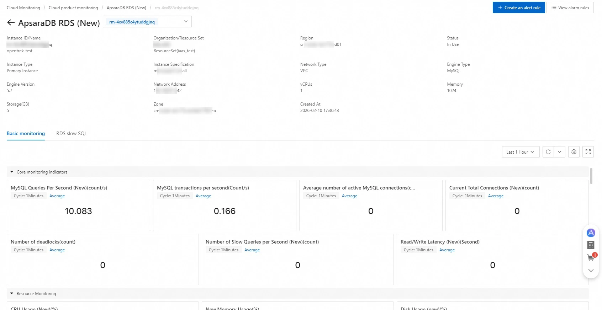

**View alert rules**

On the monitoring page of a target cloud product, you can view all alert rules for the cloud product or for a specific instance within the current organization and resource set.

1. On the monitoring page of the target cloud product, click **View Alert Rules** above the list, or find the target resource instance and click **Alert Rule** in the **Operation** column.

2. You are redirected to the **Alert Rule** page. On this page, you can view all alert rules for the cloud product or for a specified resource in the current organization and resource set. The information includes **Product Name**, **Rule Name**, **Status**, **Associated Instance**, **Alert Condition Description**, **Enable**, **Notification Recipient**, **Validity**, and **Rule Execution Record**.

   > **Note**
   >
   > - On the monitoring page of the target cloud product, you can click **Create Alert Rule** at the top of the page to create a custom alert rule for the cloud product. For more information, see Create an alert rule.
   >
   > - For other alert rule operations, see Manage alert rules.

   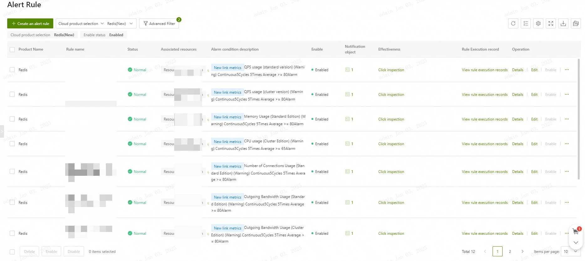

<a id="section-4-3"></a>

## 4.3. Kubernetes container monitoring

Kubernetes container monitoring tracks the performance of basic resources at the K8s cluster, node, and pod levels. This helps you understand the health of your clusters and promptly identify and resolve issues.

**Background**

Kubernetes container monitoring provides the following capabilities:

- Monitor K8s clusters and create alert rules.

- Synchronize and display a list of your K8s clusters, including information such as cluster name, ID, health status, and node count.

- Provide monitoring charts for individual clusters, with metrics for CPU, memory, and file systems.

- Define alert rules for a cluster's CPU, memory, and file system metrics.

- Support Prometheus monitoring 2.0, providing detailed monitoring for core components, nodes, applications, networks, GPUs, and big data/AI workloads.

**Procedure**

1. Log on to the Apsara Uni-manager operation console.

2. In the top menu bar, click **Products** and choose **Migration & O&M Management** > **O&M and Monitoring** > **CloudMonitor**.

3. In the left navigation bar, select **Cloud Resource Monitoring > Kubernetes Container Monitoring**.

4. The **Kubernetes container monitoring** page displays a list of Kubernetes clusters with columns for **Instance ID/Name**, **Organization/Resource Set**, **Region**, **Instance Status**, **Prometheus monitoring 2.0**, **CPU utilization**, **memory utilization**, **Cluster Identifier**, **Cluster Type**, **Cluster Version**, **Node Count**, **Network Mode**, **Availability zone ID**, **Security group ID**, and **VPC ID**.

   > **Note**
   >
   > - On the **Kubernetes container monitoring** page, click **Alert Rules** in the **Actions** column for a cluster to open the **Alert Rules** tab. For more information, see alert rules.
   >
   > - To add a new alert rule, click **Create Alert Rule** above the list. For information about the configuration parameters, see Create an alert rule.

5. View instance details.

   - For an instance that does not support Prometheus monitoring 2.0, click its **Instance ID/Name** to view the cluster details page.

     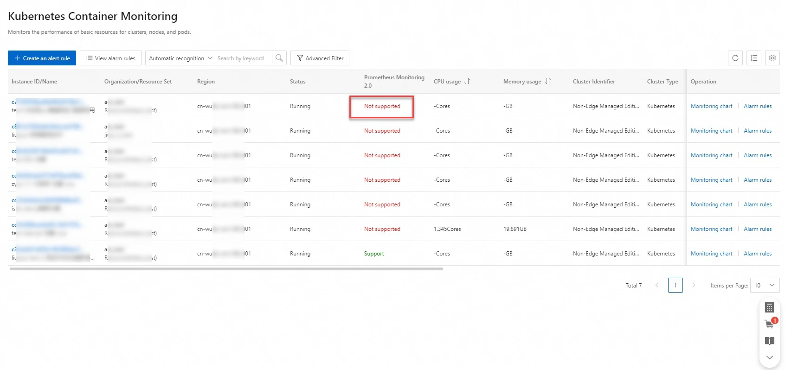

     - In the basic information section, view the **Cluster Name**, **Cluster ID**, **Cluster Type**, **Version**, and **VPC**.

     - The **Monitoring Charts** tab displays charts for the cluster's CPU, memory, and file system metrics. You can switch the time range of the charts to **1 Hour**, **3 Hours**, **6 Hours**, **12 Hours**, **1 Day**, **3 Days**, **7 Days**, or a custom time range.

       > **Note**
       >
       > - On the **Kubernetes container monitoring** page, you can also click **Monitoring Charts** in the **Actions** column for a cluster to open the **Monitoring Charts** tab directly.
       >
       > - You can change the layout of the charts to **1 per row**, **2 per row**, or **3 per row** by selecting an option from the drop-down list on the right.
       >
       > - Click the  icon on the right of a metric chart to add a rule description and
       >
       >   create an alert rule. For information about the configuration parameters, see Create an alert rule.
       >
       > - Click the
       >
       >   icon on the right of a metric chart to enlarge it.
       >
       >   

     - The **Nodes** tab lists the **Instance Name/ID**, **Status**, **CPU utilization**, and **memory utilization** for each node in the cluster. To open the node details page, click a node's instance name/ID or click **View Details** in the **Actions** column.

       - In the basic information section, view the **Instance Name** and **Cluster ID**.

       - The **Monitoring Charts** tab displays charts for CPU, memory, file system, and network metrics. You can switch the time range of the charts to **1 Hour**, **3 Hours**, **6 Hours**, **12 Hours**, **1 Day**, **3 Days**, **7 Days**, **14 Days**, or a custom time range.

         > **Note**
         >
         > - You can change the layout to **1 per row**, **2 per row**, or **3 per row** by selecting an option from the drop-down list on the right.
         >
         > - Click the
         >
         >   icon on the right of a metric chart to enlarge it.
         >
         >   

       - The **Pod List** tab displays pods associated with the current node, showing their **Instance Name**, **CPU Usage**, and **Memory Usage**. To open a pod's details page, click its **Instance Name** or click **View Details** in the Actions column.

         - In the basic information section, view the **Instance Name** and **Namespace**.

         - The **Monitoring Charts** tab displays charts for the pod's CPU, memory, file system, and network metrics. You can switch the time range of the charts to **1 Hour**, **3 Hours**, **6 Hours**, **12 Hours**, **1 Day**, **3 Days**, **7 Days**, **14 Days**, or a custom time range.

           > **Note**
           >
           > - You can change the layout to **1 per row**, **2 per row**, or **3 per row** by selecting an option from the drop-down list on the right.
           >
           > - Click the
           >
           >   icon on the right of a metric chart to enlarge it.
           >
           >   

     - The **Workloads** tab shows the **Instance Name**, **CPU Usage**, and **Memory Usage** for workloads in the cluster. To view an instance's details, click its **Instance Name** or click **View Details** in the Actions column.

       > **Note**
       >
       > - Click the **Namespace** drop-down list to switch between namespaces.
       >
       > - Click **Deployment**, **StatefulSet**, **DaemonSet**, **CronJob**, **Job**, or **Pod** above the instance list to filter by workload type.
       >
       >   - **Deployment**: Monitors Deployment resources in a namespace. The list displays instance names and CPU/memory usage. Detailed metrics include CPU allocation limit, CPU usage, maximum available file system size, and network receive/send rates. The view also lists the pods associated with the workload and provides their monitoring details.
       >
       >   - **StatefulSet**: Monitors StatefulSet resources in a namespace. The list displays instance names and CPU/memory usage. Detailed metrics include CPU allocation limit, CPU usage, maximum available file system size, and network receive/send rates. The view also lists the pods associated with the workload and provides their monitoring details.
       >
       >   - **DaemonSet**: Monitors DaemonSet resources in a namespace. The list displays instance names and CPU/memory usage. Detailed metrics include CPU allocation limit, CPU usage, maximum available file system size, and network receive/send rates. The view also lists the pods associated with the workload and provides their monitoring details.
       >
       >   - **CronJob**: Monitors CronJob resources in a namespace. The list displays instance names and CPU/memory usage. Detailed metrics include CPU allocation limit, CPU usage, maximum available file system size, and network receive/send rates. The view also lists the pods associated with the workload and provides their monitoring details.
       >
       >   - **Job**: Monitors Job resources in a namespace. The list displays instance names and CPU/memory usage. Detailed metrics include CPU allocation limit, CPU usage, maximum available file system size, and network receive/send rates. The view also lists the pods associated with the workload and provides their monitoring details.
       >
       >   - **Pod**: Displays a list of pods associated with the cluster, including pod names and CPU/memory usage. You can also access the monitoring details for each pod.

       - In the basic information section, view the **Instance Name** and **Namespace**.

       - The **Monitoring Charts** tab displays charts for CPU, memory, file system, and network metrics. You can switch the time range of the charts to **1 Hour**, **3 Hours**, **6 Hours**, **12 Hours**, **1 Day**, **3 Days**, **7 Days**, **14 Days**, or a custom time range.

         > **Note**
         >
         > - You can change the layout to **1 per row**, **2 per row**, or **3 per row** by selecting an option from the drop-down list on the right.
         >
         > - Click the
         >
         >   icon on the right of a metric chart to enlarge it.
         >
         >   

       - The **Pod List** tab lists the pods associated with the current workload, including the pod's **Instance Name**, **CPU Usage**, and **Memory Usage**. To open a pod's details page, click its instance name or click **View Details** in the Actions column.

         - In the basic information section, view the **Instance Name** and **Namespace**.

         - The **Monitoring Charts** tab displays charts for the pod's CPU, memory, file system, and network metrics. You can switch the time range of the charts to **1 Hour**, **3 Hours**, **6 Hours**, **12 Hours**, **1 Day**, **3 Days**, **7 Days**, **14 Days**, or a custom time range.

           > **Note**
           >
           > - You can change the layout to **1 per row**, **2 per row**, or **3 per row** by selecting an option from the drop-down list on the right.
           >
           > - Click the
           >
           >   icon on the right of a metric chart to enlarge it.
           >
           >   

     - The **Event List** tab displays up to 100 of the most recent event records from the last 6 hours for the current instance. The listed information includes **Event Name**, **Event Level**, **Event Status**, **Event Content**, and **Time**.

       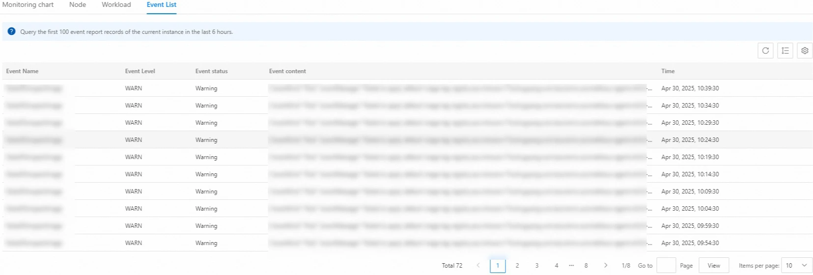

   - For an instance that supports Prometheus monitoring 2.0, click its **Instance ID/Name** to view the cluster details page.

     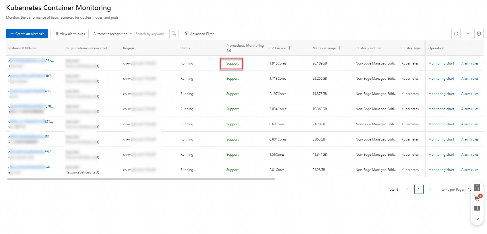

     - The cluster details page provides metric dashboards, including **Monitoring Overview**, **Core Component Monitoring**, **Node Monitoring**, **Application Monitoring**, **Network Monitoring**, **GPU Monitoring**, **Big Data/AI**, **Resource profile**, and **Others**.

       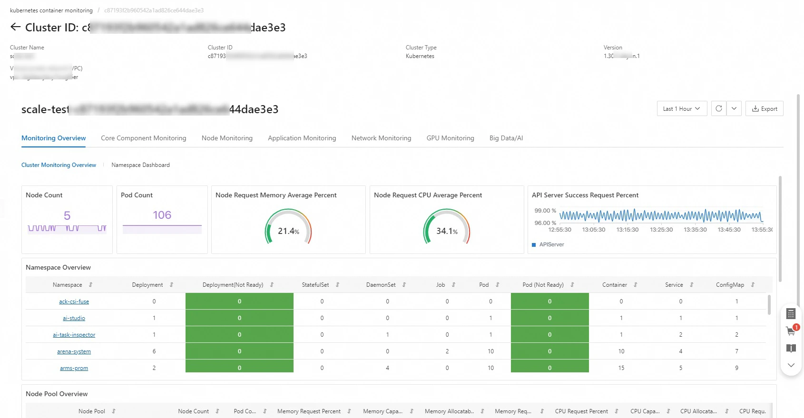

     - On the **Cluster Details** page, you can create an alert rule from a monitored metric with a single click.

       <ol type="a">

       <li>

       Click the  icon on the right of a metric and then click **Create Alert**.

       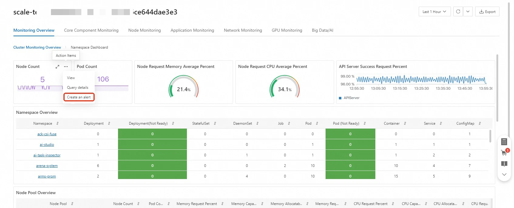

       </li>

       <li>

       In the **Create Alert** dialog box, click **Create Alert** in the **Actions** column. This redirects you to the **Create Alert Rule** page of the Prometheus monitoring 2.0 console. For more information, see the *Prometheus Monitoring User Guide*.

       </li>

       </ol>

     - To export a custom dashboard from the cluster details page, click **Export**.

       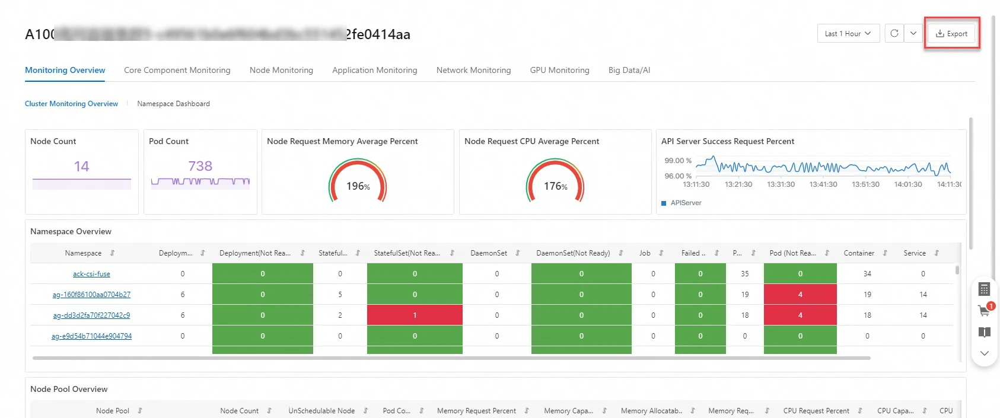

6. View Prometheus monitoring 2.0 metrics.

   In the left-side navigation pane, click **Metric store**. For Cloud Product, select **Kubernetes container monitoring** to view metrics such as **node.cpu.utilization (prometheus2)**, **node.memory.utilization (prometheus2)**, **pod memory utilization (working_set/limit) (prometheus2)**, **pod cpu utilization (usage/limit) (prometheus2)**, **cluster-level cpu utilization (prometheus2)**, and **cluster-level memory utilization (prometheus2)**.

   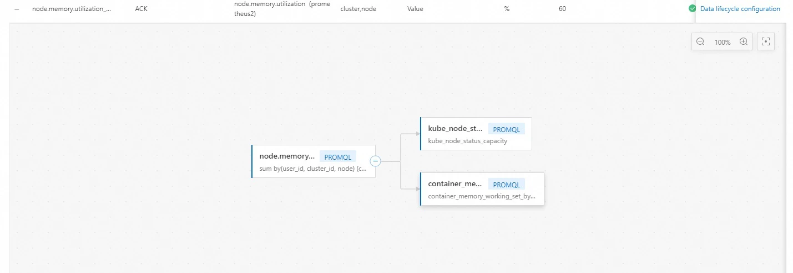

7. For more information about Prometheus monitoring 2.0, see the *Prometheus Monitoring User Guide*.

<a id="section-4-4"></a>

## 4.4. Application group

Application groups allow you to manage Elastic Compute Service (ECS) instances by group based on your business requirements. You can use an application group to manage business-specific ECS instances in a centralized manner. You can manage the alert rules and view monitoring data of different application groups. This greatly simplifies management complexity and improves efficiency.

<a id="section-4-4-1"></a>

### 4.4.1. Create an application group

Application groups allow you to manage resources across different cloud products and regions. You can group resources based on your business needs, manage alarm rules for the group, and view its monitoring data to improve your operational efficiency.

**Procedure**

1. Log on to the Apsara Uni-manager console.

2. In the top menu bar, click **Products** and choose **Migration & O&M Management** > **O&M and Monitoring** > **CloudMonitor**.

3. In the left-side navigation pane, choose **Cloud Resource Monitoring > Application Groups**.

4. On the **Application Groups** page, click **Create Application Group**.

5. In the **Create Application Group** panel, set the following parameters.

   | Parameter | Description |
   | --- | --- |
   | Instance creation method | • <strong>Create by Instance Name/Tag</strong>: Dynamically matches resources within a specific resource set or all resources in your organization by instance name or tag name.<br>• <strong>Manual creation</strong>: Choose this method to manage a fixed set of existing instances.<br>• <strong>Dynamic creation</strong>: This method uses a resource set and exclusion logic to automatically add new instances to the application group. |
   | Application group name | The name of the application group. |
   | Resource set scope | Note<br>This parameter is displayed only when <strong>Instance creation method</strong> is set to <strong>Create by Instance Name/Tag</strong>.<br><strong>Specify Resource Set is selected by default</strong>. |
   | Resource set selection | Select the target resource set from your organization. |
   | Alert contact | Select one or more alert contacts from the drop-down list. |
   | Add resource item | Note<br>Use this parameter when the <strong>Instance creation method</strong> is set to <strong>Manual</strong> <strong>creation</strong> or <strong>Create by Instance Name/Tag</strong>.<br>In the resource item, configure <strong>Cloud product selection</strong>, <strong>Rule relationship</strong>, <strong>Rule configuration</strong>, and <strong>Add instances</strong>. |
   | Exclude resource item | Note<br>Use this configuration item when the instance creation method is dynamic creation.<br>In the resource item, configure <strong>Cloud product selection</strong> and <strong>Batch exclude</strong> <strong>instances</strong>. |

6. Click **OK**.

<a id="section-4-4-2"></a>

### 4.4.2. Manage application groups

You can modify or delete application groups on the Application Group page in the Cloud Monitor console.

**Procedure**

1. Log in to the Apsara Uni-manager Management Console.

2. In the top menu bar, click **Products** and choose **Migration & O&M Management** > **O&M and Monitoring** > **CloudMonitor**.

3. In the left-side navigation pane, choose **Cloud Resource Monitoring > Application Group**. On the **Application Group** page, perform the following operations.

   | Operation | Procedure |
   | --- | --- |
   | View the information about an application group | i. Optional. In the top navigation bar, select an organization. On the <strong>Application Group</strong> page, enter an application group name or ID to search for the application group.<br>ii. Click the name of the application group whose information you want to view. On the details page of the application group, click tabs in the left-side pane to view the corresponding information.<br>• <strong>Group Overview</strong>: displays the <strong>basic information</strong> about the application group and the <strong>associated cloud services</strong>.<br>• <strong>Group Resources</strong>: displays the details of the resources in the application group.<br>• <strong>Availability Monitoring</strong>: displays the availability monitoring data of all Elastic Compute Service (ECS) instances in the current application group. For more information, see Create an availability monitoring task. |
   | Modify an application group | i. Optional. In the top navigation bar, select an organization. On the <strong>Application Group</strong> page, enter an application group name or ID to search for the application group.<br>ii. Move the pointer over theicon in the application group card and click <strong>Edit Group</strong>.<br>iii. In the <strong>Edit application groups</strong> panel, modify the parameter settings of the application group.<br>iv. After the modification is complete, click <strong>OK</strong>. |
   | Delete an application group | Note<br>If you delete an application group, all alert rules and event-triggered alerts of the application group are deleted. The instances in the application group are automatically migrated back to the pool that contains all instances.<br>i. Optional. In the top navigation bar, select an organization. On the <strong>Application Group</strong> page, enter an application group name or ID to search for the application group.<br>ii. On the Application Group page, delete one or more application groups.<br>• Delete a single application group<br>a. Move the pointer over theicon in the application group card and click <strong>Delete a group</strong>.<br>b. In the <strong>Confirm to delete a group</strong> message, click <strong>OK</strong>.<br>• Delete multiple application groups at a time<br>a. Select the application groups that you want to delete and click <strong>Batch deletion</strong> in the lower-left corner of the application group list.<br>b. In the <strong>Confirm batch deletion Group</strong> message, click <strong>OK</strong>. |

<a id="section-4-4-3"></a>

### 4.4.3. Availability monitoring

<a id="section-4-4-3-1"></a>

#### 4.4.3.1. Create an availability monitoring task

CloudMonitor provides the availability monitoring feature to help you check whether a local service or cloud server responds as expected. You can specify the path and port for the local service or cloud server. If the local service or cloud server times out or returns an error code, CloudMonitor sends an alert notification. This way, you can troubleshoot the issue at the earliest opportunity.

**Procedure**

> **Note**
>
> Availability monitoring allows you to use Elastic Compute Service (ECS) instances as the monitoring nodes.

1. Log on to the Apsara Uni-manager Management Console.

2. In the top navigation bar, choose **Products** > **Migration and O&M Management** > **O&M and Monitoring** > **CloudMonitor**.

3. In the left-side navigation pane, choose **Cloud Resource Monitoring > Application Group**.

4. On the **Application Group** page, find the application group that you want to manage and click its name.

5. On the details page of the application group, click **Availability Monitoring** in the left-side pane.

6. Click **Add Availability Monitoring**. In the **Create/Modify Availability Monitor** panel, configure the parameters and then click **OK**. The following table describes the parameters.

   **Parameter**

   **Description**

   The name of the availability monitoring task. The name

   **Task Name**

   must be 4 to 50 characters in length, and can contain letters, digits, underscores (_), and hyphens (-).

   Select one or more instances that you want to monitor in the application group.

   **Probe Source**

   > **Note**
   >
   > If you create more than 500 tasks for an instance, some tasks may fail.

   **Detection**

   The object that you want to monitor. Default value: **URL or**

   **target**

   **IP**.

   The detection method. Valid values: **HTTP(S)**, **TELNET**, and **PING**.

   - **HTTP(S)**: sends HTTP or HTTPS requests to detect the health status of the specified object. You need to enter the URL of the object. Example: http://localhost:8081/check_health.html.

   **Probe Type**

   - **TELNET**: runs the TELNET command to detect the health status of the specified object. You need to enter the IP address and port number of the object. Example: 192.168.1.1:22.

   - **PING**: runs the PING command to detect the health status of the specified object. You need to enter the IP addresses of the object. Example: 192.168.1.1.

   The request method. Valid values: **HEAD**, **GET** and **POST**.

   > **Note**

   **Request Method**

   > This parameter is displayed only if the **Detection target** parameter is set to **URL or IP** and the **Probe Type** parameter is set to **HTTP(S)**.

   The interval at which detection requests are sent. Default value: 1Minutes.

   > **Note**
   >
   > - This parameter is displayed only if the **Detection target** parameter is set to **URL or IP** and the **Probe Type** parameter is set to **HTTP(S)**.
   >
   > - You can click **Advanced Configuration** to

   **Monitoring**

   > configure this parameter for the alert rule.

   **frequency**

   **Create Task**

   The headers of the HTTP or HTTPS request.

   Format:  `parameter1:value1` .

   Separate multiple headers with commas (,).

   > **Note**

   **Headers**

   > - If the **Detection target** parameter is set to **URL or IP** and the **Probe Type** parameter is set to **HTTP(S)**, you can click **Advanced Configuration** to configure this parameter.
   >
   > - You can click **Advanced Configuration** to configure this parameter for the alert rule.

   > **Note**
   >
   > - If the **Detection target** parameter is set to **URL or IP**, the **Probe Type** parameter is set to **HTTP(S)**, and the **Request Method** parameter is set to **POST**, you can click **Advanced Configuration** to configure this parameter.

   **Submitted**

   > - You can click **Advanced Configuration** to

   **Content**

   > configure this parameter for the alert rule.

   The content is submitted in POST requests during site monitoring. This parameter is displayed only if you set the Request Method parameter to POST.

   Format: parameter1=value1&parameter2=value2.

   The response content that you want to match and the method to match the response content.

   If you specify response content, the monitoring task checks whether the first 64 KB of the HTTP response body contains the response content that you specify. Valid values:

   - **Alarm if it contains matching content**

   **Match Response**

   - **Does not contain matching content will alarm**

   **Content**

   > **Note**
   >
   > If the **Detection target** parameter is set to **URL or IP** and the **Probe Type** parameter is set to **HTTP(S)**, you can click **Advanced Configuration** to configure this parameter.

   The range of the status codes that you want to match. CloudMonitor generates an alert if the returned status code meets the alert condition. For more information about status codes, see Status codes.

   **Status Code**

   If the **status code** or **response time** reaches the specified threshold, an alert is triggered and a notification is sent to the specified alert contact group.

   The periods of the response time that you want to match. CloudMonitor generates an alert if the response time meets the alert condition. Unit: milliseconds.

   **Response time**

   If the **status code** or **response time** reaches the specified threshold, an alert is triggered and a notification is sent to the specified alert contact group.

   The alert level and the methods that are used to send alert notifications. Valid alert levels:

   - **Critical**

   **Alarm Level**

   - **Warn**

   - **Info**

   The URL that can be accessed over the Internet. CloudMonitor sends POST requests to push alert notifications to the specified URL.

   **Alarm callback**

   > **Note**
   >
   > You can enter only an HTTP URL.

   **Alarm Settings**

   The interval at which CloudMonitor resends an alert notification if the alert is not cleared. Valid values: **5Minutes**, **10Minutes**, **15Minutes**, **30Minutes**, **60Minutes**, **3Hours**, **6Hours**, **12Hours**, and **24Hours**.

   CloudMonitor sends an alert notification when a metric value reaches the threshold. If the metric value reaches the threshold again within the mute period, CloudMonitor

   **Channel**

   does not resend an alert notification. If the alert is not

   **Silence Period**

   cleared after the mute period ends, CloudMonitor resends an alert notification.

   > **Note**
   >
   > You can click **Advanced Configuration** to configure this parameter for the alert rule.

   The period during which the alert rule is effective. CloudMonitor sends alert notifications within the effective period and only records alerts beyond the effective period.

   **Effective time**

   > **Note**
   >
   > You can click **Advanced Configuration** to configure this parameter for the alert rule.

<a id="section-4-4-3-2"></a>

#### 4.4.3.2. Manage availability monitoring tasks

You can modify, disable, enable, and delete availability monitoring tasks on the **Availability Monitoring** tab of an application group in CloudMonitor.

**Procedure**

1. Log on to the Apsara Uni-manager Management Console.

2. In the top navigation bar, choose **Products** > **Migration and O&M Management** > **O&M and Monitoring** > **CloudMonitor**.

3. In the left-side navigation pane, choose **Cloud Resource Monitoring > Application Group**.

4. On the **Application Group** page, find the application group that you want to manage and click its name.

5. On the details page of the application group, click the **Availability Monitoring** tab in the left-side pane. On the **Availability Monitoring** tab, perform operations to manage availability monitoring tasks.

   | Operation | Procedure |
   | --- | --- |
   | View availability monitoring charts | i. Find the availability monitoring task that you want to manage and<br>click theicon in the <strong>Operation</strong> column to view the monitoring<br>details.<br>ii. Select one or more monitored instances from the drop-down list.<br>iii. Select a monitoring time range based on your business requirements.You can select <strong>1 Hour</strong>, <strong>6 Hours</strong>, <strong>12 Hours</strong>, <strong>1 Day</strong>, <strong>3 Days</strong>, <strong>7 Days</strong>, or <strong>14 Days</strong> or specify a time range.<br>iv. View the trend charts of the selected instances within the specified monitoring time range. |
   | Modify an availability monitoring task | i. Find the availability monitoring task that you want to modify and click <strong>Modification</strong> in the <strong>Operation</strong> column.<br>ii. In the <strong>Create/Modify Availability Monitor</strong> panel, modify the parameters as prompted. For more information about the parameters, see Create an availability monitoring task.<br>iii. After the modification is complete, click <strong>OK</strong>. |
   | Disable or enable availability monitoring tasks | Note<br>You can disable one or more availability monitoring tasks in the <strong>Enable</strong> state, or enable one or more availability monitoring tasks in the <strong>Disable</strong> state.<br>• Disable or enable a single availability monitoring task<br>a. Click <strong>Disable</strong> or <strong>Enable</strong> in the <strong>Operation</strong> column of the task.<br>b. In the <strong>Disable</strong> or <strong>Enable</strong> message, click <strong>OK</strong>.<br>• Disable or enable multiple availability monitoring tasks at a time<br>a. Select the availability monitoring tasks that you want to disable or enable and click <strong>Batch Disable</strong> or <strong>Batch Enable</strong> in the lower-left corner of the task list.<br>b. In the <strong>Disable</strong> or <strong>Enable</strong> message, click <strong>OK</strong>. |
   | Delete one or more availability monitoring tasks | • Delete a single availability monitoring task<br>a. Find the availability monitoring task that you want to delete and click <strong>Delete</strong> in the <strong>Operation</strong> column.<br>b. In the <strong>Delete</strong> message, click <strong>OK</strong>.<br>• Delete multiple availability monitoring tasks at a time<br>a. Select the availability monitoring tasks that you want to delete and click <strong>Batch Delete</strong> in the lower-left corner of the task list.<br>b. In the <strong>Delete</strong> message, click <strong>OK</strong>. |

<a id="section-4-4-3-3"></a>

#### 4.4.3.3. Status codes

If an error occurs when you use the availability monitoring feature of Cloud Monitor to check the availability of a specified path or port, the corresponding status code is returned.

The following table describes status codes.

<table>
  <tr>
    <th>Protocol</th>
    <th>Status code</th>
    <th>Description</th>
  </tr>
  <tr>
    <td rowspan="3">HTTP</td>
    <td>200</td>
    <td>The request is successful.</td>
  </tr>
  <tr>
    <td>610</td>
    <td>The status code returned because the connection times out.If Cloud Monitor does not receive a response within 5 seconds after Cloud Monitor sends an HTTP request, Cloud Monitor determines that the connection times out.</td>
  </tr>
  <tr>
    <td>611</td>
    <td>The status code returned because the monitoring fails.</td>
  </tr>
  <tr>
    <td rowspan="3">Telnet</td>
    <td>200</td>
    <td>The request is successful.</td>
  </tr>
  <tr>
    <td>630</td>
    <td>The status code returned because the connection times out.If Cloud Monitor does not receive a response within 5 seconds after Cloud Monitor sends a Telnet request, Cloud Monitor determines that the connection times out.</td>
  </tr>
  <tr>
    <td>631</td>
    <td>The status code returned because the monitoring fails.</td>
  </tr>
</table>

<a id="section-4-5"></a>

## 4.5. Namespaces

<a id="section-4-5-1"></a>

### 4.5.1. Time-series metrics

The time-series metrics feature in Metric Store provides a unified portal where you can query metrics for your cloud services and view their definitions, calculation methods, and other details.

**Background**

- Time-series metrics include all metrics for cloud services that are integrated with Cloud Monitor. The displayed product and metric names are consistent with those in the Cloud Monitor metric descriptions.

- This feature provides lineage analysis for each metric, tracing dependencies from creation (virtual metrics) and source metrics (real metrics) to the underlying data sources (Project and Logstore). This helps you trace data dependencies and troubleshoot data-related issues.

- Monitoring charts help you analyze and visualize metric data.

**View time-series metrics**

1. Log on to the Apsara Uni-manager console.

2. In the top menu bar, click **Products** and choose **Migration & O&M Management** > **O&M and Monitoring** > **CloudMonitor**.

3. In the left-side navigation pane, choose **Cloud Resource Monitoring > Metric Store**. The **Time-series Metrics** tab appears by default.

4. In the **Cloud Service List** on the left, click a target cloud service to view its corresponding metrics in the list on the right.

   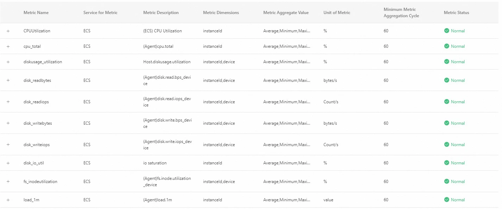

   > **Note**
   >
   > You can search for metrics by **Metric Name** and **Product**. Fuzzy search is supported.

5. Click the  icon to the left of a metric name to expand its details and view the metric

   lineage. The lineage shows the data dependencies for the metric, from the initial SQL creation to the final data source in an SLS Project and Logstore, as well as the DIM table in Cloud Monitor.

   > **Note**
   >
   > Not all cloud service metrics have DIM table data.

   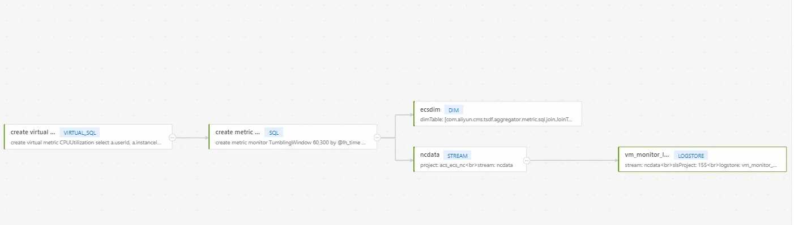

6. Click each stage to open the **Availability Monitoring Details** page. On the **Inspection Item Details** page, check for data. Use the inspection item results to determine whether the problem occurred with the raw data, during intermediate processing, or during final aggregation and calculation. If an error occurs, the inspection item results display a prompt to help you troubleshoot and track the issue.

   | Stage | Inspection item |
   | --- | --- |
   | Virtual metric | • Check if the virtual metric has data.<br>• Check for field mismatches between the virtual metric and the source metric.<br>• Check for field mismatches between the virtual metric and Tablestore query results. |
   | Real metric | • Check if the real metric has data.<br>• Check for field mismatches between the metric and Tablestore query results.<br>• Check the latency of the metric. |
   | DIM table | • Perform a sampling check to verify that instances have corresponding DIM data. |
   | Stream | • Check if the current metric has synthetic data to be collected.<br>• Check if data for the current metric has reached the ISLOT module.<br>• Check if data for the current metric is ready to be persisted to Tablestore.<br>• Check if the current stream contains a UDF. |
   | Logstore | • Check if records from the current Logstore are being consumed by ISLSLoader.<br>• Check if data is being ingested into ISLSLoader from the current Logstore.<br>• Check if the current Logstore contains data that matches the metric.<br>• Check if the current Logstore exists and contains data.<br>• Check if the shards for the current Logstore meet requirements. |

7. On the **Monitoring Details** page of **Availability Monitoring Details** for virtual and real metrics, enter an instance ID, set the aggregation value and time, and click **Query** to view the metric monitoring chart.

   | Parameter | Description |
   | --- | --- |
   | Namespace | The namespace to which the metric belongs. This field is pre-filled. |
   | Metric name | The name of the metric. This field is pre-filled. |
   | Instance ID | Enter the instance ID of the cloud service that you want to query. |
   | Aggregation | The method for aggregating metric data.<br>Note<br>The supported aggregation methods vary by cloud service metric. |
   | Time | The time range for the monitoring data. Options include 1 hour, 4 hours, 12 hours, and custom. |
   | SLS data | This parameter is available only on the monitoring details page for real metrics.<br>Indicates whether SLS data is available. |
   | Monitoring chart | Displays a chart showing the metric data trend based on the specified parameters.<br>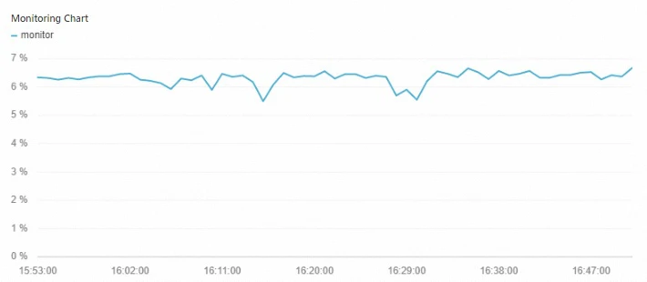 |

**Configure the data retention period**

> **Important**
>
> - Data lifecycle settings apply only to metric data.
>
> - Evaluate your Tablestore capacity before proceeding.
>
> - Configuration by organization, resource group, or individual metric is not supported. The settings apply to all metrics integrated with Cloud Monitor.

**Add a configuration**

1. On the **Time-series Metrics** tab, select a cloud service from the list, and then click **Data Lifecycle Configuration** in the **Actions** column for a metric.

2. In the **Data Lifecycle Configuration** dialog box, select **Add** from the **Operation** drop-down list. In the **data lifecycle configuration** field, enter the data retention period in days (a value from 0 to 1825). The default retention period is 31 days, and the maximum is 5 years (1825 days).

3. Click **OK**.

**Modify a configuration**

You can modify an existing data retention period.

1. On the **Time-series Metrics** tab, select a cloud service from the list, and then click **Data Lifecycle Configuration** in the **Actions** column for the metric.

2. In the **Data Lifecycle Configuration** dialog box, select **Edit** from the **Operation** drop-down list. In the **data lifecycle configuration** field, enter the new data retention period in days (a value from 0 to 1825).

3. Click **OK**.

**Delete a configuration**

You can delete an existing data retention period configuration. After deletion, the retention period for the metric reverts to the default of 31 days.

1. On the **Time-series Metrics** tab, select a cloud service from the list, and then click **Data Lifecycle Configuration** in the **Actions** column for the metric.

2. In the **Data Lifecycle Configuration** dialog box, select **Delete** from the **Operation** drop-down list.

3. Click **OK**.

<a id="section-4-5-2"></a>

### 4.5.2. System events

<a id="section-4-5-2-1"></a>

#### 4.5.2.1. Cloud product event monitoring metrics

This topic describes the names, descriptions, levels, statuses, and types of system events for Alibaba Cloud products.

**CloudMonitor event monitoring metrics**

| Event<br>name | Event Archivi ng<br>Produc t | Event<br>Description | Event<br>Level | Event<br>Status | Event<br>type |
| --- | --- | --- | --- | --- | --- |
| Agent_Status_Stopped | CloudM onitor | Plugin heartbeat stops | CRITICAL | stoppe d | StatusNotif ication |
| Agent_Status_Running | CloudM onitor | Plugin heartbeat resumes | CRITICAL | runnin g | StatusNotif ication |

**ApsaraDB for PolarDB (Legacy) event monitoring metrics**

| Event<br>name | Event Archivi ng<br>Product | Event<br>Description | Event<br>Level | Event<br>Status | Event<br>type |
| --- | --- | --- | --- | --- | --- |
| Instance:HASwitch | PolarDB | Instance HA switchover alert | WARN | Normal | Maintenance |
| Instance:Locked | PolarDB | Instance lock alert | CRITICAL | Error | Error |

**ApsaraDB RDS event monitoring metrics**

| Event<br>name | Source<br>Product | Event<br>Description | Event<br>Level | Event<br>Status | Event<br>type |
| --- | --- | --- | --- | --- | --- |
| Instance:HASwitch | RDS | Instance HA switchover alert | WARN | Normal | Maintenance |
| Instance:Locked | RDS | Instance lock alert | CRITICAL |  |  |

**AIStudio event monitoring metrics**

| Event name | Source Product | Description | Level | Status | Event type |
| --- | --- | --- | --- | --- | --- |
| Instance:OnlineService.Execute.Succeeded | AIStudio | Online service execution succeeded | INFO | TaskSucc eeded | Maintenance |
| Instance:Notebook.Exe cute.Succeeded | AIStudio | Notebook instance ran successfully | INFO | TaskSucc eeded | Maintenance |
| Instance:BatchInferenc e.Execute.Failed | AIStudio | Batch inference task failed | CRITICAL | TaskFaile d | StatusNotifica tion |
| Instance:BatchInferenc e.Execute.Succeeded | AIStudio | Batch inference task succeeded | INFO | TaskSucc eeded | Maintenance |
| Instance:BatchInferenc e.Execute.Running | AIStudio | Batch inference task started | INFO | TaskRun ning | Maintenance |
| Instance:BatchInferenc e.Queue.Failed | AIStudio | Batch inference task queuing failed | CRITICAL | TaskQue ueFailed | StatusNotifica tion |
| Instance:PipelineRun.E xecute.Terminated | AIStudio | Visualization modeling task manually stopped | INFO | TaskStop ped | Maintenance |
| Instance:PipelineRun.E xecute.Failed | AIStudio | Visualization modeling task failed | CRITICAL | TaskFaile d | StatusNotifica tion |
| Instance:PipelineRun.E xecute.Succeeded | AIStudio | Visualization modeling task succeeded | INFO | TaskSucc eeded | Maintenance |
| Instance:PipelineRun.E xecute.Running | AIStudio | Visualization modeling task started | INFO | TaskStar ting | Maintenance |
| Instance:Finetune.Exec ute.Failed | AIStudio | Model fine-tuning task failed | CRITICAL | TaskFaile d | StatusNotifica tion |
| Instance:Finetune.Exec ute.Succeeded | AIStudio | Model fine-tuning task succeeded | INFO | TaskSucc eeded | Maintenance |
| Instance:Finetune.Exec ute.Running | AIStudio | Model fine-tuning task started | INFO | TaskRun ning | Maintenance |
| Instance:Finetune.Que ue.Failed | AIStudio | Model fine-tuning task queuing failed | CRITICAL | TaskQue ueFailed | Maintenance |
| Instance:ModelQuant.E xecute.Failed | AIStudio | Model quantization task failed | CRITICAL | TaskFaile d | Maintenance |
| Instance:ModelQuant.E xecute.Succeeded | AIStudio | Model quantization task succeeded | INFO | TaskSucc eeded | StatusNotifica tion |
| Instance:ModelQuant.E xecute.Running | AIStudio | Model quantization task started | INFO | TaskRun ning | Maintenance |
| Instance:ModelQuant.Q ueue.Failed | AIStudio | Model quantization task queuing failed | CRITICAL | TaskQue ueFailed | StatusNotifica tion |
| Instance:DataAcc.Exec ute.Failed | AIStudio | Data accelerator failed to run | CRITICAL | TaskFaile d | StatusNotifica tion |
| Instance:ModelEvaluati on.Execute.Succeeded | AIStudio | Model evaluation task succeeded | INFO | TaskSucc eeded | Maintenance |
| Instance:ModelEvaluati on.Execute.Failed | AIStudio | Model evaluation task failed | CRITICAL | TaskFaile d | StatusNotifica tion |
| Instance:OnlineService.Execute.Failed | AIStudio | Online service execution failed | CRITICAL | Executio nFailed | StatusNotifica tion |
| Instance:OnlineService.Create.Failed | AIStudio | Online service creation failed | CRITICAL | Creation Failed | StatusNotifica tion |
| Instance:TaskModeling.Execute.running | AIStudio | Task modeling started | INFO | TaskRun ning | Maintenance |
| Instance:TaskModeling.Execute.Failed | AIStudio | Task modeling failed | CRITICAL | TaskFaile d | StatusNotifica tion |
| Instance:TaskModeling.Execute.Succeeded | AIStudio | Task modeling succeeded | INFO | TaskSucc eeded | Maintenance |
| Action:Notebook.Expor t.Failed | AIStudio | Failed to export Notebook instance image | CRITICAL | TaskFaile d | StatusNotifica tion |
| Instance:DataAcc.Crea te.Failed | AIStudio | Data accelerator creation failed | CRITICAL | Creation Failed | StatusNotifica tion |
| Action:Image.Accelerat e.Failed | AIStudio | Custom image acceleration failed | CRITICAL | TaskFaile d | StatusNotifica tion |
| Instance:TaskModeling.Queue.Failed | AIStudio | Task modeling queuing failed | CRITICAL | TaskQue ueFailed | StatusNotifica tion |
| Instance:TaskModeling.Start.Failed | AIStudio | Task modeling failed to start | CRITICAL | TaskStar tFailed | StatusNotifica tion |
| Instance:Notebook.Cre ate.Failed | AIStudio | Notebook instance creation failed | CRITICAL | Creation Failed | StatusNotifica tion |
| Instance:Notebook.Exe cute.Failed | AIStudio | Notebook instance failed to run | CRITICAL | Executio nFailed | StatusNotifica tion |

**Certificate Management Service event monitoring metrics**

| Event name | Related Produc ts | Description | Level | Status | Event type |
| --- | --- | --- | --- | --- | --- |
| Certificate.Expired.Mo nitoring | CAS | Certificate has expired | CRITICAL | CRITIC AL | StatusNotif ication |
| Certificate.Expiration.Monitoring | CAS | Certificate is about to expire | CRITICAL | CRITIC AL | StatusNotif ication |

**Hybrid Disaster Recovery event monitoring metrics**

| Event name | Related produc t | Description | Level | Status | Event type |
| --- | --- | --- | --- | --- | --- |
| PrimarySiteVpc:Delete d | HDR | Production site VPC was deleted | CRITICAL | Failed | StatusNotif ication |
| SecondarySiteVpc:Del eted | HDR | Disaster recovery site VPC was deleted | CRITICAL | Failed | StatusNotif ication |
| PrimarySiteNetwork:D eleted | HDR | Production site network was deleted | CRITICAL | Failed | StatusNotif ication |
| SecondarySiteNetwor k:Deleted | HDR | Disaster recovery site network was deleted | CRITICAL | Failed | StatusNotif ication |
| PrimarySecurityGroup:Deleted | HDR | Production site security group was deleted | CRITICAL | Failed | StatusNotif ication |
| SecondarySecurityGro up:Deleted | HDR | Disaster recovery site security group was deleted | CRITICAL | Failed | StatusNotif ication |
| SecurityGroup:Inconsi stency | HDR | Inconsistent security group policies | CRITICAL | Failed | StatusNotif ication |
| ProductSiteNetwork:In consistency | HDR | Abnormal change in production site network information | CRITICAL | Failed | StatusNotif ication |
| DrSiteNetwork:Inconsi stency | HDR | Abnormal change in disaster recovery site network information | CRITICAL | Failed | StatusNotif ication |
| ProductSiteStorage:In consistency | HDR | Abnormal change in production site storage information | CRITICAL | Failed | StatusNotif ication |
| DrSiteStorage:Inconsi stency | HDR | Abnormal change in disaster recovery site storage information | CRITICAL | Failed | StatusNotif ication |
| PrimarySiteComputati on:Inconsistency | HDR | Abnormal change in production site computing information | CRITICAL | Failed | StatusNotif ication |
| DrSiteComputation:In consistency | HDR | Abnormal change in disaster recovery site computing information | CRITICAL | Failed | StatusNotif ication |
| ReplicationGroup:Inco nsistency | HDR | Abnormal replication group information | CRITICAL | Failed | StatusNotif ication |
| ReplicationPair:Incons istency | HDR | Abnormal replication pair information | CRITICAL | Failed | StatusNotif ication |
| Gateway:Inconsistenc y | HDR | Abnormal gateway | CRITICAL | Failed | StatusNotif ication |
| ShadowEcs:Inconsiste ncy | HDR | Failures in ECS instance replication | CRITICAL | Failed | StatusNotif ication |

**Backup Management Platform event monitoring metrics**

| Event<br>name | Event Archivi ng<br>Produc t | Event<br>Description | Event<br>Level | Event<br>Status | Event<br>type |
| --- | --- | --- | --- | --- | --- |
| BackupPlan | ASRBR | Alerts related to backup plans | CRITICAL | FAILED | StatusNotif ication |
| RecoveryTask | ASRBR | Alerts related to restore jobs | CRITICAL | FAILED | StatusNotif ication |
| MigratePlan | ASRBR | Alerts related to migration plans | CRITICAL | FAILED | StatusNotif ication |
| LICENSE | ASRBR | Alerts related to license usage | CRITICAL | FAILED | Maintenan ce |

**Resource Orchestration Service event monitoring metrics**

| Event<br>name | Event Rules<br>Produc t | Event<br>Description | Event<br>Level | Event<br>Status | Event<br>type |
| --- | --- | --- | --- | --- | --- |
| Stack:StatusChange | ros | Stack status changed | INFO | Normal | StatusNotif ication |
| StackResource:Status Change | ros | Stack resource status changed | INFO | Normal | StatusNotif ication |
| StackGroup:Operation StatusChange | ros | Stack group operation status changed | INFO | Normal | StatusNotif ication |

**Elastic Compute Service (ECS) event monitoring metrics**

| Event<br>name | Event Archivi ng<br>Produc t | Event<br>Description | Event<br>Level | Event<br>Status | Event<br>type |
| --- | --- | --- | --- | --- | --- |
| Disk:ConvertToPostpai dCompleted | ECS | Disk converted to pay-as-you-go | INFO | Normal | StatusNotif ication |
| Disk:DiskOperationCo mpleted | ECS | Disk operation completed | INFO | Normal | StatusNotif ication |
| Disk:ErrorDetected:Ex ecuted | ECS | Local disk corruption alert ended | CRITICAL | Execut ed | Exception |
| Disk:ErrorDetected:Ex ecuting | ECS | Local disk corruption alert started | CRITICAL | Executi ng | Exception |
| Disk:OverduePayment Release | ECS | Disk released due to overdue payment | CRITICAL | Normal | StatusNotif ication |
| Disk:Stalled:Executed | ECS | Severe disk performance impact ended | CRITICAL | Execut ed | Exception |
| Disk:Stalled:Executing | ECS | Severe disk performance impact started | CRITICAL | Executi ng | Exception |
| Instance:AutoReactiva teCompleted | ECS | Automatic restart completed | INFO | Normal | StatusNotif ication |
| Instance:BurstablePer formanceRestricted | ECS | Burstable instance performance is restricted | WARN | Normal | StatusNotif ication |
| Instance:InstanceFailu re.PerformanceImpact:Executed | ECS | Potential instance performance impact ended (instance failure) | WARN | Execut ed | Exception |
| Instance:InstanceFailu re.PerformanceImpact:Executing | ECS | Potential instance performance impact started (instance failure) | WARN | Executi ng | Exception |
| Instance:InstanceFailu re.Reboot:Executed | ECS | Instance restart ended (instance failure) | CRITICAL | Execut ed | Exception |
| Instance:InstanceFailu re.Reboot:Executing | ECS | Instance restart started (instance failure) | CRITICAL | Executi ng | Exception |
| Instance:LiveMigratio nAcrossDDH | ECS | Instance hot migrated between dedicated hosts | INFO | Normal | StatusNotif ication |
| Instance:Performance ModeChange | ECS | Burstable instance performance mode switched | INFO | Normal | StatusNotif ication |
| Instance:PreemptibleI nstanceInterruption | ECS | Spot instance interruption notification | WARN | Normal | StatusNotif ication |
| Instance:Security.Tpm Alert:Executed | ECS | TPM security warning ended | WARN | Execut ed | Exception |
| Instance:Security.Tpm Alert:Executing | ECS | TPM security warning started | WARN | Executi ng | Exception |
| Instance:StateChange | ECS | Instance status change notification | INFO | Normal | StatusNotif ication |
| Instance:SystemFailur e.Delete:Avoided | ECS | Automatic instance release avoided (instance creation failed) | CRITICAL | Avoide d | Exception |
| Instance:SystemFailur e.Delete:Executed | ECS | Automatic instance release completed (instance creation failed) | CRITICAL | Execut ed | Exception |
| Instance:SystemFailur e.Delete:Executing | ECS | Automatic instance release in progress (instance creation failed) | CRITICAL | Executi ng | Exception |
| Instance:SystemFailur e.PerformanceImpact: Executed | ECS | Instance performance impact ended (system error) | WARN | Execut ed | Exception |
| Instance:SystemFailur e.PerformanceImpact: Executing | ECS | Instance performance impact started (system error) | WARN | Executi ng | Exception |
| Instance:SystemFailur e.Reboot:Executed | ECS | Instance restart ended (system error) | CRITICAL | Execut ed | Exception |
| Instance:SystemFailur e.Reboot:Executing | ECS | Instance restart started (system error) | CRITICAL | Executi ng | Exception |
| Instance:SystemFailur e.Reboot:Failed | ECS | Instance restart failed (system error) | CRITICAL | Failed | Exception |
| Instance:SystemFailur e.Redeploy:Avoided | ECS | Instance redeployment avoided (system error) | CRITICAL | Avoide d | Exception |
| Instance:SystemFailur e.Redeploy:Canceled | ECS | Instance redeployment canceled (system error) | CRITICAL | Cancel ed | Exception |
| Instance:SystemFailur e.Redeploy:Executed | ECS | Instance redeployment completed (system error) | CRITICAL | Execut ed | Exception |
| Instance:SystemFailur e.Redeploy:Executing | ECS | Instance redeployment in progress (system error) | CRITICAL | Executi ng | Exception |
| Instance:SystemFailur e.Stop:Executed | ECS | Instance stop completed (system error) | CRITICAL | Execut ed | Exception |
| Instance:SystemFailur e.Stop:Executing | ECS | Instance stop started (system error) | CRITICAL | Executi ng | Exception |
| Instance:SystemMaint enance.IsolateErrorDi sk:Avoided | ECS | Corrupted disk isolation for system maintenance was avoided | CRITICAL | Avoide d | Maintenan ce |
| Instance:SystemMaint enance.IsolateErrorDi sk:Canceled | ECS | Corrupted disk isolation for system maintenance was canceled | CRITICAL | Cancel ed | Maintenan ce |
| Instance:SystemMaint enance.IsolateErrorDi sk:Executed | ECS | Corrupted disk isolation for system maintenance was completed | CRITICAL | Execut ed | Maintenan ce |
| Instance:SystemMaint enance.IsolateErrorDi sk:Executing | ECS | Corrupted disk isolation for system maintenance is in progress | CRITICAL | Executi ng | Maintenan ce |
| Instance:SystemMaint enance.IsolateErrorDi sk:Failed | ECS | Corrupted disk isolation for system maintenance failed | CRITICAL | Failed | Maintenan ce |
| Instance:SystemMaint enance.IsolateErrorDi sk:Inquiring | ECS | Inquiring about corrupted disk isolation for system maintenance | CRITICAL | Inquirin g | Maintenan ce |
| Instance:SystemMaint enance.PerformanceI mpact:Executed | ECS | Potential instance performance impact ended (system maintenance) | CRITICAL | Execut ed | Maintenan ce |
| Instance:SystemMaint enance.PerformanceI mpact:Executing | ECS | Potential instance performance impact started (system maintenance) | CRITICAL | Executi ng | Maintenan ce |
| Instance:SystemMaint enance.ReInitErrorDis k:Avoided | ECS | Corrupted disk re-initialization for system maintenance was avoided | CRITICAL | Avoide d | Maintenan ce |
| Instance:SystemMaint enance.ReInitErrorDis k:Canceled | ECS | Corrupted disk re-initialization for system maintenance was canceled | CRITICAL | Cancel ed | Maintenan ce |
| Instance:SystemMaint enance.ReInitErrorDis k:Executed | ECS | Corrupted disk re-initialization for system maintenance was completed | CRITICAL | Execut ed | Maintenan ce |
| Instance:SystemMaint enance.ReInitErrorDis k:Executing | ECS | Corrupted disk re-initialization for system maintenance is in progress | CRITICAL | Executi ng | Maintenan ce |
| Instance:SystemMaint enance.ReInitErrorDis k:Failed | ECS | Corrupted disk re-initialization for system maintenance failed | CRITICAL | Failed | Maintenan ce |
| Instance:SystemMaint enance.ReInitErrorDis k:Inquiring | ECS | Re-initializing the faulty disk due to system maintenance | CRITICAL | Inquirin g | Maintenan ce |
| Instance:SystemMaint enance.Reboot:Avoide d | ECS | Scheduled instance restart avoided (system maintenance) | CRITICAL | Avoide d | Maintenan ce |
| Instance:SystemMaint enance.Reboot:Cancel ed | ECS | Scheduled instance restart canceled (system maintenance) | CRITICAL | Cancel ed | Maintenan ce |
| Instance:SystemMaint enance.Reboot:Execut ed | ECS | Scheduled instance restart completed (system maintenance) | CRITICAL | Execut ed | Maintenan ce |
| Instance:SystemMaint enance.Reboot:Execut ing | ECS | Scheduled instance restart in progress (system maintenance) | CRITICAL | Executi ng | Maintenan ce |
| Instance:SystemMaint enance.Reboot:Failed | ECS | Scheduled instance restart failed (system maintenance) | CRITICAL | Failed | Maintenan ce |
| Instance:SystemMaint enance.Reboot:Inquiri ng | ECS | Inquiring about scheduled instance restart (system maintenance) | CRITICAL | Inquirin g | Maintenan ce |
| Instance:SystemMaint enance.Reboot:Sched uled | ECS | Scheduled instance restart notification (system maintenance) | CRITICAL | Schedu led | Maintenan ce |
| Instance:SystemMaint enance.RebootAndIsol ateErrorDisk:Avoided | ECS | The issue was mitigated during system maintenance by restarting the instance and fencing the faulty disk. | CRITICAL | Avoide d | Maintenan ce |
| Instance:SystemMaint enance.RebootAndIsol ateErrorDisk:Canceled | ECS | Instance restart and corrupted disk isolation for system maintenance was canceled | CRITICAL | Cancel ed | Maintenan ce |
| Instance:SystemMaint enance.RebootAndIsol ateErrorDisk:Executed | ECS | Instance restart and corrupted disk isolation for system maintenance was completed | CRITICAL | Execut ed | Maintenan ce |
| Instance:SystemMaint enance.RebootAndIsol ateErrorDisk:Executin g | ECS | Instance restart and corrupted disk isolation for system maintenance is in progress | CRITICAL | Executi ng | Maintenan ce |
| Instance:SystemMaint enance.RebootAndIsol ateErrorDisk:Inquiring | ECS | Inquiring about instance restart and corrupted disk isolation for system maintenance | CRITICAL | Inquirin g | Maintenan ce |
| Instance:SystemMaint enance.RebootAndReI nitErrorDisk:Avoided | ECS | The issue was resolved by a maintenance restart of the instance and a re-initialization of the faulty disk. | CRITICAL | Avoide d | Maintenan ce |
| Instance:SystemMaint enance.RebootAndReI nitErrorDisk:Canceled | ECS | Instance restart and corrupted disk re-initialization for system maintenance was canceled | CRITICAL | Cancel ed | Maintenan ce |
| Instance:SystemMaint enance.RebootAndReI nitErrorDisk:Executed | ECS | Instance restart and corrupted disk re-initialization for system maintenance was completed | CRITICAL | Execut ed | Maintenan ce |
| Instance:SystemMaint enance.RebootAndReI nitErrorDisk:Executing | ECS | Instance restart and corrupted disk re-initialization for system maintenance is in progress | CRITICAL | Executi ng | Maintenan ce |
| Instance:SystemMaint enance.RebootAndReI nitErrorDisk:Inquiring | ECS | Inquiring about instance restart and corrupted disk re-initialization for system maintenance | CRITICAL | Inquirin g | Maintenan ce |
| Instance:SystemMaint enance.Redeploy:Avoi ded | ECS | Scheduled instance redeployment avoided (system maintenance) | CRITICAL | Avoide d | Maintenan ce |
| Instance:SystemMaint enance.Redeploy:Can celed | ECS | Scheduled instance redeployment canceled (system maintenance) | CRITICAL | Cancel ed | Maintenan ce |
| Instance:SystemMaint enance.Redeploy:Exe cuted | ECS | Scheduled instance redeployment completed (system maintenance) | CRITICAL | Execut ed | Maintenan ce |
| Instance:SystemMaint enance.Redeploy:Exe cuting | ECS | Scheduled instance redeployment in progress (system maintenance) | CRITICAL | Executi ng | Maintenan ce |
| Instance:SystemMaint enance.Redeploy:Inqu iring | ECS | Inquiring about scheduled instance redeployment (system maintenance) | CRITICAL | Inquirin g | Maintenan ce |
| Instance:SystemMaint enance.Redeploy:Sch eduled | ECS | Scheduled instance redeployment notification (system maintenance) | CRITICAL | Schedu led | Maintenan ce |
| Instance:SystemMaint enance.Stop:Avoided | ECS | Scheduled instance stop avoided (system maintenance) | CRITICAL | Avoide d | Maintenan ce |
| Instance:SystemMaint enance.Stop:Canceled | ECS | Scheduled instance stop canceled (system maintenance) | CRITICAL | Cancel ed | Maintenan ce |
| Instance:SystemMaint enance.Stop:Executed | ECS | Scheduled instance stop completed (system maintenance) | CRITICAL | Execut ed | Maintenan ce |
| Instance:SystemMaint enance.Stop:Executin g | ECS | Scheduled instance stop in progress (system maintenance) | CRITICAL | Executi ng | Maintenan ce |
| Instance:SystemMaint enance.Stop:Failed | ECS | Scheduled instance stop failed (system maintenance) | CRITICAL | Failed | Maintenan ce |
| Instance:SystemMaint enance.Stop:Schedule d | ECS | Scheduled instance stop notification (system maintenance) | CRITICAL | Schedu led | Maintenan ce |
| NetworkInterface:Net workInterfaceOperate Completed | ECS | Network interface controller (NIC) operation completed | INFO | Normal | StatusNotif ication |
| Snapshot:CreateSnap shotCompleted | ECS | Disk snapshot creation completed | INFO | Normal | StatusNotif ication |
| Instance:VmLivemigra teException | ECS | Abnormal VM status after hot migration | WARN | Normal | StatusNotif ication |
| Instance:VmDownCau sedByNcDown | ECS | VM down due to NC breakdown | WARN | Normal | StatusNotif ication |
| Instance:VmDownEnd | ECS | VM breakdown recovery event | WARN | Execut ed | StatusNotif ication |
| Instance:VmPanicEve nt | ECS | Abnormal VM PANIC restart, possibly due to internal virtual machine issues | WARN | Normal | StatusNotif ication |
| Instance:VmCrashEve nt | ECS | Abnormal VM crash event | WARN | Normal | StatusNotif ication |
| Instance:InstanceFailu re.Reboot:Inquiring | ECS | Instance restart (customer confirmation) | CRITICAL | Inquirin g | StatusNotif ication |
| Instance:InstanceFailu re.Reboot:Scheduled | ECS | Instance restart (scheduled execution) | CRITICAL | Schedu led | StatusNotif ication |
| Instance:InstanceFailu re.Reboot:Avoided | ECS | Instance restart (execution avoided) | CRITICAL | Avoide d | StatusNotif ication |
| Instance:InstanceFailu re.Reboot:Canceled | ECS | Instance restart (canceled) | CRITICAL | Cancel ed | StatusNotif ication |
| Instance:InstanceFailu re.Reboot:Failed | ECS | Instance restart (failed) | CRITICAL | Failed | StatusNotif ication |
| Instance:InstanceFailu re.Alert:Inquiring | ECS | Instance alert (customer confirmation) | WARN | Inquirin g | StatusNotif ication |
| Instance:SystemFailur e.PerformanceImpact: Canceled | ECS | Major system performance impact (canceled) | WARN | Cancel ed | StatusNotif ication |
| Instance:SystemFailur e.PerformanceImpact: Avoided | ECS | Major system performance impact (execution avoided) | WARN | Avoide d | StatusNotif ication |
| Instance:SystemFailur e.PerformanceImpact: Scheduled | ECS | Major system performance impact (scheduled execution) | WARN | Schedu led | StatusNotif ication |
| Instance:SystemFailur e.PerformanceImpact: Inquiring | ECS | Major system performance impact (customer confirmation) | WARN | Inquirin g | StatusNotif ication |
| Instance:InstanceFailu re.Alert:Failed | ECS | Instance alert (failed) | WARN | Failed | StatusNotif ication |
| Instance:InstanceFailu re.Alert:Canceled | ECS | Instance alert (canceled) | WARN | Cancel ed | StatusNotif ication |
| Instance:InstanceFailu re.Alert:Executed | ECS | Instance alert (executed) | WARN | Execut ed | StatusNotif ication |
| Instance:InstanceFailu re.Alert:Executing | ECS | Instance alert (executing) | WARN | Executi ng | StatusNotif ication |
| Instance:InstanceFailu re.Alert:Avoided | ECS | Instance alert (execution avoided) | WARN | Avoide d | StatusNotif ication |
| Instance:InstanceFailu re.Alert:Scheduled | ECS | Instance alert (scheduled execution) | WARN | Schedu led | StatusNotif ication |
| Instance:SystemMaint enance.LiveMigrate:E xecuted | ECS | Off-peak analysis, hot migration (executed) | INFO | Execut ed | Maintenan ce |
| Instance:SystemMaint enance.LiveMigrate:A voided | ECS | Off-peak analysis, hot migration (executing) | INFO | Execut ed | Maintenan ce |
| Instance:SystemMaint enance.LiveMigrate:A voided | ECS | Off-peak analysis, hot migration (execution avoided) | INFO | Avoide d | Maintenan ce |
| Instance:SystemMaint enance.LiveMigrate:S cheduled | ECS | Off-peak analysis, hot migration (scheduled execution) | INFO | Schedu led | Maintenan ce |
| Instance:SystemMaint enance.LiveMigrate:In quiring | ECS | Off-peak analysis, hot migration (customer confirmation) | INFO | Inquirin g | Maintenan ce |
| Instance:SystemMaint enance.LiveMigrate:F ailed | ECS | Off-peak analysis, hot migration (failed) | INFO | Failed | Maintenan ce |
| Instance:SystemMaint enance.LiveMigrate:C anceled | ECS | Off-peak analysis, hot migration (canceled) | INFO | Cancel ed | Maintenan ce |
| Instance:SystemFailur e.Reboot:Canceled | ECS | System restart (canceled) | CRITICAL | Cancel ed | StatusNotif ication |
| Instance:SystemFailur e.Reboot:Avoided | ECS | System restart (execution avoided) | CRITICAL | Avoide d | StatusNotif ication |
| Instance:SystemFailur e.Reboot:Scheduled | ECS | System restart (scheduled execution) | CRITICAL | Schedu led | StatusNotif ication |
| Instance:SystemFailur e.Reboot:Inquiring | ECS | System restart (customer confirmation) | CRITICAL | Inquirin g | StatusNotif ication |
| Instance:SystemFailur e.PerformanceImpact: Failed | ECS | Major system performance impact (failed) | WARN | Failed | StatusNotif ication |
| Instance:SystemFailur e.PerformanceAffect:I nquiring | ECS | System performance impact (customer confirmation) | WARN | Inquirin g | StatusNotif ication |
| Instance:SystemFailur e.Alert:Failed | ECS | System alert (failed) | INFO | Failed | StatusNotif ication |
| Instance:SystemFailur e.Alert:Canceled | ECS | System alert (canceled) | INFO | Cancel ed | StatusNotif ication |
| Instance:SystemFailur e.Alert:Executed | ECS | System alert (executed) | INFO | Execut ed | StatusNotif ication |
| Instance:SystemFailur e.Alert:Executing | ECS | System alert (executing) | INFO | Executi ng | StatusNotif ication |
| Instance:SystemFailur e.Alert:Avoided | ECS | System alert (execution avoided) | INFO | Avoide d | StatusNotif ication |
| Instance:SystemFailur e.Alert:Scheduled | ECS | System alert (scheduled execution) | INFO | Schedu led | StatusNotif ication |
| Instance:SystemFailur e.Alert:Inquiring | ECS | System alert (customer confirmation) | INFO | Inquirin g | StatusNotif ication |
| Instance:Redeploy:Fai led | ECS | VM redeployment (local disk, failed) | CRITICAL | Failed | StatusNotif ication |
| Instance:Redeploy:Ca nceled | ECS | VM redeployment (local disk, canceled) | CRITICAL | Cancel ed | StatusNotif ication |
| Instance:Redeploy:Ex ecuted | ECS | VM redeployment (local disk, executed) | CRITICAL | Execut ed | StatusNotif ication |
| Instance:Redeploy:Ex ecuting | ECS | VM redeployment (local disk, executing) | CRITICAL | Executi ng | StatusNotif ication |
| Instance:Redeploy:Av oided | ECS | VM redeployment (local disk, execution avoided) | CRITICAL | Avoide d | StatusNotif ication |
| Instance:Redeploy:Sc heduled | ECS | VM redeployment (local disk, scheduled execution) | CRITICAL | Schedu led | StatusNotif ication |
| Instance:Redeploy:Inq uiring | ECS | VM redeployment (local disk, customer confirmation) | CRITICAL | Inquirin g | StatusNotif ication |
| Instance:Reboot:Faile d | ECS | VM redeployment (failed) | CRITICAL | Failed | StatusNotif ication |
| Instance:Reboot:Canc eled | ECS | VM redeployment (canceled) | CRITICAL | Cancel ed | StatusNotif ication |
| Instance:Reboot:Exec uted | ECS | VM redeployment (executed) | CRITICAL | Execut ed | StatusNotif ication |
| Instance:Reboot:Exec uting | ECS | VM redeployment (executing) | CRITICAL | Executi ng | StatusNotif ication |
| Instance:Reboot:Avoid ed | ECS | VM redeployment (execution avoided) | CRITICAL | Avoide d | StatusNotif ication |
| Instance:Reboot:Sche duled | ECS | VM redeployment (scheduled execution) | CRITICAL | Schedu led | StatusNotif ication |
| Instance:Reboot:Inqui ring | ECS | VM redeployment (customer confirmation) | CRITICAL | Inquirin g | StatusNotif ication |
| Instance:SystemFailur e.PerformanceAffect:F ailed | ECS | System performance impact (failed) | WARN | Failed | StatusNotif ication |
| Instance:SystemFailur e.PerformanceAffect:C anceled | ECS | System performance impact (canceled) | WARN | Cancel ed | StatusNotif ication |
| Instance:SystemFailur e.PerformanceAffect:E xecuted | ECS | System performance impact (executed) | WARN | Execut ed | StatusNotif ication |
| Instance:SystemFailur e.PerformanceAffect:E xecuting | ECS | System performance impact (executing) | WARN | Executi ng | StatusNotif ication |
| Instance:SystemFailur e.PerformanceAffect:A voided | ECS | System performance impact (execution avoided) | WARN | Avoide d | StatusNotif ication |
| Instance:SystemFailur e.PerformanceAffect:S cheduled | ECS | System performance impact (scheduled execution) | WARN | Schedu led | StatusNotif ication |

**Disaster Recovery Management Platform event monitoring metrics**

| Event<br>name | Even t Archi ving<br>Prod uct | Event<br>Description | Event<br>Level | Event<br>Status | Event<br>type |
| --- | --- | --- | --- | --- | --- |
| ProtectGroupStatus:Fa iled | asrdr | Protection group status failed | CRITICAL | Failed | Exception |
| ProtectGroupLatency: Exceeded | asrdr | High protection group synchronization latency | CRITICAL | Exceeded | Exception |
| RecoveryPlanRTO:Exc eeded | asrdr | High disaster recovery plan RTO | CRITICAL | Exceeded | Exception |
| RecoveryPlanStatus:F ailed | asrdr | Disaster recovery plan execution status failed | CRITICAL | Failed | Exception |
| ProtectGroupCapacity: Insufficiency | asrdr | Insufficient protection group capacity | WARN | Insufficiency | Maintenance |
| ProtectEntityCapacity: Insufficiency | asrdr | Insufficient synchronization entity capacity | WARN | Insufficiency | Maintenance |
| RecoveryPlanCapacity:Insufficiency | asrdr | Insufficient disaster recovery plan capacity | WARN | Insufficiency | Maintenance |
| ProtectEntityLoad:Exc eeded | asrdr | Synchronization entity task load exceeded | CRITICAL | Exceeded | Maintenance |

**Bare Metal Computing Platform event monitoring metrics**

| Event<br>name | Even t Archi ving<br>Appli cable prod ucts | Event<br>Description | Event<br>Level | Event<br>Status | Event<br>type |
| --- | --- | --- | --- | --- | --- |
| BMCP_INSTANCE_HEA RTBEAT_LOST | bmcp | BMCP instance heartbeat lost | CRITICAL | failed | Exception |
| GPU_XID_ERROR | bmcp | GPU XID notification | INFO | failed | StatusNotific ation |
| GPU_XID_RPC_TIMEOU T | bmcp | GPU GSP CORE RPC timeout | WARN | failed | Exception |
| GPU_XID_CONTAINED_ECC_ERR_FAILURE | bmcp | GPU memory ECC suppression failed | WARN | failed | Exception |
| GPU_XID_CONTAINED_ECC_ERR | bmcp | GPU memory ECC suppression succeeded | INFO | failed | StatusNotific ation |
| GPU_XID_HIGH_ECC_E RR_RATE | bmcp | High single-bit GPU memory ECC error rate | WARN | failed | Exception |
| GPU_XID_FALLEN_OFF _BUS | bmcp | GPU driver failure | CRITICAL | failed | Recovery |
| GPU_XID_NVLINK_ERR OR | bmcp | GPU NVLINK connection failed | WARN | failed | Maintenance |
| GPU_XID_RETIREMENT _OR_ROW_REMAPPING _FAILURE | bmcp | Failed to record RETIREMENT or REMAPPING | WARN | failed | Exception |
| GPU_XID_RETIREMENT _OR_ROW_REMAPPING _RECORDING | bmcp | RETIREMENT or REMAPPING event detected | INFO | failed | StatusNotific ation |
| GPU_XID_MICROCONT ROLLER_HALT | bmcp | GPU microcontroller halt alert | WARN | failed | Maintenance |
| GPU_XID_MICROCONT ROLLER_BREAKPOINT | bmcp | GPU microcontroller breakpoint alert | WARN | failed | Maintenance |
| GPU_XID_DOUBLE_BIT _ECC_ERROR | bmcp | Multi-bit GPU memory error | INFO | failed | Exception |
| GPU_XID_MEMORY_PA GE_FAULT | bmcp | GPU memory page fault | WARN | failed | Exception |
| GPU_XID_GRAPHICSEN GINE_EXCEPTION | bmcp | GPU computing engine exception | INFO | failed | Exception |
| GPU_SMI_KERNEL_INT ERRUPT_ISSUE | bmcp | Interrupt communication exception alert | INFO | failed | Exception |
| GPU_SMI_TEMPHIGH | bmcp | GPU high temperature alert | WARN | failed | Exception |
| GPU_SMI_THROTTLE | bmcp | GPU throttling alert | WARN | failed | Exception |
| GPU_SMI_ROWREMAP PING_ERR | bmcp | GPU ROW remapping failed | WARN | failed | Maintenance |
| GPU_SMI_ECC_UC_ERR _HIGH | bmcp | UCE count exceeded limit alert | WARN | failed | Recovery |
| GPU_SMI_TOPO_NS | bmcp | GPU TOPO abnormal | WARN | failed | Maintenance |
| GPU_SMI_FAN_SPEED_MSGERROR | bmcp | Unable to query GPU fan speed | INFO | failed | Exception |
| GPU_PCIE_BANDWIDT H_DOWNGRADE | bmcp | PCIe bandwidth downgraded | WARN | failed | Maintenance |
| GPU_PCIE_GPU_LOST | bmcp | PCIe detected a dropped card | CRITICAL | failed | Recovery |
| GPU_SMI_LINK_STATU S_INACTIVE | bmcp | GPU NVLINK connection inactive | WARN | failed | Maintenance |
| GPU_SMI_ROMERR | bmcp | GPU INFOROM corrupted | WARN | failed | Maintenance |
| GPU_SMI_DRIVER_NOT _LOADED | bmcp | NVIDIA driver not loaded | WARN | failed | Maintenance |
| GPU_SMI_POWER_LOS T | bmcp | External power cable not connected | CRITICAL | failed | Maintenance |
| GPU_SMI_GPU_LOST | bmcp | GPU card count from smi command does not match expected count | CRITICAL | failed | Recovery |
| GPU_SMI_EXISTENCE | bmcp | SMI command not found on a machine where lspci command detects a GPU device | WARN | failed | Recovery |

**ApsaraDB RDS event monitoring metrics**

| Event<br>name | Event Archivi ng<br>Applica ble Produc ts | Event<br>Description | Event<br>Level | Event<br>Status | Event<br>type |
| --- | --- | --- | --- | --- | --- |
| Instance:HASwitch | RDS | Instance HA switchover alert | WARN | Normal | Maintenan ce |
| Instance:Locked | RDS | Instance lock alert | CRITICAL | Error | Error |

**ApsaraDB for MongoDB event monitoring metrics**

| Event<br>name | Event archivi ng<br>Produc t | Event<br>Description | Event<br>Level | Event<br>Status | Event<br>type |
| --- | --- | --- | --- | --- | --- |
| Instance:HASwitch | MongoD B | Instance HA switchover alert | WARN | Normal | Maintenan ce |

**Container Monitoring for Kubernetes event monitoring metrics**

| Event<br>name | Event archivi ng<br>Produc t | Event<br>Description | Event<br>Level | Event<br>Status | Event<br>type |
| --- | --- | --- | --- | --- | --- |
| ContainerUnhealthy | CS | Container:Unhealthy | WARN | WARNI NG | Exception |
| FailedNodeAllocatable Enforcement | CS | Node:FailedNodeAllocat ableEnforcement | WARN | WARNI NG | Exception |
| FailedToMakePodData Directories | CS | Pod:Failed | WARN | WARNI NG | Exception |
| NodeRebooted | CS | Node:NodeRebooted | WARN | WARNI NG | Exception |
| BackOffPullImage | CS | Image:BackOff | INFO | NORMA L | Maintenan ce |
| NodeNotReady | CS | Node:NodeNotReady | WARN | WARNI NG | Exception |
| FailedPrepareDynamic Resources | CS | Node:FailedPrepareDyn amicResources | WARN | WARNI NG | Exception |
| ContainerGCFailed | CS | Node:ContainerGCFaile d | WARN | WARNI NG | Exception |
| ImageGCFailed | CS | Node:ImageGCFailed | WARN | WARNI NG | Exception |
| PreemptContainer | CS | Container:Preempting | WARN | WARNI NG | Exception |
| SuccessfulAttachVolu me | CS | Node:SuccessfulAttach Volume | INFO | NORMA L | Maintenan ce |
| FailedPreStopHook | CS | Pod:FailedPreStopHook | WARN | WARNI NG | Exception |
| FailedValidation | CS | Pod:FailedValidation | WARN | WARNI NG | Exception |
| KillingContainer | CS | Container:Killing | INFO | NORMA L | Maintenan ce |
| NodeShutdown | CS | Node:Shutdown | WARN | WARNI NG | Exception |
| BackOffStartContainer | CS | Container:BackOff | WARN | WARNI NG | Exception |
| FailedToInspectImage | CS | Image:InspectFailed | WARN | WARNI NG | Exception |
| FailedToStartContaine r | CS | Container:Failed | WARN | WARNI NG | Exception |
| InvalidDiskCapacity | CS | Node:InvalidDiskCapaci ty | WARN | WARNI NG | Exception |
| NodeSchedulable | CS | Node:NodeSchedulable | INFO | NORMA L | Maintenan ce |
| FailedToCreateContai ner | CS | Container:Failed | WARN | WARNI NG | Exception |
| FailedToPullImage | CS | Image:Failed | INFO | NORMA L | Maintenan ce |
| ExceededGracePeriod | CS | Container:ExceededGra cePeriod | WARN | WARNI NG | Exception |
| VolumeResizeFailed | CS | Pod:VolumeResizeFaile d | WARN | WARNI NG | Exception |
| ContainerProbeWarnin g | CS | Container:ProbeWarnin g | WARN | WARNI NG | Exception |
| PulledImage | CS | Image:Pulled | INFO | NORMA L | Maintenan ce |
| PullingImage | CS | Image:Pulling | INFO | NORMA L | Maintenan ce |
| PossibleMemoryBacke dVolumesOnDisk | CS | Node:PossibleMemoryB ackedVolumesOnDisk | WARN | WARNI NG | Exception |
| FailedToCreatePodCo ntainer | CS | Pod:FailedCreatePodCo ntainer | WARN | WARNI NG | Exception |
| FailedMountOnFilesyst emMismatch | CS | Node:FailedMountOnFil esystemMismatch | WARN | WARNI NG | Exception |
| CreatedContainer | CS | Container:Created | INFO | NORMA L | Maintenan ce |
| FreeDiskSpaceFailed | CS | Node:FreeDiskSpaceFail ed | WARN | WARNI NG | Exception |
| SuccessfulNodeAllocat ableEnforcement | CS | Node:NodeAllocatableE nforced | WARN | WARNI NG | Exception |
| NodeNotSchedulable | CS | Node:NodeNotSchedula ble | INFO | NORMA L | Maintenan ce |
| FailedPostStartHook | CS | Pod:FailedPostStartHoo k | WARN | WARNI NG | Exception |
| NodeReady | CS | Node:NodeReady | INFO | NORMA L | Maintenan ce |
| Starting Kubelet | CS | Node:Starting | INFO | NORMA L | Maintenan ce |
| SuccessfulMountVolu me | CS | Pod:SuccessfulMountVo lume | INFO | NORMA L | Maintenan ce |
| FailedMapVolume | CS | Pod:FailedMapVolume | WARN | WARNI NG | Exception |
| FailedAttachVolume | CS | Node:FailedAttachVolu me | WARN | WARNI NG | Exception |
| FailedCreatePodSand Box | CS | Pod:FailedCreatePodSa ndBox | WARN | WARNI NG | Exception |
| SandboxChanged | CS | Pod:SandboxChanged | WARN | WARNI NG | Exception |
| FailedMountVolume | CS | Pod:FailedMount | WARN | WARNI NG | Exception |
| FailedSync | CS | Pod:FailedSync | WARN | WARNI NG | Exception |
| VolumeResizeSuccess | CS | Pod:VolumeResizeSucc essful | INFO | NORMA L | Maintenan ce |
| NetworkNotReady | CS | Pod:NetworkNotReady | WARN | WARNI NG | Exception |
| FileSystemResizeFaile d | CS | Pod:FileSystemResizeFa iled | WARN | WARNI NG | Exception |
| StartedContainer | CS | Container:Started | INFO | NORMA L | Maintenan ce |
| CgroupV1 | CS | Node:CgroupV1 | WARN | WARNI NG | Exception |
| WarnAlreadyMounted Volume | CS | Pod:AlreadyMountedVol ume | WARN | WARNI NG | Exception |
| FailedToKillPod | CS | Pod:FailedKillPod | WARN | WARNI NG | Exception |
| KubeletSetupFailed | CS | Node:KubeletSetupFaile d | WARN | WARNI NG | Exception |
| ErrImageNeverPullPoli cy | CS | Image:ErrImageNeverP ull | INFO | NORMA L | Maintenan ce |

**Cloud-native data warehouse AnalyticDB for PostgreSQL event monitoring metrics**

| Event<br>name | Event Archivi ng<br>Produc t | Event<br>Description | Event<br>Level | Event<br>Status | Event<br>type |
| --- | --- | --- | --- | --- | --- |
| Instance:Locked | GPDB | GPDB instance locked | CRITICAL | Error | Exception |

**Auto Scaling event monitoring metrics**

| Event<br>name | Event Archivi ng<br>Produc t | Event<br>Description | Event<br>Level | Event<br>Status | Event<br>type |
| --- | --- | --- | --- | --- | --- |
| AUTOSCALING:SCHED ULE_TASK_EXPIRING | ESS | Auto Scaling scheduled task expiration reminder | INFO | normal | StatusNotif ication |
| AUTOSCALING:SCALE_REJECT | ESS | Auto Scaling group scaling activity rejected | WARN | warn | StatusNotif ication |
| AUTOSCALING:SCALE_OUT_WARN | ESS | Auto Scaling group scale-out activity partially successful | WARN | warn | StatusNotif ication |
| AUTOSCALING:SCALE_OUT_SUCCESS | ESS | Auto Scaling group scale-out activity successful | INFO | normal | StatusNotif ication |
| AUTOSCALING:SCALE_OUT_START | ESS | Auto Scaling group scale-out activity started | INFO | normal | StatusNotif ication |
| AUTOSCALING:SCALE_OUT_ERROR | ESS | Auto Scaling group scale-out activity failed | CRITICAL | unnor mal | StatusNotif ication |
| AUTOSCALING:SCALE_IN_ERROR | ESS | Auto Scaling group scale-in activity failed | CRITICAL | unnor mal | StatusNotif ication |
| AUTOSCALING:SCALE_IN_WARN | ESS | Auto Scaling group scale-in activity partially successful | WARN | warn | StatusNotif ication |
| AUTOSCALING:SCALE_IN_SUCCESS | ESS | Auto Scaling group scale-in activity successful | INFO | normal | StatusNotif ication |
| AUTOSCALING:SCALE_IN_START | ESS | Auto Scaling group scale-in activity started | INFO | normal | StatusNotif ication |

**ApsaraDB for Redis event monitoring metrics**

| Event<br>name | Event Archivi ng<br>Produc t | Event<br>Description | Event<br>Level | Event<br>Status | Event<br>type |
| --- | --- | --- | --- | --- | --- |
| Instance:HASwitch | Redis | Instance HA switchover alert | WARN | Normal | Maintenan ce |

<a id="section-4-5-2-2"></a>

#### 4.5.2.2. View system event metrics

The **System Event** tab on the **Namespace** page provides a centralized platform for you to query the system event metrics of cloud services. This allows you to query the information about each system event metric, including the level, status, and type of the metric.

**Background information**

- The **System Event** tab displays only information such as events and products that have been connected to CloudMonitor.

- The system event metrics on the **System Event** tab are the same as those that are described in the Cloud service system events topic.

**Procedure**

1. Log on to the Apsara Uni-manager Management Console.

2. In the top navigation bar, choose **Products** > **Migration and O&M Management** > **O&M and Monitoring** > **CloudMonitor**.

3. In the left-side navigation pane, choose **Cloud Resource Monitoring > Namespace**.

4. On the **Namespace** page, click the **System Event** tab.

5. In the left-side **Alibaba Cloud Services** section, click a cloud service. Then, the system event metrics of the cloud service are displayed in the right-side section.

   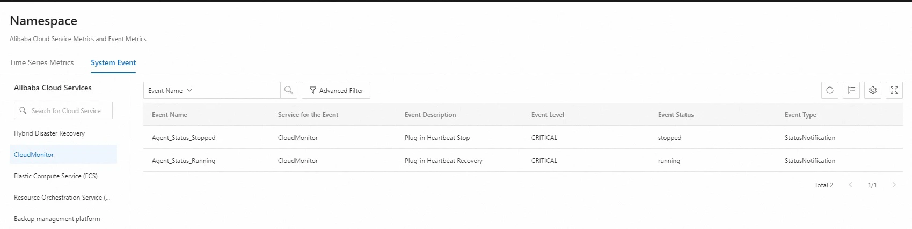

<a id="section-5"></a>

# 5.AI observability

<a id="section-5-1"></a>

## 5.1. Holographic View

Holographic View provides a unified, entity-centric portal for exploring and analyzing all cloud service instances monitored by AI observability in Cloud Monitor. You can query entities to quickly locate and analyze them, seamlessly transitioning from a global perspective to a detailed view.

**Background**

In AI observability, an entity is any object that can be independently identified and monitored. Examples include:

- AI compute entities: BMCP clusters, BMCP nodes, BMS hosts, ACK containers, and apfs/cpfs storage systems.

- AI middleware: AI gateway entities.

- AI training and inference: task entities generated by AI Studio, such as notebook modeling, task modeling, visual modeling, online services, A-Speed, and offline inference.

- AI agents: agent entities generated by OP.

- AI data centers: data processing tasks generated by OP.

Entity queries break down the siloed views of traditional monitoring, which are typically organized by product or metric, and build a panoramic catalog of your monitored assets. Key benefits include:

- Unified inventory: Gain a clear view of all entity types and specific entity instances defined in AI observability, categorized by domain and type.

- Correlation analysis: Start with any entity to explore its status, performance metrics, associated logs, traces, and topological relationships for one-stop problem diagnosis and analysis.

**Procedure**

1. Log on to the Apsara Uni-manager console.

2. In the top menu bar, click **Products** and choose **Migration & O&M Management** > **O&M and Monitoring** > **CloudMonitor**.

3. In the left-side navigation pane, choose **AI observability > Holographic View**. By default, the system displays the **Global View** for **All Spaces** over the **Last 6 Hours**.

   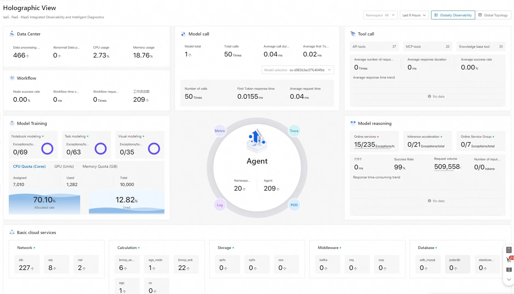

   - Data Center

     Displays details for **Data Processing Tasks**, **Abnormal Data Processing Tasks**, **CPU utilization**, and **memory utilization**.

     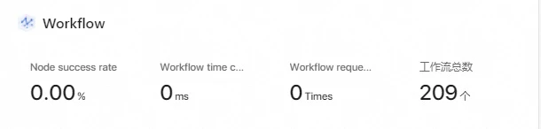

   - Workflow

     Displays details for **node success rate**, **workflow duration**, **Workflow Requests**, and **Total Workflows**.

     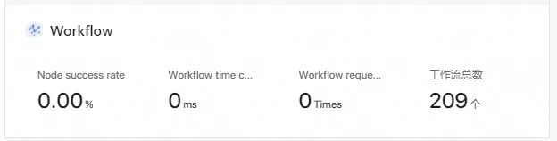

   - Model Calls

     - Displays details for **Total Models**, **Total Calls**, **Average Call Duration**, and **average time to first token**.

       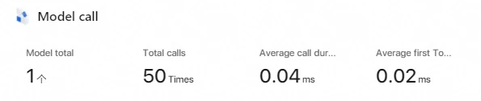

     - Select a specific model to view its **Number of Calls**, **time to first token**, and **Average Request Time**.

       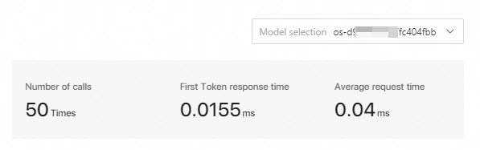

   - Tool Calls

     Displays the number of **API Tools**, **MCP Tools**, and **Knowledge Base Tools**, as well as **Average Requests**, **Average Response Duration**, **Average Success Rate**, and the **Average Response Time Trend**.

     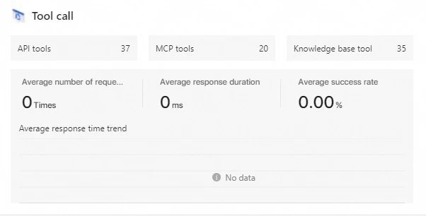

   - Model Training

     - Displays the total and abnormal counts for **notebook modeling**, **task modeling**, and **visual modeling** instances.

       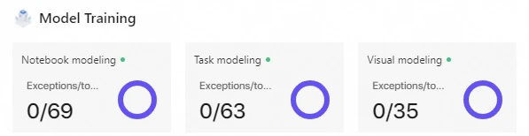

       Click a number on the card to open the **Model Training** page and view instance details.

       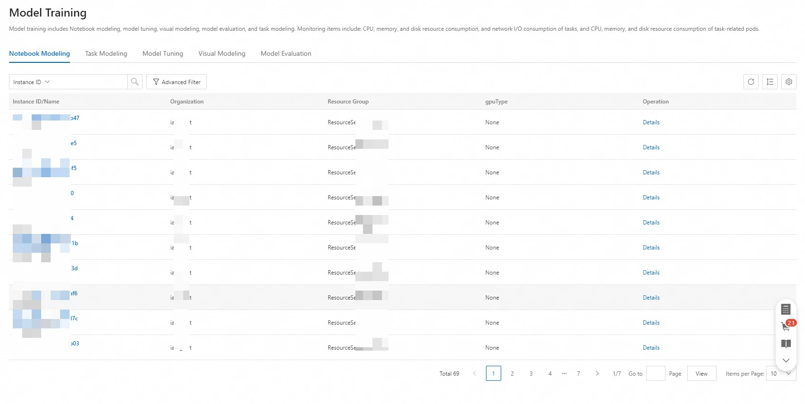

     - Displays the **Allocated**, **Used**, and **Total** values, as well as the **Allocation Rate** and **Usage Rate** for **CPU Quota (Cores)**, **GPU Cards (Units)**, and **Memory Quota (GiB)**.

       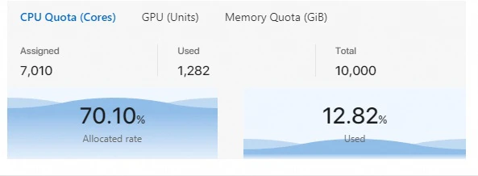

   - Agent

     Displays the number of **namespaces** and **agents**.

     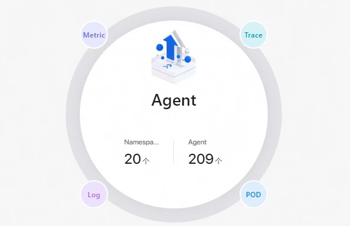

     Click Metric, Trace, Log, or POD to view agent details.

     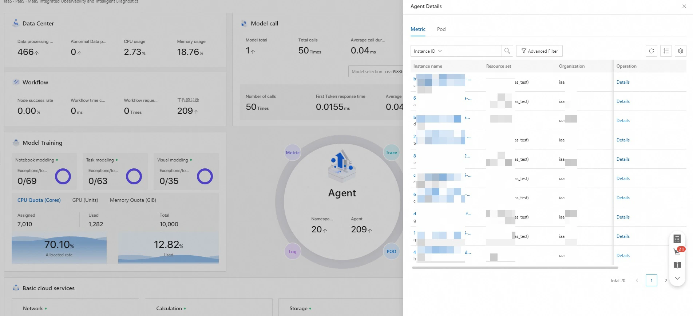

   - Model Inference

     - Displays the total and abnormal counts for **Online Services**, **inference acceleration**, and **Online Service Groups** instances.

       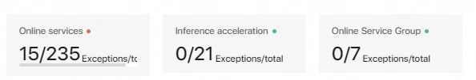

       Click a number on the card to go to the **Model Inference** page and view instance details.

       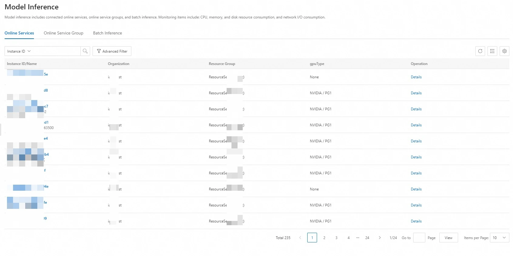

     - Displays details for **TTFT**, **Success Rate**, **Requests**, and **Input/Output Tokens**.

       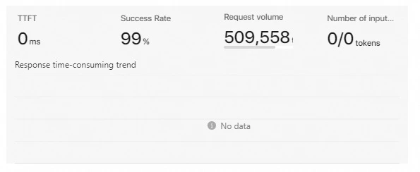

   - Basic cloud services

     - Displays the number of instances for **Network**, **Compute**, **Storage**, **Middleware**, and **Database**.

       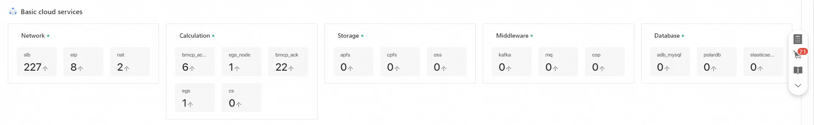

     - Click an instance count on a card to open the corresponding cloud product monitoring page and view instance monitoring details.

4. In the upper-right corner of the page, click **Global Topology** to switch to the **Global Topology** tab, where you can view monitoring details for MaaS, PaaS, and IaaS.

   

   - In the upper-left corner, click **one-click diagnosis** to view diagnostics for abnormal instances.

     - Click **Instance Details** to view the instance's detailed topology.

       

     - Click **one-click diagnosis** on an alert summary card to run an intelligent diagnosis with Apsara Assistant.

       

     - The left side of the page shows details for SFM products, including **Number of Instances**, **Number of Abnormal Alerts**, **Available Instance Ratio**, and **Abnormal Instance Ratio**, as well as any active alerts.

       

   - Hover over a service in the topology diagram to view its **Number of Instances**, **Available Instance Ratio**, **Instances with Abnormal Alerts**, **Specifications**, and **Capability Layer**.

     

<a id="section-5-2"></a>

## 5.2. Agent

The agent module displays information to help you analyze exceptions, performance, and traffic.

**Procedure**

1. Log in to the Apsara Uni-manager Management Console.

2. In the top menu bar, click **Products** and choose **Migration & O&M Management** > **O&M and Monitoring** > **CloudMonitor**.

3. In the left-side navigation pane, choose **AI Observability > Agent.**

4. View the detailed monitoring information of workspaces.

   On the **Workspace** tab, click **Details** in the **Operation** column of the target workspace to view its metrics. For more information, see SFM.

   

5. View the detailed monitoring information of basic resources.

   On the **Basic Resources** tab, click **Details** in the **Operation** column of the target instance to view its metrics. For more information, see Kubernetes container monitoring.

   

<a id="section-5-3"></a>

## 5.3. Data center

The Data Center page lets you monitor data processing tasks and underlying operations.

**Procedure**

1. Log on to the Apsara Uni-manager Operation Console.

2. In the top menu bar, click **Products** and choose **Migration & O&M Management** > **O&M and Monitoring** > **CloudMonitor**.

3. In the navigation pane on the left, select **AI Observability > Data Center.**

4. On the **Data Center** page, in the **Actions** column for the workspace instance, click **Details**.

   

5. The **Workspace** details page shows the **Instance name, Resource set**, **Organization**, **Created at**, and monitoring metrics for **CPU**, **Memory**, and **Network**.

   

<a id="section-5-4"></a>

## 5.4. Model inference

The model inference module displays information related to online services, online service groups, and batch inference. You can view the following metrics: CPU usage, memory usage, disk usage, and network I/O.

**Procedure**

1. Log in to the Apsara Uni-manager Management Console.

2. In the top menu bar, click **Products** and choose **Migration & O&M Management** > **O&M and Monitoring** > **CloudMonitor**.

3. In the left-side navigation pane, choose **AI Observability > Model Inference.**

4. View the monitoring data of online services.

   On the **Online Services** tab, click **Details** in the **Operation** column of the target online service to view its metrics. For more information, see AI Studio (online service).

   

5. View the monitoring data of an online service group.

   On the **Online Service Group** tab, click **Details** in the **Operation** column of the target online service group to view its metrics. For more information, see AI Studio (Online service group).

   

6. View the monitoring data of batch inference.

   On the **Batch Inference** tab, click **Details** in the **Operation** column of the target instance to view its metrics. For more information, see AI Studio (Batch Inference).

   

<a id="section-5-5"></a>

## 5.5. Model training

The model training module displays information about notebook modeling, model tuning, visual modeling, model evaluation, and task modeling. You can view the following information: CPU, memory, disk, and network I/O usage of tasks and CPU, memory, and disk usage of task-related pods.

**Procedure**

1. Log in to the Apsara Uni-manager Management Console.

2. In the top menu bar, click **Products** and choose **Migration & O&M Management** > **O&M and Monitoring** > **CloudMonitor**.

3. In the left-side navigation pane, choose **AI Observability > Model Training.**

4. View the detailed monitoring information of notebook modeling.

   On the **Notebook Modeling** tab, click **Details** in the **Operation** column of the target instance to view the notebook modeling metrics. For more information, see AI Studio (Notebook modeling).

   

5. View the detailed monitoring information of task modeling.

   On the **Task Modeling** tab, click **Details** in the **Operation** column of the target instance to view the task modeling metrics. For more information, see AI Studio (Task Modeling).

   

6. View the detailed monitoring information of model tuning.

   On the **Model Tuning** tab, click **Details** in the **Operation** column of the target instance to view the model tuning metrics. For more information, see AI Studio (model tuning).

   

7. View the detailed monitoring information of visual modeling.

   On the **Visual Modeling** tab, click **Details** in the **Operation** column of the target instance to view the visual modeling metrics. For more information, see AI Studio (Visualized Modeling).

   

8. View the detailed monitoring information of model evaluation.

   On the **Model Evaluation** tab, click **Details** in the **Operation** column of the target instance to view the model evaluation metrics. For more information, see AI Studio (Model Evaluation).

   

<a id="section-5-6"></a>

## 5.6. AI computing power

AI computing power consists of AI computing, AI storage, and AI gateways. Metrics for AI computing include basic resource usage such as CPU, memory, and disk resources, GPU utilization, temperature, and RDMA networks. Metrics for AI storage include storage usage, IOPS, and bandwidth. Metrics for AI gateways include uplink and downlink requests, success rate, and duration.

**Procedure**

1. Log in to the Apsara Uni-manager Management Console.

2. In the top menu bar, click **Products** and choose **Migration & O&M Management** > **O&M and Monitoring** > **CloudMonitor**.

3. In the left-side navigation pane, choose **AI Observability > AI Computing Power.**

4. Click the AI Computing tab.

   - View the detailed monitoring information of Bare Metal Computing Power (BMCP) nodes.

     On the **BMCP (Node)** tab, click **Details** in the **Operation** column of the target instance to view the metrics of BMCP nodes. For more information, see BMCP nodes.

     

   - View the detailed monitoring information of BMCP supercomputing clusters.

     On the **BMCP (Bare Metal - Supercomputing Cluster)** tab, click **Details** in the **Operation** column of the target instance to view the metrics of BMCP supercomputing clusters. For more information, see BMCP (BMS EHPC Cluster).

     

   - View the detailed monitoring information of BMCP intelligent computing clusters.

     On the **BMCP (Bare Metal - Intelligent Computing Cluster)** tab, click **Details** in the **Operation** column of the target instance to view the metrics of BMCP intelligent computing clusters. For more information, see BMCP (Bare Metal - Intelligent Computing Power Cluster).

     

   - View the detailed monitoring information of Container Service for Kubernetes (ACK)-intelligent computing clusters.

     On the **BMCP (Container - Intelligent Computing Cluster)** tab, click **Details** in the **Operation** column of the target instance to view the metrics of ACK-intelligent computing clusters. For more information, see Bare Metal Computing Platform (BMCP) (Container - Intelligent Computing Cluster).

     

5. Click the AI Storage tab.

   - View the detailed monitoring information of ApsaraStack Parallel File System (APFS).

     On the **APFS** tab, click **Details** in the **Operation** column of the target instance to view the metrics of APFS. For more information, see APFS.

     

   - View the detailed monitoring information of Cloud Parallel File Storage (CPFS).

     On the **CPFS** tab, click **Details** in the **Operation** column of the target instance to view the metrics of CPFS. For more information, see CPFS.

     

6. View the detailed monitoring information of AI gateways.

   On the **AI Gateway** tab, click **Details** in the **Operation** column of the target instance to view the metrics of AI gateways. For more information, see API Gateway.

   

<a id="section-6"></a>

# 6.Visualization

<a id="section-6-1"></a>

## 6.1. Custom dashboards

You can create custom dashboards to monitor, analyze, and display key metrics. This offers an intuitive and efficient way to understand and manage your data.

**Preset dashboards**

The following preset dashboards are available:

- API Gateway

- Alibaba Cloud DNS

- Message Queue

- Elasticsearch on K8s

- OSS

- SLB

- ECS

- ApsaraDB for Redis (Cluster Edition)

- ApsaraDB for Redis (Standard Edition/Read/Write Splitting Edition)

- ApsaraDB RDS for PostgreSQL (Cloud Disk)

- ApsaraDB RDS for PostgreSQL (Local SSD)

- ApsaraDB for PolarDB

- ApsaraDB RDS for MySQL

**Create a directory**

1. Log on to the Apsara Uni-manager console.

2. In the top menu bar, click **Products** and choose **Migration & O&M Management** > **O&M and Monitoring** > **CloudMonitor**.

3. In the left-side navigation pane, choose **Visualization > Custom Dashboard**.

4. At the top of the page, click **Create Directory**.

5. In the text box, enter a name for the directory.

6. Press Enter.

**Rename a directory**

> **Important**
>
> You cannot rename preset directories.

1. On the **Custom Dashboard** page, click the  icon to the right of the directory.

2. In the text box, enter a new name for the directory.

3. Press Enter.

**Delete a directory**

> **Important**
>
> - You cannot delete preset directories.
>
> - When you delete a directory, all dashboards within it are also deleted. This action cannot be undone.

1. On the **Custom Dashboard** page, click the  icon to the right of the directory.

2. In the dialog box that appears, click **OK**.

**Create a dashboard**

> **Important**
>
> You must create a directory before creating a dashboard. Otherwise, the dashboard cannot be saved.

1. On the **Custom Dashboard** page, click **Create Dashboard** at the top of the page.

2. In the **Create Dashboard** dialog box, enter a **Dashboard Name**, select a **Dashboard Directory**, then click **OK**.

   

3. On the dashboard page, you can create cards and row containers.

   - **Create a card**

     <ol type="a">

     <li>

     Click **New Card**, then select **New Card**.

     </li>

     <li>

     On the new card page, configure the chart's **Data Configuration**, **Data Transformation** (optional), and **Chart Configuration** (optional).

     - **Data Configuration**: Click **Add Query**, then select the **cloud product**, **metric**, **aggregation method**, and **monitoring scope**.

       > **Note**
       >
       > You can add multiple data configurations.

       

     - (Optional) **Data Transformation**: Click **Add Data Transformation > Data Filtering** and select the data columns you want to filter. Click **Add Data Transformation > Column Rename** to rename data columns. Click **Add Data Transformation > Table Join** to merge multiple tables into a single table. This transformation applies only to tables.

       > **Important**
       >
       > You must complete the Data Configuration before applying data transformations.

       

     - (Optional) **Chart Configuration**: Configure the chart type, chart elements, axes, legend, reference lines, reference areas, and more.

       

     </li>

     </ol>

     <ol type="i" start="100">

     <li>

     After you finish the configuration, click **Apply to Dashboard** above the chart.

     > **Note**
     >
     > - To discard your changes, click **Cancel** above the chart.
     >
     > - Click the **Last 1 Hour** drop-down list above the chart to select or customize the time range for the chart.

     

     </li>

     </ol>

   - **Add a row container**

     <ol type="a">

     <li>

     On the dashboard page, click **New Card** and select **New Row Container**.

     </li>

     <li>

     Hover over the row container and click the  icon to edit the row name.

     > **Note**
     >
     > To delete the row container, hover over it and click the
     >
     > icon.
     >
     > 

     </li>

     </ol>

4. After adding cards and row containers, you can customize the dashboard layout.

   - In the **Layout Template** drop-down list at the upper-right corner of the canvas, select **1 per row**, **2 per row**, **3 per row**, or **4 per row**.

   - Drag cards to rearrange their positions.

   - Click the  icon at the upper-right corner of a card to perform actions such as **Edit**,

     **Copy**, **Delete**, or **View**.

5. (Optional) Click the **Last 1 Hour** drop-down list at the top of the dashboard to select or customize the monitoring time range for the entire dashboard.

   > **Note**
   >
   > The time range set on the card editing page is a temporary override that applies only within the editor. When you return to the dashboard, the dashboard-level time range takes precedence.

6. (Optional) Click the drop-down list to the right of  to set the automatic refresh interval for

   the dashboard.

   > **Note**
   >
   > Selecting Off disables automatic refresh.

7. (Optional) At the top of the dashboard, click the  icon to view or edit the dashboard's

   basic settings and JSON mode.

   

   - **Basic Settings**

     In Basic Settings, you can view or modify the dashboard name and the editable switch.

     > **Note**
     >
     > If this switch is on, you can modify the dashboard's contents and layout. If it is off, these actions are disabled.

   - **JSON mode**

     In JSON mode, you can edit the dashboard by modifying its JSON code. Click **Preview** to

     verify your changes, then click the  icon to save.

8. Click the  icon to save the dashboard.

**Modify dashboard content and layout**

> **Important**
>
> You cannot modify the content or layout of preset dashboards.

1. On the **Custom Dashboard** page, select a directory, then click the name of the dashboard you want to modify from the list on the right.

2. On the dashboard details page, modify the cards, row containers, and layout as needed. For more information, see Create a dashboard.

**Rename a dashboard**

> **Important**
>
> You cannot rename preset dashboards.

1. On the **Custom Dashboard** page, click the target directory. In the dashboard list on the right, click **Edit** in the Actions column of the dashboard.

2. In the **Edit Dashboard** dialog box, enter a new name for the dashboard.

3. Click **OK**.

**Move a dashboard**

> **Important**
>
> You cannot move preset dashboards.

- **Move a single dashboard**

  <ol type="i">

  <li>

  On the **Custom Dashboard** page, click the target directory. In the dashboard list on the right, click **Edit** in the Actions column of the dashboard.

  </li>

  <li>

  In the **Edit Dashboard** dialog box, select a new directory for the dashboard.

  </li>

  <li>

  Click **OK**.

  </li>

  </ol>

- **Move dashboards in bulk**

  <ol type="i">

  <li>

  On the **Custom Dashboard** page, click the target directory. In the dashboard list on the right, select the checkboxes for the dashboards you want to move.

  </li>

  <li>

  At the bottom of the page, click **Move**.

  </li>

  <li>

  In the **Bulk Move Dashboards** dialog box, select a destination directory.

  </li>

  <li>

  Click **OK**.

  </li>

  </ol>

**Copy a dashboard**

Copying a dashboard allows you to quickly create a new one with the same configuration.

1. On the **Custom Dashboard** page, click the target directory. In the dashboard list on the right, click **Copy** in the Actions column of the dashboard you want to copy.

2. In the **Copy Dashboard** dialog box, enter a new name for the dashboard and select a destination directory.

3. Click **OK**.

**Set a default dashboard**

> **Important**
>
> - You can only set one dashboard as the default.
>
> - Setting a dashboard as the default replaces the previous one. This dashboard is then displayed automatically when you navigate to the Custom Dashboard page.
>
>   To return to the directory page from the default dashboard, click the  icon in the
>
>   upper-left corner.

1. On the **Custom Dashboard** page, click the target directory. In the dashboard list on the right, click **Set as Default Dashboard** in the Actions column of the dashboard you want to set as default.

2. Click **OK**.

**Delete a dashboard**

> **Important**
>
> You cannot delete preset dashboards.

- **Delete a single dashboard**

  <ol type="i">

  <li>

  On the **Custom Dashboard** page, click the target directory. In the dashboard list on the right, click **Delete** in the Actions column of the dashboard you want to delete.

  </li>

  <li>

  Click **OK**.

  </li>

  </ol>

- **Delete dashboards in bulk**

  <ol type="i">

  <li>

  On the **Custom Dashboard** page, click the target directory. In the dashboard list on the right, select the checkboxes for the dashboards you want to delete.

  </li>

  <li>

  At the bottom of the page, click **Delete**.

  </li>

  <li>

  Click **OK**.

  </li>

  </ol>

**Intelligent analysis**

Intelligent Analysis generates summaries by combining dashboard metric data with information from your cloud resources.

1. On the **Custom Dashboard** page, select the target dashboard and click its name to go to the dashboard details page.

2. On the dashboard details page, click **Intelligent Analysis** for a specific metric. Apsara Assistant then summarizes the metric data for the dashboard's current time range.

   

   You can also ask questions in the Apsara Assistant dialog box. It analyzes data trends, anomalies, metric correlations, and historical data from the dashboard to provide in-depth insights and summary reports.

<a id="section-7"></a>

# 7.Alert service

You can manage alert rules, alert history, and alert templates in the Alert Service module of CloudMonitor. You can configure alert rules to specify how CloudMonitor checks monitoring data. If monitoring data triggers the alert rules, CloudMonitor sends alert notifications. When an alert is generated, CloudMonitor records the alert information in the alert history. You can review and analyze the alert history to troubleshoot issues and make predictions. Alert templates simplify the process of creating and maintaining alert rules when you need to manage a large number of cloud resources. This helps you monitor cloud services more efficiently.

<a id="section-7-1"></a>

## 7.1. Alert history

You can filter alert history by cloud service, instance, and alert level. You can also export and download the alert history to your on-premises machine for data analysis.

**Procedure**

1. Log in to the Apsara Uni-manager Management Console.

2. In the top menu bar, click **Products** and choose **Migration & O&M Management** > **O&M and Monitoring** > **CloudMonitor**.

3. In the left-side navigation pane, choose **Alerting** > **Alert History**.

4. Optional. On the **Alert History** page, you can filter historical alerts by selecting the **Cloud product selection**, **Rule ID**, **Rule name**, **Instance ID**, **Alarm Level**, and Start and end time filter condition.

   > **Note**
   >
   > This page does not display faulty Data Transmission Service (DTS) instances.

5. On the Alert History page, perform the required operations. The following table describes the operations that you can perform.

   | Operation | Description |
   | --- | --- |
   | View the alert history | On the <strong>Alert History</strong> page, view the information about alerts in the following columns: <strong>Product Name</strong>, <strong>Faulty instance</strong>, <strong>Occurrence time</strong>, <strong>Rule name</strong>, <strong>Status</strong>, <strong>Grade</strong>, and <strong>Notification object</strong>. Find an alert record that you want to view and click the rule name in the Rule Name column to view the details of the alert rule.<br>Note<br>By default, you can query the alert history within the previous two days. |
   | Export and download alert history | i. On the <strong>Alert History</strong> page, click theicon in the upper-<br>right corner.<br>ii. In the <strong>Export task</strong> dialog box, configure the <strong>Time Selection</strong> and <strong>Task name</strong> parameters and click <strong>OK</strong>.<br>iii. In the left-side navigation pane, click <strong>Report Export</strong>. On the <strong>Report Export</strong> page, click the <strong>Alarm History</strong> tab.<br>iv. On the Alarm History tab, find the export task that you created and click <strong>Download Report Task</strong> in the <strong>Operation</strong> column.<br>v. In the <strong>Download Report Task</strong> message, click <strong>OK</strong>.<br>Note<br>The report is in the <strong>.xlsx</strong> format. You can find the downloaded report in the default download directory of your browser. |

<a id="section-7-2"></a>

## 7.2. Alert rules

You can configure alert rules for host monitoring metrics and instances in cloud service monitoring. You can apply an alert rule to all resources, an application group, or an instance. Alert Service sends alert notifications to contacts by using emails, DingTalk messages, and webhook URLs.

> **Note**
>
> You cannot manage alert rules in the root organization.

<a id="section-7-2-1"></a>

### 7.2.1. Create an alert rule

Cloud Monitor lets you create alert rules for integrated cloud products like ECS. These rules trigger alerts when metrics cross specified thresholds and promptly notify designated users.

**Background**

During the effective period of an alert rule, Cloud Monitor checks at the specified detection frequency if a metric has crossed its threshold. If it does, Cloud Monitor triggers an alert and sends it to the designated alert contacts or notification platforms.

> **Note**
>
> - Except for ApsaraDB for RDS (legacy link), which has a detection frequency of 60 to 300 seconds, all other cloud products have a minimum detection frequency of one minute.
>
> - You can configure message accumulation alert thresholds for ApsaraMQ for Kafka on a per-topic basis, which allows you to set different thresholds for each topic.

**Procedure**

1. Log on to the Apsara Uni-manager Operation Management Console.

2. In the top navigation bar, click **Products**, and then choose **Migration & O&M Management** > **O&M and Monitoring** > **Cloud Monitor**.

3. In the left-side navigation pane, choose **Alerting** > **Alert Rules**.

4. Above the list, click **Create Alert Rule**.

5. In the **Create Alert Rule** panel, configure the parameters as needed.

   | Parameter | Description |
   | --- | --- |
   | Product selection | Select the cloud product to monitor. |
   | Resource range | The resources to which the alert rule applies. The available options may vary depending on the cloud product.<br>• <strong>Instance</strong>: Select one or more target instances from the resource set of the current organization.<br>• <strong>Resource Set</strong>: Select a target resource set in the current organization and region.<br>• <strong>Application group</strong>: Select an application group in the current organization and region.<br>• <strong>All Resources</strong>: This option is not selectable by default. |
   | Resource selection | Based on your selection for <strong>resource range</strong>, select the specific resource instances, resource sets, or application groups. |
   | Rule type | The following rule types are supported: <strong>single-metric rule</strong>, <strong>multi-metric rule</strong>, and <strong>intelligent threshold rule</strong>. |

   <table>
     <tr>
       <td>Rule description</td>
       <td>Defines the condition that triggers an alert. When monitoring data meets this condition, an alert is sent.<br>To configure the rule description:<br>• The rule type is <strong>single-metric rule</strong><br>a. Click <strong>Rule description</strong>.<br>b. In the <strong>Rule description</strong> panel, set parameters such as <strong>rule name</strong>, <strong>metric</strong> <strong>dimension</strong>, <strong>metric</strong>, <strong>aggregation period</strong>, and <strong>threshold and alert</strong> <strong>level</strong>.<br>Note<br>The metric dimension is displayed only when <strong>Instance Dimension</strong> is selected for the resource range.<br>c. Click <strong>Confirm</strong>.<br>• The rule type is <strong>Multi-metric rule</strong><br>a. Click <strong>Create multi-metric rule</strong>.<br>b. In the <strong>Create Multi-metric Rule</strong> panel, set the <strong>Rule Name</strong>, <strong>Threshold</strong> <strong>and Alert Level</strong>, <strong>Multi-metric Alert Rule</strong>, <strong>Multi-metric Relationship</strong>, and <strong>Trigger Count</strong>.<br>c. Click <strong>OK</strong>.<br>• The rule type is <strong>Intelligent threshold rule</strong><br>a. Click <strong>Create intelligent threshold alert</strong>.<br>b. In the <strong>Create intelligent threshold alert</strong> panel, set parameters such as <strong>Rule name</strong>, <strong>Metric</strong>, <strong>Metric dimension</strong>, <strong>Statistics</strong>, <strong>Statistical period</strong>, <strong>Threshold and alert level</strong>, <strong>Alert condition</strong>, <strong>Alert sensitivity</strong>, <strong>Trigger</strong> <strong>condition</strong>, and <strong>Monitoring chart preview</strong>.<br>c. Click <strong>OK</strong>.</td>
     </tr>
     <tr>
       <td>Mute period</td>
       <td>The interval before a notification is resent for an unresolved alert. Valid values: <strong>5 Minutes</strong>, <strong>15 Minutes</strong>, <strong>30 Minutes</strong>, <strong>1 Hour</strong>, <strong>3 Hours</strong>, <strong>6 Hours</strong>, <strong>12 Hours</strong>, and <strong>24 Hours</strong>.<br>When a metric crosses its threshold, Cloud Monitor sends an alert. If the metric remains in an alert state, no further notifications are sent during the mute period. If the metric has not recovered after the mute period, Cloud Monitor sends another notification.<br>For example, if the <strong>mute period</strong> is set to <strong>12 Hours</strong> and a metric that exceeded its threshold has not returned to normal within 12 hours of the initial alert, Cloud Monitor sends another alert notification.</td>
     </tr>
     <tr>
       <td>Effective period</td>
       <td>The time range during which the alert rule is active. The rule only evaluates metrics during this period.</td>
     </tr>
     <tr>
       <td>Webhook</td>
       <td>The callback URL to which Cloud Monitor sends alert notifications via POST requests.<br>Note<br>The webhook URL must be a publicly accessible domain name. IP addresses are not supported.</td>
     </tr>
     <tr>
       <td>Missing data handling method</td>
       <td>The action to take when monitoring data is missing.<br>• Do Nothing<br>• Send No-Data Alert<br>Note<br>If an instance is deleted, you will receive no-data alerts for 24 hours.</td>
     </tr>
     <tr>
       <td>Alert contact</td>
       <td>Select the alert contact groups or individual users who will receive notifications.<br>The default alert contact group for a cloud account is an empty group that can be used to test whether the alert rule works as expected.</td>
     </tr>
   </table>

6. Click **OK**.

**Rule description parameters**

| Parameter | Description |
| --- | --- |
| Rule name | Enter a name for the alert rule. |
| Metric | Select a metric from all metrics available for the selected cloud product. For details about each metric, see the metric reference for the cloud product. |
| Aggregation period | Set the aggregation period for the metric.<br>Note<br>The aggregation period is the time window used to summarize and calculate raw monitoring data, for example, by calculating the sum, average, or maximum value. |
| Metric dimension | Specifies dimensions other than the instance ID. This parameter is displayed only when <strong>Resource Range</strong> is set to <strong>Instance Dimension</strong>. |
| Threshold and alert level (Unit: %) | • The alert level can be <strong>critical</strong>, <strong>warning</strong>, or <strong>info</strong>.<br>• Depending on the selected metric, the monitoring data aggregation types include <strong>Average</strong>, <strong>Minimum</strong>, <strong>Maximum</strong>, and <strong>Value</strong>.<br>• You can set the evaluation window to <strong>Consecutive</strong>, <strong>5 periods</strong>, <strong>10 periods</strong>, <strong>15</strong> <strong>periods</strong>, <strong>30 periods</strong>, or <strong>60 periods</strong>.<br>• The operator used to compare the actual metric value with the threshold. The following operators are supported: <strong>&gt;</strong>, <strong>&gt;=</strong>, <strong>&lt;</strong>, <strong>&lt;=</strong>, <strong>=</strong>, <strong>!=</strong>, <strong>day-over-day</strong> <strong>increase</strong>, <strong>day-over-day decrease</strong>, <strong>period-over-period increase</strong>, <strong>period-</strong><strong>over-period decrease</strong>, <strong>increment over yesterday</strong>, <strong>decrement over</strong> <strong>yesterday</strong>, <strong>increment over the previous period</strong>, and <strong>decrement over the</strong> <strong>previous period</strong>. You can also set a threshold and trigger count. An alert is generated when the defined condition is met for the specified number of times. |

**Selected comparison methods**

| Comparison method | Definition | Threshold | Trigger count | Period |
| --- | --- | --- | --- | --- |
| day-over-day increase/decreas e | Compares the metric value of the current period with the value from the same time period on the previous day. | An anomaly is detected if the increase or decrease exceeds the specified threshold. | An alert is triggered if the condition is met for the specified number of consecutive periods. | The time window for data collection or statistical calculation. |
| period-over-period increase/decreas e | Compares the metric value of the current period with the value of the previous consecutive period to calculate the percentage increase or decrease. | An anomaly is detected if the increase or decrease exceeds the specified threshold. | An alert is triggered if the condition is met for the specified number of consecutive periods. | The time window for data collection or statistical calculation. |

<table>
  <tr>
    <td>increment/decre ment over the previous period</td>
    <td>The difference or percentage change between the metric value of the current period and the value of the previous period of the same length.</td>
    <td>An anomaly is detected if the increment is greater than the specified threshold.</td>
    <td>An alert is triggered if the condition is met for the specified number of consecutive periods.</td>
    <td>The time window for data collection or statistical calculation.</td>
  </tr>
  <tr>
    <td>increment/decre ment over yesterday</td>
    <td>Compares the metric value of the current statistical period with the value from the same time window on the previous day to calculate the absolute difference (increment).</td>
    <td>An anomaly is detected if the increment is greater than the specified threshold.</td>
    <td>An alert is triggered if the condition is met for the specified number of consecutive periods.</td>
    <td>The time window for data collection or statistical calculation.</td>
  </tr>
</table>

**Configuration example**

This example shows how to create an alert rule named  `example`  for an ECS instance. The rule monitors the CPU utilization of the target ECS instance and triggers a critical alert when the maximum CPU utilization is greater than or equal to 70% in three out of five detection periods.

The rule description configuration for this scenario is shown in the following figure.


<a id="section-7-2-2"></a>

### 7.2.2. Manage alert rules

Use the alert rules page to modify, disable, enable, and delete alert rules.

**Procedure**

1. Log on to the Apsara Uni-manager O&M console.

2. In the top navigation bar, click **Products** and choose **Migration and O&M Management** > **O&M and Monitoring** > **Cloud Monitor**.

3. In the left-side navigation pane, choose **Alerting** > **Alert Rules**.

4. Find the target alert rule and take the required action.

   | Task | Steps |
   | --- | --- |
   | View alert rule details | In the <strong>Actions</strong> column of the target alert rule, click <strong>Details</strong>. You can view the alert rule details on the <strong>Alert Rules, Alert History, and Faulty Resources</strong> tabs. |
   | Check rule validity | In the <strong>Validity</strong> column of the target alert rule, click <strong>Inspect</strong>. The inspection result is then displayed in the same column.<br>Note<br>• If the inspection fails, click <strong>Inspection Result</strong>. The panel that appears shows the results for the <strong>Alert Rule Execution</strong> <strong>Anomaly Detection</strong>, <strong>Alert Rule Loading Detection</strong>, <strong>Invalid</strong> <strong>Alert Rule Detection</strong>, and <strong>Alert Rule Callback Detection</strong> checks.<br>• Click <strong>Re-inspect</strong> to run the inspection again. |
   | View rule execution records | In the <strong>Rule Execution Records</strong> column of the target alert rule, click <strong>View</strong> <strong>Rule Execution Records</strong>. In the <strong>Alert Rule Execution Records</strong> panel, you can filter the records by time range. |
   | Modify an alert rule | • Edit a single rule<br>a. In the <strong>Actions</strong> column of the target alert rule, click <strong>Edit.</strong><br>b. In the <strong>Modify Alert Rule</strong> panel, modify the rule parameters. For more information about the configuration parameters, see Create an alert rule.<br>c. Click <strong>OK</strong>.<br>• Batch edit<br>a. Select the target alert rules, and then click <strong>Batch Edit</strong> in the lower-left corner of the list.<br>b. In the <strong>Modify Alert Rule</strong> panel, modify the rule parameters. For more information about the configuration parameters, see Create an alert rule.<br>c. Click <strong>OK</strong>. |
   | Disable an alert rule | If a cloud product is undergoing maintenance or an upgrade, disable its alert rules to avoid receiving unnecessary notifications.<br>Note<br>Before you disable an alert rule, make sure its <strong>Status</strong> is <strong>Enabled</strong>.<br>• Disable a single rule<br>a. In the <strong>Actions</strong> column of the target alert rule, click theicon, and then click <strong>Disable.</strong><br>b. In the <strong>Disable Alert Rule</strong> dialog box, click <strong>OK.</strong><br>• Batch disable<br>a. Select the target alert rules, and then click <strong>More</strong>&gt;<strong>Disable</strong> in the lower-left corner of the list.<br>b. In the <strong>Disable Alert Rule</strong> dialog box, click <strong>OK</strong>. |
   | Enable an alert rule | After the maintenance or upgrade is complete, re-enable the disabled alert rules.<br>Note<br>First, confirm that the alert rule's <strong>Status</strong> is <strong>Disabled</strong>, and then select <strong>Enable</strong>.<br>• Enable a single rule<br>a. In the <strong>Actions</strong> column of the target alert rule, click <strong>Enable.</strong><br>b. In the <strong>Enable Alert Rule</strong> dialog box, click <strong>OK.</strong><br>• Batch enable<br>a. Select the target alert rules, and then click <strong>More</strong>&gt;<strong>Enable</strong> in the lower-left corner of the list.<br>b. In the <strong>Enable Alert Rule</strong> dialog box, click <strong>OK</strong>. |
   | Delete an alert rule | • Delete a single rule<br>a. In the Actions column of the target alert rule, click theicon, and then click <strong>Delete</strong>.<br>b. In the <strong>Delete Alert Rule</strong> dialog box, click <strong>OK</strong>.<br>• Batch delete<br>a. Select the target alert rules, and then click Delete in the lower-left corner of the list.<br>b. In the <strong>Delete Alert Rule</strong> dialog box, click <strong>OK</strong>. |
   | Export and download alert rules | i. On the <strong>Alert Rules</strong> page, click<strong>Export Report</strong>.<br>ii. In the <strong>Export Task</strong> dialog box, enter a <strong>Task Name</strong>.<br>iii. Click <strong>OK</strong>.<br>iv. In the left-side navigation pane, click <strong>Report Export</strong>.<br>v. On the <strong>Alert Rules</strong> tab, find the target report and click <strong>Download Report</strong> <strong>Task</strong> in the <strong>Actions</strong> column.<br>vi. In the <strong>Download Report Task</strong> dialog box, click <strong>OK</strong>. |
   | Migrate legacy rules | i. On the <strong>Alert Rules</strong> page, click.<br>ii. In the panel that appears, select the legacy cloud products that you want to view. A list of their corresponding legacy rules is then displayed.<br>iii. The following operations are available for legacy rules:<br>• Create a new rule that corresponds to a legacy rule.<br>• Create a new rule and delete the corresponding legacy rule.<br>• Delete a legacy rule.<br>iv. Click <strong>OK</strong>. |

<a id="section-7-2-3"></a>

### 7.2.3. Notification methods supported by Cloud Monitor

Cloud Monitor can send alert notifications by using DingTalk, emails, webhook URLs, and the Apsara Uni-manager Operations Console.

**Send notifications by using DingTalk and emails**

- **Configure alert contacts**

  When you create an alert notification policy, you can add contacts or contact groups. For more information about how to create an alert notification policy, see Notification policy.

- **Send notifications to the selected users by using DingTalk or emails**

  You need to configure the DingTalk or email notification method for the selected alert contacts, and specify their DingTalk secrets or email addresses. You can create or modify the DingTalk secrets and email addresses, and configure the notification methods when you create or modify users. For more information, see the "Create a user" topic in Apsara Uni-manager Management Console User Guide.

  

  The DingTalk secret is optional:

  - If you have specified a secret, notifications are sent by using the specified secret.

  - If you have not specified a secret, notifications are sent by using the secret of the message gateway of the Apsara Uni-manager Management Console.

    

    For more information about how to configure the message gateway of the Apsara Uni-manager Management Console, see the "Message gateways" topic in Apsara Uni-manager Management Console User Guide.

    > **Note**
    >
    > You need to contact Alibaba Cloud technical support to activate the corresponding network channel service.

**Send notifications using webhook URLs**

Cloud Monitor sends POST requests to the domain names that are configured by users. Therefore, you must configure a service to receive POST requests sent by Cloud Monitor.

**Configure a service**

If you want to use your platform to handle alerts and have a service to receive requests sent by Cloud Monitor, you can configure the alert callback settings when you create an alert notification policy. For more information about how to create an alert notification policy, see Notification policy.

> **Important**
>
> - You must specify a domain name instead of an IP address when you configure the alert callback settings.
>
> - The URL that you specify must be connected to the networks of the alert center of Cloud Monitor and the primary and secondary data centers.

**Request method**

By default, the POST method is used. If any parameters are required, you must specify them in the request URL.

**Request parameters**

When a notification policy is triggered, Cloud Monitor sends a POST request to the callback URL. The following table describes the parameters of a POST request.

| Parameter | Description |
| --- | --- |
| lastTime | The duration of the alert. |
| itemType | The type of alert object. Default value: <strong>CLOUD_INSTANCE</strong>. |
| messageCount | The total number of times that the alert rule is triggered. |
| processStatus | The status of the alert. Valid values:<br>• TRIGGERED<br>• ACKNOWLEDGED<br>• TRANSFERRED<br>• RESOLVED |
| enrichFiled | The alert center enrich field. The enrich result is returned in the tags field. |
| title | The title of the alert message. |
| duration | The duration of the alert. |
| extendTagMapForMerger | The extended information. |
| ruleName | The name of the original rule. |
| startTime | The start time of the alert. |
| createDate | The time when the alert was generated. |
| severity | The severity level of the alert. Valid values:<br>• P(0)<br>• P1(1)<br>• P2(2)<br>• P3(3)<br>• P4(4)<br>• UNKNOWN(8) |
| summary | The alert digest. |
| product | The service for which the alert is triggered. |
| modifyDate | The time when the alert information was updated. |
| alertSource | The source of the alert. Valid values:<br>• CMS<br>• DW<br>• ARMS<br>• Prometheus<br>• SLS<br>• Sunfire |
| hitRuleData | Indicates whether the alert hits the alert notification policy.You can ignore this parameter because notifications are sent only when alerts hit the notification policy. |
| lastMessageTime | The most recent time when the alert was triggered. |
| severityNum | The severity level. |
| userId | The primary key of the level-1 organization, which identifies the level-1 organization to which the alert source belongs. |
| tags | The tags of the alert. |
| itemLayer | The corresponding layer. CLOUD indicates the cloud platform. |
| detail | The detailed alert content. |
| endTime | The time when the alert was cleared. The parameter is valid only when the alert is cleared. |
| status | The status of the alert. Valid values:<br>• OPEN(0, "Alerting")<br>• OBSERVING(1, "Monitoring")<br>• CLOSED(2, "Cleared") |

**Troubleshooting**

If you fail to receive notifications through the callback URL after you complete the configuration, check the network connectivity by using the following method:

Run the  `curl -X POST '{"Alarm":"cms-test"}' 'http://(webhook that you specified)'` command in the alert center container to check network connectivity.

If other exceptions occur, contact the technical support.

**Send notifications by using the Apsara Uni-manager Operations Console**

By default, Cloud Monitor receives alert notifications in the Apsara Uni-manager Operations Console. Cloud Monitor can use the Apsara Uni-manager Operations Console to send alert notifications. For more information, contact the technical support.

<a id="section-7-3"></a>

## 7.3. Alert templates

<a id="section-7-3-1"></a>

### 7.3.1. General alert templates

CloudMonitor provides pre-configured, general-purpose alert templates for cloud products such as ECS, RDS, OSS, SLB, EIP, Private DNS, and ApsaraDB for Redis. You can apply these templates directly to resource sets and application groups to quickly enable monitoring and alerting for common metrics. You can also clone a general-purpose alert template and customize its alert rules to create a custom template that meets your business needs.

General alert templates provide pre-configured alert rules based on common cloud product use cases and best practices, so you can quickly monitor the running status of your resources.

**ECS**

**Default template**

<table>
  <tr>
    <th>Metric</th>
    <th>Threshold</th>
    <th>Consecu tive times</th>
    <th>Severity level</th>
    <th>Description</th>
  </tr>
  <tr>
    <td rowspan="2">cpu_total</td>
    <td>&gt;=85.00%</td>
    <td>5</td>
    <td>INFO</td>
    <td>Triggers an alert if an ECS instance's CPU utilization is 85% or greater for 5 consecutive times.</td>
  </tr>
  <tr>
    <td>&gt;=95.00%</td>
    <td>5</td>
    <td>WARN</td>
    <td>Triggers an alert if an ECS instance's CPU utilization is 95% or greater for 5 consecutive times.</td>
  </tr>
  <tr>
    <td>memory_use dutilization</td>
    <td>&gt;=80.00%</td>
    <td>5</td>
    <td>INFO</td>
    <td>Triggers an alert if an ECS instance's memory utilization is 80% or greater for 5 consecutive times.</td>
  </tr>
  <tr>
    <td rowspan="2">diskusage_u tilization</td>
    <td>&gt;=85.00%</td>
    <td>5</td>
    <td>INFO</td>
    <td>Triggers an alert if an ECS instance's disk space utilization is 85% or greater for 5 consecutive times.</td>
  </tr>
  <tr>
    <td>&gt;=95.00%</td>
    <td>5</td>
    <td>WARN</td>
    <td>Triggers an alert if an ECS instance's disk space utilization is 95% or greater for 5 consecutive times.</td>
  </tr>
</table>

**Best practice template**

<table>
  <tr>
    <th>Metric</th>
    <th>Threshold</th>
    <th>Consecu tive times</th>
    <th>Severity level</th>
    <th>Description</th>
  </tr>
  <tr>
    <td rowspan="2">cpu_total</td>
    <td>&gt; 90.00%</td>
    <td>3</td>
    <td>CRITICAL</td>
    <td>Triggers an alert if an ECS instance's average CPU utilization exceeds 90% for 3 consecutive times.</td>
  </tr>
  <tr>
    <td>&gt; 80.00%</td>
    <td>3</td>
    <td>WARN</td>
    <td>Triggers an alert if an ECS instance's average CPU utilization exceeds 80% for 3 consecutive times.</td>
  </tr>
  <tr>
    <td rowspan="2">cpu_total</td>
    <td>&gt; 90.00%</td>
    <td>3</td>
    <td>CRITICAL</td>
    <td>Triggers an alert if an ECS instance's average CPU utilization exceeds 90% for 3 consecutive times.</td>
  </tr>
  <tr>
    <td>&gt; 80.00%</td>
    <td>3</td>
    <td>WARN</td>
    <td>Triggers an alert if an ECS instance's average CPU utilization exceeds 80% for 3 consecutive times.</td>
  </tr>
  <tr>
    <td rowspan="2">diskusage_u tilization</td>
    <td>&gt; 95.00%</td>
    <td>3</td>
    <td>CRITICAL</td>
    <td>Triggers an alert if an ECS instance's average disk space utilization exceeds 95% for 3 consecutive times.</td>
  </tr>
  <tr>
    <td>&gt; 85.00%</td>
    <td>3</td>
    <td>WARN</td>
    <td>Triggers an alert if an ECS instance's average disk space utilization exceeds 85% for 3 consecutive times.</td>
  </tr>
  <tr>
    <td rowspan="2">disk_io_util</td>
    <td>&gt; 90</td>
    <td>3</td>
    <td>CRITICAL</td>
    <td>Triggers an alert if an ECS instance's average I/O saturation exceeds 90 for 3 consecutive times.</td>
  </tr>
  <tr>
    <td>&gt; 80</td>
    <td>3</td>
    <td>WARN</td>
    <td>Triggers an alert if an ECS instance's average I/O saturation exceeds 80 for 3 consecutive times.</td>
  </tr>
  <tr>
    <td rowspan="2">memory_use dutilization</td>
    <td>&gt; 90.00%</td>
    <td>3</td>
    <td>CRITICAL</td>
    <td>Triggers an alert if an ECS instance's average memory utilization exceeds 90% for 3 consecutive times.</td>
  </tr>
  <tr>
    <td>&gt; 80.00%</td>
    <td>3</td>
    <td>WARN</td>
    <td>Triggers an alert if an ECS instance's average memory utilization exceeds 80% for 3 consecutive times.</td>
  </tr>
  <tr>
    <td>DiskReadIOP S</td>
    <td>&gt;= 90</td>
    <td>3</td>
    <td>CRITICAL</td>
    <td>Triggers an alert if the average read IOPS for all cloud disks is 90 or greater for 3 consecutive times.</td>
  </tr>
</table>

Triggers an alert if the average write IOPS

DiskWriteIO

>= 90

3

CRITICAL

for all cloud disks is 90 or greater for 3

PS

consecutive times.

gpu_decode

Triggers an alert if an instance's average

r_utilization_

> 30.00%

3

CRITICAL

GPU decoder utilization exceeds 30% for 3

v2

consecutive times.

gpu_encode

Triggers an alert if an instance's average

r_utilization_

> 30.00%

3

CRITICAL

GPU encoder utilization exceeds 30% for 3

v2

consecutive times.

Triggers an alert if an instance's average

> 90.00%

3

CRITICAL

GPU utilization exceeds 90% for 3 consecutive times.

gpu_gpu_us edutilization

Triggers an alert if an instance's average

_v2

GPU utilization exceeds 70% for 3

> 70.00%

3

WARN

consecutive times.

gpu_memor

Triggers an alert if an instance's average

y_freeutiliza

> 20.00%

3

CRITICAL

GPU free memory utilization exceeds 20%

tion_v2

for 3 consecutive times.

gpu_memor

Triggers an alert if an instance's average

y_usedutiliz

> 80.00%

3

CRITICAL

GPU memory utilization exceeds 80% for 3

ation_v2

consecutive times.

Triggers an alert if the average network

>= 15.00%

3

CRITICAL

interface inbound error rate is 15% or greater for 3 consecutive times.

networkin_e rror_ratio

Triggers an alert if the average network

>= 10.00%

3

WARN

interface inbound error rate is 10% or greater for 3 consecutive times.

Triggers an alert if the average network

>= 15.00%

3

CRITICAL

interface inbound packet drop rate is 15% or greater for 3 consecutive times.

networkin_d rop_ratio

Triggers an alert if the average network

>= 10.00%

3

WARN

interface inbound packet drop rate is 10% or greater for 3 consecutive times.

Triggers an alert if the average network

>= 15.00%

3

CRITICAL

interface outbound error rate is 15% or greater for 3 consecutive times.

networkout_ error_ratio

Triggers an alert if the average network

WARN

>= 10.00%

3

interface outbound error rate is 10% or greater for 3 consecutive times.

Triggers an alert if the average network

>= 15.00%

3

CRITICAL

interface outbound packet drop rate is 15% or greater for 3 consecutive times.

networkout_ drop_ratio

Triggers an alert if the average network

>= 10.00%

3

WARN

interface outbound packet drop rate is 10% or greater for 3 consecutive times.

Triggers an alert if an instance's average

swapUtilizati

> 20.00%

3

CRITICAL

swap partition utilization exceeds 20% for

on

3 consecutive times.

Triggers an alert if the average cloud disk

>= 90.00%

3

CRITICAL

utilization is 90% or greater for 3 consecutive times.

DiskSerialUs ePercent

Triggers an alert if the average cloud disk

>= 80.00%

3

WARN

utilization is 80% or greater for 3 consecutive times.

**ApsaraDB RDS**

**ApsaraDB RDS (New)**

**Default template**

Applies to ApsaraDB RDS instances that run the MySQL, PolarDB for Oracle, or SQL Server database engine.

| Metric | Threshold | Consec utive periods | Severity | Description |
| --- | --- | --- | --- | --- |
| ConnectionUsa ge_new | &gt;=80.00% | 5 | INFO | Sends an alert when the connection usage for an RDS instance is 80% or higher for five consecutive periods. |
| CpuUsage_new | &gt;=65.00% | 5 | INFO | Sends an alert when the CPU utilization for an RDS instance is 65% or higher for five consecutive periods. |
| DataDelay | &gt;=10 | 5 | WARN | Sends an alert when the latency for an RDS read-only instance is 10 seconds or longer for five consecutive periods. |
| DiskUsage_ne w | &gt;=70.00% | 5 | INFO | Sends an alert when the disk utilization for an RDS instance is 70% or higher for five consecutive periods. |
| IOPSUsage_ne w | &gt;=80.00% | 5 | INFO | Sends an alert when the IOPS utilization for an RDS instance is 80% or higher for five consecutive periods. |
| MemoryUsage_new | &gt;=80.00% | 5 | INFO | Sends an alert when the memory utilization for an RDS instance is 80% or higher for five consecutive periods. |

**ApsaraDB RDS for PostgreSQL**

**Default template**

Applies only to ApsaraDB RDS for PostgreSQL instances.

| Metric | Threshold | Consec utive periods | Severity | Description |
| --- | --- | --- | --- | --- |
| cpu_usage | &gt;=80.00% | 5 | INFO | Sends an alert when the CPU utilization for an ApsaraDB RDS for PostgreSQL instance is 80% or higher for five consecutive periods. |
| mem_usage | &gt;=80.00% | 5 | INFO | Sends an alert when the memory utilization for an ApsaraDB RDS for PostgreSQL instance is 80% or higher for five consecutive periods. |
| local_fs_size_us age | &gt;=85.00% | 5 | WARN | Sends an alert when the disk utilization for an ApsaraDB RDS for PostgreSQL instance is 85% or higher for five consecutive periods. |
| ReadLag_new | &gt;=7200 | 5 | INFO | Sends an alert when the replication lag for an ApsaraDB RDS for PostgreSQL read-only instance is 7,200 seconds or longer for five consecutive periods. |

**ApsaraDB RDS**

**Best practice template**

**Consec utive**

**Severit**

**Metric**

**Threshold**

**Description**

**periods**

**y**

Sends an alert when the average disk

> 90.00%

3

Critical

utilization is greater than 90% for three consecutive periods.

DiskUsage_ne w

Sends an alert when the average disk

> 80.00%

3

WARN

utilization is greater than 80% for three consecutive periods.

Sends an alert when the average

ConnectionUs

> 80.00%

3

WARN

connection usage is greater than 80% for

age_new

three consecutive periods.

Sends an alert when the average CPU

> 90.00%

3

Critical

utilization is greater than 90% for three consecutive periods.

CpuUsage_ne w

Sends an alert when the average CPU

3

WARN

utilization is greater than 80% for three

> 80.00%

consecutive periods.

Sends an alert when the average memory

> 90.00%

3

Critical

utilization is greater than 90% for three consecutive periods.

MemoryUsage _new

Sends an alert when the average memory

> 80.00%

3

WARN

utilization is greater than 80% for three consecutive periods.

Sends an alert when the average IOPS

> 95.00%

3

Critical

utilization is greater than 95% for three consecutive periods.

IOPSUsage_ne w

Sends an alert when the average IOPS

> 90.00%

3

WARN

utilization is greater than 90% for three consecutive periods.

Sends an alert when the average CPU utilization for a PostgreSQL instance is

> 80.00%

3

Critical

greater than 80% for three consecutive periods.

cpu_usage

Sends an alert when the average CPU utilization for a PostgreSQL instance is

> 70.00%

3

WARN

greater than 70% for three consecutive periods.

Sends an alert when the average connection usage for a PostgreSQL instance

> 80.00%

3

Critical

is greater than 80% for three consecutive periods.

conn_usage

Sends an alert when the average connection usage for a PostgreSQL instance

> 70.00%

3

WARN

is greater than 70% for three consecutive periods.

Sends an alert when the average IOPS utilization for a PostgreSQL instance is

> 95.00%

3

Critical

greater than 95% for three consecutive periods.

iops_usage

Sends an alert when the average IOPS utilization for a PostgreSQL instance is

> 90.00%

3

WARN

greater than 90% for three consecutive periods.

Sends an alert when the average disk utilization for a PostgreSQL instance is

> 85.00%

3

Critical

greater than 85% for three consecutive periods.

local_fs_size_u sage

Sends an alert when the average disk utilization for a PostgreSQL instance is

> 75.00%

3

WARN

greater than 75% for three consecutive periods.

Sends an alert when the average memory utilization for a PostgreSQL instance is

> 80.00%

3

Critical

greater than 80% for three consecutive periods.

mem_usage

Sends an alert when the average memory utilization for a PostgreSQL instance is

> 70.00%

3

WARN

greater than 70% for three consecutive periods.

Sends an alert when the average inode utilization for the cloud disks of a

> 80.00%

3

Critical

PostgreSQL instance is greater than 80% for three consecutive periods.

InodeUsage_n ew

Sends an alert when the average inode utilization for the cloud disks of a

> 70.00%

3

WARN

PostgreSQL instance is greater than 70% for three consecutive periods.

**Object storage service (OSS)**

**Default template**

| Metric | Threshold | Consec utive occurre nces | Severit y level | Description |
| --- | --- | --- | --- | --- |
| Availability | &lt;100% | 3 | INFO | The availability of the OSS bucket drops below 100% three times in a row. |

**Best practice template**

**Consec**

**Thres**

**utive**

**Severit**

**Metric**

**Description**

**hold**

**occurre**

**y level**

**nces**

>95.0

The user-level valid request rate exceeds

3

Critical

0%

95% three times in a row.

UserRequestValidR ate

>90.0

The user-level valid request rate exceeds

3

WARN

0%

90% three times in a row.

>=30.

The client-side authorization error rate is

3

Critical

00%

30% or higher three times in a row.

AuthorizationErrorR ate

>=20.

The client-side authorization error rate is

WARN

3

00%

20% or higher three times in a row.

The availability is 80% or lower three times

<=80

3

Critical

in a row.

Availability

The availability is 90% or lower three times

<=90

3

WARN

in a row.

The rate of other client-side errors exceeds

>4

3

Critical

4% three times in a row.

ClientOtherErrorRat e

The rate of other client-side errors exceeds

>1

3

WARN

1% three times in a row.

ClientTimeoutError

The client-side timeout error rate exceeds

>1

3

Critical

Rate

1% three times in a row.

The network error rate exceeds 1% three

NetworkErrorRate

>1

3

Critical

times in a row.

The redirect rate exceeds 1% three times in

RedirectRate

>1

3

Critical

a row.

<70.0

The valid request rate drops below 70%

3

Critical

0%

three times in a row.

RequestValidRate

<90.0

The valid request rate drops below 90%

3

WARN

0%

three times in a row.

The rate of client-side 'resource not found'

>5

3

Critical

errors exceeds 5% three times in a row.

ResourceNotFound ErrorRate

The rate of client-side 'resource not found'

>2

3

WARN

errors exceeds 2% three times in a row.

The server-side error rate exceeds 5% three

>5

Critical

3

times in a row.

ServerErrorRate

The server-side error rate exceeds 3% three

>3

3

WARN

times in a row.

The successful request rate drops below

<95%

3

Critical

95% three times in a row.

SuccessRate

The successful request rate drops below

<99%

3

WARN

99% three times in a row.

The user-level rate of client-side

UserAuthorizationE

>5

3

WARN

authorization errors exceeds 5% three times

rrorRate

in a row.

The user-level availability drops below 95%

< 95

3

Critical

three times in a row.

UserAvailability

The user-level availability drops below 99%

< 99

3

WARN

three times in a row.

UserClientOtherErr

The user-level rate of other client-side errors

> 5

3

WARN

orRate

exceeds 5% three times in a row.

UserClientTimeoutE

The user-level client-side timeout error rate

> 5

3

WARN

rrorRate

exceeds 5% three times in a row.

UserNetworkErrorR

The user-level network error rate exceeds

> 5

3

WARN

ate

5% three times in a row.

The user-level redirect rate exceeds 20%

> 20

3

Critical

three times in a row.

UserRedirectRate

The user-level redirect rate exceeds 10%

> 10

3

WARN

three times in a row.

The user-level rate of client-side 'resource

UserResourceNotFo

> 1

3

WARN

not found' errors exceeds 1% three times in

undErrorRate

a row.

UserServerErrorRat

The user-level server-side error rate exceeds

> 5

3

Critical

e

5% three times in a row.

The user-level successful request rate drops

UserSuccessRate

< 80

3

Critical

below 80% three times in a row.

Storage size exceeds 800 GB three times in

> 800

3

Critical

a row.

MeteringStorageUti lizationGB

Storage size exceeds 28 GB three times in a

> 28

3

WARN

row.

Storage utilization exceeds 95% three times

> 95%

3

Critical

in a row.

MeteringStorageUti lizationPercent

Storage utilization exceeds 80% three times

> 80%

3

WARN

in a row.

**SLB**

**Default template**

**Consec utive**

**Alert**

**times**

**Metric**

**Threshold**

**Description**

**level**

The inbound traffic of an SLB instance is

>=4000000000

1

WARN

greater than or equal to 4 Gbps (4,000,000,000 bits/s).

InstanceTraffi cRXNew_SUM

The inbound traffic of an SLB instance is

>=4500000000

1

Critical

greater than or equal to 4.5 Gbps (4,500,000,000 bits/s).

The outbound traffic of an SLB instance

>=4000000000

1

WARN

is greater than or equal to 4 Gbps (4,000,000,000 bits/s).

InstanceTraffi cTXNew_SUM

The outbound traffic of an SLB instance

>=4500000000

1

Critical

is greater than or equal to 4.5 Gbps (4,500,000,000 bits/s).

An SLB instance receives 16,000 or

>=16000

1

WARN

more new connections per second.

InstanceNewC onnection

An SLB instance receives 18,000 or

>=18000

1

Critical

more new connections per second.

An SLB instance has 160,000 or more

>=160000

1

WARN

maximum concurrent connections.

InstanceMaxC onnection

An SLB instance has 180,000 or more

>=180000

1

Critical

maximum concurrent connections.

An SLB instance drops 10 or more

>=10

3

WARN

connections per second for 3 consecutive periods.

An SLB instance drops 200 or more connections per second for 3 consecutive periods.

InstanceDrop

>=200

3

Critical

Connection

<table>
  <tr>
    <td rowspan="2">InstanceDrop TrafficRX</td>
    <td>&gt;=100000</td>
    <td>3</td>
    <td>WARN</td>
    <td>Dropped inbound traffic per second for an SLB instance is greater than or equal to 100,000 bits for 3 consecutive periods.</td>
  </tr>
  <tr>
    <td>&gt;=2000000</td>
    <td>3</td>
    <td>Critical</td>
    <td>Dropped inbound traffic per second for an SLB instance is greater than or equal to 2,000,000 bits for 3 consecutive periods.</td>
  </tr>
  <tr>
    <td rowspan="2">InstanceDrop TrafficTX</td>
    <td>&gt;=100000</td>
    <td>3</td>
    <td>WARN</td>
    <td>Dropped outbound traffic per second for an SLB instance is greater than or equal to 100,000 bits for 3 consecutive periods.</td>
  </tr>
  <tr>
    <td>&gt;=2000000</td>
    <td>3</td>
    <td>Critical</td>
    <td>Dropped outbound traffic per second for an SLB instance is greater than or equal to 2,000,000 bits for 3 consecutive periods.</td>
  </tr>
  <tr>
    <td>InstanceUnhe althyServerCo unt</td>
    <td>Increases by 1 compared to the same time on the previous day</td>
    <td>3</td>
    <td>WARN</td>
    <td>The number of unhealthy backend ECS instances for an SLB instance increases by at least one compared to the same time on the previous day for 3 consecutive periods.</td>
  </tr>
</table>

**Best practice template**

**Thr**

**Consec**

**Alert**

**Metric**

**esh**

**utive**

**Description**

**level**

**old**

**times**

>

The maximum concurrent connection

80.0

3

Critical

utilization for the instance exceeds 80% for 3

0%

consecutive periods.

InstanceMaxConnec tionRate

>

The maximum concurrent connection

70.0

3

WARN

utilization for the instance exceeds 70% for 3

0%

consecutive periods.

>

The QPS utilization for a Layer 7 instance

80.0

3

Critical

exceeds 80% for 3 consecutive periods.

0%

InstanceSevenFloor QpsRate

>

The QPS utilization for a Layer 7 instance

70.0

3

WARN

exceeds 70% for 3 consecutive periods.

0%

The average number of failed connections for

>=

3

Critical

the instance is 4 or more for 3 consecutive

4

periods.

InstanceFailConnect ion

The average number of failed connections for

>=

3

WARN

the instance is 1 or more for 3 consecutive

1

periods.

>

The health check failure rate for backend

50.0

3

Critical

servers of a Layer 7 instance exceeds 50% for

0%

3 consecutive periods.

SeventhFloorUnheal thyServerRate

>

The health check failure rate for backend

10.0

3

WARN

servers of a Layer 7 instance exceeds 10% for

0%

3 consecutive periods.

>

The health check failure rate for backend

50.0

3

Critical

servers of a Layer 7 instance exceeds 50% for

0%

3 consecutive periods.

InstanceSeventhFlo orUnhealthyServerR ate

>

The health check failure rate for backend

10.0

3

WARN

servers of a Layer 7 instance exceeds 10% for

0%

3 consecutive periods.

> 450

The average inbound traffic for the instance

000

1

Critical

exceeds 4.5 Gbps (4,500,000,000 bits/s).

000 0

InstanceTrafficRXNe w

> 400

The average inbound traffic for the instance

000

1

WARN

exceeds 4 Gbps (4,000,000,000 bits/s).

000 0

> 450

The average outbound traffic for the instance

000

1

Critical

exceeds 4.5 Gbps (4,500,000,000 bits/s).

000 0

InstanceTrafficTXNe

>

w

400

The average outbound traffic for the instance

000

1

WARN

exceeds 4 Gbps (4,000,000,000 bits/s).

000 0

>

The average new connection rate for the

180

1

Critical

instance exceeds 18,000 per second.

00

InstanceNewConnec tion

>

The average new connection rate for the

160

1

WARN

instance exceeds 16,000 per second.

00

>

The maximum concurrent connections for the

180

1

Critical

instance exceeds 180,000.

000

InstanceMaxConnec tion

>

The maximum concurrent connections for the

160

1

WARN

instance exceeds 160,000.

000

The average number of dropped connections

>

3

Critical

for the instance exceeds 200 per second for 3

200

consecutive periods.

InstanceDropConne ction

The average number of dropped connections

>

3

WARN

for the instance exceeds 10 per second for 3

10

consecutive periods.

The average dropped inbound traffic for the

>

instance exceeds 2,000,000 bits per second

200

for 3 consecutive periods.

3

Critical

000 0

InstanceDropTraffic RX

>

The average dropped inbound traffic for the

100

3

WARN

instance exceeds 100,000 bits per second for

000

3 consecutive periods.

>

The average dropped outbound traffic for the

200

3

Critical

instance exceeds 2,000,000 bits per second

000

for 3 consecutive periods.

0

>

The average dropped outbound traffic for the

100

3

WARN

instance exceeds 100,000 bits per second for

InstanceDropTraffic

000

3 consecutive periods.

TX

<table>
  <tr>
    <td>InstanceUnhealthyS erverCount</td>
    <td>Incr eas es by 1% com par ed to the sam e tim e on the pre viou s day</td>
    <td>3</td>
    <td>WARN</td>
    <td>The number of unhealthy backend ECS instances for the instance increases by 1% compared to the same time on the previous day for 3 consecutive periods.</td>
  </tr>
</table>

**Elastic IP Address**

**Default template**

| Metric | Thr esh old | Consec utive periods | Severit y | Description |
| --- | --- | --- | --- | --- |
| out_ratelimit_drop_s peed | &gt;0.00% | 3 | INFO | Alerts when the outbound rate-limit packet drop rate for an EIP instance exceeds 0.00% for three consecutive periods. |
| in_ratelimit_drop_sp eed | &gt;0.00% | 3 | INFO | Alerts when the inbound rate-limit packet drop rate for an EIP instance exceeds 0.00% for three consecutive periods. |

**Best practice template**

| Metric | Thr esh old | Consec utive periods | Severit y | Description |
| --- | --- | --- | --- | --- |
| out_ratelimit_drop_s peed | &gt;0.00% | 3 | INFO | Alerts when the outbound rate-limit packet drop rate, averaged over three consecutive periods, exceeds 0.00%. |
| in_ratelimit_drop_sp eed | &gt;0.00% | 3 | INFO | Alerts when the inbound rate-limit packet drop rate, averaged over three consecutive periods, exceeds 0.00%. |

**Apsara Stack DNS**

**Default template**

<table>
  <tr>
    <th>Metric</th>
    <th>Threshol d</th>
    <th>Consec utive count</th>
    <th>Alarm level</th>
    <th>Description</th>
  </tr>
  <tr>
    <td rowspan="2">ParsingTotal</td>
    <td>&gt;40000</td>
    <td>3</td>
    <td>WARN</td>
    <td>The total resolutions for a DNS domain exceeds 40,000 for 3 consecutive periods.</td>
  </tr>
  <tr>
    <td>&gt;45000</td>
    <td>3</td>
    <td>Critical</td>
    <td>The total resolutions for a DNS domain exceeds 45,000 for 3 consecutive periods.</td>
  </tr>
</table>

**Best practice template**

<table>
  <tr>
    <th>Metric</th>
    <th>Threshol d</th>
    <th>Consec utive count</th>
    <th>Alarm level</th>
    <th>Description</th>
  </tr>
  <tr>
    <td>latency</td>
    <td>&gt;300</td>
    <td>3</td>
    <td>WARN</td>
    <td>The latency for a DNS domain exceeds 300 for 3 consecutive periods.</td>
  </tr>
  <tr>
    <td rowspan="2">ParsingTotal</td>
    <td>&gt;45000</td>
    <td>3</td>
    <td>Critical</td>
    <td>The total resolutions for a DNS domain exceeds 45,000 for 3 consecutive periods.</td>
  </tr>
  <tr>
    <td>&gt;40000</td>
    <td>3</td>
    <td>WARN</td>
    <td>The total resolutions for a DNS domain exceeds 40,000 for 3 consecutive periods.</td>
  </tr>
</table>

**ApsaraDB for Redis**

**ApsaraDB for Redis Standard Edition**

**Default template**

| Metric | Threshold | Consec utive periods | Alarm level | Rule description |
| --- | --- | --- | --- | --- |
| StandardCpuU sage | &gt;=65.00% | 5 | WARN | The CPU utilization of the Redis instance is greater than or equal to 65% for 5 consecutive periods. |
| StandardIntra netInRatio | &gt;=80.00% | 5 | WARN | The inbound bandwidth utilization of the Redis instance is greater than or equal to 80% for 5 consecutive periods. |
| StandardIntra netOutRatio | &gt;=80.00% | 5 | WARN | The outbound bandwidth utilization of the Redis instance is greater than or equal to 80% for 5 consecutive periods. |
| StandardMem oryUsage | &gt;=80.00% | 5 | WARN | The memory utilization of the Redis instance is greater than or equal to 80% for 5 consecutive periods. |
| StandardQPSU sage | &gt;=80.00% | 5 | WARN | The QPS utilization of the Redis instance is greater than or equal to 80% for 5 consecutive periods. |
| StandardConn ectionUsage | &gt;=80.00% | 5 | WARN | The connection utilization of the Redis instance is greater than or equal to 80% for 5 consecutive periods. |

**Best practice template**

**Consec**

**Alarm**

**Metric**

**Threshold**

**utive**

**Rule description**

**level**

**periods**

The average CPU utilization (Standard

> 80.00%

3

Critical

Edition/read/write splitting) is greater than 80% for 3 consecutive periods.

StandardCpuU sage

The average CPU utilization (Standard

> 65.00%

3

WARN

Edition/read/write splitting) is greater than 65% for 3 consecutive periods.

The average outbound bandwidth utilization

StandardIntra

> 80.00%

3

WARN

(Standard Edition/read/write splitting) is

netOutRatio

greater than 80% for 3 consecutive periods.

The average inbound bandwidth utilization

StandardIntra

> 80.00%

5

WARN

(Standard Edition/read/write splitting) is

netInRatio

greater than 80% for 5 consecutive periods.

The average connection utilization

StandardConn

> 80.00%

WARN

(Standard Edition/read/write splitting) is

3

ectionUsage

greater than 80% for 3 consecutive periods.

The average memory utilization (Standard

> 90.00%

3

Critical

Edition/read/write splitting) is greater than 90% for 3 consecutive periods.

StandardMem oryUsage

The average memory utilization (Standard

> 80.00%

3

WARN

Edition/read/write splitting) is greater than 80% for 3 consecutive periods.

The average QPS utilization (Standard

StandardQPSU

> 80.00%

3

WARN

Edition/read/write splitting) is greater than

sage

80% for 3 consecutive periods.

The average data node hit rate (Standard

StandardHitRa

< 80.00%

3

WARN

Edition/read/write splitting) is less than 80%

te

for 3 consecutive periods.

**ApsaraDB for Redis Cluster Edition**

**Default template**

| Metric | Threshol d | Consec utive periods | Alarm level | Rule description |
| --- | --- | --- | --- | --- |
| ShardingCpuU sage | &gt;=65.00 % | 5 | WARN | The CPU utilization of the Redis instance is greater than or equal to 65% for 5 consecutive periods. |
| ShardingIntra netIn | &gt;=80.00 % | 5 | WARN | The inbound bandwidth utilization of the Redis instance is greater than or equal to 80% for 5 consecutive periods. |
| ShardingIntra netOut | &gt;=80.00 % | 5 | WARN | The outbound bandwidth utilization of the Redis instance is greater than or equal to 80% for 5 consecutive periods. |
| ShardingMem oryUsage | &gt;=80.00 % | 5 | WARN | The memory utilization of the Redis instance is greater than or equal to 80% for 5 consecutive periods. |
| ShardingQPSU sage | &gt;=80.00 % | 5 | WARN | The QPS utilization of the Redis instance is greater than or equal to 80% for 5 consecutive periods. |
| ShardingConn ectionUsage | &gt;=80.00 % | 5 | WARN | The connection utilization of the Redis instance is greater than or equal to 80% for 5 consecutive periods. |

**Best practice template**

<table>
  <tr>
    <th>Metric</th>
    <th>Threshol d</th>
    <th>Consec utive periods</th>
    <th>Alarm level</th>
    <th>Rule description</th>
  </tr>
  <tr>
    <td>NodeHitRate</td>
    <td>&lt; 80.00%</td>
    <td>3</td>
    <td>WARN</td>
    <td>The average node hit rate is less than 80% for 3 consecutive periods.</td>
  </tr>
  <tr>
    <td>NodeConnecti onUsage</td>
    <td>&gt; 80.00%</td>
    <td>3</td>
    <td>WARN</td>
    <td>The average node connection utilization is greater than 80% for 3 consecutive periods.</td>
  </tr>
  <tr>
    <td>NodeIntranetI nRatio</td>
    <td>&gt; 80.00%</td>
    <td>3</td>
    <td>WARN</td>
    <td>The average node inbound bandwidth utilization is greater than 80% for 3 consecutive periods.</td>
  </tr>
  <tr>
    <td>NodeIntranet OutRatio</td>
    <td>&gt; 80.00%</td>
    <td>3</td>
    <td>WARN</td>
    <td>The average node outbound bandwidth utilization is greater than 80% for 3 consecutive periods.</td>
  </tr>
  <tr>
    <td>NodeQPSUsag e</td>
    <td>&gt; 70.00%</td>
    <td>3</td>
    <td>WARN</td>
    <td>The average node QPS utilization is greater than 70% for 3 consecutive periods.</td>
  </tr>
  <tr>
    <td>NodeTotalCon nections</td>
    <td>&gt; 24000</td>
    <td>3</td>
    <td>WARN</td>
    <td>The average total connections per node is greater than 24,000 for 3 consecutive periods.</td>
  </tr>
  <tr>
    <td>NodeCpuUsag e</td>
    <td>&gt; 70.00%</td>
    <td>3</td>
    <td>WARN</td>
    <td>The average node CPU utilization is greater than 70% for 3 consecutive periods.</td>
  </tr>
  <tr>
    <td rowspan="2">ShardingTotal Qps</td>
    <td>&gt; 80.00%</td>
    <td>3</td>
    <td>Critical</td>
    <td>The average total QPS (Cluster Edition) is greater than 80% for 3 consecutive periods.</td>
  </tr>
  <tr>
    <td>&gt; 50.00%</td>
    <td>3</td>
    <td>WARN</td>
    <td>The average total QPS (Cluster Edition) is greater than 50% for 3 consecutive periods.</td>
  </tr>
  <tr>
    <td>ShardingHitRa te</td>
    <td>&lt; 50.00%</td>
    <td>3</td>
    <td>WARN</td>
    <td>The average data node hit rate (Cluster Edition) is less than 50% for 3 consecutive periods.</td>
  </tr>
  <tr>
    <td>ShardingCpuU sage</td>
    <td>&gt;= 70.00%</td>
    <td>3</td>
    <td>WARN</td>
    <td>The average CPU utilization (Cluster Edition) is greater than or equal to 70% for 3 consecutive periods.</td>
  </tr>
  <tr>
    <td>ShardingIntra netOutRatio</td>
    <td>&gt;= 70.00%</td>
    <td>3</td>
    <td>WARN</td>
    <td>The average outbound bandwidth utilization (Cluster Edition) is greater than or equal to 70% for 3 consecutive periods.</td>
  </tr>
  <tr>
    <td>ShardingIntra netInRatio</td>
    <td>&gt;= 80.00%</td>
    <td>5</td>
    <td>WARN</td>
    <td>The average inbound bandwidth utilization (Cluster Edition) is greater than or equal to 80% for 5 consecutive periods.</td>
  </tr>
  <tr>
    <td>ShardingConn ectionUsage</td>
    <td>&gt;= 80.00%</td>
    <td>5</td>
    <td>WARN</td>
    <td>The average connection utilization (Cluster Edition) is greater than or equal to 80% for 5 consecutive periods.</td>
  </tr>
  <tr>
    <td>ShardingMem oryUsage</td>
    <td>&gt;= 80.00%</td>
    <td>3</td>
    <td>WARN</td>
    <td>The average memory utilization (Cluster Edition) is greater than or equal to 80% for 3 consecutive periods.</td>
  </tr>
  <tr>
    <td>ShardingQPSU sage</td>
    <td>&gt;= 70.00%</td>
    <td>3</td>
    <td>WARN</td>
    <td>The average QPS utilization (Cluster Edition) is greater than or equal to 70% for 3 consecutive periods.</td>
  </tr>
</table>

**Elasticsearch on k8s**

**Best practice template**

**Consec**

**Alert**

**Metric**

**Threshold**

**utive**

**Description**

**level**

**count**

PendingTaskC

Alerts if the pending task count exceeds 0

> 0

3

WARN

ount

for 3 consecutive periods.

Alerts if the average node CPU utilization

> 90.00%

3

Critical

exceeds 90% for 3 consecutive periods.

NodeCPUUtil

Alerts if the average node CPU utilization

> 80.00%

3

WARN

exceeds 80% for 3 consecutive periods.

Alerts if the average node disk utilization

> 85.00%

3

Critical

exceeds 85% for 3 consecutive periods.

NodeDiskUtil

Alerts if the average node disk utilization

> 80.00%

3

WARN

exceeds 80% for 3 consecutive periods.

Alerts if the average node heap memory utilization exceeds 85% for 3 consecutive

> 85.00%

3

Critical

periods.

NodeHeapMe moryUtil

Alerts if the average node heap memory

> 80.00%

3

WARN

utilization exceeds 80% for 3 consecutive periods.

Alerts if the average node Old GC rate is 5

OldGCRate

>= 5

3

WARN

or greater for 3 consecutive periods.

Alerts if the average node Old GC duration

OldGCCostTim

>= 1000

3

WARN

is 1,000 ms or longer for 3 consecutive

e

periods.

Alerts if the average search duration is

AvgSearchTim

>= 30000

3

WARN

30,000 ms or longer for 3 consecutive

e

periods.

Alerts if the average node search latency is

NodeSearchLa

>= 30000

3

WARN

30,000 ms or longer for 3 consecutive

tency

periods.

**Apsara File Storage NAS**

**Best practice template**

<table>
  <tr>
    <th>Metric</th>
    <th>Threshold</th>
    <th>Consec utive times</th>
    <th>Alert level</th>
    <th>Description</th>
  </tr>
  <tr>
    <td rowspan="2">StorageUtilizat ionRate</td>
    <td>&gt;90.00%</td>
    <td>3</td>
    <td>Critical</td>
    <td>The storage utilization is greater than 90% for 3 consecutive checks.</td>
  </tr>
  <tr>
    <td>&gt;85.00%</td>
    <td>3</td>
    <td>Warning</td>
    <td>The storage utilization is greater than 85% for 3 consecutive checks.</td>
  </tr>
</table>

**Vulnerability scanning engine**

**Best practice template**

**Consec**

**Alert**

**Metric**

**Threshold**

**utive**

**Description**

**level**

**count**

CPU utilization of an ECS instance exceeds

> 85.00%

3

Critical

85% for 3 consecutive periods.

CPUUtilization

CPU utilization of an ECS instance exceeds

> 70.00%

3

Warning

70% for 3 consecutive periods.

<table>
  <tr>
    <td rowspan="2">CPUSysUtilizati on</td>
    <td>&gt; 30.00%</td>
    <td>3</td>
    <td>Critical</td>
    <td>CPU system utilization of an ECS instance exceeds 30% for 3 consecutive periods.</td>
  </tr>
  <tr>
    <td>&gt; 20.00%</td>
    <td>3</td>
    <td>Warning</td>
    <td>CPU system utilization of an ECS instance exceeds 20% for 3 consecutive periods.</td>
  </tr>
  <tr>
    <td rowspan="2">CPUUserUtiliza tion</td>
    <td>&gt; 50.00%</td>
    <td>3</td>
    <td>Critical</td>
    <td>CPU user utilization of an ECS instance exceeds 50% for 3 consecutive periods.</td>
  </tr>
  <tr>
    <td>&gt; 30.00%</td>
    <td>3</td>
    <td>Warning</td>
    <td>CPU user utilization of an ECS instance exceeds 30% for 3 consecutive periods.</td>
  </tr>
  <tr>
    <td rowspan="2">MemoryUtiliza tion</td>
    <td>&gt; 80.00%</td>
    <td>3</td>
    <td>Critical</td>
    <td>Memory utilization of an ECS instance exceeds 80% for 3 consecutive periods.</td>
  </tr>
  <tr>
    <td>&gt; 70.00%</td>
    <td>3</td>
    <td>Warning</td>
    <td>Memory utilization of an ECS instance exceeds 70% for 3 consecutive periods.</td>
  </tr>
  <tr>
    <td>RootDiskUtiliz ation</td>
    <td>&gt; 80.00%</td>
    <td>3</td>
    <td>Critical</td>
    <td>Root directory disk utilization of an ECS instance exceeds 80% for 3 consecutive periods.</td>
  </tr>
  <tr>
    <td>DockerDiskUtil ization</td>
    <td>&gt; 80.00%</td>
    <td>3</td>
    <td>Critical</td>
    <td>Docker directory disk utilization of an ECS instance exceeds 80% for 3 consecutive periods.</td>
  </tr>
  <tr>
    <td>RootInodeUtili zation</td>
    <td>&gt; 80.00%</td>
    <td>3</td>
    <td>Critical</td>
    <td>Root directory inode utilization of an ECS instance exceeds 80% for 3 consecutive periods.</td>
  </tr>
  <tr>
    <td>DockerInodeUt ilization</td>
    <td>&gt; 80.00%</td>
    <td>3</td>
    <td>Critical</td>
    <td>Docker directory inode utilization of an ECS instance exceeds 80% for 3 consecutive periods.</td>
  </tr>
</table>

**Bare Metal Computing Platform (BMCP)**

**Best practices template**

**Consec utive**

**Alert**

**Metric**

**Threshold**

**Description**

**occurr**

**level**

**ences**

CPU usage exceeds 90% for three

>90.00%

3

Critical

consecutive periods.

NODE_CPU_U SAGE

CPU usage exceeds 80% for three

>80.00%

3

WARN

consecutive periods.

Memory usage exceeds 90% for three

>90.00%

3

Critical

consecutive periods.

NODE_MEM_ USAGE

Memory usage exceeds 80% for three

>80.00%

3

WARN

consecutive periods.

Disk usage exceeds 95% for three

>95.00%

3

Critical

consecutive periods.

NODE_DISK_ USAGE

Disk usage exceeds 85% for three

>85.00%

3

WARN

consecutive periods.

GPU temperature exceeds 85°C for

>85

3

Critical

three consecutive periods.

GPU_TEMP

GPU temperature exceeds 70°C for

>70

3

WARN

three consecutive periods.

- NVIDIA > 400

  GPU power usage exceeds the following thresholds for three consecutive

- Huawei (Ascend

  periods:

  910. > 400

       - NVIDIA > 400

- Hygon (K100) > 400

  3

  Critical

  - Huawei (Ascend 910) > 400

- Muxi (C500) >

  - Hygon (K100) > 400

  400

  - Muxi (C500) > 400

- Tianshu

  - Tianshu (Tiangai) > 400

  (Tiangai) > 400

GPU_POWER _USAGE

- NVIDIA > 360

  GPU power usage exceeds the following thresholds for three consecutive

- Huawei (Ascend

  periods:

  910. > 360

       - NVIDIA > 360

- Hygon (K100) > 270

  3

  WARN

  - Huawei (Ascend 910) > 360

- Muxi (C500) >

  - Hygon (K100) > 270

  315

  - Muxi (C500) > 315

- Tianshu

  - Tianshu (Tiangai) > 315

  (Tiangai) > 315

  GPU utilization exceeds 90% for three

>90.00%

3

Critical

consecutive periods.

GPU_USAGE

GPU utilization exceeds 80% for three

>80.00%

3

WARN

consecutive periods.

**Bare metal computing platform (BMCP) for container clusters**

**Best practice template**

**Consec**

**Alert**

**Metric**

**Threshold**

**utive**

**Description**

**level**

**count**

The alert triggers when CPU usage exceeds

> 90.00%

3

Critical

90% for 3 consecutive checks.

NODE_CPU_US AGE

The alert triggers when CPU usage exceeds

> 80.00%

3

WARN

80% for 3 consecutive checks.

The alert triggers when memory usage

> 90.00%

3

Critical

exceeds 90% for 3 consecutive checks.

NODE_MEM_U SAGE

The alert triggers when memory usage

> 80.00%

3

WARN

exceeds 80% for 3 consecutive checks.

The alert triggers when disk usage exceeds

> 95.00%

3

Critical

95% for 3 consecutive checks.

NODE_DISK_U SAGE

The alert triggers when disk usage exceeds

> 85.00%

3

WARN

85% for 3 consecutive checks.

The alert triggers when GPU temperature

> 85°C

3

Critical

exceeds 85°C for 3 consecutive checks.

The alert triggers when GPU temperature

> 70°C

3

WARN

exceeds 70°C for 3 consecutive checks.

GPU_TEMP

<table>
  <tr>
    <td rowspan="2">GPU_POWER_USAGE</td>
    <td>• NVIDIA &gt; 400 W<br>• Huawei (Ascend<br>910) &gt; 400 W<br>• Hygon (k100) &gt; 400 W<br>• MetaX (c500) &gt; 400 W<br>• Tianshu (Tiangai) &gt; 400 W</td>
    <td>3</td>
    <td>Critical</td>
    <td>The alert triggers when GPU power usage exceeds the applicable threshold below for 3 consecutive checks:<br>• NVIDIA: &gt; 400 W<br>• Huawei (Ascend 910): &gt; 400 W<br>• Hygon (k100): &gt; 400 W<br>• MetaX (c500): &gt; 400 W<br>• Tianshu (Tiangai): &gt; 400 W</td>
  </tr>
  <tr>
    <td>• NVIDIA &gt; 360 W<br>• Huawei (Ascend<br>910) &gt; 360 W<br>• Hygon (k100) &gt; 270 W<br>• MetaX (c500) &gt; 315 W<br>• Tianshu (Tiangai) &gt; 315 W</td>
    <td>3</td>
    <td>WARN</td>
    <td>The alert triggers when GPU power usage exceeds the applicable threshold below for 3 consecutive checks:<br>• NVIDIA: &gt; 360 W<br>• Huawei (Ascend 910): &gt; 360 W<br>• Hygon (k100): &gt; 270 W<br>• MetaX (c500): &gt; 315 W<br>• Tianshu (Tiangai): &gt; 315 W</td>
  </tr>
  <tr>
    <td rowspan="2">GPU_USAGE</td>
    <td>&gt; 90.00%</td>
    <td>3</td>
    <td>Critical</td>
    <td>The alert triggers when GPU utilization exceeds 90% for 3 consecutive checks.</td>
  </tr>
  <tr>
    <td>&gt; 80.00%</td>
    <td>3</td>
    <td>WARN</td>
    <td>The alert triggers when GPU utilization exceeds 80% for 3 consecutive checks.</td>
  </tr>
</table>

**Container Service for Kubernetes (ACK)**

**Best practice template**

<table>
  <tr>
    <th>Metric</th>
    <th>Threshold</th>
    <th>Consec utive times</th>
    <th>Severity</th>
    <th>Description</th>
  </tr>
  <tr>
    <td rowspan="2">cluster.cpu.util ization</td>
    <td>&gt;80.00%</td>
    <td>3</td>
    <td>Critical</td>
    <td>Triggers an alert when the cluster's cpu utilization exceeds 80% for 3 consecutive times.</td>
  </tr>
  <tr>
    <td>&gt;70.00%</td>
    <td>3</td>
    <td>WARN</td>
    <td>Triggers an alert when the cluster's cpu utilization exceeds 70% for 3 consecutive times.</td>
  </tr>
  <tr>
    <td rowspan="2">cluster.memor y.utilization</td>
    <td>&gt;80.00%</td>
    <td>3</td>
    <td>Critical</td>
    <td>Triggers an alert when the cluster's memory utilization exceeds 80% for 3 consecutive times.</td>
  </tr>
  <tr>
    <td>&gt;70.00%</td>
    <td>3</td>
    <td>WARN</td>
    <td>Triggers an alert when the cluster's memory utilization exceeds 70% for 3 consecutive times.</td>
  </tr>
  <tr>
    <td>node.cpu.over sale_rate</td>
    <td>&gt;1.5</td>
    <td>3</td>
    <td>Critical</td>
    <td>Triggers an alert when a node's CPU oversubscription ratio (usage/request) exceeds 1.5 for 3 consecutive times.</td>
  </tr>
  <tr>
    <td rowspan="2">node.cpu.utiliz ation</td>
    <td>&gt;80.00%</td>
    <td>3</td>
    <td>Critical</td>
    <td>Triggers an alert when the cpu utilization of a node exceeds 80% for 3 consecutive times.</td>
  </tr>
  <tr>
    <td>&gt;70.00%</td>
    <td>3</td>
    <td>WARN</td>
    <td>Triggers an alert when the cpu utilization of a node exceeds 70% for 3 consecutive times.</td>
  </tr>
  <tr>
    <td>node.memory.oversale_rate</td>
    <td>&gt; 1.5</td>
    <td>3</td>
    <td>Critical</td>
    <td>Triggers an alert when a node's memory oversubscription ratio (usage/request) exceeds 1.5 for 3 consecutive times.</td>
  </tr>
  <tr>
    <td>node.network.rx_errors_rate</td>
    <td>&gt;0%</td>
    <td>3</td>
    <td>Critical</td>
    <td>Triggers an alert when the packet reception error rate on a node is greater than 0 for 3 consecutive times.</td>
  </tr>
  <tr>
    <td rowspan="2">pod.cpu.utiliza tion</td>
    <td>&gt;80.00%</td>
    <td>3</td>
    <td>Critical</td>
    <td>Triggers an alert when the cpu utilization (usage/limit) of a pod exceeds 80% for 3 consecutive times.</td>
  </tr>
  <tr>
    <td>&gt;70.00%</td>
    <td>3</td>
    <td>WARN</td>
    <td>Triggers an alert when the cpu utilization (usage/limit) of a pod exceeds 70% for 3 consecutive times.</td>
  </tr>
  <tr>
    <td>pod.memory.u tilization</td>
    <td>&gt;70.00%</td>
    <td>3</td>
    <td>WARN</td>
    <td>Triggers an alert when the memory utilization (working_set/limit) of a pod exceeds 70% for 3 consecutive times.</td>
  </tr>
</table>

**Message Queue for Apache Kafka**

**Best practice template**

| Metric | Threshold | Consec utive times | Severity level | Description |
| --- | --- | --- | --- | --- |
| group_kafka_h k_consumer_g roup_lag | &gt; 0 | 3 | Critical | The group-level message backlog is greater than 0 three times in a row. |

**Message Queue for RocketMQ**

**Best practice template**

<table>
  <tr>
    <th>Metric</th>
    <th>Threshold</th>
    <th>Consec utive count</th>
    <th>Alert severity</th>
    <th>Description</th>
  </tr>
  <tr>
    <td rowspan="2">MessageReten tionPeriod</td>
    <td>&gt;= 40</td>
    <td>3</td>
    <td>Critical</td>
    <td>Triggers an alert when the average message retention period is 40 or greater for 3 consecutive periods.</td>
  </tr>
  <tr>
    <td>&gt;= 30</td>
    <td>3</td>
    <td>Warning</td>
    <td>Triggers an alert when the average message retention period is 30 or greater for 3 consecutive periods.</td>
  </tr>
</table>

**Bastion host**

**Best practice template**

**Consec**

**Alert**

**Metric**

**Threshold**

**utive**

**Description**

**level**

**times**

(ECS) Average CPU utilization exceeds 85%

> 85.00%

3

Critical

three times in a row.

CPUUtilization

(ECS) Average CPU utilization exceeds 70%

> 70.00%

3

WARN

three times in a row.

CPUSysUtilizati

(ECS) Average CPU system utilization

> 25.00%

Critical

3

on

exceeds 25% three times in a row.

(ECS) Average CPU user utilization exceeds

> 80.00%

3

Critical

80% three times in a row.

CPUUserUtiliza tion

(ECS) Average CPU user utilization exceeds

> 60.00%

3

WARN

60% three times in a row.

(ECS) Average memory utilization exceeds

> 85.00%

3

Critical

85% three times in a row.

MemoryUtiliza tion

(ECS) Average memory utilization exceeds

> 70.00%

3

WARN

70% three times in a row.

(ECS) Average root directory disk utilization

> 80.00%

3

Critical

exceeds 80% three times in a row.

RootDiskUtiliz ation

(ECS) Average root directory disk utilization

> 60.00%

3

WARN

exceeds 60% three times in a row.

(ECS) Average Docker directory disk

> 80.00%

3

Critical

utilization exceeds 80% three times in a row.

DockerDiskUtil ization

(ECS) Average Docker directory disk

> 60.00%

3

WARN

utilization exceeds 60% three times in a row.

(ECS) Average root directory inode

RootInodeUtili

> 80.00%

3

Critical

utilization exceeds 80% three times in a

zation

row.

**Data Transmission Service (DTS): Synchronization task**

**Best practice template**

<table>
  <tr>
    <th>Metric</th>
    <th>Threshold</th>
    <th>Consec utive occurre nces</th>
    <th>Alarm level</th>
    <th>Description</th>
  </tr>
  <tr>
    <td rowspan="2">Synchronizatio nLatency</td>
    <td>&gt; 20</td>
    <td>3</td>
    <td>Critical</td>
    <td>Synchronization latency &gt; 20 for 3 consecutive occurrences.</td>
  </tr>
  <tr>
    <td>&gt; 10</td>
    <td>3</td>
    <td>Warning</td>
    <td>Synchronization latency &gt; 10 for 3 consecutive occurrences.</td>
  </tr>
</table>

**Data transmission service (DTS): Subscription task**

**Best practice template**

<table>
  <tr>
    <th>Metric</th>
    <th>Threshold</th>
    <th>Consec utive periods</th>
    <th>Severity level</th>
    <th>Rule description</th>
  </tr>
  <tr>
    <td rowspan="2">ChangeTracki ngLatency</td>
    <td>&gt; 20</td>
    <td>3</td>
    <td>Critical</td>
    <td>Subscription task latency exceeds 20 for 3 consecutive periods</td>
  </tr>
  <tr>
    <td>&gt; 10</td>
    <td>3</td>
    <td>Warning</td>
    <td>Subscription task latency exceeds 10 for 3 consecutive periods</td>
  </tr>
</table>

**Data Transmission Service (DTS): Migration tasks**

**Best practice template**

<table>
  <tr>
    <th>Metric</th>
    <th>Threshold</th>
    <th>Consec utive occurre nces</th>
    <th>Alarm level</th>
    <th>Description</th>
  </tr>
  <tr>
    <td rowspan="2">MigrationLate ncy</td>
    <td>&gt; 20</td>
    <td>3</td>
    <td>Critical</td>
    <td>Migration task latency exceeds 20 for 3 consecutive checks.</td>
  </tr>
  <tr>
    <td>&gt; 10</td>
    <td>3</td>
    <td>Warning</td>
    <td>Migration task latency exceeds 10 for 3 consecutive checks.</td>
  </tr>
</table>

**MaxCompute**

**Best practice template**

| Metric | Threshold | Consec utive periods | Alert level | Description |
| --- | --- | --- | --- | --- |
| project_used_r ate | &gt; 90.00% | 3 | WARN | Alerts when project utilization exceeds 90% for 3 consecutive periods. |

**MaxCompute (quota group)**

**Default template**

| Metric | Threshold | Consec utive count | Alarm level | Description |
| --- | --- | --- | --- | --- |
| quota_used_c pu_rate | &gt;= 90.00% | 3 | Critical | Alerts when the CPU utilization of the quota group is greater than or equal to 90% for 3 consecutive periods. |
| quota_used_m emory_rate | &gt;= 90.00% | 3 | Warning | Alerts when the memory utilization of the quota group is greater than or equal to 90% for 3 consecutive periods. |

**Best practice template**

| Metric | Threshold | Consec utive count | Alarm level | Description |
| --- | --- | --- | --- | --- |
| quota_used_c pu_rate | &gt;= 90.00% | 3 | Critical | Alerts when the CPU utilization of the quota group is greater than or equal to 90% for 3 consecutive periods. |
| quota_used_m emory_rate | &gt;= 90.00% | 3 | Warning | Alerts when the memory utilization of the quota group is greater than or equal to 90% for 3 consecutive periods. |

**ApsaraDB for MongoDB**

**Best practice template**

**Consec utive**

**Alert**

**Metric**

**Threshold**

**Description**

**occurre**

**level**

**nces**

Average CPU utilization exceeds 80% for 3

> 80.00%

3

Critical

consecutive checks.

CPUUtilization _new

Average CPU utilization exceeds 60% for 3

> 60.00%

3

WARN

consecutive checks.

Average memory utilization exceeds 85%

> 85.00%

3

Critical

for 3 consecutive checks.

MemoryUtiliza tion_new

Average memory utilization exceeds 70%

> 70.00%

3

WARN

for 3 consecutive checks.

Average disk utilization exceeds 80% for 3

> 80.00%

3

Critical

consecutive checks.

DiskUtilization _new

Average disk utilization exceeds 70% for 3

> 70.00%

3

WARN

consecutive checks.

Average IOPS utilization exceeds 90% for 3

> 90.00%

3

Critical

consecutive checks.

IOPSUtilization _new

Average IOPS utilization exceeds 80% for 3

> 80.00%

3

WARN

consecutive checks.

Average connection utilization exceeds

> 80.00%

3

Critical

80% for 3 consecutive checks.

ConnectionUtil ization_new

Average connection utilization exceeds

3

WARN

> 70.00%

70% for 3 consecutive checks.

Average CPU utilization for the cluster

> 80.00%

3

Critical

edition exceeds 80% for 3 consecutive checks.

CPUUtilization _new_cluster

Average CPU utilization for the cluster

> 60.00%

3

WARN

edition exceeds 60% for 3 consecutive checks.

Average memory utilization for the cluster

> 85.00%

3

Critical

edition exceeds 85% for 3 consecutive checks.

MemoryUtiliza tion_new_clust

Average memory utilization for the cluster

er

edition exceeds 70% for 3 consecutive

> 70.00%

3

WARN

checks.

Average disk utilization for the cluster

> 80.00%

3

Critical

edition exceeds 80% for 3 consecutive checks.

DiskUtilization _new_cluster

Average disk utilization for the cluster

> 70.00%

3

WARN

edition exceeds 70% for 3 consecutive checks.

Average IOPS utilization for the cluster

> 90.00%

3

Critical

edition exceeds 90% for 3 consecutive checks.

IOPSUtilization _new_cluster

Average IOPS utilization for the cluster

> 70.00%

3

WARN

edition exceeds 70% for 3 consecutive checks.

Average connection utilization for the

> 80.00%

3

Critical

cluster edition exceeds 80% for 3 consecutive checks.

ConnectionUtil ization_new_cl uster

Average connection utilization for the

> 70.00%

3

WARN

cluster edition exceeds 70% for 3 consecutive checks.

**PolarDB HTAP Edition (compute node)**

**Best practice template**

<table>
  <tr>
    <th>Metric</th>
    <th>Threshold</th>
    <th>Consec utive count</th>
    <th>Severity</th>
    <th>Rule description</th>
  </tr>
  <tr>
    <td>CPUUtilization</td>
    <td>&gt; 70.00%</td>
    <td>3</td>
    <td>WARN</td>
    <td>Triggers an alert if the average CPU utilization exceeds 70% for 3 consecutive periods.</td>
  </tr>
  <tr>
    <td rowspan="2">MemoryUtiliza tion</td>
    <td>&gt; 80.00%</td>
    <td>3</td>
    <td>Critical</td>
    <td>Triggers an alert if the average memory utilization exceeds 80% for 3 consecutive periods.</td>
  </tr>
  <tr>
    <td>&gt; 70.00%</td>
    <td>3</td>
    <td>WARN</td>
    <td>Triggers an alert if the average memory utilization exceeds 70% for 3 consecutive periods.</td>
  </tr>
  <tr>
    <td rowspan="2">HeapMemoryU sage</td>
    <td>&gt; 80.00%</td>
    <td>3</td>
    <td>Critical</td>
    <td>Triggers an alert if the average heap memory usage exceeds 80% for 3 consecutive periods.</td>
  </tr>
  <tr>
    <td>&gt; 70.00%</td>
    <td>3</td>
    <td>WARN</td>
    <td>Triggers an alert if the average heap memory usage exceeds 70% for 3 consecutive periods.</td>
  </tr>
</table>

**AnalyticDB for PostgreSQL**

**Best practice template**

| Metric | Threshold | Evaluat ion period | Alert level | Description |
| --- | --- | --- | --- | --- |

Alerts when the average master node connection usage in compute-storage

> 90.00%

3

Critical

integrated mode exceeds 90% for three consecutive periods.

ConnectionUs ageMaster

Alerts when the average master node connection usage in compute-storage

> 70.00%

3

WARN

integrated mode exceeds 70% for three consecutive periods.

Alerts when the average master node CPU usage in compute-storage integrated mode

> 90.00%

3

Critical

exceeds 90% for three consecutive periods.

CpuUsageMas ter

Alerts when the average master node CPU usage in compute-storage integrated mode

> 70.00%

3

WARN

exceeds 70% for three consecutive periods.

Alerts when the average master node disk usage in compute-storage integrated mode

> 90.00%

3

Critical

exceeds 90% for three consecutive periods.

DiskUsageMas ter

Alerts when the average master node disk usage in compute-storage integrated mode

> 75.00%

3

WARN

exceeds 75% for three consecutive periods.

Alerts when the average master node IOPS usage in compute-storage integrated mode

> 90.00%

3

Critical

exceeds 90% for three consecutive periods.

IOPSUsageMas ter

Alerts when the average master node IOPS usage in compute-storage integrated mode

> 70.00%

3

WARN

exceeds 70% for three consecutive periods.

Alerts when the average master node memory usage in compute-storage

> 90.00%

3

Critical

integrated mode exceeds 90% for three consecutive periods.

MemoryUsage

Alerts when the average master node

Master

memory usage in compute-storage

> 80.00%

3

WARN

integrated mode exceeds 80% for three consecutive periods.

Alerts when the average segment node CPU usage in compute-storage integrated

> 90.00%

3

Critical

mode exceeds 90% for three consecutive periods.

CpuUsageSeg ment

Alerts when the average segment node CPU usage in compute-storage integrated

> 80.00%

3

WARN

mode exceeds 80% for three consecutive periods.

Alerts when the average segment node disk usage in compute-storage integrated

> 90.00%

3

Critical

mode exceeds 90% for three consecutive periods.

DiskUsageSeg ment

Alerts when the average segment node disk usage in compute-storage integrated

> 75.00%

3

WARN

mode exceeds 75% for three consecutive periods.

Alerts when the average segment node IOPS usage in compute-storage integrated

> 90.00%

3

Critical

mode exceeds 90% for three consecutive periods.

IOPSUsageSeg

Alerts when the average segment node

ment

IOPS usage in compute-storage integrated mode exceeds 70% for three consecutive periods.

> 70.00%

3

WARN

Alerts when the average segment node memory usage in compute-storage

> 90.00%

3

Critical

integrated mode exceeds 90% for three consecutive periods.

MemoryUsage Segment

Alerts when the average segment node memory usage in compute-storage

> 80.00%

3

WARN

integrated mode exceeds 80% for three consecutive periods.

Alerts when the average master node CPU

> 90.00%

3

Critical

usage in reserved storage mode exceeds 90% for three consecutive periods.

node_cpu_use d_percent_ma ster

Alerts when the average master node CPU

> 70.00%

3

WARN

usage in reserved storage mode exceeds 70% for three consecutive periods.

Alerts when the average master node memory usage in reserved storage mode

> 90.00%

3

Critical

exceeds 90% for three consecutive periods.

node_mem_us ed_percent_m aster

Alerts when the average master node memory usage in reserved storage mode

> 80.00%

3

WARN

exceeds 80% for three consecutive periods.

Alerts when the average segment node CPU usage in reserved storage mode

> 90.00%

3

Critical

exceeds 90% for three consecutive periods.

node_cpu_use d_percent_seg ment

Alerts when the average segment node CPU usage in reserved storage mode

> 70.00%

3

WARN

exceeds 70% for three consecutive periods.

Alerts when the average segment node memory usage in reserved storage mode

> 90.00%

3

Critical

exceeds 90% for three consecutive periods.

node_mem_us ed_percent_se gment

Alerts when the average segment node memory usage in reserved storage mode

> 80.00%

3

WARN

exceeds 80% for three consecutive periods.

Alerts when the average segment node disk usage in reserved storage mode exceeds 90% for three consecutive periods.

> 90.00%

3

Critical

node_disk_use d_percent_seg ment

Alerts when the average segment node disk usage in reserved storage mode

> 75.00%

3

WARN

exceeds 75% for three consecutive periods.

Alerts when the average segment node instance disk usage in reserved storage mode exceeds 90% for three consecutive periods.

> 90.00%

3

Critical

adbpg_instanc e_disk_usage_ percent_segm ent

Alerts when the average segment node instance disk usage in reserved storage

> 75.00%

3

WARN

mode exceeds 75% for three consecutive periods.

**Alibaba Cloud DNS**

**Default template**

| Metric | Threshold | Consec utive times | Alert level | Description |
| --- | --- | --- | --- | --- |
| Total queries | &gt; 40000 | 3 | WARN | Triggers an alert when total queries exceed 40,000 for 3 consecutive times. |
| Total queries | &gt; 45000 | 3 | Critical | Triggers an alert when total queries exceed 45,000 for 3 consecutive times. |

**Best practice template**

<table>
  <tr>
    <th>Metric</th>
    <th>Threshold</th>
    <th>Consec utive times</th>
    <th>Alert level</th>
    <th>Description</th>
  </tr>
  <tr>
    <td rowspan="2">Total queries</td>
    <td>&gt; 45000</td>
    <td>3</td>
    <td>Critical</td>
    <td>Triggers an alert when total queries exceed 45,000 for 3 consecutive times.</td>
  </tr>
  <tr>
    <td>&gt; 40000</td>
    <td>3</td>
    <td>WARN</td>
    <td>Triggers an alert when total queries exceed 40,000 for 3 consecutive times.</td>
  </tr>
  <tr>
    <td>Latency</td>
    <td>&gt; 300</td>
    <td>3</td>
    <td>WARN</td>
    <td>Triggers an alert when latency exceeds 300 for 3 consecutive times.</td>
  </tr>
</table>

<a id="section-7-3-2"></a>

### 7.3.2. Create an alert template

When you manage a large number of cloud resources, you can use alert templates to save alert rules for metrics from various cloud services. This lets you apply a template directly when you create or modify alert rules, avoiding repetitive configuration.

**Background**

Alert templates work with application groups. To simplify alert rule management, create an application group, an alert template, and then apply the template to that group. For more information, see Create an application group.

**Procedure**

1. Log on to the Apsara Uni-manager Operation Console.

2. In the top menu bar, click **Products** and choose **Migration & O&M Management** > **O&M and Monitoring** > **CloudMonitor**.

3. In the left-side navigation pane, choose **Alerting Service** > **Alert Templates**.

4. Click the **Custom Templates** tab, and then click **Create Alert Template**.

5. In the **Create Alert Template** panel, configure the following parameters.

   | Parameter | Description |
   | --- | --- |
   | Template name | The name of the alert template. It can be up to 30 characters long and can contain Chinese characters, letters, digits, and underscores (_). |
   | Template description | (Optional) A description of the alert template, up to 100 characters long. |
   | Cloud service | Click <strong>Add Product</strong>, select a cloud service, click <strong>Add Alert Rule</strong> to configure an alert rule, and then click <strong>OK</strong>. |

   

   The following table describes the parameters for a threshold-based alert rule.

   | Parameter | Description |
   | --- | --- |
   | Rule name | The name of the threshold-based alert rule. |
   | Metric name | The name of the metric to monitor. For details about the metrics for each cloud service, see CloudMonitor Metric Reference. |
   | Metric aggregation period | The time period over which metric data is aggregated for evaluation. |
   | Operator | The operator used to compare the metric value against the threshold. An alert is triggered if this condition is met.<br>Supported operators include <strong>&gt;</strong>, <strong>&gt;=</strong>, <strong>&lt;</strong>, <strong>&lt;=</strong>, <strong>=</strong>, <strong>!=</strong>, <strong>increase over the same</strong> <strong>period yesterday</strong>, <strong>decrease over the same period yesterday</strong>, <strong>increase</strong> <strong>over the previous period</strong>, <strong>decrease over the previous period</strong>, <strong>increase</strong> <strong>over yesterday</strong>, <strong>decrease over yesterday</strong>, <strong>increase over the last period</strong>, and <strong>decrease over the last period</strong>. |
   | Threshold and alert level | • The alert level can be <strong>Critical</strong>, <strong>Warning</strong>, or <strong>Info</strong>.<br>• The aggregation method for metric data can be <strong>Average</strong>, <strong>Minimum</strong>, or <strong>Maximum</strong>.<br>• The number of consecutive periods during which the condition must be met to trigger an alert. Options include <strong>Consecutive</strong>, <strong>5 consecutive periods</strong>, <strong>10 consecutive periods</strong>, <strong>15 consecutive periods</strong>, <strong>30 consecutive</strong> <strong>periods</strong>, and <strong>60 consecutive periods</strong>.<br>• An alert is triggered when the metric value meets the threshold for the specified number of consecutive periods. |

   

6. After adding all required alert rules, click **OK**.

<a id="section-7-3-3"></a>

### 7.3.3. Manage alert templates

You can modify, clone, export, and delete alert templates on the **Alert Templates** page in CloudMonitor.

**Procedure**

1. Log on to the Apsara Uni-manager Management Console.

2. In the top navigation bar, choose **Products** > **Migration and O&M Management** > **O&M and Monitoring** > **CloudMonitor**.

3. In the left-side navigation pane, choose **Alert Service** > **Alert Templates**.

4. On the **Alert Templates** page, select an alert template and perform the required operations. The following table describes the operations that you can perform on alert templates.

   | Operation | Procedure |
   | --- | --- |
   | View an alert template | On the <strong>General Template</strong> tab, find the alert template that you want to view and click <strong>View</strong> in the <strong>Operation</strong> column. |
   | Modify an alert template | i. On the <strong>Custom Template</strong> tab, find the alert template that you want to modify and click <strong>Edit</strong> in the <strong>Operation</strong> column.<br>ii. In the panel that appears, modify the information about the alert template.<br>iii. Click <strong>OK</strong>.<br>Note<br>You cannot modify default templates. |
   | Clone an alert template | You can clone an alert template to copy the template configurations to create a new alert template.<br>i. Find the alert template that you want to clone and click <strong>Clone</strong> in the <strong>Operation</strong> column.<br>ii. In the panel that appears, configure the alert template as required.<br>iii. Click <strong>OK</strong>. |
   | Delete one or more alert templates | Warning<br>Deleted alert templates cannot be restored.<br>Note<br>You cannot delete default templates.<br>• Delete a single alert template<br>a. On the <strong>Custom Template</strong> tab, find the alert template that you want to delete and click <strong>Delete</strong> in the <strong>Operation</strong> column.<br>b. In the message that appears, click <strong>OK</strong>.<br>• Delete multiple alert templates at a time<br>a. On the <strong>Custom Template</strong> tab, select the alert templates that you want to delete and click <strong>Batch deletion</strong> in the lower-left corner of the alert template list.<br>b. In the message that appears, click <strong>OK</strong>. |
   | Apply one or more alert templates to application groups or resource sets | Alert templates must be used together with application groups. You can apply alert templates to application groups to create alert rules for resources from different cloud services. Make sure that application groups, resource sets, and alert templates are available.<br>Important<br>After you select an alert template and apply the alert template to an application group or a resource set, CloudMonitor deletes the existing alert rules that are created based on the original alert template except for the process monitoring and availability monitoring rules. Then, CloudMonitor creates new alert rules based on the new alert template. We recommend that you apply an alert template to up to five application groups or resource sets. Otherwise, the alert template may fail to take effect for some application groups or resource sets.<br>• Apply an alert template to application groups or resource sets<br>a. Find the alert template that you want to apply to application groups and click <strong>Application Template</strong> in the <strong>Operation</strong> column.<br>b. In the <strong>Apply templates to groups</strong> dialog box, configure the following parameters: <strong>Overwrite/append</strong>, <strong>Resource type</strong>, <strong>Resource set selection</strong>, <strong>Application Group selection</strong>, <strong>Silence channel period</strong>, <strong>Effective time</strong>, <strong>Alert callback</strong>, and <strong>Alert contact</strong>.<br>c. Click <strong>OK</strong>.<br>• Apply multiple alert templates to application groups or resource sets<br>a. Select the alert templates that you want to apply and click <strong>Batch Application Template</strong> in the lower-left corner.<br>b. In the <strong>Apply templates to groups</strong> dialog box, configure the following parameters: <strong>Overwrite/append</strong>, <strong>Resource type</strong>, <strong>Resource set selection</strong>, <strong>Application Group selection</strong>, <strong>Silence channel period</strong>, <strong>Effective time</strong>, <strong>Alert callback</strong>, and <strong>Alert contact</strong>.<br>c. Click <strong>OK</strong>. |

   <table>
     <tr>
       <td>Create a report export task and download a report on alert templates</td>
       <td>i. On the <strong>Alert Templates</strong> page, click theicon.<br>ii. In the <strong>Export task</strong> dialog box, set the <strong>Task name</strong> parameter.<br>iii. Click <strong>OK</strong>.<br>iv. In the left-side navigation pane, click <strong>Export Report</strong>. On the <strong>Export Report</strong> page, click the <strong>Alarm Template</strong> tab.<br>v. On the <strong>Alarm Template</strong> tab, find the report that you want to download and click <strong>Download Report Task</strong> in the <strong>Operation</strong> column.<br>vi. In the <strong>Download Report Task</strong> message, click <strong>OK</strong>.<br>Note<br>The report is in the <strong>.xlsx</strong> format. You can find the downloaded report in the default download directory of your browser.</td>
     </tr>
   </table>

<a id="section-7-4"></a>

## 7.4. One-click alarm

Enable one-click alarm to apply default alarm rules to all instances of a cloud product in your organization.

**Background**

- You can enable or disable the one-click alarm feature for each cloud product.

- When you enable one-click alarm for a cloud product, CloudMonitor automatically creates and enables a set of preset alarm rules for its key metrics.

- After you enable one-click alarm for a cloud product, the alarm rules apply to all existing and new instances in your organization.

- After you enable one-click alarm for a cloud product, you can add, modify, delete, or disable rules as needed.

- After you enable the one-click alarm feature, if an alarm rule is triggered, CloudMonitor generates an alert in the alert history. By default, CloudMonitor also sends a notification to the alarm contact of your Alibaba Cloud account.

- After you disable one-click alarm for a cloud product, all corresponding alarm rules are deleted.

- For information about the default metrics for cloud products, see General alarm templates.

**Procedure**

1. Log on to the Apsara Uni-manager console.

2. In the top menu bar, click **Products** and choose **Migration & O&M Management** > **O&M and Monitoring** > **CloudMonitor**.

3. In the left-side navigation pane, choose **Alarm service** > **one-click alarm**.

4. Perform the required task.

   | Actions | Procedure |
   | --- | --- |
   | Enable one-click alarm | <br>i. In the <strong>one-click alarm</strong> column for the target cloud product, click the<br>switch to enable its alarms.<br><br>: Indicates that alarms are disabled.<br><br>: Indicates that alarms are enabled.<br>ii. Click <strong>Enable</strong>.<br>Important<br>After you enable one-click alarm, the corresponding alarm rules are added and enabled on the <strong>Alarm service</strong> &gt;<strong> alarm rules</strong> page.<br>iii. Click theicon next to the cloud product to view its alarm rules. |
   | Disable one-click alarm | <br>i. In the <strong>one-click alarm</strong> column for the target cloud product, click the<br>switch to disable its alarms.<br>ii. Click <strong>Disable</strong>.<br>Important<br>After you disable one-click alarm, the corresponding alarm rules are deleted from the <strong>Alarm service</strong> &gt;<strong> alarm rules</strong> page. |
   | Add an alarm rule | i. Next to a cloud product with one-click alarm enabled, click theicon.<br>ii. Click <strong>Create alarm rule</strong>.<br>iii. In the <strong>Create alarm rule</strong> panel, configure parameters such as <strong>Rule name</strong>, <strong>Metric</strong>, <strong>Metric aggregation period</strong>, and <strong>Threshold and alert level</strong>.<br>iv. Click <strong>Confirm</strong> in the <strong>Create alarm rule</strong> panel.<br>v. Configure <strong>Silence period</strong>, <strong>Effective period</strong>, <strong>Alarm callback</strong>, <strong>Missing</strong> <strong>data handling</strong>, and <strong>Alarm contact</strong>.<br>vi. Click <strong>OK</strong>.<br>Note<br>CloudMonitor merges and displays rules of different severity levels for the same metric as a single rule. |
   | Enable or disable an alarm rule | i. Click theicon next to a cloud product for which one-click alarm is<br>enabled.<br>ii. Enable or disable a rule.<br>• To disable an active rule, click <strong>Disable</strong> in the <strong>Actions</strong> column. The corresponding rule on the <strong>Alarm service</strong> &gt;<strong> alarm rules</strong> page is also disabled.<br>• To enable an inactive rule, click <strong>Enable</strong> in the <strong>Actions</strong> column. The corresponding rule on the <strong>Alarm service</strong> &gt;<strong> alarm rules</strong> page is also enabled. |
   | Modify an alarm rule | i. Click theicon next to a cloud product for which one-click alarm is<br>enabled.<br>ii. Modify rules individually or in batches.<br>• Modify a single rule<br>a. In the <strong>Actions</strong> column for the rule, click <strong>Edit</strong>.<br>b. In the <strong>Modify alarm rule</strong> panel, modify the rule settings as needed.<br>c. Click <strong>OK</strong>.<br>• Modify rules in batches<br>a. Select the rules that you want to modify.<br>b. Click <strong>Batch Edit</strong> below the rule list.<br>c. In the <strong>Batch Edit</strong> dialog box, modify parameters such as <strong>Silence</strong> <strong>period</strong>, <strong>Effective period</strong>, <strong>Alarm callback</strong>, <strong>Missing data handling</strong>, and <strong>Alarm contact group</strong>.<br>d. Click <strong>Confirm</strong>. |
   | Delete an alarm rule | i. Click theicon next to a cloud product for which one-click alarm is<br>enabled.<br>ii. In the Actions column for the rule, click <strong>Delete</strong>.<br>Important<br>Once deleted, the corresponding rule is also deleted from the <strong>Alarm</strong> <strong>service</strong> &gt;<strong> alarm rules</strong> page. This action is irreversible.<br>iii. In the confirmation dialog box, click <strong>Delete</strong>. |

   <table>
     <tr>
       <td>Exclude instances in batches</td>
       <td>i. Click theicon next to a cloud product for which one-click alarm is<br>enabled.<br>ii. Select the target rules and click <strong>Batch exclude instances</strong>.<br>iii. In the dialog box, select an <strong>Exclusion policy</strong>. You can choose <strong>Overwrite</strong> or <strong>Append</strong>. Then, select the target instances and click <strong>OK</strong>.<br>Note<br>Excluded instances will not trigger alerts, even if the rule conditions are met.</td>
     </tr>
     <tr>
       <td>Check rule validity</td>
       <td>i. Click theicon next to a cloud product for which one-click alarm is<br>enabled.<br>ii. In the <strong>Validity</strong> column of the alarm rule, click <strong>Click to Check</strong>. The result appears in the <strong>Validity</strong> column.<br>Note<br>• If the check result is abnormal, you can click <strong>Check Result</strong>. In the panel that appears, view the results for <strong>Alarm rule execution</strong> <strong>exception detection</strong>, <strong>Alarm rule loading detection</strong>, <strong>Invalid</strong> <strong>alarm rule detection</strong>, and <strong>Alarm rule callback detection</strong>.<br>• Click <strong>Check Again</strong> to re-run the validity check.</td>
     </tr>
     <tr>
       <td>View rule execution history</td>
       <td>i. Click theicon next to a cloud product for which one-click alarm is<br>enabled.<br>ii. In the <strong>Rule execution history</strong> column of the alarm rule, click <strong>View rule</strong> <strong>execution history</strong>. The <strong>Alarm rule execution history</strong> panel opens, where you can filter the history by time range.</td>
     </tr>
   </table>

<a id="section-7-5"></a>

## 7.5. Download a report

You can export reports of the alert history, alert rules, and alert templates, and then download the reports to your local device.

**Background information**

- Before you download the reports of the alert history, alert rules, and alert templates, make sure that the reports are exported.

- The downloaded reports are in the **.xlsx** format. You can find the downloaded reports in the default download directory of your browser.

**Procedure**

1. Log on to the Apsara Uni-manager Management Console.

2. In the top navigation bar, choose **Products** > **Migration and O&M Management** > **O&M and Monitoring** > **CloudMonitor**.

3. In the left-side navigation pane, choose **Alert Service > Export Report**.

4. On the **Export Report** page, you can perform the following operations.

   | Operation | Procedure |
   | --- | --- |
   | Download a report | i. Click the <strong>Alarm History</strong>, <strong>Alarm Rules</strong>, or <strong>Alarm Template</strong> tab.<br>ii. Optional. Filter reports by <strong>report status</strong>.<br>iii. Find the report that you want to download and click <strong>Download</strong> <strong>Report Task</strong> in the <strong>Operation</strong> column.<br>iv. In the <strong>Download report task</strong> message, click <strong>OK</strong>. |
   | Delete a report task | i. Click the <strong>Alarm History</strong>, <strong>Alarm Rules</strong>, or <strong>Alarm Template</strong> tab.<br>ii. Optional. Filter reports by <strong>report status</strong>.<br>iii. Find the report task that you want to delete and click <strong>Delete</strong> <strong>Report Task</strong> in the <strong>Operation</strong> column.<br>iv. In the Delete report task message, click <strong>OK</strong>. |

<a id="section-8"></a>

# 8.Availability monitoring

<a id="section-8-1"></a>

## 8.1. Service availability monitoring

Service availability monitoring periodically probes specified paths and ports to verify their responsiveness. If a probe times out or returns a status code error, CloudMonitor sends an alert to help you quickly identify unresponsive services. You can use any ECS instance as a probe source.

**Create an availability monitoring task**

1. Log on to the Apsara Uni-manager Operation Console.

2. In the top menu bar, click **Products** and choose **Migration & O&M Management** > **O&M and Monitoring** > **CloudMonitor**.

3. In the left navigation bar, select **Availability Monitoring > Service Availability Monitoring**.

4. Click **Add Availability Monitoring**. In the **Create Availability Monitoring** panel, complete the configuration wizard. The following tables describe the parameters.

   <ol type="i">

   <li>

   Create task

   | Parameter | Description |
   | --- | --- |
   | Task name | The name of the availability monitoring task. The name can contain letters, digits, underscores (_), hyphens (-), and Chinese characters. The name must be 4 to 50 characters in length. |
   | Probe source | Select one or more instances to use as probe sources. |
   | Probe target | The default value is <strong>URL or IP</strong>. |
   | Probe type | The supported probe types are <strong>HTTP(S)</strong>, <strong>TELNET</strong>, and <strong>PING</strong>.<br>• <strong>HTTP(S)</strong>: Probes the health of the target by sending an HTTP(S) request. You must enter the URL of the probe target. For example, <code> http://localhost:8081/check_health.html </code>.<br>• <strong>TELNET</strong>: Probes the health of the target by sending a TELNET command. You must enter the IP address and port number of the probe target. For example, <code> 192.168.1.1:22 </code>.<br>• <strong>PING</strong>: Probes the health of the target by sending a PING command. You must enter the IP address of the probe target. For example, <code> 192.168.1.1 </code>. |
   | Port | If you set <strong>probe type</strong> to <strong>TELNET</strong>, you must enter the target port number. |

   | Request method | The probe's request method. Supported methods include <strong>HEAD</strong>, <strong>GET</strong>, and <strong>POST</strong>.<br>Note<br>This parameter is required when <strong>probe target</strong> is set to <strong>URL or IP</strong> and <strong>probe type</strong> is set to <strong>HTTP(S)</strong>. |
   | --- | --- |
   | Advanced settings | Note<br>If <strong>probe target</strong> is set to <strong>URL or IP</strong> and <strong>probe type</strong> is set to <strong>HTTP(S)</strong>, you can click <strong>advanced settings</strong> to configure the following parameters.<br>• Request parameters<br>• <strong>Headers</strong>: The HTTP or HTTPS headers for the site probe.<br>Format: <code> key1:value1 </code>, followed by a new line for <code> key2:value2 </code>.<br>• <strong>POST body</strong>: The content submitted in a POST request. This parameter is required when using the POST request method. Only English characters are supported.<br>Format: <code> parameter1=value1&amp;parameter2=value2 </code>.<br>• <strong>Match response content</strong>: The method and content for response matching.<br>If you specify content to match, the probe reads the first 64 KB of the HTTP server response body to find the specified string.<br>The matching methods are:<br>• Alert if response contains the content<br>• Alert if response does not contain the content<br>• User authentication<br>• <strong>HTTP authentication username</strong>: The username for HTTP authentication.<br>• <strong>HTTP authentication password</strong>: The password for HTTP authentication.<br>• <strong>Monitoring frequency</strong>: The probe interval. The value is 15 seconds. |

   </li>

   <li>

   Alert settings

   | Parameter | Description |
   | --- | --- |

   <table>
     <tr>
       <td>Alert rule</td>
       <td>• For HTTP(S) or TELNET probes, you must configure status code and response time rules.<br>• For PING probes, you must configure packet loss rate and response time rules.<br>Note<br>• <strong>Status code</strong>: An alert is triggered when the detected status code matches the alert condition. For more information, see Status code description.<br>• <strong>Packet loss rate</strong>: An alert is triggered when the detected packet loss rate meets the alert condition.<br>• <strong>Response time</strong>: An alert is triggered when the detected response time meets the alert condition. The unit is milliseconds (ms).<br>• An alert is triggered and sent to the alert contact group if any of the thresholds for <strong>status code</strong>, <strong>packet loss rate</strong>, or <strong>response</strong> <strong>time</strong> is reached.</td>
     </tr>
     <tr>
       <td>Alert level</td>
       <td>The severity level of the alert. Options include:<br>• Critical<br>• Warning<br>• Info</td>
     </tr>
     <tr>
       <td>Alert callback</td>
       <td>A publicly accessible URL where CloudMonitor can send alert information via POST requests.<br>Note<br>Only the HTTP protocol is supported.</td>
     </tr>
     <tr>
       <td>Configure alert contact group</td>
       <td>Select the alert contacts or alert contact groups you want to notify.</td>
     </tr>
     <tr>
       <td>Advanced settings</td>
       <td>Note<br>Click <strong>advanced settings</strong> to configure the following parameters for the alert rule.<br>• <strong>Silence period</strong>: The interval for resending an alert notification for an unresolved issue.<br>Options: <strong>5 minutes</strong>, <strong>10 minutes</strong>, <strong>15 minutes</strong>, <strong>30 minutes</strong>, <strong>60 minutes</strong>, <strong>3 hours</strong>, <strong>6 hours</strong>, <strong>12 hours</strong>, and <strong>24 hours</strong>.<br>After an alert is triggered, CloudMonitor sends no further notifications for the same issue during the silence period. If the issue persists after this period, a new alert is sent.<br>• <strong>Effective time</strong>: The time range during which the alert rule is active. Alerts triggered outside this period are recorded in history but do not generate notifications.</td>
     </tr>
   </table>

   </li>

   <li>

   Creation result

   After the task is created, you can view it in the list of availability monitoring tasks.

   </li>

   </ol>

**View an availability monitoring task**

1. On the **Service Availability Monitoring** page, view the task list, which displays information such as **Task name/Task ID**, **Monitoring status**, **Probe target**, **Probe type**, **Machines with probe errors**, **Machines with agent errors**, **Total machines**, **Availability**, and **Average latency**.

   

2. In the **Actions** column for the target task, click  to view the monitoring details.

3. At the top of the page, view the monitoring task's basic information.

   

4. From the dropdown list, select one or more instances to monitor.

5. Select a time range for monitoring based on your needs. You can choose **1 Hour**, **6 Hours**, **12 Hours**, **1 Day**, **3 Days**, **7 Days**, **14 Days**, or a custom range.

6. View the trend charts for the selected instance(s) over the specified time range.

   

**Modify an availability monitoring task**

You can modify the configuration of an existing availability monitoring task.

1. On the **Service Availability Monitoring** page, find the task you want to modify and click **Modify** in the \*\*Actions\*\* column.

2. In the **Modify Availability Monitoring** panel, update the parameters as needed. For details about the parameters, see Create an availability monitoring task.

**Disable an availability monitoring task**

You can disable a task to temporarily stop probing a resource.

> **Important**
>
> Before you disable a task, make sure its **Monitoring Status** is **Enabled**.

- Disable a single task

  <ol type="i">

  <li>

  On the **Service Availability Monitoring** page, find the task and click **Disable** in the \*\*Actions\*\* column.

  </li>

  <li>

  Click **OK**.

  </li>

  </ol>

- Disable tasks in batch

  <ol type="i">

  <li>

  On the **Service Availability Monitoring** page, select the checkboxes next to the tasks you want to disable.

  </li>

  <li>

  Click **Batch Disable** at the bottom of the list.

  </li>

  <li>

  Click **OK**.

  </li>

  </ol>

**Enable an availability monitoring task**

You can enable a disabled task to resume probing.

> **Important**
>
> Before you enable a task, make sure its **Monitoring Status** is **Disabled**.

- Enable a single task

  <ol type="i">

  <li>

  On the **Service Availability Monitoring** page, find the task and click **Enable** in the \*\*Actions\*\* column.

  </li>

  <li>

  Click **OK**.

  </li>

  </ol>

- Enable tasks in batch

  <ol type="i">

  <li>

  On the **Service Availability Monitoring** page, select the checkboxes next to the tasks you want to enable.

  </li>

  <li>

  Click **Batch Enable** at the bottom of the list.

  </li>

  <li>

  Click **OK**.

  </li>

  </ol>

**Delete an availability monitoring task**

You can delete a task when it is no longer needed.

- Delete a single task

  <ol type="i">

  <li>

  On the **Service Availability Monitoring** page, find the task and click **Delete** in the \*\*Actions\*\* column.

  </li>

  <li>

  Click **OK**.

  </li>

  </ol>

- Delete tasks in batch

  <ol type="i">

  <li>

  On the **Service Availability Monitoring** page, select the checkboxes next to the tasks you want to delete.

  </li>

  <li>

  Click **Batch Delete** at the bottom of the list.

  </li>

  <li>

  Click **OK**.

  </li>

  </ol>

<a id="section-8-2"></a>

## 8.2. Cloud service availability monitoring

This feature uses probes on ECS instances to check the connectivity of your cloud service instances via ICMP and TCP. It supports instances with VPC or public addresses, but not instances in a classic network.

**Background**

- After you enable Cloud Service Availability Monitoring for a top-level organization and complete the initial configuration, CloudMonitor automatically creates and maintains availability detection tasks for your services.

- All detection sources are ArgusAgent probes running on ECS instances.

- CloudMonitor uses the custom role feature in ASCM to assign different access permissions to O&M accounts. When an account logs on, the console only displays data for the product lines authorized for that account's role. This improves security by preventing data leaks and increases efficiency by allowing personnel to focus on their assigned responsibilities.

**Limitations**

- Only one detection task can be created per top-level organization.

- Before creating a detection task, you must authorize the top-level organization and ensure the RAM service role is visible within it. Otherwise, creating probes for the classic network may fail.

  To grant the authorization, log on to the Apsara Uni-manager Operation Console, click **Configuration** in the top navigation bar, and select **RAM service role**. Click **Create RAM service role**, and for **Service Name**, select **CloudMonitor**.

  

- Global network connectivity for an ECS instance means that its vSwitch or the instance itself is connected to SNAT.

- The ECS instance used as a detection source must have ArgusAgent version 3.5.10 or later installed. To probe public targets, such as a public-facing SLB instance, the ECS instance must also have global network connectivity. If no eligible ECS instances are found within the specified detection scope, the detection task is not created.

- If an ECS detection source no longer meets the requirements, it is automatically replaced with a new, compliant ECS instance. If no suitable replacement can be found, the task is disabled.

  > **Important**
  >
  > If an alert is triggered by a detection source that is later replaced, the alert may persist for up to 24 hours.

  An ECS detection source may be automatically replaced in the following scenarios:

  - The ECS instance is released.

  - The ArgusAgent on the ECS instance disconnects.

  - The detection target has a public address, but either the target or the ECS detection source loses its global network connectivity due to operational changes.

  - The detection target has a VPC address, but the VPC of the ECS detection source is changed.

  - The detection target is a VPC, and the actual probed object is an ECS instance within that VPC. The probe is blocked due to a change in the security group of the target ECS instance.

  - The detection target is an ApsaraDB for Redis instance, and a change to its IP address whitelist blocks the probe.

- Detection tasks for SLB, ApsaraDB RDS, and ApsaraDB for Redis instances are categorized by VPC addresses and public addresses. Probing targets in a classic network is not supported. If an instance has both a VPC address and a public address (such as an EIP), only the VPC address is probed.

  - An ECS detection source for a VPC target must be in the same VPC as the target.

  - An ECS detection source for a public network target must have global network connectivity.

  - If a detection target only has a classic network address, the Cloud Service Availability Monitoring feature cannot be used.

- For ECS detection, instances within the same default security group probe each other using Ping.

- For VPC detection, one ECS instance is selected from each of two connected VPCs to probe each other. If the probes fail due to security group rules, a notification is displayed on the page.

- The detection method is Ping for SLB and Telnet for ApsaraDB RDS and ApsaraDB for Redis. An SLB instance cannot be probed by an ECS instance that is part of its backend server group. Similarly, an SLB instance automatically created for an ACK cluster cannot be probed by an ECS instance serving as a node in that cluster.

- The system automatically adapts to the addition or removal of detection sources and targets with a maximum delay of 20 minutes. However, status changes are not currently supported. This means that if a target instance is no longer in a  `Running/Healthy`  state but still exists, the availability probe continues to run.

- Currently supported cloud services: Elastic Compute Service (ECS), ApsaraDB RDS, ApsaraDB for Redis, Server Load Balancer (SLB), Alibaba Cloud DNS, Object Storage Service (OSS), Network Attached Storage (NAS), Tablestore, PolarDB (Primary/Standby Edition), Data Transmission Service (DTS), Elasticsearch, PolarDB for Xscale (Data Node), PolarDB (Cluster Edition), Lindorm, AnalyticDB for PostgreSQL, ApsaraDB for MongoDB (Sharded Cluster), DataWorks, Apsara File Storage (APFS), Cloud Parallel File System (CPFS), Bare Metal Compute Platform (BMCP) (Node), MaxCompute, Bare Metal Management Service (BMS), Realtime Compute for Apache Flink, ApsaraMQ for RocketMQ, ApsaraMQ for Kafka, Container Service for Kubernetes (ACK) Monitoring, Bastionhost (Tenant), Database Audit, Data Masking and Watermarking, Privileged Access Management (PAM), Vulnerability Scan Engine, AnalyticDB for MySQL 3.0, AI Studio (Task Modeling), AI Studio (Model Evaluation), AI Studio (Notebook Modeling), AI Studio (Online Service), AI Studio (Batch Inference), AI Studio (Model Tuning), and Hologres.

**View detection results**

**Procedure**

1. Log on to the Apsara Uni-manager Operation Console.

2. In the top menu bar, click **Products** and choose **Migration & O&M Management** > **O&M and Monitoring** > **CloudMonitor**.

3. In the left navigation bar, select **Availability Monitoring > Cloud Service Availability Monitoring**.

4. On the **Detection Results** tab, you can filter the results by selecting a **Cloud Service** or **Detection Type**, or by entering an **Instance ID**. The total number of instances for the cloud service and their operational statuses are displayed at the bottom of the page.

   

   > **Note**
   >
   > - Red indicates that the instance has an availability alert.
   >
   > - Gray indicates that no alert was generated for the instance.
   >
   > - Green indicates that the instance is running normally.

   - Click the color block for a successful instance. In the pop-up window, click **Detection Details** to view its monitoring details.

   - Click the color block for a failed instance. In the pop-up window, click **Detection Details** to view the failure message. Click **Associated Alerts** to view the related alert details in the alert list.

5. On the **Detection Results** tab, click **View Alert Rules** in the upper-right corner of a service module to view the details of its associated rules in a dialog box.

   

**One-click detection Exclude instances**

1. On the **Cloud Service Availability Monitoring** page, select the **One-Click Detection** tab.

2. In the **Actions** column for the target cloud service, click **Exclude Instances**. In the dialog box that appears, select the instances to exclude.

3. Click **OK**.

**Disable detection**

1. On the **Cloud Service Availability Monitoring** page, select the **One-Click Detection** tab.

2. In the **Actions** column for the target cloud service, click **Disable**.

3. Click **OK**.

**Enable detection**

1. On the **Cloud Service Availability Monitoring** page, select the **One-Click Detection** tab.

2. In the **Actions** column for a cloud service with detection disabled, click **Enable**.

3. Click **OK**.

**View tasks and rules**

1. On the **Cloud Service Availability Monitoring** page, select the **One-Click Detection** tab.

2. Click the  icon to the left of the target cloud service.

3. Task Management

   <ol type="i">

   <li>

   On the **Task Management** tab, you can view task details for the cloud service, including **Task name/ID**, **Monitoring status**, **Detection target**, **Abnormal machines (detection)**, **Abnormal machines (agent)**, **Total machines**, and **Detection type**.

   </li>

   <li>

   In the **Actions** column for the target task, click **Details** to view monitoring details.

   </li>

   </ol>

   

4. Rule Management

   On the **Rule Management** tab, you can view rule details for the current cloud service.

   

<a id="section-9"></a>

# 9.Event Center

The Event Center module provides a unified portal for you to query and manage system events of CloudMonitor, Elastic Compute Service (ECS), Hybrid Disaster Recovery (HDR), ASR for Backup and Recovery, and Resource Orchestration Service (ROS). You can view the status of the cloud services and receive alert notifications. This helps you troubleshoot business exceptions at the earliest opportunity.

<a id="section-9-1"></a>

## 9.1. System events

<a id="section-9-1-1"></a>

### 9.1.1. Cloud service system events

These tables list the Alibaba Cloud services supported by CloudMonitor and their system events. For more information on event metrics, see Cloud Product Event Monitoring Metrics Description in the metrics repository.

**CloudMonitor**

| Service | System events |
| --- | --- |
| CloudMonitor | • Agent Heartbeat Stopped<br>• Agent Heartbeat Recovered |

**Certificate Management Service**

| Service | System events |
| --- | --- |
| Certificate Management Service | • Certificate Expired<br>• Certificate About to Expire |

**KEA**

| Service | System events |
| --- | --- |
| KEA | • Training Task Started<br>• Training Task Finished<br>• Training Task Failed<br>• Training Node Switched |

**Hybrid Cloud Disaster Recovery (HDR)**

| Service | System events |
| --- | --- |
| Hybrid Cloud Disaster Recovery | • Production Site VPC Deleted<br>• Disaster Recovery Site VPC Deleted<br>• Production Site Network Deleted<br>• Disaster Recovery Site Network Deleted<br>• Production Site Security Group Deleted<br>• Disaster Recovery Site Security Group Deleted<br>• Inconsistent Security Group Policy<br>• Abnormal Change in Production Site Network Information<br>• Abnormal Change in Disaster Recovery Site Network Information<br>• Abnormal Change in Production Site Storage Information<br>• Abnormal Change in Disaster Recovery Site Storage Information<br>• Abnormal Change in Production Site Compute Information<br>• Abnormal Change in Disaster Recovery Site Compute Information<br>• Abnormal Replication Group Information<br>• Abnormal Replication Pair Information<br>• Gateway Exception<br>• Replicated ECS Instance Exception |

**Backup Management Platform (ASR-BR)**

| Service | System events |
| --- | --- |
| Backup Management Platform | • Backup Plan Alarm<br>• Recovery Task Alarm<br>• Migration Plan Alarm<br>• License Usage Alarm |

**Resource Orchestration Service (ROS)**

| Service | System events |
| --- | --- |
| Resource Orchestration Service | • Stack Status Changed<br>• Stack Resource Status Changed<br>• Stack Group Operation Status Changed |

**Elastic Compute Service (ECS)**

| Service | System events |
| --- | --- |
| Elastic Compute Service (ECS) | • Disk Conversion to Pay-As-You-Go Completed<br>• Disk Operation Completed<br>• Local Disk Damage Alarm Ended<br>• Local Disk Damage Alarm Started<br>• Disk Released (Account in Arrears)<br>• Disk Performance Severely Affected Ended<br>• Disk Performance Severely Affected Started<br>• Automatic Reboot Completed<br>• Burstable Instance Performance Restricted<br>• Potential Instance Performance Impact Ended (Instance Error)<br>• Potential Instance Performance Impact Started (Instance Error)<br>• Instance Restart Finished (Instance Error)<br>• Instance Restart Started (Instance Error)<br>• Instance Live Migration Between dedicated hosts<br>• Burstable Instance Performance Mode Switched<br>• Preemptible Instance Interruption Notification<br>• TPM Security Warning Ended<br>• TPM Security Warning Started<br>• Instance Status Change Notification<br>• Instance Automatic Release Avoided (Instance Creation Failed)<br>• Instance Automatic Release Completed (Instance Creation Failed)<br>• Instance Automatic Release in Progress (Instance Creation Failed)<br>• Instance Performance Impact Ended (System Error)<br>• Instance Performance Impact Started (System Error)<br>• Instance Restart Finished (System Error)<br>• Instance Restart Started (System Error)<br>• Instance Restart Failed (System Error)<br>• Instance Redeployment Avoided (System Error)<br>• Instance Redeployment Canceled (System Error)<br>• Instance Redeployment Completed (System Error)<br>• Instance Redeployment in Progress (System Error)<br>• Scheduled Instance Redeployment Notification (System Error)<br>• Instance Stop Completed (System Error)<br>• Instance Stop Started (System Error)<br>• Bad Disk Isolation for System Maintenance Avoided<br>• Bad Disk Isolation for System Maintenance Canceled<br>• Bad Disk Isolation for System Maintenance Completed<br>• Bad Disk Isolation for System Maintenance in Progress<br>• Bad Disk Isolation for System Maintenance Failed<br>• Bad Disk Isolation for System Maintenance Pending Confirmation<br>• Potential Instance Performance Impact Ended (System Maintenance)<br>• Potential Instance Performance Impact Started (System Maintenance)<br>• Bad Disk Re-initialization for System Maintenance Avoided<br>• Bad Disk Re-initialization for System Maintenance Canceled<br>• Bad Disk Re-initialization for System Maintenance Completed<br>• Bad Disk Re-initialization for System Maintenance in Progress<br>• Bad Disk Re-initialization for System Maintenance Failed<br>• Bad Disk Re-initialization for System Maintenance Pending Confirmation<br>• Scheduled Instance Restart Avoided (System Maintenance)<br>• Scheduled Instance Restart Canceled (System Maintenance)<br>• Scheduled Instance Restart Completed (System Maintenance)<br>• Scheduled Instance Restart in Progress (System Maintenance)<br>• Scheduled Instance Restart Failed (System Maintenance)<br>• Scheduled Instance Restart Pending Confirmation (System Maintenance)<br>• Scheduled Instance Restart Notification (System Maintenance)<br>• Instance Restart and Bad Disk Isolation for System Maintenance Avoided<br>• Instance Restart and Bad Disk Isolation for System Maintenance Canceled<br>• Instance Restart and Bad Disk Isolation for System Maintenance Completed<br>• Instance Restart and Bad Disk Isolation for System Maintenance in Progress<br>• Instance Restart and Bad Disk Isolation for System Maintenance Pending Confirmation<br>• Instance Restart and Bad Disk Re-initialization for System Maintenance Avoided<br>• Instance Restart and Bad Disk Re-initialization for System Maintenance Canceled<br>• Instance Restart and Bad Disk Re-initialization for System Maintenance Completed<br>• Instance Restart and Bad Disk Re-initialization for System Maintenance in Progress<br>• Instance Restart and Bad Disk Re-initialization for System Maintenance Pending Confirmation<br>• Scheduled Instance Redeployment Avoided (System Maintenance)<br>• Scheduled Instance Redeployment Canceled (System Maintenance)<br>• Scheduled Instance Redeployment Completed (System Maintenance)<br>• Scheduled Instance Redeployment in Progress (System Maintenance)<br>• Scheduled Instance Redeployment Pending Confirmation (System Maintenance)<br>• Scheduled Instance Redeployment Notification (System Maintenance)<br>• Scheduled Instance Stop Avoided (System Maintenance)<br>• Scheduled Instance Stop Canceled (System Maintenance)<br>• Scheduled Instance Stop Completed (System Maintenance)<br>• Scheduled Instance Stop in Progress (System Maintenance)<br>• Scheduled Instance Stop Failed (System Maintenance)<br>• Scheduled Instance Stop Notification (System Maintenance)<br>• Elastic Network Interface Operation Completed<br>• Disk Snapshot Creation Completed<br>• Abnormal VM Status After Live Migration<br>• VM Down due to NC Down<br>• VM Down Recovery Event<br>• Abnormal VM PANIC Reboot, Potentially due to Internal VM Exception<br>• VM Abnormal Crash Event<br>• Instance Restart (Customer Confirmed)<br>• Instance Restart (Scheduled)<br>• Instance Restart (Avoided)<br>• Instance Restart (Canceled)<br>• Instance Restart (Failed)<br>• Instance Alert (Customer Confirmed)<br>• Instance Alert (Scheduled)<br>• Instance Alert (Avoided)<br>• Instance Alert (In Progress)<br>• Instance Alert (Completed)<br>• Instance Alert (Canceled)<br>• Instance Alert (Failed)<br>• Major System Performance Impact (Customer Confirmed)<br>• Major System Performance Impact (Scheduled)<br>• Major System Performance Impact (Avoided)<br>• Major System Performance Impact (Canceled)<br>• Major System Performance Impact (Failed)<br>• System Restart (Customer Confirmed)<br>• System Restart (Scheduled)<br>• System Restart (Avoided)<br>• System Restart (Canceled)<br>• Off-Peak Analysis, Live Migration (Customer Confirmed)<br>• Off-Peak Analysis, Live Migration (Scheduled)<br>• Off-Peak Analysis, Live Migration (Avoided)<br>• Off-Peak Analysis, Live Migration (In Progress)<br>• Off-Peak Analysis, Live Migration (Completed)<br>• Off-Peak Analysis, Live Migration (Canceled)<br>• Off-Peak Analysis, Live Migration (Failed)<br>• System Alert (Customer Confirmed)<br>• System Alert (Scheduled)<br>• System Alert (Avoided)<br>• System Alert (In Progress)<br>• System Alert (Completed)<br>• System Alert (Canceled)<br>• System Alert (Failed)<br>• System Performance Impact (Customer Confirmed)<br>• System Performance Impact (Scheduled)<br>• System Performance Impact (Avoided)<br>• System Performance Impact (In Progress)<br>• System Performance Impact (Completed)<br>• System Performance Impact (Canceled)<br>• System Performance Impact (Failed)<br>• VM Redeployment (Customer Confirmed)<br>• VM Redeployment (Scheduled)<br>• VM Redeployment (Avoided)<br>• VM Redeployment (In Progress)<br>• VM Redeployment (Completed)<br>• VM Redeployment (Canceled)<br>• VM Redeployment (Failed)<br>• VM Redeployment (Local Disk, Customer Confirmed)<br>• VM Redeployment (Local Disk, Scheduled)<br>• VM Redeployment (Local Disk, Avoided)<br>• VM Redeployment (Local Disk, In Progress)<br>• VM Redeployment (Local Disk, Completed)<br>• VM Redeployment (Local Disk, Canceled)<br>• VM Redeployment (Local Disk, Failed) |

**Site Recovery (ASR-DR)**

| Service | System events |
| --- | --- |
| Site Recovery | • Protection Group Failure<br>• High Protection Group Sync Latency<br>• Disaster Recovery Plan RTO<br>• Disaster Recovery Plan Execution Failed<br>• Sync Entity Task Overloaded<br>• Insufficient Protection Group Capacity<br>• Insufficient Sync Entity Capacity<br>• Insufficient Disaster Recovery Plan Capacity |

**Bare Metal Computing Platform (BMCP)**

| Service | System events |
| --- | --- |

<table>
  <tr>
    <td>Bare Metal Computing Platform</td>
    <td>• GPU Count Mismatch<br>• NVLink Status Abnormal<br>• PCIE Device Count Mismatch (GPU Related)<br>• GPU-Related PCIE Speed Reduction<br>• GPU XID 79 Error<br>• GPU multi-bit memory error<br>• GPU NVLink disconnection<br>• GPU NVLink connection failure<br>• GPU NVLink fault<br>• GPU PCIe link bandwidth degradation<br>• GPU GSP core RPC timeout<br>• GPU controller halt<br>• GPU Microcontroller Breakpoint Alert<br>• GPU compute engine error<br>• Xid 79: The GPU has fallen off the bus.<br>• The nvidia-smi command returns ERR for GPU fan information<br>• The GPU count does not match the specifications for the instance type.<br>• The GPU is unavailable due to a driver failure.<br>• GPU PCIe device rev card drop<br>• The external power cord is unplugged.<br>• Nvidia card failure<br>• NPU card failure<br>• DCU card failure<br>• XPU card failure<br>• PG machine hardware failure<br>• Detecting an XID failure</td>
  </tr>
</table>

**PAI-Studio**

| Service | System events |
| --- | --- |

<table>
  <tr>
    <td>PAI-Studio</td>
    <td>• Online Service Execution Succeeded<br>• Notebook Instance Run Succeeded<br>• Batch Inference Task Execution Failed<br>• Batch Inference Task Execution Succeeded<br>• Batch Inference Task Execution Started<br>• Batch Inference Task Queuing Failed<br>• Visualized Modeling Task Manually Stopped<br>• Visualized Modeling Task Execution Failed<br>• Visualized Modeling Task Execution Succeeded<br>• Visualized Modeling Task Execution Started<br>• Model Tuning Task Execution Failed<br>• Model Tuning Task Execution Succeeded<br>• Model Tuning Task Execution Started<br>• Model Tuning Task Queuing Failed<br>• Model Quantization Task Execution Failed<br>• Model Quantization Task Execution Succeeded<br>• Model Quantization Task Execution Started<br>• Model Quantization Task Queuing Failed<br>• Data Accelerator Run Failed<br>• Model Evaluation Task Succeeded<br>• Model Evaluation Task Failed<br>• Online Service Execution Failed<br>• Online Service Creation Failed<br>• Task Modeling Execution Started<br>• Task Modeling Execution Failed<br>• Task Modeling Execution Succeeded<br>• Notebook Instance Export Image Failed<br>• Data Accelerator Creation Failed<br>• Custom Image Acceleration Failed<br>• Task Modeling Queuing Failed<br>• Task Modeling Startup Failed<br>• Notebook Instance Creation Failed<br>• Notebook Instance Run Failed</td>
  </tr>
</table>

**ApsaraDB for RDS**

| Service | System events |
| --- | --- |
| ApsaraDB for RDS | • Instance HA Switch Alarm<br>• Instance Lock Alarm |

**ApsaraDB for MongoDB**

| Service | System events |
| --- | --- |
| ApsaraDB for MongoDB | Instance HA Switch Alarm |

**Prometheus Service**

| Service | System events |
| --- | --- |
| Prometheus Service | • Container:Unhealthy<br>• Node:FailedNodeAllocatableEnforcement<br>• Pod:Failed<br>• Node:NodeRebooted<br>• Image:BackOff<br>• Node:NodeNotReady<br>• Node:FailedPrepareDynamicResources<br>• Node:ContainerGCFailed<br>• Node:ImageGCFailed<br>• Container:Preempting<br>• Node:SuccessfulAttachVolume<br>• Pod:FailedPreStopHook<br>• Pod:FailedValidation<br>• Container:Killing<br>• Node:Shutdown<br>• Container:BackOff<br>• Image:InspectFailed<br>• Container:Failed<br>• Node:InvalidDiskCapacity<br>• Node:NodeSchedulable<br>• Container:Failed<br>• Image:Failed<br>• Container:ExceededGracePeriod<br>• Pod:VolumeResizeFailed<br>• Container:ProbeWarning<br>• Image:Pulled<br>• Image:Pulling<br>• Node:PossibleMemoryBackedVolumesOnDisk<br>• Pod:FailedCreatePodContainer<br>• Node:FailedMountOnFilesystemMismatch<br>• Container:Created<br>• Node:FreeDiskSpaceFailed<br>• Node:NodeAllocatableEnforced<br>• Node:NodeNotSchedulable<br>• Pod:FailedPostStartHook<br>• Node:NodeReady<br>• Node:Starting<br>• Pod:SuccessfulMountVolume<br>• Pod:FailedMapVolume<br>• Node:FailedAttachVolume<br>• Pod:FailedCreatePodSandBox<br>• Pod:SandboxChanged<br>• Pod:FailedMount<br>• Pod:FailedSync<br>• Pod:VolumeResizeSuccessful<br>• Pod:NetworkNotReady<br>• Pod:FileSystemResizeFailed<br>• Container:Started<br>• Node:CgroupV1<br>• Pod:AlreadyMountedVolume<br>• Pod:FailedKillPod<br>• Node:KubeletSetupFailed<br>• Image:ErrImageNeverPull |

**AnalyticDB for PostgreSQL**

| Service | System events |
| --- | --- |
| AnalyticDB for PostgreSQL | GPDB Instance Locked |

**Auto Scaling**

| Service | System events |
| --- | --- |

<table>
  <tr>
    <td>Auto Scaling</td>
    <td>• Scheduled Auto Scaling Task Expiration Reminder<br>• Scaling Group Activity Execution Rejected<br>• Scaling Group Scale-out Activity Partially Succeeded<br>• Scaling Group Scale-out Activity Succeeded<br>• Scaling Group Scale-out Activity Started<br>• Scaling Group Scale-out Activity Failed<br>• Scaling Group Scale-in Activity Failed<br>• Scaling Group Scale-in Activity Partially Succeeded<br>• Scaling Group Scale-in Activity Succeeded<br>• Scaling Group Scale-in Activity Started</td>
  </tr>
</table>

**ApsaraDB for Redis**

| Service | System events |
| --- | --- |
| ApsaraDB for Redis | Instance HA Switch Alarm |

<a id="section-9-1-2"></a>

### 9.1.2. View system events

Cloud Monitor provides the event monitoring feature to help you query and analyze system events that are generated for various cloud services. The feature allows you to track the use of cloud services.

**Background information**

- The System Event tab displays only information such as events and services that have been integrated with Cloud Monitor.

- For more information about the cloud services and system events that are supported by the event monitoring feature, see System events of cloud services.

**Procedure**

1. Log in to the Apsara Uni-manager Management Console.

2. In the top menu bar, click **Products** and choose **Migration & O&M Management** > **O&M and Monitoring** > **CloudMonitor**.

3. In the left-side navigation pane, choose **Event Center > System Event**.

4. Click the **Event Monitoring** tab. On the **Event Monitoring** tab, select a cloud service, an event level, an event name, and a time range.

5. View the event monitoring chart.

   

   - The x-axis indicates the time, and the y-axis indicates the number of events.

   - Move the pointer over the distribution chart to view the **start time**, **end time**, and **number of events**.

6. In the System Events section, view the event information. Find the event that you want to view and click **Details** in the Operation column. In the System events detail panel, you can view the event details in **JSON** format.

   > **Note**
   >
   > System events are reported to the alert center. You can view the alert details on the **Alert Center** > **Alert List** page.

<a id="section-9-1-3"></a>

### 9.1.3. Create a system event-triggered alert rule

You can create alert rules for system events of cloud services. If an exception occurs, an alert is generated and CloudMonitor sends notifications to alert contacts. This helps you analyze and troubleshoot issues.

**Procedure**

1. Log on to the Apsara Uni-manager Management Console.

2. In the top navigation bar, choose **Products** > **Migration and O&M Management** > **O&M and Monitoring** > **CloudMonitor**.

3. In the left-side navigation pane, choose **Event Center > System Events**.

4. On the **System Events** page, click the **Event Alarm rules** tab, and then click **Create Event Alerts Rules**.

5. In the **Create Event Alerts Rules** panel, configure parameters. The following table describes the parameters.

   | Parameter | Description |
   | --- | --- |
   | Alarm rule name | The name of the system event-triggered alert rule. The name must be 1 to 30 characters in length and can contain letters, digits, and underscores (_). |
   | Product | The cloud service to which the system event-triggered alert rule is applied. For more information about the cloud services that are supported by CloudMonitor, see Cloud service system events. |
   | Event Level | The level of the event that triggers alerts. For more information about the event levels that are supported by each cloud service, see Event metrics of cloud services. |
   | Event Name | The name of the event that triggers alerts. For more information about the events that are supported by each cloud service, see Event metrics of cloud services. |
   | Alarm callback | The callback URL to which CloudMonitor sends alert notifications by using the POST request method.<br>Note<br>The callback URL must be accessible for CloudMonitor. You can enter only an HTTP URL. IP addresses are not supported. |
   | Alarm contact | The alert contacts or alert contact groups that receive alert notifications. |

6. Click **OK**.

<a id="section-9-1-4"></a>

### 9.1.4. Manage system event-triggered alert rules

You can modify, disable, enable, and delete system event-triggered alert rules on the **System Events** page in CloudMonitor.

**Procedure**

1. Log on to the Apsara Uni-manager Management Console.

2. In the top navigation bar, choose **Products** > **Migration and O&M Management** > **O&M and Monitoring** > **CloudMonitor**.

3. In the left-side navigation pane, choose **Event Center** > **System Events**.

4. On the **System Events** page, click the **Event Alarm rules** tab. On the **Event Alarm rules** tab, find the system event-triggered alert rule that you want to manage and perform required operations. The following table describes supported operations.

   | Operation | Procedure |
   | --- | --- |
   | Modify a system event-triggered alert rule | i. Find the system event-triggered alert rule that you want to modify, and click <strong>Edit</strong> in the <strong>Operation</strong> column. In the panel that appears, modify the following parameters: <strong>Alarm rule name</strong>, <strong>Product</strong>, <strong>Event Level</strong>, and <strong>Event Name</strong>. For more information about the parameters, see Create a system event-triggered alert rule.<br>ii. Click <strong>OK</strong>. |
   | Disable one or more system event-triggered alert rules | Note<br>You can disable only event-triggered alert rules that are in the <strong>Enabled</strong> state. After you disable an alert rule, the alert rule no longer takes effect.<br>• Disable a single system event-triggered alert rule<br>a. Find the system event-triggered alert rule that you want to disable and click <strong>Disable</strong> in the <strong>Operation</strong> column.<br>b. In the message that appears, click <strong>OK</strong>.<br>• Disable multiple system event-triggered alert rules at a time<br>a. Select the system event-triggered alert rules that you want to disable and click <strong>Disable</strong> in the lower-left corner of the alert rule list.<br>b. In the message that appears, click <strong>OK</strong>. |
   | Enable one or more system event-triggered alert rules | You can enable system event-triggered alert rules that are disabled.<br>Note<br>You can enable only event-triggered alert rules that are in the <strong>Disabled</strong> state.<br>• Enable a single system event-triggered alert rule<br>a. Find the system event-triggered alert rule that you want to enable and click <strong>Enable</strong> in the <strong>Operation</strong> column.<br>b. In the message that appears, click <strong>OK</strong>.<br>• Enable multiple system event-triggered alert rules at a time<br>a. Select the system event-triggered alert rules that you want to enable and click <strong>Enable</strong> in the lower-left corner of the alert rule list.<br>b. In the message that appears, click <strong>OK</strong>. |
   | Delete one or more system event-triggered alert rules | • Delete a single system event-triggered alert rule<br>a. Find the system event-triggered alert rule that you want to delete and click <strong>Delete</strong> in the <strong>Operation</strong> column.<br>b. In the message that appears, click <strong>OK</strong>.<br>• Delete multiple system event-triggered alert rules at a time<br>a. Select the system event-triggered alert rules that you want to delete and click <strong>Delete</strong> in the lower-left corner of the alert rule list.<br>b. In the message that appears, click <strong>OK</strong>. |
   | View the records of system event-triggered alerts | After an event-triggered alert rule is created or enabled, CloudMonitor records the information about alerts that are generated based on the alert rule.<br>i. Click the <strong>Event Alarm history</strong> tab.<br>ii. Optional. Enter a <strong>rule ID</strong> or <strong>rule name</strong> and specify a time range and <strong>product</strong>. The information about the alert rule is displayed: <strong>Product</strong>, <strong>Rule name</strong>, <strong>Instance name</strong>, <strong>Event Name</strong>, <strong>Event Level</strong>, and <strong>Alarm</strong> <strong>time</strong>. |

<a id="section-10"></a>

# 10.Statistical analysis

You can use CloudMonitor to analyze the monitoring data of all supported cloud services in a specified organization.

<a id="section-10-1"></a>

## 10.1. Monitoring ranking

The monitoring ranking feature lets you analyze monitoring data for all cloud services managed by CloudMonitor within a specified organization.

**Limitations**

- Data ranking is available for only the first 1,000 instances of a cloud service in the current organization. If this limit is exceeded, the data cannot be ranked.

- Some metrics of Data Transmission Service (DTS) and Object Storage Service (OSS) do not support ranking.

**Procedure**

1. Log on to the Apsara Uni-manager Operations Console.

2. In the top menu bar, click **Products** and choose **Migration & O&M Management** > **O&M and Monitoring** > **CloudMonitor**.

3. In the left-side navigation pane, choose **Statistical Analysis > Monitoring Ranking.**

4. In the filter pane, select the target cloud service.

   

5. Filter instances.

   <ol type="i">

   <li>

   Click **filter** and set the filter conditions as needed.

   

   > **Note**
   >
   > You can click **Add Item** to set multiple filter conditions.

   </li>

   <li>

   Click **sort** to set the sort conditions.

   </li>

   </ol>

   > **Note**
   >
   > **sort**: You can sort data in ascending order (smallest to largest) or descending order (largest to smallest).

   

   <ol type="i" start="3">

   <li>

   Click **field** to select the fields to display.

   </li>

   </ol>

6. (Optional) Click **export data** at the top of the page, set the export scope, customize the task name, and then click **OK**.

   

<a id="section-10-2"></a>

## 10.2. Data subscription

You can create a data subscription to view the data within the current primary organization.

**Limitations**

The data subscription feature involves creating a task and then consuming the data from Log Service (SLS). Because data subscriptions are specific to a primary organization, you must create a separate subscription for each organization whose data you want to access.

**Create a subscription task**

**Procedure**

> **Important**
>
> You can create a maximum of five data subscription tasks. To request a limit increase, contact Apsara Stack technical support.

1. Log on to the Apsara Uni-manager console.

2. In the top navigation bar, click **Products** and choose **Migration & O&M** > **O&M and Monitoring** > **Cloud Monitor**.

3. In the left-side navigation pane, choose **Statistical Analysis > Data Subscription.**

4. Click **Create Subscription**. On the **Create Subscription** page, set the parameters for **basic information** and **SLS configurations** as detailed in the table below, then click **OK**.

   **Category**

   **Parameter**

   **Description**

   **Task Name**

   The name of the data subscription task.

   **Time Range**

   By default, the subscription starts when the task is created.

   Select the scope of the data to subscribe to.

   **Data Scope**

   The default is **Some Products/Metrics**, which subscribes to metrics from specific cloud products.

   **Basic information**

   Click **Add Item** to select products and metrics. You can add multiple items.

   - **Cloud Product Selection**: Select a cloud product.

   **Product/Metric**

   - **Metric Scope**: Select the scope of metrics to subscribe to.

   **Selection**

   The default is **Some Metrics**, which subscribes to specific metrics from the selected cloud product.

   - **Metric Selection**: Select one or more metrics from the cloud product.

   **Obtain SLS**

   Click to go to the Log Service page to obtain the configuration

   **Configuration**

   values described below.

   **Address**

   **slsProject**

   The name of the Project.

   The name of the Logstore.

   **SLS configuratio**

   **slsLogstore**

   > **Note**

   **ns**

   > Each Logstore can be used for only one subscription.

   **SlsAk**

   The AccessKey ID (AK) of the primary organization.

   The AccessKey Secret (SK) of the primary organization.

   **SlsSk**

   > **Note**
   >
   > To obtain the AK and SK of a primary organization:
   >
   > <ol type="i">
   >
   > <li>
   >
   > Log on to the Apsara Uni-manager console.
   >
   > </li>
   >
   > <li>
   >
   > Choose **Enterprise > Resource Management > Organization Management**,
   >
   > </li>
   >
   > </ol>
   >
   > select the target organization, and click **Manage AccessKey** in the **Basic Information** section. The **Manage AccessKey** page displays the organization's AK and SK.
   >
   > 

   

**View subscription tasks**

**Procedure**

Once a task is created, you can view its details.

The list on the **Data Subscription** page displays details for each task, including its **Subscription Name**, **Subscription Scope**, **Subscription Status**, **SlsLogstore/SlsProject**, **Running Status**, and **Creation Time**.

**Edit a subscription task**

**Procedure**

You can modify an existing data subscription task.

1. On the **Data Subscription** page, find the task you want to modify and click **Edit** in the **Actions** column.

2. In the **Edit** panel, modify the parameters. For parameter details, see Create a subscription task.

3. Click **OK**.

**Delete a subscription task**

**Procedure**

You can delete tasks that you no longer need.

1. On the **Data Subscription** page, find the task you want to delete and click **Delete** in the **Actions** column.

2. Click **OK**.

**Disable a subscription task**

**Procedure**

You can temporarily disable a data subscription task.

> **Important**
>
> Before you disable a data subscription task, make sure its **Subscription Status** is **Enabled**.

1. On the **Data Subscription** page, find the task you want to disable and click **Disable** in the **Actions** column.

2. Click **OK**.

**Enable a subscription task**

**Procedure**

You can enable a disabled task to resume its data subscription.

> **Important**
>
> Before you enable a data subscription task, make sure its **Subscription Status** is **Disabled**.

1. On the **Data Subscription** page, find the task you want to enable and click **Enable** in the **Actions** column.

2. Click **OK**.

**View data in SLS Procedure**

1. In the task list, find the subscription you want to view and note its **SlsLogstore/SlsProject** value.

2. Log on to the Apsara Uni-manager console.

3. In the top navigation bar, click Products, and then choose **Storage > Storage Data Service > Log Service (SLS)**.

4. On the Log Service page, find and click the Project whose name matches the **slsProject** you noted earlier.

5. Using the **slsLogstore** value from step 1, find and click the corresponding Logstore name on the **Project** page. You can then view the subscribed data, including details such as instance name, IP address, and resource ownership.

   

<a id="section-11"></a>

# 11.Access Center

<a id="section-11-1"></a>

## 11.1. Log monitoring

You can monitor keywords in Simple Log Service (SLS) logs and detect potential issues at the earliest opportunity. This improves system stability and O&M efficiency.

**Create a log monitoring metric**

**Procedure**

You can create a log monitoring metric to track and analyze log data in real time.

1. Log on to the Apsara Uni-manager Management Console.

2. In the top navigation bar, choose **Products** > **Migration and O&M Management** > **O&M and Monitoring** > **CloudMonitor**.

3. In the left-side navigation pane, choose **Access Center** > **Log Monitoring**.

4. On the **Log Monitoring** page, click **Create Log Monitoring**.

5. In the **Create Log Monitoring** panel, configure parameters in the following steps: **Basic information**, **Log Data Source**, and **Compute Configuration**.

   <ol type="i">

   <li>

   In the **Basic information** step, enter a name in the **Monitoring Item Name** field and click **Next step**.

   > **Note**
   >
   > A metric name must be unique in a level-1 organization.

   

   </li>

   <li>

   In the **Log Data Source** step, configure the **SLS log source**, **SlsProject**, and **SlsLogstore** parameters and click **Next step**.

   > **Note**
   >
   > - **SLS log source**: the source of the log data. Default value: Redline.
   >
   > - **SlsProject**: the name of the project in SLS.
   >
   > - **SlsLogstore**: the name of the Logstore in SLS.

   

   </li>

   <li>

   In the **Compute Configuration** step, configure the **Unit**, **Aggregation cycle**, **Statistical Methods**, **Log Filtering**, and **Group By** parameters, and then click **Submit**.

   | Parameter | Description |
   | --- | --- |
   | Unit | The unit of the metric. |
   | Aggregati on cycle | The statistical period of the metric. Unit: minutes.<br>Valid values: <strong>1 minute</strong>, <strong>2 minutes</strong>, <strong>3 minutes</strong>, <strong>4 minutes</strong>, <strong>5 minutes</strong>, <strong>10</strong> <strong>minutes</strong>, <strong>15 minutes</strong>, <strong>20 minutes</strong>, <strong>30 minutes</strong>, and <strong>60 Minutes</strong>. |

   <table>
     <tr>
       <td>Statistical Methods</td>
       <td>The statistical methods that are used to aggregate log data within a statistical period. If the values of log fields are of the numeric type, you can use all the supported aggregate functions. Otherwise, you can use only the COUNT and COUNTPS aggregate functions.<br>Valid values: <strong>Count</strong>, <strong>Sum</strong>, <strong>Maximum</strong>, <strong>Minimum</strong>, <strong>Average</strong>, <strong>value</strong>, <strong>sumps</strong>, and <strong>countps</strong>.<br>• <strong>Count</strong>: calculates the number of values of the specified field within a statistical period.<br>• <strong>Sum</strong>: calculates the sum of the values of the specified field within a statistical period.<br>• <strong>Maximum</strong>: calculates the maximum value of the specified field within a statistical period.<br>• <strong>Min</strong>: calculates the minimum value of the specified field within a statistical period.<br>• <strong>Average</strong>: calculates the average of the values of the specified field within a statistical period.<br>• <strong>value</strong>: calculates the random sampling of the values of the specified field within a statistical period.<br>• <strong>sumps</strong>: calculates the sum of the values of the specified field divided by the total number of seconds within a statistical period.<br>• <strong>countps</strong>: calculates the number of values of the specified field divided by the total number of seconds within a statistical period.<br>For example, if you want to calculate the number of values of the _sql_rendered field, add an entry for the <strong>Statistical Methods</strong> parameter. Enter _sql_rendered in the first column as the log field and select <strong>Count</strong> from the drop-down list in the second column. Then, _sql_rendered__count is automatically entered in the column after as.</td>
     </tr>
     <tr>
       <td>Log Filtering</td>
       <td>The conditions that are used to filter log data. This parameter is equivalent to the WHERE clause in SQL.<br>For example, the _sql_rendered field is used and the keyword to be monitored in the values of the field is ERROR. In this case, enter _sql_rendered in the first column, select <strong>Contains</strong> from the drop-down list in the second column, and then enter ERROR in the third column.<br>Important<br>The name of the log field that you use to filter data cannot contain Chinese characters.</td>
     </tr>
     <tr>
       <td>Group By</td>
       <td>The dimensions based on which data is aggregated. This parameter is equivalent to the GROUP BY clause in SQL.<br>Log data is grouped by the specified dimension. If you do not specify a dimension, all data is aggregated based on the specified aggregate function.</td>
     </tr>
   </table>

   

   </li>

   </ol>

**View the details of a metric**

**Procedure**

After a log monitoring metric is created, you can view the details of the metric, including the basic information, monitoring charts, and alert rules.

1. On the **Log Monitoring** page, view the information about a metric in the following columns: **Monitoring Items**, **Data source (Region/Logstore/Project)**, **Log Filtering**, and **Creation time**.

2. In the metric list, find the metric that you want to view and click **Details** in the **Operation** column.

3. On the details page of the metric, view the details of the metric.

   - In the basic information section, view the following parameters: **Monitoring Items**, **Geography**, **Logstore**, **SlsProject**, and **Creation time**.

     

   - On the **Monitoring chart** tab, view the monitoring charts of the metric. You can view the monitoring data generated within the previous **1 hour**, **3 hours**, **6 hours**, **12 hours**, **1 day**, **3 days**, **7 days**, and **14 days**, or **a custom time range**.

     > **Note**
     >
     > You can click **Create alarm rules** to create an alert rule. For more information, see Create an alert rule.

     

   - On the **Alarm Rules** tab, view the alert rules of the metric.

     > **Note**
     >
     > - You can click **Create alarm rules** to create an alert rule. For more information, see Create an alert rule.
     >
     > - You can click buttons in the **Operation** column to manage alert rules. For more information, see Manage alert rules.

     

**Modify a metric**

**Procedure**

If the information about a metric changes, you can modify the metric.

> **Note**
>
> The name of a metric cannot be modified.

1. On the **Log Monitoring** page, find the metric that you want to modify and click **Edit** in the **Operation** column.

2. In the **Edit Log Monitoring** panel, follow the steps in the wizard to modify the metric based on your business requirements. For more information about the parameters, see the Create a log monitoring metric section of this topic.

**Copy a metric**

**Procedure**

You can copy a metric to quickly create a metric that is the same as the copied metric. You can fine-tune the new metric based on your business requirements.

1. On the **Log Monitoring** page, find the metric that you want to copy and click **Copy** in the **Operation** column.

2. In the **Replication Log Monitoring** panel, follow the steps in the wizard to modify the metric based on your business requirements. For more information, see Create an alert rule.

**Delete a metric Procedure**

You can delete a metric that is no longer needed.

1. On the **Log Monitoring** page, find the metric that you want to delete and click **Delete** in the **Operation** column.

2. In the **Delete monitoring items** message, click **OK**.

<a id="section-11-2"></a>

## 11.2. Custom monitoring

Metric monitoring provides an API for reporting custom metrics. You can collect metrics from your business, report them to CloudMonitor, and configure alert rules to receive notifications.

**Background**

CloudMonitor (CMS) supports monitoring only for preset cloud product metrics. For products that are not covered, you can define custom metrics and report the metric data using an API.

**Metric monitoring**

**Add a metric**

1. Log on to the Apsara Uni-manager Management Console.

2. In the top menu bar, click **Products** and choose **Migration & O&M Management** > **O&M and Monitoring** > **CloudMonitor**.

3. In the navigation pane on the left, choose **Integration Center** > **Custom Monitoring**.

4. On the **Custom Monitoring** page, click the **Metric Monitoring** tab, and then click **Add Metric**.

   | Configuration item | Description |
   | --- | --- |
   | Metric Name | Enter a metric name. The name can contain letters, digits, and underscores (_). The name can be up to 64 characters long. |
   | Metric Description | Enter a description for the metric. The description can be up to 500 characters long. |
   | Metric Period | Select a metric period. Valid values: <strong>1 Minute</strong>, <strong>5 Minutes</strong>, <strong>15</strong> <strong>Minutes</strong>, <strong>30 Minutes</strong>, and <strong>60 Minutes</strong>. |
   | Metric Unit | Enter a unit for the metric. CloudMonitor performs unit conversions for the following units:<br>• Bandwidth-related units<br>BYTE, KIB, MIB, GIB, TIB, PIB, EIB, and ZIB<br>• Rate-related units<br>BYTE/S, KIB/S, MIB/S, GIB/S, TIB/S, PIB/S, EIB/S, and ZIB/S |
   | Metric Dimension | Enter dimensions for the metric. The system selects userId, instanceId, and groupId by default. |
   | Statistical Method | Select a statistical method for the metric. Valid values: <strong>Average</strong>, <strong>Maximum</strong>, <strong>Minimum</strong>, <strong>Sum</strong>, and <strong>Value</strong>. |

   > **Note**
   >
   > After the metric is added, CloudMonitor starts receiving the reported monitoring data in approximately 10 minutes.

5. After you configure the parameters, click **OK**. The new metric appears on the Metric Monitoring tab.

   

**Query a metric**

1. On the **Metric Monitoring** tab, click the name of the metric.

2. On the **Metric Query** page, select an **Instance ID**, **Metric Dimension**, **Statistical Method**, and **Time Range**. The monitoring details for the metric are displayed in the **Query Result** section.

**Edit a metric**

1. On the **Metric Monitoring** tab, find the target metric and click **Modify** in the **Actions** column.

   

2. In the **Modify Metric** dialog box, you can modify the **Metric Description**, **Metric Period**, **Metric Unit**, **Metric Dimension**, and **Statistical Method**.

   

   > **Note**
   >
   > If you modify the **Metric Period**, **Metric Unit**, **Metric Dimension**, or **Statistical Method**, the associated alert rules may become invalid. You may need to manually modify the alert rules on the Alert Rules tab.

3. When you are finished, click **OK**.

**Clone a metric**

1. On the **Metric Monitoring** tab, find the target metric and click **Clone** in the **Actions** column.

   

2. In the **Clone Metric** dialog box, you can modify the metric name and other configuration items. When you are finished, click **OK**.

**Delete a metric**

1. On the **Metric Monitoring** tab, find the target metric and click **Delete** in the **Actions** column.

   

2. Click **OK** in the confirmation dialog box to delete the metric.

   > **Note**
   >
   > Deleted metrics cannot be recovered. Proceed with caution.

**Alert rules**

**Create an alert rule**

1. On the **Custom Monitoring** page, click the **Alert Rules** tab, and then click **Create Alert Rule**.

   | Configuration item | Description |
   | --- | --- |
   | Resource Scope | The scope of resources associated with the alert rule. The default value is <strong>All Resources</strong>. |
   | Rule Type | The default value is <strong>Single Metric Rule</strong>. |
   | Alert Rule Description | The body of the alert rule. An alert rule is triggered when monitoring data meets the alert conditions.<br>i. Click <strong>Create Alert Rule</strong>.<br>ii. In the <strong>Create Alert Rule</strong> panel, set the <strong>Rule Name</strong>, <strong>Metric</strong>, <strong>Metric Aggregation Period</strong>, <strong>Threshold, And Alert Level</strong>.<br>iii. Click <strong>Confirm</strong>. |
   | Mute For | The interval at which an alert notification is resent if the alert is not resolved. Valid values: <strong>5 Minutes</strong>, <strong>15 Minutes</strong>, <strong>30 Minutes</strong>, <strong>1</strong> <strong>Hour</strong>, <strong>3 Hours</strong>, <strong>6 Hours</strong>, <strong>12 Hours</strong>, and <strong>24 Hours</strong>.<br>When a metric exceeds its threshold, an alert is triggered. If the metric continues to exceed the threshold during the mute period, no more alert notifications are sent. If the metric has not recovered after the mute period, CloudMonitor sends another alert notification.<br>For example, if you set <strong>Mute For</strong> to <strong>12 Hours</strong>, CloudMonitor sends another alert notification if the metric that exceeded its threshold has not recovered 12 hours after the first alert was triggered. |
   | Effective Period | The period during which the alert rule is active. The alert rule checks whether monitoring data exceeds the threshold only during this period. |
   | Alert Callback | The webhook address that receives alert messages pushed by CloudMonitor through POST requests.<br>Note<br>The alert callback URL must be a domain name that is accessible to CloudMonitor. Only the HTTP protocol is supported. You cannot enter an IP address. |
   | No Data Processing Method | The method for handling alerts when no monitoring data is available.<br>• Do Not Process<br>• Send No-data Alert |
   | Alert Contact | Select the user group or user to which alert information is sent.<br>The default alert contact group for an Alibaba Cloud account is an empty account. You can use it to test the validity of alert rules. |

2. Click **OK**.

**Manage alert rules**

1. On the **Custom Monitoring** page, click the **Alert Rules** tab.

2. Find the alert rule that you want to manage and perform the required operation.

   | Task | Procedure |
   | --- | --- |
   | View alert rule details | Click <strong>Details</strong> in the <strong>Actions</strong> column of the target alert rule. You can view the details of the alert rule in the <strong>Alert Rule/Alert History/Faulty Resource</strong> panel. |
   | Check rule validity | Click <strong>Click To Inspect</strong> in the <strong>Validity</strong> column of the target alert rule. You can view the inspection result in the Validity column.<br>Note<br>• If the inspection result is abnormal, click <strong>Detection Result</strong>. In the panel that appears, view the results for <strong>Alert Rule Execution</strong> <strong>Anomaly Detection</strong>, <strong>Alert Rule Loading Detection</strong>, <strong>Invalid</strong> <strong>Alert Rule Detection</strong>, and <strong>Alert Rule Callback Detection</strong>.<br>• Click <strong>Re-detect</strong> to check the rule validity again. |
   | View rule execution records | Click <strong>View Rule Execution Records</strong> in the <strong>Rule Execution Records</strong> column of the target alert rule. In the <strong>Alert Rule Execution Records</strong> panel, you can filter the execution records by time range. |
   | Modify an alert rule | i. Click <strong>Edit</strong> in the <strong>Actions</strong> column of the target alert rule<strong>.</strong><br>ii. In the <strong>Modify Alert Rule</strong> panel, modify the alert rule.<br>iii. After you finish the modifications, click <strong>OK</strong>. |
   | Disable an alert rule | When you need to manually stop a service for maintenance or an upgrade, you can disable the alert rule to avoid receiving many useless alert notifications caused by manual changes.<br>Note<br>Before you disable an alert rule, make sure that its <strong>Status</strong> is <strong>Normal</strong>.<br>• Disable a single rule<br>a. Click theicon in the <strong>Actions</strong> column of the target alert rule, and click Disable.<br>b. In the <strong>Disable Alert Rule</strong> dialog box, click <strong>OK.</strong><br>• Disable rules in a batch<br>a. Select the check boxes of the target alert rules, and then click <strong>Disable</strong> in the lower-left corner of the list.<br>b. In the <strong>Disable Alert Rule</strong> dialog box, click <strong>OK</strong>. |

   <table>
     <tr>
       <td>Enable an alert rule</td>
       <td>After you complete the maintenance or upgrade of a cloud product, you can re-enable a disabled alert rule.<br>Note<br>Before you enable an alert rule, make sure that its <strong>Status</strong> is <strong>Disabled</strong> before you <strong>Enable</strong> it.<br>• Enable a single rule<br>a. Click <strong>Enable</strong> in the <strong>Actions</strong> column of the target alert rule<strong>.</strong><br>b. In the <strong>Enable Alert Rule</strong> dialog box, click <strong>OK.</strong><br>• Enable rules in a batch<br>a. Select the check boxes of the target alert rules, and then click <strong>Enable</strong> in the lower-left corner of the list.<br>b. In the <strong>Enable Alert Rule</strong> dialog box, click <strong>OK</strong>.</td>
     </tr>
     <tr>
       <td>Delete an alert rule</td>
       <td>• Delete a single rule<br>a. Click theicon in the Actions column of the target alert rule, and then click <strong>Delete</strong>.<br>b. In the <strong>Delete Alert Rule</strong> dialog box, click <strong>OK</strong>.<br>• Delete rules in a batch<br>a. Select the check boxes of the target alert rules, and then click Delete in the lower-left corner of the list.<br>b. In the <strong>Delete Alert Rule</strong> dialog box, click <strong>OK</strong>.</td>
     </tr>
   </table>

<a id="section-11-3"></a>

## 11.3. Report custom events

CloudMonitor provides the event monitoring feature that allows you to report custom events. You can collect and report the exception events that occur in your business to CloudMonitor. You can also configure alert rules to receive alert notifications for custom events.

**Prerequisites**

The monitoring data of custom events is reported to CloudMonitor.

**Event monitoring**

**Report event monitoring data**

1. Log on to the Apsara Uni-manager Management Console.

2. In the top navigation bar, choose **Products** > **Migration and O&M Management** > **O&M and Monitoring** > **CloudMonitor**.

3. In the left-side navigation pane, choose **Access Center** > **Custom Event** to go to the **Custom Event** page.

4. On the **Event Monitoring** tab, click **Data reporting**.

5. In the **SDK Data reporting** panel, view the data in the **Increase dependency POM** and **Sample code** sections to complete data reporting.

**View custom events**

1. On the **Event Monitoring** tab of the **Custom Event** page, enter an event name and a keyword, and select an event level and a time range.

2. View the column chart that shows the distribution of reported custom events and the list of custom events.

   - **Column chart of custom event distribution**

     

   - **Custom event list**

     > **Note**
     >
     > To create an alert rule for a custom event, find the custom event and click **Create an Event Alarm rule** in the **Operation** column. In the **Create an Event Alarm rule** panel, configure parameters to create an alert rule for the custom event. For more information, see the Create an event-triggered alert rule section of this topic.

     

**Event-triggered alert rules**

**Create an event-triggered alert rule**

1. On the **Custom Event** page, click the **Event alarm rules** tab.

2. On the Event alarm rules tab, click **Create an Event Alarm rule**. In the **Create an Event Alarm rule** panel, configure the following parameters to create an event-triggered alert rule.

   | Parameter | Description |
   | --- | --- |
   | Alarm rule name | The name of the event-triggered alert rule. |
   | Event Name | The name of the custom event for which the alert rule is created. |
   | Event alarm level | The alert level of the custom event. Valid values: <strong>Emergency</strong>, <strong>Warning</strong>, and <strong>Prompt</strong>. |
   | Rule Description | The details of the event-triggered alert rule. For example, you can specify that an alert is triggered if the custom event is generated three times or more within 5 minutes. |
   | Contact Group | The alert contacts or alert contact groups that receive alert notifications. |
   | Alarm callback | The callback URL to which CloudMonitor sends alert notifications by using the POST request method.<br>Note<br>The callback URL must be accessible for CloudMonitor. You can enter only an HTTP URL. IP addresses are not supported. |

   

3. Click **OK**.

**Modify an event-triggered alert rule**

1. On the **Event alarm rules** tab, find the alert rule that you want to modify and click **Modification** in the **Operation** column.

2. In the **Modify Event Alarm rules** panel, modify the parameters of the alert rule.

   > **Note**
   >
   > The name of the custom event cannot be modified.

   

3. Click **OK**.

**Disable one or more event-triggered alert rules**

> **Note**
>
> - If you do not need to receive alert notifications about a custom event, you can disable the event-triggered alert rules that are created for the custom event.
>
> - You can disable the custom event-triggered alert rules that are in the **Enable** state.

- **Disable a single event-triggered alert rule**

  <ol type="i">

  <li>

  On the **Event alarm rules** tab, find the alert rule that you want to disable and click **Disable** in the **Operation** column.

  </li>

  <li>

  In the **Disable alarm rules** message, click **OK**.

  </li>

  </ol>

- **Disable multiple event-triggered alert rules at a time**

  <ol type="i">

  <li>

  On the **Event alarm rules** tab, select the alert rules that you want to disable.

  </li>

  <li>

  Click **Disable** in the lower-left corner.

  </li>

  <li>

  In the **Disable alarm rules** message, click **OK**.

  </li>

  </ol>

**Enable one or more event-triggered alert rules**

> **Note**
>
> You can enable the custom event-triggered alert rules that are in the **Disable** state.

- **Enable a single event-triggered alert rule**

  <ol type="i">

  <li>

  On the **Event alarm rules** tab, find the alert rule that you want to enable and click **Enable** in the **Operation** column.

  </li>

  <li>

  In the **Enable alarm rules** message, click **OK**.

  </li>

  </ol>

- **Enable multiple event-triggered alert rules at a time**

  <ol type="i">

  <li>

  On the **Event alarm rules** tab, select the alert rules that you want to enable.

  </li>

  <li>

  Click **Enable** in the lower-left corner.

  </li>

  <li>

  In the **Enable alarm rules** message, click **OK**.

  </li>

  </ol>

**Delete one or more event-triggered alert rules**

> **Note**
>
> After you delete a custom event-triggered alert rule, CloudMonitor no longer sends the related alert notifications to you.

- **Delete a single event-triggered alert rule**

  <ol type="i">

  <li>

  On the **Event alarm rules** tab, find the alert rule that you want to delete and click **Delete** in the **Operation** column.

  </li>

  <li>

  In the **Delete alarm rules** message, click **OK**.

  </li>

  </ol>

- **Delete multiple event-triggered alert rules at a time**

  <ol type="i">

  <li>

  On the **Event alarm rules** tab, select the alert rules that you want to delete.

  </li>

  <li>

  Click **Delete** in the lower-left corner.

  </li>

  <li>

  In the **Delete alarm rules** message, click **OK**.

  </li>

  </ol>

**Event-triggered alert history**

**View the records of event-triggered alerts**

1. On the **Custom Event** page, click the **Event Alarm History** tab.

2. On the Event Alarm History tab, enter a **rule ID** and **rule name**, and select a time range.

3. The event-triggered alerts that meet the specified conditions are displayed on the Event Alarm History tab. You can view the alert information, including the rule name, rule ID, time when the alert was generated, event name, and event level.

   
