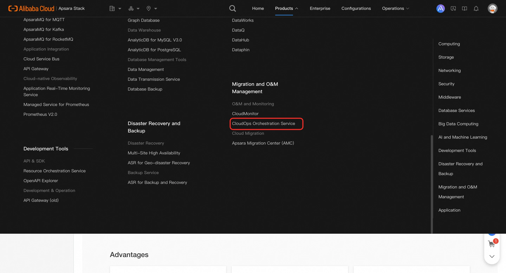
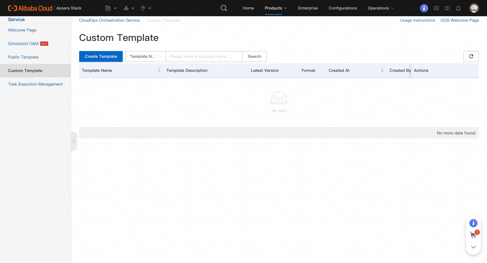
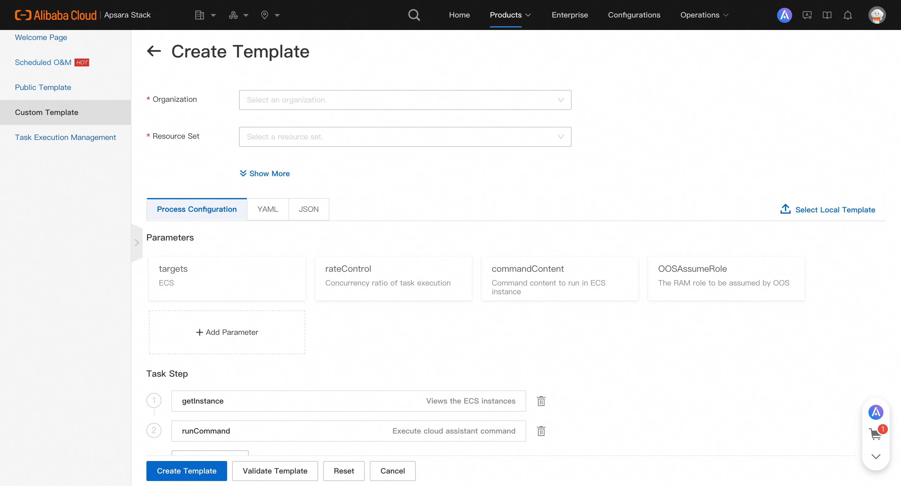
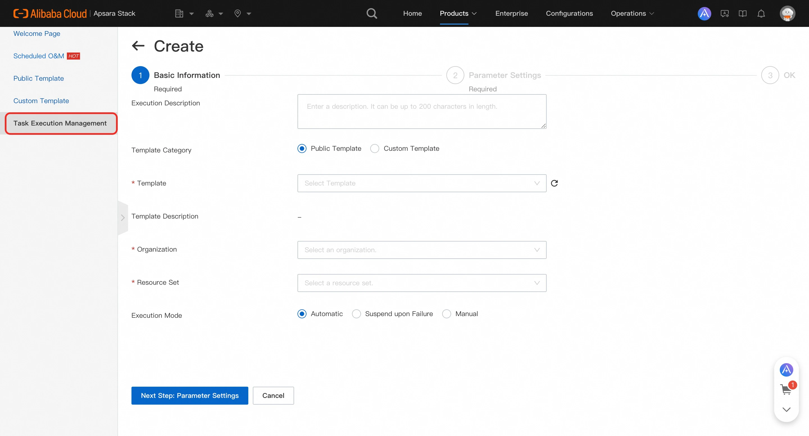
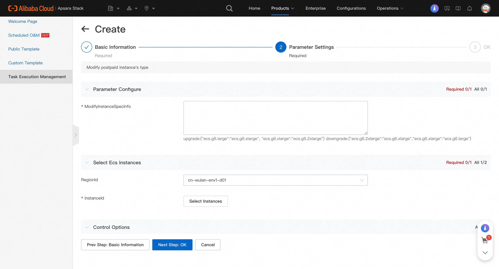
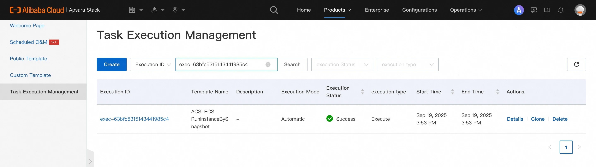
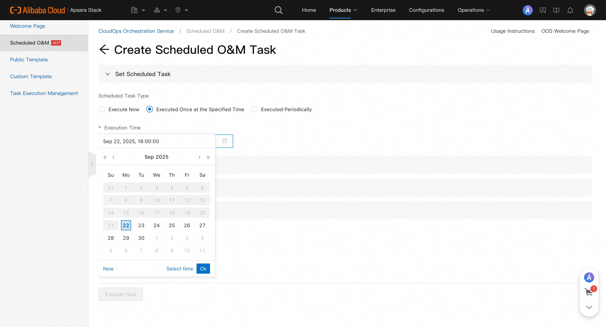
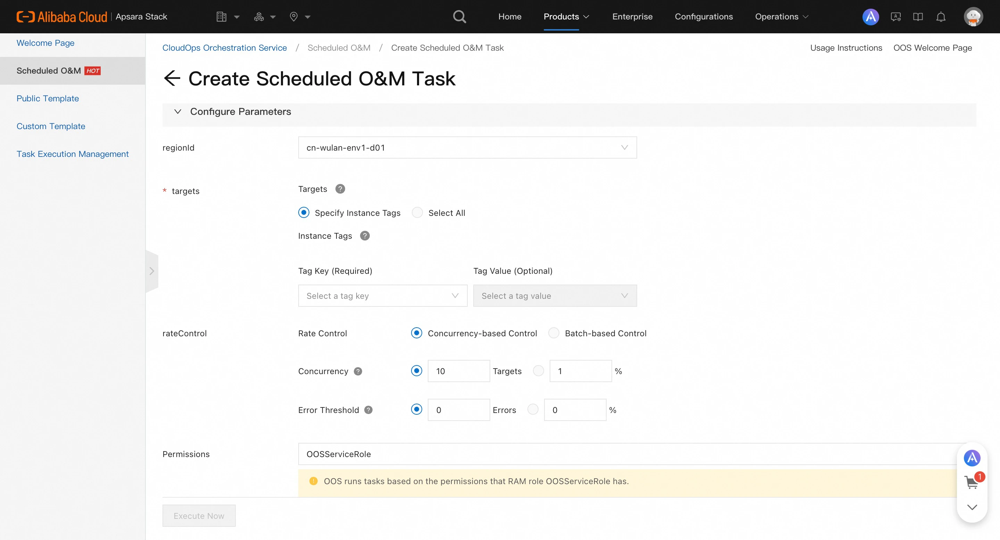

Alibaba Cloud  
Apsara Stack  
Operation Orchestration  
Service  
Operations and Maintenance  
Guide  
Product Version: V3.18.6  
Document Version: 20250925

**Table of Contents**

- [1.Overview](#section-1)
- [2.Create a template](#section-2)
- [3.Create an execution](#section-3)
- [4.Perform scheduled O&M](#section-4)
- [5.FAQ](#section-5)

<a id="section-1"></a>

# 1.Overview

This topic describes how to quickly create and execute an Operation Orchestration Service (OOS) template.

To create and execute an OOS template, perform the following steps:

1. Create a template

For more information, see Create a template.

2. Create an execution

Create an execution based on the created template and start the execution. For more information, see Create an execution.

<a id="section-2"></a>

# 2.Create a template

This topic describes how to create an Operation Orchestration Service (OOS) template for querying the IDs of Elastic Compute Service (ECS) instances in the specified state, such as Running or Stopped, within the current account. The template assumes the OOSServiceRole role to call the DescribeInstances operation of ECS and automatically goes through the results to return the IDs of ECS instances in the specified state. If no more than 1,000 ECS instances are in the specified state, the IDs of all these ECS instances are returned. If more than 1,000 ECS instances are in the specified state, the IDs of the first 1,000 ECS instances in the specified state are returned. For more information, see Limits.

**Procedure**

1. Log on to the Apsara Stack OOS console.

   

2. In the left-side navigation pane, click **Custom Template**. On the page that appears, click **Create Template**.

   

3. In the Basic Information section of the Create Template page, configure the basic information of the template.

   

4. Configure the **Template Name** parameter. In this example, DescribeInstances is used.

5. On the **YAML** tab, enter the following sample template. You can modify this template to add multiple tasks and call API operations.

   ```yaml
   ---
    Description: DescribeInstances
    FormatVersion: OOS-2019-06-01
    Parameters:
        Status:
            Description: Running or Stopped
            Type: String
    Tasks:
      - Name: describeInstances
        Action: ACS::ExecuteAPI
        Properties:
            Service: ECS
            API: DescribeInstances
            Parameters:
                Status: "{{ Status }}"
        Outputs:
            InstanceIds:
                Type: List
                ValueSelector: .Instances.Instance[].InstanceId
    Outputs:
        InstanceIds:
            Type: List
            Value: "{{ describeInstances.InstanceIds }}"
   ```

6. Click **Create Template**.

<a id="section-3"></a>

# 3.Create an execution

After you create a template, you can create an execution based on the template and start the execution.

**Procedure**

1. Log on to the **Apsara Stack Operation Orchestration Service (OOS) console**.

2. In the left-side navigation pane, click **Custom Template**. On the page that appears, find the DescribeInstances template that you created and click **Create Execution** in the Actions column.

3. In the **Create Task** wizard, configure the parameters in the **Basic Information** step. In this example, the **Execution Mode** parameter is set to **Automatic**. The following table describes the parameters.

   

| Parameter or value | Description |
| --- | --- |
| Execution Mode | Automatic: After the execution is created, the execution automatically starts.<br>Manual: After the execution is created, you must manually start the execution. |
| Suspend upon Failure | If the execution contains a loop task and a subtask fails, the execution is suspended, and you must manually adjust the subtask and decide whether to continue the execution. |
| Template Category | Public Template: the templates provided by OOS for common scenarios.<br>Custom Template: the templates that you create based on your business requirements. |
| Template | Select the template that you created. |

4. Click **Next Step: Parameter Settings**. In the Parameter Settings step, configure the parameters. In this example, the **Status** parameter is set to **Stopped**.

   

5. Click **Next Step: OK**.

6. Click **Create**.

7. Go to the **Task Execution Management** page and view the execution that you created.

- If you set the execution mode to **Automatic**, the execution automatically starts. After the execution is complete, check whether the value in the **Execution Status** column becomes **Success**.

- If you set the execution mode to **Manual**, you must manually start the execution.

8. To view the execution details, click the execution ID or click **Details** in the **Actions** column.

   

<a id="section-4"></a>

# 4.Perform scheduled O&M

**Background information**

If you want to perform O&M operations at a specific point in time, you can use the **Scheduled O&M** feature of Operation Orchestration Service (OOS). OOS allows you to run a scheduled O&M task once at the specified time or periodically.

**Procedure**

1. Log on to the Apsara Stack OOS console.

2. In the left-side navigation pane, click **Scheduled O&M**. On the page that appears, click Create.

3. In the Set Scheduled Task section, configure the **Scheduled Task Type** parameter. You can select **Executed Once at the Specified Time** or **Executed Periodically**. In this example, **Executed Once at the Specified Time** is selected. Then, configure the **Execution Duration** parameter.

   

4. In the **Select Template** section, select a template. You can select **Public Template** or **My Template**. In this example, **Public Template** is selected.

5. In the **Configure Template Parameters** section, configure the template parameters.

   

6. Click **Create**.

7. On the **Task Execution Management** page, find the execution that you created. If the execution is created and in the Waiting state, the scheduled O&M task is created.

8. To view more information about the execution, click **Details** in the Actions column. On the page that appears, click the **Log** tab in the output section to view the logs of the execution.

<a id="section-5"></a>

# 5.FAQ

This topic provides answers to frequently asked questions about Operation Orchestration Service (OOS).

- Why is the following error message returned when I use OOS as a RAM user: User has no permission to do the action: (ListTemplates)?

- Why is the following error message returned when I use OOS as a RAM user: User has no permission to do the action: (PassRole)?

- Why is the following error message returned when I use a template: Assumes role failed. Code: EntityNotExist.Role, msg: The role not exists: acs:111111:role/OOSServiceRole?

- Why is the following error message returned when I use a template: Assumes role failed. Code: NoPermission, msg: You are not authorized to do this action. You should be authorized by RAM?

**Why is the following error message returned when I use OOS as a RAM user: User has no permission to do the action: (ListTemplates)?**

Cause: The Resource Access Management (RAM) user does not have the permissions to call the specified API operation of OOS.

Solution: Log on to the **RAM console** with an Apsara Stack tenant account or an administrator account. Authorize the RAM user to call the specified API operation or all API operations of OOS. For example, configure  `"Action": "oos:*"`  to authorize the RAM user to call all API operations of OOS. For more information, see **Access control**.

```json
{
  "Statement": [
      {
          "Effect": "Allow",
          "Action": "oos:*",
          "Resource": "*"
      }
  ],
  "Version": "1"
}
```

**Why is the following error message returned when I use OOS as a RAM user: User has no permission to do the action: (PassRole)?**

Cause: The RAM user is not allowed to use OOS as the specified RAM role because the RAM user does not have the PassRole permission.

Solution: Log on to the **RAM console** with an Apsara Stack tenant account or an administrator account. Grant the PassRole permission to the RAM user. For more information, see **Access control**.

```json
{
  "Statement": [
      {
          "Effect": "Allow",
          "Action": "oos:*",
          "Resource": "*"
      }
  ],
  "Version": "1"
}
```

**Why is the following error message returned when I use a template: Assumes role failed. Code: EntityNotExist.Role, msg: The role not exists: acs:111111:role/OOSServiceRole?**

Cause: You have not created a default RAM role for your OOS service to access your Apsara Stack resources.

Solution: Log on to the **RAM console** with an Apsara Stack tenant account or an administrator account. Create the default RAM role OOSServiceRole for your OOS service. For more information, see **Grant RAM permissions to OOS**.

**Why is the following error message returned when I use a template: Assumes role failed. Code: NoPermission, msg: You are not authorized to do this action. You should be authorized by RAM?**

Cause: You have not attached the required trust policy to the RAM role OOSServiceRole for your OOS service.

Solution: Log on to the **RAM console** with an Apsara Stack tenant account or an administrator account. Attach the required trust policy to the RAM role OOSServiceRole assumed by your OOS service. For more information, see **Grant RAM permissions to OOS**.

1. Log on to the **RAM console**. In the left-side navigation pane, choose Identities > Roles. On

the Roles page, enter OOSServiceRole in the search box to search for the role.

2. Click the role name to go to the details page of the role. Click the Trust Policy Management

tab.

3. Modify the trust policy of the role.Replace the trust policy with the following content:

```json
{
  "Statement": [
      {
          "Action": "sts:AssumeRole",
          "Effect": "Allow",
          "Principal": {
              "Service": [
                  "oos.aliyuncs.com"
              ]
          }
      }
  ],
  "Version": "1"
}
```
