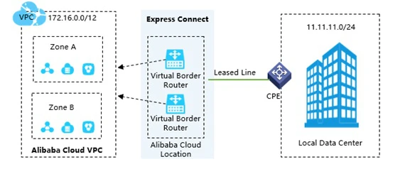
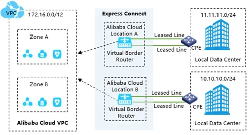
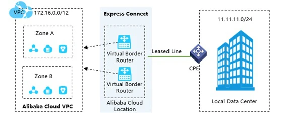

Alibaba Cloud  
Apsara Stack  
Express Connect  
Product Introduction  
Product Version: V3.18.6  
Document Version: 20260310

**Table of Contents**

- [1.Express Connect](#section-1)
    - [1.1. What is Express Connect?](#section-1-1)
    - [1.2. Benefits](#section-1-2)
    - [1.3. Scenarios](#section-1-3)
    - [1.4. Features](#section-1-4)

# 1.Express Connect

Express Connect allows you to establish private connections to enable fast, stable, and secure communication between different network environments. You can use Express Connect to ensure network stability and prevent data breaches.

## 1.1. What is Express Connect?

Apsara Stack Express Connect allows you to establish private, flexible, stable, and secure connections between virtual private clouds (VPCs). Network traffic does not traverse the Internet, which prevents data breaches and ensures network stability.

Express Connect allows you to connect VPCs within the same region and account. You can also connect VPCs across different regions and accounts.

**Benefits**

Express Connect provides the following benefits:

- High-speed connections

  Powered by the network virtualization technology of Apsara Stack, Express Connect allows networks to communicate with each other through direct, private, and high-speed connections. Network traffic does not traverse the Internet. The impact of distance on network performance is minimized to ensure low-latency and high-bandwidth communication.

- Stability and reliability

  Express Connect provides services based on the high-quality infrastructure of Apsara Stack. This guarantees stable and reliable communication between networks.

- Security

  Express Connect allows you to virtualize your networks and enables communication based on the infrastructure provided by Apsara Stack. Networks owned by different accounts are independent of each other. Data packets are exchanged through private connections to prevent beaches.

- On-demand purchase

  The maximum bandwidth of Express Connect circuits varies. You can set the maximum bandwidth based on your business requirements.

**Differences between Express Connect and Internet connections**

A VPC is a logically isolated network. Network traffic between VPCs or between VPCs and data centers are transferred through separate connections.

Compared with Internet connections, Express Connect provides higher performance and security. The following table describes the differences.

| Item | Connect VPCs through Internet connections | Connect VPCs through Express Connect |
| --- | --- | --- |
| Network performance and availability | When network traffic is transferred over a long distance, a low network latency and a low packet loss rate cannot be guaranteed. | Connections are built based on the infrastructure provided by Apsara Stack, which offers higher quality and availability. |
| Costs | You are charged a high Internet bandwidth fee or data transfer fee. | The cost for cross-region communication is minimized. You are not charged for connecting VPCs that belong to the same region. |
| Security | Network traffic is transferred over the Internet. Therefore, data breaches may occur. | Networks are virtualized on Apsara Stack and isolated from each other to ensure high security. |

## 1.2. Benefits

A virtual private cloud (VPC) is a logically isolated network. Network traffic between VPCs is transferred through separate connections.

Compared with Internet connections, Express Connect offers higher performance and security for communication between VPCs. The following table describes the differences.

| Item | Connect VPCs through Internet connections | Connect VPCs through Express Connect |
| --- | --- | --- |
| Network performance and availability | When network traffic is transferred over a long distance, a low network latency and a low packet loss rate cannot be guaranteed. | Connections are built based on the infrastructure provided by Apsara Stack, which offers higher quality and availability. |
| Costs | You are charged a high Internet bandwidth fee or data transfer fee. | The cost for cross-region communication is minimized. You are not charged for connecting VPCs that belong to the same region. |
| Security | Network traffic is transferred over the Internet. Therefore, data breaches may occur. | Networks are virtualized on Apsara Stack and isolated from each other to ensure high security. |

## 1.3. Scenarios

Express Connect enables reliable, secure, and high-speed communication between data centers and virtual private clouds (VPCs). You can use Express Connect to enable communication between networks with different architectures. The following section describes the scenarios in which you can use Express Connect.

**Scenario 1: Multi-zone disaster recovery and high-availability network architecture for large and medium-sized enterprises**

You can establish multiple connections over Express Connect circuits between different access points and a VPC to ensure high availability for your business-critical services. This prevents service downtime caused by severed fiber cables, device malfunctions, or access point errors.

**Scenario 2: High-elasticity and high-availability network architecture for large enterprises**

In scenarios where your business grows rapidly and the data center cannot meet the requirements for further development, you can deploy your workloads on the cloud. In addition, Express Connect supports equal-cost multi-path (ECMP) routing. You can configure ECMP to optimize bandwidth usage through multiple connections over Express Connect circuits and transfer network traffic at the Tbit/s level. This prevents service downtime caused by malfunctions of devices, Express Connect circuits, and access points.

**Scenario 3: Simplified network architecture for non-critical services**

In scenarios that do not require high elasticity or high availability, Express Connect allows you to build a simplified network. For example, to run tests in a staging environment on Apsara Stack, we recommend that you use Express Connect to establish a private connection between your data center and Apsara Stack. This ensures the security and reliability of communication between your data center and Apsara Stack.

## 1.4. Features

This topic describes the features of Express Connect. Apsara Stack Express Connect enables high-speed, stable, secure, and private communication between different networks. You can establish high-quality and flexible connections between data centers and virtual private clouds (VPCs) by using Express Connect circuits.

**Overview**

Express Connect provides private and high-speed connections that can connect data centers to VPCs. You can use a leased line provided by an Internet Service Provider (ISP) to establish a connection between your data center and an Apsara Stack access point. After a connection is established, you can create a virtual border router (VBR) for the connection to connect the data center to Apsara Stack. This allows you to build a hybrid cloud that enables networks in different regions to communicate with each other through high-speed connections.

In addition, Express Connect allows you to create a peering connection between two VPCs for private communication.

**Features**

You can use the following features in the Express Connect console:

- VPC-to-VPC connection

  You can create a peering connection to connect two VPCs that belong to the same or different accounts.

- VBR-to-VPC connection

  You can create a peering connection to connect a VBR to a VPC. After you establish a peering connection between a VBR and VPC, the VBR and VPC can communicate with each other.

- Express Connect circuit

  You can use a leased line provided by an ISP to establish a connection between your data center and an Apsara Stack access point.

- VBR

  A VBR is a router deployed between a customer-premises equipment (CPE) and a VPC. VBRs route traffic between VPCs and data centers. You can configure routes in the route table of a VBR to control where network traffic is forwarded.

- Equal-cost multi-path (ECMP)

  A routing strategy where packet forwarding to a single destination can occur over multiple best paths with equal cost.
