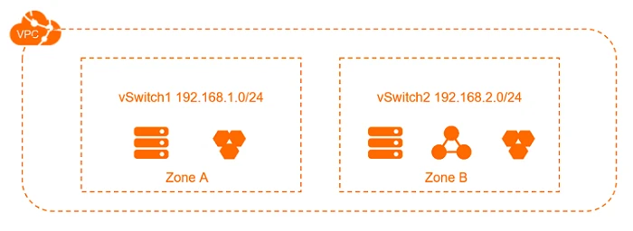
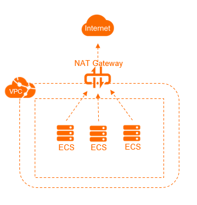
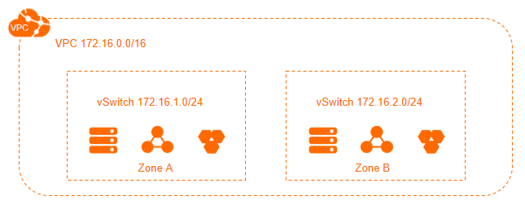
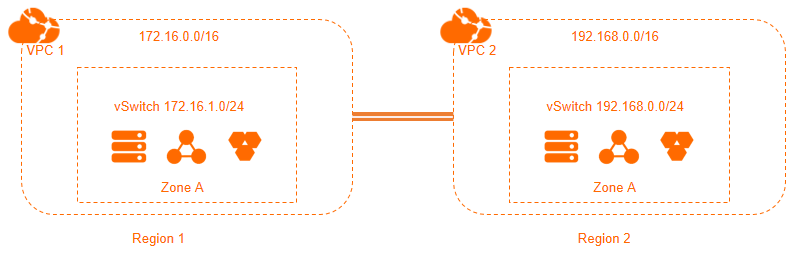
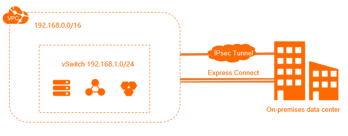

Alibaba Cloud  
Apsara Stack  
Virtual Private Cloud  
Product Introduction  
Product Version: V3.18.6  
Document Version: 20260310

**Table of Contents**

- [1.Virtual private cloud](#section-1)
    - [1.1. Features](#section-1-1)
    - [1.2. Benefits](#section-1-2)
    - [1.3. Features](#section-1-3)
    - [1.4. Use scenarios](#section-1-4)

# 1.Virtual private cloud

A virtual private cloud (VPC) is a private network in the cloud. A VPC provides network services for resources in the cloud. Different VPCs are logically isolated from each other. You have full control over your VPC. For example, you can specify CIDR blocks, and configure route tables and gateways for your VPC. In your VPCs, you can use Alibaba Cloud resources, such as Elastic Compute Service (ECS) instances, ApsaraDB RDS instances, and Server Load Balancer (SLB) instances.

## 1.1. Features

Virtual private clouds (VPCs) are private networks deployed on Apsara Stack. VPCs are logically isolated from each other. You can manage your VPCs and Apsara Stack resources in your VPCs.

**VPCs**

Each VPC consists of one private CIDR block, at least one vRouter, and at least one vSwitch.

- When you create a VPC and a vSwitch, you must specify the private IP address range for the VPC in CIDR notation. You can use the standard private CIDR blocks listed in the following table and their subsets as the private CIDR blocks for your VPCs.

  | CIDR block | Number of available private IP addresses (excluding IP addresses reserved by the system) |
  | --- | --- |
  | 192.168.0.0/16 | 65,532 |
  | 172.16.0.0/16 | 65,532 |

- A vRouter is the hub of a VPC. As a core component, it connects the vSwitches in a VPC and serves as a gateway between a VPC and other networks. After you create a VPC, the system automatically creates a vRouter. Each vRouter is associated with a route table.

- A vSwitch is a basic network component that connects different cloud resources in a VPC. After you create a VPC, you can create vSwitches to create one or more subnets for the VPC. vSwitches in the same VPC can communicate with each other. You can deploy your applications in vSwitches that belong to different zones to improve service availability.

**Custom route tables and routes**

After you create a VPC, the system creates a system route table to manage routes of the VPC. By default, vSwitches in the VPC use this route table. You cannot create or delete the system route table of a VPC. However, you can create a custom route table and associate it with a vSwitch to manage your network in a more flexible way.

You can add custom routes to the system route table and custom route tables to route traffic to specified next hops. The route table uses the longest prefix match algorithm for traffic routing. If multiple routes match the destination IP address, the route with the longest subnet mask prevails and is used to determine the next hop. This ensures that the traffic is routed to the most precise destination.

**High-availability virtual IP addresses (HAVIPs)**

HAVIPs are private IP addresses that can be created and released as independent resources. You can use HAVIPs with high-availability software such as Keepalived to provide active/standby services. This improves the availability of your services. Each Elastic Compute Service (ECS) instance is assigned a private IP address as the primary IP address. You can associate HAVIPs with an ECS instance to increase the number of private IP addresses available for the ECS instance.

**Network access control lists (ACLs)**

Network ACLs allow you to implement access control for a VPC. You can create network ACL rules and associate a network ACL with a vSwitch. This allows you to control inbound and outbound traffic of ECS instances that are associated with the vSwitch.

**Various connection methods**

Apsara Stack provides multiple connection methods. You can connect a VPC to the Internet, a data center, or another VPC.

- Connect a VPC to the Internet

  You can connect a VPC to the Internet by associating elastic IP addresses (EIPs) with resources in the VPC or configuring NAT gateways. This way, resources in the VPC can communicate with the Internet.

- Connect a VPC to another VPC

  You can establish high-performance and secure connections between VPCs by creating a pair of router interfaces.

- Connect a VPC to a data center

  You can connect a VPC to a data center through Express Connect circuits. This allows you to smoothly migrate on-premises applications to the cloud.

## 1.2. Benefits

This topic describes the benefits of virtual private clouds (VPCs). VPCs are secure, reliable, flexible, easy to use, and scalable.

**Security and reliability**

Each VPC is identified by a unique tunnel ID, which corresponds to a virtual network. Different VPCs are isolated by tunnel IDs:

- Similar to a traditional network, you can create vSwitches and vRouters to divide a VPC into multiple subnets. Elastic Compute Service (ECS) instances in the same subnet use the same vSwitch to communicate with each other, while ECS instances in different subnets use vRouters to communicate with each other.

- VPCs are completely isolated from each other. Cloud resources in different VPCs can communicate with each other by using elastic IP addresses (EIPs) or NAT IP addresses.

- The IP packets of an ECS instance are encapsulated by using the tunneling technology. Therefore, information at the data link layer (the MAC address) of the ECS instance is not transferred to the physical network. This way, ECS instances in different VPCs are isolated at Layer 2.

- ECS instances in a VPC use security groups and firewalls to control inbound and outbound traffic at Layer 3.

**Flexible management**

You can use security group rules and access control lists (ACLs) to manage inbound and outbound traffic to cloud resources in a VPC in a flexible manner.

**Ease of use**

You can easily create and manage VPCs in the VPC console. When you create a VPC, the system automatically creates a vRouter and a route table for the VPC.

**High scalability**

You can create different subnets in a VPC to deploy different services. Additionally, you can connect a VPC to a data center or another VPC to extend the network architecture.

## 1.3. Features

This topic describes the features of virtual private clouds (VPCs). VPCs provide an isolated and customizable virtual environment for flexible management and secure isolation of resources. VPCs support a variety of features, including isolating CIDR blocks, and configuring Elastic IP (EIP), subnets, and gateways to ensure high availability of backend services and communication security.

**VPC**

**Feature**

**Description**

Modify VPC

Modify the name and description of a VPC.

Create VPC

Create a VPC.

VPC management

Delete VPC

Delete a VPC.

Query VPC

Query a VPC using filters.

Share VPCs in the current resource set, between

VPC sharing

VPC sharing

organization and sub-branches, and in the current organization.

Custom tags are supported due to the

Tags

integration of the tag system.

Enable IPv6

Enable the IPv6 feature for VPCs

Modify VPC attributes

Modify the VPC name and description.

VPC instance management

Create VPC

Create a VPC.

Delete VPC

Delete a VPC.

Query VPC

Query a VPC.

Provide network connectivity for ECS instances.

Provide ECS network interface controller service.

Elastic Compute

Manage network for ECS

Support ECS throttling.

Service (ECS)

instances

Provide ECS proxy network service.

Support ECS proxy, migration, access control, O&M monitoring, and after-sales tools.

SHENLONG MOC 2.0

Supported models

General models

Modify traffic mirroring.

Stop traffic mirroring.

Basic settings

Create traffic mirror.

Delete traffic mirror.

View traffic mirroring.

Outbound and inbound traffic.

Filters

5-tuples.

Traffic mirroring

Mirror traffic from a source to a destination

Traffic mirror session

based on specified filters.

Traffic mirror source

An ENI from which you want to mirror traffic.

An ENI or an internal-facing SLB instance that is

Traffic mirror destination

used to receive mirrored traffic.

SHENLONG MOC 2.0 General models

ITAI

Intel

Hygon

ARM (Kunpeng)

The IPv4 mask length of the vSwitch CIDR block

vSwitch mask

must be 16 to 29 bits.

Modify vSwitch

Modify a vSwitch

Manage vSwitch

Create vSwitch

Create a vSwitch in the VPC.

Delete vSwitch

Delete a vSwitch from a VPC.

Query vSwitch

Query a vSwitch.

Delete a custom route

Delete an existing route entry in the vRouter.

entry

Delete a custom IPv4

Delete an existing route entry in the vRouter.

route entry

After you associate a custom route table with a

Subnet routing

vSwitch, traffic in the vSwitch is forwarded based on the custom route table.

Subnet routing 2.0

Create a custom route

Set up a new custom route entry in the vRouter.

Set a new custom route entry in the vRouter. The next hop can be set to Elastic Network

New IPv4 custom route

Interface, RI (VPC/VBR), ECS, VPN, NAT, and

Route Table

HAVIP.

Management

Query the list of route

Query entries in a route table.

tables IPv4 custom routes

Set a new custom route entry in the vRouter.

support dedicated RI

The next hop can be configured as a

primary/secondary mode

primary/secondary RI (VBR) interface.

IPV4 custom routes

Set a new custom route entry in the vRouter.

support dedicated RI load

The next hop can be configured as multiple load

balancing mode

sharing RI (VBR) interface.

In addition to the system route table, you can

Custom route tables

create custom route table and entries. The next hop type supports ECS, gateways, and VBRs.

HAVIP can be bound to a primary instance and a

ECS high reliability

secondary ECS instance.

Modify HAVIP

Modify HAVIP attributes.

Create HAVIP

Create a new HAVIP.

High-availability virtual IP address (HAVIP)

Delete HAIVP

Deletes an HAVIP instance.

HAVIP can be bound to a primary ENI and a

ENI high reliability

secondary ENI.

Query HAIVP

Query HAIVP attributes and status.

Allow access from the

Only access from the Internet is allowed.

IPv6 gateway

Internet and reject access

Resources in the VPC are not allowed to access

egress-only rules

from the VPC to the

the Internet.

Internet

Modify IPv6 gateway

Modify an IPv6 gateway.

Manage IPv6

Create IPv6 gateway

Create an IPv6 gateway.

gateway

Delete IPv6 gateway

Delete an IPv6 gateway.

View NAT service plans

Query a NAT service plan.

Modify the name and description of a NAT

Modify attributes of a service package

service plan.

Manage NAT service

Modify the bandwidth of a

Modify the bandwidth plan.

plans

NAT service plan

Delete a NAT service plan

Delete a service plan.

Remove a public IP

Remove a public IP address from a NAT service

address from a NAT

plan.

service plan.

Add a public IP address to

Add a public IP addresses to a NAT service plan.

a NAT service plan.

Modify the destination address of IP data

DNAT

packets, generally used in scenarios where the Internet accesses a private server.

NAT gateway

Modify the source address of IP packets,

SNAT

generally used in scenarios where a private server accesses the Internet.

Custom tags are supported due to the

Tags

integration of the tag system.

Modify the gateway attributes, including the

Modify a NAT gateway

name.

Basic NAT gateway management

Create a NAT gateway

Create a gateway.

Delete NAT gateway

Delete or release a NAT gateway.

SNAT and DNAT share the

Specify the same EIP for both SNAT and DNAT

same EIP

entries.

Modify the DNAT rule. You can change the port

Modify DNAT Entry

information and backend ECS instances.

Manage a DNAT table

Create DNAT entry

Create a DNAT rule.

The forwarding logic becomes invalid after the

Delete DNAT entry

DNAT rule is deleted.

Modify the associated EIP and rule granularity of

Modify an SNAT entry

an SNAT rule.

Create SNAT entries-

Create SNAT rules for the ECS to match ECS

Specify ECS

forwarding.

Manage SNAT table

Create SNAT entries-

Create SNAT rules for vSwitches to match

Specify vSwitch

vSwitch forwarding.

The forwarding rule becomes invalid after the

Delete an SNAT entry

corresponding SNAT entry is deleted.

Custom tags are supported due to the

Tags

integration of the tag system.

Modify EIP attributes

Modify EIP attributes.

Query EIP list

Query the EIP list.

Support traffic metering capabilities based on

Metered Traffic

EIPs. You can export EIP metering data to OMS.

Modify the bandwidth of

Change the bandwidth of the EIP.

an EIP

Multi-carrier lines

Create an EIP.

EIPs

Specified bandwidth

Support the creation of a specified bandwidth.

creation

Apply for an EIP

Apply for an EIP.

Associate an HAVIP with

Bind the EIP to a cloud resource, HAVIP, or ENI

an EIP

in the same region.

Unbind an EIP

Unbind the EIP from the instance.

Release an EIP

Releases EIPs that are no longer in use.

Bind an EIP to an ENI

Each EIP can be associated with one ENI.

Bind multiple EIPs to ENI

Bind multiple EIPs to ENI.

Containerization

XGW on docker.

Virtuali gateway

Supports zone-disaster recovery.

Multi-IDC Deployment

XGW on docker supports multiple regions.

Create NACLs and configure inbound and

Support for NACL (IPv4) at

outbound rules. Bind the NACL to the vSwitch to

vSwitch level

manage the inbound and outbound IPv4 traffic.

Network ACLs

Import/export ACL rules to

The VPC ACL feature in ASCM supports cloning

files

ACL and importing/exporting ACL rules.

Modify vRouter attributes

Modify vRouter attributes.

vRouter Management

Query vRouter

Query a vRouter.

Enable private communication between VPCs by

Local region VPCs

using Express Connect in the same account or across accounts.

Enable private communication between VPCs in

Cross-region VPCs

different regions by using Express Connect in the same account or across accounts.

Activate a vRouter interface in the Inactive

Activate vRouter interface

state. After being activated, the vRouter

Express Connect

interface sends data properly.

circuit

> **Note**

You can deactivate a vRouter interface in the Active status. No data will pass through the

> Provide service

Disable a vRouter

vRouter interface.

> using Express

interface

> Connect

Modify information of the

Modify the configuration of the peer interface.

peer interface

Modify information of the

Modify the configuration of the local interface.

local interface

Configure a route

Configure routes for vRouter interfaces.

VPC supports multi-region

Physical servers in Business Foundation System.

2.0

Multi-IDC Deployment

VPC support 3AZ

Physical server.

Intel

Intel

Hygon

Hygon

Kunpeng

Kunpeng

ITAI

Phytium

Physical server.

ShenWei

Physical server.

Support V8

Physical server.

Support 8U

Physical server.

Support CX6 dual-port network interface

Physical server.

controllers (NICs).

Support X710 10GE NIC on

Physical server.

x86 Hygon.

NICs

XGWdocker supports CX6 dual-port network

Virtuali gateway.

interface controllers (NICs).

VPC supports 100G

Physical gateway.

network access

Architecture

FRR (Fast Reroute) protocol restores data flow in

XGW supports FRR

Optimization

network failures.

Interaction between

Support the interaction between vSwitch

vSwitch creation and VPC

creation and IPv4 CIDR block.

CIDR

vSwitch

Interaction between

Support the interaction between vSwitch

vSwitch creation and VPC

creation and IPv6 CIDR block.

CIDR

**Monitoring and alerting**

<table>
  <tr>
    <th colspan="2">Feature</th>
    <th>Note</th>
  </tr>
  <tr>
    <td>Alerting</td>
    <td>VPC alerts</td>
    <td>Alerts are supported.</td>
  </tr>
  <tr>
    <td rowspan="4">Monitoring</td>
    <td>NOE monitoring and O&amp;M</td>
    <td>NOE is integrated and runs on the backend, allowing data about VPC resources to be queried.</td>
  </tr>
  <tr>
    <td rowspan="2">AVS Monitoring</td>
    <td>AVS is connected to CMS tenant network monitoring.</td>
  </tr>
  <tr>
    <td>AVS integrates the monitoring system.</td>
  </tr>
  <tr>
    <td>NAT monitoring</td>
    <td>NAT supports tenant monitoring of network inbound bandwidth, outbound bandwidth, and bandwidth usage.</td>
  </tr>
</table>

## 1.4. Use scenarios

Virtual private clouds (VPCs) are virtual networks that are isolated from each other. VPCs support flexible configurations to meet the requirements of different scenarios.

**Deploy applications in a safe manner**

You can deploy applications in a VPC to provide services to external networks. To control access to the applications over the Internet, you can create security group rules and configure whitelists. You can also isolate application servers from databases to implement access control. For example, you can deploy web servers in a subnet that can access the Internet, and deploy databases in another subnet that cannot access the Internet.

**Deploy applications that require access to the Internet**

You can deploy applications that require access to the Internet in a subnet of a VPC and use an Internet NAT gateway to route network traffic. You can configure SNAT entries to allow instances in the subnet to access the Internet without the need to expose the private IP addresses. In addition, you can change the elastic IP addresses (EIPs) specified in the SNAT entries to prevent attacks from the Internet.

**Implement cross-zone disaster recovery**

You can create one or more vSwitches to create one or more subnets for the VPC. vSwitches within the same VPC can communicate with each other. To implement cross-zone disaster recovery, you can deploy resources across vSwitches in different zones.

**Isolate business systems**

VPCs are logically isolated from each other. You can use multiple VPCs to isolate business systems in different environments such as production and test environments. To allow business systems deployed in two VPCs to communicate with each other, you can create a peering connection between the VPCs.

**Build a hybrid cloud**

To expand your on-premises network, you can establish a dedicated connection between a VPC and your data center. This allows you to seamlessly migrate the applications in your data center to the cloud. You do not need to change the access method for the applications.

