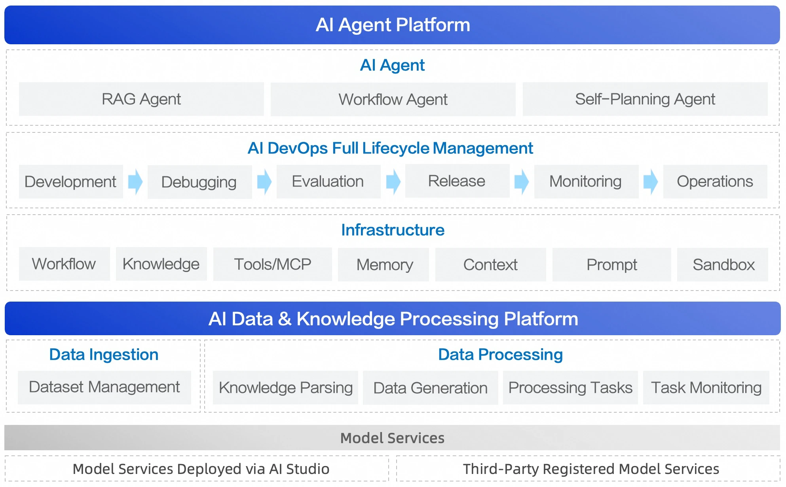

Alibaba Cloud  
Apsara Stack  
OpenTrek Dev Product  
Introduction  
Product Version: V3.18.6  
Document Version: 20260630

**Table of Contents**

- [1.Product details](#section-1)
- [2.Product value](#section-2)
- [3.Use cases](#section-3)
- [4.Features](#section-4)

# 1.Product details

Model Studio-Enterprise Edition is an enterprise-grade development platform for large model agents, providing a one-stop toolchain for domain-specific knowledge processing and management, agent building, and capability evaluation.

**Background**

As large model technology moves into real-world production, enterprises face three core challenges in their intelligent transformation:

- First, large model application development is difficult to manage across the full lifecycle. In traditional workflows, fragmented toolchains and a lack of evaluation systems reduce development efficiency, while key stages like context engineering and dynamic knowledge system updates lack sufficient tools and proven methodologies.

- Second, limited multimodal data processing capabilities severely restrict the expansion of application scenarios. Enterprises struggle to effectively convert massive volumes of unstructured data—such as financial reports, blueprints, and audio/video files—into valuable knowledge assets.

- Finally, agent development faces the dual challenge of limited functional scope and significant security risks. Agents must meet diverse needs, ranging from simple Q&A to complex decision-making, while guaranteeing system stability and data security in enterprise-grade scenarios.

Industry research shows that over 70% of enterprises building large model applications are hindered by pain points such as long knowledge base build cycles, limited agent functionality, and poor toolchain integration. These issues directly lengthen AI application development cycles by more than 40%.

Model Studio-Enterprise Edition was created to address these critical bottlenecks. The platform focuses on enterprise-grade scenarios, centered on "full lifecycle management" and "foundational capability support." By providing a full-stack platform that covers data processing, application development, and O&M optimization, it streamlines the entire workflow from multimodal knowledge processing to engineering production-ready agents. As the core infrastructure for building AI-native systems, Model Studio-Enterprise Edition not only resolves toolchain fragmentation but also overcomes the limitations of traditional multimodal data processing. It delivers an end-to-end solution—from data parsing to application deployment—that helps enterprises accelerate AI deployment and iteration, moving large models from proof-of-concept to scalable industrial application.

**Product overview**

Model Studio-Enterprise Edition is an enterprise-grade dual platform for large model application development and knowledge processing. It provides a full lifecycle toolchain covering development, debugging, evaluation, observability, and O&M, and integrates core capabilities such as knowledge processing, agent building, and tool ecosystem management.

For knowledge processing, the platform uses end-to-end multimodal parsing to manage various data modalities, including documents, images, audio/video, and data tables. It includes built-in deep-parsing templates to accurately process over 10 types of professional content, such as financial reports, academic papers, and policy documents. The platform enables complex table parsing, formula recognition, and image understanding, helping enterprises quickly build a high-quality knowledge base and providing foundational support for AI applications like RAG Q&A.

For agent development, the platform provides comprehensive support for a wide range of scenarios:

- On the one hand, by integrating RAG for knowledge enhancement, custom workflow orchestration, and ReAct reasoning and decision-making mechanisms, developers can flexibly build various types of agents, such as knowledge Q&A, workflow-driven, and autonomous planning agents, meeting a wide range of needs from simple interactions to complex decision-making.

- On the other hand, the platform offers an open MCP and tool ecosystem that expands agent capabilities while ensuring stability under high concurrency and secure script execution.

Additionally, the platform features a fine-grained memory management mechanism. Short-term memory supports context compression and entity extraction, while long-term memory enables personalized services through user profiles and task maps. Combined with custom generation and retrieval strategies, this allows agents to continuously evolve.

With these capabilities, Model Studio-Enterprise Edition provides a one-stop service for knowledge processing, agent development, evaluation, and O&M, establishing it as a core engine driving intelligent transformation across industries.

# 2.Product value

Model Studio Dedicated Edition integrates extensive industry-specific knowledge and data to support a wide range of applications. It addresses questions across multiple domains and provides accurate, comprehensive answers. This platform lets you efficiently manage solutions for all your use cases in one place.

**Efficient multimodal knowledge processing**

- Customer value

  Build a high-quality enterprise knowledge base and rapidly deploy AI applications, such as RAG Q&A.

- Key capabilities

  Provides end-to-end knowledge parsing for managing multimodal data, including documents, images, audio, video, and data tables. It features over 20 deep-parsing templates for more than 10 document types, such as financial reports, academic papers, policies, and textbooks. These capabilities let you parse document layouts, complex tables, and formulas, as well as understand images, allowing you to quickly build a multimodal knowledge base using your private data.

**Build agents for any scenario**

- Customer value

  Create various agents for a wide range of scenarios, including knowledge Q&A agents, workflow agents, and autonomous planning agents.

- Key capabilities

  Integrates multiple mechanisms, including RAG enhancement, custom workflow orchestration, and the ReAct framework for single-agent reasoning and decision-making. This lets developers switch between operating modes for diverse development needs, from basic Q&A to complex multi-agent systems.

**Open MCP and tool ecosystem**

- Customer value

  Integrate diverse tools efficiently to enhance development flexibility and security. This simplifies the integration process, reduces costs, and accelerates business innovation and response.

- Key capabilities

  Supports asynchronous API tool calls and dynamic injection of authentication credentials for various tool types. You can register MCP services in either Server-Sent Events (SSE) or STDIO mode and run them in an isolated security sandbox for flexible and secure deployment. The platform also lets you wrap APIs as MCP services with a single click, ensuring cross-protocol compatibility and reducing integration costs.

**Fine-grained memory management**

- Customer value

  Effectively manage long context for agent tasks using short-term memory, and deliver personalized experiences through long-term memory. This helps your agents improve and become more helpful with each interaction.

- Key capabilities

  Short-term memory management includes features like history round setting, long context compression, key entity extraction, and custom memory read and write. Long-term memory supports key Q&A, user profiling, and task mapping. It also lets you define custom memory generation, organization, and recall strategies.

# 3.Use cases

This topic describes how Model Studio can be applied in various industries.

Model Studio lets organizations across various industries build powerful AI applications. The following sections highlight several key use cases.

**Public sector**

To simplify complex policy documents for the public, you can build an intelligent interpretation agent. By ingesting historical policy documents into a knowledge base, the agent can use retrieval-augmented generation (RAG) to provide clear explanations. It can also support voice-based queries and trace information back to specific clauses, reducing the workload on government helpdesks and improving efficiency for both citizens and businesses.

**Finance**

Buy-side financial institutions often need to quickly analyze vast amounts of unstructured data, such as financial reports, prospectuses, satellite imagery, and web articles. You can use multimodal capabilities to build a knowledge base that supports multi-source data retrieval. An agent built for investment analysis can then be configured with specific reasoning logic to automatically generate batch analysis reports on a recurring schedule.

**Energy and power**

In power grid management, slow fault responses and inefficient coordination between systems are common challenges. To address this, you can build an intelligent dispatch agent to act as a decision-making hub. By creating a dispatch knowledge base from integrated data sources—including command libraries, equipment ledgers, and historical contingency plans— the agent can identify and route issues, coordinate with power flow and transfer tools, manage contingency plans, and provide smart visualizations to support operators.

**Industrial manufacturing**

You can create an industrial internet of things (IIoT) data hub that consolidates real-time sensor data (such as temperature, pressure, and vibration) with historical production logs (like process parameters, quality inspection records, and energy reports). You can use this data to build a process optimization knowledge base. A process analysis agent can then use this knowledge base to forecast energy consumption, trace the root cause of defects, and intelligently tune process parameters, creating a closed-loop optimization system.

**Healthcare**

Patients often struggle with technical pharmaceutical information, and healthcare providers face a high volume of inquiries. You can build a medication consultation agent to address these issues. By integrating authoritative medical and pharmaceutical data, the agent can help users find drug information, match medications to symptoms, and obtain clear usage guidance. This enhances patient safety and makes accessing medication information more convenient.

**Media and publishing**

You can build an agent that combines retrieval from a local knowledge base with web search capabilities. This automates workflows for sensitive content detection, fact-checking, and style consistency analysis, significantly improving the efficiency of proofreading and editorial review processes.

**Education**

Using a multimodal model, you can build a tool that comprehensively understands both video and audio content from educational lectures. This capability automatically extracts key concepts, organizes them into a structured knowledge system, and generates concise summaries.

# 4.Features

Model Studio dedicated edition features

Seconda

Primary

Tertiary

ry

Description

feature

feature

feature

Custom

Create an agent from scratch by providing a name,

agent

description, and creation method. After initialization, you'll

creation

be taken to the version configuration page for further setup.

Create

Quickly create an agent from a template using a guided

agent from

interface and prompt engineering.

template

Edit an existing agent's name, description, avatar, and other

Edit agent

details to update its configuration.

Permanently remove unneeded agents to free up system

Delete agent

resources and organize the agent list.

Agent manage

Search

Quickly locate a specific agent by searching for its name.

ment

agent

Export an agent file by providing the import key for the target environment. Agent dependencies, such as model

Export agent

services, knowledge bases, memory content, MCP services, and sub-agents, are not exported. You cannot export an agent using an import key from the same environment.

Select an exported agent file to import. You can only import an agent if it was exported using an import key generated

Import agent

for the current environment. This feature is intended for importing agent files between different environments.

Get import

Generates an import key to validate agent exports from

key

other environments. The key is valid for 72 hours.

Custom

Create a new agent version. After specifying a version name

version

and creation method, you will be directed to the workflow

creation

page to develop the version from scratch.

Create

Quickly build an agent version from a template using a

version from

guided interface and prompts.

template Upgrade

Duplicates the current version and opens the copy on the

template

workflow canvas to enable more advanced business

form to

processes.

workflow

Clone

Clones an agent version's configuration to create an identical

version

new version, allowing modifications without affecting the

within agent

original.

Clone

Clones an existing agent version's configuration to a

version to

specified workspace. Dependencies such as model services,

another

knowledge bases, memory content, MCP services, and sub-

workspace

agents are not cloned.

Set traffic allocation quotas for a specified agent version.

Traffic

Supports traffic splitting by session ID and request ID to

allocation

ensure the version receives sufficient resources. When an

settings

agent has only one version, allocating traffic to it also sets it as the output version.

Version manage

Export selected agent versions, with multi-select support.

ment

Dependencies such as model services, knowledge bases,

Export agent

memory content, and sub-agents are not exported. You

version

cannot export a version using an import key from the same environment.

Select an exported agent version file to import. You can only import a version if it was exported using an import key

Import agent

generated for the current environment. This feature is

version

intended for importing agent versions between different environments.

Version status

Manage the lifecycle of agent versions, including viewing

managemen

details, publishing, and taking versions offline.

t

Publish a version in development to a live state, making it

Publish

available for external calls. The platform performs

version

completeness and validity checks before publishing.

Query task details and log records for each agent service

Effect

request. Supports filtering by version, session ID, and

tracking

request ID.

Monitor 11 business and performance metrics at both the agent and version levels: request concurrency, concurrency

Metric

ratio, concurrency trend, success rate, average request

monitoring

latency, average time to first token, maximum request latency, maximum time to first token, memory consumption, input tokens, and output tokens.

Defines the starting point of the agent workflow. Customize

Start node

input parameters and map them to the agent's standard input to set initial conditions for subsequent tasks.

Paired with an Aggregator, distributes a collection of data

Iterator

serially or in parallel, enabling iteration over a list of data.

Paired with an Iterator, aggregates data distributed serially

Aggregator

or in parallel from an iteration.

Large

Configures a Large Language Model (LLM) to perform specific

Language

inference tasks. Supports model selection, parameter

Model (LLM)

settings, input/output configuration, and prompt-based

node

content generation.

Configures a multimodal understanding Large Language

Multimodal

Model (LLM) to perform specific inference tasks. Supports

understandi

model selection, parameter settings, input/output

ng LLM node

configuration, and prompt-based content generation.

Reranks text using a specified model. Supports model selection, parameter settings, and input/output

Text

configuration.

reranking model node

Image-text

Reranks image-text pairs using a specified model. Supports

reranking

model selection, parameter settings, and input/output

model node

configuration.

Calls a registered tool. You can configure its input

Tool node

parameters to perform a specific function.

Retrieves from authorized document knowledge bases.

Document

Supports configuration of retrieval parameters, input, and

retrieval

output.

Retrieves from authorized image-text knowledge bases.

Image-text

Supports configuration of retrieval parameters, input, and

retrieval

output.

Retrieves from authorized data table knowledge bases.

Data table

Supports configuration of retrieval parameters, input, and

retrieval

output.

SQL

Executes SQL tasks on an authorized database registered

executor

with the platform. Supports input and output configuration.

Design workflo

Merges outputs from multiple preceding nodes. Supports

Content

w

streaming output for merged results and defining rules and

merge

structures for combining results.

Intermediate

Outputs partial information from preceding nodes before the

output

final result is generated.

Allows you to select variables defined in short-term memory

Write to

and perform operations such as overwriting, appending, or

short-term

clearing their values.

memory

Allows you to select another configured agent version as a callable node within the current workflow. The session

Agent node

between the main agent and sub-agent remains relatively stable.

Allows you to write custom scripts to complete tasks.

Script node

Supports defining input and output parameters that conform to a preset structure.

Agent

Implements conditional branching logic in the workflow,

develop

Selector

choosing different execution paths based on the values of

ment

node

input parameters.

Result

Combines and renders the agent's output information,

rendering

including text, attachment content, and custom structured

node

data.

Validates the agent's configuration, ensuring all nodes are configured correctly and connections are logical to

Validation

guarantee normal operation.

Automatically saves configuration changes to ensure

Autosave

operational continuity and data safety.

Provides an option to manually save the configuration,

Manual save

allowing users to save the agent's current state at a specific moment.

Provides a built-in library of 30 functions, enabling developers to further parse and process data or read specific

Function

information, such as getting the value of a specific key in an

capabilities

object, parsing items from a list, or reading historical dialogue records.

Allows developers to input text to simulate user-agent

Text input

interactions to test and adjust the agent's response and

debugging

processing logic.

Attachment

Allows you to upload attachments to test the agent's ability

input

to handle different attachment types and ensure it can

debugging

correctly parse and use the contained data.

Additional

Provides an interface for inputting additional information to

information

simulate interactions in complex scenarios and test how the

debugging

agent uses this information for decision-making.

Allows data input in JSON format to help developers test the

JSON input

agent's ability to parse and respond to structured data.

debugging

Suitable for API debugging.

Enables developers to clear all content from the current

Clear

session and reset its state, allowing them to start a fresh

session

interaction test and ensure session independence.

Debuggi ng

In Run mode, the agent automatically executes the entire

Run mode

task chain and provides an answer. This mode is suitable for

debugging

quickly validating the agent's automated execution flow and efficiency.

Debug mode allows manual triggering of each task's

Debug mode

execution for fine-grained troubleshooting. This mode is

debugging

suitable for debugging and optimizing complex logic.

Displays all intermediate tasks and sub-step results during

Intermediate

the agent's execution to help developers understand each

task view

step and the logic of the entire interaction process.

Allows you to view the agent's debug logs, including error

View logs

messages and execution status, to facilitate analysis and troubleshooting.

Insert and

Allows developers to insert and view the agent's thought

view thought

process, including decision logic and reasoning steps, to

process

evaluate and optimize the agent's decision-making quality.

Short-term memory:

Enable or disable the conversation history. If disabled, the

Conversatio

agent cannot reference past dialogue from the session.

n history toggle

Short-term

Define the number of conversation turns to retain and the

memory:

handling method when the limit is exceeded. Options include

Conversatio

truncating or summarizing the history.

n turn limit

Short-term memory:

Select a model and set a prompt for summarizing

Conversatio

conversation history to improve summary quality.

n summary settings

Short-term

Toggle the extraction of key entities, which are valuable

memory:

pieces of information from the conversation history saved

Key entities

separately to avoid being lost in a long context.

toggle

Short-term memory:

Set the name, description, and type for up to 10 entities. The

Key entity

system extracts entities based on these settings.

settings

Short-term memory:

Select a model and set a prompt for key entity extraction to

Key entity

improve its effectiveness.

extraction settings

Short-term memory:

Set custom variables. Their content can be written using the

Custom

"Custom Memory" node in the agent settings.

variables

Long-term memory:

Create a long-term memory partition from a Q&A template,

Create

saving important conversation content to the memory store

memory

to improve agent response quality. Supports selecting

partition

models for memory generation and vectorization.

from Q&A template

Long-term

Memory

memory:

Create a long-term memory partition from a user profile

Create

template, saving user profile information from conversations

memory

to memory. Supports selecting models for memory

partition

generation and vectorization. User profile tags can be

from user

maintained manually.

profile template

Create a memory partition through workflow orchestration. Configuration parameters include: Memory storage structure: Choose from key-value pairs,

Long-term

multiple texts, or text.

memory:

Memory generation strategy: Choose between workflow

Custom

orchestration or manual maintenance.

memory

Memory organization strategy: Set a retention policy, such

partition

as permanent or time-based cleanup.

creation

Memory retrieval strategy: Set the retrieval method to search and recall content by memory title or content. Vectorization model: Configure the vectorization model for the memory partition's retrieval strategy.

Long-term memory:

Edit specific memory entries within a partition to update

Edit memory

their content for new business scenarios or requirements.

content

Long-term memory:

Remove individual memory entries that are outdated or

Delete

incorrect to improve the quality of the memory store.

memory content

Long-term

Edit an existing memory partition to update its name,

memory:

description, generation strategy, organization strategy,

Edit memory

retrieval strategy, and other information.

partition

Long-term memory:

Delete an existing memory partition to adapt to the agent's

Delete

evolving needs.

memory partition

Long-term memory:

Debug the content of a memory partition by entering a

Debug

query to test its recall effectiveness.

memory partition

View agent template names, IDs, descriptions, and other

Template list

information, and access template details from this page.

View template usage instructions, configuration

Template

requirements, APIs, capability dependencies, and other

details

information. You can also create an agent from this page.

Templat e list

Create an agent directly from a template's detail page. You

Use

can choose to create a new agent or add a new version to an

template

existing agent.

Create

Create an agent instance from the AutoDoc template. You

agent from

can choose to create a new agent or add a version to an

AutoDoc

existing one, and customize the name and description.

template

Edit AutoDoc

Edit the name and description of agent instances created

template

from the AutoDoc template.

agent

Associate a single, specified document knowledge base.

Configure parameters for various stages, including standard

Agent

Q&A, knowledge rewriting, multi-turn rewriting, vector

templat

retrieval, text retrieval, result reranking, and summarization.

e -

Configure

AutoDoc

AutoDoc

Standard Q&A library: Set up a standard Q&A library based

template

on a long-term memory partition. Supports adding, editing,

agent

deleting, and viewing standard Q&A content.

Knowledge lexicon: Set up a knowledge lexicon based on a long-term memory partition. Supports adding, editing, deleting, and viewing terms and their definitions.

Delete AutoDoc

Delete agent instances created from this template.

template agent

Create

Create an agent instance from the AutoBI template. You can

agent from

choose to create a new agent or add a version to an existing

AutoBI

one, and customize the name and description.

template

Parameter settings: Associate knowledge base: Search for and bind data table knowledge bases. Knowledge rewriting: Use the default configuration or customize the LLM and its parameters (such as prompt and temperature) for knowledge rewriting. Multi-turn rewriting: Use the default configuration or customize the LLM and its parameters (such as prompt and temperature) for multi-turn rewriting. Recall configuration: Configure recall information for table columns, values, and SQL samples. Use the default

Agent

configuration or set the recall count and threshold.

templat

Generate SQL: Configure the SQL generation scheme. Select

e -

NL2SQL and configure the runtime parameters (such as

AutoBI

prompt and temperature) of the LLM used for SQL generation.

Configure

Summarization: Configure response summaries by refining

AutoBI

and summarizing SQL execution results. Use the default

template

configuration or customize the LLM and its parameters (such

agent

as prompt and temperature) for summarization. Chart generation: Generate chart data structures from SQL execution results for application rendering. Customize the LLM and its parameters (such as prompt and temperature) for generating chart data structures.

Agent template s

Delete AutoBI

Delete agent instances created from this template.

instance

Handles database queries using natural language and commands. When you describe the query requirement, the

Data query

system automatically parses it and generates the corresponding SQL query statement.

Analyzes the user's data query intent and the query results.

Data

It then analyzes these results in the context of the query to

analysis

extract key information, perform data analysis, and generate an analytical summary.

Create

Create an agent instance from the AutoVideo template. You

agent from

can choose to create a new agent or add a version to an

AutoVideo

existing one, and customize the name and description.

template

Edit AutoVideo

Edit the name and description of agent instances created

template

from the AutoVideo template.

agent

Associate a single, specified image-text knowledge base.

Configure parameters for various stages, including standard Q&A, knowledge rewriting, multi-turn rewriting, vector retrieval, text retrieval, result reranking, and summarization.

Configure AutoVideo

Standard Q&A library: Set up a standard Q&A library based

template

on a long-term memory partition. Supports adding, editing,

agent

deleting, and viewing standard Q&A content.

Knowledge lexicon: Set up a knowledge lexicon based on a long-term memory partition. Supports adding, editing, deleting, and viewing terms and their definitions.

Delete AutoVideo

Delete agent instances created from this template.

template agent

Agent

General

templat

image

Generates basic content descriptions for up to four images

e -

understandi

within the same conversation.

AutoVid

ng

eo

Image understandi

Generates descriptions for single images based on recall,

ng with

reranking, and generation configurations, along with the

image-text

configured image-text knowledge base.

knowledge base

Supports conversations about a single image for a limited

Image

number of turns within a single dialogue when recall

conversation

configuration is disabled.

Supports conversations about a single video (under 20 MB)

Video

for a limited number of turns within a single dialogue when

conversation

recall configuration is disabled.

General video

Generates basic content descriptions for videos up to 20 MB

understandi

in size.

ng Specific

Supports content understanding for three types of clearly

chart type

presented chart images: line charts, bar charts, and pie

understandi

charts.

ng

Text-to-

Retrieves images from the knowledge base using a text

image

query, based on AutoVideo's recall and reranking

retrieval

configurations.

Image-to-

Retrieves images from the knowledge base using an image

image

query, based on AutoVideo's recall and reranking

retrieval

configurations.

Edit registered tools. This allows you to modify and update

Edit tool

tool information, such as configuration details and request parameters.

Remove tools that are no longer needed, freeing up system

Delete tool

resources and helping to maintain a clean and efficient platform.

Lets you quickly find registered tools by keyword, which

Tool list

Query tool

improves the efficiency of locating specific tools and speeds up development and maintenance.

Registered API-type tools can be upgraded to an MCP service

Upgrade to

with one click. Supports adding the upgraded tool to an

MCP

existing MCP tool or creating a new MCP.

Displays the details of an MCP service, showing the tools it

MCP service

contains. You can switch views to see tool descriptions,

details

request parameters, and response parameters.

Register external service APIs. By providing the tool's name, description, address, and request method, you can define

Register tool

the API tool's basic properties and call parameters for quick integration.

Integrate and use streaming APIs. Configure API tools to

Streaming

support streaming output, which allows the interface to

API support

continuously return data.

API tool

My tools

registrat ion

Enable asynchronous invocation for long-running request

Asynchronou

tasks. Asynchronous tool calls are supported after

s invocation

completing the integration according to platform

support

instructions.

Register

Register an MCP tool in SSE mode by providing a name and

MCP tool in

description, then following the service configuration

SSE mode

instructions and verifying service connectivity.

MCP service registrat ion

Register

Select a virtual machine, develop and upload a code

MCP tool in

package according to the scaffold requirements, and deploy

STDIO mode

the service on the virtual machine.

Debug registered API tools to ensure their connectivity and

API tool

the correctness of their responses. Simulate requests and

debugging

observe the tool's response data to adjust parameters and optimize performance.

Tool debuggi

Supports selecting a specific tool within an MCP service for

ng

debugging via form or JSON input. For MCP tools registered in SSE mode that require authentication, you can provide an

MCP service

authentication key during debugging.

debugging

Query tool

Search for platform tools by name or type to quickly find a

list

specific tool.

Platform tool list

View the details of a platform tool, including usage

Platform

Tool details

instructions, parameter descriptions, and resource

tools

dependencies, to understand its applicable scenarios.

Platform

Integrates with the Quark Search API. It is built-in by default.

Quark

built-in

To use it, enter your Quark authentication information and

Search

API tool

pay the related fees.

Query

Search for platform tools by name or type to quickly find a

shared tool

specific tool.

list

Shared tool list

Query tool

View the details page of a tool to see its usage information.

details

Shared

Debug API tools to ensure their connectivity and the

tools

API tool

correctness of their responses. Simulate requests and

debugging

observe the tool's response data to adjust parameters and optimize performance.

Debug shared

Supports selecting a specific tool within an MCP service for

tool

debugging via form or JSON input. For MCP tools registered

MCP service

in SSE mode that require authentication, an authentication

debugging

key can be provided during debugging.

Create

Create prompt templates using Custom, CRISPE, and Few-

prompt

shot frameworks. You can configure prompt tags for easy

template

calling and searching of templates.

Query

Query templates by tags and specified content to quickly

template

find the desired prompt template.

Displays all created prompt templates. The list shows

Template list

template names and debug status for easy management.

My templat es

Change the name, tags, framework, and instruction content

Edit

of a prompt template. The template content can be adjusted

template

based on its usage scenario.

Prompt template s

Debug a prompt template by inputting variable values to

Debug

verify its usability. Supports selecting a model service for

template

debugging.

Delete

Delete prompt templates that are no longer needed to keep

template

your workspace organized.

Provides built-in platform prompt templates. Supports

Platform

template debugging and can be selected directly when

template list

building agents.

Platform templat es

Query

Quickly finds built-in platform prompt templates by querying

platform

by template category tags and prompt content.

template

Query prompt optimization tasks by prompt name to quickly

Query task

find a specific task and get its details and optimization

list

status.

View the details of a prompt optimization task. Multiple

Task details

optimization solutions are provided, and results can be

Optimiz

saved to "My Templates" to be used when building agents.

ation task list

Prompt

Terminate

Terminate a prompt optimization task that is in progress,

optimiza

task

which interrupts the optimization process.

tion

Delete prompt optimization tasks to clean up the task

Delete task

workspace for easier searching.

Create new

Initiate

prompt

Select a model to optimize the instruction based on the input

optimiza

optimization

prompt description, thereby improving prompt quality.

tion task

task

Evaluati

Evaluation

Supports adding, downloading, disabling, enabling, and

on set

set version

deleting evaluation set versions, as well as viewing their log

manage

managemen

information.

ment

t

Evaluation

After an evaluation task is created, you can view its details,

Agent

task

which include basic information and task instance

evaluati

managemen

information. Supports manually starting, rerunning, or

on

t

deleting the task.

Evaluati on task

For completed evaluation tasks, you can view the evaluation

View

report. The report displays performance information and

evaluation

sample analysis results to help you assess the agent's

results

effectiveness.

View

Find a knowledge base by its name, ID, or type, and view its

knowledge

name, description, configuration parameters, and status.

base

Edit knowledge

Edit the name, description, and retrieval strategy of an

base

existing knowledge base.

information

View a knowledge base's original files, task details, parsing

Knowled

Content

status, and parsing results. Supports deleting tasks and

ge base

managemen

downloading source files, parsed results, and chunking

list

t

results to manage the content.

Enable/Disa ble

An enabled knowledge base can be called by an agent.

knowledge

Disabling a knowledge base restricts its use.

base

Delete

Delete obsolete knowledge bases to free up system

knowledge

resources.

base

Create a knowledge base with more flexibility and configure it for specific use cases:

Custom

Configure the content structure and its fields.

creation

The retrieval strategy can be configured with vector index and Elasticsearch index parameters.

Custom knowled

Build an index for a custom knowledge base to improve the

ge base

Build index

accuracy of knowledge recall. Configuration includes content

creation

for custom

structure, index content, storage information, model

knowledge

selection, and fields for retrieval and recall. Supports adding

base

and configuring index nodes in the workflow.

Select a document knowledge base template and enter a

Create from

name and description to quickly create a document

document

knowledge base.

template

Advanced

Docume

settings:

Switch the text vectorization model on the advanced settings

nt

Vector

page. This can only be done when creating a new knowledge

knowled

model

base; the model cannot be changed after creation.

ge base

switching

creation

Advanced

Set parsing strategies on the advanced settings page.

settings:

Different strategies enable features like document text

Parsing

extraction, layout analysis, image OCR, table parsing,

strategy

formula parsing, and image parsing.

Create from

Select an image-text knowledge base template and enter a

image-text

name and description to quickly create a knowledge base.

template

Advanced

Set the image-text vectorization model and vectorization

Image-

settings:

trigger conditions. The model cannot be changed after the

text

Vectorizatio

knowledge base is created.

knowled

n

ge base creation

Advanced settings: Image-text

Enable or disable smart parsing, and set the image-text

parsing

parsing model and related prompts.

Data

Create a data table knowledge base from a template. By

table

Create from

configuring the data source, you can import information from

knowled

data table

a database into the knowledge base to enable quick data

ge base

template

calls.

creation

View

View the knowledge base name, description, ID, and creation

knowledge

method.

base details

Query

Search for tasks by content keyword or status. Supports

knowledge

queries based on the content structure table.

base content

Import to

Batch add content to the knowledge base by using a

knowledge

template or via the API.

Custom

base

knowled ge base details

Delete obsolete tasks to clean up the knowledge base

Delete task

content.

Retry task

Reprocess ingested content.

Refresh

Refresh the page status. Automatically refreshes every 30

content list

seconds.

View

Displays the knowledge base name, description, code, and

Knowled

knowledge

creation method.

ge base

base details

Original

Query original files by file code, filename, format, and

files: Query

status.

Original files: Import

Import files via document upload or API synchronization.

file

Original

Delete a file, along with its corresponding parsed results,

files: Delete

chunking results, and vector data. Supports batch deletion.

Original

View the file parsing results to inspect chunking and parsing

files: Parsing

status. Supports editing the parsed results.

details

Original files:

Reparse a file. Supports batch reparsing.

Reparse

Original files:

Download the source file to your local machine.

Download source file

Docume nt knowled

Original

ge base

files:

details

Download

Download the parsed result file.

parsed results

Original

Refresh the page status. Automatically refreshes every 30

files: Refresh

seconds.

Content details:

Search for content by keyword, chunk code, and status.

Query Content

Batch import content via template import or API

details:

synchronization.

Batch import

Content details:

Delete parsed content. Supports batch deletion.

Delete

Content

Re-vectorize specified content. This operation is not

details: Re-

supported if the content is already in the vector store.

vectorize

Content

Refresh the page status. Automatically refreshes every 30

details:

seconds.

Refresh

Display

Displays the knowledge base name, description, code, and

knowledge

creation method.

base details

Query

Query by file code, filename, and status.

Import files via file upload, template import, or API

Import file

synchronization.

Manually edit image content, descriptions, and tags for recall

Image-

Parse

when the agent accesses the knowledge base.

text knowled ge base details

Initiate smart parsing, which overwrites existing content.

Smart parse

Supports batch smart parsing.

Delete file

Delete obsolete images. Supports batch deletion.

Re-initiate vectorization for an image. Supports batch re-

Re-vectorize

vectorization.

Refresh the page status. Automatically refreshes every 30

Refresh

seconds.

Display

Displays the knowledge base name, description, code, and

knowledge

creation method.

Data

base details

table knowled ge base

Edit

details

Register a data table and edit the knowledge base details

knowledge

based on the registered table.

base View shared

On the Shared Knowledge Base page, view a list of

knowledge

knowledge bases shared from other workspaces to the

base

current one, and view their details.

Shared knowled ge base

Share

Share a specific knowledge base from the current workspace

knowledge

to other authorized workspaces.

base

View a list of datasets, filtering by keyword and tag. Datasets feature a three-level tagging system and support custom design and management of dataset tags.

Create and manage datasets for multiple data modalities, including documents, text, images, audio, video, and tables. Dataset files can be managed in a hierarchical path structure.

Dataset

Supports hosting multiple file types:

creation and

Image: .png, .jpg, .jpeg, .bmp, .gif, .webp, .svg, .ico, .tiff,

settings

.eps, .psd, .raw, .heic, .jxr

Audio: .wav, .mp3, .aac, .flac, .alac, .ogg, .wma, .aiff, .dsd,.midi, .dts, .amr, .opus, .m4a

Video: .mp4, .avi, .mov, .mkv, .wmv, .flv, .webm, .mpeg,.3gp, .vob, .ts, .asf, .rm

Dataset

Document: pdf, txt, doc, docx, md, epub, caj, wps, xls, xlsx,

manage

ppt, pptx, html, htm, rtf, odt, ods, xml, tex, mobi, fb2, fb2z,

ment

azw

Tabular: .csv, .json, .jsonl, .parquet

Data

Datasets can contain multiple subsets with flexible data

manage

formats. Users can custom-configure the mapping between

Data view

ment

subsets and file data, and enable or disable automatic updates for subset data.

Supports batch uploading of data files as individual files or in folders, with download and delete operations available.

Data files

Batch uploads have a limit on the number of files. Different file types can be uploaded in the same batch.

Includes data permission management. Workspace

Dataset

administrators and dataset creators have full permissions,

permissions

while regular users have read-only access.

Command-line

Provides a command-line interface (CLI) for batch uploading

interface

and downloading of data files.

(CLI)

Integrat ed develop ment

Provides an OpenAPI for dataset operations such as dataset

OpenAPI

creation, data file upload, and subset creation configuration.

View

Provides data processing templates. Supports filtering,

Task

templates

searching, and viewing template details, including detailed

templat

and create

descriptions and dataflow diagrams. You can also create

es

tasks

tasks from templates.

Create data processing tasks for batch processing of datasets.

Task managemen t

Tasks can be in either a draft or a published state and include management functions such as configuration, publishing, decommissioning, and cloning.

Processi ng tasks

Flexibly configure the computing resource specifications and

Run task

parallelism required for task execution.

Templates are categorized as cleaning, parsing,

Task

enhancement, balancing, and end-to-end. Supports creating

configuratio

pipeline tasks where a single task can combine both CPU-

n

and GPU-based operators. Processing results can be saved as a new subset.

Provides task instance O&M functions. Supports viewing task

View task

instance execution status, input and output dataset

instances

Task

information, and logs.

operatio ns and mainten

Cancel and

ance

rerun task

Task instance O&M supports cancel and rerun operations.

instances

Command-line

Provides a command-line interface (CLI) for creating and

Integrat

interface

executing tasks.

ed

(CLI)

develop ment

Provides an OpenAPI for CRUD (Create, Read, Update,

OpenAPI

Delete) and view operations on tasks and instances.

Document -

Parses uploaded PDF documents, directly extracts native

Basic PDF

content and generates a semantic data structure. Scanned

parsing to

content and images are not supported. The parsed results

generate

are split into knowledge snippets and can be imported into a

knowledge

knowledge base.

snippets

Document -

Parses uploaded PDF documents with layout analysis

Deep PDF

capabilities. Supports parsing tables, formulas, and URL

parsing to

hyperlinks, and generates a semantic structure tree. The

generate

parsed results are split into knowledge snippets and can be

knowledge

imported into a knowledge base.

snippets

Document -

Parses uploaded Excel documents (such as .xls, .xlsx)

Basic Excel

without parsing images, performs chunking, and generates

parsing to

knowledge snippets. The results are saved as a dataset, and

generate

the split snippets can be saved as a JSONL file in the

knowledge

End-to-

platform's unified format.

snippets

end templat es

Document -Basic Word

Parses uploaded Word documents without parsing images

parsing to

and generates a semantic structure tree. The parsed results

generate

are split into knowledge snippets and can be imported into a

knowledge

knowledge base.

snippets

Document -

Parses uploaded Word documents, including support for

Deep Word

parsing images within the document, and generates a

parsing to

semantic structure tree. The parsed results are split into

generate

knowledge snippets and can be imported into a knowledge

knowledge

base.

snippets

Document -Plain text parsing to generate

Splits uploaded plain text documents (supports .txt, .json,

knowledge

.jsonl, .md) into knowledge snippets that can be imported

snippets

into a knowledge base.

Document:

Parses uploaded PDF documents. Word documents are

Deep PDF

automatically converted to PDF and then parsed. The results

parsing

are saved as a corresponding JSONL file for the document.

Data

Parses uploaded PDF documents, directly extracts native

Document:

processi

content (scanned content and images are not supported),

Basic PDF

ng

generates a semantic data structure, and saves the results

parsing

as a dataset.

Document:

Parses uploaded Word documents without parsing images.

Basic Word

The results are saved as a corresponding JSONL file for the

parsing

document.

Data parsing

Document:

Parses uploaded Word documents, including support for

templat

Deep Word

parsing images within the document. The results can be

es

parsing

saved as a corresponding JSONL file.

Video: Smart

Splits a video into multiple segments, returns the boundary

parsing of

time points and a keyframe for each segment (but not the

segments

video segments themselves), and provides a summary

and

description for each segment and keyframe. Supports

keyframes

various video file formats.

Based on video parsing results, slices a long video into

Video: Video

segments and generates a corpus dataset according to the

slicing

platform's text-to-video data protocol.

Based on video parsing results, extracts frames from a long

Video: Video

video to generate images (in JPG format) and creates a

frame

corpus dataset according to the platform's text-to-image

extraction

training data protocol.

Cleans specified columns in a text dataset, including encoding conversion, content filtering, sensitive information

Text: Data

handling, and deduplication. Operators can be combined as

cleaning

needed to generate high-quality text data suitable for LLM training.

Data cleaning

Performs operations such as aspect ratio filtering, duration

templat

Video: Data

filtering, and resolution filtering on a video dataset to filter

es

cleaning

out suitable samples.

Performs operations such as deduplication, shape filtering,

Image: Data

size filtering, clarity filtering, and aspect ratio filtering on an

cleaning

image dataset to filter out suitable samples.

Text: SFT

For a set of text question-and-answer (Q&A) pairs, this

Q&A pair

extracts up to 10 seed Q&A pairs and generates up to 2,000

augmentatio

new Q&A samples based on their content and format

n

features.

Text: Text

Extracts Q&A pairs from text snippets. The results are saved

Q&A pair

as a JSONL file and a data subset.

extraction

Data augmen tation

Image: Pre-annotation

Batch generates two types of data about images:

template for

descriptions and Q&A pairs. This data is stored in the pre_tag

descriptions

column as pre-annotated content. Users can specify the

and Q&A

prompt and the questions the model needs to answer.

pairs

Addresses multi-class data imbalance by randomly sampling

Text:

the majority classes to match the sample count of the

Random

smallest class, thus achieving data balance. This operator is

undersampli

mainly used in classification tasks, especially when class

ng

distribution is severely imbalanced.

Addresses multi-class data imbalance by randomly

Text:

duplicating samples from minority classes to match the

Random

sample count of the largest class, thus achieving data

oversamplin

balance. This operator is mainly used in classification tasks,

g

especially when class distribution is severely imbalanced.

This template implements an undersampling function based

Data

Text:

on K-means clustering to address class imbalance. By

balancin

Cluster-

applying K-means clustering to each class, it reduces the

g

based

number of majority class samples to match the number of

undersampli

minority class samples, generating a dataset with a balanced

ng

class distribution.

Text: Augmentatio n-based

This template is mainly used to address class imbalance in

oversamplin

multi-class classification tasks. It uses text data

g

augmentation techniques to oversample minority classes by generating new samples to balance the number of samples across all classes.

Default

View the default service configurations for platform

scenario

scenarios to enable global control.

service list

System settings: Default

For scenarios in agents, memory, and knowledge bases that

scenario

Default

use models, you can customize the default model selection.

models

scenario

Users can also switch models on the respective scenario

service

interfaces.

settings

System

View and manage system parameters. Supports querying by

parameter

parameter name and code.

list

System

System

Set various parameters for the agent center, which will take

settings:

parameter

effect globally. Supports batch configuration by uploading a

System

configuratio

file.

paramet

n

ers

Request

View and manage request quotas and maximum concurrent

traffic

tasks for different workspaces, agents, and versions.

control list

Request

You can choose to control traffic by the number of

traffic

concurrent requests or by the number of parallel processing

System

control

requests.

settings:

method

Request traffic control

Edit version

Modify existing version traffic control settings to adjust

traffic

traffic guarantees based on agent usage.

Delete

For agents that no longer require version traffic control, you

version

can delete the configuration.

traffic

Query virtual

Filter virtual machines by name, code, and available

machine

workspace.

managemen

System

t

manage ment

View virtual machine details and status. Supports refreshing

Virtual

the connection status of a specific virtual machine from the

machine list

list.

System

View virtual

settings:

machine

View the list of services deployed on this virtual machine.

Virtual

services

machine manage ment

Register

Select an available workspace for the virtual machine. A

virtual

connectivity test must be passed before the registration can

machine

be submitted.

Edit virtual

Modify virtual machine registration information, including the

machine

service name and available workspace.

Delete a virtual machine that is no longer in use, along with

Delete

all services deployed on it.

virtual machine

Integrate models deployed on the platform or registered

Integrate

from third parties. Integrated models can be allocated to

model

workspaces.

Model

Lets you view and filter integrated models. You can also

integrati

Model list

perform operations such as enabling, disabling, and editing

on

them.

Debug

Debug an integrated model to confirm its service

model

connectivity.

Workspace

View a list of workspaces that you belong to.

list

Workspa

Create

Administrators can create new workspaces.

ce

workspace

manage ment

Workspace member

Workspace administrators can add and remove members

managemen

and assign administrator roles.

t
