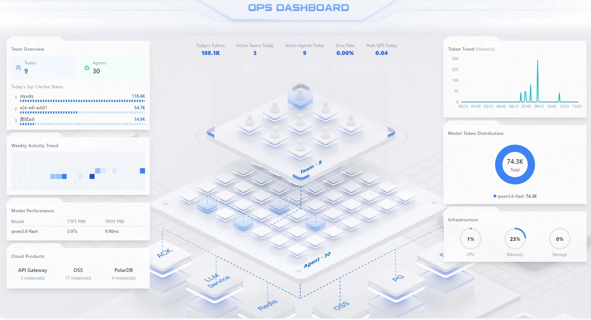
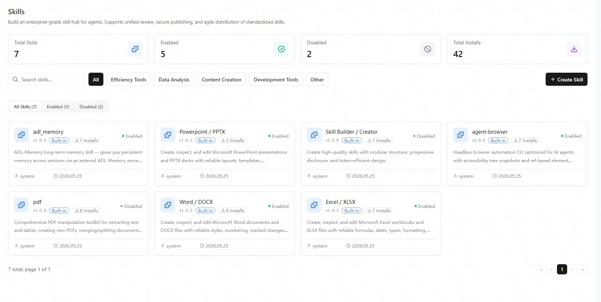
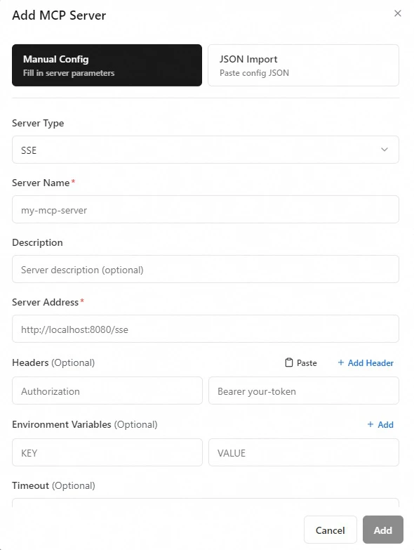
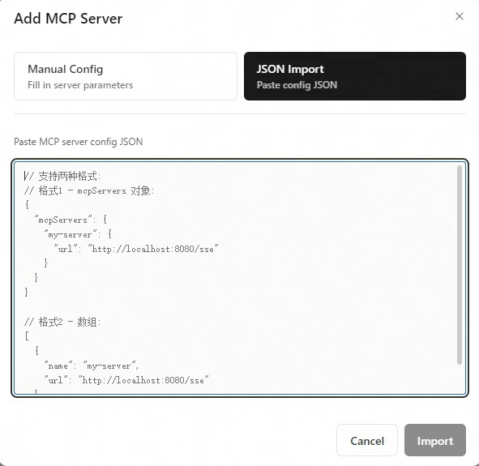
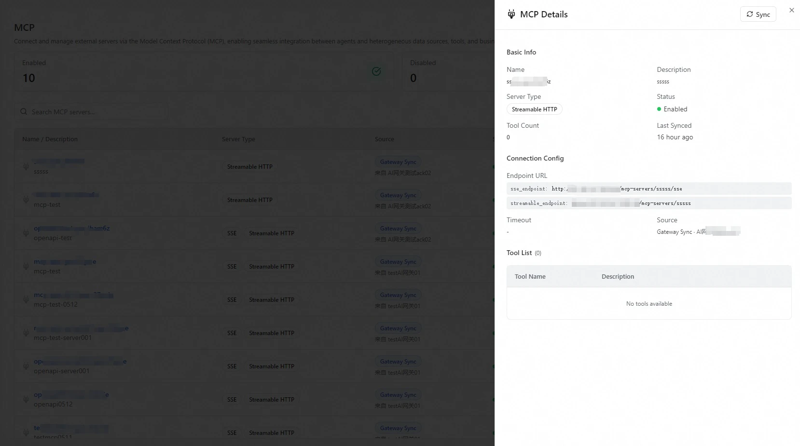
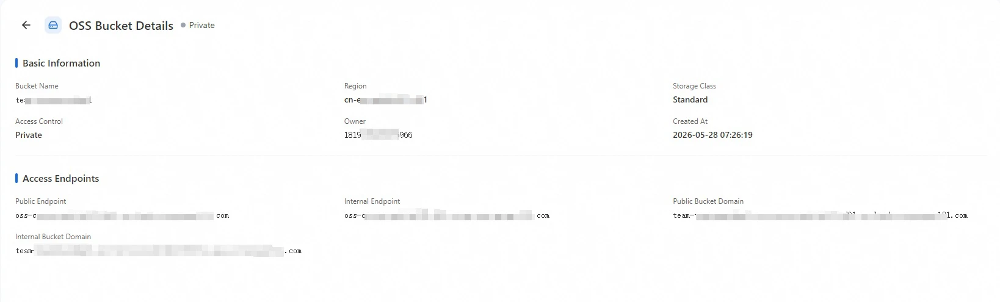
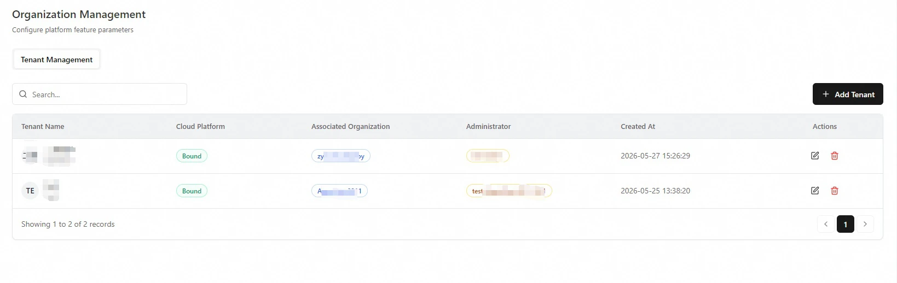
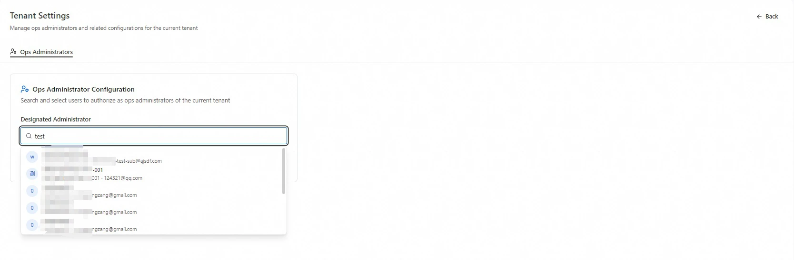

Alibaba Cloud  
Apsara Stack  
OpenTrek-Ops User Guide  
Product Version: V3.18.6  
Document Version: 20260630

**Table of Contents**

- [1.Overview](#section-1)
- [2.Log in to the OpenTrek-Ops platform](#section-2)
- [3.Operation overview](#section-3)
- [4.Operation Center](#section-4)
    - [4.1. Agent management](#section-4-1)
    - [4.2. Agent team](#section-4-2)
    - [4.3. Operation history](#section-4-3)
- [5.Asset Center](#section-5)
    - [5.1. Skills](#section-5-1)
    - [5.2. MCP](#section-5-2)
    - [5.3. Agent Infra](#section-5-3)
- [6.System Settings](#section-6)
    - [6.1. Organization management](#section-6-1)
    - [6.2. Platform management](#section-6-2)
- [7.Multi-tenant management](#section-7)
- [8.AI Assistant](#section-8)
- [9.FAQ](#section-9)

# 1.Overview

This topic describes the features and usage of the OpenTrek-Ops platform.

OpenTrek-Ops is a multi-agent operations and governance platform based on the xClaw, providing full lifecycle management capabilities for enterprise-grade AI agents. The platform delivers an all-in-one solution for operations teams by focusing on agent creation, deployment, monitoring, collaboration, and governance.

**Product architecture**

OpenTrek-Ops divides operations management into three layers: agent operations, skill asset operations, and infrastructure operations. The platform accumulates operations experience and collects data across these three layers. It then aggregates the operations data into a unified governance center to perform integrated analysis and comprehensive processing.

OpenTrek-Ops provides a unified operations portal and a single operations entry point to deliver a consistent operations experience for users. The platform integrates with various infrastructure services, including LLM Service, Redis, OSS, and PostgreSQL. It also exposes data from the operations system to third-party systems through APIs.

**Scenarios**

OpenTrek-Ops applies to the following scenarios:

- **AI operations automation**: The platform automates the execution of operational tasks through agents to reduce manual operation costs.

- **Multi-agent collaboration**: Users build agent teams to enable multi-role collaboration in complex operations scenarios.

- **Skill asset management**: The platform manages, reviews, and distributes agent skills in a unified manner to enable capability reuse.

- **Ops governance**: OpenTrek-Ops comprehensively monitors agent running status, token consumption, and error rates.

**Prerequisites**

- You have obtained the access URL, username, and password of the OpenTrek-Ops platform from the administrator.

- We recommend that you use the Chrome browser.

**User roles**

User roles provide different operation permissions for different users. The system creates the system administrator, tenant administrator, and regular user roles by default during initialization. The permissions are as follows:

| Role | Permission description |
| --- | --- |
| System administrator | Manages the Ops operations of the platform, including agent management, agent team management, skill management, and tenant management. |
| Tenant administrator | Manages agents and skills within the scope of the affiliated tenant. |
| Regular user | Performs basic operations such as creating agents and using skills. |

# 2.Log in to the OpenTrek-Ops platform

**Log in and log out**

This topic describes how users log in to and log out of the OpenTrek-Ops platform.

**Scenarios**

Logging in and logging out are basic operations for using the OpenTrek-Ops platform, applicable to the following scenarios:

- Ops personnel access the platform daily to perform routine operations.

- Administrators configure and manage the system.

- Users securely log out of the system after completing their operations.

**Prerequisites**

- You have obtained the endpoint, username, and password of the OpenTrek-Ops platform from the administrator.

- The administrator provides the endpoint of the OpenTrek-Ops platform.

- We recommend that you use the Chrome browser.

**Procedure**

1. Open a browser.

2. In the address bar, enter the endpoint of the OpenTrek-Ops platform and press Enter.

3. Enter the correct username and password.

   > **Note**
   >
   > - Obtain the username and password for logging in to the OpenTrek-Ops platform from the administrator.
   >
   > - If you enter an incorrect password multiple times in a row, the system enables the verification code login feature. If the number of consecutive incorrect attempts reaches the upper limit, the system locks the account. Contact the administrator to unlock the account.
   >
   > - When you log in to the OpenTrek-Ops platform for the first time, the system may require you to change the initial password. Follow the prompts to change the password. To improve security, the password must meet the following requirements:
   >
   >   - The password must contain uppercase and lowercase English letters.
   >
   >   - The password must contain Arabic numerals (0 to 9).
   >
   >   - The password must contain special characters.
   >
   >   - The password must be 10 to 20 characters in length.

4. Click **Log In**.

**Log out of the system**

1. In the upper-left corner of the page, click the username.

2. In the dialog box, click **Sign Out**.

# 3.Operation overview

This topic describes the features and metrics of the Overview page in the OpenTrek-Ops platform.

**Scenarios**

Operation Overview is the homepage dashboard of the platform, applicable to the following scenarios:

- Perform daily operations inspections to quickly understand the overall health status of the platform.

- Monitor the running trends of agents and token consumption to evaluate resource usage efficiency.

- View model performance metrics to analyze the response time and processing capacity of different models.

- Monitor the infrastructure status to promptly discover and troubleshoot service exceptions.

**Prerequisites**

You have logged in to the OpenTrek-Ops platform as a tenant administrator.

**Procedure**

1. Log in to the OpenTrek-Ops platform.

   After a successful login, the system directs you to the **Overview** page by default.

   

2. On the **Overview** page, you can view the following core modules:

   | Module name | Description |
   | --- | --- |
   | Team Overview | • Displays the statistics on the number of teams and agents. • Today's Top 5 Active Teams Displays a list of the top five teams by activity. |
   | Weekly Activity Trend | Displays the activity trend over the last seven days. |
   | Model Performance | Displays the TTFT P99 and TPOT P99 performance metrics for each model. |
   | Cloud Products | Displays the number of instances for API Gateway, Object Storage Service (OSS), PolarDB, and Alibaba Cloud Container Service for Kubernetes (ACK). |
   | Token Trend | Displays the time trend of token consumption in a line chart.When you move the pointer over the line chart, the system displays the total token data for the corresponding point in time. |
   | Model Token Distribution | Displays the token usage distribution of different models. |
   | Infrastructure | Displays the utilization of CPU, memory, and storage. |
   | Central dashboard | • Displays the running status of infrastructure such as ACK, LLM Service, Redis, OSS, and PG. Blue indicates that the service is normal. • Today's Tokens Displays the total token consumption for the current day. • Active Teams Today Displays the number of active teams for the current day. • Active Agents Today Displays the number of active agents for the current day. • Error Rate Displays the error rate metric for current requests. • Peak QPS Today Displays the peak QPS for the current day. |

**Next steps**

After obtaining the operation overview information as required, you can use agent management to view and manage the details of agents.

# 4.Operation Center

## 4.1. Agent management

This topic describes how to manage agents in the OpenTrek-Ops platform. You can create, view, edit, start, stop, scale, and delete agents.

**Scenarios**

Agent management is a core feature of the platform, applicable to the following scenarios:

- Create new operations agents to automate specific operational tasks.

- Manage the configuration and running status of existing agents to ensure that the agents run normally.

- Allocate and manage agent resources for different teams to optimize resource allocation.

- View agent execution records to analyze agent performance and troubleshoot issues.

**Prerequisites**

- You have logged in to the OpenTrek-Ops platform.

- You have the tenant administrator role or a role with agent creation permissions.

**Procedure**

1. Log in to the OpenTrek-Ops platform.

2. In the left-side navigation pane, select **Ops Center** > **Agent Management**.

   On the **Agent Management** page, you can obtain the following information:

   - View the total number of agents.

   - Use the search box to search for a target agent by agent name.

   - Use the **All Creators** drop-down list to filter the agent list by creator.

   - Use the **All Statuses** drop-down list to filter the agent list by status.

   - Use the **All Teams** drop-down list to filter the agent list by team.

   - Click the view switch button to switch between the grid view and the list view.

   - Click the refresh button to refresh the agent list data.

   - View agent cards, which display information such as the agent icon, name, type label, team, creator, and running status.

3. Create an agent.

   <ol type="i">

   <li>

   On the **Agent Management** page, click the **Create Agent** button.

   </li>

   <li>

   In the creation form that appears, fill in the following information:

   Module

   **Parameter**

   **Required**

   **Description**

   The display name of the agent. We recommend

   Name

   Yes

   that you use a meaningful name.

   Select an agent type. The system supports two

   Type

   Yes

   types: QwenPaw and OpenCL.

   Team

   Yes

   The team to which the agent belongs.

   Basic Info

   Description

   No

   The feature description of the agent.

   Select the professional or the standard edition.

   - The professional edition provides comprehensive capabilities, including powerful memory services, scaling, and full-stack observability.

   Edition

   Yes

   - The standard edition provides limited capabilities. This edition supports basic operations features and does not ensure high availability.

   Persona

   No

   The persona traits.

   Persona

   Behavior

   No

   The behavior boundaries.

   Boundary

   Click **Add Skill**. After you select a skill, click **Confirm**.

   Skill

   > **Note**

   Configurati

   /

   No

   on

   > Before you add a skill, make sure that you created the skill on the **Assets** > **Skills** tab.

   Enable DingTalk or DingTalk Hybrid.

   > **Note**
   >
   > Before you configure channels, make sure that you enabled the channel in **System**

   Channel

   > **Settings** > **Channel Management**.

   /

   No

   Settings

   </li>

   <li>

   After you fill in the information, click the **Create** button.

   </li>

   </ol>

   After creation, the system displays the new agent in the agent list.

4. View agent details.

   - On the **Agent Management** page, find and click the card of the target agent to go to the agent details page.

   - On the agent details page, you can view the following information:

     - Basic Info: name, type, description, and creation time.

     - Running status: running or stopped.

     - Configuration information: operation configuration parameters of the agent, such as the overview, persona, skills, MCP, cloud resources, channels, metrics, trace, and topology.

     - Operational logs: historical execution records of the agent. You can view historical tasks and logs.

**Related operations**

| Operation type | Procedure |
| --- | --- |
| Edit an agent | 1. Find the target agent in the agent list. 2. Click the agent card to go to the agent details page. 3. In the <strong>Basic Info</strong> section, edit <strong>Primary Model</strong> as needed. 4. In the lower part of the details page, click the <strong>Persona</strong>, <strong>Skills</strong>, and <strong>Channels</strong> tabs to edit the related information. |
| Start or stop an agent | 1. Find the target agent in the agent list and click the agent card to go to the details page. 2. In the upper-right corner of the details page, click <strong>More</strong>, and then select <strong>Start</strong> or <strong>Stop</strong>. 3. After you confirm the operation, the system updates the agent status. |
| Restart an agent | 1. Find the target agent in the agent list and click the agent card to go to the details page. 2. In the upper-right corner of the details page, click <strong>More</strong>, and then select <strong>Restart</strong>. 3. After you confirm the operation, the system updates the agent status. |
| Delete an agent | Note Before you delete an agent, make sure that the agent is in the stopped status. 1. Find the target agent in the agent list and click the agent card to go to the details page. 2. In the upper-right corner of the details page, click <strong>More</strong>, and then select <strong>Delete</strong>. 3. In the confirmation dialog box that appears, click <strong>Delete</strong>. 4. After deletion, the system removes the agent from the list. |
| Scale an agent | 1. Find the target agent in the agent list and click the agent card to go to the details page. 2. In the upper-right corner of the details page, click <strong>More</strong>, and then select <strong>Scale</strong>. 3. In the <strong>Adjust Resources</strong> dialog box, preview the current configuration information, and then configure the CPU and memory. 4. Click <strong>Apply</strong>. During the scaling process, the agent status changes to <strong>Changing</strong>. You can view the scaling task details on the <strong>Operation</strong> <strong>History</strong> page. |
| Update an agent | 1. Find the target agent in the agent list and click the agent card to go to the details page. 2. In the upper-right corner of the details page, click <strong>More</strong>, and then select <strong>Update</strong> to upgrade the agent. Note When the agent image is the latest version, the system dims and disables the Update button. |
| Chat with an agent | 1. Find the target agent in the agent list and click the agent card to go to the details page. 2. In the upper-right corner of the details page, click <strong>Chat</strong> to go to the OpenClaw<strong> Chat</strong> page. Note For more information, see the OpenClaw guide. |

**Next steps**

After creating an agent, you can add the agent to an agent team for collaboration.

## 4.2. Agent team

This topic describes how to manage agent teams in the OpenTrek-Ops platform. You can create teams and manage team members.

**Scenarios**

The agent team feature applies to the following scenarios:

- Build a multi-role operations team to enable seamless collaboration on complex operational tasks.

- Manage the team member agents and permissions to ensure effective management of team members.

- Coordinate task assignment for agents within the team to improve team collaboration efficiency.

- Form a dedicated operations team for a specific project or business scenario.

**Prerequisites**

- You have logged in to the OpenTrek-Ops platform.

- You obtained the tenant administrator role or a role with the permission to create agent teams.

**Procedure**

1. Log in to the OpenTrek-Ops platform.

2. In the left-side navigation pane, choose **Ops Center** > **Agent Team**.

   On the **Agent Team** page, you can obtain the following information:

   - Use the search box to search for a target team by team name.

   - Click the **Create Team** button to create an agent team.

   - View a team card, which displays information such as the team name, the number of members, and the creator.

   - Click a team card to go to the team details page and view the member list.

3. Create a team.

   <ol type="i">

   <li>

   On the **Agent Team** page, click the **Create Team** button.

   </li>

   <li>

   Fill in the following information in the creation form that appears:

   </li>

   </ol>

   | Parameter | Required | Description |
   | --- | --- | --- |
   | Team Name | Yes | The display name of the team. We recommend that you enter a meaningful name. |
   | Description | No | The responsibilities and goals of the team. |
   | Organization | Yes | The organization to which the team belongs. |
   | K8S Cluster | No | Select a Kubernetes cluster. |
   | Model Service | Yes | Select at least one text generation model. |
   | Runtime Storage | Yes | This feature is enabled by default. |
   | Memory Service | No | This feature is disabled by default. If you enable this feature, select at least one text vectorization model. |
   | Team Member Settings | No | Configure the <strong>Team Admin</strong> and <strong>Team</strong> <strong>Members</strong>. • Team Admin: This role has full management permissions for the team, including members, resources, and configurations. • Team Members: This role can use resources such as agents, skills, and tools under the team. |

   <ol type="i" start="3">

   <li>

   Click the **Create Team** button to complete the creation.

   </li>

   </ol>

4. Manage team members.

   <ol type="i">

   <li>

   Add a member:

   <ol type="a">

   <li>

   Click **Enter** in the lower-right corner of the target team card to go to the details page.

   </li>

   <li>

   On the **Agent** tab, click **Create Agent**. You can refer to Agent management to add an agent.

   </li>

   </ol>

   <ol type="i" start="100">

   <li>

   Click **Create** to complete the addition.

   </li>

   </ol>

   </li>

   <li>

   Remove a member:

   <ol type="a">

   <li>

   Find the target agent in the team member list.

   </li>

   <li>

   Click the icon in the **Operation** column of the member to complete the operation.

   </li>

   </ol>

   </li>

   </ol>

5. Add a skill.

   On the team details page, click the **Skills** tab and click **Add Skill**. Select a skill and click **Confirm** to add the skill to the team.

6. Add an MCP server.

   On the team details page, click the **MCP** tab and click **Add MCP**. Select an MCP service and click **Add to Team** to add the MCP server to the team.

7. Add a cloud resource.

   On the team details page, click the **Cloud Resource** tab. On the **Model Services** tab, click **Add Resource**. Select a model and click **Save** to bind the model to the team.

8. Perform trace analysis.

   On the team details page, click the **Trace Analysis** tab to view all trace records under the team. Click a trace ID to view the details.

**Related operations**

**Edit a team**

1. On the **Agent Team** page, select the target team and click **Enter** in the lower-right corner of the team card.

2. Click **Edit** in the upper-right corner of the page to edit the **Team Name**, **Description**, **Model Service**, and **Team Members**.

3. Click **Save**.

**Delete a team**

> **Note**
>
> Before you delete a team, make sure that you clean up all agents under the team.

1. On the **Agent Team** page, select the target team and click **Enter** in the lower-right corner of the team card.

2. Click **Delete** in the upper-right corner of the page, and then click **Confirm Delete**.

   > **Warning**
   >
   > The delete operation is irreversible. Proceed with caution.

**Batch operations**

1. On the **Agent Team** page, select the target team and click **Enter** in the lower-right corner of the team card.

2. Click **Batch Operations** in the upper-right corner of the page.

   - Agent operations

     <ol type="a">

     <li>

     In the batch operation dialog box, select **Agent Ops**, and then select a specific operation.

     | Operation type | Detailed steps |
     | --- | --- |
     | Update agent version | a. Select <strong>Update Agent Version</strong>. b. Select the runtime and version. |
     | Resize specification | a. Select <strong>Resize Spec</strong>. b. Set the target specification. You can select a recommended specification or customize a specification. |
     | Restart | Select <strong>Restart</strong>. |
     | Start | Select <strong>Start</strong>. |
     | Stop | Select <strong>Stop</strong>. |
     | Go offline | Select <strong>Offline</strong>. |

     </li>

     <li>

     Click **Select Agent**. In the **Select Agent** dialog box, select the agents and click **Confirm Selection**.

     </li>

     </ol>

     <ol type="i" start="100">

     <li>

     Select the execution mode.

     - Full Execution

       The system executes the operation on all agents simultaneously.

     - Batch Execution

       Set the number of batches. The system executes the operation in batches.

     </li>

     <li value="500">

     Click **Confirm**.

     The interface indicates that the system submitted the batch operation. You can view the batch operation details on the **Operation History** page.

     </li>

     </ol>

   - Skill operations

     <ol type="a">

     <li>

     In the batch operation dialog box, select **Skill Ops**.

     </li>

     <li>

     Select a specific operation. The system supports batch **Sync Skill**, **Disable Skill**, and **Remove Skill**.

     </li>

     </ol>

     <ol type="i" start="100">

     <li>

     Select the skills to execute.

     </li>

     <li value="500">

     Click **Select Agent**. In the **Select Agent** dialog box, select the agents and click **Confirm Selection**.

     </li>

     </ol>

     <ol type="a" start="5">

     <li>

     Select the execution mode.

     - Full Execution

       The system executes the operation on all agents simultaneously.

     - Batch Execution

       Set the number of batches. The system executes the operation in batches.

     </li>

     <li>

     Click **Confirm**.

     The interface indicates that the system submitted the batch operation. You can view the batch operation details on the **Operation History** page.

     </li>

     </ol>

   - Configuration update

     <ol type="a">

     <li>

     In the batch operation dialog box, select **Config Update**.

     </li>

     <li>

     Select **Update Model**.

     </li>

     </ol>

     <ol type="i" start="100">

     <li>

     Select the target model.

     </li>

     <li value="500">

     Click **Select Agent**. In the **Select Agent** dialog box, select the agents and click **Confirm Selection**.

     </li>

     </ol>

     <ol type="a" start="5">

     <li>

     Select the execution mode.

     - Full Execution

       The system executes the operation on all agents simultaneously.

     - Batch Execution

       Set the number of batches. The system executes the operation in batches.

     </li>

     <li>

     Click **Confirm**.

     The interface indicates that the system submitted the batch operation. You can view the batch operation details on the **Operation History** page.

     </li>

     </ol>

**Next steps**

After creating a team, you can assign skills to the team to enable team collaboration.

## 4.3. Operation history

This topic describes how to view the operation history of agents and teams.

**Scenarios**

After performing Ops operations on agents, such as restart, upgrade, scaling, and skill synchronization, you can view the execution status and results on the Operation History page.

**Prerequisites**

- You have logged in to the OpenTrek-Ops platform.

- You have the tenant administrator role or a role with the permission to create agent teams.

**Procedure**

1. Log in to the OpenTrek-Ops platform.

2. In the left-side navigation pane, choose **Ops Center** > **Change History** to go to the **Operation History** page.

3. On the **Operation History** page, you can view the following information:

   - Statistics cards: The top of the page displays four statistical metrics: **Total Changes**, **Success** operations, **Failed/Partial** operations, and **Running** operations.

   - Operation record list: The system displays all operation records in a table.

4. View operation details.

   In the operation record list, click the operation type in the target row to view the detailed history of the operation.

   You can view the operation details, start time, end time, target team, target agent, and batch policy.

5. View the agent execution results of batch operations.

   For batch operations, you can view the **Batch policy** and the total number of agents in the operation details drawer.

6. Search for and filter operation records.

   - Use the search box to search for records by operator, operation type, or operation details.

   - Use the filter box to filter records by status, operation type, team name, or agent name.

7. Refresh data.

   Click **Refresh** to manually trigger a data refresh.

**Parameter description**

The operation record list contains the following fields:

| Field | Description |
| --- | --- |
| Change Type | The system displays the icon and Chinese label of the operation type, with different colors for different types. |
| Operator | The name of the user who performed the operation. |
| Target Team | The list of target teams. |
| Target Agent | The list of target agents. |
| Status | The execution status of the operation, including Success, Failed, Running, and Pending. |
| Time | The timestamp when the operation started. |
| Duration | The execution duration of the operation. The system dynamically updates the duration for running operations. |

# 5.Asset Center

## 5.1. Skills

This topic describes how to manage skills in the OpenTrek-Ops platform. The operations include creating, enabling, disabling, and viewing skills.

**Scenarios**

The skill management feature applies to the following scenarios:

- Manage and publish skills for agents in a unified manner to standardize capabilities.

- Review the security and compliance of skills to ensure skill quality.

- Encapsulate common capabilities into skills for multiple agents to reuse, improving development efficiency.

- Manage the version and lifecycle of skills to achieve continuous iteration and optimization.

**Prerequisites**

- You have logged in to the OpenTrek-Ops platform.

- You have the tenant administrator role or a role with the skill creation permission.

**Procedure**

1. Log in to the OpenTrek-Ops platform.

2. In the left-side navigation pane, choose **Asses**>**Skills**.

   On the **Skills** page, you can obtain the following information:

   

   - View the total number of skills, the number of enabled skills, the number of disabled skills, and the total number of installations.

   - Use the search box to search for a target skill by skill name.

   - Use the category filter to filter skills by All, Efficiency Tools, Data Analysis, Content Creation, Development Tools, or Other.

   - Click **Create Skill** to create a new skill.

   - View skill cards. which display information such as the skill icon, name, description, version number, update time, and enablement status.

3. Create a skill.

   > **Note**
   >
   > The system provides the following built-in skills: Word/DOCX, PDF, ADL_memory, Excel/XLSX, agent-browser, Skill Builder/Creator, and PowerPoint/PPTX. It also supports custom skill creation.

   <ol type="i">

   <li>

   On the **Skills** page, click **Create Skill**.

   </li>

   <li>

   Fill in the following information in the creation form:

   </li>

   </ol>

   | Parameter | Required | Description |
   | --- | --- | --- |
   | Upload Skill Package | Yes | Upload a prepared skill package. The package must be a .zip file that contains a skill.md file in the root directory. The skill.md file must include the name and description in YAML format. Important The size of a single skill file cannot exceed 10 MB. If the file exceeds this limit, compress the file or split it into multiple skills. |
   | Skill Name | No | The system uses the name in the skill.md file by default. You can modify the name. |
   | Skill Description | No | The system uses the description in the skill.md file by default. You can modify the description. |
   | Tags | No | Select a category for the skill. The system supports Efficiency Tools, Data Analysis, Content Creation, Development Tools, and Other. |

   <ol type="i" start="3">

   <li>

   After the system uploads the skill package, click **Create Skill**.

   </li>

   </ol>

4. Enable or disable a skill.

   > **Note**
   >
   > If you disable a skill, agents that have installed it cannot call it anymore.

   <ol type="i">

   <li>

   Find the target skill in the skill list and click the card to go to the skill details page.

   </li>

   <li>

   Click **Enable** or **Disable** in the upper-right corner of the details page.

   </li>

   <li>

   The system updates the status after you confirm the operation.

   </li>

   </ol>

5. Delete a skill.

   > **Note**
   >
   > You cannot delete system built-in skills.

   - Find the target skill in the skill list and click the card to go to the skill details page. Click **Delete**, and then click **Confirm Delete** in the dialog box.

   - Or click the **Delete** icon in the upper-right corner of the skill card, and then click **Confirm Delete** in the dialog box.

6. Update the version.

   <ol type="i">

   <li>

   Click the target skill card in the skill list.

   </li>

   <li>

   Click **Update Version** in the upper-right corner of the skill details page.

   </li>

   <li>

   Upload the new version file in the update version dialog box. The system automatically

   </li>

   </ol>

   performs a security scan and completes the update.

   <ol type="i" start="4">

   <li>

   Click **Start Update**.

   </li>

   </ol>

7. View skill details.

   <ol type="i">

   <li>

   Click the target skill card in the skill list.

   </li>

   <li>

   Go to the skill details page to view the following information:

   - Basic information: the name, category, description, and version.

   - Skill configuration: the detailed configuration parameters of the skill.

   - Usage records: the records of agents calling the skill, version upgrade details, and security information.

   </li>

   </ol>

**Next steps**

After creating and enabling a skill, you can install and use the skill in an agent.

## 5.2. MCP

This topic describes how to manage Model Context Protocol (MCP) servers in the OpenTrek-Ops platform, including adding, editing, enabling, disabling, and deleting MCP servers. The platform uses the standardized MCP to connect to and manage various external servers. This enables seamless integration and collaboration between agents and heterogeneous data sources, tools, and business systems.

**Scenarios**

In the OpenTrek-Ops platform, users manage the full lifecycle of MCP configurations in the asset center. This includes creating, editing, deleting, and managing versions of MCP configurations. This section applies to the following scenarios:

- Manage MCP servers in a unified manner to integrate agents with external systems.

- Configure MCP server connection parameters to ensure that agents can access external tools and services.

- Manage the lifecycle of MCP servers, including creating, editing, enabling, disabling, and deleting servers.

**Prerequisites**

- The current user has logged in to the OpenTrek-Ops platform.

- The current user has the permissions to access MCP management in the asset center.

**Procedure**

1. Log on to the OpenTrek-Ops platform.

2. In the left-side navigation pane, choose **Assets** > **MCP**.

   On the **MCP** page, you can obtain the following information:

   - View the numbers of enabled and disabled MCP servers.

   - Use the search box to find target MCP servers.

   - View the MCP list, which includes the name, description, server type, source, status, and number of tools.

3. Add an MCP server.

   You can add an MCP server by using manual configuration, JSON import, or AI gateway synchronization.

   - **Method 1: Manual configuration**

     <ol type="a">

     <li>

     On the **MCP** page, click **Add MCP**.

     </li>

     <li>

     On the **Manual Config** tab, configure the following parameters:

     

     | Parameter | Required | Description |
     | --- | --- | --- |
     | Server Type | Yes | Select a server type: • SSE • Streamable HTTP • STDIO |
     | Server Name | Yes | Enter a server name. |
     | Description | No | Optional. Add a description. |
     | Server Address | Yes | Enter the server endpoint, such as http://localhost:8080/sse. |
     | Headers | No | • Add headers directly. You can add multiple headers. • Click <strong>Paste</strong>. Paste headers in the Header:Value or Header=Value format with one header per line. Then, click <strong>Parse</strong>. |
     | Environment Variables | No | Add environment variables. |
     | Timeout | No | Specify the timeout period for connection, tool list retrieval, and tool invocation. Valid range: 1-600 seconds. Default: 30 seconds. |

     </li>

     </ol>

     <ol type="i" start="100">

     <li>

     Click **Add**. The system sets the status of the added server to **Enabled**.

     </li>

     </ol>

   - **Method 2: JSON import**

     <ol type="a">

     <li>

     On the **MCP** page, click **Add MCP**.

     </li>

     <li>

     In the **Add MCP Server** dialog box, click **JSON Import**.

     </li>

     </ol>

     <ol type="i" start="100">

     <li>

     Paste the MCP server configuration JSON string into the input box.

     

     </li>

     <li value="500">

     Click **Import**. The system sets the status of the imported server to **Enabled**.

     </li>

     </ol>

   - **Method 3: Gateway import**

     After importing an AI gateway, you can use the **Sync Gateway** operation to automatically import the **MCP configurations** associated with the AI gateway. For more information, see Synchronize a gateway.

4. View MCP details.

   In the server list, click a server name to view the basic info, connection config, and tool list of the server:

   

   - Basic info

     View the name, description, server type, status, tool count, and last synchronization status of the server.

   - Connection config

     View the server endpoint URL, timeout, and source.

   - Tool list

     View detailed tool names and descriptions.

5. Disable or enable an MCP server.

   - For a server in the **Enabled** status, click the disable icon in the **Actions** column of the target server.

   - For a server in the **Disabled** status, click the enable icon in the **Actions** column of the target server.

6. Edit an MCP server.

   > **Note**
   >
   > You cannot edit servers imported from a gateway.

   Click **Edit** in the **Actions** column of the target server. In the **Edit MCP Server** dialog box, modify the **Description**, **Server Address**, **Headers**, **Environment Variables**, and **Timeout**.

7. Delete an MCP server.

   Click **Delete** in the **Actions** column of the target server. In the **Confirm Delete** dialog box, click **Delete**.

   > **Important**
   >
   > This operation is irreversible. Proceed with caution.

## 5.3. Agent Infra

This topic describes the features and configurations of the Agent Infra module in the OpenTrek-Ops platform.

**Scenarios**

The Agent Infra feature applies to the following scenarios:

- Manage the infrastructure services that the agent depends on to ensure the stability of the agent runtime environment.

- Monitor the infrastructure status to detect and troubleshoot service faults promptly.

- Configure the infrastructure connection parameters to optimize service performance and resource utilization.

- Manage the integration and configuration of underlying services such as LLM Service, Redis, Object Storage Service (OSS), and PostgreSQL.

**Prerequisites**

You have logged in to the OpenTrek-Ops platform as a tenant administrator.

**Procedure**

1. Log in to the OpenTrek-Ops platform.

2. In the left-side navigation pane, choose **Assets**>**Agent Infra**.

   On the **Agent Infra** page, you can obtain the following information:

   View information such as the names and types of model services, Kubernetes clusters, AI gateways, and data storage infrastructure.

3. Model services

   - Add a model

     <ol type="a">

     <li>

     On the **Model Services** tab, click **Add Model** and configure the following parameters:

     | Parameter | Required | Description |
     | --- | --- | --- |
     | Model ID | Yes | Enter the identifier for model API calls, such as gpt-4-turbo. |
     | Display Name | Yes | Enter the display name of the model, such as GPT-4 Turbo. |
     | Provider | Yes | Select a provider. The system currently supports Alibaba Cloud. |
     | Protocol | Yes | Select a protocol. |
     | Inference Type | Yes | Select <strong>Text Generation</strong> or <strong>Text Embedding</strong>. |
     | API Key | Yes | Contact Alibaba Cloud technical support to obtain the API key. |
     | API Endpoint | Yes | Contact Alibaba Cloud technical support to obtain the API endpoint. |

     </li>

     <li>

     Click **Confirm**.

     </li>

     </ol>

   - Edit a model

     > **Note**
     >
     > Before you modify the infrastructure configuration, make sure that the modifications do not affect running agent tasks.

     <ol type="a">

     <li>

     Click the edit icon  in the **Actions** column of the target model.

     </li>

     <li>

     Modify the related parameters and click **Save Changes**.

     </li>

     </ol>

   - Remove a model

     <ol type="a">

     <li>

     Click the remove icon  in the **Actions** column of the target model.

     </li>

     <li>

     In the dialog box that appears, click **Delete**.

     </li>

     </ol>

4. Kubernetes clusters

   - Import a cluster

     <ol type="a">

     <li>

     On the **K8S Cluster** tab, click **Import Cluster** and configure the following parameters.

     | Parameter | Required | Description |
     | --- | --- | --- |
     | Cluster | Yes | Select the Kubernetes cluster instance to import. |
     | Agent Service Endpoint | Yes | This endpoint generates the root domain name for agent links. Configure the wildcard DNS record in the DNS console in advance. |
     | Access IP | No | Enter the domain name and port to access the cluster API server. If you leave this parameter empty, the system uses the domain name and port in the default kubeconfig. |
     | ingressClassName | Yes | Select the Ingress type for agent domain name routing. |

     </li>

     <li>

     Click **Import**.

     </li>

     </ol>

   - View details

     Click the name of the target cluster to view details such as the **Basic Info**, **Cluster Info**, **Cluster Resources**, and **Master Nodes** of the cluster.

   - Edit a cluster

     Click the edit icon  in the **Actions** column of the target cluster to modify the **Agent**

     **Service Endpoint**, **Access IP**, and **ingressClassName** of the cluster. After you modify the parameters, click **Save**.

   - Remove a cluster

     Click the remove icon  in the **Actions** column of the target cluster, and then click

     **Remove** in the dialog box.

5. AI gateways

   - Import a gateway

     <ol type="a">

     <li>

     On the **AI Gateway** tab, click **Import Gateway** and configure the following parameters:

     | Parameter | Required | Description |
     | --- | --- | --- |
     | AI Gateway Name | Yes | Select the gateway instance to import. |
     | API Key | Yes | Contact Alibaba Cloud technical support to obtain the API key. |

     </li>

     <li>

     Click **Import**.

     > **Note**
     >
     > If you import an ASCM AI gateway, the system automatically imports the **MCP configuration** and **AI model configuration** associated with the AI gateway after you click **Import**. You can view the configurations on the **MCP** page and the **Agent Infra**>**Model Services** page.

     </li>

     </ol>

   - View details

     Click the name of the target gateway to view details such as the **Basic Information**, **Access Points**, **model API**, and **MCP** of the gateway.

   - Edit a gateway

     Click the edit icon  in the **Actions** column of the target gateway. In the **Edit Higress**

     **Gateway** dialog box, modify the **API Key** and click **Save**.

   - Synchronize a gateway

     Click the synchronize icon  in the **Actions** column of the target gateway, and then click

     **Sync** to synchronize the MCP and AI models for the gateway.

   - Remove a gateway

     Click the remove icon  in the **Actions** column of the target gateway, and then click

     **Remove** in the dialog box.

6. Data storage

   On the **Data Storage** tab, click the instance name to view details such as the **Basic Information** and **Access Endpoints** of the instance.

   

# 6.System Settings

This article describes the functions and configuration methods of the OpenTrek-Ops platform system settings module, including tenant management, cloud platform management, channel management and system configuration four functions.

> **Important**
>
> Please use system administrator login for system setup.

## 6.1. Organization management

This topic describes how to manage tenants in the OpenTrek-Ops platform.

**Scenarios**

The organization/tenant management feature applies to the following scenarios:

- Isolate resources and manage permissions in multi-tenancy environments to ensure independence among different tenants.

- Create dedicated tenants for different departments or business units to enable hierarchical management.

- Manage the tenant lifecycle, including creating, enabling, disabling, and deleting tenants.

- Configure the connection between tenants and the cloud platform to enable unified resource scheduling.

**Prerequisites**

- You have log in to the OpenTrek-Ops platform.

- You have the system administrator permissions.

**Procedure**

1. Log in to the OpenTrek-Ops platform.

2. The system displays the **Organization Management** page by default. On this page, you can view the tenant list, involving the following fields:

   

   | Field | Description |
   | --- | --- |
   | Tenant Name | The display name and identifier of the tenant. |
   | Cloud Platform | Indicates whether the tenant connects to the cloud platform. |
   | Associated Organization | The name of the organization associated with the tenant. |
   | Administrator | The username of the tenant administrator. |
   | Created At | The creation date of the tenant. |
   | Actions | You can edit or delete the tenant. |

3. Add a tenant.

   <ol type="i">

   <li>

   On the **Organization Management** page, click **Add Tenant**.

   </li>

   <li>

   Enter the following information in the pop-up form:

   </li>

   </ol>

   | Parameter | Required | Description |
   | --- | --- | --- |
   | Tenant Name | Yes | The display name of the tenant. |
   | Tenant Code | Yes | The unique identifier of the tenant. It supports only letters, numbers, and hyphens. |
   | Description | No | Enter the description of the tenant. |
   | Connect to cloud Platform | Yes | Select <strong>Yes</strong> or <strong>No</strong>. |
   | Select Organization | Yes | If you select <strong>Yes</strong> for <strong>Connect to Cloud Platform</strong>, select an associated organization. You can select any level-2 organization under the same level-1 organization. Cross-level-1 organization selection is not supported. |
   | Assign Administrators | Yes | If you select <strong>Yes</strong> for<strong> Connect to Cloud Platform</strong>, set tenant administrators. Select one or more users under the selected level-1 organization. |

   <ol type="i" start="3">

   <li>

   Click **Confirm Create** to complete the creation.

   </li>

   </ol>

4. Edit a tenant.

   <ol type="i">

   <li>

   Find the target tenant in the tenant list.

   </li>

   <li>

   Click the edit icon in the **Actions** column to modify configuration information such as the

   </li>

   </ol>

   tenant name and description.

   <ol type="i" start="3">

   <li>

   Click **Save changes** to update the tenant.

   </li>

   </ol>

5. Delete a tenant.

   > **Warning**
   >
   > Deleting a tenant is a high-risk operation. Proceed with caution. The system cannot recover any data under the tenant after deletion.

   <ol type="i">

   <li>

   Find the target tenant in the tenant list.

   </li>

   <li>

   Click the delete icon  in the **Actions** column.

   </li>

   <li>

   Click **Confirm Delete** in the confirmation dialog box. The system removes the tenant

   </li>

   </ol>

   from the list after a successful deletion.

**Next steps**

Log in as the created tenant administrator to perform initial tenant configuration. This includes registering model services and importing Kubernetes clusters. For more information, see Agent Infra.

> **Note**
>
> When you log in for the first time, the system prompts you to initialize the password. Follow the prompts to set a new password and store it securely.

## 6.2. Platform management

This topic describes how to manage cloud platform configurations in the OpenTrek-Ops platform.

**Scenarios**

The cloud platform management feature applies to the following scenarios:

- Configure and manage cloud platform resources and notification channels connected to the OpenTrek-Ops platform. Configure the push targets for agent running statuses and for alert messages.

- Implement unified management and resource scheduling in a multi-cloud platform environment.

- Enable real-time push notifications for O&M messages to ensure that Ops personnel obtain key information promptly.

- Configure multiple notification channels, such as DingTalk, email, and SMS, to meet the notification requirements of different scenarios.

- Manage cloud platform connection information and authentication credentials to ensure the stability of data interoperability.

**Prerequisites**

- You have logged in to the OpenTrek-Ops platform.

- You have the system administrator permissions.

**Cloud platform management**

1. Log in to the OpenTrek-Ops platform.

2. In the left-side navigation pane, choose **System Settings** > **Platform**.

3. On the **Platform Management** page, click **Cloud Platforms**.

   On the cloud platform management page, you can view the list of configured cloud platforms.

4. Add a cloud platform configuration.

   <ol type="i">

   <li>

   On the cloud platform management page, click **Add Cloud Platform**.

   </li>

   <li>

   In the form that appears, enter the cloud platform connection information.

   </li>

   </ol>

   <table>
     <tr>
       <th>Field</th>
       <th>Required</th>
       <th>Description</th>
     </tr>
     <tr>
       <td>Platform Name</td>
       <td>Yes</td>
       <td>The custom name. We recommend that you enter a meaningful name.</td>
     </tr>
     <tr>
       <td>Platform Code</td>
       <td>Yes</td>
       <td>The unique identifier of the platform.</td>
     </tr>
     <tr>
       <td>Cloud Vendor</td>
       <td>Yes</td>
       <td>The default value is Alibaba Cloud Apsara Stack.</td>
     </tr>
     <tr>
       <td>Cloud Platform OpenAPI Endpoint</td>
       <td>Yes</td>
       <td>The ASCM OpenAPI domain name. Contact Alibaba Cloud technical support to obtain the domain name.</td>
     </tr>
     <tr>
       <td>Access Key (AK)</td>
       <td>Yes</td>
       <td rowspan="2">a. Log in to the Apsara Uni-Manager Management Console as the admin user. b. Click theicon in the upper-right corner and select <strong>Personal Information</strong>. c. View the Accesskey (AK) and AccessKey Secret (SK) of the admin user.</td>
     </tr>
     <tr>
       <td>Secret Key (SK)</td>
       <td>Yes</td>
     </tr>
     <tr>
       <td>Enable Network Proxy</td>
       <td>No</td>
       <td>The system disables the network proxy by default.</td>
     </tr>
   </table>

   <ol type="i" start="3">

   <li>

   Click **Confirm Create** to complete the creation.

   </li>

   </ol>

5. Edit a cloud platform configuration.

   Click the edit icon in the **Actions** column of the target cloud platform. You can edit the cloud platform name and the cloud platform OpenAPI endpoint. After you complete the update, click **Confirm Update**.

6. Delete a cloud platform configuration.

   Click the delete icon  in the **Actions** column of the target cloud platform. In the dialog

   box that appears, click **Confirm Delete**.

   > **Warning**
   >
   > The delete operation is irreversible. The system permanently deletes all configurations under the cloud platform. Proceed with caution.

7. Disable or enable a cloud platform.

   Click the disable or enable icon in the **Actions** column of the target cloud platform to complete the operation.

**Channel management**

1. Log in to the OpenTrek-Ops platform.

2. In the left-side navigation pane, choose **System Settings** > **Platform**.

3. On the **Platform Management** page, click **Channels**.

   On the **Channels** page, you can view the list of configured channels.

4. Enable a channel.

   Click the switch in the upper-right corner of the target channel card to enable the channel. After you turn on the switch, the status changes to **Enabled**.

**System configuration**

1. Log in to the OpenTrek-Ops platform.

2. In the left-side navigation pane, choose **System Settings** > **Platform**.

3. On the **Platform Management** page, click **System Configuration**. You can modify the preset configuration item for the skill package size.

4. Click **Edit** in the **Actions** column to modify the configuration value.

   > **Note**
   >
   > The modification takes effect immediately for all tenants. Adjust the value with caution to prevent an oversized skill from affecting the loading performance.

5. Click **Save**.

# 7.Multi-tenant management

This topic describes how to switch and manage tenants.

**Prerequisites**

You have logged in to the OpenTrek-Ops platform as a tenant administrator.

**Procedure**

1. Log in to the OpenTrek-Ops platform.

2. Click the current tenant at the bottom of the left-side menu to switch tenants. The system isolates resources for different tenants to ensure independence.

3. Configure the tenant.

   In the tenant switch dialog, click the settings button  for the target tenant. Enter the

   designated administrator in the input box and authorize the user as the Ops administrators of the current tenant.

   > **Note**
   >
   > Ensure that the tenant administrator added the organization of the selected user to the platform.

   

   Click **Confirm Authorization**, and then click **Back** in the upper-right corner of the page.

# 8.AI Assistant

You can implement automated operations management with the AI Assistant. This topic describes how to use the AI Assistant.

**Procedure**

1. Log in to the OpenTrek-Ops platform.

2. Click the icon in the lower-right corner of the interface to open the AI Assistant.

3. Enter your question in the input box of the AI Assistant and click  .

   - New conversation: Click  above the dialog box to start a new conversation.

   - Conversation history: Click above the dialog box to view the conversation history.

   - Full screen: Click above the dialog box to display the dialog box in full screen.

   - Close conversation: Click above the dialog box to close the AI Assistant.

# 9.FAQ

**Login issues**

**What can I do if I forget my password?**

A: Contact the system administrator to reset the password.

**What do I do if the page is abnormal after I log on to the console?**

A: Please clear the browser cache and log on again, or try to use Chrome browser.

**Agent-related issues**

**Q: Can I not find the required type when I create the agent?**

A: Contact the administrator to check whether the corresponding Agent type plug-in has been installed.

**Q: Why does the Agent fail to start?**

A: Check whether the configuration of the agent is complete and whether the dependent infrastructure services are running properly.

**Skills Related Questions**

**What can I do if a skill cannot be used by agents after it is created?**

A: Make sure that the skill is enabled and the agent has the skill installed.
