Alibaba Cloud  
Apsara Stack  
Database Security Audit User  
Guide  
Product Version: V3.18.6  
Document Version: 20260701

**Table of Contents**

- [1.Usage notes](#section-1)
- [2.Quick start](#section-2)
    - [2.1. User roles and permissions](#section-2-1)
    - [2.2. Log on to the Apsara Uni-manager Management Console](#section-2-2)
    - [2.3. Upgrade instance specifications](#section-2-3)
- [3.Quick deployment guide](#section-3)
    - [3.1. Deploy a Database Security Audit instance](#section-3-1)
    - [3.2. Log in to a Database Security Audit instance in Apsara Stack Security Center](#section-3-2)
    - [3.3. Initialize a Database Security Audit instance](#section-3-3)
        - [3.3.1. Prerequisites](#section-3-3-1)
        - [3.3.2. Add a database instance to be audited](#section-3-3-2)
        - [3.3.3. Deploy an RMAgent](#section-3-3-3)
            - [3.3.3.1. 自动部署](#section-3-3-3-1)
            - [3.3.3.2. Manual deployment on Windows with separated application and database servers](#section-3-3-3-2)
            - [3.3.3.3. Manual deployment on Windows with a combined application and database server](#section-3-3-3-3)
            - [3.3.3.4. Manual deployment on Linux with separated application and database servers](#section-3-3-3-4)
            - [3.3.3.5. Manual deployment on Linux with a combined application and database server](#section-3-3-3-5)
        - [3.3.4. Verify the deployment](#section-3-3-4)
- [4.安全管理员指南](#section-4)
    - [4.1. 概况](#section-4-1)
    - [4.2. Behaviors](#section-4-2)
        - [4.2.1. Risk hits](#section-4-2-1)
        - [4.2.2. Behavior search](#section-4-2-2)
        - [4.2.3. Risk search](#section-4-2-3)
        - [4.2.4. Statistical comparison](#section-4-2-4)
    - [4.3. Applications](#section-4-3)
        - [4.3.1. Application identifies](#section-4-3-1)
        - [4.3.2. Custom application users](#section-4-3-2)
    - [4.4. Models](#section-4-4)
        - [4.4.1. Statement models](#section-4-4-1)
        - [4.4.2. Model configurations](#section-4-4-2)
    - [4.5. Global reports](#section-4-5)
        - [4.5.1. Comprehensive reports](#section-4-5-1)
        - [4.5.2. Compliance reports](#section-4-5-2)
        - [4.5.3. Special reports](#section-4-5-3)
        - [4.5.4. Custom reports](#section-4-5-4)
        - [4.5.5. Report preset](#section-4-5-5)
        - [4.5.6. Scheduled delivery](#section-4-5-6)
        - [4.5.7. Report export](#section-4-5-7)
        - [4.5.8. Recipient management](#section-4-5-8)
    - [4.6. Global rules](#section-4-6)
        - [4.6.1. Virtual patch query](#section-4-6-1)
        - [4.6.2. Manage rules](#section-4-6-2)
            - [4.6.2.1. Injection](#section-4-6-2-1)
            - [4.6.2.2. Operation rules](#section-4-6-2-2)
            - [4.6.2.3. Access rules](#section-4-6-2-3)
            - [4.6.2.4. Password attack rules](#section-4-6-2-4)
        - [4.6.3. Enable rules](#section-4-6-3)
            - [4.6.3.1. Configure associations during rule management](#section-4-6-3-1)
            - [4.6.3.2. Reference and dereference rules](#section-4-6-3-2)
            - [4.6.3.3. Configure priorities](#section-4-6-3-3)
    - [4.7. Configurations](#section-4-7)
        - [4.7.1. Databases](#section-4-7-1)
            - [4.7.1.1. Add a database](#section-4-7-1-1)
            - [4.7.1.2. Edit database information](#section-4-7-1-2)
            - [4.7.1.3. Delete a database](#section-4-7-1-3)
            - [4.7.1.4. Import and export database information](#section-4-7-1-4)
        - [4.7.2. Platform access](#section-4-7-2)
        - [4.7.3. Database groups](#section-4-7-3)
        - [4.7.4. Alert settings](#section-4-7-4)
        - [4.7.5. IP address alias management](#section-4-7-5)
        - [4.7.6. Sensitive data masking](#section-4-7-6)
        - [4.7.7. Group management](#section-4-7-7)
            - [4.7.7.1. IP address groups](#section-4-7-7-1)
            - [4.7.7.2. Database user groups](#section-4-7-7-2)
            - [4.7.7.3. Application user groups](#section-4-7-7-3)
            - [4.7.7.4. Time groups](#section-4-7-7-4)
            - [4.7.7.5. Object groups](#section-4-7-7-5)
            - [4.7.7.6. Operating system user groups](#section-4-7-7-6)
        - [4.7.8. RMAgents](#section-4-7-8)
            - [4.7.8.1. RMAgent management](#section-4-7-8-1)
    - [4.8. 维护](#section-4-8)
        - [4.8.1. 引擎管理](#section-4-8-1)
        - [4.8.2. 数据备份恢复](#section-4-8-2)
            - [4.8.2.1. 设置自动备份](#section-4-8-2-1)
            - [4.8.2.2. 手动备份与恢复](#section-4-8-2-2)
            - [4.8.2.3. 查询备份清单](#section-4-8-2-3)
        - [4.8.3. 自动清理告警与数据](#section-4-8-3)
    - [4.9. Vulnerability scan](#section-4-9)
        - [4.9.1. Vulnerability scan](#section-4-9-1)
        - [4.9.2. Scan policies](#section-4-9-2)
    - [4.10. System](#section-4-10)
        - [4.10.1. Notification management](#section-4-10-1)
            - [4.10.1.1. Email notifications](#section-4-10-1-1)
            - [4.10.1.2. Syslog notifications](#section-4-10-1-2)
            - [4.10.1.3. Cloud SOC notifications](#section-4-10-1-3)
        - [4.10.2. System alerts](#section-4-10-2)
        - [4.10.3. System update](#section-4-10-3)
- [5.Single database configurations and data](#section-5)
    - [5.1. Single database overview](#section-5-1)
        - [5.1.1. View the overview of a database](#section-5-1-1)
    - [5.2. Risks](#section-5-2)
        - [5.2.1. View risk statistics](#section-5-2-1)
        - [5.2.2. View risk hit rules](#section-5-2-2)
        - [5.2.3. Search for risks](#section-5-2-3)
        - [5.2.4. Search for risk templates](#section-5-2-4)
    - [5.3. SQL statements](#section-5-3)
        - [5.3.1. View SQL statistics](#section-5-3-1)
        - [5.3.2. Search for statements](#section-5-3-2)
        - [5.3.3. Search for statement templates](#section-5-3-3)
        - [5.3.4. View failed SQL statements](#section-5-3-4)
        - [5.3.5. Sort and view top SQL statements](#section-5-3-5)
        - [5.3.6. Search for new SQL templates](#section-5-3-6)
        - [5.3.7. View access source statistics](#section-5-3-7)
    - [5.4. Sessions](#section-5-4)
        - [5.4.1. View session statistics](#section-5-4-1)
        - [5.4.2. Retrieve session information](#section-5-4-2)
        - [5.4.3. View login failure information](#section-5-4-3)
        - [5.4.4. View the information about active sessions](#section-5-4-4)
    - [5.5. Reports (single database)](#section-5-5)
        - [5.5.1. Comprehensive reports (single database)](#section-5-5-1)
        - [5.5.2. Compliance reports (single database)](#section-5-5-2)
        - [5.5.3. Special reports (single database)](#section-5-5-3)
        - [5.5.4. Pre-store reports (single database)](#section-5-5-4)
        - [5.5.5. Create and manage scheduled pushing tasks](#section-5-5-5)
    - [5.6. Rules (single database)](#section-5-6)
        - [5.6.1. Enable or disable a virtual patch](#section-5-6-1)
        - [5.6.2. Bind statement templates to a statement rule](#section-5-6-2)
        - [5.6.3. View referenced rule details](#section-5-6-3)
    - [5.7. Single database configurations](#section-5-7)
        - [5.7.1. Configure business-oriented languages](#section-5-7-1)
        - [5.7.2. Configure an engine action](#section-5-7-2)

# 1.Usage notes

Before you log on to Apsara Stack Security Center, you must verify that your computer meets the configuration requirements.

For more information about the configuration requirements, see .

Table 1. Configuration requirements

| Item | Requirement |
| --- | --- |
| Browser | • Internet Explorer: V11 or later • Google Chrome (recommended): V42.0.0 or later • Mozilla Firefox: V30 or later • Safari: V9.0.2 or later |
| Operating system | • Windows XP • Windows 7 or later • macOS |

# 2.Quick start

## 2.1. User roles and permissions

This topic describes the user roles involved in Apsara Stack Security.

All roles in Apsara Stack Security Center are provided by default. You cannot create custom roles. Before you log on to Apsara Stack Security Center, make sure that your account is assigned the required role. For more information, see Default roles in Apsara Stack Security.

Table 1. Default roles in Apsara Stack Security

| Role name | Description |
| --- | --- |
| Organization security administrator | Uses SOC to manage the security of hosts, applications, and networks for an organization. This role also manages security products related to Elastic Compute Service (ECS). |
| Global organization security administrator | Uses SOC to conduct security management for Apsara Stack and all tenants, and manages security products related to ECS. |

If you do not have an account that assumes the required role, contact the administrator to create an account and assign the role to the account. For more information, see the **Create a user** topic in **Apsara Uni-manager Management Console User Guide**.

## 2.2. Log on to the Apsara Uni-manager Management Console

This topic describes how to log on to the Apsara Uni-manager Management Console.

**Prerequisites**

- The URL of the Apsara Uni-manager Management Console is obtained from the deployment personnel before you log on to the Apsara Uni-manager Management Console.

- We recommend that you use the Google Chrome browser.

**Procedure**

1. In the address bar, enter the URL of the Apsara Uni-manager Management Console. Press the Enter key.

2. Enter your username and password.

   Obtain the username and password that you can use to log on to the console from the operations administrator.

   > **Note**
   >
   > When you log on to the Apsara Uni-manager Management Console for the
   >
   > first time, you must change the password of your username. Your password must meet complexity requirements. The password must be 10 to 32 characters in length and must contain at least two of the following character types:
   >
   > - Uppercase or lowercase letters
   >
   > - Digits
   >
   > - Special characters, which include ! @ # $ %

3. Click **Log On**.

4. If your account has multi-factor authentication (MFA) enabled, perform corresponding operations in the following scenarios:

   - It is the first time that you log on to the console after MFA is forcibly enabled by the administrator.

     <ol type="a">

     <li>

     On the Bind Virtual MFA Device page, bind an MFA device.

     </li>

     <li>

     Enter the account and password again as in Step 2 and click **Log On**.

     </li>

     </ol>

     <ol type="i" start="100">

     <li>

     Enter a six-digit MFA verification code and click **Authenticate**.

     </li>

     </ol>

   - You have enabled MFA and bound an MFA device.

     Enter a six-digit MFA authentication code and click **Authenticate**.

     > **Note**
     >
     > For more information, see the **Bind a virtual MFA device to enable**
     >
     > **MFA** topic in **Apsara Uni-manager Operations Console User Guide**.

## 2.3. Upgrade instance specifications

If the current instance cannot meet your business requirements, you can upgrade the instance specifications on the instances page of Database Security Audit. This topic describes how to upgrade instance specifications.

**Procedure**

1. Log in to the Apsara Uni-manager Management Console.

2. In the upper-right corner of the Apsara Uni-manager Management Console, choose **Security** > **Data Security > Database Audit**. On the **Database Audit** page, select a region from the **Region** drop-down list and click **Access with Authorized Role**.

3. In the left-side navigation pane, choose **Database Security Audit**.

4. Find the instance that you want to manage and choose **More** > **Settings** in the **Actions** column.

5. In the **Configure Instance** panel, configure the following parameters and click **OK**.

   > **Important**
   >
   > - You can only upgrade your instance to higher specifications. You cannot roll back the upgrade. Proceed with caution.
   >
   > - The upgrade process involves a downtime during which the instance is stopped and upgraded. The instance is unavailable during the downtime.

   | Parameter | Description |
   | --- | --- |
   | Instance Name | The name of the instance that you want to upgrade. |
   | ECS Instance Specification | The Elastic Compute Service (ECS) instance specifications that you want to use. |
   | Data Disk | The type and size of the data disk that you want to use. Note • Only the data disk can be manually configured. The system disk is allocated 100 GB space by default and cannot be modified. • We recommend that you set the size of the data disk to at least 2,048 GB. |
   | Database Instance Quota | The number of database instances that can be managed by the instance. Configure this parameter based on the selected version. |

# 3.Quick deployment guide

## 3.1. Deploy a Database Security Audit instance

This topic describes how to deploy a Database Security Audit instance.

**Background information**

Deployed on your server as an image, Database Security Audit provides precise auditing of access to both self-managed cloud databases and ApsaraDB RDS instances.

**Procedure**

1. Log in to the Apsara Uni-manager Management Console.

2. In the upper-right corner of the Apsara Uni-manager Management Console, choose **Security** > **Data Security > Database Audit**. On the **Database Audit** page, select a region from the **Region** drop-down list and click **Access with Authorized Role**.

3. In the left-side navigation pane, choose **Database Security Audit**.

4. In the upper-left corner of the Database Audit page, click **Create Instance**. The **Create Instance** panel appears.

5. Configure the parameters to create a Database Security Audit instance. Configure the **Database Instance Quota** parameter based on the **ECS Instance Specification** settings.

   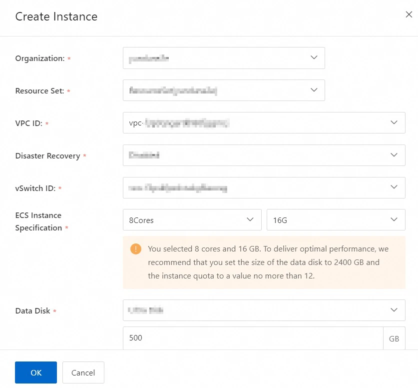

6. Click **OK**.

## 3.2. Log in to a Database Security Audit instance in Apsara Stack Security Center

This topic describes how to log in to a Database Security Audit instance in Apsara Stack Security Center.

**Background information**

Make sure that your account has the permissions on the cloud resources of your department. For example, you have the permissions of the administrator role in your department.

**Procedure**

1. Log in to the Apsara Uni-manager Management Console.

2. In the upper-right corner of the Apsara Uni-manager Management Console, choose **Security** > **Data Security > Database Audit**. On the **Database Audit** page, select a region from the **Region** drop-down list and click **Access with Authorized Role**.

3. In the left-side navigation pane, choose **Database Security Audit**.

4. In the instance list, find the Database Security Audit instance you want to access. In the **Actions** column, click **Details** to log in to the Database Security Audit instance.

## 3.3. Initialize a Database Security Audit instance

### 3.3.1. Prerequisites

Database Security Audit consists of a remote mirror agent (RMAgent) and a web console. The following table describes the ports that you need to open before you use Database Security Audit.

| Source | Destination | Port | Remarks |
| --- | --- | --- | --- |
| O&amp;M management client | Web console | 443 | For HTTPS communication with the web console. |
| RMAgent | Web console | 9266 | For communication between the RMAgent and web console. |
| O&amp;M management client | Web console | 22 | For SSH communication with the web console. |

### 3.3.2. Add a database instance to be audited

Database Security Audit can audit self-managed databases and ApsaraDB instances.

**Procedure**

1. Log in to a Database Security Audit instance of Apsara Stack Security as a global organization security administrator. For more information, see Log in to a Database Security Audit instance in Apsara Stack Security Center.

2. On the **Overview / All** page, click the

   icon in the upper-left corner to configure

   

   databases.

3. On the **Configuration > Database** page, click the

   icon in the upper-right corner of the

   

   **Database list** section to add a database instance.

   > **Note**
   >
   > To add multiple database instances at a time, click the
   >
   > icon on the Database page.
   >
   > 
   >
   > Download the database template file, enter database information in the file, and then upload the file.

4. In the panel that appears, enter the information about the database instance to be audited and click the

   icon in the upper-left corner to save the configuration.

   

   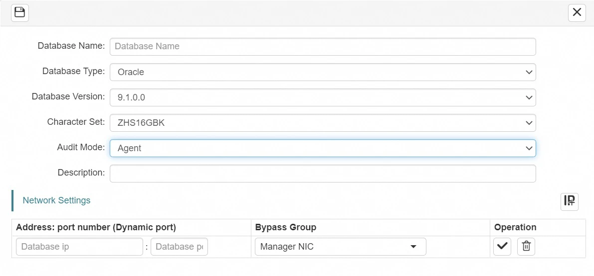

   Table 1. Database instance parameters

   | Parameter | Description |
   | --- | --- |
   | Database Name | The name of the database instance to be audited. |
   | Database Type | The type of the database instance to be audited. |
   | Database Version | The version of the database instance to be audited. |
   | Character Set | The character set used by the database instance. |
   | Audit Mode | The network deployment mode of the database instance. The value is set to Agent and cannot be modified. |
   | Description | The description of the database instance to be audited. |
   | Network Settings | The IP address and port number of the database instance. After you enter an IP address and a port number, click theicon in the <strong>Operation</strong> column to save the configuration. • IP address • Self-managed database on Elastic Compute Service (ECS): Enter the IP address of the database instance to be audited. • ApsaraDB instance: Enter the URL connection string of the ApsaraDB instance to be audited. • Port: Enter the port number of the database instance to be audited. You can click theicon to add multiple sets of IP addresses and port numbers. |

   > **Note**
   >
   > When you add an SQL Server database, you must enter the username and password of the account that has the required permissions, and then click **Authority Verification** to verify the permissions. A security administrator can also click **Download create user reference script** to create a specific user for Database Security Audit in the relevant database instance based on the reference script.

   After the database instance is added, you can view a summary of the database instance in the database list of the **Overview / All** page.

### 3.3.3. Deploy an RMAgent

#### 3.3.3.1. 自动部署

Agent程序需要部署到数据库或应用服务器上，用于获取访问数据库的流量，帮助审计系统对获取到的流量实现分析审计。

**背景信息**

自动部署Agent程序功能目前仅支持Linux系统的服务器。对于自建数据库实例，数据库所在的服务器必须使用Linux系统；对于RDS数据库实例，对应的应用服务器必须使用Linux系统。

- 服务器自建数据库实例：Agent程序需要部署在数据库所在的服务器上。

- RDS数据库实例：Agent程序需要部署在使用RDS数据库的业务实例对应的应用服务器上。

**操作步骤**

1. 

2. 在**配置**页面，单击**RMAgent组件 > RMAgent部署**，单击**安装**。

3. 在**RMAgent安装**对话框中，填写部署参数。

   表 1. Agent自动部署设置

   <table>
     <tr>
       <th width="121">参数</th>
       <th>说明</th>
     </tr>
     <tr>
       <td>审计服务器IP</td>
       <td>审计服务器IP地址。</td>
     </tr>
     <tr>
       <td>目标服务器</td>
       <td> 部署Agent服务器的信息，格式为：<code> </code>目标<code>IP,root</code>密码<code>,ssh</code>端口<code> </code>。 如果需要将Agent程序自动部署至多台服务器时，可以单击进行添加。</td>
     </tr>
   </table>

   > **Note**
   >
   > 添加的服务器也可以通过文件导入的方式添加，需先在文件导入页面下载模板编辑后导入。

4. 单击**确定**，即可将Agent程序自动部署到相应的服务器中。

#### 3.3.3.2. Manual deployment on Windows with separated application and database servers

This topic describes how to manually deploy a remote mirror agent (RMAgent) on Windows if your application and database are deployed on different servers.

**Procedure**

1. Log in to a Database Security Audit instance in Apsara Stack Security as a global organization security administrator. For more information, see Log in to a Database Security Audit instance in Apsara Stack Security Center.

2. In the left-side navigation pane, choose **Configuration** > **RMAgent Component**. On the RMAgent Component page, click **Download Agent(Win)**.

   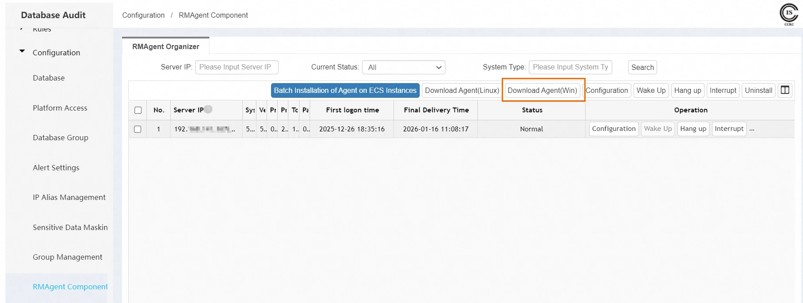

3. Download the RMAgent installation package, place it onto a Windows server, and then decompress it. In the extracted folder, double-click Rmagent_Setup.exe.

   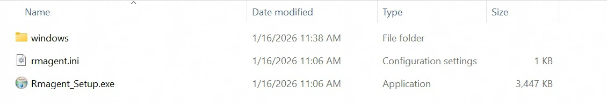

4. In the Installer Language dialog box, select English and click **OK**.

5. In the **Remote Mirror Agent for Database Audit** dialog box, click **Next**.

   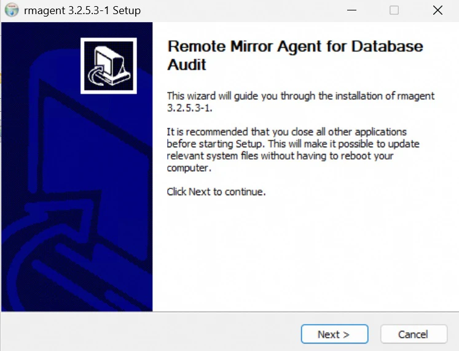

6. In the **License Agreement** dialog box, click **I Agree**.

   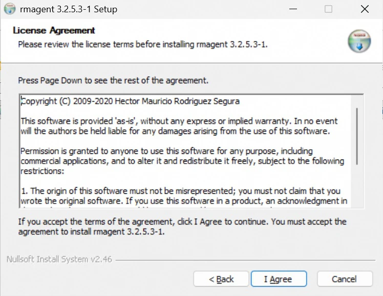

7. In the **Choose Components** dialog box, click **Next**.

   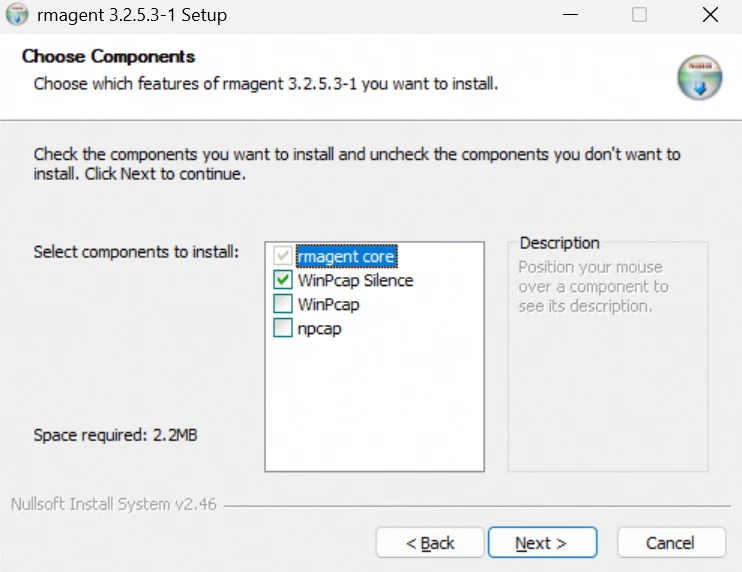

8. In the **Choose Install Location** dialog box, use the default setting for Destination Folder and click **Install**.

   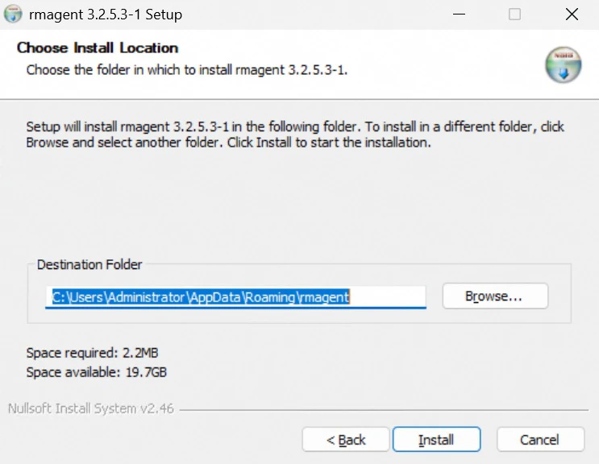

9. In the **Completing the rmagent 3.2.5.3-1 Setup Wizard** dialog box, click **Finish**.

   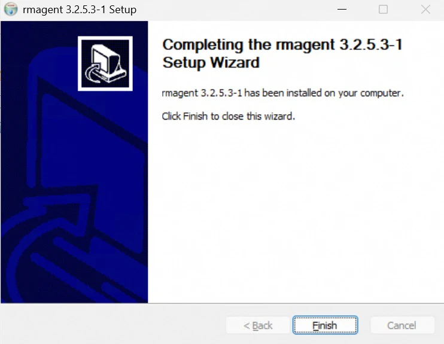

#### 3.3.3.3. Manual deployment on Windows with a combined application and database server

This topic describes how to manually deploy a remote mirror agent (RMAgent) on Windows if your application and database are deployed on the same server.

**Procedure**

1. Log in to a Database Security Audit instance in Apsara Stack Security as a global organization security administrator. For more information, see Log in to a Database Security Audit instance in Apsara Stack Security Center.

2. In the left-side navigation pane, choose **Configuration** > **RMAgent Component**. On the RMAgent Component page, click **Download Agent(Win)**.

   

3. Download the RMAgent installation package, place it onto a Windows server, and then decompress it. In the extracted folder, modify the rmagent.ini file by removing the number sign (#) preceding loopback=1. Then, double-click **Rmagent_Setup.exe**.

   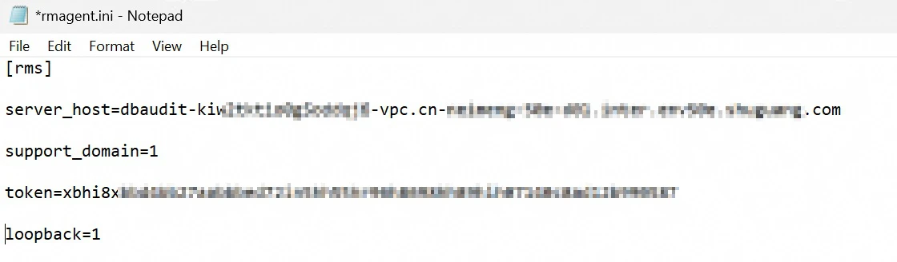

   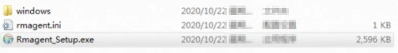

4. In the **Installer Language** dialog box, select English and click **OK**.

   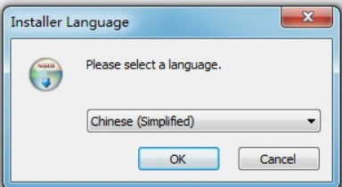

5. In the **Remote Mirror Agent for Database Audit** dialog box, click **Next**.

   

6. In the **License Agreement** dialog box, click **I Agree**.

   

7. In the **Choose Components** dialog box, select npcap, clear WinPcap, and then click **Next**.

   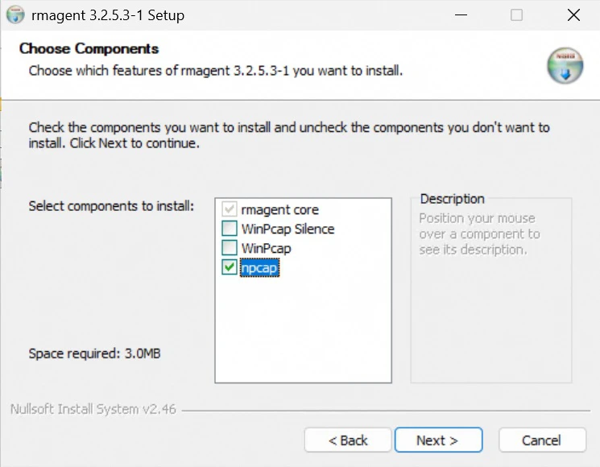

8. In the **Choose Install Location** dialog box, use the default setting for Destination Folder and click **Install**.

   

9. In the License Agreement dialog box, click **I Agree**.

   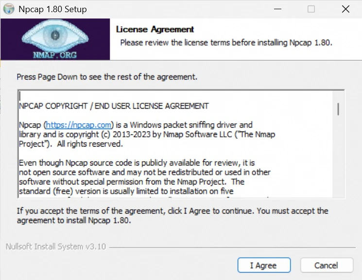

0. In the Installation Options dialog box, select **Install Npcap in WinPcap API-compatible Mode** and click **Install**.

   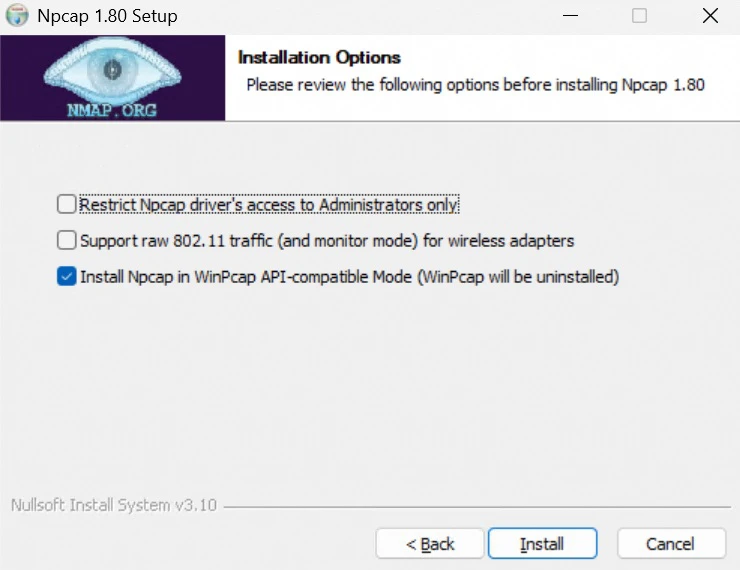

1. In the Installation Complete dialog box, click **Next**.

   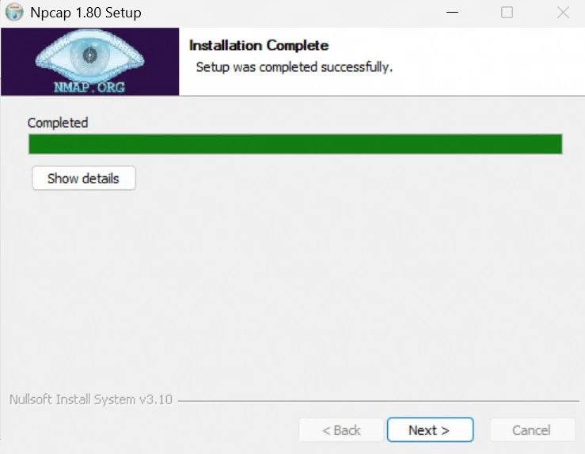

2. In the Finished dialog box, click **Finish**.

   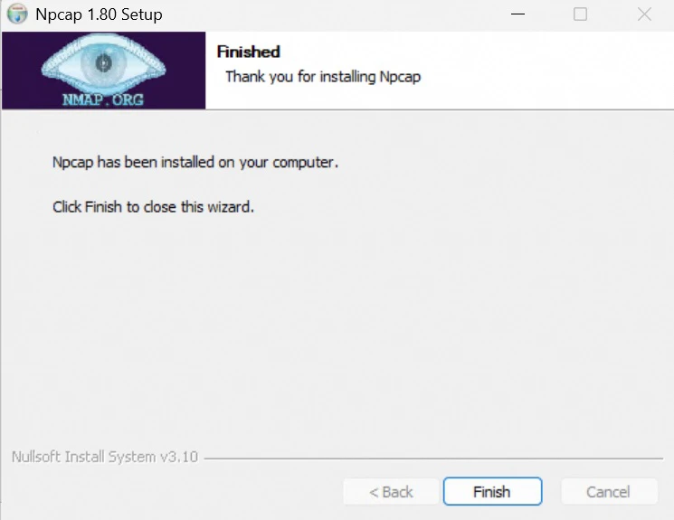

3. In the Completing the rmagent 3.2.5.3-1 Setup Wizard dialog box, click **Finish**.

   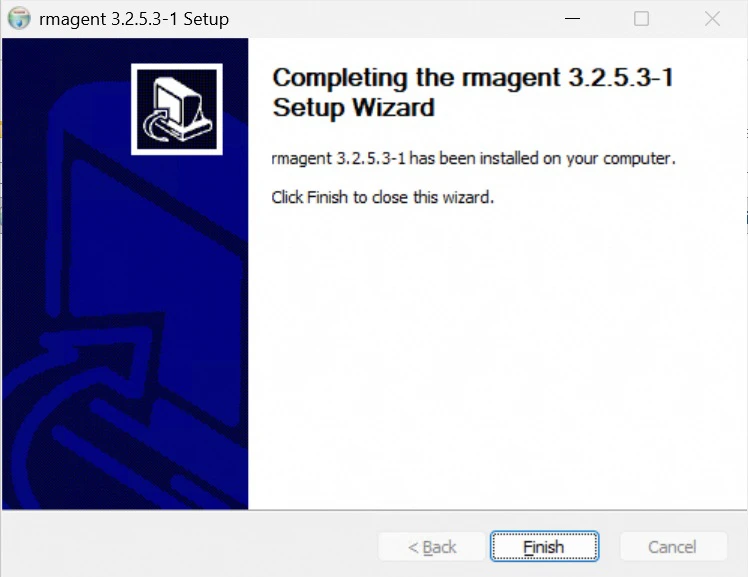

#### 3.3.3.4. Manual deployment on Linux with separated application and database servers

This topic describes how to manually deploy a remote mirror agent (RMAgent) on Linux if your application and database are deployed on different servers.

**Procedure**

1. Log in to a Database Security Audit instance in Apsara Stack Security as a global organization security administrator. For more information, see Log in to a Database Security Audit instance in Apsara Stack Security Center.

2. In the left-side navigation pane, choose **Configuration** > **RMAgent Component**. On the RMAgent Component page, click **Download Agent(Linux)**.

   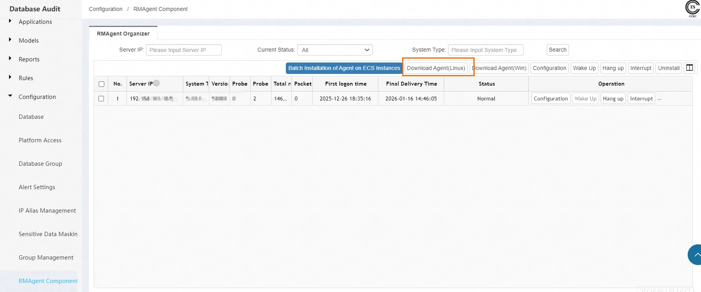

3. Download the RMAgent installation package and upload it to a Linux server as the root user. Then, run the tar -zxvf yddbaudit_rmagent.tar.gz command.

   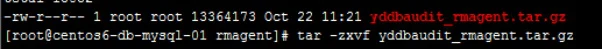

4. After the package is decompressed, run the ./install.sh command.

   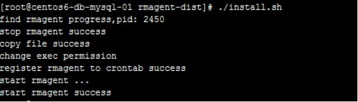

5. On the RMAgent Component page, verify that the RMAgent is displayed in the Normal state.

   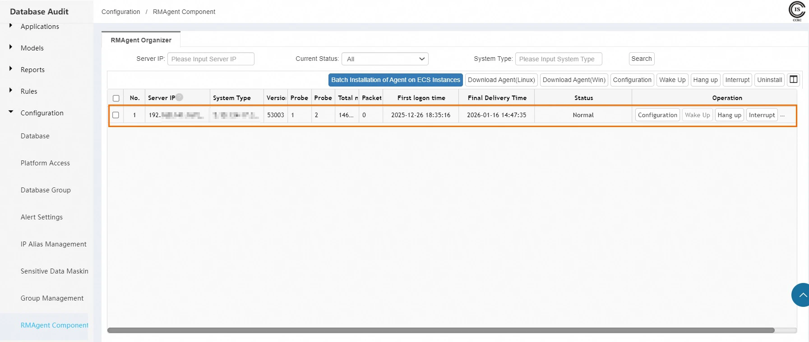

#### 3.3.3.5. Manual deployment on Linux with a combined application and database server

This topic describes how to manually deploy a remote mirror agent (RMAgent) on Linux if your application and database are deployed on the same server.

**Procedure**

1. Log in to a Database Security Audit instance in Apsara Stack Security as a global organization security administrator. For more information, see Log in to a Database Security Audit instance in Apsara Stack Security Center.

2. In the left-side navigation pane, choose **Configuration** > **RMAgent Component**. On the RMAgent Component page, click **Download Agent(Linux).**

   

3. Download the RMAgent installation package and upload it to a Linux server as the root user. Then, run the  `tar -zxvf yddbaudit_rmagent.tar.gz`  command.

   

4. After the package is decompressed, run the  `./install.sh`  command.

   

5. On the RMAgent Component page, verify that the RMAgent is displayed in the Normal state.

   

6. In the Operation column of the RMAgent, click Configuration. In the Unified Distribution Configuration dialog box, select **loopback**, set it to 1, and then click **OK**. The RMAgent automatically restarts.

   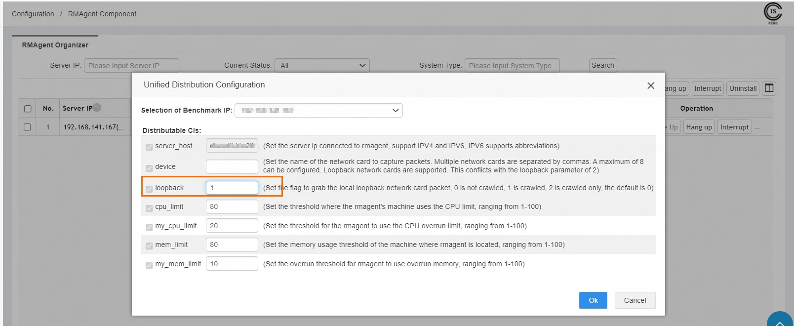

### 3.3.4. Verify the deployment

This topic describes how to verify whether a Database Security Audit instance runs as expected after you deploy a remote mirror agent (RMAgent).

From the application server on which the RMAgent is installed, access the audited database instance and execute one or more SQL statements. Then, log in to the Database Security Audit instance as a security administrator to check whether audit information is recorded for the database instance.

- If audit information about the database instance appears in Database Security Audit, auditing for the database instance is set up and is working as expected.

- If no audit information is recorded for the database instance in Database Security Audit, check the RMAgent configuration, RMAgent service process, and connection settings.

# 4.安全管理员指南

## 4.1. 概况

## 4.2. Behaviors

The **Overview / All** page displays the overall audit status of the databases audited by Database Security Audit. The **Behavior** module displays the specific behaviors that are audited in the protected databases. Compared with the audit page of a single database, the **Behavior** module displays the behavior statistics of all databases. Database Security Audit collects statistics on behaviors and displays them on the **Risk Hits**, **Behavior Search**, **Risk Search**, and **Statistical Comparison** pages.

### 4.2.1. Risk hits

This topic describes how to view the details of hit risks.

**Procedure**

1. In the left-side navigation pane, choose **Behavior > Risk Hits**. On the page that appears, specify a time range to query the detailed hit information for each risk type.

   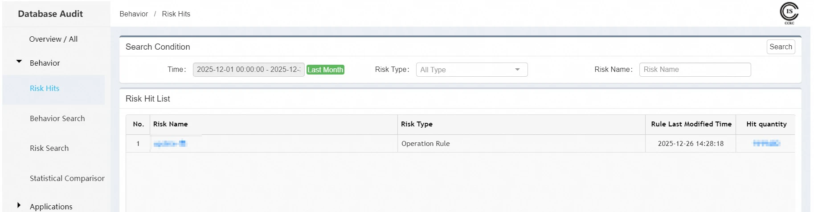

   The hit list displays detailed risk information in the **Risk Name**, **Risk Type**, and **Hit quantity** columns.

2. Click the name in the **Risk Name** column for a hit record. You are navigated to the details page of the custom risk rule.

   For more information about how to configure a rule, see the "Global rules" topic.

   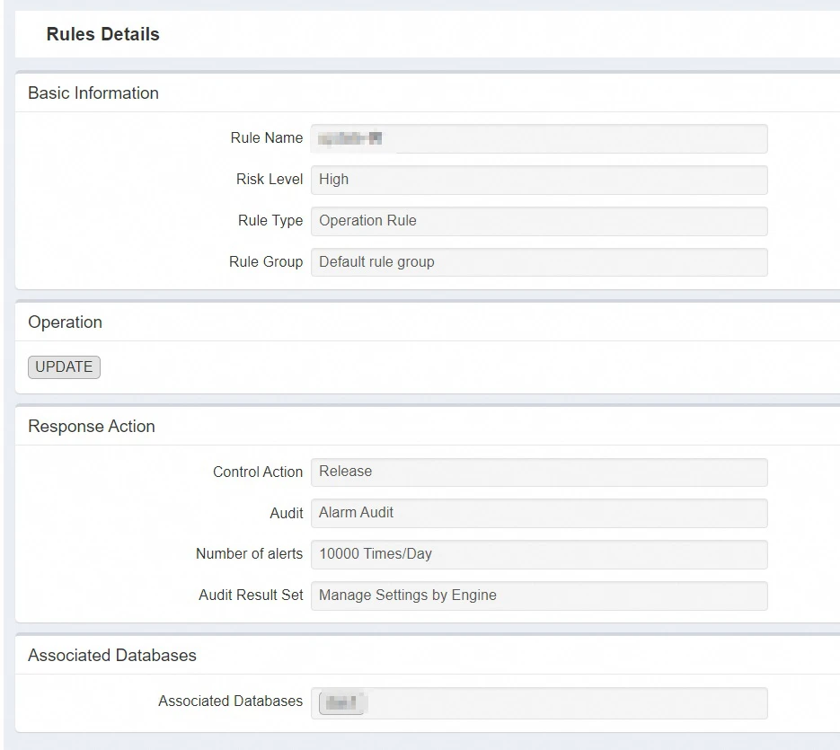

3. Click the number in the **Hit quantity** column of a hit record. The Rules hit distribution dialog box appears, where you can view the databases in which the risk occurred and the number of hits for each database.

   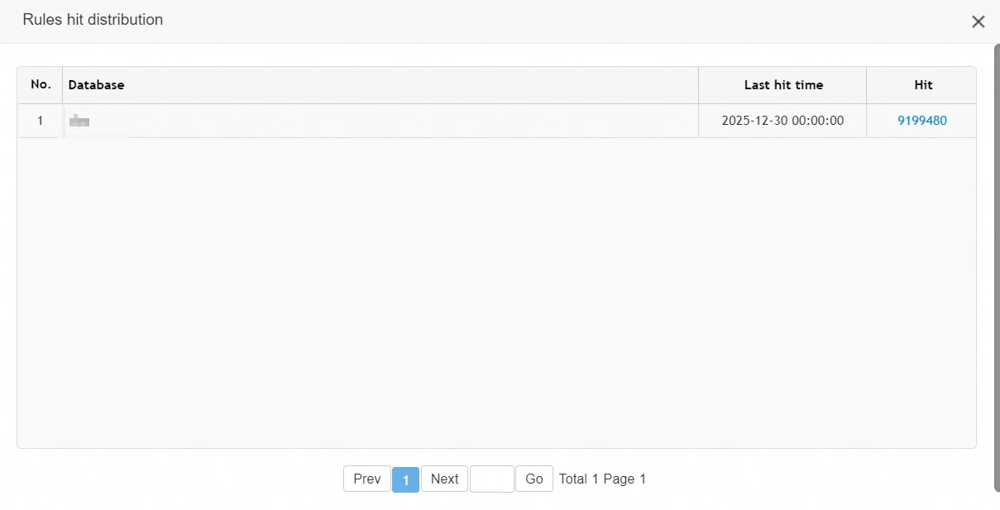

4. Click the number in the **Hit** column of a record. You are navigated to the **Risk Search** page, where you can view the risk details. For more information, see **Risk search**.

### 4.2.2. Behavior search

This topic describes how to search for behaviors.

**Overview**

The **Behavior Search** page collects statistics on the SQL statements executed in all databases audited by the system. The statistics include the client information, server information, and session information. Compared with the statistics on SQL statements of a single database, this page provides statistics on all databases and allows you to sort the information by client IP address. The parameters on the page are the same as those on the statement statistics page for a single database. For more information, see **Statement search**.

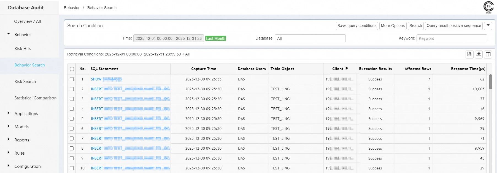

To facilitate search, the options of a search condition are displayed by page, as shown in the following figure.

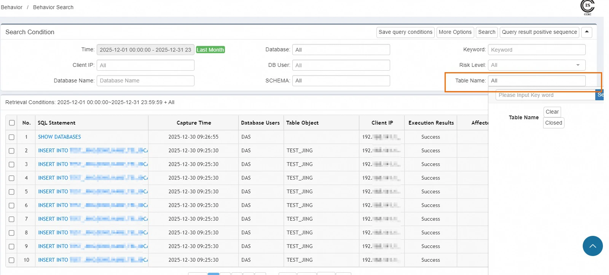

### 4.2.3. Risk search

This topic describes how to search for risks.

**Overview**

The **Risk Search** page collects statistics based on the specific behaviors of all hit risks. The details of all risky statements are displayed in a list. The details of each risky statement are displayed in the following columns: SQL Statement, Time, Risk Type, Risk Name, Risk Level, Database User, and Client IP. You can add a risky statement to the trust list, set it as a sensitive statement, or disable audit for the statement.

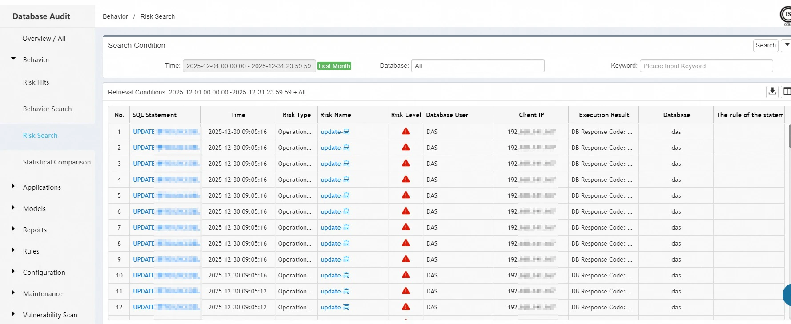

**Procedure**

In the left-side navigation pane, choose **Behavior > Risk Search**. On the page that appears, click a statement in the **SQL Statement** column to go to the **Statement details** page. On this page, you can view the access source, application identity, SQL statement, affected objects, SQL statement, statement template, result set, and SQL parameters of the statement.

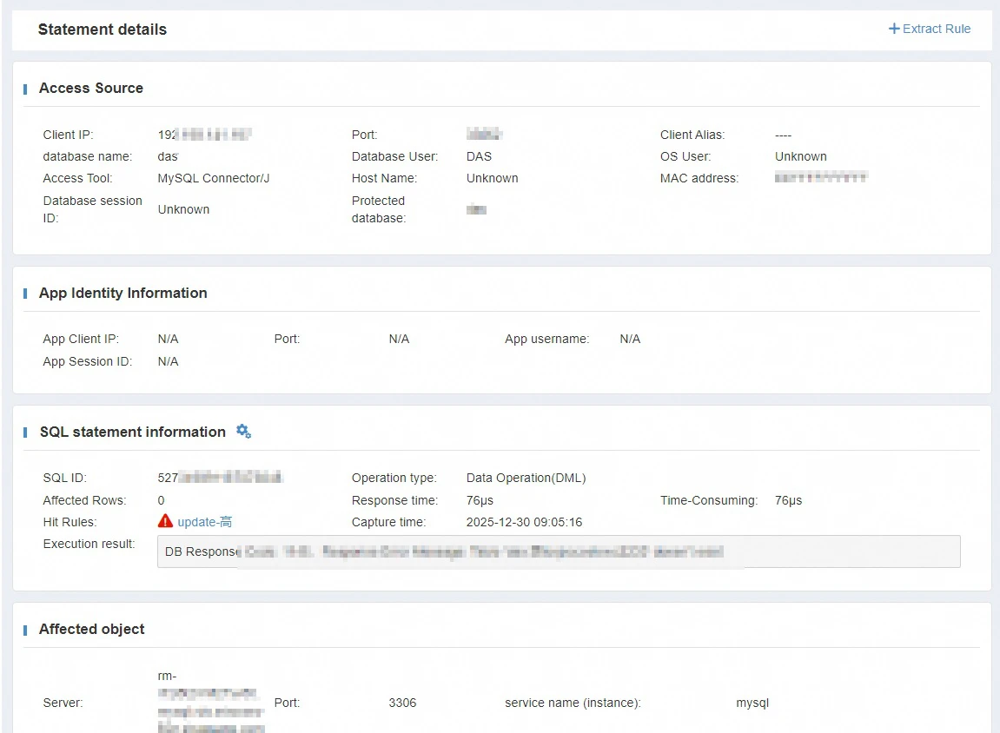

### 4.2.4. Statistical comparison

This topic describes how to use the statistical comparison feature.

The statistical comparison provides the following information:

- The comparison between statistics of the same database in different time ranges.

- The comparison between statistics of different databases in the same time range.

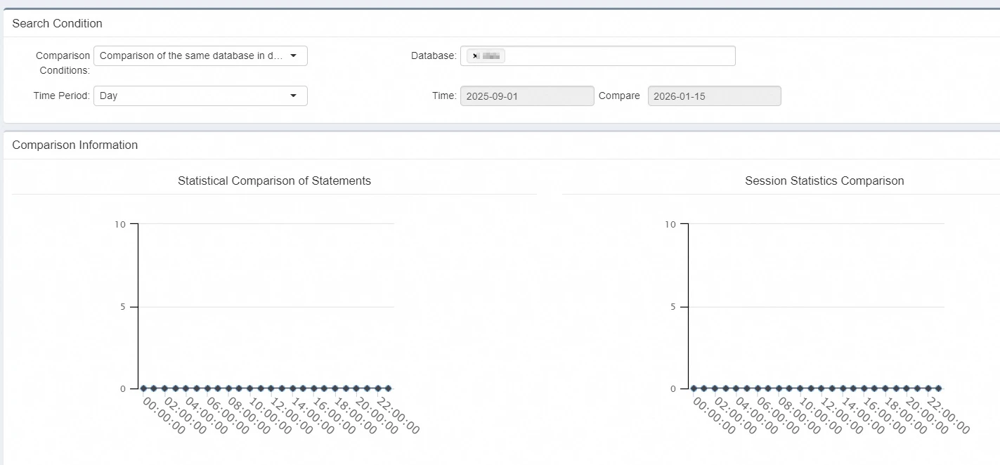

## 4.3. Applications

### 4.3.1. Application identifies

This topic describes the details of application identities.

An application identity is an access behavior record of an application server after an application user accesses a database through the application server. Traditional database security audit products can audit only the application IP addresses, but cannot parse the application user information. Database Security Audit adopts an audit mode in which applications are associated with audits. This allows the service to analyze and audit the detailed application user information. The application component provided by Database Security Audit can obtain the most accurate application user information based on the application login mechanism. The following figure shows the parameters.

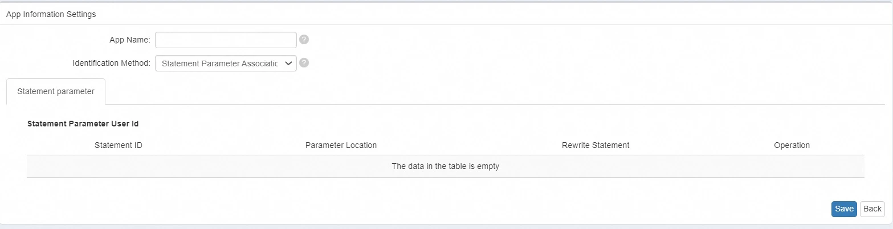

### 4.3.2. Custom application users

You can add a single application user or import multiple application users at a time. After the application users are associated with specific login statements, the application users can be accurately identified and audited. This topic describes how to add custom application users.

- Import multiple application users at a time

  Click **Import**. In the **Import** dialog box, upload the template file for importing application users.

  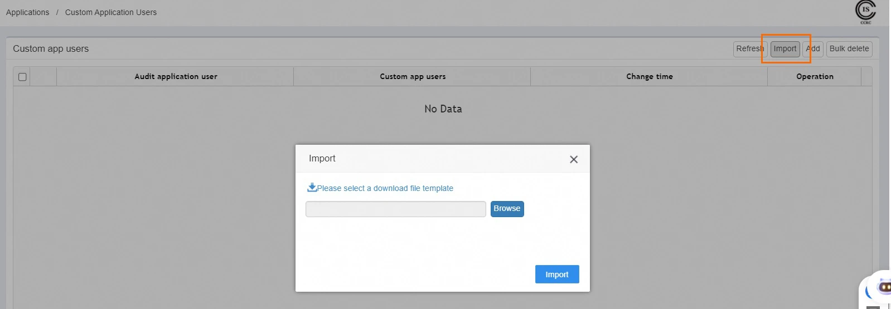

- Add a single application user

  Click **Add**. In the **Add** dialog box, configure the audit application user and custom application users.

  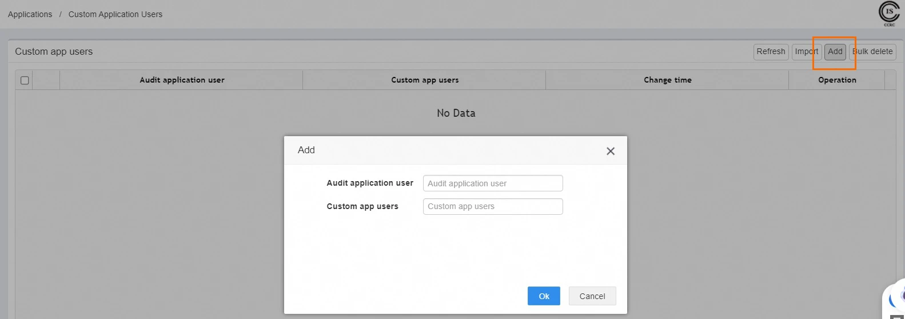

## 4.4. Models

Database Security Audit comprehensively parses database communication protocols. It can generate statement models based on the specified learning period.

### 4.4.1. Statement models

Database Security Audit can perform statistical learning on statements based on the learning period. After comparison, statistics collection, learning, and analysis, new statements are generated for auditing and monitoring, and can be associated with statement templates.

In the left-side navigation pane, choose **Models > SQL Model**. On the page that appears, search for statement templates. You can set multiple statement templates as trusted statements at a time.

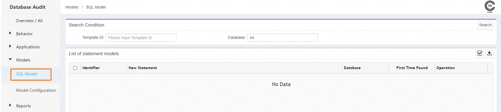

### 4.4.2. Model configurations

You can configure learning for a specific database, including the learning period. You can also stop learning for a database at any time.

In the left-side navigation pane, choose **Models > Model Configuration** to configure the learning period or stop learning for a database.

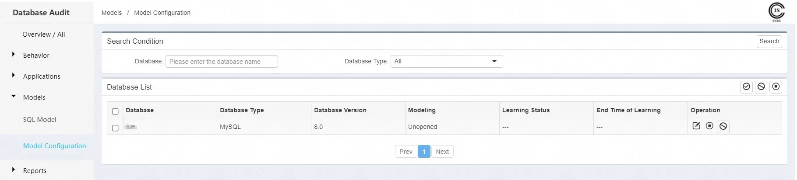

## 4.5. Global reports

Database Security Audit adopts a new form of report presentation called aggregate reports, and divides reports into two types: global reports and single-database reports. The report module provides the following pages: Comprehensive Report, Compliance Report, Special Report, Custom Report, Report Preset, and Scheduled Delivery.

This topic describes the global report feature. Global reports are displayed as aggregate reports, and the audit status of all databases in the system is displayed in different sections. Daily, weekly, and monthly reports are supported. On a report page, you can click **Preview** to query and display the report data of the specified database group within the specified time range.

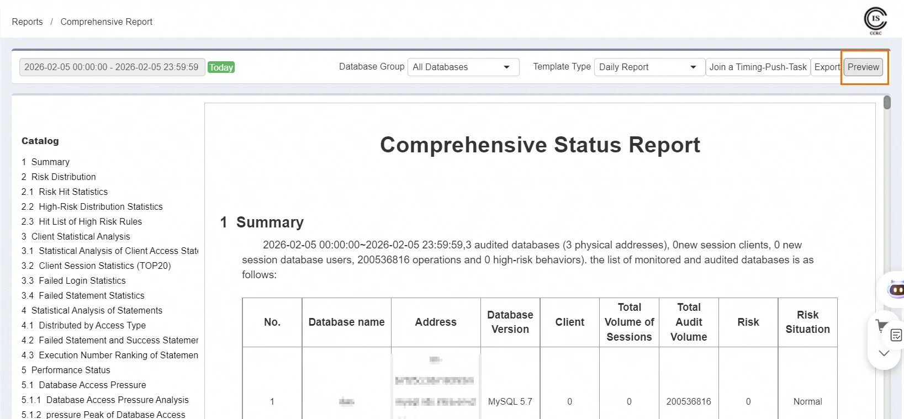

### 4.5.1. Comprehensive reports

This topic describes the details of comprehensive reports.

**Report name**

Comprehensive Report

**Report types**

Daily Report, Weekly Report, and Monthly Report

**Report content**

Information such as Risk Distribution, Client Statistical Analysis, Statistical Analysis of Statements, and Performance Status

**Statistical charts**

Charts such as column charts, curve charts, and dual-axis line charts

The following figures show the chart and table about SQL Peak Throughput in a sample report.

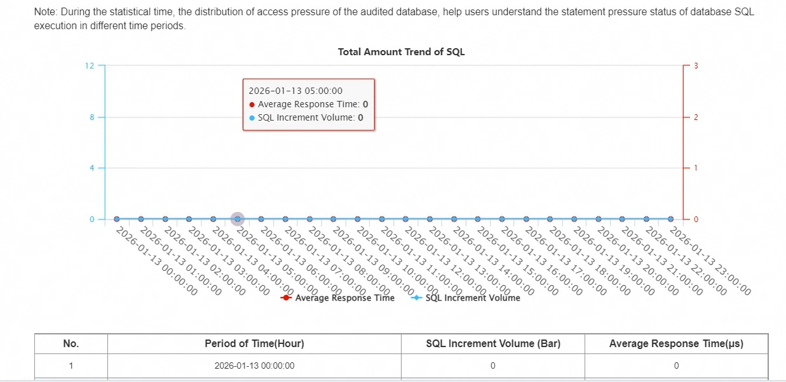

### 4.5.2. Compliance reports

This topic describes the details of compliance reports.

**Report names**

SOX-Sarbanes Report, PCI-Report, and Equal Insurance Reference Report

**Report types**

SOX-Sarbanes Report, PCI-Report, and Equal Insurance Reference Report

**Report content**

Information such as Risk Distribution and Statistical Analysis of Statements

**Statistical charts**

Charts such as column charts

**Sample report**

The following figures show a sample report and the Risk Hit Statistics section in the report.

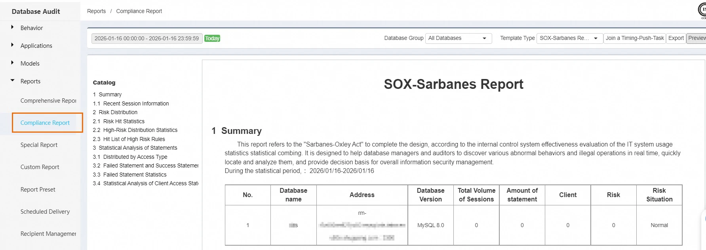

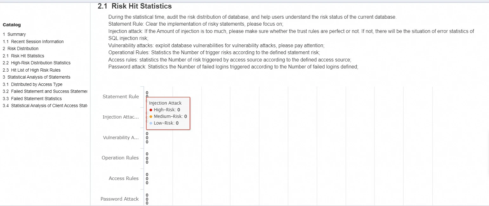

### 4.5.3. Special reports

This topic describes the details of special reports.

**Report names**

More than 20 reports such as Comprehensive Risk Analysis Report and Client Risk Analysis Report

**Report types**

More than 20 report templates such as Statistical Report on Risk Distribution, Client Risk Analysis Report, Analysis Report of Database Security Audit, and Summary Analysis Report of Database

**Report content**

Information such as Risk Distribution

**Statistical charts**

Charts such as column charts

**Sample report**

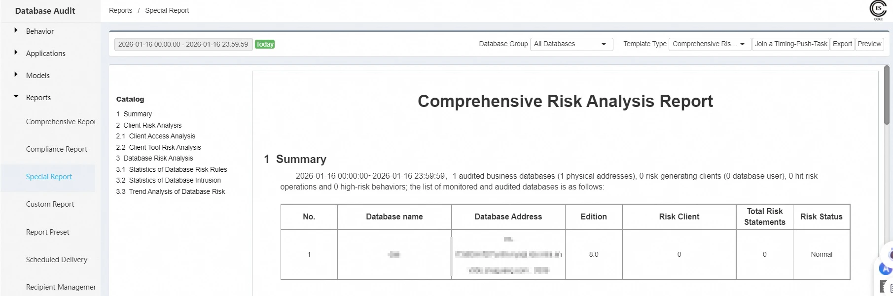

### 4.5.4. Custom reports

This topic describes the details of custom reports.

**Overview**

You can specify report elements such as report statistics and analysis criteria to generate custom reports.

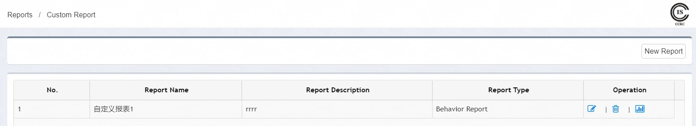

**Procedure**

1. Create a custom report.

   Click **New Report**. In the dialog box that appears, specify report elements such as the report type, query conditions, and report display mode.

   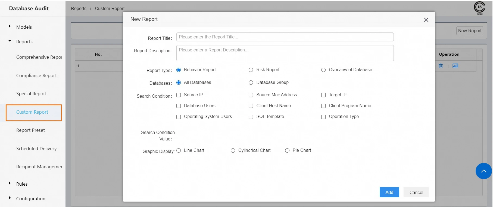

2. After the report is created, click the  icon to view the report.

   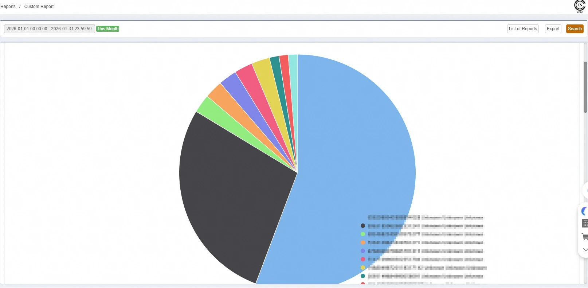

3. Click **Export** to export the custom report.

   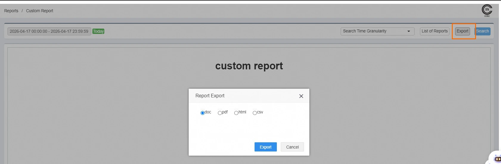

### 4.5.5. Report preset

This topic describes the report preset feature.

**Overview**

The report preset feature generates and stores the specified reports in advance. This way, you can directly access these pre-stored reports to reduce the system pressure.

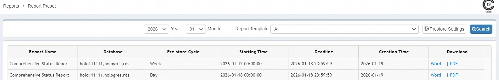

**Enable the report preset feature**

On the Report Preset page, click **Prestore Settings** to enable the feature for the specified reports.

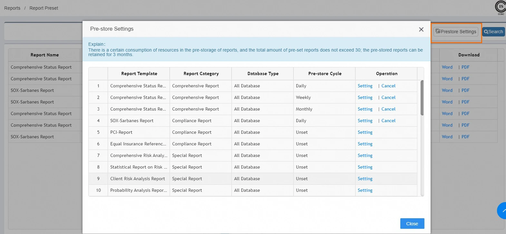

### 4.5.6. Scheduled delivery

This topic describes how to configure scheduled tasks for delivering reports.

**Overview**

A report is a summary of the performance and status of the audited databases within a specific period of time, which can clearly reflect the status of the databases. Database Security Audit supports daily, weekly, and monthly reports. The scheduled delivery feature can periodically send reports of audit logs to specified recipients.

When you preview a report, you can click **Join a Timing-Push-Task** in the upper-right corner to create a task for periodically delivering the created report. The task is then displayed on the **Scheduled Delivery** page.

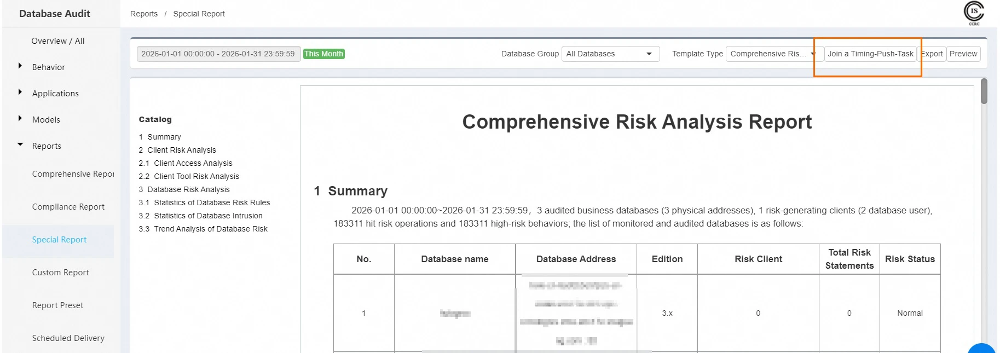

**Procedure**

- **Create a scheduled task**

  In the left-side navigation pane, choose **Reports > Scheduled Delivery**. On the page that appears, click **Add** in the upper-right corner. In the dialog box that appears, configure the Task Name, Mail Subject, Sending Period, and Sending Time parameters to create a scheduled task.

  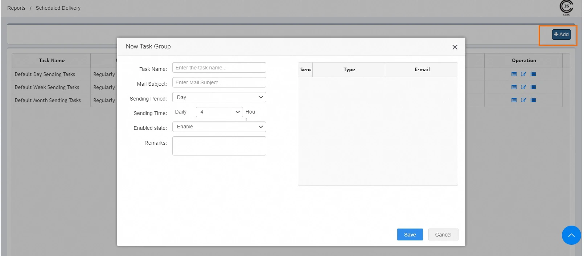

- **View the list of scheduled tasks**

  View the list of created scheduled tasks on the Scheduled Delivery page. This page displays task information in the following columns: Task Name, Mail Subject, Sending Period, Sending Time, Description, State, and Operation.

  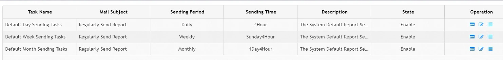

- **Query the delivery history**

  Find the scheduled task that you want to view and click the  icon in the Operation column

  to query the delivery history of the task.

- **Edit or delete a scheduled task**

  Find the scheduled task that you want to edit and click the  icon in the Operation column

  to edit the task. You can also click the  icon to delete a scheduled task.

- **Query the reports that have been delivered by a task**

  Find the scheduled task that you want to view and click the  icon in the Operation column

  to view the reports that have been delivered by the task.

  

### 4.5.7. Report export

This topic describes how to export a report.

**Procedure**

Go to the page of the report that you want to export and click **Export** in the upper-right corner to export the report.

Reports can be exported in the following formats: DOC, PDF, HTML, and CSV.

### 4.5.8. Recipient management

The recipient management feature allows you to manage the recipients to which reports are delivered in scheduled tasks. This topic describes how to manage recipients.

**Procedure**

1. In the left-side navigation pane, choose **Reports > Recipient Management**. On the page

   that appears, click the  icon.

   

2. In the panel that appears, enter the username, email address, and mobile phone number of

   the recipient, and then click the  icon.

   

## 4.6. Global rules

### 4.6.1. Virtual patch query

Virtual patches are used to alert you about attacks that exploit database vulnerabilities. Built-in rules are generated based on vulnerability types such as Common Vulnerabilities and Exposure (CVE) vulnerabilities. You cannot add custom rules or delete built-in rules. However, you can enable or disable rules based on your business requirements.

The Virtual patch list section displays all vulnerability exploitation rules in all supported database versions, including the vulnerability name, CVE ID, vulnerability type, impact scope, risk level, alert notification, status, and actions (enable/disable). The Virtual Patch Query page also provides the search feature.

### 4.6.2. Manage rules

#### 4.6.2.1. Injection

You can define SQL injection statements or high-risk SQL statements to be blocked by describing the characteristics of the statements. This way, you can prevent SQL injections that may occur within a specific time range by specific users with certain tools from specific IP addresses. This topic describes how to create an injection prevention rule.

**Procedure**

1. In the left-side navigation pane, choose **Rules > Rule Management**. On the page that

   appears, click the  icon. In the Basic Information section, select **Injection Attack** from

   the **Rule Type** drop-down list.

   

2. Configure the rule.

   In the rule management section on the left, you can view existing rules and add or edit rules. When you create an SQL injection prevention rule, configure the rule information including the access source, operation, conditional control, execution results, injection feature, and response action.

   

   

   

   

   

#### 4.6.2.2. Operation rules

Operation rules are used to reduce the risk of specific operations on specific objects that are performed by a user from a specific IP address, using specific tools, within the specified time period. This topic describes how to create an operation rule.

**Procedure**

1. In the left-side navigation pane, choose **Rules > Rule Management**. On the Rule

   Management page, click the  icon. In the Basic Information section, select **Operation**

   **Rules** from the **Rule Type** drop-down list.

   

2. Configure advanced parameters to create an operation rule, and then click the  icon in

   the upper-right corner.

   

#### 4.6.2.3. Access rules

Access rules are used to reduce risks arising from a user from a specific IP address, using specific tools, within the specified time period. This topic describes how to create an access rule.

**Procedure**

1. In the left-side navigation pane, choose **Rules > Rule Management**. On the Rule

   Management page, click the  icon. In the Basic Information section, select **Access Rules**

   from the **Rule Type** drop-down list.

   

2. Configure the parameters in the Access Source, Response Action, and Time Limit Settings

   sections, and then click the  icon in the upper-right corner.

   

#### 4.6.2.4. Password attack rules

Password attack rules are used to reduce the risk of failed logins originating from a specific IP address or user account within the specified time period. This topic describes how to create a password attack rule.

**Procedure**

1. In the left-side navigation pane, choose **Rules > Rule Management**. On the Rule

   Management page, click the  icon. In the Basic Information section, select **Password**

   **Attack** from the **Rule Type** drop-down list.

   

2. Configure the parameters in the Access Source, Execution Results, and Response Action

   sections, and then click the  icon in the upper-right corner.

   

### 4.6.3. Enable rules

For databases in a database group, you can apply or remove rules, and set their execution priority.

#### 4.6.3.1. Configure associations during rule management

You can configure associations to associate databases with rules so that the rules can be referenced. This topic describes how to configure associations during rule management.

**Procedure**

- Configure associations when you create or edit a rule

  Click the  icon next to **Associated Databases** to configure associations.

  

- Configure associations for an existing rule

  Select the rule for which you want to configure associations and click the  icon in the

  upper-right corner.

  

  The following figure shows the dialog box for configuring associations. You can select

  multiple databases and click the  icon to associate the databases with the rule. You can

  also click the  icon to select all databases. After the databases are selected, click **OK**.

  

#### 4.6.3.2. Reference and dereference rules

This topic describes how to reference and dereference rules.

**Procedure**

1. Specify the conditions to search for the rules that you want to configure.

   The following conditions are supported: Database, Rule name, Rule type, Rule group, Risk level, Is it enabled, and Whether to quote.

   

   Rules that meet the conditions are displayed in the rule list. The icon in the Operation

   column indicates the reference relationship.  indicates that the rule is referenced. 

   indicates that the rule is not referenced.

2. Select a database and click the  icon for a dereferenced rule to reference the rule. Click

   the  icon for a referenced rule to dereference the rule.

   You can also reference or dereference multiple rules at a time. To do so, select multiple

   rules and click the  or  icon in the upper-right corner of the rule list. You can click

   the  or  icon to enable or disable the selected rules.

#### 4.6.3.3. Configure priorities

If the behavior of accessing a database matches multiple rules at the same time, the rule with the highest priority is hit. This topic describes how to configure priorities.

**Procedure**

1. Find a referenced rule for which you want to adjust the priority, and click the  or  icon

   in the **Operation** column.

   

2. After you adjust the priority, click the  icon in the upper-right corner to save the priority

   setting.

   

## 4.7. Configurations

### 4.7.1. Databases

Auditing database behaviors is the core feature of Database Security Audit. The Database page allows you to manage audited databases. You can view the basic information of the added databases, and add, modify, or remove the databases.

#### 4.7.1.1. Add a database

This topic describes how to add a database.

**Procedure**

1. In the left-side navigation pane, choose **Configuration > Database**. On the page that

   appears, click the  icon in the upper-right corner to add a database.

   

2. Enter the database information, click the  icon to save the database connection

   information, and then click the  icon in the upper-left corner to save the configuration.

   You need to specify the database name, database type, and version, and enter the connection information of the database, including the IP address and service port.

   

#### 4.7.1.2. Edit database information

This topic describes how to edit database information.

**Procedure**

1. In the left-side navigation pane, choose **Configuration > Database**. On the page that appears, find the database that you want to manage.

2. Click the  icon in the **Operation** column to view the details of the database. Then, click

   the  icon in the upper-left corner to edit the existing information. The panel for editing

   database information is the same as that for adding a database.

   

3. Click the  icon to save the configuration.

   

#### 4.7.1.3. Delete a database

This topic describes how to delete a database.

**Procedure**

1. In the left-side navigation pane, choose **Configuration > Database**. On the page that appears, find the database that you want to delete.

2. Click the  icon in the **Operation** column to delete the database.

   

3. In the message that appears, click **OK**.

   

#### 4.7.1.4. Import and export database information

This topic describes how to import and export database information.

**Procedure**

1. In the left-side navigation pane, choose **Configuration > Database**. On the page that

   appears, click the  icon in the upper-right corner of the database list. In the **Import**

   **database** dialog box, download the template file for importing database information.

   

2. Click the  icon in the upper-right corner of the database list to export database

   information.

   

### 4.7.2. Platform access

This topic describes how to write platform logs to Simple Log Service (SLS).

**Procedure**

In the left-side navigation pane, choose **Configuration > Platform Access**. Find the database that you want to configure and click the Edit icon in the Operation column. In the dialog box that appears, configure the log storage parameters and click **Ok**.

### 4.7.3. Database groups

You can add multiple databases to a database group to facilitate report queries across the databases.

1. In the left-side navigation pane, choose **Configuration > Database Group**. On the

   Database Group page, click the  icon in the upper-right corner to create a database

   group. Add the required databases to the database group.

   

2. Click Ok.

   

### 4.7.4. Alert settings

When Database Security Audit or an audited database triggers an alert, alert messages are sent to the specified email addresses by using the email server configured on the Notification Management page based on the predefined alert rule. To use the alerting feature, you must configure email settings on the **Notification Management** page.

**Procedure**

1. In the left-side navigation pane, choose **Configuration > Alert Settings**. On the page

   that appears, click the  icon in the upper-right corner to add an alert rule.

   

2. In the dialog box that appears, configure the Email Subject and Template Name parameters and select the risk levels for triggering alerts. Enter custom email content. You can select required content from the Template Content section. Specify the recipients in the Contacts field and click Save.

   

3. After you add an alert rule, click the **Enable** icon in the **Operation** column of the alert rule to enable it.

   

### 4.7.5. IP address alias management

You can add IP addresses of database clients and configure aliases for these IP addresses for easy identification. You can add a single IP address and configure an alias for it. Alternatively, you can import multiple IP addresses with specified aliases at a time. After you add aliases for IP addresses, they are displayed when you search for statements.

**Procedure**

- Import multiple IP addresses at a time

  In the left-side navigation pane, choose **Configuration > IP Alias Management**. On the

  page that appears, click the  icon in the upper-right corner. In the dialog box that

  appears, download the IP address template file. Enter the IP addresses and their aliases in the template file and then upload the file to import the IP addresses.

  

- Add a single IP address

  <ol type="i">

  <li>

  Click the  icon to add a single IP address.

  

  </li>

  <li>

  Click **Ok**.

  </li>

  </ol>

  

### 4.7.6. Sensitive data masking

This topic describes how to configure sensitive data masking.

**Overview**

Database Security Audit provides the sensitive data masking feature, which masks the audited sensitive data of customers, such as social security numbers and bank card numbers, before displaying the data.

When you configure a sensitive data masking rule, you need to specify the rule for matching the data that you want to mask and how the data is displayed after masking. Generally, the matching rules are written in regular expressions.

> **Note**
>
> The sensitive data masking feature affects the query and export efficiency.

**Procedure**

1. In the left-side navigation pane, choose **Configuration > Sensitive Data Masking**. On

   the page that appears, click the  icon in the upper-right corner to add a masking rule.

   

2. In the dialog box that appears, configure the Name, Regular Expression Matching, Mask result, and Description parameters, and click **Ok**.

   

3. Click the  icon in the **Operation** column of the masking rule to enable it.

   

### 4.7.7. Group management

You can create groups of IP addresses, database users, application users, time ranges, objects, and operating system users, and reference the groups when you create rules.

#### 4.7.7.1. IP address groups

This topic describes how to create an IP address group.

**Procedure**

1. In the left-side navigation pane, choose **Configuration > Group Management**. On the **IP**

   **User Group** tab, click the  icon in the upper-right corner to create an IP address group.

   

2. In the Add IP Group dialog box, specify a group name and one or more IP addresses or CIDR blocks, and then click Save.

   

#### 4.7.7.2. Database user groups

This topic describes how to create a database user group.

**Procedure**

1. In the left-side navigation pane, choose **Configuration > Group Management**. Click the

   **Database User Group** tab, and then click the  icon in the upper-right corner to create a

   database user group.

   

2. In the Add Database User Group dialog box, specify a group name and one or more database users, and then click **Save**.

   

#### 4.7.7.3. Application user groups

This topic describes how to create an application user group.

**Procedure**

1. In the left-side navigation pane, choose **Configuration > Group Management**. Click the

   **App User Group** tab, and then click the  icon in the upper-right corner to create an

   application user group.

   

2. In the Add App User Group dialog box, specify a group name and one or more application users, and then click **Save**.

   

#### 4.7.7.4. Time groups

This topic describes how to create a time group.

**Procedure**

1. In the left-side navigation pane, choose **Configuration > Group Management**. Click the

   **Time Group** tab, and then click the  icon in the upper-right corner to create a time

   group.

   

2. In the Add Time Group dialog box, specify a group name and the year, month, day, week, and hour settings, and then click **Save**.

   

#### 4.7.7.5. Object groups

This topic describes how to create an object group.

**Procedure**

1. In the left-side navigation pane, choose **Configuration > Group Management**. Click the

   **Object Group** tab, and then click the  icon in the upper-right corner to create an object

   group.

   

2. In the Add Object Group dialog box, add one or more conditions and click **Save**. You can

   click the  icon to add multiple conditions. Each condition can specify criteria at various

   levels, from databases down to specific objects and fields.

   

#### 4.7.7.6. Operating system user groups

This topic describes how to create an operating system user group.

**Procedure**

1. In the left-side navigation pane, choose **Configuration > Group Management**. Click the

   **Operating System User Group** tab, and then click the  icon in the upper-right corner

   to create an operating system user group.

2. In the Add Operating System User Group dialog box, specify a group name and one or more

   system users, and then click **Save**. You can click the  icon to add multiple system users.

   

### 4.7.8. RMAgents

A remote mirror agent (RMAgent) sends auditable traffic to Database Security Audit. It is designed for virtualized deployments or other environments in which configuring traffic mirroring is not feasible. An RMAgent can be deployed on either a database server or client. Once deployed, the RMAgent can be monitored and managed by Database Security Audit.

#### 4.7.8.1. RMAgent management

You can manage the remote mirror agents (RMAgents) that are connected to your audit server. This topic describes how to manage RMAgents.

**Procedure**

- View the RMAgent list.

  In the RMAgent list, view the information about each RMAgent that can be managed, including the IP address and operating system of the host on which the RMAgent is deployed and the CPU utilization and status of the RMAgent. You can perform different operations on an RMAgent by clicking the following buttons in the Operation column:

  

- Configuration: remotely configures the runtime parameters of the RMAgent.

  

- Wake Up: resumes the activity of the RMAgent after it is suspended.

- Hang up: suspends the activity of the RMAgent, but keeps its process running.

- Interrupt: terminates the process of the RMAgent.

- Monitoring: monitors the CPU load of the host on which the RMAgent is deployed and the number of packets received by the RMAgent per second.

  

- Log: downloads the operation logs of the RMAgent to your local device.

- Uninstall: uninstalls the RMAgent. You must set a password when you uninstall the RMAgent for the first time. This password will then be required for all future uninstalls.

  

- You can select multiple RMAgents and perform the Configuration, Hang up, Wake Up, Interrupt, and Uninstall operations on them at a time.

## 4.8. 维护

### 4.8.1. 引擎管理

该章节介绍如何管理数据库审计的引擎。

**操作步骤**

1. 

2. 单击**维护 > 引擎管理**。

3. 在**引擎管理**页面，您可对数据库引擎执行以下操作，对引擎进行管理。

   - 单击**开启**或**停止**，可启动或停止数据库审计引擎。

   - 单击**刷新**，刷新引擎的当前状态及配置信息。

   - 在常用配置区域，设置引擎的配置属性值，单击**保存**，修改引擎配置。

   - 单击**恢复默认值**，可将配置属性恢复至默认值。

### 4.8.2. 数据备份恢复

#### 4.8.2.1. 设置自动备份

数据库审计支持对审计日志进行自动备份，确保审计日志的安全性和永久性。

**背景信息**

审计日志支持对备份存储进行定制，可减少系统存储的压力。同时，支持日志恢复功能，方便您随时对备份数据进行查询和恢复。

**操作步骤**

1. 

2. 单击**维护 > 数据备份恢复**。

3. 在**自动备份配置**区域，设置开始备份时间、备份策略，选择是否上传服务器，服务器类型。

   - **开始备份时间**：自动备份以天为单位，通过开始备份时间确定在哪一整点时间开始每天的自动备份。

   - **备份策略**：自动备份默认备份3天前的数据，即备份自当天起3天前的数据。例如，在12月17日，自动备份默认备份12月15日当天的审计日志数据。

   - **上传服务器**：备份的审计日志，出于安全性和数据盘空间考虑支持选择自动上传到指定服务器。目前支持FTP、SFTP和NFS服务器。

   > 设置FTP服务器时，FTP路径是FTP服务器下的已有目录，而不是FTP服务器在操作系
   >
   > **Note**
   >
   > 统上的存储目录。

4. 单击**保存**。

#### 4.8.2.2. 手动备份与恢复

该章节介绍如何手动备份和恢复当前系统配置数据。

**操作步骤**

1. 

2. 单击**维护 > 数据备份恢复**。

3. 在**系统配置信息备份/恢复**，单击**备份**。

   

4. 单击**确定**，对当前系统配置数据进行备份。

**后续步骤**

备份成功后，在**系统配置信息备份/恢复**区域，单击**恢复**并选择备份文件后，单击**确认**。

> 该备份的系统配置数据会覆盖当前系统配置数据。
>
> **Warning**

#### 4.8.2.3. 查询备份清单

自动备份的数据默认会存储到数据库审计系统的硬盘，也可以选择上传到FTP服务器转存。安全管理员可在备份清单表中查看备份操作记录。

**操作步骤**

1. 

2. 单击**维护 > 数据备份恢复**。

3. 设置查询日期，默认查询条件以月为单位，统计某月内的备份记录。

4. 选择**服务器类型**。可选服务器类型包含**FTP**、**SFTP**和**NFS**。

5. 选择数据状态。可选择的数据状态如下。

   - **全部**：本系统审计到的全部数据查询。

   - **在线**：本系统中未被清理、恢复，并且在线可查询的初始数据。

   - **已恢复**：本系统中清理后被恢复的数据。

   - **已清理**：本系统中达到系统阈值被清理的数据。

   - **处理中**：本系统当前正在进行清理或者恢复的数据。

6. 单击**查询**或**刷新**，查看相应的备份记录。备份清单列表包含备份日期、数据状态、备份结果、FTP上传状态、空间占用等信息。

   > 如果自动备份启用FTP设置，且备份已成功转存至FTP服务器，在操作栏中单击**恢复**，
   >
   > **Note**
   >
   > 可将该日志备份恢复至数据库审计系统硬盘。

### 4.8.3. 自动清理告警与数据

设置在线数据的清理门限（即阈值）与备份数据的告警门限和清理门限、自动清理间隔以及开始时间，当审计日志和备份文件达到上限后系统将自动启动清理。

**操作步骤**

1. 

2. 单击**维护 > 告警与数据清理**。

3. 根据需要，设置清理门限及清理周期。

   - **清理门限**：达到指定条数后，将清理旧的数据。

   - **告警门限**：当前产品数据盘分配的数据分区空间不足某值，如40％时生成系统告警。

   - **清理门限**：当前产品数据盘分配的数据分区空间不足某值，如50％时清理备份数据，释放存储空间。

   - **自动检查周期**、**清理开始时间**：默认每一周期内（天、时、分），某个时间整点自动执行检查。被清理的数据，可以在清理列表中查看，并可对已经清理的数据进行恢复。

4. 单击**保存**，完成数据自动清理任务的设置。被清理的数据，可以在清理列表中查看，并可对已经清理的数据进行恢复。

## 4.9. Vulnerability scan

### 4.9.1. Vulnerability scan

You can create a scan task to scan for vulnerabilities of databases.

**Procedure**

1. Log in to Database Security Audit as a global organization security administrator. In the instance list, find the Database Security Audit instance you want to access. In the Actions column, click **Details** to log in to the Database Security Audit instance. For more information, see Log in to a Database Security Audit instance in Apsara Stack Security Center.

2. In the left-side navigation pane, choose **Vulnerability Scan > Vulnerability Scanning**. On the page that appears, select the default group and click **New Scan Task**.

   

3. In the Select Database step, select a database. If you are not authorized to access the database, click **Unauthorized**. In the dialog box that appears, enter the username and password for accessing the database.

   

   

4. In the Basic Config step, select a scan mode, such as MLPS level 2 for MySQL.

   

5. Click Next. In the **Other Config** step, configure the email notification, and click **Finish**. By default, the email notification is disabled.

6. Click the  icon in the Operation column of the task to start the task. After the task is

   successfully executed, you can view the task execution details and report.

   

### 4.9.2. Scan policies

This topic describes how to create and view scan policies.

**Procedure**

1. In the left-side navigation pane, choose **Vulnerability Scan > Scan Policy**. In the Policy

   List section, click the  icon.

   

2. On the New Policy page, configure the parameters to create a scan policy.

   Specify a policy name, and configure the Database Type, Risk Level, and VT Type parameters to filter check items. For example, set the Database Type parameter to MySQL and the VT Type parameter to Configuration Defect. Select the required check items, click the > icon, and then click **Save**.

   

3. Query check items.

   You can query check items by configuring the Database Type, Risk Level, and VT Type parameters.

   

## 4.10. System

### 4.10.1. Notification management

On the Notification Management page, you can configure different notification methods for system risks on the following tabs: Email Settings, SYSLOG, and Cloud SOC.

#### 4.10.1.1. Email notifications

You can use emails to send alert notifications. This topic describes how to configure email notifications.

**Procedure**

1. In the left-side navigation pane, choose **System > Notification Management**. The **Email Settings** tab appears.

   

2. Specify the SMTP server address, port, username, password, and sender address, select an encryption type, and then click **Save**.

3. Configure the **Recipient's Address** parameter, and then click **Send Test Mail** to check whether the recipient receives the test email.

#### 4.10.1.2. Syslog notifications

This topic describes how to use Syslog to send alert notifications.

**Overview**

To send alert notifications using Syslog, you must specify the delivery name, hostname, port, log type, and transport protocol for the notifications.

Database Security Audit allows you to use Syslog to send the following types of data to external systems:

- Rule-based alert logs

- Audit data

- Logs for new statement types

- Session data

**Procedure**

1. In the left-side navigation pane, choose **System > Notification Management**. Click the **SYSLOG** tab.

2. Configure the Delivery Name, Hostname, and Port Number parameters, turn on **Enable**, and then click **Add**.

   

   After a Syslog destination is configured, you can modify or delete it based on your business requirements.

#### 4.10.1.3. Cloud SOC notifications

This topic describes how to use Cloud Security Operations Center (SOC) to send alert notifications.

**Overview**

To send alert notifications using Cloud SOC, you must specify the delivery name, hostname, port, log type, and transport protocol for the notifications.

Database Security Audit allows you to use Cloud SOC to send the following types of data to external systems:

- Rule-based alert logs

- Audit data

- Logs for new statement types

- Session data

**Procedure**

1. In the left-side navigation pane, choose **System > Notification Management**. Click the **Cloud SOC** tab.

2. Configure the Delivery Name, Hostname, and Port Number parameters, turn on **Enable**, and then click **Add**.

   

   After a Cloud SOC destination is configured, you can modify or delete it based on your business requirements.

### 4.10.2. System alerts

Database Security Audit generates alerts for various system events, including: partition usage exceeding limits, high CPU utilization, high memory usage, excessive sessions, high packet rates, high SQL statement rates, and remote mirror agent (RMAgent) errors. An alert is triggered whenever its corresponding condition is met. This topic describes how to view system alerts.

**Procedure**

1. In the left-side navigation pane, choose **System > System Alerts**. On the System Alerts page, select an alert type from the Alarm Type drop-down list, and then click **Search**.

   

2. View the details of the queried system alerts in the System Name, Target Object, Occurrence Time, Alarm Type, and Description columns.

### 4.10.3. System update

On the System Upgrade tab, you can upload an update package to update the database vulnerability rule library and maximum number of connections allowed by a remote mirror agent (RMAgent). After the update is complete, you can view the update record on the **Upgrade History** tab.

**Update the database vulnerability rule library**

1. In the left-side navigation pane, choose **System > System Upgrade**. Click the **System Upgrade** tab and select **Rule-base Upgrade File** from the Upload drop-down list.

   

2. Click **Navigation**, select the required rule file, and then click **Upload**.

**Update the maximum number of connections allowed by an RMAgent**

1. In the left-side navigation pane, choose **System > System Upgrade**. Click the **System Upgrade** tab and select **System Upgrade File** from the Upload drop-down list.

   

2. Click **Navigation**, select the required system file, and then click **Upload**.

**View the update record**

In the left-side navigation pane, choose **System > System Upgrade**. On the **Upgrade History** tab, view the update record.

# 5.Single database configurations and data

## 5.1. Single database overview

### 5.1.1. View the overview of a database

This topic describes how to view the overview of a database.

**Procedure**

The Overview / DB page displays the overview of an audited database in three charts. You can click data in a chart to access the corresponding page.

1. Go to the details page of a database. In the left-side navigation pane, click Overview / DB. On the **Overview / DB** page, select a preset time range or specify a custom time range to view data.

   

2. View data in the Risk Statistics, Session Stats, and Statement charts.

   - Risk Statistics: displays the distribution of risks.

   - Session Stats: displays the session statistics.

   - Statement: displays the distribution of SQL statements. This chart uses a dual-axis format to visualize statement distribution, with corresponding response times plotted as a line.

## 5.2. Risks

### 5.2.1. View risk statistics

The Risk Statistics page offers a graphical overview of all risks detected on a specific database within a time range, presented in a combined table and chart format. The data is broken down by both risk type and risk level. This topic describes how to view risk statistics.

**Procedure**

1. Go to the details page of a database. In the left-side navigation pane, choose **Risk > Risk Statistics**. On the Risk Statistics page, select a preset time range or specify a custom time range.

2. View risk statistics in the table on the Risk Statistics page. You can click blue values in the table to access the **Risk Hits** page for detailed analysis.

   

3. View the risk distribution chart.

   

   The Risk Distribution chart is a column chart, which displays the distribution of different risks in a visualized manner. This chart is interactive, allowing you to click and manipulate its elements for a more detailed risk assessment. The following figures show the risk statistics that are displayed after you click risk levels in the chart.

   

### 5.2.2. View risk hit rules

The Risk Hits page extends the statistical risk overview by detailing each specific rule violation. You can search within the specified time range to examine the individual hit rules for any given risk type and risk level. This topic describes how to view the details of a risk hit rule.

**Procedure**

1. Go to the details page of a database. In the left-side navigation pane, choose **Risk > Risk Hits**. On the Risk Hits page, configure the Time, Risk Type, Risk Level, and Risk Name parameters.

2. View the risk hit rule list.

   You can view the information about risk hit rules in the columns, including **Risk Name**, **Risk Type**, **Risk Level**, and **Hit quantity**.

   

3. Find the risk hit rule that you want to view and click the value in the **Risk Name** column to view its details. For more information about how to configure rules, see **Global rules**.

   

4. Click the value in the **Hit quantity** column to open the Regular Hit Distribution dialog box.

   

The Regular Hit Distribution dialog box displays information about the risk, including the client IP address, user, and number of execution times. In the Regular Hit Distribution dialog box, find the client IP address that you want to view and click the value in the Execution Times column to go to the Risk Hit List Detail page.

The upper part of the Risk Hit List Detail page displays the client IP address, database user name, risk type, rule name, risk level, time range, and a search box that supports fuzzy search.

The lower part provides a detailed breakdown for each statement identified as a risk, including its trigger time, the executed SQL statement, execution result, number of affected rows, response time, and risk level.

### 5.2.3. Search for risks

This topic describes how to search for risks.

**Overview**

The Risk Search page is the core component of the Risk module. This page presents a detailed, itemized list of every risk statement. Each entry provides comprehensive details, including the SQL statement, trigger time, risk type, risk name, risk level, database user, and client IP address. From this page, you can manage any retrieved statement by adding it to a trusted rule, classifying it as sensitive, or exempting it from future auditing.

**Procedure**

1. Go to the details page of a database. In the left-side navigation pane, choose **Risk > Risk Search**. On the Risk Search page, select a preset time range or specify a custom time

   range and click the  icon in the upper-right corner of the Search Condition section. Then,

   specify search conditions and click Search to search for risks.

   The search conditions include the risk type, risk level, database user, and client IP address.

   

2. Find the statement that you want to view and click the value in the **SQL Statement** column to view the details of the statement. The details include the access source information, application identity information, SQL statement information, affected object, SQL statement, statement template, business language, result set, and SQL parameters.

   

3. Click the  icon next to statement template to add the statement to an existing

   **statement rule**.

   

### 5.2.4. Search for risk templates

This topic describes how to search for risk templates.

**Overview**

A risk template is the normalized form of an SQL statement that has triggered a risk. It is generated by stripping out variable elements, such as the prepare parameter, query parameters, comments, extra spaces, and line breaks, to represent the core structure of the statement. This process allows different but structurally identical queries to be grouped together as a single template. Risk templates help achieve significant storage savings and faster query performance. Furthermore, you can create statement rules directly from statement templates.

**Procedure**

1. Go to the details page of a database. In the left-side navigation pane, choose **Risk > Risk Template Search**. On the Risk Template Search page, select a preset time range or

   specify a custom time range and click the  icon in the upper-right corner of the Search

   Condition section. Then, specify search conditions and click Search to search for risk templates.

   The search conditions include the risk type, risk level, database user, and client IP address.

   

2. Configure statement rules.

   Select the risk template that you want to use to configure statement rules and click the 

   icon in the upper-right corner of the Template List section. In the Statement Rule Settings

   dialog box, select the statement rules that you want to configure and click the  icon.

   

3. Click the  icon in the **Deep Tracking** column to view the access source.

   

   

4. In the Deep Tracking dialog box, find the record that you want to view and click the value in the **Number of executions** column to view the details of the template.

   

## 5.3. SQL statements

### 5.3.1. View SQL statistics

The SQL Statistics page provides a statistical summary for various SQL statements on a specific database within a time range, presented in a combined table and chart format. The page is divided into an upper and a lower section, which separately aggregate statement execution counts by operation type and by statement source. This topic describes how to view SQL statistics.

**Procedure**

1. Go to the details page of a database. In the left-side navigation pane, choose **SQL Statements > SQL Statistics**. On the SQL Statistics page, select a preset time range or specify a custom time range and click **Refresh** in the upper-right corner of the Search Condition section.

The upper section displays the distribution of different statements in a column chart.

Click each record in the table. The column chart on the right is changed to a pie chart, which displays the distribution of different client IP addresses for this operation type.

Find the operation type that you want to view and click the value in the Execution times column to go to the Template Search page.

The lower section displays the number of execution times of SQL statements by client IP address, database user, and tool and application. You can select one or more options at a time. Statistics are displayed in a pie chart for intuitive analysis.

After you select Client IP, you can also select Database Users and Tools and Applications.

Click each record in the table. The pie chart on the right is changed to a column chart, which displays the distribution of operation types by statement source.

Click Return in the upper-right corner to restore the column chart to the pie chart.

### 5.3.2. Search for statements

This topic describes how to search for statements.

**Procedure**

1. Go to the details page of a database. In the left-side navigation pane, choose **SQL Statements > Statement Search**. On the Statement Search page, select a preset time

   range or specify a custom time range and click the  icon in the upper-right corner of the

   Search Condition section. Then, specify search conditions and click Search to search for statements.

   

   You can also click More Options in the upper-right corner to add search conditions.

   

2. View the statement list.

   You can view the information about SQL statements in the statement list. The information includes the SQL statement, capture time, database user, client IP address, execution result, and number of affected rows.

   

   You can click the  icon in the upper-right corner of the Statement List section to export

   the statement list as a comma-separated values (CSV) file. You can also click the  icon to

   manage the columns displayed in the statement list. The following figure shows the supported columns.

   

3. Find the statement that you want to view and click the value in the **SQL Statement** column to view the statement details.

   The statement details include the access source information, application identity information, SQL statement information, and affected object.

   

4. Click the value in the **Session ID** column to view the session details for each statement in the report.

   

### 5.3.3. Search for statement templates

The **Template Search** page allows you to search for SQL statement templates. The system uses **statement templates** to group and manage SQL statements. This simplifies the structure of SQL statements and records SQL statements of the same type. You can quickly locate high-risk SQL statements on the Template Search page. This topic describes how to search for statement templates.

**Procedure**

1. Go to the details page of a database. In the left-side navigation pane, choose **SQL Statements > Template Search**. On the Template Search page, select a preset time

   range or specify a custom time range and click the  icon in the upper-right corner of the

   Search Condition section. Then, specify search conditions and click Search to search for statement templates.

   The search conditions include the client IP address, database user, tool or application, MAC address, SQL identifier, and operation.

   

2. View the statement template list. You can view the information about the statement templates, including the statement template content, last execution time, and number of execution times.

   

3. Find the statement template that you want to view and click the  icon in the **Depth**

   **Tracking** column to go to the Depth Tracking page.

   

### 5.3.4. View failed SQL statements

The Failed SQL page displays all statements that failed to be executed within a time range. You can analyze failed SQL statements to help detect possible risk sessions for a database. This topic describes how to view failed SQL statements.

**Procedure**

1. Go to the details page of a database. In the left-side navigation pane, choose **SQL Statements > Failed SQL**. On the Failed SQL page, select a preset time range or specify

   a custom time range and click the  icon in the upper-right corner of the Search Condition

   section. Then, specify search conditions and click Search to search for failed SQL statements.

   The search conditions include the time, database user, client IP address, MAC address, tool or application, operation, and error number. The system provides the **Error Number** search condition to query failed SQL statements.

   

2. View the information about failed SQL statements.

   

   You can click the  icon in the upper-right corner of the Session List section to export the

   session details of the failed SQL statements as a comma-separated values (CSV) file. You can configure column settings to manage the columns displayed in the Session List section.

   

3. Find the session that you want to view and click its ID in the **Session ID** column. On the Session Details page, view the details of the session.

   

4. Find the record that you want to view and click the value in the **SQL Statement** column to view the details of the failed SQL statement.

   

### 5.3.5. Sort and view top SQL statements

This topic describes how to sort and view top SQL statements.

**Procedure**

1. Go to the details page of a database. In the left-side navigation pane, choose **SQL Statements > Top SQL**. On the Top SQL page, select a preset time range or specify a

   custom time range and click the  icon in the upper-right corner of the Search Condition

   section. Then, specify search conditions and click Search to search for SQL statements.

   You can sort SQL statements in descending order by average request time, total time consumption, and number of execution times. You can specify the following parameters to search for top SQL statements:

   - Sorting Method: Valid values are Average Request Time, Total Time Consumption, and Execution Times.

   - TOP Statistics: Valid values are 10, 50, and 100.

   - Average Request Time and Execution Times: You can specify the two parameters to search for SQL statements whose request time consumed per minute is greater than X microseconds and number of execution times is greater than Y. X and Y indicate positive integers.

     

2. View the list of top SQL statements.

   

3. Click the  icon in the upper-right corner of the Search section to export the statistics of

   top SQL statements as a comma-separated values (CSV) file.

### 5.3.6. Search for new SQL templates

The New SQL Patterns page summarizes all statement templates newly audited on a specific database within a time range. You can configure policies for the new SQL templates and query their details. This topic describes how to search for new SQL templates.

**Procedure**

1. Go to the details page of a database. In the left-side navigation pane, choose **SQL Statements > New SQL Patterns**. On the New SQL Patterns page, select a preset time

   range or specify a custom time range and click the  icon in the upper-right corner of the

   Search Condition section. Then, specify search conditions and click Search to search for new SQL templates.

   

2. View the new SQL template list.

   

3. Find the template that you want to view and click the value in the **New Statements** column to view the template details.

   

### 5.3.7. View access source statistics

The Access Source Analysis page displays the statistics on access sources for a specific database within a time range, presented in a combined table and chart format. This topic describes how to view the statistics on access sources for a database.

**Procedure**

1. Go to the details page of a database. In the left-side navigation pane, choose **SQL Statements > Access Source Analysis**. On the Access Source Analysis page, select a preset time range or specify a custom time range and click **Search** in the upper-right corner of the Search Condition section to search for access sources.

   You can select **Database Address**, Database Users, Client IP, and Tools and Applications to view the number of execution times of SQL statements.

   

2. Click a database address to view the statistics on SQL statements in the column chart.

   

## 5.4. Sessions

The session analysis feature provides comprehensive statistics, analysis, and tracking for all sessions of a database. It comprises the Session Statistics, Session Search, Failed Logins, and Active Sessions modules. By using database sessions as investigative leads, this feature allows you to quickly pinpoint security risks and significantly improves the efficiency of your database risk analysis.

### 5.4.1. View session statistics

The Session Statistics page provides holistic analysis and statistics for sessions on an audited database. The page presents data in a combined table and chart format, featuring a pie chart that intuitively visualizes the proportion of new sessions by IP address, user, and tool or application. This topic describes how to view session statistics.

**Procedure**

1. Go to the details page of a database. In the left-side navigation pane, choose **Sessions > Session Statistics**. On the Session Statistics page, select a preset time range or specify a custom time range, select **Client IP**, **Database Users**, or **Tools and Applications**, and then click **Search**.

   

2. View statistics in the pie chart. You can dynamically display data and hide or show sectors in the pie chart.

   - Dynamically display data

     - Select Client IP only

       

     - Select Client IP and Database Users

       

   - Hide sectors

     

3. Find the client IP address that you want to view and click the value in the **Number of New Sessions** column to go to the **Session Search** page.

   

### 5.4.2. Retrieve session information

The Session Search module allows you to specify search conditions to retrieve session information. This topic describes how to retrieve session information.

**Procedure**

1. Go to the details page of a database. In the left-side navigation pane, choose **Sessions > Session Search**. On the Session Search page, select a preset time range or specify a

   custom time range and click the  icon in the upper-right corner of the Search Condition

   section. Then, specify search conditions and click Search to search for sessions.

   

2. View the sessions. A number in the **Stay (min)** column indicates the duration of a session.

   

3. Find the session that you want to view and click its ID. On the **Session Details** page, view the details of the session.

   

   

### 5.4.3. View login failure information

The Failed Logins module records information about each failed session, displaying the relevant details in a grid-style report and summarizing the total number of failures. This topic describes how to view login failure information.

**Procedure**

1. Go to the details page of a database. In the left-side navigation pane, choose **Sessions > Failed Logins**. On the Failed Logins page, select a preset time range or specify a custom

   time range and click the  icon in the upper-right corner of the Search Condition section.

   Then, specify search conditions and click Search to search for failed logins.

   

2. View the failed logins.

   

3. Find the client whose login failure information is to be viewed and click the number in the **Total Failures** column to view the failed logins of the client.

### 5.4.4. View the information about active sessions

This topic describes how to view the information about active sessions.

**Procedure**

1. Go to the details page of a database. In the left-side navigation pane, choose **Sessions > Active Sessions**. On the Active Sessions page, select a preset time range or specify a custom time range and click **Search** in the upper-right corner of the Search Condition section to search for active sessions.

2. View the information about the active sessions, including the trend chart, statistics table, and statistics chart of the active sessions.

   

## 5.5. Reports (single database)

The report feature translates systematic analysis of audit log big data into tangible visual outputs. By leveraging audit reports and periodic submissions, it intuitively presents database security trends from audit logs and risk analysis, enabling security administrators to analyze operational risks with greater convenience and depth.

**Overview**

The reports in this topic are specific to a single database.

The reports utilize various graphical formats, including pie, column, bar, and dual axis line charts.

Report structure:

- Overview

- Overall access statistics

- Risk distribution

- Risk hit statistics

- Client risk distribution

- Hit list of high-risk rules

- Session distribution

- Numbers of client and user visits

- Failed logins of clients and users

- Concurrent sessions of clients and users

- Statement distribution

- Statement type distribution

- Top 10 client IP addresses that access the most database statements

- Failed and successful statements

- Distribution of failed statements

- Performance

- Database access load

- Visit load

- Visit rankings

- Time-consuming rankings

### 5.5.1. Comprehensive reports (single database)

This topic describes the overview of a comprehensive report.

**Report name**

The name of a comprehensive report is Comprehensive Status Report.

**Report type**

Daily, weekly, and monthly reports are supported.

**Report content**

The report contains risk distribution, session distribution, statement distribution, and performance.

**Supported statistical charts**

Column, line, and dual axis line charts are supported.

**Sample report**

### 5.5.2. Compliance reports (single database)

This topic describes the overview of a compliance report.

**Report name**

The name of a compliance report is SOX-Sarbanes Report or PCI-Report.

**Report type**

Sarbanes-Oxley (SOX) and Payment Card Industry (PCI) reports are supported.

**Report content**

The report contains risk distribution and statement distribution.

**Supported statistical charts**

Column charts are supported.

**Sample report**

### 5.5.3. Special reports (single database)

This topic describes the overview of a special report.

**Report name**

The name of a special report is Analysis Report of Comprehensive Risk or Risk Login Analysis Report.

**Report type**

Comprehensive risk analysis reports, risky login analysis reports, access source analysis reports, and access performance reports are supported.

**Supported statistical charts**

Column charts are supported.

**Sample report**

### 5.5.4. Pre-store reports (single database)

The Report Preset module allows you to pre-store reports of the specified types. After a report of the specified type is pre-stored, subsequent queries for that report directly load the pre-stored data, reducing system load. This topic describes how to pre-store a report.

**Procedure**

1. Go to the details page of a database. In the left-side navigation pane, choose **Reports > Report Preset**. On the Report Preset page, click **Prestore Settings** in the upper-right corner.

   

2. In the Pre-store Settings dialog box, find the report that you want to pre-store and click **Setting** in the **Operation** column.

3. In the dialog box that appears, select Daily, Weekly, or Monthly and click **Save**.

   If you no longer need to pre-store a report, find the report in the Pre-store Settings dialog box and click **Cancel** in the **Operation** column. In the message that appears, click Ensure.

### 5.5.5. Create and manage scheduled pushing tasks

A report is a summarized presentation of various performance and status metrics of an audited database over a time period, clearly reflecting its current operational state. The system supports reports in daily, weekly, and monthly formats. To facilitate this, a scheduled push feature is included, enabling the periodic delivery of reports to designated recipients. This topic describes how to create and manage a scheduled pushing task.

**Create a scheduled pushing task and add a report to the task**

1. Go to the details page of a database. In the left-side navigation pane, choose **Reports > Scheduled Delivery**. On the Scheduled Delivery page, click **Add** in the upper-right corner. In the New Task Group dialog box, configure the following parameters and click Save to create a scheduled pushing task: Task Name, Mail Subject, Sending Period, and Sending Time.

   

2. On the **Comprehensive Report** or **Compliance Report** page, select a report and click Preview in the upper-right corner. Then, click **Join a Timing-Push-Task**. In the Add Push Tasks dialog box, configure the Push Task, Report Name, and Report Format parameters and click Add to add the report to the created scheduled pushing task.

   

   After the scheduled pushing task is created, it is displayed in the scheduled pushing task list.

**View the reports added to a scheduled pushing task**

Find the scheduled pushing task that you want to view and click the  icon in the **Operation**

column to view the reports added to the scheduled pushing task.

**View the sending history of a scheduled pushing task**

Find the scheduled pushing task that you want to view and click the  icon in the **Operation**

column to view the sending history of the scheduled pushing task.

**Modify a scheduled pushing task**

Find the scheduled pushing task that you want to modify and click the  icon in the

**Operation** column to modify the scheduled pushing task.

**Delete a scheduled pushing task**

Find the scheduled pushing task that you want to delete and click the  icon in the

**Operation** column to delete the scheduled pushing task. In the message that appears, click Ensure.

## 5.6. Rules (single database)

Rules are the soul of Database Security Audit. Database Security Audit allows you to perform database compliance audit by configuring audit rules. Statement rules are configured on a per-database basis, enabling a single rule to be applied to multiple statement templates.

### 5.6.1. Enable or disable a virtual patch

Virtual patching generates alerts for attacks that exploit database vulnerabilities. It relies on built-in rules based on vulnerability types such as Common Vulnerabilities and Exposures (CVEs). While these rules cannot be custom-added or deleted, they can be enabled or disabled. This topic describes how to enable or disable a virtual patch.

**Procedure**

1. Go to the details page of a database. In the left-side navigation pane, choose **Rules > Virtual Patch**. On the Virtual Patch page, specify search conditions and click **Search** in the upper-right corner.

   The virtual patch list displays all vulnerability attack rules in the current database version. The displayed information includes Vulnerability Name, CVE, Type, Affected Range, Risk Level, Warning Notice, Control Action, and Status (enabled or disabled).

   

2. To enable a virtual patch, find it and click the  icon in the **Status** column.

3. To disable a virtual patch, find it and click the  icon in the **Status** column.

### 5.6.2. Bind statement templates to a statement rule

The SQL Rules module is the central panel for applying trust and risk rules to statements on a specific database. It lists all statement templates for that database, allowing you to select and classify them as trusted, sensitive, or exempt from audit.

**Procedure**

1. Go to the details page of a database. In the left-side navigation pane, choose **Rules > SQL**

   **Rules**. On the SQL Rules page, click the  icon to add a statement rule.

   

2. On the right side of the SQL Rules page, configure rule parameters.

   - **Risk Level**: the risk level. You can select **High**, **Medium**, or **Low** to add the SQL statement to the blacklist. For a risk alert, select **Trust** to classify the SQL statement as trusted.

   - **Access Source**: In this section, configure the Source IP, Database Users, and Client Tool parameters.

   - **Application Identity**: In this section, configure the Application Client IP and Application User parameters.

   - **Response Action**: In this section, configure the Control Action, Audit, and Number of alerts parameters. If you set the Audit parameter to No Audit, the SQL statement is added to the list of non-audit statements. In other words, the system does not audit the SQL statement.

   - **Time Limit Settings**: In this section, configure the time limit as required.

3. Click the  icon in the upper-right corner to save the statement rule. A message appears,

   prompting you to bind statement templates to the statement rule.

   

4. Click **OK** to immediately bind statement templates to the statement rule. Select Unreferenced from the Status drop-down list and click Search to search for available statement templates.

   

5. Select a statement template and click the  icon in the **Operation** column to bind the

   statement template to the statement rule.

   To bind multiple statement templates to the statement rule, select the statement templates

   and click the  icon in the upper-right corner of the list.

### 5.6.3. View referenced rule details

The Quoted Rules page displays all rules in use for a single database and allows you to search for them by name. This topic describes how to view the details of a referenced rule.

**Procedure**

Go to the details page of a database. In the left-side navigation pane, choose **Rules > Quoted Rules**. On the Quoted Rules page, find the referenced rule that you want to view and click its name. On the right side of the Quoted Rules page, view the details of the referenced rule.

## 5.7. Single database configurations

### 5.7.1. Configure business-oriented languages

The Business-oriented Language module translates SQL statements from business systems into easy-to-understand descriptions. It works by first having you manually map audited database elements, such as tables and objects, to understandable business terms. The system then uses these mappings to translate executed statements into readable business language.

**Procedure**

Go to the details page of a database. In the left-side navigation pane, choose **Configuration > Business-oriented Language**. On the Business-oriented Language page, configure a business-oriented language and customize the schemas, table names, and field names.

### 5.7.2. Configure an engine action

This topic describes how to configure an engine action.

**Procedure**

Go to the details page of a database. In the left-side navigation pane, choose **Configuration > Engine Action**. On the Engine Action page, configure an engine action for the database to control the engine and determine whether to audit the database.

