Alibaba Cloud  
Apsara Stack  
IDaaS  
Operations and Maintenance  
Guide  
Product Version: V3.18.6  
Document Version: 20260629

**Table of Contents**

- [1.IDaaS O&M Manual](#section-1)
    - [1.1. Deployment architecture](#section-1-1)
    - [1.2. High availability](#section-1-2)
    - [1.3. Disaster recovery and backup](#section-1-3)
    - [1.4. Capacity planning](#section-1-4)
    - [1.5. Hot upgrade](#section-1-5)
- [2.IDaaS O&M operations](#section-2)
    - [2.1. Log on to the Apsara Infrastructure Management console](#section-2-1)
    - [2.2. Routine inspection on system monitoring](#section-2-2)
    - [2.3. Query the version information of IDaaS](#section-2-3)
    - [2.4. Log in to a service container](#section-2-4)
    - [2.5. Query service PV logs](#section-2-5)

<a id="section-1"></a>

# 1.IDaaS O&M Manual

<a id="section-1-1"></a>

## 1.1. Deployment architecture

This topic describes the deployment architecture of Identity as a Service (IDaaS).

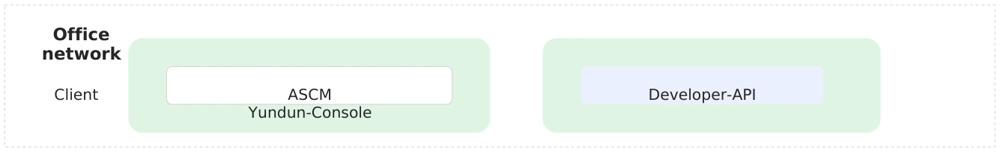

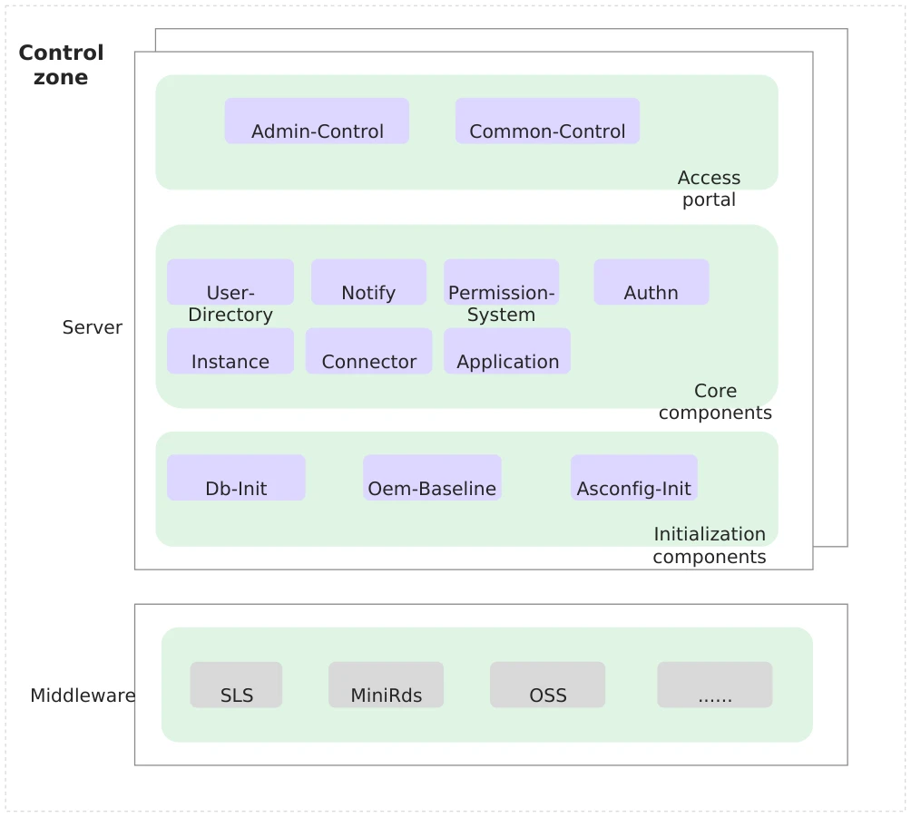

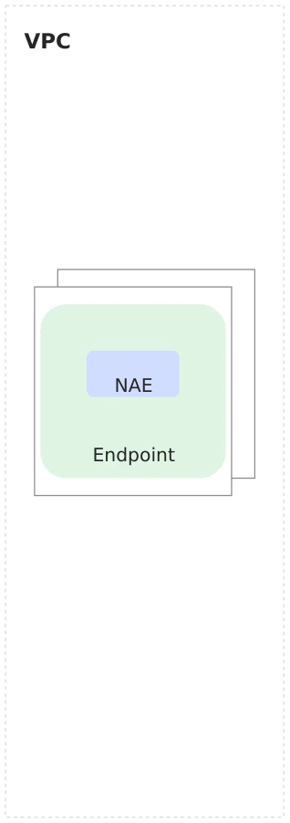

The following table describes the components of IDaaS.

| No. | Component | Description |
| --- | --- | --- |
| 1 | Admin-Control | Control business agent module |
| 2 | Common-Control | Service business agent module |
| 3 | Connector | Synchronization module |
| 4 | Permission-System | Permission module |
| 5 | Application | Application module |
| 6 | Authn | Authentication module |
| 7 | User-Directory | User directory module |
| 8 | Instance | Instance module |
| 9 | Notify | Notification module |
| 10 | Oem-Baseline | Network endpoint module |
| 11 | Db-Init | Initialization base content module |
| 12 | Asconfig-Init | Initialization asconfig module |

<a id="section-1-2"></a>

## 1.2. High availability

This topic describes how Identity as a Service (IDaaS) ensures high availability.

The server side of IDaaS consists of stateless applications and implements load balancing based on virtual IP addresses (VIPs) and Dubbo to ensure service availability.

- The server side is stateless and is deployed in a Kubernetes cluster with at least two nodes. Availability is guaranteed as long as at least one node remains operational.

- Data is stored in middleware such as MetaQ or cloud services such as MiniRDS, Simple Log Service (SLS), Object Storage Service (OSS), and Tair. The middleware and cloud services provide high data storage availability.

- IDaaS provides API operations that can be called over HTTPS and implements load balancing based on domain names and VIPs to ensure service availability.

- Service calls in IDaaS depend on the Dubbo microservices framework. Software-based load balancing of Dubbo ensures service availability.

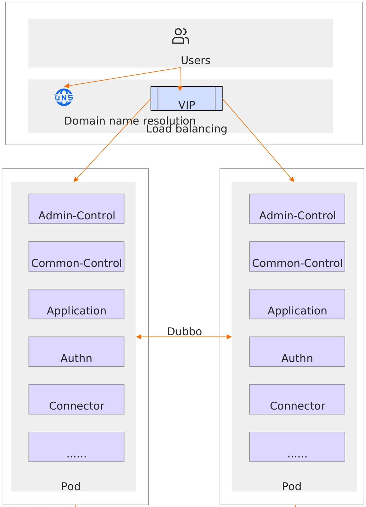

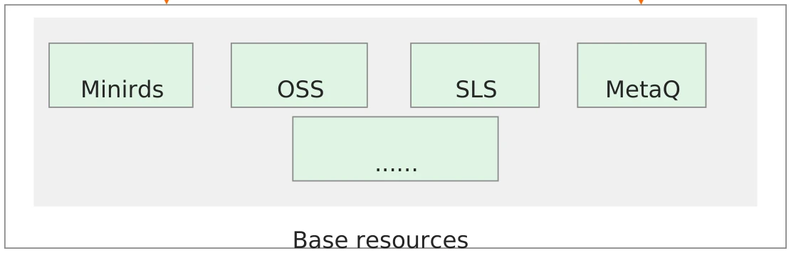

Base resources

<a id="section-1-3"></a>

## 1.3. Disaster recovery and backup

This topic describes the zone-disaster recovery architecture (active-active mode) of Identity as a Service (IDaaS).

**Zone-disaster recovery**

> **Note**
>
> Zone-disaster recovery is delivered by using the active-active mode.

The zone-disaster recovery architecture of IDaaS follows the rules of the active-active mode. In this architecture, disaster recovery is ensured by cloud storage services or middleware.

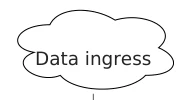

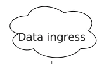

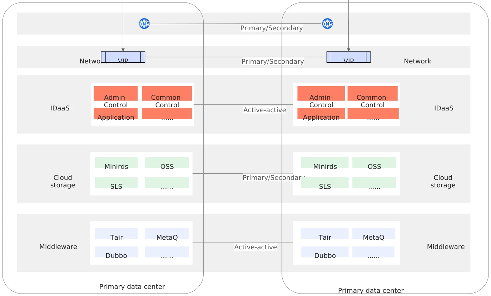

The following table describes each component in the zone-disaster recovery solution:

| No. | Component | Description |
| --- | --- | --- |
| 1 | IDaaS | The active-active deployment strategy depends on middleware and cloud storage to ensure data consistency. |
| 2 | DNS | Anycast VIPs are used to isolate traffic between the primary and secondary data centers. |
| 3 | VIP | BGP routing is used to implement primary/standby switchover. |
| 4 | MiniRDS | Standby databases synchronize data from the primary databases based on binary logs. |
| 5 | SLS | Data synchronization is implemented based on backups in Object Storage Service (OSS). |
| 6 | OSS | Data synchronization between the primary and standby data centers is supported. |
| 7 | Middleware | The active-active deployment strategy depends on MiniRDS to ensure data consistency. |

**Geo-disaster recovery**

> **Note**
>
> Geo-disaster recovery is delivered based on independent regions.

The multi-region architecture of IDaaS follows the rules of independent regions. General regions do not depend on the central region, and data is completely isolated from services.

<a id="section-1-4"></a>

## 1.4. Capacity planning

This topic describes the capacity planning of  `Identity as a Service (IDaaS)` .

**IDaaS specifications**

| IDaaS specifications | IDaaSBaseCluster | Calculation formula |
| --- | --- | --- |
| small | 2 | UserCount &lt; 50000 |
| standard | 4 | UserCount &lt; 200000 |
| large | 6 | UserCount &lt; 500000 |

**MiniRDS specifications**

| Database instance name | Database specifications | Disk<br>(Unit: GB) |
| --- | --- | --- |
| idaas_eiam_user_directory | rds-mys2-large | 100 |
| idaas_eiam_permission_system | rds-mys2-large | 100 |
| idaas_eiam_as | rds-mys2-large | 100 |
| idaas_eiam_instance | rds-mys2-large | 100 |
| idaas_eiam_application | rds-mys2-large | 100 |
| idaas_eiam_connector | rds-mys2-large | 100 |
| idaas_eiam_notify | rds-mys2-large | 100 |

<a id="section-1-5"></a>

## 1.5. Hot upgrade

This topic describes the hot upgrade logic of Identity as a Service (IDaaS).

IDaaS supports hot upgrade by default. No additional O&M operations are required.

<a id="section-2"></a>

# 2.IDaaS O&M operations

<a id="section-2-1"></a>

## 2.1. Log on to the Apsara Infrastructure Management console

This topic describes how to log on to the Apsara Infrastructure Management console.

**Prerequisites**

- The endpoint of the Apsara Uni-manager Operations Console and the username and password that are used to log on to the console are obtained from a deployment engineer or an administrator.

  The endpoint of the Apsara Uni-manager Operations Console is in the following format: ${region}.*ops*.console.*intranet-domain-id*.com.

- A browser is available. We recommend that you use Google Chrome.

**Procedure**

1. Open your browser.

2. In the address bar, enter the endpoint of the Apsara Uni-manager Operations Console. Press the ENTER key.

   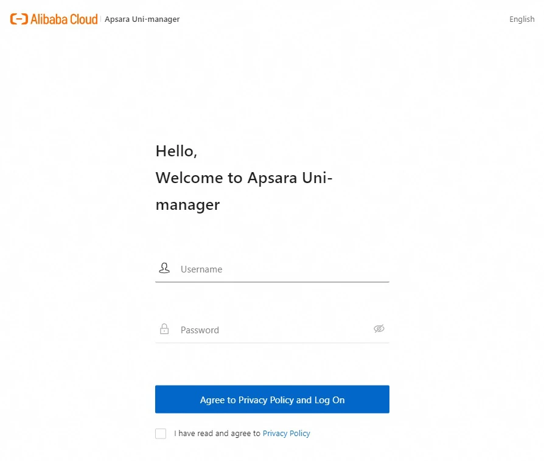

   > **Note**
   >
   > You can click the current language in the upper-right corner to switch to another language. Simplified Chinese and English are supported.

3. Enter your username and password.

   > **Note**
   >
   > Obtain the username and password that are used to log on to the Apsara Uni-manager Operations Console from the deployment engineer or an administrator.

   The first time you log on to the Apsara Uni-manager Operations Console, you must change the password of your username.

   To ensure the security of your account, we recommend that you use a password that meets the minimum complexity requirements. The password must contain letters, digits, and special characters such as exclamation points (!), at signs (@), number signs (#), dollar signs ($), and percent signs (%). The password must be 10 to 20 characters in length.

4. Click Log On to log on to the Apsara Uni-manager Operations Console.

5. In the top navigation bar of the Apsara Uni-manager Operations Console, choose **Products > Base/Platforms > Apsara Infrastructure Management**.

<a id="section-2-2"></a>

## 2.2. Routine inspection on system monitoring

This topic describes how to view the system monitoring data of Identity as a Service (IDaaS).

**Prerequisites**

- The URL, username, and password of the Apsara Uni-manager Operations Console are obtained from the deployment engineer or administrator.

  The URL of the Apsara Uni-manager Operations Console is in the format of *ops*.asconsole.*intranet-domain-id*.com.

- A web browser is available. We recommend that you use Google Chrome.

  1. **Routine inspection on system monitoring**

You can view the monitoring data of each IDaaS module in Cloud Shield Operations Center.

2. **Log in to Cloud Shield Operations Center**

Log in to the Apsara Uni-manager Operations Console. In the top navigation bar, choose **Product Operation > Security O&M > Cloud Shield Operations Center**.

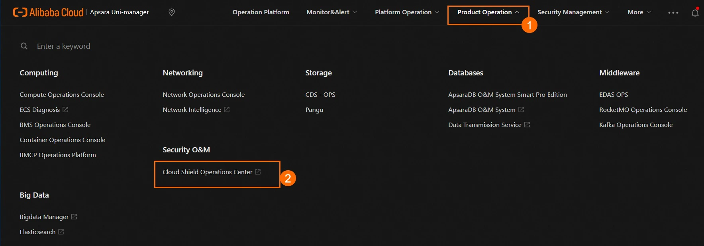

3. **Query the system monitoring data of IDaaS**

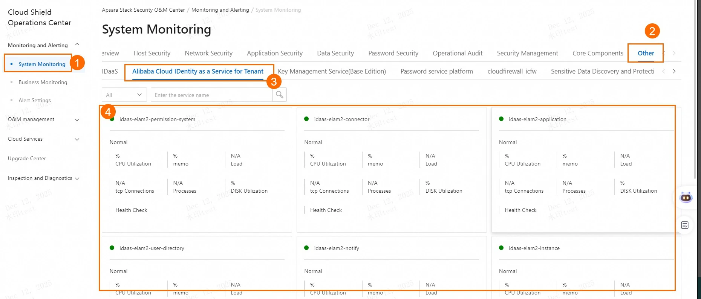

4. **Click a module to query monitoring details**

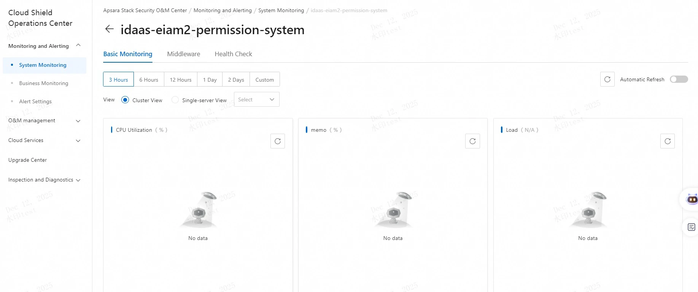

<a id="section-2-3"></a>

## 2.3. Query the version information of IDaaS

This topic describes how to query the version information of Identity as a Service (IDaaS).

**Prerequisites**

- The URL, username, and password of the Apsara Uni-manager Operations Console are obtained from the deployment engineer or administrator.

  The URL of the Apsara Uni-manager Operations Console is in the format of *ops*.asconsole.*intranet-domain-id*.com.

- A web browser is available. We recommend that you use Google Chrome.

  1. **Log in to the Apsara Infrastructure Management console. On**

**the Product & Cluster O&M page, find IDaaS.**

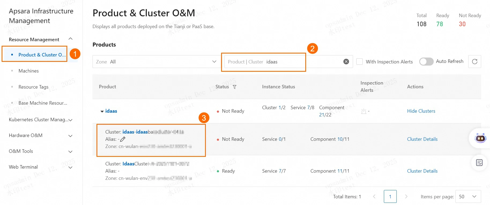

2. **On the Desired Stated Configuration tab of the cluster**

**details page, perform a global search for the keyword product-build-id to locate the corresponding version information.**

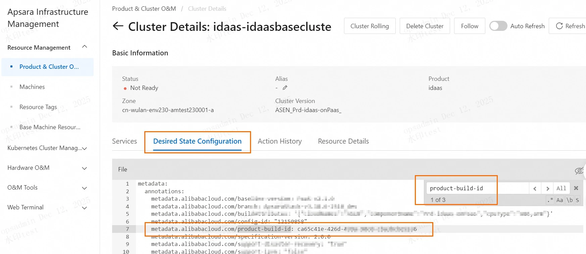

<a id="section-2-4"></a>

## 2.4. Log in to a service container

This topic describes how to log in to a service container of  `Identity as a Service (IDaaS)` .

1. **Find the master node of PaaS and log in to the node**

Typically, the OPS machine serves as the master node. You can log in to the machine and run the following command to verify:

```bash
kubectl get pod -nidaas
```

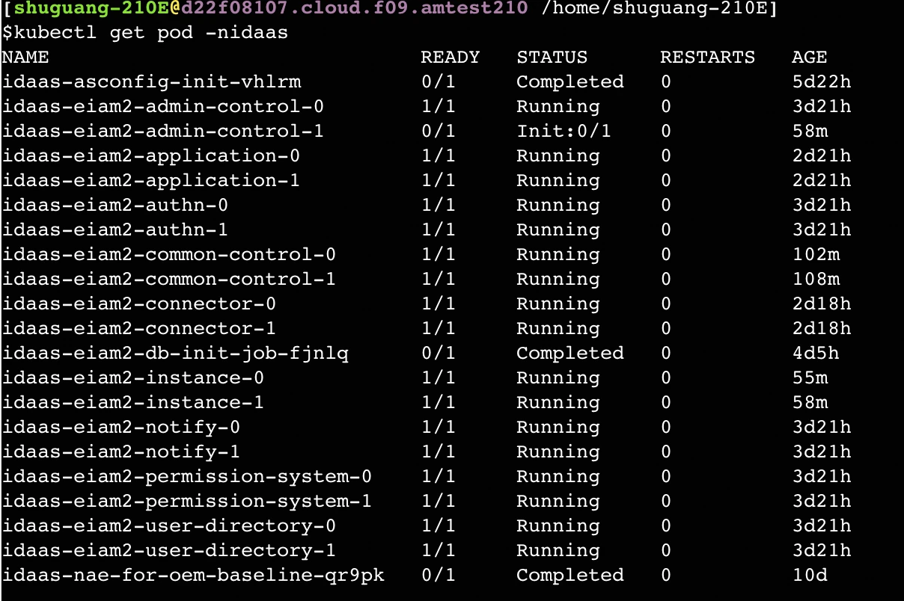

**Note: If the preceding command returns no output, check whether the node is an OPS machine. If not, perform the following operations:**

Go to the node list under Kubernetes cluster management on the O&M side of the  `Apsara Infrastructure Management console` , and query the servers with the master role, as shown in the following figure.

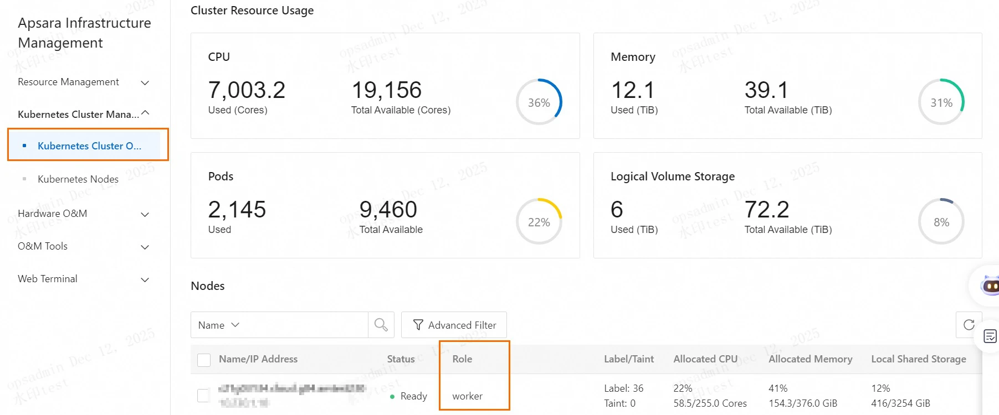

2. **Confirm the ID of the target pod**

```bash
kubectl get pod -nidaas| grep <Target pod>
```


3. **Run the pod login command**

```bash
kubectl exec -it <Target pod ID> -nidaas -- bash
```

&lt;Target pod ID> is the idaas-eiam2-admin-control-0 or idaas-eiam2-authn-0 queried in Step 2.

Expected result

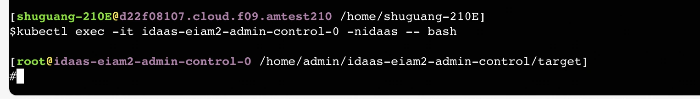

<a id="section-2-5"></a>

## 2.5. Query service PV logs

If you are unable to access a pod to view logs due to frequent restarts, you can use the following method to query the logs.

1. **Find the master node of PaaS and log in to the node**

Typically, the OPS machine serves as the master node. You can log in to the machine and run the following command to verify:

```bash
kubectl get pod -nidaas
```


**Note: If the preceding command returns no output, perform the following operations:**

Go to the node list under Kubernetes cluster management on the O&M side of the Apsara Infrastructure Management console, and query the servers with the master role.


2. **Check the PV mounts of the StatefulSet to which the pod**

**belongs**

Example: Query the PV mounts of the StatefulSet idaas-eiam2-admin-control

```bash
kubectl describe sts <Chart name> -nidaas
```

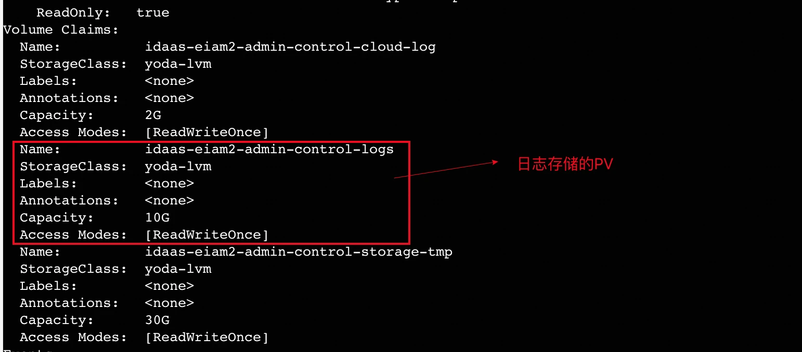

3. **Check the PV created by the StatefulSet**

Example: Query the PV for the StatefulSet idaas-eiam2-admin-control-logs

```bash
kubectl get pv | grep <PV name>
```

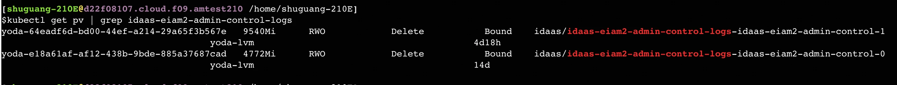

4. **Check the physical machine to which the PV is mounted**

Example: yoda-64eadf6d-bd00-44ef-a214-29a65f3b567e

```bash
kubectl describe pv <PV ID>
```

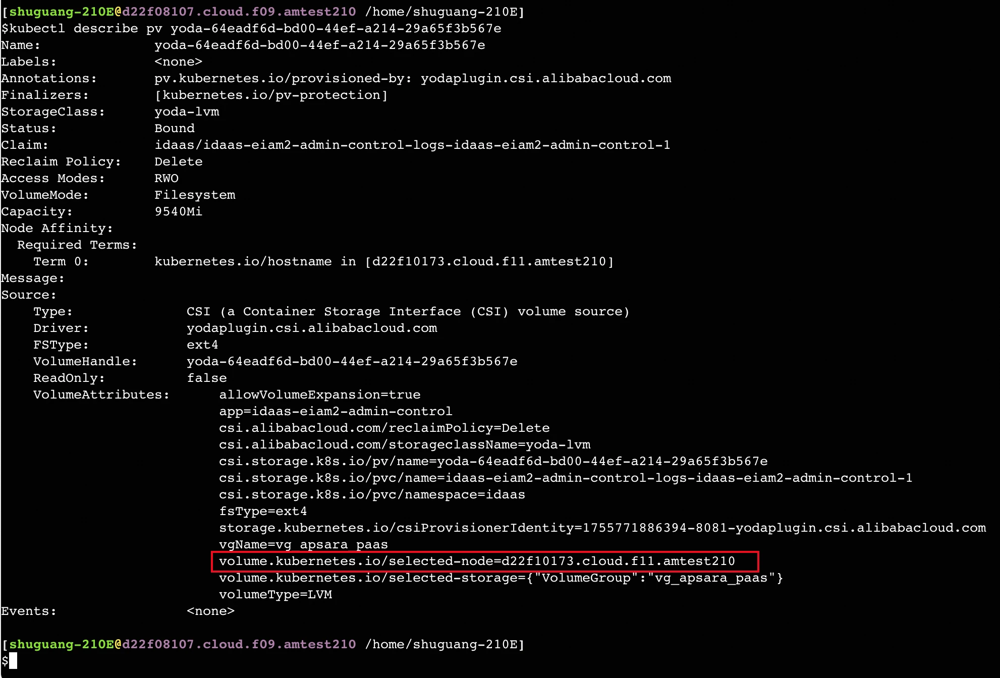

5. **Run the**  **`ssh`**  **command into the corresponding physical**

**machine and check the mount directory**

Example: ssh d22f10173.cloud.f11.amtest210 (this is the name of a machine in the test environment)

```bash
ssh <Machine name>
```

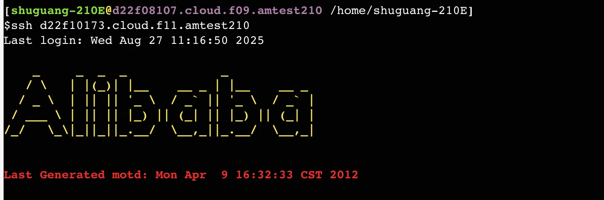

6. **Query the directory of the disk where logs are located**

Example: yoda-64eadf6d-bd00-44ef-a214-29a65f3b567e

```text
lsblk | grep '<PV ID>'
```

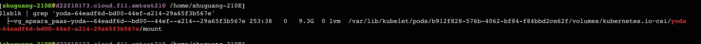

7. **Go to the directory and query logs**

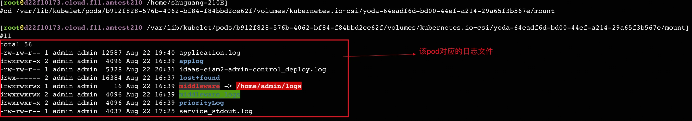
