Alibaba Cloud  
Apsara Stack  
Key Management Service  
Operations and Maintenance  
Guide  
Product Version: V3.18.6  
Document Version: 20260701

**Table of Contents**

- [1.Log on to Cloud Shield Operations Center](#section-1)
- [2.Quota management](#section-2)
    - [2.1. Manage resources](#section-2-1)
    - [2.2. Manage tasks](#section-2-2)
    - [2.3. Manage a throttling rule](#section-2-3)
    - [2.4. Manage a user quota](#section-2-4)
    - [2.5. View global quotas](#section-2-5)
    - [2.6. Configure global settings](#section-2-6)
- [3.Security Audit](#section-3)
    - [3.1. Overview](#section-3-1)
    - [3.2. Log in to the Apsara Uni-manager Operations Console](#section-3-2)
    - [3.3. View the summary information about security audit](#section-3-3)
    - [3.4. Query audit events](#section-3-4)
    - [3.5. View raw logs](#section-3-5)
    - [3.6. View the number of logs](#section-3-6)
    - [3.7. Policy settings](#section-3-7)
        - [3.7.1. Manage audit rules](#section-3-7-1)
        - [3.7.2. Configure alert recipients](#section-3-7-2)
        - [3.7.3. Query the events logs](#section-3-7-3)
        - [3.7.4. Download exported audit events or logs](#section-3-7-4)
        - [3.7.5. Modify system settings](#section-3-7-5)
- [4.Log analysis](#section-4)
    - [4.1. Overview](#section-4-1)
    - [4.2. View logs by using request IDs](#section-4-2)
    - [4.3. Common KMS errors](#section-4-3)
        - [4.3.1. Overview](#section-4-3-1)
        - [4.3.2. Errors with HTTP status code 4XX](#section-4-3-2)
        - [4.3.3. Errors with HTTP status code 500](#section-4-3-3)
        - [4.3.4. Errors with HTTP status code 503](#section-4-3-4)
        - [4.3.5. Degradation of dependency on a service](#section-4-3-5)
- [5.Access control](#section-5)
    - [5.1. Manage read/write permission verification](#section-5-1)
- [6.O&M of KMS components](#section-6)
    - [6.1. Overview](#section-6-1)
    - [6.2. Log on to the Apsara Infrastructure Management console](#section-6-2)
    - [6.3. KMS_HOST](#section-6-3)
    - [6.4. HSA](#section-6-4)
    - [6.5. etcd](#section-6-5)
    - [6.6. Rotator](#section-6-6)
        - [6.6.1. Primary data center](#section-6-6-1)
        - [6.6.2. Secondary data center](#section-6-6-2)

# 1.Log on to Cloud Shield Operations Center

Cloud Shield Operations Center is an operations platform for Apsara Stack Security services. The platform monitors the status and workloads of Apsara Stack Security services in real time and sends alert notifications to users. This topic describes how to log on to Cloud Shield Operations Center.

**Prerequisites**

- The endpoint of the Apsara Uni-manager Operations Console and the username and password that are used to log in to the console are obtained from a deployment engineer or an administrator.

  The endpoint of the Apsara Uni-manager Operations Console is in the following format: *region-id*.ops.console.*intranet-domain-id*.

- A supported browser is used. We recommend that you use Google Chrome.

**Procedure**

1. Open your browser.

2. In the address bar, enter the endpoint of the Apsara Uni-manager Operations Console. Press the ENTER key.

   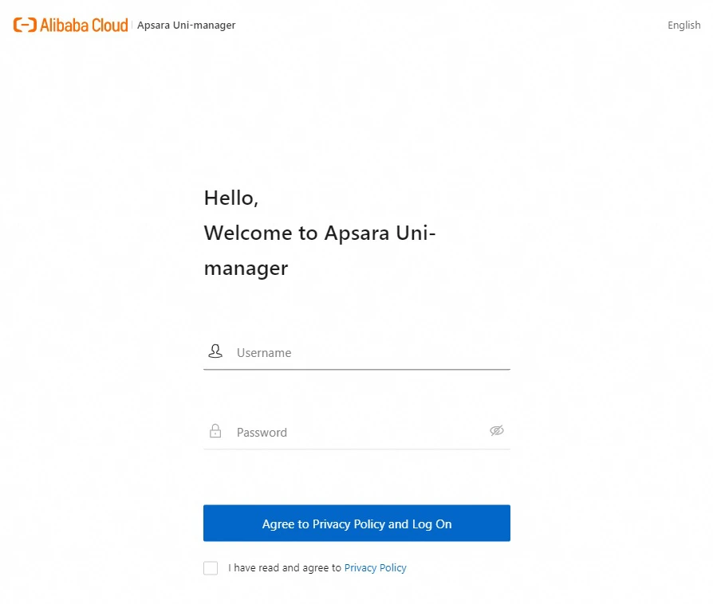

   > **Note**
   >
   > You can click the current language in the upper-right corner to switch to another language. Simplified Chinese and English are supported.

3. Enter your username and password.

   > **Note**
   >
   > - Obtain the username and password that are used to log on to the Apsara Uni-manager Operations Console from a deployment engineer or an administrator.
   >
   > - If you enter an invalid password for three consecutive times, the system enables the image verification logon feature. If you enter an invalid password for five consecutive times, the account is locked. Contact the administrator to unlock the account.
   >
   > - The first time that you log on to the Apsara Uni-manager Operations Console, change the password for your username as prompted.
   >
   >   To enhance security, your password must meet the following requirements:
   >
   >   - The password contains uppercase and lowercase letters.
   >
   >   - The password contains digits.
   >
   >   - The password contains at least one of the following special characters: ! @ # $ %
   >
   >   - The password is 10 to 20 characters in length.

4. Click **Agree to Private Policy and Log On**.

5. In the top navigation bar, choose **Product Operation > Security O&M > Cloud Shield Operations Center**.

**View execution results**

You can view information on the pages of **Cloud Shield Operations Center**.

# 2.Quota management

## 2.1. Manage resources

This topic describes how to manage resources. You can register and initialize resources.

**Procedure**

1. Log on to Cloud Shield Operations Center.

2. In the left-side navigation pane, choose **Cloud Services** > **KMS O&M** > **Tenant-side KMS O&M**.

3. On the **Resources** tab, click **Register Resource**. In the **Register Resource** dialog box, configure the parameters that are described in the following table and click **OK**.

   - KMS-managed HSMs

     | Parameter | Description |
     | --- | --- |
     | Zone | The zone in which you want to deploy the hardware security module (HSM). |
     | Manufacturer | The manufacturer of the HSM. The value of this parameter is automatically provided based on the value of the HSM Model parameter. You do not need to configure this parameter. |
     | HSM Model | The model of the HSM. Make sure that you select the actual model in use. |
     | HSM IP Address | The IP address of the HSM. Enter an IP address that is planned by Deployment Planner. Example: 10.4.XX.XX. If you select a virtual security module (VSM) as HSM Model, enter the IP address of the VSM. |

   - Cloud Hardware Security Module-managed HSMs

     > **Important**
     >
     > If you have already registered Key Management Service (KMS)-managed HSMs, the Cloud Hardware Security Module-managed HSMs tab is dimmed.

     | Parameter | Description |
     | --- | --- |
     | Zone | The zone in which you want to deploy the HSM. |
     | Manufacturer | The manufacturer of the HSM. |
     | HSM Model | The model of the HSM. Make sure that you select the actual model in use. |
     | HSM | The HSM that you want to register. |

4. Initialize the HSM.

   <ol type="i">

   <li>

   In the left-side navigation pane, choose **Cloud Services** > **KMS O&M** > **Tenant-side KMS O&M**.

   </li>

   <li>

   On the **Resources** tab, click **Initialize HSM**. In the **Initialize HSM** message, click **OK**.

   > **Note**
   >
   > - If the number of VSMs is smaller than 3, you cannot initialize the HSM.
   >
   > - After the initialization request is submitted, the system generates an O&M task. You can choose **Cloud Services** > **KMS O&M** > **Tenant-side KMS O&M** in the left-side navigation pane to go to the Tenant-side KMS O&M page and view the status of the O&M task on the **Tasks** tab.
   >
   > - After the HSM is initialized, health check tasks for the HSM are continuously added to the task list. You can use HSM-related features.

   </li>

   </ol>

5. Disable the HSM.

   <ol type="i">

   <li>

   In the left-side navigation pane, choose **Cloud Services** > **KMS O&M** > **Tenant-side KMS O&M**.

   </li>

   <li>

   On the **Resources** tab, find the HSM that you want to disable and click **Bring Offline** in the **Actions** column.

   </li>

   <li>

   Obtain the O&M code for this operation from Apsara Stack technical support as prompted, enter the O&M code in the field, and then

   </li>

   </ol>

   click **OK**.

## 2.2. Manage tasks

This topic describes how to view existing tasks on the Tasks tab.

**Procedure**

1. Log on to Cloud Shield Operations Center.

2. In the left-side navigation pane, choose **Cloud Services > KMS O&M > Tenant-side KMS O&M**.

3. On the Tenant-side KMS O&M page, click the **Tasks** tab. On the Tasks tab, configure the **Type**, **Status**, or **ID** parameter to search for the task that you want to query.

4. Click the  icon to the left of the task ID to query the execution information about its sub-tasks.

   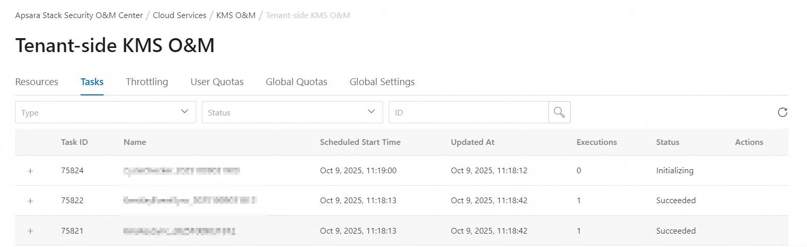

## 2.3. Manage a throttling rule

This topic describes how to create and modify a throttling rule.

**Create a throttling rule**

1. Log on to Cloud Shield Operations Center.

2. In the left-side navigation pane, choose **Cloud Services > KMS O&M > Tenant-side KMS O&M**.

3. On the **Tenant-side KMS O&M** page, click the **Throttling** tab.

4. On the **Throttling** tab, click **Create Throttling Rule**.

5. In the **Register Resource** dialog box, configure the parameters that are described in the following table and click **Ok**.

   | Parameter | Description |
   | --- | --- |
   | Resource | The name of the resource to which the throttling rule applies. Valid values: • s: applies to all API operations. • d: applies to the default API operation. |
   | Apply To | The method to combine user and service IDs for your application. Valid values: • d: combines all user IDs and service IDs. This is the default value. • d_d: combines the default user and service IDs. |
   | Threshold | The threshold for throttling. |
   | Throttling Policy | • The throttling policy. Valid values: Standalone Throttling: Throttling is implemented on a single Key Management Service (KMS) API operation. • Standalone Token Bucket: Throttling is implemented on a single user. |
   | Time Unit | The time unit for throttling. |

**Modify a throttling rule**

1. Log on to Cloud Shield Operations Center.

2. In the left-side navigation pane, choose **Cloud Services > KMS O&M > Tenant-side KMS O&M**.

3. On the **Tenant-side KMS O&M** page, click the **Throttling** tab.

4. On the Throttling tab, find the throttling rule that you want to modify and click **Modify** in the **Actions** column.

5. In the **Modify Rule** dialog box, configure the parameters that are described in the following table and click **Ok**.

   | Parameter | Description |
   | --- | --- |
   | Resource | The name of the resource to which the throttling rule applies. Valid values: • s: applies to all API operations. • d: applies to the default API operation. |
   | Apply To | The method to combine user and service IDs for your application. Valid values: • d: combines all user IDs and service IDs. This is the default value. • d_d: combines the default user and service IDs. |
   | Threshold | The threshold for throttling. Note If you want to change the value of this parameter, you must change it for two rules. One rule has the Resource parameter set to s and the Apply To parameter set to d. The other rule has the Resource parameter set to s and the Apply To parameter set to d_d. |
   | Throttling Policy | • The throttling policy. Valid values: Standalone Throttling: Throttling is implemented on a single KMS API operation. • Standalone Token Bucket: Throttling is implemented on a single user. |
   | Time Unit | The time unit for throttling. |

## 2.4. Manage a user quota

This topic describes how to create and modify a user quota.

**Create a user quota**

1. Log on to Cloud Shield Operations Center.

2. In the left-side navigation pane, choose **Cloud Services > KMS O&M > Tenant-side KMS O&M**.

3. On the **Tenant-side KMS O&M** page, click the **User Quotas** tab.

4. On the User Quotas tab, click **Create Quota**.

5. In the **Create Quota** dialog box, configure the parameters that are described in the following table and click Ok.

   | Parameter | Description |
   | --- | --- |
   | User ID | The ID of the user. |
   | Key Quota | The maximum number of keys that are supported. |

**Modify a user quota**

1. Log on to Cloud Shield Operations Center.

2. In the left-side navigation pane, choose **Cloud Services > KMS O&M > Tenant-side KMS O&M**.

3. On the **Tenant-side KMS O&M** page, click the **User Quotas** tab.

4. On the User Quotas tab, find the ID of the user whose quota you want to modify and click **Modify** in the **Actions** column.

5. In the **Modify** dialog box, configure the parameters that are described in the following table and click Ok.

   | Parameter | Description |
   | --- | --- |
   | Key Quota | The maximum number of keys that are supported. |
   | Alias Quota | The maximum number of aliases. |

## 2.5. View global quotas

This topic describes how to view global quotas.

**Procedure**

1. Log on to Cloud Shield Operations Center.

2. In the left-side navigation pane, choose **Cloud Services > KMS O&M > Tenant-side KMS O&M**.

3. On the Tenant-side KMS O&M page, click the Global Quotas tab. On the **Global Quotas** tab, view the information about global quotas. Global quotas cannot be modified.

## 2.6. Configure global settings

By default, TASS Crypto Engine hardware security modules (HSMs) do not support ShangMi (SM) algorithms. If your business requires SM algorithms, you need to turn on HSMs (TASSCryptoEngine) Support SM Algorithms on the Global Settings tab. This topic describes how to enable TASS Crypto Engine HSMs to support SM algorithms.

> **Warning**
>
> By default, this feature is disabled. After this feature is enabled, TASS Crypto Engine HSMs support the SM2 and SM4 algorithms. Use of this feature outside the Chinese mainland must comply with all applicable local laws and regulations. Enable this feature with caution.

**Procedure**

1. Log on to Cloud Shield Operations Center.

2. In the left-side navigation pane, choose **Cloud Services > KMS O&M > Tenant-side KMS O&M**.

3. On the Tenant-side KMS O&M page, click the **Global Settings** tab. On the Global Settings tab, turn on or off **HSMs (TASSCryptoEngine) Support SM Algorithms**.

# 3.Security Audit

## 3.1. Overview

A security audit refers to the systemic and independent inspection and verification of activities and behavior in the computer network environment. Delegated by property owners and authorized by management authorities, professional auditors give their assessments according to relevant laws and regulations. When the administrator needs to backtrack system operations, the administrator can perform a security audit.

Security audits are long-term security management activities throughout the lifecycle of cloud services. The security audit feature of Apsara Stack Security can collect system security data, analyze weaknesses in system operations, report audit events, and classify audit events into important, moderate, and low risk levels. The security administrator views and analyzes audit events to continuously improve the system and ensure the security and reliability of cloud services.

## 3.2. Log in to the Apsara Uni-manager Operations Console

This topic describes how to log on to the Apsara Uni-manager Operations Console.

**Prerequisites**

- The URL, username, and password that are required to log on to the Apsara Uni-manager Operations Console are obtained from the deployment personnel or administrators.

  The URL of the Apsara Uni-manager Operations Console is in the format of *region-id*.ops.console.*intranet-domain-id*.

- A browser is available. We recommend that you use Google Chrome.

**Procedure**

1. Open your browser.

2. In the address bar, enter the URL. Then, press the Enter key.

   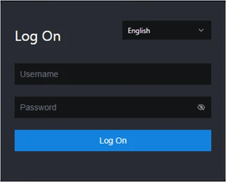

   > **Note**
   >
   > You can select a language from the drop-down list in the upper-right corner of the page.

3. Enter your username and password.

   > **Note**
   >
   > To obtain the username and password that are used to log on to the Apsara Uni-manager Operations Console, contact the deployment personnel or administrators.

   Upon your first login to the Apsara Uni-manager Operations Console, you must change the your password as prompted.

   To enhance security, make sure that the password meets the following requirements:

   - The password contains uppercase and lowercase letters.

   - The password contains digits.

   - The password contains special characters such as exclamation points (!), at signs (@), number signs (#), dollar signs ($), and percent signs (%).

   - The password is 10 to 20 characters in length.

4. Click **Log On**.

## 3.3. View the summary information about security audit

This topic describes how to view the summary information about security audit.

**Background information**

The **Overview** tab provides reports on the raw log trend, audit event trend, audit risk distribution, and security event distribution. The reports are displayed in run charts or pie charts to help security administrators analyze the trend of risks in your cloud services.

On the **Overview** tab, security administrators can check the number of logs and the storage usage in a specific time range.

**Procedure**

1. Log on to the Apsara Uni-manager Management Console.

2. In the upper-right corner of the Apsara Uni-manager Management Console, choose **Security** > **Global Platform Security > Security Operations Center**. On the **Security Operations Center** page, select a region from the **Region** drop-down list and click **Access with Authorized Role**.

3. choose In the left-side navigation pane,.

4. On the **Security Audit** page, click the **Overview** tab.

5. On the **Overview** tab, view the audit summary for the last seven days.

   - Trends of Raw Log

     This chart displays the trend of logs that are generated by **Platform Database**, **Server**, **Network Device**, **ECS**, **Cloud Products**, or **Platform Database(new)** in the last seven days. Security administrators can analyze the trend to check whether the number of logs is at a normal level.

   - Audit Events

     This chart displays the trend of audit events that are generated by **Platform Database**, **Server**, **Network Device**, **ECS**, **Cloud Products**, or **Platform Database(new)** in the last seven days. Security administrators can analyze the trend to check whether the number of audit events is at a normal level.

   - Audit Risk Distribution

     This chart displays the percentage distribution of audit events at different risk levels in the last seven days. Risk levels are important, moderate, and low. Security administrators can analyze the trend to check whether the audit events are at acceptable risk levels.

   - Security Issue Distribution

     This chart displays the percentage distribution of different event types in the last seven days. Security administrators can analyze this chart to check for the most frequent audit events and identify high-risk events to improve security protection.

   - Log Size

     This chart displays the volume of online logs and offline logs. If the logs consume a large number of storage resources, we recommend that you back up the required audit logs and delete unnecessary logs.

   - Audit Log Size

     This chart displays the size of logs for each audit type.

6. View the audit summary in a specific time range.

   <ol type="i">

   <li>

   Specify **End Time** as the end of the time range to query.

   </li>

   <li>

   In the **Audit Type** section, select the audit types that you want to query.

   </li>

   <li>

   Click **View** to query the audit summary in the last seven days before the specified end time.

   </li>

   </ol>

## 3.4. Query audit events

This topic describes how to query audit events.

**Background information**

On the **Audit Query** tab, you can view the details of audit events, including the log creation time, audit type, audit object, action type, risk level, and log content.

The system matches the logs that are collected by a security audit module against audit rules. If the log content matches the regular expression in an audit rule, an audit event is reported.

**Procedure**

1. Log on to the Apsara Uni-manager Management Console.

2. In the upper-right corner of the Apsara Uni-manager Management Console, choose **Security** > **Global Platform Security > Security Operations Center**. On the **Security Operations Center** page, select a region from the **Region** drop-down list and click **Access with Authorized Role**.

3. In the left-side navigation pane, choose **Operations > Security Audit**.

4. On the **Security Audit** page, click the **Audit Query** tab.

5. On the **Audit Query** tab, configure query conditions to view audit events within the specified time range.

   - Basic query

     <ol type="a">

     <li>

     Configure the following parameters: **Audit Type**, **Audit Target**, **Action Type**, **Action**, **Risk Level**, and **Notify**.

     </li>

     <li>

     Specify a time range to query.

     </li>

     </ol>

     <ol type="i" start="100">

     <li>

     In the **Full-Text Search** search box, enter a keyword.

     </li>

     <li value="500">

     Click **Search**.

     </li>

     </ol>

   - Advanced query

     In addition to the basic query conditions, you can configure advanced query conditions.

     <ol type="a">

     <li>

     Configure basic query conditions.

     </li>

     <li>

     Click **Advanced Search**.

     </li>

     </ol>

     <ol type="i" start="100">

     <li>

     In the **Advanced Search** dialog box, configure **Filter Name**, **User**, **Target**, **Action**, **Result**, and **Cause**.

     </li>

     <li value="500">

     Click **Save**.

     </li>

     </ol>

6. Click **Export** to export the audit events. Download the exported file for analysis. For more information, see Manage export tasks.

## 3.5. View raw logs

On the Raw Logs tab, you can view the raw logs that are generated by a running audit object. Raw logs contain information that is required for debugging. Security administrators can use these raw logs to troubleshoot system failures. This topic describes how to view raw audit logs.

**Procedure**

1. Log on to the Apsara Uni-manager Management Console.

2. In the upper-right corner of the Apsara Uni-manager Management Console, choose **Security** > **Global Platform Security > Security Operations Center**. On the **Security Operations Center** page, select a region from the **Region** drop-down list and click **Access with Authorized Role**.

3. In the left-side navigation pane, choose **Operations > Security Audit**.

4. On the **Raw Logs** tab of the **Security Audit** page, configure query conditions to view the log summary chart and raw logs within a specific time range.

   <ol type="i">

   <li>

   Specify **Audit Type** and **Audit Target**.

   </li>

   <li>

   Specify a time range to query.

   </li>

   <li>

   Enter a keyword.

   </li>

   <li>

   Click **Search**. In the raw log list, you can view the **Source**, **Audit Target**, and **Log Content** of a log.

   </li>

   </ol>

5. Click **Export** to export the audit events. Download the exported file for analysis. For more information, see Download exported audit events or logs.

## 3.6. View the number of logs

This topic describes how to view and manage log sources.

**Background information**

You can view the number of logs and specify whether to show logs by log type or log source.

- The Log Types tab provides the number of all logs for a specific audit object of a specific device instance.

- The Log Sources tab provides the number of logs for all audit objects of a specific device instance.

**Procedure**

1. Log on to the Apsara Uni-manager Management Console.

2. In the upper-right corner of the Apsara Uni-manager Management Console, choose **Security** > **Global Platform Security > Security Operations Center**. On the **Security Operations Center** page, select a region from the **Region** drop-down list and click **Access with Authorized Role**.

3. In the left-side navigation pane, choose **Operations > Security Audit**.

4. On the **Log Sources** tab, click the **Log Types** tab to view the number of logs by audit object.

   You can view the number of logs that are recorded on the current day and the number of logs that are recorded during the last 30 days for each audit object.

   If you do not want to display the logs for an audit object, perform the following steps:

   <ol type="i">

   <li>

   Find the audit object and click **Hide** in the **Actions** column.

   </li>

   <li>

   In the Note message, click **Confirm**.

   </li>

   </ol>

   > **Note**
   >
   > The process that is used to display the logs for an audit object is similar to the process that is used to hide the logs.

5. Click the **Log Sources** tab and view the number of logs for each device instance.

   You can view the number of logs that are recorded on the current day and the number of logs that are recorded during the last 30 days for each device instance.

   If you do not want to display the logs for an audit object from a specific device instance, perform the following steps:

   <ol type="i">

   <li>

   Find the device instance and click **Hide** in the **Actions** column.

   </li>

   <li>

   In the message that appears, click **OK**.

   </li>

   </ol>

   > **Note**
   >
   > The process that is used to display the logs for an audit object is similar to the process that is used to hide the logs.

## 3.7. Policy settings

### 3.7.1. Manage audit rules

This topic describes how to create, modify, or delete an audit rule.

**Background information**

If a log matches an audit rule, an audit event is reported. You can specify regular expressions in an audit rule to match logs. A regular expression defines a matching pattern for character strings and can be used to check whether a string contains a specific substring. The following table provides examples about the pattern.

| Regular expression | Description |
| --- | --- |
| <code>^\d{5,12}$</code> | Matches the consecutive numbers from the fifth number to the twelfth number. |
| <code>load_file\(</code> | Matches the "load_file(" string. |

The security audit module defines the default audit rule based on the string that is generated in the log. This applies when an audit event is reported. A security administrator can also customize audit rules based on the string that is generated in the log. This applies when the system encounters an attack.

**Procedure**

1. Log on to the Apsara Uni-manager Management Console.

2. In the upper-right corner of the Apsara Uni-manager Management Console, choose **Security** > **Global Platform Security > Security Operations Center**. On the **Security Operations Center** page, select a region from the **Region** drop-down list and click **Access with Authorized Role**.

3. In the left-side navigation pane, choose **Operations > Security Audit**.

4. On the **Security Audit** page, click the **Policy Settings** tab.

5. On the **Policy Settings** tab, click the **Audit Rules** tab.

6. Create an audit rule.

   <ol type="i">

   <li>

   Click **New**.

   </li>

   <li>

   In the dialog box that appears, configure the parameters.

   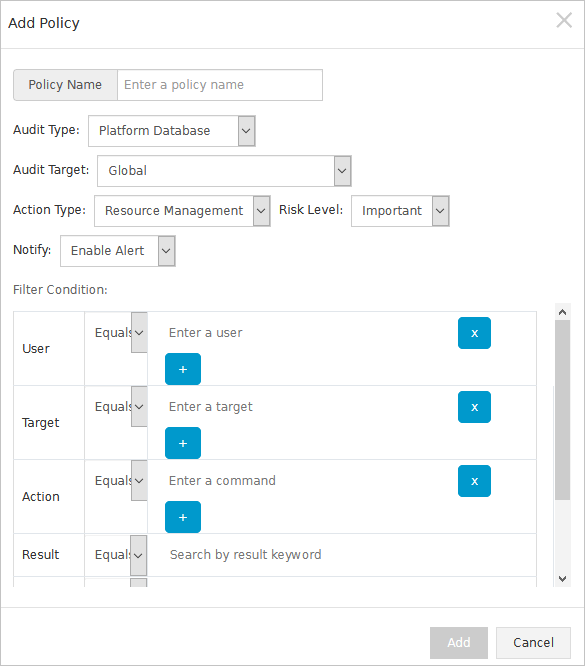

   </li>

   <li>

   Click **Add**.

   </li>

   </ol>

   The system sends an alert email to the specified alert recipient after you create an audit rule. This applies if one string in an audit log of the specified audit type, audit object, or risk level matches the regular expression of the audit rule.

7. Manage audit rules. You can create, query, disable, enable, and delete audit rules.

   - Query audit rules

     Specify **Audit Type** and **Audit Target**. Enter a keyword in the search box and click **Search**.

   - Disable an audit rule

     Find the audit rule that you want to disable and click **Disable** in the **Actions** column.

   - Enable an audit rule

     Find the audit rule that has been disabled and click **Enable** in the **Actions** column.

   - Delete an audit rule

     Find the audit rule that you want to delete and click **Delete** in the **Actions** column.

     > **Note**
     >
     > You can delete only custom rules.

### 3.7.2. Configure alert recipients

This topic describes how to configure the recipients of alerts on audit events.

**Background information**

After you specify an alert recipient, the system sends a report to the email address of the alert recipient when an audit event occurs.

**Procedure**

1. Log on to the Apsara Uni-manager Management Console.

2. In the upper-right corner of the Apsara Uni-manager Management Console, choose **Security** > **Global Platform Security > Security Operations Center**. On the **Security Operations Center** page, select a region from the **Region** drop-down list and click **Access with Authorized Role**.

3. In the left-side navigation pane, choose **Operations > Security Audit**.

4. On the **Security Audit** page, click the **Policy Settings** tab.

5. On the **Policy Settings** tab, click the **Alert Settings** tab.

6. Create an alert recipient.

   <ol type="i">

   <li>

   Click **New**.

   </li>

   <li>

   In the **Add Alert Recipient** dialog box, configure the parameters.

   </li>

   <li>

   Click **OK**.

   </li>

   </ol>

7. Manage alert recipients.

   - Search for alert recipients

     Specify **Audit Type**, **Audit Target**, and **Risk Level**, enter the keyword of the email address, and then click **Search**.

   - Delete alert recipients

     Find the email address that you want to delete and click **Delete** in the Actions column.

### 3.7.3. Query the events logs

This topic describes how to query and download the archives of audit events and raw logs.

**Background information**

You can download the archives of events and logs to analyze audit events. This ensures the security of the Apsara Stack environment. Log on to the Apsara Uni-manager Management Console.

**Procedure**

1. Log on to the Apsara Uni-manager Management Console.

2. In the upper-right corner of the Apsara Uni-manager Management Console, choose **Security** > **Global Platform Security > Security Operations Center**. On the **Security Operations Center** page, select a region from the **Region** drop-down list and click **Access with Authorized Role**.

3. In the left-side navigation pane, choose **Operations > Security Audit**.

4. On the Security Audit page, click the **Policy Settings** tab.

5. On the **Policy Settings** tab, click the **Archiving** tab.

6. Query the archives of events and logs.

   <ol type="i">

   <li>

   Specify **Audit Type** and **Archiving Type**.

   </li>

   <li>

   Specify a time range to query.

   </li>

   <li>

   Click **Search**. Find the file where the archive information is stored and click Download in the Actions column to save the archive file to

   </li>

   </ol>

   your computer.

### 3.7.4. Download exported audit events or logs

This topic describes how to download exported audit events or logs.

**Background information**

You can export audit events or logs on the **Audit Query** or **Raw Log** tab of the Security Audit page. After you export audit events or logs, you can manage the export tasks on the Exporting tab.

**Procedure**

1. Log on to the Apsara Uni-manager Management Console.

2. In the upper-right corner of the Apsara Uni-manager Management Console, choose **Security** > **Global Platform Security > Security Operations Center**. On the **Security Operations Center** page, select a region from the **Region** drop-down list and click **Access with Authorized Role**.

3. In the left-side navigation pane, choose **Operations > Security Audit**.

4. On the **Security Audit** page, click the **Policy Settings** tab.

5. On the **Policy Settings** tab, click the **Exporting** tab.

6. View the created export tasks.

   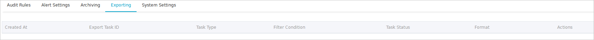

7. Click **download** to download audit events or logs to your on-premises server. To delete an export task, click **Delete**.

### 3.7.5. Modify system settings

This topic describes how to configure system parameters for security audit.

**Background information**

You can configure system parameters to specify the maximum number of system alerts per day and the maximum number of audits per day for raw logs.

**Procedure**

1. Log on to the Apsara Uni-manager Management Console.

2. In the upper-right corner of the Apsara Uni-manager Management Console, choose **Security** > **Global Platform Security > Security Operations Center**. On the **Security Operations Center** page, select a region from the **Region** drop-down list and click **Access with Authorized Role**.

3. In the left-side navigation pane, choose **Operations > Security Audit**.

4. On the **Security Audit** page, click **Policy Settings**.

5. On the **Policy Settings** tab, click the **System Settings** tab.

6. Find the system parameter that you want to modify and click **Edit** in the **Actions** column.

   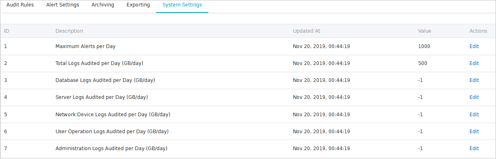

7. Enter a required value in the Value column and click **OK** in the Actions column.

# 4.Log analysis

## 4.1. Overview

When the administrator needs to backtrack operations of Key Management Service (KMS), the administrator can perform a security audit.

Security audits are long-term security management activities throughout the lifecycle of cloud services. The security audit feature of Apsara Stack Security can collect system security data, analyze weaknesses in system operations, and report audit events to administrators. The administrator can view and analyze the audit events to continuously improve the security and reliability of cloud services.

> **Note**
>
> KMS logs are collected to Log Service by using Logtail. You can analyze the logs in the Log Service console or by calling Log Service API operations. If you cannot analyze the logs in the Log Service console or by calling Log Service API operations, you must log on to the servers on which KMS is deployed and analyze the logs on each server.

## 4.2. View logs by using request IDs

After you send a request to Key Management Service (KMS), KMS sends you a message that contains a request ID. This topic describes how to view logs by using request IDs.

Request IDs can be used in the following scenarios:

- You can view the KMS audit logs in the /cloud/log/kms/KmsHost#/kms_host/audit.log file.

  You can view the audit log information of the current access based on the value of request_id.

- For log entries whose expected_code values are not 200, you can view error information in the debug logs based on the value of request_id. Path to the on-premises logs: /cloud/log/kms/KmsHost#/kms_host/debug.log

  > **Note**
  >
  > The /cloud/log/kms/KmsHost#/kms_host/debug.log and audit.log files are stored on the same machine.

- If you need all details of a request, you can view detailed information in the trace logs. Path to the on-premises logs: /cloud/log/kms/KmsHost#/kms_host/debug.log

  > **Note**
  >
  > The /cloud/log/kms/KmsHost#/kms_host/debug.log and audit.log files are stored on the same machine.

- You can associate a cryptographic API operation with the trace logs of HSA by using the value of request_id. Path to the on-premises logs: /cloud/log/kms/HSA#/hsa/trace.log

  > **Note**
  >
  > The /cloud/log/kms/KmsHost#/kms_host/trace.log and audit.log files may be stored on different machines.

- You can retrieve log information based on other information.

  You can retrieve the information in the audit logs of KMS by using information other than request_id. If you need to associate the audit logs with other logs, you must use request_id.

## 4.3. Common KMS errors

### 4.3.1. Overview

KMS has two HTTP status codes in audit.log: expected_code and status_code.

Typically, the expected code and status code of an error are the same. ( `expected_code = status_code` ). However, there are exceptions.

status_code is the HTTP status code that is actually returned to a user.

### 4.3.2. Errors with HTTP status code 4XX

Most errors with HTTP status code 4XX are included in the business logic of KMS. For example, HTTP status code 403 indicates a user request authentication failure, and HTTP status code 400 indicates that an input parameter is invalid.

You can view the details of an error in the debug log by using the value of request_id.

### 4.3.3. Errors with HTTP status code 500

This type of error is not included in the business logic of KMS. They are severe errors and must be fixed immediately.

In most scenarios, if the status code of an error is **500**, the expected code of this error is also **500**.

Such an error may be caused by an unexpected exception in a dependency service. We recommend that you contact the technical support personnel of the dependency service for further assistance.

You can view the details of an error in the debug log by using the value of request_id.

### 4.3.4. Errors with HTTP status code 503

An error with HTTP status code 503 occurs when the user interrupts the connection or a dependency service of Key Management Service (KMS) is abnormal. We recommend that you handle the exception at the earliest opportunity.

The status code and expected code of such an error may be different or consistent.

- The status code is 503 but the expected code is not 503.

  Possible causes:

  - The client of a user interrupts the connection in advance.

  - The client times out because KMS that functions as the server does not respond within the timeout period.

  You can check the trace logs by using the value of request_id to determine whether the error is caused by a slow response of the server and identify the specific module.

- Both the status code and expected code are 503.

  Such an error is an expected error in a dependency service of KMS. It may occur when the performance of the dependency service is unstable.

  You can view the details of the error in the debug logs by using the value of request_id. We recommend that you contact the technical support of the dependency service for further assistance.

### 4.3.5. Degradation of dependency on a service

KMS stores the data of its dependency services in the local cache. If a dependency service is unavailable, KMS uses the obsolete data stored in the cache.

In this scenario, the status code in the audit log of KMS is 200, but an additional debug log will be generated.

When this situation occurs, users with cached data can access KMS. However, users without cached data encounter a 503 error when they try to access KMS.

# 5.Access control

## 5.1. Manage read/write permission verification

The Apsara Uni-manager Operations Console allows you to verify role permissions in a centralized manner. By default, read/write permission verification is enabled. You can disable read/write permission verification if required.

1. Log on to a server on which Key Management Service (KMS) is deployed. For more information, see KMS_HOST.

2. Access the following path to configure read/write permission verification:  `/cloud/app/kms/AdminPortalBackend#/admin_portal_backend/current/conf.global/self/user/local/admin_portal_backend/oam_config.json` .

3. Set KmsEnableRwPermission to true to enable read/write permission verification.

   > **Note**
   >
   > - If you set KmsEnableRwPermission to false, read/write permission verification is disabled.
   >
   > - You must enable read/write permission verification for all servers.

4. Restart the AdminPortalBackend service to ensure that the configuration changes take effect.

   - Method 1: Log on to the Apsara Infrastructure Management console and restart the AdminPortalBackend service. For more information, see Log on to the Apsara Infrastructure Management console.

   - Method 2: Log on to the server and stop the admin_portal_backend process. The Apsara Infrastructure Management console automatically starts the process again.

# 6.O&M of KMS components

## 6.1. Overview

You can deploy Key Management Service (KMS) and perform O&M on KMS components in the Apsara Infrastructure Management console.

You can log on to a server where KMS is deployed on the **Machines** page in the Apsara Infrastructure Management console.

## 6.2. Log on to the Apsara Infrastructure Management console

This topic describes how to log on to the Apsara Infrastructure Management console.

**Prerequisites**

- The endpoint of the Apsara Uni-manager Operations Console and the username and password that are used to log on to the console are obtained from a deployment engineer or an administrator.

  The endpoint of the Apsara Uni-manager Operations Console is in the following format: ${region}.*ops*.console.*intranet-domain-id*.com.

- A browser is available. We recommend that you use Google Chrome.

**Procedure**

1. Open your browser.

2. In the address bar, enter the endpoint of the Apsara Uni-manager Operations Console. Press the ENTER key.

   

   > **Note**
   >
   > You can click the current language in the upper-right corner to switch to another language. Simplified Chinese and English are supported.

3. Enter your username and password.

   > **Note**
   >
   > Obtain the username and password that are used to log on to the Apsara Uni-manager Operations Console from the deployment engineer or an administrator.

   The first time you log on to the Apsara Uni-manager Operations Console, you must change the password of your username.

   To ensure the security of your account, we recommend that you use a password that meets the minimum complexity requirements. The password must contain letters, digits, and special characters such as exclamation points (!), at signs (@), number signs (#), dollar signs ($), and percent signs (%). The password must be 10 to 20 characters in length.

4. Click Log On to log on to the Apsara Uni-manager Operations Console.

5. In the top navigation bar of the Apsara Uni-manager Operations Console, choose **Products > Base/Platforms > Apsara Infrastructure Management**.

## 6.3. KMS_HOST

This topic describes how to check the status of the KMS_HOST component.

**Check whether the KMS_HOST component is normal**

1. In the top navigation bar of the Apsara Uni-manager Operations Console, choose **Products > Base/Platforms > Infrastructure Management**.

2. In the left-side navigation pane, click **Project & Cluster O&M**.

3. Enter kms in the Project | Cluster search box, find the Key Management Service (KMS) cluster that you want to manage, and click **Cluster Details** in the **Actions** column.

4. On the **Services** tab, enter **kms** in the Service search box and click Details in the Actions column to view the details of the KMS_HOST component.

   If the indicator for **KmsHost#** is green, the component is in the desired state.

5. Click **KmsHost#** to view and obtain the IP addresses of all servers on which the KMS_HOST component is deployed.

   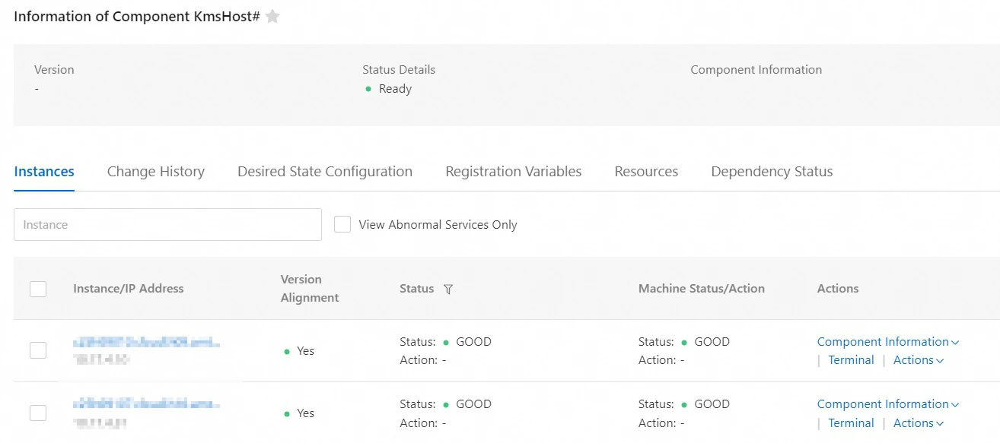

6. Find a server and click **Terminal** in the Actions column to log on to the server.

7. Run the  `curl http://ip:5555/status.html`  command and check whether **success** is returned.

   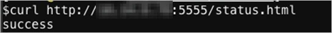

   > **Note**
   >
   > - The IP address is the IP address of the server in Step 6.
   >
   > - Use this method to verify all servers on which the KMS_HOST component is deployed.

**Troubleshooting**

1. View logs in the /cloud/log/kms/KmsHost#/kms_host directory.

2. Check whether the KMS_HOST component is normal.

   - If the KMS_HOST component abnormally exits after it starts, view debug logs in the debug.log file to troubleshoot the specific error.

   - If the KMS_HOST component is running but does not function as expected, view status logs in the status.log file to troubleshoot the specific error.

**Possible errors**

| Error message | Solution |
| --- | --- |
| <code>xxx selfCheck error</code> Note <em>xxx</em> indicates a component on which the KMS_HOST component depends. | • Check whether the dependency configuration is valid. You can view debug logs in the debug.log file to troubleshoot the specific error. • Check whether the xxx component is normal. |
| <code>exit code 1</code> | View debug logs in the debug.log file to identify the cause of the abnormal exit. |

## 6.4. HSA

This topic describes how to check the status of the HSA component.

**Check whether the HSA component is normal**

1. In the top navigation bar of the Apsara Uni-manager Operations Console, choose **Products > Base/Platforms > Infrastructure Management**.

2. In the left-side navigation pane, click **Project & Cluster O&M**.

3. Enter kms in the **Project | Cluster** search box and find the Key Management Service (KMS) cluster that you want to manage.

4. Click **Cluster Details** in the **Actions** column.

5. On the **Services** tab, enter **kms** in the Service search box and click Details in the Actions column to view the details of the HSA component.

   If the indicator for **HSA#** is green, the component is in the desired state.

6. Click **HSA#** to view and obtain the IP addresses of all servers on which the HSA component is deployed.

   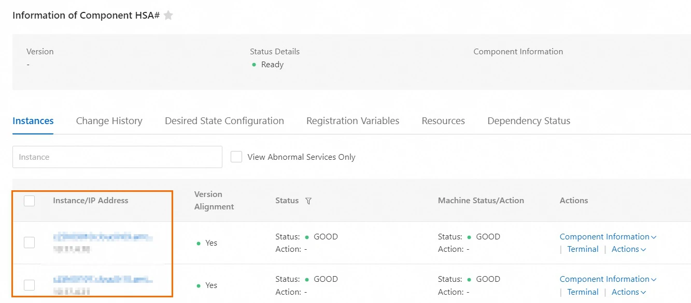

7. Find a server and click **Terminal** in the Actions column to log on to the server.

8. Run the  `curl http://ip:5555/status.html`  command and check whether **success** is returned.

   

   > **Note**
   >
   > - The IP address is the IP address of the server in Step 6.
   >
   > - Use this method to verify all servers on which the HSA component is deployed.

**Troubleshooting**

1. View logs in the /cloud/log/kms/HSA#/hsa directory.

2. Check whether the HSA component is normal.

   - If the HSA component abnormally exits after it starts, view debug logs in the debug.log file to troubleshoot the specific error.

   - If the HSA component is running but does not function as expected, view status logs in the status.log file to troubleshoot the specific error.

**Possible errors**

Error:  `exit code 1`

Troubleshooting: View debug logs in the debug.log file to identify the cause of the abnormal exit. This error can be caused by one of the following reasons:

- The etcd component does not start as expected.

- The etcd component starts as expected, but the corresponding data is invalid.

  > **Note**
  >
  > During disaster recovery, synchronization errors in a secondary cluster may cause this error.

## 6.5. etcd

This topic describes how to check the status of the etcd component.

**Check whether the etcd component is normal**

In the Apsara Infrastructure Management console, check whether Etcd and EtcdDecider are in the desired state.

1. In the top navigation bar of the Apsara Uni-manager Operations Console, choose **Products > Base/Platforms > Infrastructure Management**.

2. In the left-side navigation pane, click **Project & Cluster O&M**.

3. Enter kms in the **Project | Cluster** search box and find the Key Management Service (KMS) cluster that you want to manage.

4. Click **Cluster Details** in the **Actions** column.

5. On the **Services** tab, enter **kms** in the Service search box and click Details in the Actions column to view the details of Etcd and EtcdDecider.

   If the indicators for **kms.Etcd#** and **kms.EtcdDecider#** are green, they are in the desired state.

   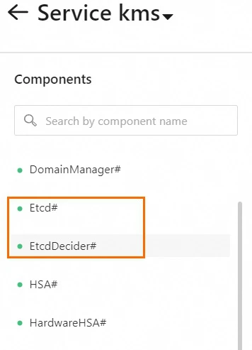

**Troubleshooting**

View logs in the /cloud/log/kms/Etcd#/etcd and /cloud/log/kms/EtcdDecider#/decider directories to troubleshoot errors.

**Possible errors**

| Exception | Solution |
| --- | --- |
| The startup parameters of the etcd component are invalid. | Find the correct settings of the startup parameters in the historical records of the debug.log file. Then, manually start the etcd component. Note Retain the error logs and contact the technical support team to help you identify the cause. |
| Errors in EtcdDecider during service updates cause errors in the etcd component. | In most scenarios, this error occurs when a rolling task exists. You can analyze the error and identify the cause based on the debug.log file of EtcdDecider. |
| The data directory of the etcd component is missing and the etcd component cannot be started. | Use the Apsara Infrastructure Management console to remove the abnormal etcd node, and then add the node again. |

## 6.6. Rotator

### 6.6.1. Primary data center

This topic describes how to check the status of the rotator of the primary data center.

The rotator is a special component. Even if the service role of the rotator is in the desired state, the rotator is not necessarily working as expected. You can view the status of the rotator in the Apsara Infrastructure Management console.

Rotator exceptions do not have an impact on the API logic of Key Management Service (KMS).

In most scenarios, you need to identify the cause of a rotator exception only when unexpected results are found, such as, when the data in ApsaraDB RDS does not meet expectations.

**Check whether the rotator starts in primary data center mode**

View the value of  `current idc master`  in the /cloud/log/kms/Rotator#/rotator/debug.log file to check whether the rotator of the primary data center starts in primary data center mode.

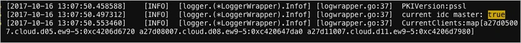

If the value of  `current idc master`  is **true**, the rotator starts in primary data center mode. If the value of  `current idc master`  is **false**, the rotator starts in secondary data center mode.

**Check whether the rotator is in the working state**

The rotator of the primary data center is deployed on all nodes. The nodes work in distributed lock mode to ensure that only one node can work at a time. All other nodes remain in the standby state.

View status logs in the /cloud/log/kms/Rotator#/rotator/status.log file and check the status of each node.

Check the value of RotatorState in the status logs. Valid values: ExecuteWorker and TryLock.

- ExecuteWorker: The node is in the working state.

- TryLock: The node is in the standby state.

  Figure 1. Working state

  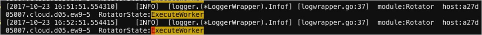

  Figure 2. Standby state

  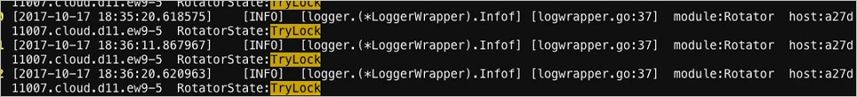

**Possible errors**

- Abnormal ApsaraDB RDS database access. Statistics collection and key deletion tasks cannot be executed.

- Abnormal HSA service. Key rotation tasks cannot be executed.

- Abnormal Log Service. Metering tasks cannot be executed.

- Abnormal etcd service. Distributed locks are unavailable and tasks cannot be executed.

- If one of the tasks on the rotator is abnormal, the rotator may be unable to reach the desired state. In this case, the rotator may be stuck in the desired state, which you can view in the Apsara Infrastructure Management console.

### 6.6.2. Secondary data center

This topic describes how to check the running status of the rotator of the secondary data center.

The rotator of the secondary data center is deployed on all nodes, which are all in the working state. The work scopes of the nodes are idempotent in a certain time range.

**Check whether the rotator starts in secondary data center mode**

Check the value of  `current idc master`  in /cloud/log/kms/Rotator#/rotator/debug.log, as shown in the following figure.

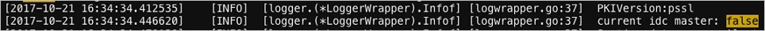

If the value of  `current idc master`  is **false**, the rotator starts in secondary data center mode. If the value of  `current idc master`  is **true**, the rotator starts in primary data center mode.

**Possible errors**

- Abnormal network of the primary data center. The etcd of the primary data center is inaccessible.

- Abnormal etcd of the primary data center. The etcd of the primary data center is inaccessible.

- Abnormal etcd of the secondary data center. Data cannot be written into etcd.

- Incorrect etcd information of the primary data center. Data synchronization errors occur.

> **Important**
>
> Rotator exceptions of the secondary data center has a severe impact on KMS in the secondary data center. You
>
> must fix the exceptions in a timely manner.
