Alibaba Cloud  
Apsara Stack  
Container Service for  
Kubernetes  
Distributed Cloud Container  
Platform ACK One Product  
Introduction  
Product Version: v3.18.6-2607  
Document Version: 20260828

**Table of Contents**

- [1.What is Distributed Cloud Container Platform for Kubernetes (ACK One)](#section-1)
- [2.Product details](#section-2)
- [3.Benefits](#section-3)
- [4.Functions and features](#section-4)
- [5.Common scenarios](#section-5)

# 1.What is Distributed Cloud Container Platform for Kubernetes (ACK One)

Distributed Cloud Container Platform for Kubernetes (ACK One) is an enterprise-grade cloud native platform that Alibaba Cloud provides for hybrid cloud, multi-cluster, distributed computing, and disaster recovery scenarios. ACK One connects to and manages your Kubernetes clusters on any infrastructure in any region. It provides consistent management and community-compatible APIs, supporting unified O&M for computing, networking, storage, security, monitoring, logging, jobs, applications, and traffic.

# 2.Product details

As an enterprise-grade cloud-native solution, ACK One helps enterprises build secure, standardized, and modern cloud-native IT architectures. It effectively addresses multi-cluster management challenges in distributed cloud scenarios and delivers comprehensive coverage and unified governance from local data centers to Apsara Stack and edge nodes.

**Core features**

To address various challenges in distributed cloud scenarios, ACK One provides the following features.

**Registered cluster**

**User**

Provide consistent

- user experience

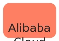

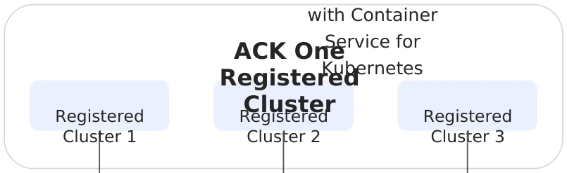

Cloud

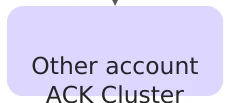

ACK Cluster

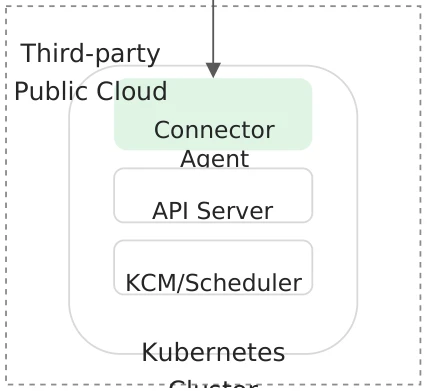

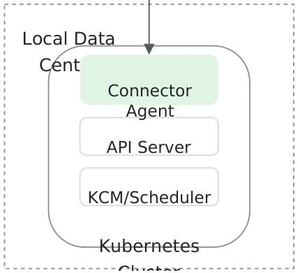

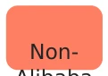

Alibaba

Cloud

Cluster

Cluster

By using ACK registered clusters, you can connect Kubernetes clusters from different vendors and locations to the Alibaba Cloud Container Service for Kubernetes console for unified management of multiple clusters and access to the rich cluster extension capabilities of Container Service for Kubernetes.

For more information about registered clusters, see the **Container Service for Kubernetes User Guide > Overview of registered clusters** section.

**Multi-cluster fleet**

Unified Control Plane

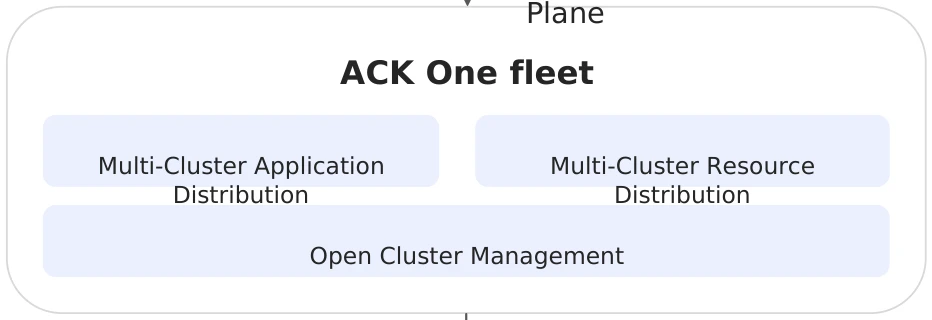

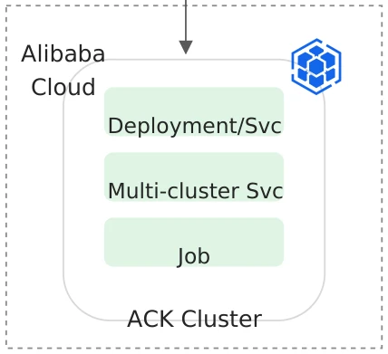

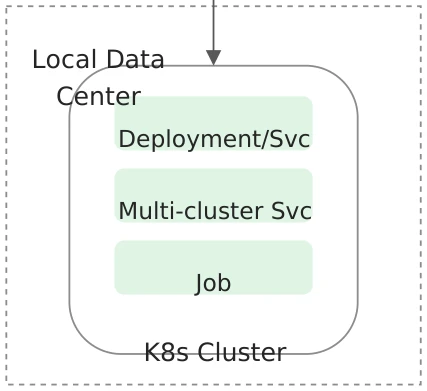

When running multiple Kubernetes clusters simultaneously, you can associate them with a multi-cluster fleet and manage all associated clusters through the unified control plane provided by the fleet.

- A multi-cluster fleet control plane runs on the Kubernetes control plane and provides standard Kubernetes APIs.

- A multi-cluster fleet can connect to multiple Kubernetes clusters. For non-ACK clusters, connect them first by using registered clusters.

- Multi-cluster application distribution: Host open source ArgoCD to distribute applications across multiple clusters.

For more information about multi-cluster fleets, see the **Distributed Cloud Container Platform ACK One User Guide > Overview of fleet management** section.

**Summary**

Distributed Cloud Container Platform for Kubernetes (ACK One) is an enterprise-grade solution that Alibaba Cloud develops for complex distributed cloud scenarios. It overcomes the limitations of traditional cloud-native platforms by enabling unified management of Kubernetes clusters across regions and infrastructure. The platform delivers consistent O&M experience, intelligent resource scheduling, elastic computing power, and reliable disaster recovery for enterprises.

Whether you need to build a hybrid cloud architecture, manage multi-cluster environments, implement application disaster recovery, or optimize AI and big data workloads, ACK One provides comprehensive, efficient, and secure solutions to accelerate your cloud-native transformation and enhance the agility and reliability of your IT infrastructure.

# 3.Benefits

Distributed Cloud Container Platform for Kubernetes (ACK One) is an enterprise-grade cloud-native platform that Alibaba Cloud provides for hybrid cloud, multi-cluster, distributed computing, and disaster recovery scenarios. The platform connects to and manages Kubernetes clusters on any infrastructure in any region through a unified control plane. It delivers consistent operations experience and community-compatible APIs to help enterprises build secure and standardized cloud-native architectures. This topic describes the key benefits of ACK One.

**Unified operations and security management**

ACK One provides the same operations experience as Alibaba Cloud Container Service for Kubernetes. The platform allows you to connect local data centers, third-party public clouds, and edge clusters to a unified console. It reduces operational complexity and enhances system stability and compliance by offering monitoring, logging, and security policy capabilities.

**Multi-cluster application distribution and disaster recovery**

ACK One uses ArgoCD to distribute applications across multiple clusters and automatically synchronizes application states from Helm repositories.

**Intelligent resource scheduling optimization**

ACK One uses an intelligent scheduler to support advanced capabilities such as Gang Scheduling and CPU topology awareness, optimizing resource allocation for hybrid workloads, such as AI training and big data processing.

**Consistent experience across on-premises and cloud environments**

ACK One uses the registered cluster feature to centrally manage Kubernetes clusters in local data centers and on third-party public clouds.

# 4.Functions and features

Distributed Cloud Container Platform for Kubernetes (ACK One) is an enterprise-grade Cloud Native platform from Alibaba Cloud. The platform supports hybrid cloud, multi-cluster, distributed computing, and disaster recovery scenarios. It connects to and manages any Kubernetes cluster, provides consistent APIs, and enables unified O&M. This topic describes the specific features.

**Registered cluster**

| Feature | Description |
| --- | --- |
| Registered cluster management | • Manage Kubernetes clusters from customer data centers or third-party clouds. • Read information from customer self-managed clusters in a non-intrusive manner through an ack-cluster-agent proxy. • Create registered clusters. • Display the registered cluster list. • Delete registered clusters. |

**Fleet instance management**

| Feature | Description |
| --- | --- |
| Fleet instance creation | Create a Fleet instance. |
| Fleet instance deletion | Delete a Fleet instance. |
| Fleet instance list | Display the Fleet instance list. |
| Authorization management | Grant administrator and developer permissions to RAM users for a Fleet instance. You can specify namespaces to which developer permissions apply. |
| Fleet instance details | Display the basic information and associated cloud resource information of a Fleet instance. |
| Associated Fleet instance list | Display the list of ACK Kubernetes clusters associated with a Fleet instance. |
| Associate a Fleet instance | Select an ACK cluster and associate it with a Fleet instance. Note Note: The Pod, Service, vSwitch, and VPC CIDR blocks of associated clusters must not overlap. |
| Connect to fleet | Connect to a Kubernetes cluster by using kubectl. |
| Fleet instance logs | View the operation logs of a Fleet instance. |
| Namespace | • Create namespaces within a Fleet instance. • View the namespace list. • Delete a namespace. |
| Multi-cluster applications | • Create multi-cluster applications by using Helm charts to enable application deployment across multiple clusters. • View the name, status, chart name, and chart URL of deployed applications. • Edit multi-cluster applications. • Delete multi-cluster applications. |

**Dual-stack network**

| Feature | Description |
| --- | --- |
| IPv4/IPv6 dual-stack support | ACK One clusters fully support the Kubernetes-Native IPv4/IPv6 dual-stack network mode. |

# 5.Common scenarios

This topic describes scenarios of Distributed Cloud Container Platform for Kubernetes (ACK One).

**Scenarios**

**Scenario 1: Registered cluster for consistent operations experience across on-premises and cloud clusters**

**User**

Provide user experience

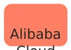

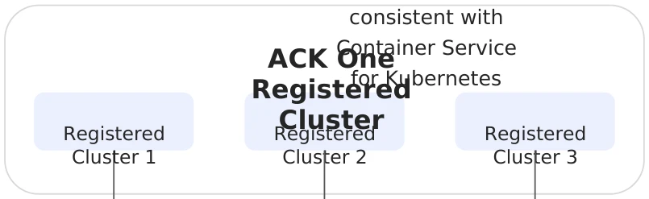

Cloud

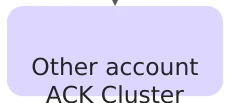

ACK Cluster

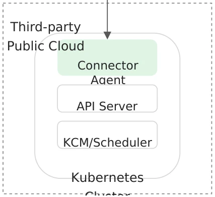

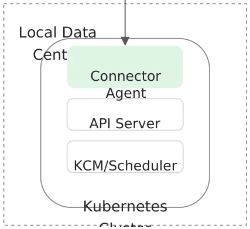

Alibaba

Cloud

Cluster

Cluster

Scenario description

- **Consistent operations experience:** The unified operations capabilities of ACK extend to data center clusters and third-party public cloud clusters.

- **Enhanced observability:** Collect logs, metrics, and events to deliver the same operations experience as in the cloud.

**Scenario 2: Multi-cluster fleet for application distribution across multiple clusters**

**Developer**

Update

**repo**

Watch and Pull

**Platform teams**

compare/sync

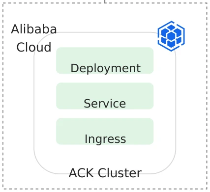

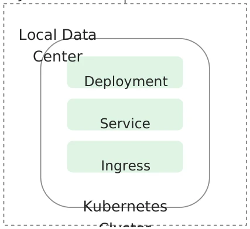

Cluster

Cluster

Scenario description

- **Continuous deployment:** Automatically synchronize application states between Helm repositories and Kubernetes clusters.

- **Multi-cluster application distribution:** Deploy applications to multiple clusters simultaneously.
