Alibaba Cloud  
Apsara Stack  
Prometheus Service  
User Guide  
Product Version: v3.18.6-2607  
Document Version: 20260828

**Table of Contents**

- [1.Product introduction](#section-1)
    - [1.1. What is Managed Service for Prometheus?](#section-1-1)
    - [1.2. HPA for Managed Service for Prometheus](#section-1-2)
- [2.Getting started](#section-2)
    - [2.1. Log in to the Prometheus V2.0 console](#section-2-1)
    - [2.2. Complete authorization in the Prometheus V2.0 console](#section-2-2)
    - [2.3. Log in to the Apsara Uni-manager Operations Console](#section-2-3)
- [3.Interface with Managed Service for Prometheus](#section-3)
    - [3.1. Overview](#section-3-1)
    - [3.2. Monitor ACK clusters in Managed Service for Prometheus](#section-3-2)
    - [3.3. Use Remote Write to interface with a self-managed Prometheus system](#section-3-3)
- [4.Work with Managed Service for Prometheus](#section-4)
    - [4.1. Container observation](#section-4-1)
        - [4.1.1. Cluster list](#section-4-1-1)
        - [4.1.2. Cluster configuration](#section-4-1-2)
    - [4.2. Prometheus instances](#section-4-2)
        - [4.2.1. Instance list](#section-4-2-1)
    - [4.3. Custom Dashboards](#section-4-3)
        - [4.3.1. Grafana Dashboard](#section-4-3-1)
        - [4.3.2. Custom dashboards](#section-4-3-2)
    - [4.4. Integration management](#section-4-4)
        - [4.4.1. Integrated environments](#section-4-4-1)
        - [4.4.2. Metric collection](#section-4-4-2)
        - [4.4.3. Configure the Prometheus agent](#section-4-4-3)
        - [4.4.4. Self-monitoring](#section-4-4-4)
- [5.Alert management](#section-5)
    - [5.1. Create an alert rule](#section-5-1)
    - [5.2. Query historical alerts](#section-5-2)
    - [5.3. Mute alerts](#section-5-3)
    - [5.4. Create contacts to receive alert notifications](#section-5-4)
    - [5.5. Obtain the webhook URL of a DingTalk chatbot](#section-5-5)
    - [5.6. Create a contact group that uses a webhook URL](#section-5-6)
- [6.Product Interaction](#section-6)
    - [6.1. Use Managed Service for Prometheus to monitor ACK clusters and view metrics in a dashboard](#section-6-1)
    - [6.2. Use ServiceMonitors to discover and monitor Services](#section-6-2)
    - [6.3. Use Managed Service for Prometheus to monitor PVs](#section-6-3)
- [7.References](#section-7)
    - [7.1. Helm commands](#section-7-1)
    - [7.2. Introduction to built-in dashboards](#section-7-2)
- [8.Permission management](#section-8)
    - [8.1. Create a role and grant permissions to the role](#section-8-1)
    - [8.2. Create users and user groups](#section-8-2)
    - [8.3. RAM policies](#section-8-3)
    - [8.4. RAM user authentication](#section-8-4)
    - [8.5. User roles and permissions](#section-8-5)

<a id="section-1"></a>

# 1.Product introduction

<a id="section-1-1"></a>

## 1.1. What is Managed Service for Prometheus?

Managed Service for Prometheus is a fully managed monitoring service interfaced with the open source Prometheus ecosystem. Managed Service for Prometheus monitors various components and provides multiple ready-to-use dashboards.

**Background information**

Due to the development of Docker and Kubernetes, containerization offers benefits such as elasticity and on-demand billing, and helps developers improve their efficiency through standardized and lightweight resources. Containerization is adopted by an increasing number of enterprises. According to reports, 20% to 35% of the applications in the public cloud market are containerized. 50% to 75% of the applications in the cloud are expected to adopt containerization by 2025.

As the best partner of Kubernetes, Prometheus becomes the de facto standard for cloud-native monitoring. Prometheus is an open source monitoring tool recommended by Cloud Native Computing Foundation (CNCF). It can be used to collect metrics, process data, store data, visualize and analyze data through Grafana, monitor resources, and generate alerts. It is compatible with cloud platforms, OpenStack, and private clouds to monitor VMs, containers, middleware, and databases. Prometheus is the preferred monitoring tool for Kubernetes. However, open source Prometheus Monitoring is a monolithic application that lacks distributed deployment and cluster deployment capabilities. The amount of data that open source Prometheus can monitor and store is limited, and the deployment occupies a large amount of resources. Managed Service for Prometheus is a fully managed monitoring service interfaced with the open source Prometheus ecosystem. Managed Service for Prometheus monitors various components and provides multiple ready-to-use dashboards.

**Architecture of Managed Service for Prometheus**

ACK

Prometheus 2.0

Monitoring

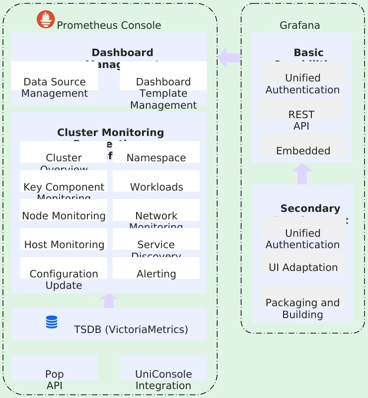

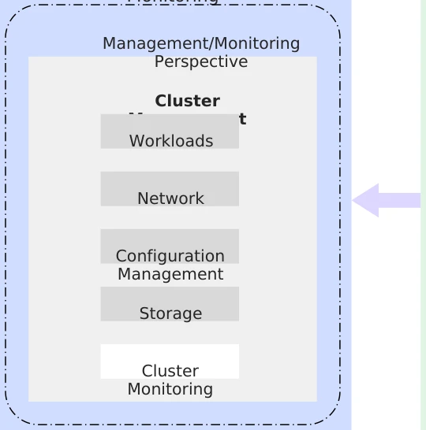

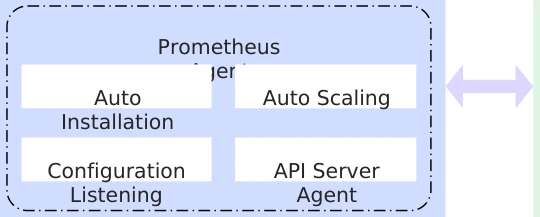

Enterprise Base/Basic

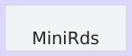


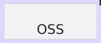

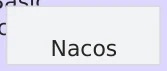

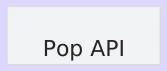

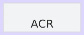

Services

**Benefits**

Compared with open source Prometheus, Managed Service for Prometheus has the following benefits:

- Faster implementation, saving 50% of the time compared with open source Prometheus

  - Managed Service for Prometheus is ready for use without the need for deployment. It provides predefined dashboards and an agent which is automatically deployed to collect metrics. You can set up Managed Service for Prometheus to monitor your Container Service for Kubernetes (ACK) clusters within 10 minutes.

- Stability, horizontal scaling, and high-availability architecture

  - The monitoring data processing capability of Managed Service for Prometheus can be horizontally scaled, and a high-availability architecture is used for data storage. The agent adopts an auto reconnection mechanism. In addition, Managed Service for Prometheus introduces Message Queue to handle heavy traffic.

- Less business intrusion, reducing 50% of agent resource consumption compared with open source Prometheus

  - Managed Service for Prometheus provides an all-in-one agent that runs based on a single process to limit the resource consumption of the agent. This greatly reduces CPU and memory usage.

**Out-of-the-box service and reduced implementation time**

Compared with open source Prometheus, the deployment of Managed Service for Prometheus is more lightweight. Instead of building a Prometheus monitoring system, you can install PromAgent to monitor your business.

The components of Managed Service for Prometheus provide the following benefits:

- Prometheus Agent

  - Optimization based on open source Prometheus Server.

  - Compatibility with open source service discovery.

  - Support for open source Exporter and Clientlib.

  - Direct data ingestion to storage services in the cloud.

  - Only 200 MB of memory consumption.

- Prometheus Server

  - Developed based on open source VictoriaMetrics.

  - Comes with web API and Server components.

  - Read request processing.

  - Support for PromQL.

  - Support for CustomResourceDefinitions (CRDs).

  - Query optimization.

- Grafana Service

  - Rendering and secondary development based on open source Grafana.

  - Ready-to-use dashboards. Custom display components.

**Compatibility with open source architecture optimization and improved stability**

- Managed Service for Prometheus is compatible with the clients and query languages in the open source Prometheus ecosystem. Managed Service for Prometheus provides optimized collection rules and usage values.

  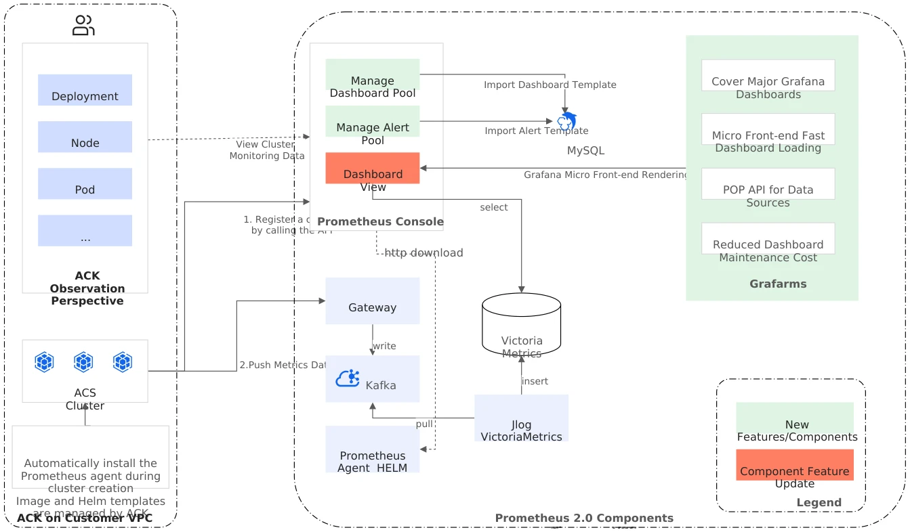

  **onTiangongVPC**

- Managed Service for Prometheus is compatible with three mainstream collection rules: the open source prometheus.yaml configuration file, ServiceMonitor, and the default collection rule named Annotation. ServiceMonitor is suitable for the monitoring of custom Kubernetes clusters. Compared with the open source Prometheus, Managed Service for Prometheus allows you to update collection rules by modifying the prometheus.yaml configuration file. You do not need to write multiple lines of code in the Deployment file. You need only to add the following three annotations.

  ```text
  prometheus.io/scrape: "true"
  prometheus.io/port: "9090"
  prometheus.io/path: "/metrics"
  ```

- Managed Service for Prometheus allows you to visualize data by using Grafana. By configuring the Prometheus HTTP API URL, you can implement multi-tenant isolation for the data source in Grafana and multi-tenant isolation for the Grafana dashboard. Managed Service for Prometheus is also compatible with the Explore data debugging module of Grafana.

- Managed Service for Prometheus is compatible with the HTTP API module of the open source Prometheus. It supports three standard API operations: query, query_range, and labelValues. In addition, you can add /userId/clusterId/regionId/ to the data URL to achieve multi-tenant isolation.

- Managed Service for Prometheus uses the built-in alerting system of Application Real-Time Monitoring Service (ARMS) and is compatible with the PromQL-based alert rules of open source Prometheus.

**Architecture optimization and improved stability**

- Dual-node: All computing nodes adopt a high-availability dual-node architecture to improve system stability.

- Storage layer: Managed Service for Prometheus introduces the time series database VictoriaMetrics, which takes the first position in database ranking, to improve data throughput.

- Link layer: Managed Service for Prometheus introduces the message queue and data re-transmission mechanisms of ApsaraMQ for Kafka to ensure the reliability of the collected data.

- Horizontal scaling: Managed Service for Prometheus supports horizontal scaling based on the cluster size.

- The architecture of the agent is optimized to reduce business intrusion.

<a id="section-1-2"></a>

## 1.2. HPA for Managed Service for Prometheus

Managed Service for Prometheus can automatically scale out collectors based on persisted key states.

**Terms**

- Container: A container is an environment used to run applications, such as Kubernetes.

- Collector: A collector is a process that collects application monitoring data.

- Scale-out: A scale-out is an operation performed to increase the number of pods that are provisioned for a process.

- Number of pods: The number of pods that run the same process.

**Background information**

A Prometheus collector may restart due to Out-of-Memory (OOM) errors when the pods deployed for the collector are insufficient. To resolve the issue, Managed Service for Prometheus provides the Horizontal Pod Autoscaling (HPA) feature to automatically adjust the number of collector pods.

**Comparison between HPA for Managed Service for Prometheus and Kubernetes HPA**

**How Kubernetes HPA works:**

The HPA process collects metric values, such as memory usage, and checks whether the metric values exceed the threshold, such as 75%. If the metric value exceeds the threshold, a scale-out is triggered.

**Disadvantages of Kubernetes HPA:**

- You need to find a metric that can be used to determine whether scale-out operations are needed, such as the memory usage or number of requests. However, it is hard to find such as metric, and the threshold is determined based on experience in most cases.

- You need to periodically check external processes and determine whether scale-out is needed. In some scenarios, the spike ends within a very short period of time, such as an OOM error. The time is too short for the collector to collect the metric from the external process.

**How HPA for Managed Service for Prometheus works:**

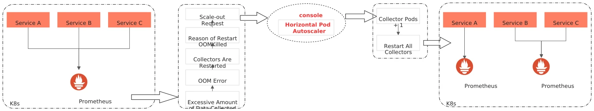

ofDataCollected

1. The collectors of HPA for Managed Service for Prometheus run in one pod at the initial stage.

2. When an excessive amount of data needs to be collected, the collector process encounters an OOM error and is restarted by Kubernetes.

3. After the process is restarted, the process checks the reason of the collector restart. If the reason is OOMKilled, the process initiates a scale-out request to the external controller (Console).

4. The Console sends a request to Kubernetes to deploy an additional pod for the collectors. Currently, up to 10 pods can be deployed for the collectors.

5. The Console requests Kubernetes to restart all collectors once to clear the reason of the last restart, which is OOMKilled. Kubernetes then redistributes collection tasks to the collectors for load balancing.

HPA for Managed Service for Prometheus provides the following benefits:

- The OOMKilled state can be used to determine whether scale-out is needed.

- The OOMKilled state can be recorded in Kubernetes status. During the startup of collectors, the Console can check the Kubernetes status to determine whether scale-out is needed. This addresses the issue that transient state changes cannot be collected within limited time.

<a id="section-2"></a>

# 2.Getting started

<a id="section-2-1"></a>

## 2.1. Log in to the Prometheus V2.0 console

This topic describes how to log in to the Prometheus V2.0 console.

**Prerequisites**

- The URL of the Apsara Uni-manager Management Console is obtained from the deployment engineer.

- A web browser is available. We recommend that you use Google Chrome.

**Procedure**

1. Enter the URL of the Apsara Uni-manager Management Console in the address bar and press the Enter key.

   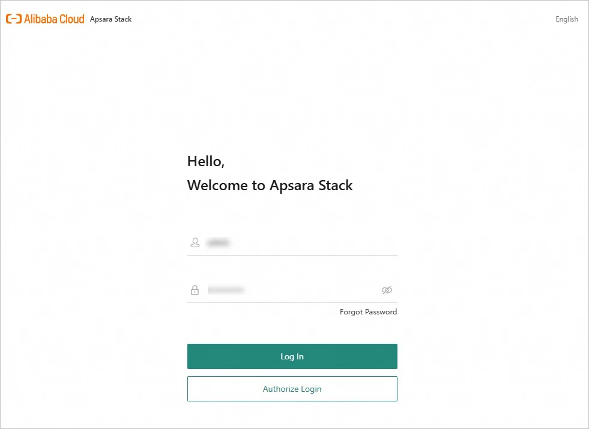

   > **Note**
   >
   > - You can click the current language in the upper-right corner to switch to another language.
   >
   > - The Authorized Login button is displayed only when a global identity provider (IdP) is configured in third-party authentication. You can specify a name for the Authorized Login button.
   >
   > - If you need to click Continue multiple times or cannot find the entry to the Apsara Uni-manager Management Console because the browser certificate has expired or HTTPS authentication is enabled in your environment, you must install a valid certificate. Click **Browser certificate installation** in the upper-right corner to open the browser certificate installation guide.

2. Enter your username and password.

   > **Note**
   >
   > - Obtain the username and password from an operations administrator.
   >
   > - The first time you log in to the Apsara Uni-manager Management Console, you must change the password of your account as prompted. For security purposes, the password must be 10 to 32 characters in length. It must contain all of the following character types: uppercase letters, lowercase letters, digits, and special characters. The following special characters are supported: ! @ # $ %

3. Click **Log On**.

4. If multi-factor authentication (MFA) is enabled for your account, perform the corresponding operations in the following scenarios:

   - **This is your first time logging in to the Apsara Uni-manager Management Console after MFA is enabled by the administrator:**

     <ol type="a">

     <li>

     On the Bind Virtual MFA Device page, follow the instructions to bind an MFA device.

     </li>

     <li>

     Enter the username and password again as in Step 2 and click **Log On**.

     </li>

     </ol>

     <ol type="i" start="100">

     <li>

     Enter the 6-digit MFA verification code and click **Authenticate**.

     </li>

     </ol>

   - **You have enabled MFA and bound an MFA device:**

     Enter the 6-digit MFA verification code and click **Authenticate**.

     > **Note**
     >
     > For more information about how to enable MFA and bind an MFA device, see the **Manage MFA** topic in Apsara Uni-manager Management Console User Guide.

5. In the top navigation bar, choose **Products > Middleware > Cloud-native Observability > Prometheus V2.0** to log in to the Prometheus V2.0 console.

6. In the top navigation bar, select an organization and a region.

   > **Note**
   >
   > After you log in to the Prometheus V2.0 console, if no Prometheus instances are displayed in the instance list, you need to first complete authorization. For more information, see Authorize Apsara Uni manager Management Console to access Managed Service for Prometheus.

<a id="section-2-2"></a>

## 2.2. Complete authorization in the Prometheus V2.0 console

After you log in to the Prometheus V2.0 console, you need to complete authorization so that the console will display information about Prometheus instances. Then, you can view monitoring data collected by Managed Service for Prometheus.

**Background information**

If you have already installed Managed Service for Prometheus in the Apsara Uni-manager Management Console but you have not completed authorization in the Prometheus V2.0 console, this means that Managed Service for Prometheus has not completed registration or installation. In addition, you cannot view monitoring data in the Prometheus V2.0 console. In this case, you need to log in to the Prometheus V2.0 console and complete authorization. After you complete authorization, log in to the console again and view the monitoring data of Prometheus instances.

**Procedure**

1. Log in to the **Prometheus V2.0** console.

2. In the left-side navigation pane, click **Cluster List** and click **Authorize Prometheus**. Then, you can find that the installation of Managed Service for Prometheus is completed.

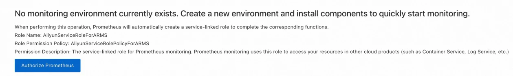

<a id="section-2-3"></a>

## 2.3. Log in to the Apsara Uni-manager Operations Console

This topic describes how to log in to the Apsara Uni-manager Operations Console.

**Prerequisites**

- The URL, username, and password of the Apsara Uni-manager Operations Console are obtained from the deployment engineer or administrator.

  The URL of the Apsara Uni-manager Operations Console is in the following format: *region-id*.aso.*intranet-domain-id*.com.

- A web browser is available. We recommend that you use Google Chrome.

**Procedure**

1. Open the web browser.

2. In the address bar, enter the endpoint of the Apsara Uni-manager Operations Console. Press the ENTER key.

   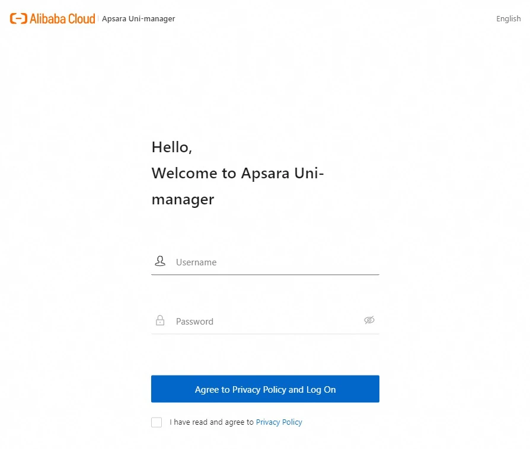

   > **Note**
   >
   > You can click the current language in the upper-right corner to switch to another language. Simplified Chinese, English, and traditional Chinese are supported.

3. Enter the correct username and password.

   > **Note**
   >
   > - Obtain the username and password that are used to log in to the Apsara Uni-manager Operations Console from a deployment engineer or an administrator.
   >
   > - If you enter an invalid password three consecutive times, the system enables the image verification login feature. If you enter an invalid password five consecutive times, the system locks your account. In this case, you can contact the administrator to unlock your account.
   >
   > - The first time that you log in to the Apsara Uni-manager Operations Console, change the password for your account as prompted.
   >
   >   To enhance security, make sure that your password meets the following requirements:
   >
   >   - The password contains uppercase and lowercase letters.
   >
   >   - The password contains digits.
   >
   >   - The password contains at least one of the following special characters: ! @ # $ %
   >
   >   - The password is 10 to 20 characters in length.

4. Click **Agree to Private Policy and Log On**.

5. In the top menu bar of the Apsara Uni-manager Operations Console, click **Platform Operation**.

6. On the **Platform Operation** page, click a service below **Apsara Infrastructure Management**.

<a id="section-3"></a>

# 3.Interface with Managed Service for Prometheus

<a id="section-3-1"></a>

## 3.1. Overview

This topic describes the methods that you can use to interface with Managed Service for Prometheus.

- For more information, see Monitor ACK clusters in Managed Service for Prometheus.

- For more information, see Use Remote Write to interface with Managed Service for Prometheus.

<a id="section-3-2"></a>

## 3.2. Monitor ACK clusters in Managed Service for Prometheus

This topic describes how to connect a Container Service for Kubernetes (ACK) cluster to Managed Service for Prometheus. Then, you can use built-in dashboards to monitor the performance metrics of hosts and ACK clusters.

**Enable Managed Service for Prometheus for ACK**

1. Log in to the **Prometheus V2.0** console.

2. In the left-side navigation pane, choose **Prometheus Instances** > **Instance List**.

3. On the **Instance List** page, click **Create a Prometheus instance**.

4. In the **Create a Prometheus instance** panel, **Prometheus instance for container service**.

5. Follow the on-screen steps to deploy an ACK cluster. For more information, see the **Create a Kubernetes cluster** topic in Container Service for Kubernetes User Guide.

   > **Note**
   >
   > To use monitoring and alerting features of ACK, you must select the Prometheus monitoring plug-in when you create the ACK cluster. Follow the on-screen instructions to interface with Managed Service for Prometheus.

<a id="section-3-3"></a>

## 3.3. Use Remote Write to interface with a self-managed Prometheus system

Managed Service for Prometheus provides the Remote Write feature. You can use this feature to store the monitoring data of Managed Service for Prometheus in remote databases. This topic describes how to use the Remote Write feature to interface Managed Service for Prometheus with a self-managed Prometheus system. The feature provides an efficient solution to store monitoring data.

**Step 1: Create a Remote Write database and obtain the read and write URLs**

1. Log in to the **Prometheus V2.0** console.

2. In the left-side navigation pane, choose **Prometheus Instances > Instance List**.

3. On the **Instance List** page, click **Create a Prometheus instance** and click **General instance**.

4. In the dialog box that appears, enter an instance name in Step 1 and click Save.

   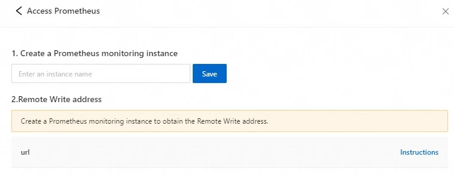

   > **Note**
   >
   > After you click **Save**, if an error is thrown, the specified instance name already exists. Enter another name.

5. After the Prometheus instance is created, the system displays the Remote Write URL.

   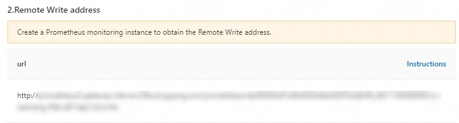

6. You can read the usage notes of the URL and then use the URL to store the monitoring data of Managed Service for Prometheus to remote databases.

**Step 2: Configure Prometheus**

1. Install Prometheus. For more information, see Prometheus official documentation.

2. Open the Prometheus.yaml configuration file and append the following content to the file. Replace the  `remote_write`  and  `remote_read`  URLs with the URLs that you obtained in Step 1: Create a Remote Write database and obtain the read and write URLs. Then, save the file.

   ```text
   global:
     scrape_interval:     15s
     evaluation_interval: 15s
   scrape_configs:
     - job_name: 'prometheus'
       static_configs:
       - targets: ['localhost:9090']
   remote_write:
     - url: "http://ts-xxxxxxxxxxxx.hitsdb.rds.aliyuncs.com:3242/api/prom_write"
       basic_auth:   
         //The username and password must comply with the AccessKey pair limits. 
         username: access-key-id
         password: access-key-secret
   ```

**Step 3: Use OpenTelemetry to connect to the remote database**

After you interface Managed Service for Prometheus with OpenTelemetry, you can use the Remote Write feature to store OpenTelemetry data.

1. Configure OpenTelemetry instrumentation in business code.

   ```go
   package stat
   import (
       "context"
       "fmt"
       "go.opentelemetry.io/otel"
       "go.opentelemetry.io/otel/metric"
       "time"
   )

   var buyCounter metric.Int64Counter

   func init() {
       fmt.Println(time.Now(), " - initMetrics start......")
       meter := otel.GetMeterProvider().Meter("github.com/liguozhong/prometheus-arms-aliyun-go-demo")
       buyCounter = metric.Must(meter).NewInt64Counter(
           "buy_total",
           metric.WithDescription("Measures  buy"),
       )
   }

   func DoBuy() (string, error) {
       buyCounter.Add(context.Background(), 1)
       return "buy success", nil
   }
   ```

2. Initialize OpenTelemetry Meter and connect to Prometheus.

   ```go
   package stat
   import (
       "context"
       prometheusPushExporter "go.opentelemetry.io/contrib/exporters/metric/cortex"
       prometheusExporter "go.opentelemetry.io/otel/exporters/metric/prometheus"

       "errors"
       "fmt"
       "go.opentelemetry.io/otel"
       "go.opentelemetry.io/otel/exporters/otlp"
       "go.opentelemetry.io/otel/label"
       "go.opentelemetry.io/otel/sdk/metric/controller/pull"
       "go.opentelemetry.io/otel/sdk/metric/controller/push"
       "go.opentelemetry.io/otel/sdk/metric/processor/basic"
       "go.opentelemetry.io/otel/sdk/metric/selector/simple"
       "go.opentelemetry.io/otel/sdk/resource"
       "net/http"
       "time"

       _ "net/http/pprof"
   )
   func InitMeter(app string, push bool) error {
       fmt.Println(time.Now(), " - initMeter start......")
       if push {
           fmt.Println(time.Now(), " - initMeter opentelemetry push......")
           remoteUrl := 
   "http://region.arms.aliyuncs.com/prometheus/../../../../api/v3/write"
           ak := "ak"
           sk := "sk"
           return initPushMeter(app, remoteUrl, ak, sk)
       }
       fmt.Println(time.Now(), " - initMeter opentelemetry pull......")
       return initPullMeter(app)
   }

   func initPushMeter(regionId string, remoteWriteUrl string, ak string, sk string) error {
       fmt.Println(time.Now(), " - initPushMeter start......")
       var validatedStandardConfig = prometheusPushExporter.Config{
           Endpoint:      remoteWriteUrl,
           Name:          "AliyunConfig",
           RemoteTimeout: 30 * time.Second,
           PushInterval:  10 * time.Second,
           Quantiles:     []float64{0.5, 0.9, 0.95, 0.99},
           BasicAuth: map[string]string{
               "username": ak,
               "password": sk,
           },
       }
       if validatedStandardConfig.Endpoint == "" {
           return errors.New(" validatedStandardConfig.Endpoint==empty.regionId:" + regionId)
       }
       fmt.Println("Success: Created Config struct")
       r, err := resource.New(context.Background(),
           resource.WithAttributes(
               label.String("cluster", "test-otel"),
               label.String("app", "buy")))
       if err != nil {
           fmt.Println("resource Error:", err)
       }
       pusher, err := prometheusPushExporter.InstallNewPipeline(validatedStandardConfig,
           push.WithPeriod(30*time.Second), push.WithResource(r))
       if err != nil {
           fmt.Println("InstallNewPipeline Error:", err)
       }
       otel.SetMeterProvider(pusher.MeterProvider())
       return nil
   }

   func initPullMeter(app string) error {
       fmt.Println(time.Now(), " - initPullMeter start......")
       r, err := resource.New(context.Background(),
           resource.WithAttributes(
               label.String("cluster", "test-otel"),
               label.String("app", app)))
       if err != nil {
           fmt.Println("resource Error:", err)
       }
       exporter, err := prometheusExporter.NewExportPipeline(
           prometheusExporter.Config{
               DefaultHistogramBoundaries: []float64{-0.5, 1},
           },
           pull.WithCachePeriod(0),
           pull.WithResource(r),
       )
       if err != nil {
           return err
       }
       http.HandleFunc("/opentelemetry", exporter.ServeHTTP)
       otel.SetMeterProvider(exporter.MeterProvider())
       return nil
   }

   func initOtlpProvider(regionId string) (*push.Controller, error) {
       exporter, err := otlp.NewExporter(
           context.Background(),
           otlp.WithInsecure(),
           otlp.WithAddress(regionId+"-intranet.arms.aliyuncs.com:8000"),
       )
       if err != nil {
           return nil, err
       }

       pusher := push.New(
           basic.New(
               simple.NewWithExactDistribution(),
               exporter,
           ),
           exporter,
           push.WithPeriod(30*time.Second),
       )

       otel.SetMeterProvider(pusher.MeterProvider())
       pusher.Start()

       return pusher, err
   }
   ```

3. Initialize the business endpoint and start OpenTelemetry.

   ```go
   package pkg
   import (
       "fmt"
       stat "github.com/liguozhong/prometheus-arms-aliyun-go-demo/pkg/opentelemetry"
       "github.com/prometheus/client_golang/prometheus/promhttp"
       "io"
       "net/http"
       "strconv"
   )

   type Server struct {
       port int
   }

   func NewServer(port int) *Server {
       return &Server{
           port: port,
       }
   }

   func (s *Server) Run() error {
       port := ":" + strconv.Itoa(s.port)
       path := "/metrics"
       service := "/buy"
       http.Handle(path, promhttp.Handler()) // Initialize an HTTP handler.
       http.HandleFunc(service, func(writer http.ResponseWriter, request *http.Request) 
   {
           content, err := stat.DoBuy()
           if err != nil {
               io.WriteString(writer, err.Error())
               return
           }
           io.WriteString(writer, content)
       })
       stat.InitMeter("buy2", true)
       fmt.Println("http.url: http://localhost" + port + path)
       fmt.Println("service.url: http://localhost" + port + service)
       err := http.ListenAndServe(port, nil)
       if err != nil {
           return err
       }
       return nil
   }
   ```

4. View the dependencies of the Go module.

   ```text
   module github.com/liguozhong/prometheus-arms-aliyun-go-demo

   go 1.12

   require (
       github.com/go-kit/kit v0.9.0
       github.com/prometheus/client_golang v1.7.1
       go.opentelemetry.io/contrib/exporters/metric/cortex v0.15.0
       go.opentelemetry.io/otel v0.15.0
       go.opentelemetry.io/otel/exporters/metric/prometheus v0.15.0
       go.opentelemetry.io/otel/exporters/otlp v0.15.0
       go.opentelemetry.io/otel/sdk v0.15.0
       golang.org/x/text v0.3.3 // indirect
   )
   ```

5. View data on Grafana dashboards.

   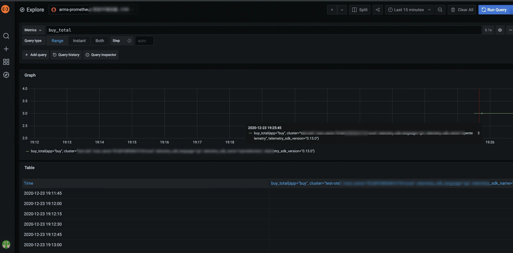

**Step 4: Stop storing monitoring data to the remote database**

If you want to stop storing monitoring to the remote database, you can perform the following steps to uninstall the Prometheus agent:

1. Log in to the **Prometheus V2.0** console.

2. On the **Instance List** page, find the Remote Write instance for which you want to uninstall the Prometheus agent and click **Delete** in the **Operation** column. In the message that appears, click **OK**.

   > **Note**
   >
   > After you uninstall the Prometheus agent, the instance is no longer displayed on the **Instance List** page.

<a id="section-4"></a>

# 4.Work with Managed Service for Prometheus

<a id="section-4-1"></a>

## 4.1. Container observation

<a id="section-4-1-1"></a>

### 4.1.1. Cluster list

On the Cluster List page, you can view the existing clusters in the list and the key metric of the clusters, such as the number of nodes, memory usage, CPU utilization, and GPU utilization. You can also view the global status of the clusters in honeycomb mode.

**Prerequisites**

Your cluster is connected to Managed Service for Prometheus. For more information, see Overview.

**Procedure**

1. Log in to the Prometheus V2.0 console.

2. In the left-side navigation pane, choose **Container observable > Cluster List**.

3. On the **Cluster List** page, click the 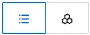 icon to select a cluster display mode above the

   list.

> **Note**
>
> - The Cluster List page displays the names, key metrics, environment, and tags of clusters that are monitored by Managed Service for Prometheus. You can add tags to the clusters.
>
>   Add a tag to one cluster: Click the  icon in the Label column of a cluster, select
>
>   or enter a tag, and then click **OK**.
>
>   Add a tag to multiple clusters: Select the clusters to which you want to add the tag and click **Add Tags**, select or enter a tag, and then click **OK**.
>
>   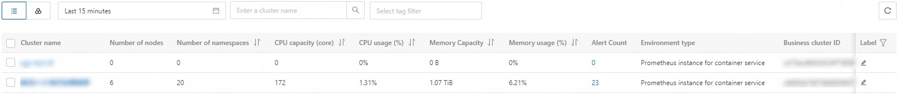
>
> - The Cluster List page in **Honeycomb** mode displays the CPU and memory usage of pods in all clusters. You can filter the statistics by cluster name, workload, or namespace.
>
>   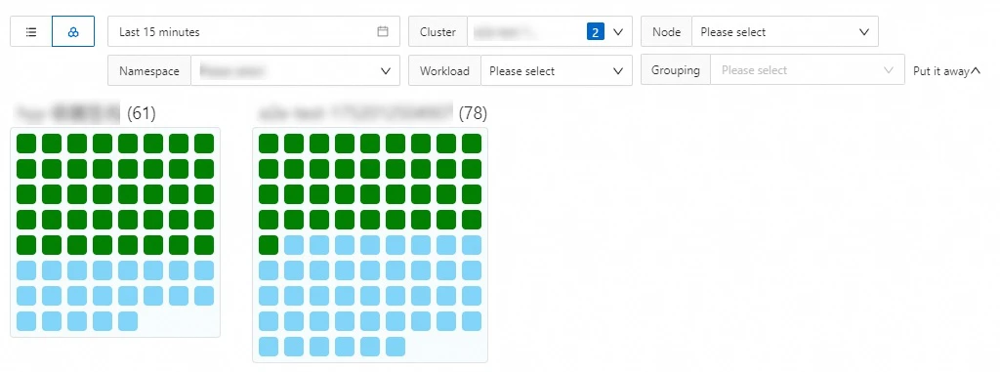

4. On the **Cluster List** page, click the name of a cluster to go to the cluster details page. On the details page, you can view metrics in different dashboards on the **Core Component Monitoring**, **Node Monitoring**, **Application Monitoring**, **Network Monitoring**, **GPU Monitoring**, **Big Data/AI**, **Resource Profile**, and **Others** tabs.

   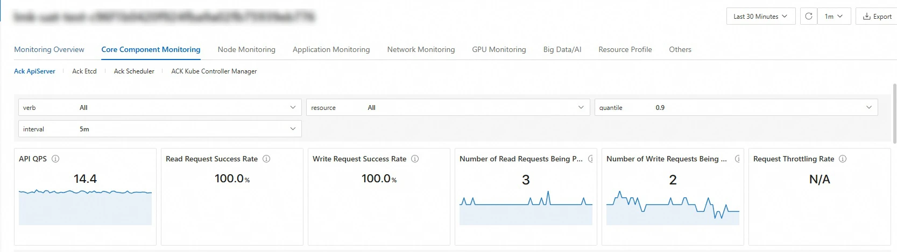

5. On the **Cluster List** page, click a cluster name to go to the **cluster details** page. You can convert the monitored metrics to alerts with a few clicks.

   Click the  icon next to a metric and select **Create an alert** to go to the **Create alert**

   **rules** page. For more information, see Create an alert rule.

   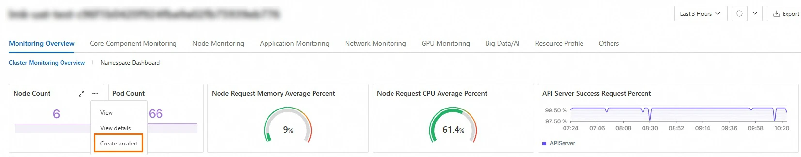

   If a panel involves multiple PromQL entries, the **Select PromQL** dialog box appears when you select **Create an alert**. After you select a PromQL entry and click **ok**, the **Create an alert rule** dialog box appears. For more information, see Create an alert rule.

   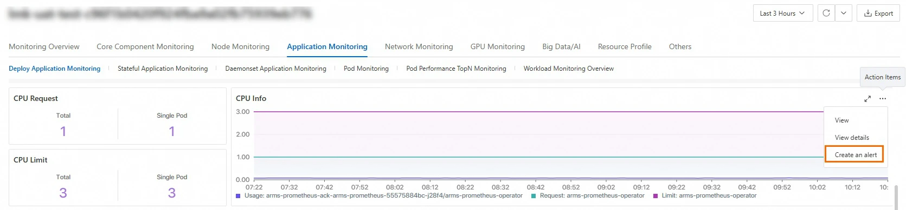

   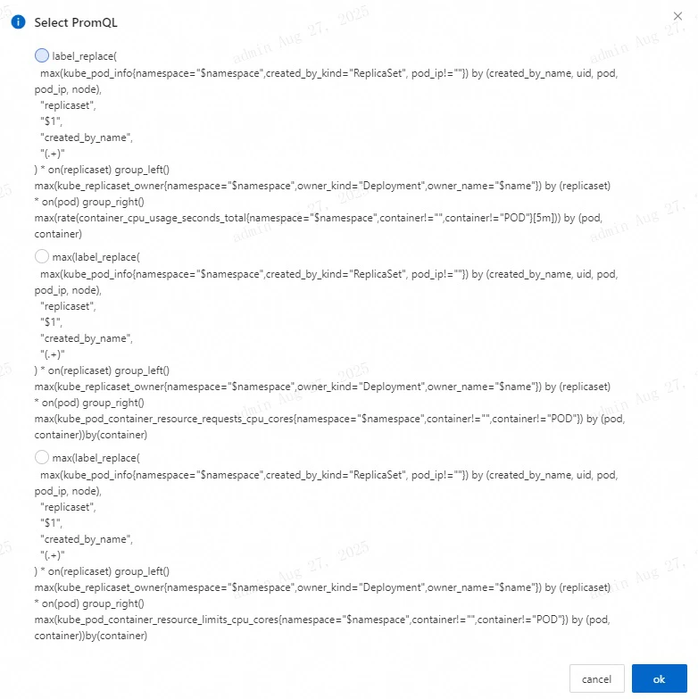

6. On the **Cluster List** page, find the cluster that you want to view and click the number in the **Number of alarms** column. The **Alert Event** page appears. On this page, you can view the alert history. For more information, see Query historical alerts.

<a id="section-4-1-2"></a>

### 4.1.2. Cluster configuration

This topic describes how to configure cluster thresholds.

**Prerequisites**

Your cluster is monitored in Managed Service for Prometheus. For more information, see Overview.

**Procedure**

1. Log in to the **Prometheus V2.0** console.

2. In the left-side navigation pane, choose **Container observable** > **Cluster Config**.

3. On the **Cluster Config** page, you can configure thresholds for pods and nodes in clusters.

   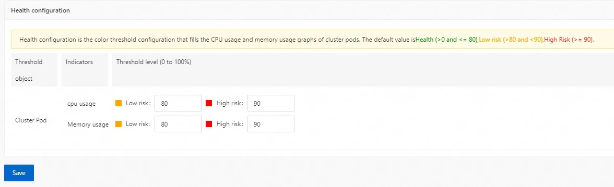

<a id="section-4-2"></a>

## 4.2. Prometheus instances

<a id="section-4-2-1"></a>

### 4.2.1. Instance list

This topic describes how to view the details of Prometheus instances in the console.

**Prerequisites**

Your cluster is monitored in Managed Service for Prometheus. For more information, see Overview.

**Procedure**

1. Log in to the **Prometheus V2.0** console.

2. In the left-side navigation pane, choose **Prometheus Instances** > **Instance List**.

3. On the **Instance List** page<strong>, click Create a Prometheus instance</strong> above the list.

4. In the **Create a Prometheus instance** panel, click **Prometheus instance for container service** or **General instance** to view the detailed steps.

5. On the **Instance List** page, click the name of an instance in the **Instance name** column or click **Details** in the Operation column.

> **Note**
>
> - The **Instance List** page displays the names, types, and tags of Prometheus instances. You can modify tags, view instance details, or delete instances.
>
>   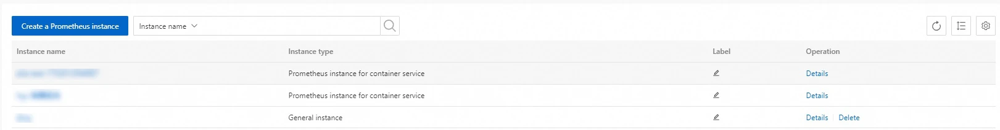
>
> - The instance details page displays the remote write address, push gateway address, and metric collection address. The following figure shows the metric collection rule configuration available for Prometheus instances for container service.
>
>   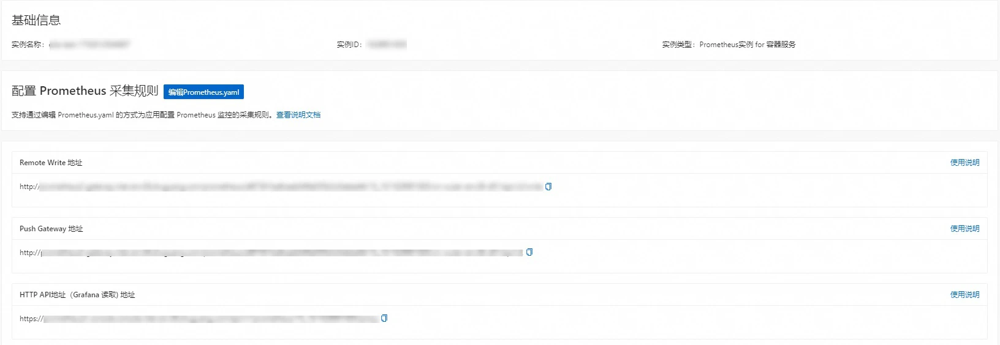

<a id="section-4-3"></a>

## 4.3. Custom Dashboards

<a id="section-4-3-1"></a>

### 4.3.1. Grafana Dashboard

Prometheus-compatible Grafana dashboard integration provides a high-performance, scalable, and out-of-the-box solution for metric monitoring and data visualization.

**Prerequisites**

You have integrated **Prometheus monitoring**. For details, see Overview of Prometheus monitoring integration.

**Access the feature**

1. Log on to the Prometheus monitoring console.

2. In the left navigation pane, click **Custom dashboards > Grafana dashboards**.

3. On the **Grafana dashboards** page, perform the following operations on folders.

   | Operation | Description |
   | --- | --- |
   | Create a folder | On the <strong>Grafana dashboards</strong> page, click <strong>Create folder</strong>. Enter a folder name and press Enter. |
   | Edit a folder | On the <strong>Grafana dashboards</strong> page, hover over<br>the target folder and clickto edit the folder<br>name. Press Enter to save. |
   | Delete a folder | On the <strong>Grafana dashboards</strong> page, hover over<br>the target folder and clickto delete it. In the<br><strong>Confirm delete folder</strong> dialog box, click <strong>OK</strong>. |

4. On the **Grafana dashboards** page, click a target folder to perform the following operations on dashboards.

   | Operation | Description |
   | --- | --- |
   | Create a dashboard | On the folder page, click <strong>Create dashboard</strong>. In the <strong>Create dashboard</strong> dialog box, enter a <strong>dashboard name</strong>, select a <strong>dashboard folder</strong> and a <strong>destination cluster</strong>, then click <strong>OK</strong>. |
   | Edit a dashboard | In the dashboard list on the folder page, click <strong>Actions</strong> &gt; <strong>Edit</strong> for the target dashboard. In the <strong>Edit dashboard</strong> dialog box, update the <strong>dashboard name</strong> and <strong>dashboard folder</strong>, then click <strong>OK</strong>. |
   | Delete a dashboard | In the dashboard list on the folder page, click <strong>Actions</strong> &gt; <strong>Delete</strong> for the target dashboard. In the <strong>Confirm delete dashboard</strong> dialog box, click <strong>OK</strong>. |
   | Import a dashboard | On the folder page, click <strong>Import dashboard</strong>. In the <strong>Import dashboard</strong> dialog box, enter a <strong>dashboard name</strong>, select a <strong>dashboard folder</strong> and a <strong>destination cluster</strong>, upload <strong>Grafana</strong> <strong>JSON-formatted data</strong>, then click <strong>OK</strong>. |

5. On the **Grafana dashboards** page, click a target folder. Then, in the dashboard list, click the target dashboard name to open the dashboard page. Perform the following operations.

   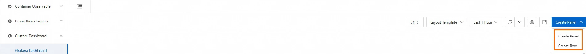

   | Operation | Description |
   | --- | --- |

   | New Card | On the dashboard page, click <strong>Add panel</strong>. In the <strong>JSON mode</strong> section on the right side of the <strong>Cluster monitoring overview</strong> page, enter JSON-formatted data. Click <strong>Apply to</strong> <strong>dashboard</strong> in the upper-right corner. |
   | --- | --- |
   | Add row | On the dashboard page, click <strong>Add row</strong>. Hover over the row to perform the following actions.<br>• Edit: Click. In the <strong>Edit row</strong> dialog box,<br>enter a name and click <strong>OK</strong>.<br>• Delete: Click. In the <strong>Confirm delete row</strong><br>dialog box, choose <strong>Delete row only</strong> or <strong>Delete row and all panels in it</strong>.<br>• Move: Click. Drag the row to reposition it.<br>• Add panel: Clickin the upper-left corner of<br>a panel and drag it into the target row. |
   | Export | Click <strong>Export</strong>. Adjust the download location and file name. Click <strong>Download</strong> to save the JSON-formatted data file. |

<a id="section-4-3-2"></a>

### 4.3.2. Custom dashboards

On the **Custom Dashboards** page, you can view all dashboards and their core metrics for the destination cluster.

**Prerequisites**

You have connected to **Prometheus Monitoring**. For more information, see Prometheus Monitoring connection overview.

**Feature access**

1. Log on to the Prometheus Monitoring console.

2. In the navigation pane on the left, choose **Custom Dashboards > Self-developed Dashboards**.

3. On the **Self-developed Dashboards** page, click

   to open the chart creation page.

   

> **Note**
>
> On the **Dashboard** page, you can use Prometheus Query Language (PromQL) to create time series charts for cluster metrics. You can customize the style of the charts, arrange them using drag-and-drop, and perform operations such as grouping, refreshing, filtering, sharing, importing, and exporting.

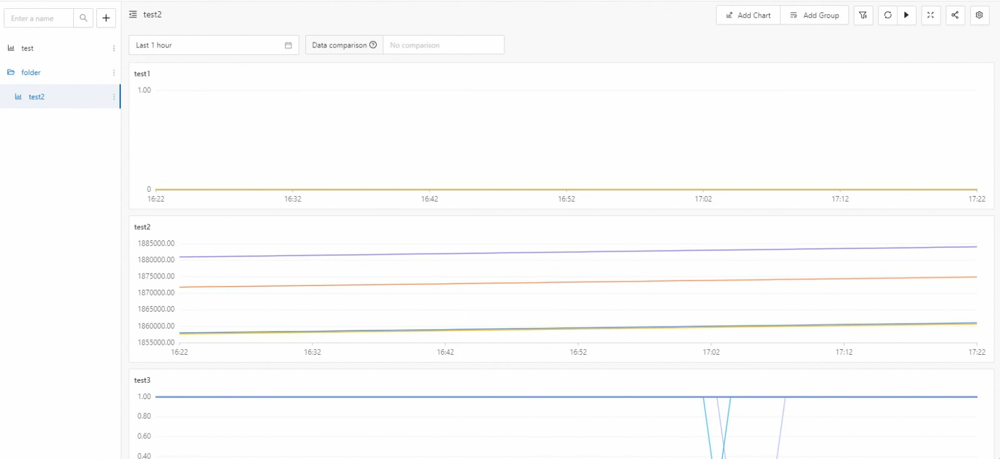

**Other operations**

- Click  to create folders and dashboards.

- Click the  icon to the right of a folder. You can perform the following operations:

  - Add dashboard

  - Add folder

  - Edit folder

  - Clone folder

  - Export folder

  - Delete folder

- Click the  icon to the right of a dashboard. You can perform the following operations:

  - Edit dashboard

  - Clone dashboard

  - Export dashboard

  - Delete dashboard

- You can click **Add Group**, the Edit icon  , or the Zoom In icon  on the right side of the

  page to perform additional operations.

<a id="section-4-4"></a>

## 4.4. Integration management

<a id="section-4-4-1"></a>

### 4.4.1. Integrated environments

This topic describes how to view an integrated container environment and how to remove the environment.

**Prerequisites**

Your cluster is connected to Managed Service for Prometheus. For more information, see Overview.

**Procedure**

1. Log in to the **Prometheus V2.0** console.

2. In the left-side navigation pane, click **Access Management to** go to the **Integrated Environments** page.

3. On the **container environment** page, you can configure metric collection and agent, and remove clusters.

> **Note**
>
> - On the **container environment** page, you can also view the basic information about the container environment.
>
> - To remove a cluster, click **Delete** in the Actions column of the corresponding environment in the **environment list**. In the Confirm Environment Deletion dialog box, confirm the current Prometheus components and agent installed in the cluster. To remove the cluster, you must first uninstall these components and the agent.

<a id="section-4-4-2"></a>

### 4.4.2. Metric collection

You can add a ServiceMonitor to configure a data collection rule for Managed Service for Prometheus. ServiceMonitors are suitable for collecting the business data of applications deployed in Managed Service for Kubernetes (ACK) clusters.

**Prerequisites**

Your cluster is connected to Managed Service for Prometheus. For more information, see Overview.

**Procedure**

1. Log in to the **Prometheus V2.0** console.

2. In the left-side navigation pane, click **Access Management.** Then, find the desired environment and click **Metric Scraping** in the **Actions** column.

3. On the **Metric Scraping** tab, add a ServiceMonitor or PodMonitor to configure collection rules for Managed Service for Prometheus. You can also configure default service discovery to discover pods from which metrics are collected based on the Annotations settings of pods, and add default collection tasks.

> **Note**
>
> Follow the on-screen instructions to configure default service discovery, ServiceMonitors, and PodMonitors. You can also **enable or disable** ServiceMonitors or PodMonitors.
>
> 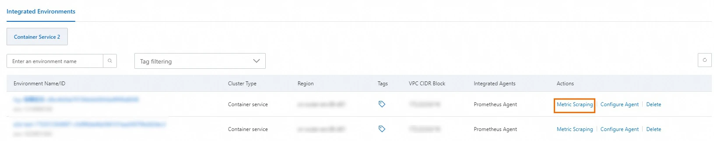

**What to do next**

On the Service Monitor, Pod Monitor, and Customize Collection pages, you can click **Disable**, **Enable**, **Modify Settings**, or **Delete** in the **Actions** column of a ServiceMonitor, PodMonitor, or collection task.

<a id="section-4-4-3"></a>

### 4.4.3. Configure the Prometheus agent

This topic describes how to view the status and version of the Prometheus agent in a cluster.

**Prerequisites**

Your cluster is connected to Managed Service for Prometheus. For more information, see Overview.

**Procedure**

1. Log in to the **Prometheus V2.0** console.

2. In the left-side navigation pane, click **Access Management.** In the **environment list**, click **Configure Agent**.

3. On the **Configure Agent** tab, you can restart or uninstall the agent or update the monitoring data.

<a id="section-4-4-4"></a>

### 4.4.4. Self-monitoring

This topic describes how to view the Targets tasks in a cluster and the self-monitoring dashboard for the Prometheus agent.

**View the self-monitoring dashboard**

You can view the self-monitoring dashboard to confirm the installation and status of the Prometheus agent. If Managed Service for Prometheus cannot collect monitoring data, you can troubleshoot based on the result displayed on the self-monitoring dashboard.

1. Log in to the **Prometheus V2.0** console.

2. In the left-side navigation pane, click **Access Management.** On the **Details** page, click the **Self-Monitoring** tab.

3. On the **Self-Monitoring** tab, you can view Targets tasks and view the Prometheus agent dashboard.

In the Targets task list, you can view the ongoing tasks in the current cluster and the endpoints, status, tags, and data reporting latency of the tasks. You can monitor the real-time health status of Targets tasks to identify abnormal tasks.

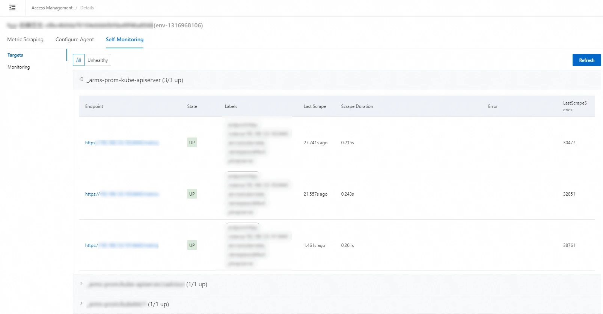

The Prometheus agent dashboard displays the real-time status of the agent and data collection details. This helps you identify agent anomalies and troubleshoot cluster issues.

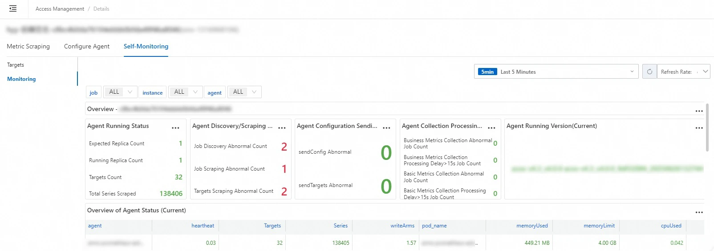

<a id="section-5"></a>

# 5.Alert management

<a id="section-5-1"></a>

## 5.1. Create an alert rule

Managed Service for Prometheus provides predefined alert rules. You can also create alert rules to monitor specific resources. If an alert rule is triggered, Managed Service for Prometheus sends alert notifications to the specified contact group by using the specified notification method. This way, contacts can resolve issues at the earliest opportunity.

**Prerequisites**

- A monitoring task is created. For more information, see Overview.

- Contacts are created. For more information, see Create contacts.

**Procedure**

1. Log in to the **Prometheus V2.0** console.

2. In the left-side navigation pane, choose **Alert Management** > **Alert Rules**.

3. On the Alert Rules page, you can **create alert rules**, **modify alert rules**, and **enable or disable alert rules**.

   > **Note**
   >
   > The **alert rule** list displays basic information about alert rules, such as the rule name, tags, and rule type. If the status of an alert rule is Stopped, no alert notification is sent. You can import, export, or modify alert and notification rules.
   >
   > 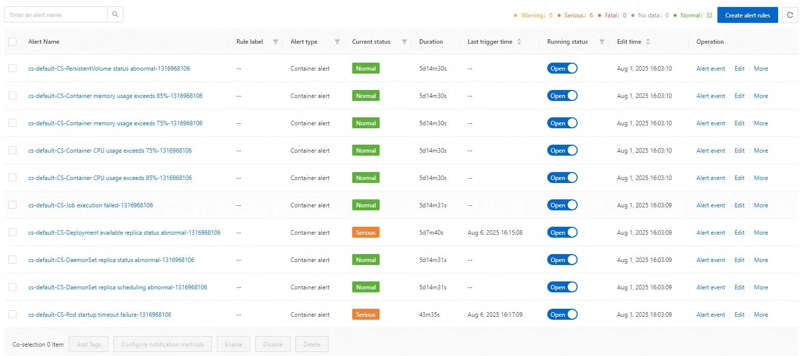

   <ol type="i">

   <li>

   On the **Alert Rules** page, click **Create alert rules**, configure the following parameters, and then click **Submit** to create an alert rule.

   <table>
     <tr>
       <th>Parameter</th>
       <th>Description</th>
       <th>Example</th>
     </tr>
     <tr>
       <td colspan="3">Rule configuration</td>
     </tr>
     <tr>
       <td>Cluster instance</td>
       <td>Select a cluster instance.</td>
       <td>None</td>
     </tr>
     <tr>
       <td>Custom PromQL statements</td>
       <td>Enter a query statement.</td>
       <td>None</td>
     </tr>
     <tr>
       <td>Duration</td>
       <td>• If the alert condition is met, an alert event is <strong>generated</strong>.<br>• An alert event is generated only when the alert conditions are met for the specified duration (default: 1 minute).</td>
       <td>If the alert condition is met, an alert event is generated.</td>
     </tr>
     <tr>
       <td>Alert Suppression</td>
       <td>• <strong>No Suppression</strong>.<br>• Once an alert is triggered for a given alert object, no further alert events will be generated for that object within the specified time window (default: 5 minutes).</td>
       <td>No Suppression</td>
     </tr>
     <tr>
       <td>Execution frequency</td>
       <td>The Cron expression format, such as * * * * * *. It consists of six fields that represent seconds (0–59), minutes (0– 59), hours (0–23), day of month (1–31), month (1–12), and day of week (0–6). An asterisk (*) serves as a wildcard, indicating that all traversals are performed.</td>
       <td>Every minute</td>
     </tr>
     <tr>
       <td>Alert level</td>
       <td>• Warning<br>• Serious<br>• Fatal</td>
       <td>Warning</td>
     </tr>
     <tr>
       <td>Recovery notification</td>
       <td>If the system returns to the normal state, a notification is sent.<br>• Select the check box.<br>• Clear the check box.</td>
       <td>Select the check box.</td>
     </tr>
     <tr>
       <td colspan="3">Alert content</td>
     </tr>
     <tr>
       <td>Alert Name</td>
       <td>Enter an alert name.</td>
       <td>None</td>
     </tr>
     <tr>
       <td>Alert content</td>
       <td>The following variables are supported:<br>• Fixed variables:<br>${alert_name}: the alert name, such as custom alert.<br>${alert_severity}: the alert level, such as warning.<br>${alert_time}: the alert time or recovery time, such as 1970-01-01 00:00:00.<br>${alert_tag}: the alert tag, such as production environment alert.<br>${condition}: a query statement, such as count(up) &gt; 10.<br>${alert_result}: the query record that triggers the alert.<br>${value}: the latest alert value.<br>${tenant_name}: the tenant name.<br>${alert_source}: the alert source, which contains labels and basic information.<br>${metric}: the metric tag that triggers the alert.<br>• Prometheus native variables:<br>{{$value}}: the latest alert value.<br>{{$ labels.xxx }}: the specific metric tag that triggers the alert, such as {{$ labels.pod}}.<br>{{ printf "%.2f" $value }}: The alert value is output in the specified format.</td>
       <td>None</td>
     </tr>
     <tr>
       <td>Rule Label</td>
       <td>Select or enter a tag.</td>
       <td>None</td>
     </tr>
     <tr>
       <td colspan="3">Notification Rules</td>
     </tr>
     <tr>
       <td>Notification Channel</td>
       <td>• DingTalk<br>• Enterprise WeChat<br>• Telephone<br>• Mail<br>• SMS<br>• Webhook</td>
       <td>DingTalk</td>
     </tr>
     <tr>
       <td>Notification object</td>
       <td>Select a notification group.</td>
       <td>None</td>
     </tr>
     <tr>
       <td>Notification interval</td>
       <td>The interval between two consecutive alert notifications must be at least the specified time.</td>
       <td>Never</td>
     </tr>
   </table>

   </li>

   </ol>

**Support for importing alert rules in YAML format**

You can save alert rules as a YAML file in the PrometheusRule format and run  `kubectl apply -f your-rule.yaml`  to deploy the alert rules.

**Create an alert rule**

1. Install and upgrade the  `ack-arms-prometheus`  component in the desired cluster.

   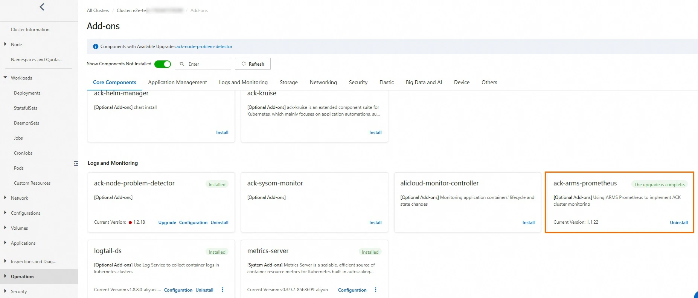

2. Log in to the cluster, create a YAML file for an alert rule, and then upload the file to the cluster. Sample content:

   ```yaml
   apiVersion: monitoring.coreos.com/v1
   kind: PrometheusRule
   metadata:
     labels:
       prometheus: k8s
       role: alert-rules
     name: prometheus-aaa-rules
     namespace: arms-prom
   spec:
     groups:
     - name: test
       rules:
       - alert: test222
         annotations:
           message: test111 message
             }}.
         expr: |
           up==0
         for: 5m
         labels:
           severity: warning
       - alert: test333
         annotations:
           message: test222 message
         expr: |
           up>100
         for: 5m
         labels:
           severity: warning
   ```

   Run the following command to create an alert rule:

   ```bash
   kubectl apply -f prometheusrule.yaml
   ```

   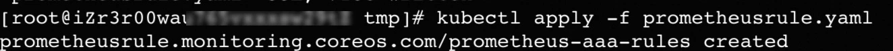

   Run the following command to query the result:

   ```bash
   kubectl get prometheusrule -A
   ```

   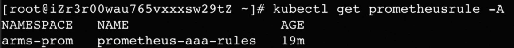

3. Log in to the **Prometheus V2.0** console. In the left-side navigation pane, choose **Alert Management** > **Alert Rules**. On the Alert Rules page, you can view the created alert rule.

**Update an alert rule**

1. In the YAML file, change the metadata.name value to huiruantest.

2. Run the following command to create an alert rule and view the result:

   ```bash
   kubectl apply -f prometheusrule.yaml
   ```

   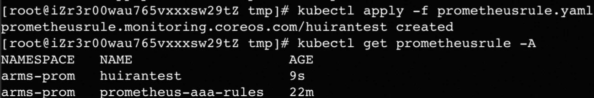

3. Log in to the **Prometheus V2.0** console. In the left-side navigation pane, choose **Alert Management** > **Alert Rules**. On the Alert Rules page, you can view the updated alert rule.

**Delete an alert rule**

1. Run the following command to delete an alert rule:

   ```bash
   kubectl delete prometheusrule <Resource name> -n <Namespace>
   ```

   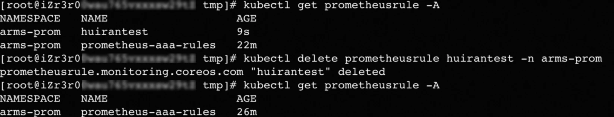

2. Log in to the **Prometheus V2.0** console. In the left-side navigation pane, choose **Alert Management** > **Alert Rules**. On the Alert Rules page, you can view that the alert rule is deleted.

**Related operations**

- Enable an alert rule: Turn the switch in the Running status column of the alert rule to **Open**.

- Disable an alert rule: Turn the switch in the Running status column of the alert rule to **Off**.

- Modify an alert rule: Click **Edit** in the **Operation** column of the alert rule. You can modify **Alert Name**, **Custom PromQL statements**, **Execution frequency**, and other parameters.

- View alert events: Click **Alert event** in the **Operation** column of an alert rule to redirect to the **Alarm Management > Alarm Events** page to view all historical alert events and alert notifications.

- More operations: Click **More** in the **Operation** column of an alert rule and click **Clone** or **Delete to clone or delete the alert rule.**

- Batch operations: Select alert rules and click an action below the list to add tags to the alert rules, configure the notification method of the alert rules, enable the alert rules, disable the alert rules, or delete the alert rules.

<a id="section-5-2"></a>

## 5.2. Query historical alerts

On the **Alarm Events** page, you can view historical events that indicate when and why an alert rule was triggered. You can also view historical events about the alert notifications sent to specified alert contacts.

**Prerequisites**

- A monitoring task is created. For more information, see Overview.

- Contacts are created. For more information, see Create contacts.

**Procedure**

1. Log in to the Prometheus V2.0 console.

2. In the left-side navigation pane, choose **Alert Management > Alert Evens**.

3. On the **Alert Event** page, you can view the alert trend and historical alert events.

   - You can enter an alert ID, alert name, alert object, or cluster name into the search box above the **alert event** list, select a time range, and then click the search icon to view historical alert events within the specified range.

   - In the Trend Chart section, the number of alerts generated over time is displayed.

     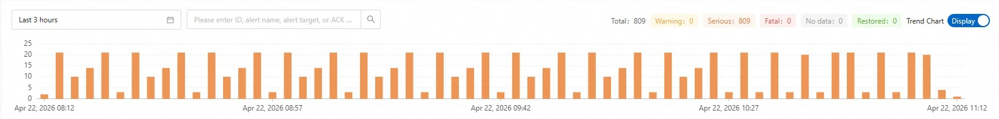

     - Different colors in a bar in the chart indicate different alert levels.

     - When you move the pointer over a bar, the system shows the numbers of alerts of all levels at the corresponding point in time.

     - Turn the switch on the right of **Trend Chart** to show or hide the chart.

     - The total number of alerts and the number of alerts of each alert level are displayed above the trend chart. You can click a number to quickly view historical alerts of the corresponding alert level.

   - In the alert list section, you can click the  icon next to the **Cluster name**, **Current**

     **status**, **Alert type**, or **Association rule label** table headers to filter historical alert events.

     The filter results in the table headers are linked with the alert statistics. As shown in the following figure: When alerts are filtered by the current status "Serious" (1), the total number in the statistics displays only the number of serious alerts (2).

     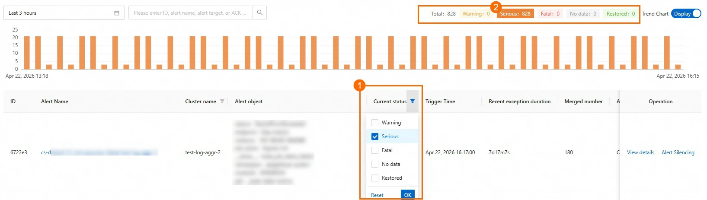

     | Parameter | Description |
     | --- | --- |
     | ID | The ID of the alert. |
     | Alert Name | The name of the alert. You can click the name to view the detailed alert event. |
     | Cluster name | The name of the ACK cluster. |
     | Alert object | The resource, application, or metric that triggered the alert. |
     | Current status | The level of the alert event. Valid values:<br>• Warning<br>• Serious<br>• Fatal<br>• No data<br>• Restored |
     | Trigger Time | The time when the alert was triggered. |
     | Recent exception duration | The interval between the time when the exception occurred and the time when the exception was fixed. |
     | Merged number | By default, alerts with the same alert object are merged. This parameter displays the number of alerts that are merged. |
     | Alert type | The type of the alert event. |
     | Association rule label | The tags defined in the alert rule. |

5. You can click the name in the **Alert Name** column of an alert and click **View Details** in the Operation column to view detailed information about the historical alert notifications and the corresponding timeline.

6. Find the alert that you want to manage and click **Alert Silencing** in the Operation column. In the **Add Masking Rule** panel, configure the following parameters and click **OK** to add a mute rule.

   | Parameter | Description |
   | --- | --- |
   | Mask type | <strong>By alert object</strong>: You can mute alert objects in the key-value pair format, such as clusterId:385 \*\*\*\*\*\*. You can click <strong>Add Alert Object</strong> to add a key-value pair.<br>A maximum of 20 alert object groups can be configured. If this limit is exceeded, only the first 20 groups will be retained. By default, the alert object data from the alert event page is pre-populated.<br>Note<br>After you mute an alert rule, notifications are not sent when the alert rule is triggered. However, you can view the corresponding alert record in the alert record section. The alert record is in the Shielded state. |

   | Shielding range | <strong>By alert object</strong>: Enter an alert object in the key-value pair format. |
   | --- | --- |
   | Shielding plan | • <strong>Single</strong>: Alert rules are muted within the specified time range only once.<br>• <strong>Cycle</strong>: Alert rules are muted daily, weekly, or monthly within the specified time range. You can specify the start time and end time of the time range within a cycle. |
   | Masking instructions | Enter a description. |
   | Event Preview | Only the event data that hits the last 10 mute rules is displayed. |

<a id="section-5-3"></a>

## 5.3. Mute alerts

This topic describes how to mute alerts to avoid alert storms.

**Prerequisites**

A monitoring task is created. For more information, see Overview.

**Procedure**

1. Log in to the Prometheus V2.0 console.

2. In the left-side navigation pane, choose **Alert Management > Alert Shielding**.

3. On the **Alarm Muting** page, click **Add masking rules**. In the dialog box that appears, configure the following parameters and click **OK**.

   | Parameter | Description |
   | --- | --- |

   <table>
     <tr>
       <td>Mask type</td>
       <td>• <strong>By Rules</strong>: You can mute alert rules with the specified names or tags. If you choose to mute alert rules by tags, all alert rules that have the specified tags are muted.<br>• <strong>By Notification Group</strong>: You can mute the specified notification groups.<br>• <strong>Fully Shielded</strong>: You can mute all existing alert rules. Proceed with caution if you choose this option.<br>• <strong>By ACK cluster</strong>: You can mute the specified ACK clusters.<br>• <strong>By alert content keyword</strong>: You can specify a keyword to mute alerts. For example, if you specify the NodeNotReady keyword, all alerts with this keyword are muted.<br>• <strong>By alert object</strong>: You can mute alert objects in the key-value pair format, such as clusterId:385 ******. You can click <strong>Add Alert Object</strong> to add a key-value pair.<br>A maximum of 20 alert object groups can be configured. If this limit is exceeded, only the first 20 groups will be retained. If mute rules are configured by clicking Alert Silencing in the Operation column on the Alert Event page, the alert object data from the alert event page is pre-populated by default.<br>Note<br>After you mute an alert rule, notifications are not sent when the alert rule is triggered. However, you can view the corresponding alert record in the Alarm record section. The alert record is in the Trigger only state.</td>
     </tr>
     <tr>
       <td>Shielding range</td>
       <td>• <strong>By Rules</strong>: Select Rule label or Rule name. You can click <strong>Preview</strong> to view the associated rules, including the rule name, tag, metric, and status.<br>• <strong>By Notification Group</strong>: Select the notification groups that you want to mute. You can click <strong>Preview</strong> to view the associated rules, including the rule name, tag, metric, and status.<br>• <strong>By ACK cluster</strong>: Select the ACK clusters that you want to mute.<br>• <strong>By alert content keyword</strong>: Specify a keyword to mute alerts.<br>• <strong>By alert object</strong>: Enter an alert object in the key-value pair format.</td>
     </tr>
     <tr>
       <td>Shielding plan</td>
       <td>• <strong>Single</strong>: Alert rules are muted within the specified time range only once.<br>• <strong>Cycle</strong>: Alert rules are muted daily, weekly, or monthly within the specified time range. You can specify the start time and end time of the time range within a cycle.</td>
     </tr>
     <tr>
       <td>Masking instructions</td>
       <td>Enter a description.</td>
     </tr>
     <tr>
       <td>Event Preview</td>
       <td>Only the event data that hits the last 10 mute rules is displayed.</td>
     </tr>
   </table>

**What to do next**

1. Log in to the Prometheus V2.0 console.

2. In the left-side navigation pane, choose **Alert Management > Alert Shielding**.

3. On the **Alert Shielding** page, you can search for mute rules by **ID** or **shielding instructions**. In the mute rule list, you can view **ID**, **Mask type**, **Blocking Details**, **Masking instructions**, **Status**, **Shielding plan**, and **Edit time** of mute rules.

4. On the **Alert Shielding** page, find the mute rule that you want to manage and perform the following operations by clicking the actions in the **Operation** column:

   - **Edit** (only when the mute rule is in the **In effect** state): Modify the current mute rule.

   - **End** (only when the mute rule is in the **In effect** state): Terminate the current mute rule in advance.

   - **Clone**: Clone the current mute rule.

   - **Delete** (only when the mute rule is in the **Ended** state): Delete the current mute rule.

<a id="section-5-4"></a>

## 5.4. Create contacts to receive alert notifications

When an alert rule is triggered, notifications are sent to the contacts or contact group that you specified. Before you create a contact group, you must create contacts. When you create a contact, you can specify the mobile phone number and email address of the contact to receive notifications. You can also provide a DingTalk chatbot webhook URL that is used to automatically send alert notifications. This topic describes how to create contacts.

**Procedure**

1. Log in to the **Prometheus V2.0** console.

2. In the left-side navigation pane, choose **Alarm Management > Notification Settings**.

3. On the **Notification Settings** page, click the **Contact** tab and click **Add Contact** in the upper-right corner.

4. In the **Add Contact** dialog box, specify the name, phone number, and contact group of the contact and click **OK**

   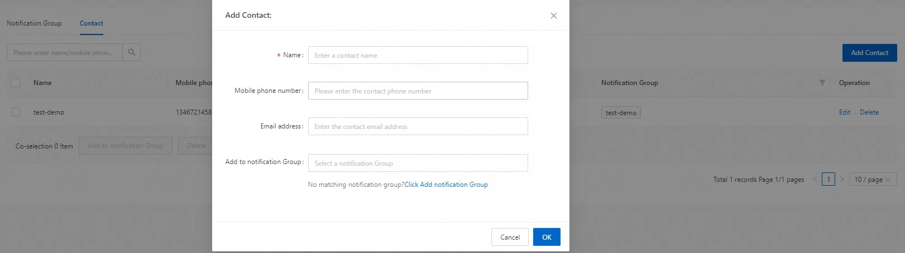

5. On the **Notification Group** tab, click **Add notification Group**. In the **Add Notification Group** dialog box, specify the parameters related to DingTalk notifications, WeChat notifications, or webhook, and click **OK**.

   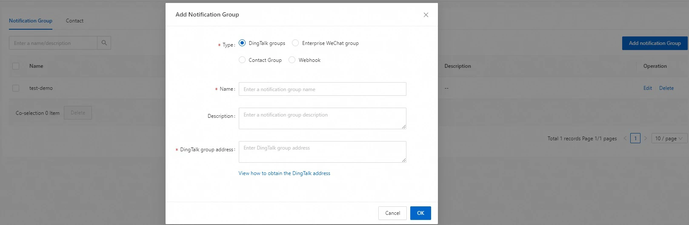

> **Note**
>
> - You must specify at least one of the following notification methods: phone number, email, and DingTalk chatbot. Each phone number or email address can be bound to only one contact.
>
> - You can add up to 100 contacts.
>
> - For more information about how to obtain the webhook URL of a DingTalk chatbot, see Obtain the webhook URL of a DingTalk chatbot.

**What to do next**

After you create contacts and contact groups, you can query, modify, and delete contacts or contact groups on the corresponding tab and add multiple contacts to a contact group at a time.

- Modify a contact or contact group: Click **Edit** in the **Operation** column of the contact or contact group, modify the information in the dialog box that appears, and click **OK**.

- Delete contacts or contact groups:

  - Delete a contact or contact group: Click **Delete** in the **Operation** column of the contact or contact group. In the message that appears, click **OK**.

  - Delete multiple contacts or contact groups: Select the contacts or contact groups and click **Delete** below the list. In the message that appears, click **OK**.

- Add multiple contacts to a contact group: Select the contacts, click Add to notification Group, select a contact group in the dialog box that appears, and click **OK**.

<a id="section-5-5"></a>

## 5.5. Obtain the webhook URL of a DingTalk chatbot

This topic describes how to obtain the webhook URL of a DingTalk chatbot. You can add the webhook URL of a DingTalk chatbot to automatically push alert notifications to the specified DingTalk group when an alert rule is triggered.

**Procedure**

1. Run the DingTalk client on a computer, go to the DingTalk group to which you want to add a chatbot, and then click the **Group Settings** icon in the upper-right corner.

2. In the **Group Settings** panel, click **Group Assistant**.

3. In the **Group Assistant** panel, click **Add Robot**.

4. In the **ChatBot** dialog box, click the

   icon in the **Add Robot** section. Then, click

   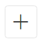

   **Custom**.

   > **Note**
   >
   > For the first time you add a DingTalk chatbot, you can directly select **Custom** in the **ChatBot** dialog box.

   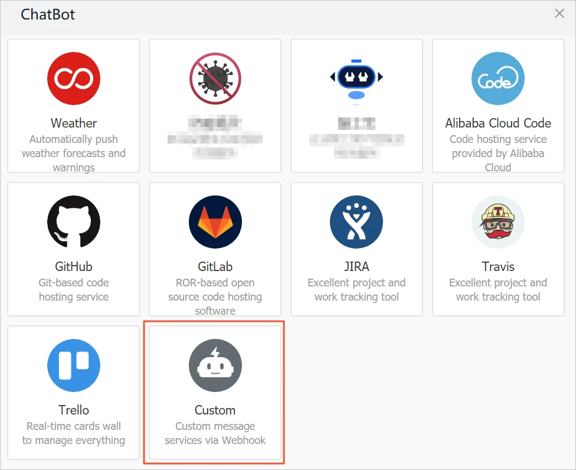

5. In the **Robot details** dialog box, click **Add**.

6. In the **Add Robot** dialog box, edit the profile picture, enter a chatbot name, and then select at least one of the options in the **Security Settings** section. Read the DingTalk Custom Robot Service Terms of Service and select **I have read and accepted DingTalk Custom Robot Service Terms of Service**. Then, click **Finished**.

   > **Important**
   >
   > You must select **Custom Keywords** in the **Security Settings** section, and set at least **Alarm** and **Dispatch** as keywords. Otherwise, you cannot receive alert notifications.

   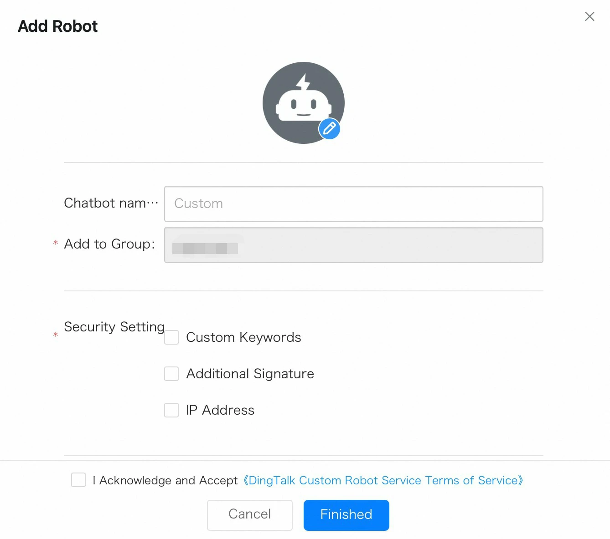

7. In the **Add Robot** dialog box, copy the webhook URL that the system generates for the chatbot and click **Finished**.

<a id="section-5-6"></a>

## 5.6. Create a contact group that uses a webhook URL

After you create a contact group that uses a webhook URL, alert notifications are pushed to the webhook URL by using the specified notification method. Managed Service for Prometheus can send alert notifications to Lark, WeChat, and DingTalk groups through webhook URLs. In this topic, Lark is used as an example to describe how to create a contact group that uses a webhook URL.

**Step 1: Generate a webhook URL**

1. Open and log in to Lark.

2. Click the **+** icon, and then click **Add Group** to create a Lark group to receive alert notifications.

3. Click the Settings icon and then click the **Bots** tab.

4. On the **Bots** tab, click **Add Bot**.

   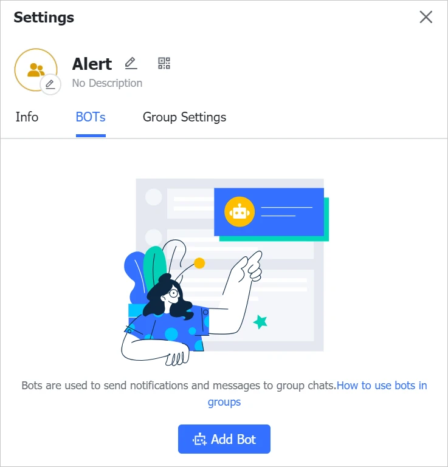

5. In the **Add Bot** dialog box, click Add in the **Custom Bot** section.

   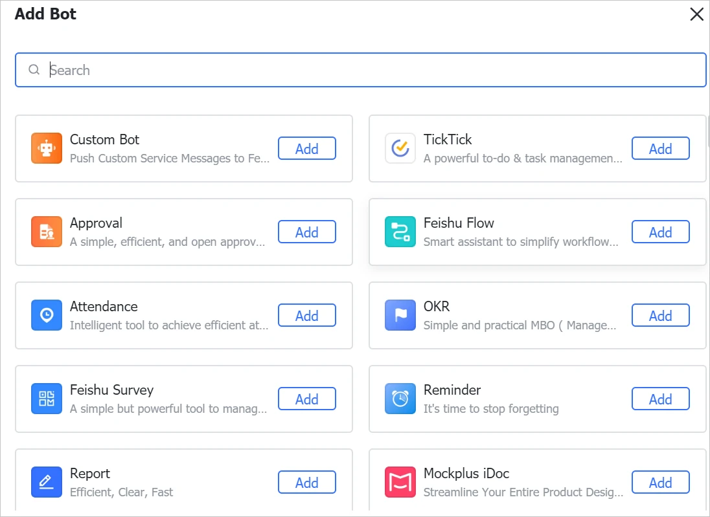

6. Configure the **Bot name** and **Description** parameters and click **Add**.

   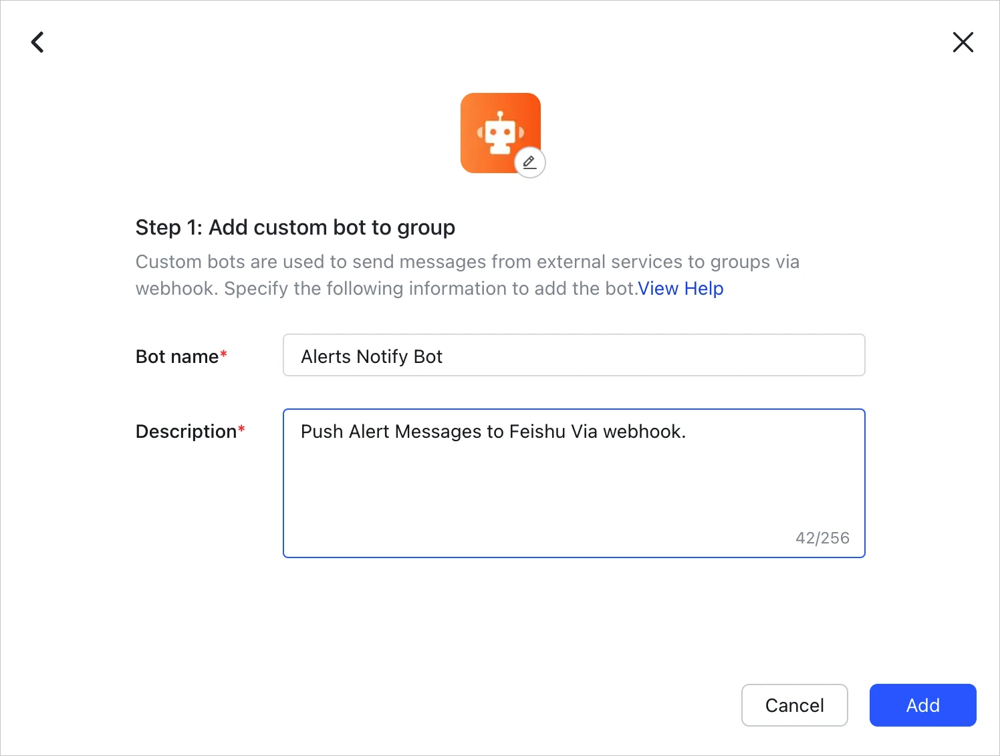

7. Click **Copy** to copy the value of the **Webhook URL** parameter, and then click **Finish**.

   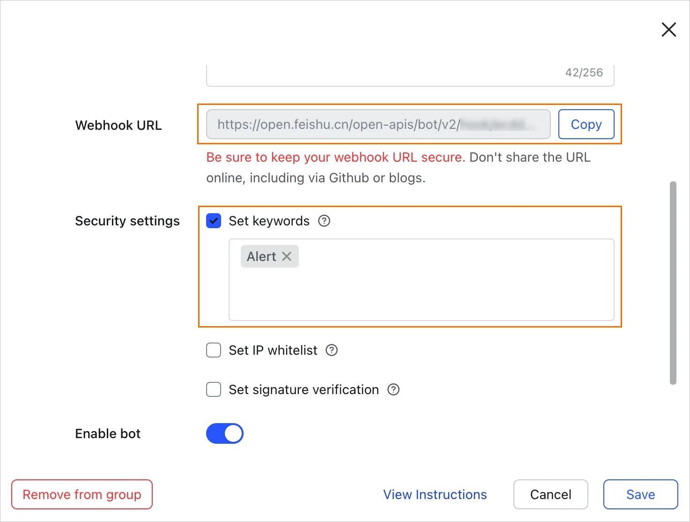

**Step 2: Create a contact group that uses the webhook URL**

1. Log in to the **Prometheus V2.0** console.

2. In the left-side navigation pane, choose **Alarm Management > Notification Settings**.

3. On the **Notification Group** tab, click **Add notification Group**. In the dialog box that appears, select **Webhook**.

   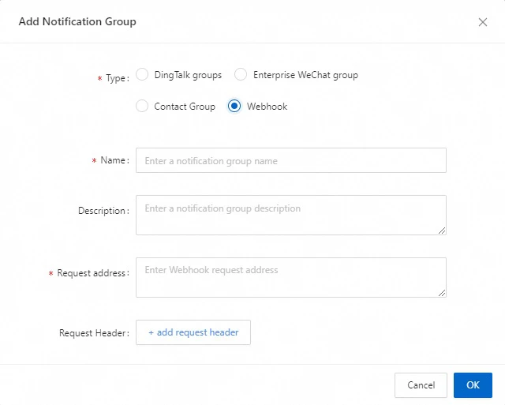

   The following table describes the parameters.

   | Parameter | Description |
   | --- | --- |
   | Name | The custom webhook name. This parameter is required. |
   | Request address | Enter the webhook URL and specify the request method. This parameter is required. The URL must not exceed 100 characters in length.<br>In this example, the <strong>POST</strong> method is used and the webhook URL generated in Step 1 is entered. |

4. Click **OK**.

<a id="section-6"></a>

# 6.Product Interaction

<a id="section-6-1"></a>

## 6.1. Use Managed Service for Prometheus to monitor ACK clusters and view metrics in a dashboard

Managed Service for Prometheus allows you to use a Grafana dashboard to display monitoring data. You can create a custom Grafana dashboard or import a Grafana dashboard from the official website of Grafana to Managed Service for Prometheus. This topic describes how to customize a Grafana dashboard to display monitoring data. In this example, Container Service for Kubernetes (ACK) and Container Registry are monitored.

**Prerequisites**

An ACK cluster is connected to Managed Service for Prometheus. For more information, see the **ACK clusters** topic.

**Step 1: Create a Prometheus instance**

Perform the following steps to create a Prometheus instance:

1. Log in to the Prometheus V2.0 console.

2. In the left-side navigation pane, choose **Prometheus Instances** > **Instance List**. Then, click **Create a Prometheus instance**.

3. You can create a Prometheus instance for container service or a general Prometheus instance. For more information, see Overview<strong>.</strong>

4. After the instance is created, go to the **Container observable > Cluster List** page and click the name of the cluster to view the cluster dashboard.

**Step 2: View the cluster dashboard**

By default, Managed Service for Prometheus displays the information about the CPU, memory, and network resources. Procedure:

1. Log in to the Prometheus V2.0 console.

2. In the left-side navigation pane, click **Access Management** and click the name of the environment in the **Environment Name/ID** column.

3. On the environment page, click the **Self-Monitoring** tab and click **Monitoring** on the left to view the monitoring data.

<a id="section-6-2"></a>

## 6.2. Use ServiceMonitors to discover and monitor Services

Managed Service for Prometheus allows you to create ServiceMonitors based on custom resource definitions (CRDs) to specify the Services that need to be discovered and monitored. When you create a ServiceMonitor, you can define the namespaces of pods to be discovered and set the  `matchLabel`  parameter to specify the Services to be monitored. This topic describes how to create a ServiceMonitor based on the Spring Boot framework to discover and monitor Services.

**Demo**

You can download the demo to try the features of ServiceMonitors.

**Step 1: Add dependencies**

1. Create a Maven project and add the following dependencies to the pom.xml file:

   ```xml
   <dependencies>
           <dependency>
               <groupId>org.springframework.boot</groupId>
               <artifactId>spring-boot-starter-actuator</artifactId>
           </dependency>
           <dependency>
               <groupId>org.springframework.boot</groupId>
               <artifactId>spring-boot-starter-web</artifactId>
           </dependency>
           <dependency>
               <groupId>io.micrometer</groupId>
               <artifactId>micrometer-registry-prometheus</artifactId>
               <version>1.6.6</version>
           </dependency>

           <dependency>
               <groupId>org.springframework.boot</groupId>
               <artifactId>spring-boot-configuration-processor</artifactId>
               <optional>true</optional>
           </dependency>
           <dependency>
               <groupId>org.projectlombok</groupId>
               <artifactId>lombok</artifactId>
               <optional>true</optional>
           </dependency>
           <dependency>
               <groupId>org.springframework.boot</groupId>
               <artifactId>spring-boot-starter-test</artifactId>
               <scope>test</scope>
           </dependency>
       </dependencies>
   ```

2. Add the following configuration to the src/resources/applications.properties file of the project:

   ```text
   management.endpoints.web.exposure.include=prometheus
   ```

3. Start the project and visit  `http://{host}:{port}/actuator/prometheus`  by using a browser.

   The information about Java Virtual Machine (JVM) monitoring is returned, as shown in the following figure.

   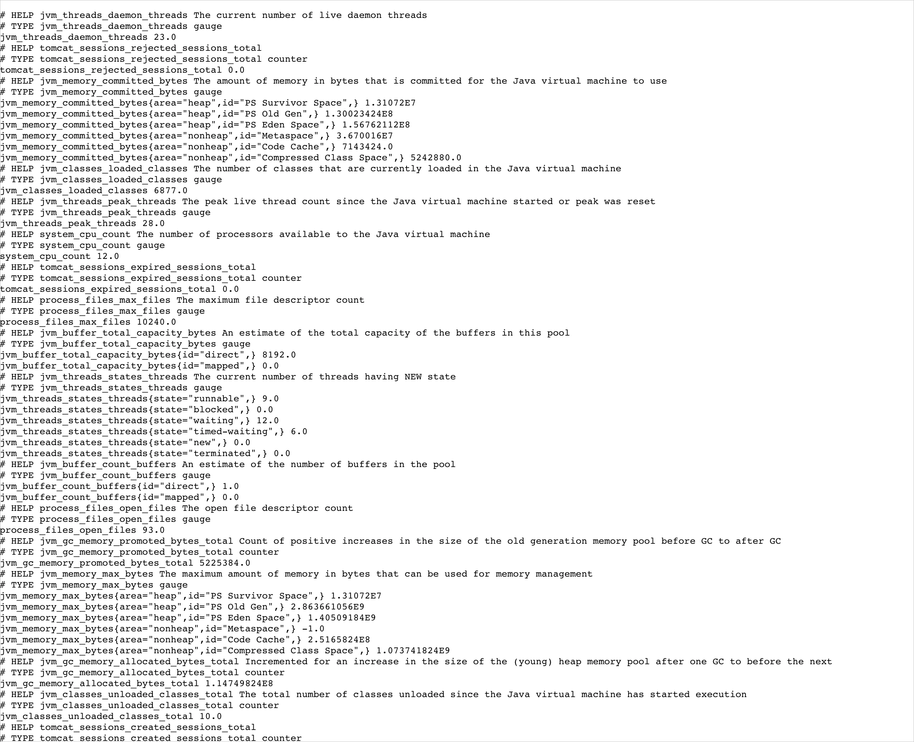

**Step 2: Deploy a Kubernetes cluster**

1. Build an image and upload the Dockerfile of the image to the image repository.

2. Create a Deployment based on the following sample code:

   ```yaml
   apiVersion: apps/v1
   kind: Deployment
   metadata:
     name: micrometer-prometheus
     namespace: default
     labels:
       app: demo-prometheus
   spec:
     replicas: 3
     selector:
       matchLabels:
         app: demo-prometheus
     template:
       metadata:
         labels:
           app: demo-prometheus
       spec:
         containers:
           - name: micrometer-prometheus
             image: manjusakalza/micrometer-prometheus:latest
             ports:
               - containerPort: 8080
   ```

3. Create a Service based on the following sample code:

   ```yaml
   apiVersion: v1
   kind: Service
   metadata:
     name: prometheus-metrics-demo
     namespace: default
     labels:
       micrometer-prometheus-discovery: 'true'
   spec:
     selector:
       app: demo-prometheus
     ports:
       - protocol: TCP
         port: 8080
         targetPort: 8080
         name: metrics
   ```

**Step 3: Create a ServiceMonitor**

The following sample YAML file is used to create a ServiceMonitor:

```yaml
apiVersion: monitoring.coreos.com/v1
kind: ServiceMonitor
metadata:
  name: micrometer-demo
  namespace: default
spec:
  endpoints:
    - interval: 15s
      path: /actuator/prometheus
      port: metrics
  namespaceSelector:
    any: true
  selector:
    matchLabels:
      micrometer-prometheus-discovery: 'true'
      app: tomcat
```

The sample YAML file contains the following parameters:

- The  `name`  and  `namespace`  parameters in  `metadata`  specify the key metadata required by the ServiceMonitor.

- The  `endpoints`  parameter in  `spec`  specifies the endpoints that Managed Service for Prometheus uses to collect metrics. The value of the  `endpoints`  parameter is an array. Each element in the array is an endpoint. You can specify multiple  `endpoints` . Each  `endpoint`  contains the following parameters:

  - `interval` : the intervals at which Managed Service for Prometheus collects metrics by using the current  `endpoint` . Unit: seconds. In this example, Managed Service for Prometheus collects metrics at intervals of 15 seconds ( `15s` ).

  - `path` : the path that stores the metric data collected by Managed Service for Prometheus. In this example, the path is set to  `/actuator/prometheus` .

  - `port` : the port that is used to collect metrics. Set this parameter to the value of the  `name`  parameter specified for the Service that you created in Step 2. In this example, the port is set to  `metrics` .

- The  `namespaceSelector`  parameter in  `spec`  specifies the namespaces of Services to be discovered. The  `namespaceSelector`  section contains the following two mutually exclusive parameters:

  - `any` : The value of this parameter is fixed as  `true` . If this parameter is specified, all Services that meet the filter conditions specified in the selector section are monitored.

  - `matchNames` : an array that specifies the  `namespaces`  of the Services to be monitored. For example, if you want to monitor only the Services in the default and arms-prom namespaces, use the following  `matchNames`  settings:

    ```text
    namespaceSelector:
      matchNames:
      - default
      - arms-prom
    ```

- The  `selector`  section in  `spec`  specifies the conditions used to filter Services. For more information, see labelselector-v1-meta.

  In this example, the label of the Service that you created is micrometer-prometheus-discovery: 'true'. Therefore, the following  `selector`  settings are used:

  ```text
  selector:
    matchLabels:
      micrometer-prometheus-discovery: 'true'
  ```

Managed Service for Prometheus allows you to create a ServiceMonitor by using the following two methods.

**Use the console to create a ServiceMonitor**

1. Log on to the **Prometheus V2.0** console.

2. In the left-side navigation pane, click **Access Management**. On the page that appears, click the name of the environment that you want to manage.

3. On the page that appears, click **Service Monitor**. In the upper-right corner of the page, click **Create**.

4. In the panel that appears, click the **YAML** tab, enter the code in the YAML file, and then click **Create**.

**Use the CLI to create a ServiceMonitor**

1. Save the YAML file to your computer.

2. Run the following command to apply the YAML file:

   ```bash
   kubectl apply -f {Path of the YAML file}
   ```

**Step 4: Verify the ServiceMonitor**

Perform the following operations to check whether Managed Service for Prometheus can discover Services:

1. Log on to the **Prometheus V2.0** console.

2. In the left-side navigation pane, click **Access Management**. On the page that appears, click the name of the environment that you want to manage.

3. Click the **Self-Monitoring** tab. On the **Targets** page, check whether a Service whose name is in the {namespace}/{serviceMonitorName}/x format exists.

   

4. Click the Show icon to the left of the Service name. Then, click the link in the Endpoint column of the table below the Service name.

   Check whether the metrics are collected as expected.

   

<a id="section-6-3"></a>

## 6.3. Use Managed Service for Prometheus to monitor PVs

This topic describes how to use Managed Service for Prometheus to monitor persistent volumes (PVs).

**Procedure**

1. Log in to the Container Service for Kubernetes (ACK) console.

   <ol type="i">

   <li>

   Enter the URL of the Apsara Uni-manager Management Console in the address bar and press the Enter key.

   </li>

   <li>

   On the login page, enter your username and password.

   </li>

   </ol>

   You can obtain the username and password that are used to log in to the Apsara Uni-manager Management Console from the operations administrator.

   > **Note**
   >
   > - **First login**
   >
   >   The first time that you log on to the Apsara Uni-manager Management Console, you need to change the password of your account. The password must be 10 to 32 characters in length. It must contain all of the following character types: uppercase letters, lowercase letters, digits, and special characters. Supported special characters include: ! @ # $ %
   >
   > - **Forgotten password**
   >
   >   If you have forgotten your password, click Forgot Password. On the page that appears, enter the username of your account, the email address that was used to create the account, and the CAPTCHA code. Then, the system sends a link for resetting the password to the specified email address.

   <ol type="i" start="3">

   <li>

   Click **Log In**.

   </li>

   <li>

   In the top navigation bar, choose **Products > Computing > Container Service for Kubernetes**.

   </li>

   <li>

   On the **Container Service** page, click the switch account icon on the floating button, select an organization and region, and then click **Access With Authorized Role** or **Access As Administrator** to access the ACK console.

   </li>

   </ol>

2. Click the name of a cluster and create a persistent volume claim (PVC). After the PVC is created, it enters the **Bound** state. For more information, see **Container Service for Kubernetes > User Guide > Kubernetes clusters > Storage > Mount disk volumes**.

   

3. Create a Deployment to mount the PVC. For more information, see **Container Service for Kubernetes > User Guide > Kubernetes clusters > Applications > Workloads > Create a stateless application by using a Deployment**.

   

4. After the pod runs for a period of time, log in to the Prometheus V2.0 console and view the node_volume_write_bytes_total metric in a custom dashboard.

   <ol type="i">

   <li>

   Log in to the **Apsara Uni-manager Management Console**. In the left-side navigation pane, choose **Products > Middleware > Prometheus V2.0**.

   

   </li>

   <li>

   In the left-side navigation pane, click **Custom Dashboards**. Then, click the

   icon

   </li>

   </ol>

   next to the search box and click **Create a dashboard**.

   <ol type="i" start="3">

   <li>

   Create a dashboard and add charts as shown in the following figure.

   </li>

   </ol>

   

**Metrics supported by Managed Service for Prometheus**

| No. | Metric | Description |
| --- | --- | --- |
| 1 | node_volume_capacity_bytes_available | The available space of the current volume in bytes. This metric indicates the remaining space of a volume. |
| 2 | node_volume_capacity_bytes_t otal | The capacity of the volume in bytes. You can compare this metric with the node_volume_capacity_bytes_available metric to calculate the used space and the volume usage. |
| 3 | node_volume_capacity_bytes_used | The used space of the current volume in bytes. You can compare this metric with the node_volume_capacity_bytes_total and node_volume_capacity_bytes_available metrics to confirm the space usage. |
| 4 | node_volume_inodes_available | The number of available inodes in the volume. Inode is a data structure used in UNIX and Linux file systems. Inodes are used to store file and directory metadata, such as file types, permissions, and owners. |
| 5 | node_volume_inodes_total | The total number of inodes in the volume. This metric indicates the maximum number of files that can be stored in the volume. |
| 6 | node_volume_inodes_used | The number of used inodes in the current volume. This metric indicates the number of files that are stored in the volume. |
| 7 | node_volume_io_now | The number of ongoing I/O operations at the current time.This metric is typically used for real-time monitoring to display the ongoing I/O operations within a short period of time. |
| 8 | node_volume_io_time_seconds _total | The total amount of time used to perform all I/O operations on the volume in seconds. This metric is used to assess the performance of a volume to help you identify performance bottlenecks. |
| 9 | node_volume_read_bytes_total | The total number of bytes read from the volume since the volume was mounted. This metric indicates the throughput of read operations. |
| 10 | node_volume_read_completed _total | The total number of read operations that have been completed since the volume was mounted. This metric indicates the number of read requests to help you analyze the loads. |
| 11 | node_volume_read_merged_tot al | The total number of merged read operations since the volume was mounted. In heavy-load scenarios, multiple read requests are merged into one request to improve the efficiency. |
| 12 | node_volume_read_time_millis econds_total | The total amount of time used to perform read operations since the volume was mounted in milliseconds. This metric can be used to assess the read performance. |
| 13 | node_volume_write_bytes_total | The total number of bytes written to the volume since the volume was mounted. This metric indicates the throughput of write operations. |
| 14 | node_volume_write_completed _total | The total number of write operations that have been completed since the volume was mounted. This metric indicates the number of write requests to help you analyze the loads. |
| 15 | node_volume_write_merged_to tal | The total number of merged write operations since the volume was mounted, which is similar to the merging of read requests to reduce the overheads of I/O operations. |
| 16 | node_volume_write_time_millis econds_total | The total amount of time used to perform write operations since the volume was mounted in milliseconds. This metric can be used to assess the write performance. |

<a id="section-7"></a>

# 7.References

<a id="section-7-1"></a>

## 7.1. Helm commands

Managed Service for Prometheus allows you to manage Container Service for Kubernetes (ACK) clusters by using Helm Operator. This topic introduces the Helm commands used when you install Helm Operator in ACK clusters.

The following sample command is used to install Helm Operator in an ACK cluster:

```bash
helm install --name arms-prom-operator arms-prom-operator-0.1.2.tgz \
  --version 0.1.4 \
  --namespace arms-prom \
  --set controller.clusterId=123 \
  --set controller.regionId=cn-qingdao-env66-d01 \
  --set controller.userId=456
```

| Parameter | Description |
| --- | --- |
| version | The Helm version. |
| namespace | The namespace of Helm. |
| controller.clusterId | The ID of the ACK cluster. |
| controller.userId | The user ID. |
| controller.regionId | The ID of the region in which the ACK cluster resides. |

<a id="section-7-2"></a>

## 7.2. Introduction to built-in dashboards

Managed Service for Prometheus provides a variety of out-of-the-box built-in Grafana dashboards. You can view Prometheus metrics on these dashboards, and modify the dashboard settings such as the time range and refresh frequency to meet your business requirements. This topic describes the Kubernetes overview, Kubernetes deployment, Kubernetes pods, and host details dashboards. This topic also describes basic Grafana operations.

**Kubernetes overview**


The dashboard displays the following metrics:

- Overall usage metrics such as Cluster CPU usage, Cluster memory usage, and Cluster filesystem usage.

- CPU metrics such as Pods CPU usage and All processes CPU usage.

- Memory metrics such as Pods memory usage and All processes memory usage.

- Network metrics such as Network I/O pressure, Pods network I/O, and All processes network I/O.

**Kubernetes deployment**


The dashboard displays the following metrics:

- Overview: Pod Number, spec_replicas, Pod CPU Usage Secs, Pod Mem Used, and restarts_total.

- Details: Pods CPU usage, Pods memory usage, Network I/O pressure, and fs writes/reads.

**Kubernetes pods**


The dashboard displays the following metrics:

- Pod information such as Pod IP Address, Pod Status, Pod Container, and Container restarts.

- Overall usage metrics such as Pod CPU usage and Pod memory usage.

- CPU metrics such as Pods CPU usage and All processes CPU usage.

- Memory metrics such as Pods memory usage and All processes memory usage.

- Network metrics such as Network I/O pressure, Pods network I/O, and All processes network I/O.

**Host details**


The dashboard displays the following metrics:

- CPU metrics such as CPU Cores, CPU Usage, and CPU I/O Waiting Time.

- Memory metrics such as Total Memory and Memory Usage.

- Disk metrics such as Total Disk Space, Disk I/O Read/Write Time, and Disk Read/Write Rate.

- Network metrics such as Network Traffic and TCP Connections.

**Basic Grafana operations**

> **Note**
>
> This section describes only basic Grafana operations. For more information about advanced operations, see Grafana documentation.

You can perform the following basic operations on Grafana dashboards.

**Set the time range and refresh frequency**

1. In the upper-right corner of the Grafana page, click the drop-down list to select a time range.

   

2. Select a predefined relative time range from the drop-down list. For example, you can select Last 5 minutes, Last 12 hours, or Last 30 days. You can also set the start time and end time to define an absolute time range.

   

   

3. In the upper-right corner of the Grafana page, click the

   icon to refresh the monitoring

   data on all panels on the current dashboard.

   

**Filter monitoring data**

On the Grafana page, select a filter condition from the drop-down list to filter the monitoring data that is displayed on the current dashboard, as shown in the following figure.


<a id="section-8"></a>

# 8.Permission management

<a id="section-8-1"></a>

## 8.1. Create a role and grant permissions to the role

You can create a role in the Apsara Uni-manager Management Console and attach a Resource Access Management (RAM) policy to the role to enforce fine-grained permission management. This topic describes how to create a role, assign the role to a user group, and attach a RAM policy to the role.

**Prerequisites**

- The URL of the console that is obtained from the deployment personnel.

- A supported browser is used. We recommend that you use Google Chrome.

**Create a role**

1. Enter the URL of the Apsara Uni-manager Management Console in the address bar and press the Enter key.

2. On the login page, enter your username and password.

   You can obtain the username and password that are used to log in to the Apsara Uni-manager Management Console from the operations administrator.

   > **Note**
   >
   > - **First login**
   >
   >   The first time that you log on to the Apsara Uni-manager Management Console, you need to change the password of your account. The password must be 10 to 32 characters in length. It must contain all of the following character types: uppercase letters, lowercase letters, digits, and special characters. Supported special characters include: ! @ # $ %
   >
   > - **Forgotten password**
   >
   >   If you have forgotten your password, click Forgot Password. On the page that appears, enter the username of your account, the email address that was used to create the account, and the CAPTCHA code. Then, the system sends a link for resetting the password to the specified email address.

3. Click **Log In**.

4. In the top navigation bar, click **Enterprise**.

5. In the left-side navigation pane, choose **Permissions > Role Permissions**. Then, click **Create Custom Role** on the page.

6. On the **Create Role** page, click **Advanced Settings** in the lower part and click **Create RAM Role & Attach Policy**.

7. In the **Basic Configurations** step, configure parameters and click **Next**.

   | Parameter | Description |
   | --- | --- |
   | Role Name | The name of the custom role. |
   | Description | The description of the custom role. This parameter is optional. |
   | Sharing Scope | The scope in which the custom role is available. You can select only <strong>Global</strong> when you are an operations administrator.<br>• Global: The role is shared by all organizations.<br>• Current Organization: The role is shared within the current organization.<br>• Subordinate Organization: The role is shared by the current organization and its subordinate organizations. |

8. In the **Configure Custom Policy** step, select policies and click **Next**.

   If none of the listed policies meets your requirements, you can click **Create Policy** in the upper-right corner of the Select Policy section to create one. You can click **Policy Content** in the **Actions** column of a policy to view JSON-formatted policy content.

   

9. In the **Configure Trust Policy** step, configure the **Trust Organization** and **Trust Cloud Service** parameters and click **Next**.

   A trust policy is used to define the entities that can assume this RAM role. For example, you can specify level-1 organizations (tenant accounts) and Apsara Stack services to assume this RAM role.

   > **Note**
   >
   > If you enable the Open ID Connect (OIDC) feature, you can also authorize an OIDC provider to assume the RAM role and configure the Limits parameter.

   - **Trust Organization**: Specify one or more level-1 organizations (tenant accounts) to assume this RAM role.

   - **Trust Cloud Service**: Specify one or more Apsara Stack services to assume this RAM role.

0. In the **Preview Policy** step, check the selected policies and the trust policy and click **Create**.

1. In the role list, find the RAM role template you created and click the role name in the **Role Name/ID** column to go to the details page.

2. On the page that appears, click the **RAM Role** tab, click **Create**, and then select a level-1 organization to create a RAM role instance.

   

3. After the RAM role instance is generated, the trust entities in the trust policy can assume this RAM role to access and manage the corresponding resources.

   

<a id="section-8-2"></a>

## 8.2. Create users and user groups

You can create users and assign different roles to the users in the Apsara Uni-manager Management Console to regulate access control.

**Prerequisites**

- The URL of the console that is obtained from the deployment personnel.

- A supported browser is used. We recommend that you use Google Chrome.

**Create an organization**

You must create an organization before you can create a user or user group.

1. Enter the URL of the Apsara Uni-manager Management Console in the address bar and press the Enter key.

2. On the login page, enter your username and password.

   You can obtain the username and password that are used to log in to the Apsara Uni-manager Management Console from the operations administrator.

   > **Note**
   >
   > - **First login**
   >
   >   The first time that you log on to the Apsara Uni-manager Management Console, you need to change the password of your account. The password must be 10 to 32 characters in length. It must contain all of the following character types: uppercase letters, lowercase letters, digits, and special characters. Supported special characters include: ! @ # $ %
   >
   > - **Forgotten password**
   >
   >   If you have forgotten your password, click Forgot Password. On the page that appears, enter the username of your account, the email address that was used to create the account, and the CAPTCHA code. Then, the system sends a link for resetting the password to the specified email address.

3. Click **Log In**.

4. In the top menu bar, click **Enterprise**.

5. In the left-side navigation pane, choose **Resources > Organizations**.

6. On the **Organizations** page, select **root** in the tree on the left and click **Create Organization** on the right.

7. In the **Add Organization** dialog box, configure the parameters that are described in the following table.

   | Parameter | Description |
   | --- | --- |
   | Name | The name of the organization. The name must be 2 to 128 characters in length and cannot start or end with a space.<br>Note<br>The organization name must be unique in the organizational structure. |
   | Description | The description of the organization. |
   | Associate Third-party Authenticatio n | If no global identity provider (IdP) is configured in the resource pool, you can select <strong>Set Now</strong> or <strong>Set Later</strong>.<br>• If you select <strong>Set Now</strong>, you must select a local IdP name from the <strong>IdP Name</strong> drop-down list. You can associate only one IdP with the organization.<br>• If you select <strong>Set Later</strong>, third-party authentication is not associated.<br>Important<br>• The <strong>Associate Third-party Authentication</strong> parameter is displayed only when you create a level-1 organization.<br>• If a global IdP has been configured in the resource pool, third-party authentication cannot be associated with level-1 organizations. In this case, <strong>Set Now</strong> and <strong>Set Later</strong> are dimmed. |

8. Click **OK**.

**Create a user group**

A role cannot be directly assigned to a user. You can assign a role to a user group. Then, users in the user group can obtain the permissions of the role.

1. In the left-side navigation pane, choose **Users > User Groups**.

2. On the **User Groups** page, click **Create User Group**.

3. In the **Create User Group** dialog box, specify **User Group Name**, **Organization**, and **Role Authorization**, and click **OK**.

   

   | Parameter | Description |
   | --- | --- |
   | User Group Name | The name of the user group. The name must be 3 to 255 characters in length, and can contain letters, digits, underscores (_), hyphens (-<br><br>), periods (.), and at signs (@). Example: <code>EDAS_group</code>. |
   | Organization | Select an organization from the drop-down list. |
   | Role Authorization | Select the role to be assigned to the users in the user group. For more information about how to create a role, see <strong>Create a role</strong>. |

**Create a user**

Perform the following steps to create a user.

1. In the left-side navigation pane, choose **Users > Users**.

2. On the **Users** page, click **Create User**.

3. In the **Create User** dialog box, specify the basic user information and click **OK**.

   

   | Parameter | Description |
   | --- | --- |
   | User Name | The Apsara Stack account name of the user. The name must be 1 to 64 characters in length, and can contain letters, digits, hyphens (-), underscores (_), periods (.), and at signs (@). The name must start with a letter or a digit. |
   | Display Name | The display name of the user. The name must be 1 to 128 characters in length, and can contain letters, digits, hyphens (-), underscores (_), periods (.), and at signs (@). |
   | Role | You must select <strong>Resource User</strong>. Otherwise, you will be prompted that you have no permissions when you attempt to log in to the Apsara Uni-manager Management Console. |
   | Organization | The organization to which the user belongs. |
   | Login Policy | Use the default policy. |
   | Phone | The phone number of the user. The phone number is used to notify users of resource requests and usage. Make sure that the phone number is valid.<br>Note<br>If the phone number of the user changes, update it in a timely manner. |
   | Landline | The landline number of the user. The landline number must be 4 to 20 characters in length and can contain only digits and hyphens (-). |
   | Email | The email address of the user. If you want to send emails about the resource requests and usage to the email address, make sure that the specified email address is valid.<br>Note<br>If the email address changes, update it in a timely manner. |
   | DingTalk Key | The key of the DingTalk chatbot. |
   | Notify User by Email | After this option is selected, the Apsara Uni-manager Management Console informs the alert contact by email whenever an alert is generated.<br>Note<br>You must configure an email server if you enable notification by email. For more information, contact the on-site O&amp;M engineers. |
   | Notify User by DingTalk | After this option is selected, the Apsara Uni-manager Management Console informs the alert contact by DingTalk message whenever an alert is generated. |

   > **Note**
   >
   > Keep the AccessKey pair and initial password of the user confidential.

**Add the user to the user group**

After you add the user to the user group, the user is granted permissions provided by the role assigned to the user group.

1. In the left-side navigation pane, choose **Users > User Groups**.

2. On the **User Groups** page, select a user and click **Add User** in the **Actions** column.

3. In the **Add User** dialog box, select the user in the organization, click the  icon to move

   the user to the list on the right, and then click **OK**.

   

<a id="section-8-3"></a>

## 8.3. RAM policies

This topic describes the Resource Access Management (RAM) policies that can be attached to RAM users to grant permissions related to Managed Service for Prometheus.

**Policy syntax**

```json
{
  "Version": "1",
  "Statement": [
    {
      "Action": [
        "prometheus:ProcessCluster"
      ],
      "Resource": "acs:prometheus:*:*:prometheus/A Container Service for Kubernetes (AC
K) cluster name matching expression.",
      "Effect": "Allow"
    }
  ]
}
```

- Action: The value is fixed to  `prometheus:ProcessCluster` , which grants the specified RAM user permissions to manage the matching ACK clusters.

- Resource: Specify this parameter based on the resource naming rule of RAM. Currently, the value is set to  `acs:prometheus:::prometheus/ACK cluster name matching expression` . You can replace "ACK cluster name matching expression" with a wildcard character (\*).

- Effect: Specify an effect based on the RAM rule. This parameter is usually set to  `Allow` .

**Sample policy**

In the following example, the RAM user is granted permissions to manage ACK clusters whose names start with  `prom` .

```json
{
  "Version": "1",
  "Statement": [
    {
      "Action": [
        "prometheus:ProcessCluster"
      ],
      "Resource": "acs:prometheus:*:*:prometheus/prom*",
      "Effect": "Allow"
    }
  ]
}
```

<a id="section-8-4"></a>

## 8.4. RAM user authentication

Resource Access Management (RAM) users can only view the Prometheus monitoring data of clusters to which they are authorized to access. RAM users cannot create Prometheus instances.

**View all clusters with an Alibaba Cloud account**

After you log in to the Prometheus V2.0 console with an Alibaba Cloud account, you can view all Container Service for Kubernetes (ACK) clusters on the Cluster List page.

**View clusters as a RAM user**

After you use an Alibaba Cloud account to attach a RAM policy to a RAM user to grant permissions on ACK clusters, log in to the Prometheus V2.0 console as a RAM user. On the Cluster List page, you can view only ACK clusters that the RAM user is authorized to access, as shown in the following figure. The RAM user can view only ACK clusters that match the  `prom*`  rule. The RAM user has only permissions granted by the Alibaba Cloud account. For more information about how to attach a RAM policy to a RAM user, see Create and assign a role and RAM policies.

<a id="section-8-5"></a>

## 8.5. User roles and permissions

This topic describes roles and their permissions.


**Cloud**

**User**

**Resource**

**Resource**

Monitoring & Alerting

**Management**

Management

**User**

**Management**


**Resource Set**

**User**

**Administrator**

**Cloud**

**Resource**

**Management**

**Resource**

**Set**

**Management**

**Management**

Monitoring & Alerting

Review


**Organization Administrator**

Management

Quota  Management

and Alerts

**Resource**

**Organization**

**Routine**

**User**

**Set**

**Management**

**Management**

**Management**

**Management**


**Operations**

**Administrator**

Management

Management

Statistics

**Operations**

**Platform**

**User**

**Management**

**Management**

**Management**


**Security Auditor**

**Bill Audit**

**Resource**

**Business**

**Audit**

**Audit**

Table 1. Roles and permissions

| Role | Permission |
| --- | --- |
| Resource user | This role has permissions to view and modify resources in a resource set and create alert rules. |
| Resource set administrator | This role has permissions to create, modify, and delete resources in a resource set and manage the users of the resource set. |
| Organization administrator | This role has permissions to manage an organization and its subordinate organizations, create, modify, and delete the resources of organizations, create and view alert rules for resources, and export reports. |
| Operations administrator | This role has the permissions to read and write permissions on all resources. |
| Security auditor | This role performs security audits on the Apsara Uni-manager Management Console and has read-only permissions on the operation logs of the Apsara Uni-manager Management Console. |
| Platform administrator | This role initializes the system and creates operations administrators. |
| Resource auditor | This role has read-only permissions on all resources in the Apsara Uni-manager Management Console. |
| Organization security administrator | This role manages the security of an organization, including the security of hosts, applications, and networks. This role has read-only permissions on the operation logs of the Apsara Uni-manager Management Console and read and write permissions on ApsaraDB RDS, Elastic Compute Service (ECS), and Apsara Stack Security. |
| Security system configuration administrator | This role configures system security features such as the upgrade center and global configurations. This role has read and write permissions on the upgrade, protection, and configuration features of Apsara Stack Security. |
| Global organization security administrator | This role manages the security of global tenants by using Security Operations Center (SOC). This role has read and write permissions on all features of Apsara Stack Security. |
| Platform security administrator | This role manages the security of the Apsara Uni-manager Management Console by using SOC. |
| Global organization security auditor | This role checks the security conditions of all organizations by using SOC. This role has read-only permissions on the operation logs of the Apsara Uni-manager Management Console and all features of Apsara Stack Security. |
| Platform security auditor | This role checks the security conditions of the Apsara Uni-manager Management Console by using SOC. This role has read-only permissions on the operation logs of the Apsara Uni-manager Management Console, Server Guard, Cloud Firewall, Sensitive Data Discovery and Protection, SOC, system configurations, and Web Application Firewall (WAF) configurations. This role also has read and write permissions on Anti-DDoS, Threat Detection, and Update Center of Apsara Stack Security. |
| Platform security configuration administrator | This role configures security services in the Apsara Uni-manager Management Console, such as Server Guard and WAF, and has read and write permissions on these services. |
| Organization resource auditor | This role has read-only permissions on all resources in an organization to which it belongs. |
